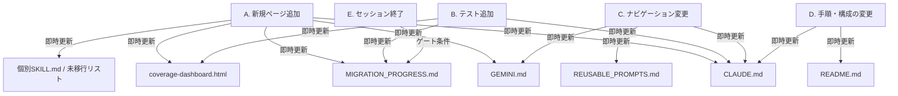

# QA_Studies 仕様書同期スキル

(最終更新日: 2026-11-06)

## Goal

`CLAUDE.md` / `GEMINI.md` / `README.md` / `docs/MIGRATION_PROGRESS.md` / `docs/REUSABLE_PROMPTS.md` / `docs/coverage-dashboard.html` / 各種個別スキル・ルールの全仕様書を、常にプロジェクトの最新状況（実装、テスト、構成）と乖離させず、漏れなく最新に保つ。

---

## 最終更新日（Last Updated）の記載ルール

すべての仕様書および進捗管理ドキュメントには、**更新を行った日付**を必ず明記し、いつ時点の仕様であるかを誰でも判断できるようにしなければなりません。

### 記載フォーマットと場所

各ドキュメントの以下の位置に、最終更新日を記載または更新してください：

| ドキュメント | 最終更新日の記載方法 | 記載・更新場所 |
|---|---|---|
| `CLAUDE.md` | `Updated YYYY-MM-DD` | ファイル冒頭付近 |
| `GEMINI.md` | `Updated YYYY-MM-DD` | ファイル冒頭付近 |
| `README.md` | `最終更新日: YYYY-MM-DD` | ファイル冒頭付近（見出しの直下） |
| `docs/MIGRATION_PROGRESS.md` | `Updated YYYY-MM-DD`（現在地テーブル内） | 現在地テーブル内、または「最終 HEAD」欄 |
| `docs/coverage-dashboard.html` | `<time datetime="YYYY-MM-DD">YYYY-MM-DD</time>` | ヘッダーのメタ情報エリア（`Updated`）およびフッター |
| `docs/REUSABLE_PROMPTS.md` | `最終更新日: YYYY-MM-DD` | ファイル冒頭付近 |
| 各個別 `SKILL.md` / `*.md` | `(最終更新日: YYYY-MM-DD)` または未移行HTMLリスト等の日付 | タイトル下、または進捗管理の日付欄 |

---

## いつ、どのタイミングで、どの仕様書を更新するか

開発中に発生する操作（イベント）と、更新が必要な仕様書の対応関係は以下の通りです。イベント発生後、**直ちに（次のタスクに移る前に）**対象の仕様書をすべて更新しなければなりません。



### イベント別更新マトリクス（チェックリスト）

| 更新対象ドキュメント | A. 新規ページ追加時 | B. テスト追加時 | C. ナビゲーション変更時 | D. 手順・構成変更時 | E. セッション終了時 |
| :--- | :---: | :---: | :---: | :---: | :---: |
| `CLAUDE.md` | **`Update`**<br>(アーキテクチャ追記) | **`Update`**<br>(テスト数更新) | **`Update`**<br>(NavBarパスの同期) | **`Update`**<br>(コマンド更新) | — |
| `GEMINI.md` | **`Update`**<br>(Migrated Pages) | — | **`Update`**<br>(NavBar有無) | — | — |
| `README.md` | — | — | — | **`Update`**<br>(Dockerや定義) | — |
| `MIGRATION_PROGRESS.md` | **`Update`**<br>(移行テーブル) | **`Update`**<br>(テスト数実測) | — | — | **`Update`**<br>(HEAD/ビルド/再開) |
| `coverage-dashboard.html` | **`Update`**<br>(DATA.pages) | **`Update`**<br>(inventory / % / ゲージ) | — | — | — |
| `REUSABLE_PROMPTS.md` | — | — | **`Update`**<br>(NavBar未実装) | — | — |
| 個別 `SKILL.md` / `*.md` | **`Update`**<br>(未移行HTML等) | — | — | — | — |
| **最終更新日の更新** | **必須** | **必須** | **必須** | **必須** | **必須** |

---

## 監査・確認プロセス（「更新漏れがないか確認して」への対応）

ユーザーまたはシステムから「更新漏れがないか確認」の依頼を受けた際、またはセッション終了時には、以下の監査手順を実行し、すべての不整合を解消してください。

### 1. 現在のステータス情報の収集

以下のコマンドを実行し、プロジェクトの「実装・テストの実態値」を取得します。

```bash
# A. 最新の HEAD コミット値の取得
git log --oneline -5
git rev-parse --short HEAD

# B. 現在のNext.jsルート一覧の取得（app/page.tsx とネストしたページを含む）
# ルートグループ (group) と並列ルートのスロット @slot は URL に現れないため除去し、階層数にも数えない。
# インターセプトマーカーは階層として解決する: (.) は同階層、(..) は 1 つ前のセグメントを取り除き（(..)(..) は 2 つ）、(...) はルートへ戻る
# `_` で始まるプライベートフォルダはルーティング対象外のため、配下ごと探索から除外する
# pipefail で find を含むどの段の失敗も検出し、部分的な一覧を出力せずに中止する
if routes=$(set -o pipefail; find app -type d -name '_*' -prune -o -name page.tsx -print | sed -E 's|^app||; s|/page\.tsx$||' | awk -F/ '{
  n = 0
  for (i = 2; i <= NF; i++) {
    s = $i
    if (s ~ /^@/) continue
    while (1) {
      if (substr(s, 1, 5) == "(...)") { n = 0; s = substr(s, 6) }
      else if (substr(s, 1, 4) == "(..)") { if (n > 0) n--; s = substr(s, 5) }
      else if (substr(s, 1, 3) == "(.)") { s = substr(s, 4) }
      else break
    }
    if (s == "" || s ~ /^\(.*\)$/) continue
    seg[++n] = s
  }
  out = ""
  for (j = 1; j <= n; j++) out = out "/" seg[j]
  print (out == "" ? "/" : out)
}' | sort -u); then
  printf '%s\n' "$routes"
else
  echo "❌ ルート一覧の取得に失敗しました。部分的な一覧は使用しません" >&2; false
fi

# C. テストファイル実数の取得 (Bunユニットテスト)
find tests/ -name "*.test.ts" -o -name "*.test.tsx" 2>/dev/null | sort

# D. テスト実行結果の取得（pipefail で bun の終了コードを tail に握りつぶさせず、両方の結果を集約する）
test_rc=0; lint_rc=0
(set -o pipefail; bun test 2>&1 | tail -5) || test_rc=$?
(set -o pipefail; bun run lint 2>&1 | tail -5) || lint_rc=$?
[ "$test_rc" -eq 0 ] && [ "$lint_rc" -eq 0 ]
```

### 2. 監査チェックリスト

収集した実態値と、各仕様書の記述に乖離がないか検証します。

- [ ] **`CLAUDE.md` 監査**
  - [ ] `app/**/page.tsx` および `app/**/*.css` の全配置パスが `CLAUDE.md` の「アーキテクチャ」セクションに正しく記載されているか。
  - [ ] コマンド節のユニットテスト数（`126 specs`等）が現在の実測値と一致しているか。
  - [ ] 最終更新日のタイムスタンプが最新化されているか。
- [ ] **`GEMINI.md` 監査**
  - [ ] `Migrated Pages (Tracking)` に、現在 Next.js 上に存在する全ページ（ホームページ・基礎ガイド・ISTQBガイド）が漏れなく載っているか。
  - [ ] 最終更新日のタイムスタンプが最新化されているか。
- [ ] **`README.md` 監査**
  - [ ] Dockerコマンドや起動手順、機能・非機能テストの定義に変更はないか。
  - [ ] 最終更新日のタイムスタンプが最新化されているか。
- [ ] **`docs/MIGRATION_PROGRESS.md` 監査**
  - [ ] `最新 HEAD` が `git rev-parse --short HEAD` の出力と完全に一致しているか。
  - [ ] `ビルド状態` の `bun test` の pass 数が現在の実測値と一致しているか。
  - [ ] `## 次回セッションでの再開プロンプト` の `最新 HEAD`、`テスト件数` が上記と同期しているか。
  - [ ] 最終更新日（タイムスタンプ）が更新されているか。
- [ ] **`docs/coverage-dashboard.html` 監査**
  - [ ] `DATA.pages` の配列件数と Next.js のルート件数が一致しているか。
  - [ ] `DATA.inventory`（`pages`, `components`, `lib`, `scripts`, `e2e`）に、上記で検出したすべてのテストファイルパスが登録されているか。
  - [ ] HTML内の初期表示のテストファイル総数（`inv-total`）、および各カテゴリのファイルカウントが、`DATA.inventory` の実数と一致しているか。
  - [ ] `--coverage` およびプログレスバーの % 数値が、数式 `Math.floor(tested/total * 100)` に基づき同期されているか。
  - [ ] メタ情報の `Updated` タイムスタンプが最新化されているか。
- [ ] **`docs/REUSABLE_PROMPTS.md` 監査**
  - [ ] NavBar未実装リストなど、すでに完了しているタスクの進捗が「なし（すべて実装完了）」に更新されているか。
  - [ ] 最終更新日のタイムスタンプが最新化されているか。
- [ ] **個別 `SKILL.md` / `*.md` 監査**
  - [ ] 完了した移行タスクや使用が禁止された古いコマンド（例: npm や pnpm）の記述が残っていないか。
  - [ ] 最終更新日のタイムスタンプが最新化されているか。

---

## 修正とコミット規約

監査の結果、1つでも乖離が検出された場合は**直ちに修正**し、以下の規約に従ってコミットしてください。

### コミットメッセージ

仕様書のみの同期更新のコミットには**ソースコードの変更を一切含めない**でください（TDD コミット分割ルール）。

```bash
git add CLAUDE.md GEMINI.md README.md docs/MIGRATION_PROGRESS.md docs/REUSABLE_PROMPTS.md docs/coverage-dashboard.html .claude/skills/ .gemini/skills/ .agents/skills/ .claude/rules/ .gemini/rules/
# 走査本体は .claude/rules/no-absolute-paths.md の正本と同一（tests/rules/no-absolute-paths.test.ts が一致を検証する）。
# 正本を変更した場合はここも同期する。exit はサブシェルの関数内で完結する
pii_check() (
# >>> pii-scan
# 各段階の失敗を「該当なし」と区別する: git / awk の失敗は pipefail で検出し、grep は 1（該当なし）のみを正常とみなす
# --text でバイナリ扱いのファイルも中身を差分に含め、NUL は空白に置き換えて awk が行を途中で打ち切らないようにする（走査から漏らさない）
if ! added=$(set -o pipefail; git diff --cached --text | tr '\000' ' ' | awk '/^diff --/{h=1; next} /^@@/{h=0; next} h{next} /^\+/{print substr($0, 2)}'); then
  echo "diff extraction failed — abort commit" >&2
  exit 1
fi
# grep を if の条件に置き、errexit（set -e）下でも終了ステータスを記録する前にシェルが終了しないようにする
# pipefail で grep の失敗を sed の終了ステータスに隠さず、下の rc 判定へ渡す
# file:// URI は境界の文字クラスを緩めず接頭辞として許可し（https URL のパス部分は対象外のまま）、sed で先頭を単一の / に揃えてプレースホルダー判定へ渡す
# Windows の file:// URI はドライブ文字の前に / が付いた形へ揃うため、プレースホルダー判定でもその形を認める
# 別のパス要素より下にあるユーザーディレクトリ（WSL のドライブマウントや外部ボリューム配下など）も検出する。起点は境界の直後に限り、途中の要素は空にできないため、URL のパス部分と相対パスは対象外のまま
# opt / srv / workspace は Homebrew の共有ディレクトリなどを誤検出しないよう、ルート直下だけを対象にする
# Windows のドライブは C: に限らず、大文字・小文字の全ドライブ文字を検出する。ドライブ文字で始まる一致を消さないよう、sed は境界の 1 文字と file:// だけを外す
# UNC パスも Windows のドライブと同じ規則で検出する（サーバー名と共有名は途中の要素として扱う）
# 空白を含むパス要素も検出する。空白は要素の内側だけに許可し、2 語目以降は ":" を含められない（同じ行の別のドライブや URL スキームまで 1 要素にしないため）。区切り文字が続かない語は末尾の文章とみなして取り込まない
seg='[^/[:space:]"'\''`<>]+( +[^/:[:space:]"'\''`<>]+)*'
win='[^\\[:space:]"'\''`<>]+( +[^\\:[:space:]"'\''`<>]+)*'
word='[^/\\:[:space:]"'\''`<>]+'
# file:// URI 内のパーセントエンコードされた保護ディレクトリ名（先頭文字を含む）も検出する
usr='(U|%55)(s|%73)(e|%65)(r|%72)(s|%73)'
hm='(h|%68)(o|%[6][fF])(m|%[6][dD])(e|%65)'
# %2F・%5C でエンコードされた区切り文字は抽出前に復号する（URL のパス部分は境界の判定により対象外のまま）
if paths=$(set -o pipefail; printf '%s\n' "$added" | sed -E -e 's#%2[fF]#/#g' -e 's#%5[cC]#\\#g' | grep -oE '((^|[^A-Za-z0-9._~/-])(file://(localhost)?)?/(('"$seg"'/)*('"$usr"'|'"$hm"')|op[t]|sr[v]|workspac[e])/|[A-Za-z]:\\('"$win"'\\)*[Uu][Ss][Ee][Rr][Ss]\\|\\\\[^\\[:space:]]+\\('"$win"'\\)*[Uu][Ss][Ee][Rr][Ss]\\)[^[:space:]"'\''`]*( +('"$word"' +)*'"$word"'[/\\][^[:space:]"'\''`]*)*' | sed -E -e 's#^[^/A-Za-z]*##' -e 's#^file://(localhost)?##'); then
  rc=0
else
  rc=$?
fi
if [ "$rc" -gt 1 ]; then
  echo "grep failed (exit $rc) — abort commit" >&2
  exit 1
fi
if [ "$rc" -eq 0 ]; then
  # %XX は 1 回だけ復号し、".."・保護ディレクトリ・プレースホルダーの判定をすべて復号後の値で行う（検出時は元の表記を表示する）
  # 16 進数の変換は macOS awk / mawk でも動くよう index() で行い、制御文字と非 ASCII は復号しない
  # プレースホルダーとして除外するのは、保護ディレクトリがパス全体で 1 つだけで、その直下が johndoe のものに限る（途中の要素に別のユーザーディレクトリがあれば除外しない。opt / srv / workspace はルート直下の要素がユーザー名の場合があるため、配下のプレースホルダーも除外しない）
  if ! hits=$(printf '%s\n' "$paths" | awk '
         function decode(s, out, h, c) {
           out = ""
           while (match(s, /%[0-9A-Fa-f][0-9A-Fa-f]/)) {
             h = tolower(substr(s, RSTART + 1, 2))
             c = (index("0123456789abcdef", substr(h, 1, 1)) - 1) * 16 + index("0123456789abcdef", substr(h, 2, 1)) - 1
             out = out substr(s, 1, RSTART - 1) (c >= 32 && c < 127 ? sprintf("%c", c) : substr(s, RSTART, 3))
             s = substr(s, RSTART + RLENGTH)
           }
           return out s
         }
         {
           d = decode($0); gsub(/\\/, "/", d); n = split(d, part, "/"); count = 0; first = 0
           if (d ~ /^\/(op[t]|sr[v]|workspac[e])\//) { print; next }
           for (i = 1; i <= n; i++) {
             if (part[i] == "..") { print; next }
             if (tolower(part[i]) ~ /^(user[s]|hom[e])$/) { count++; if (first == 0) first = i }
           }
           if (count != 1 || part[first + 1] != "johndoe") print
         }
         '); then
    echo "placeholder filter failed — abort commit" >&2
    exit 1
  fi
  if [ -n "$hits" ]; then
    printf '%s\n' "$hits"
    echo "PII detected — abort commit" >&2
    exit 1
  fi
fi
echo "PII check passed"
# <<< pii-scan
)
# 許可されたドキュメントパス以外がステージされていたらコミットを中止する
# git diff の失敗や grep の走査エラー（終了コード 2 以上）でもコミットへ進まないよう fail closed にする
if ! staged=$(git diff --cached --name-only); then
  echo "❌ ステージ済みパスを取得できません。コミットを中止します" >&2
  false
else
  printf '%s' "$staged" | grep -vE '^(CLAUDE\.md|GEMINI\.md|README\.md|docs/MIGRATION_PROGRESS\.md|docs/REUSABLE_PROMPTS\.md|docs/coverage-dashboard\.html)$|^(\.claude|\.gemini|\.agents)/skills/.+\.md$|^(\.claude|\.gemini)/rules/.+\.md$'
  case $? in
    1)
      # PII 検査が終了コード 0 かつ最終行 `PII check passed` の場合だけコミットする（検出・中止時はコミットしない）
      if pii_out=$(pii_check) && [ "$(printf '%s\n' "$pii_out" | tail -n 1)" = "PII check passed" ]; then
        git commit -m "chore(docs): sync spec files — <具体的な更新理由や同期内容>"
      else
        printf '%s\n' "$pii_out" >&2
        echo "❌ PII 検査に合格しなかったため、コミットを中止します" >&2; false
      fi ;;
    0) echo "❌ ドキュメント以外のパスがステージされています。コミットを中止します" >&2; false ;;
    *) echo "❌ grep による検査に失敗しました。コミットを中止します" >&2; false ;;
  esac
fi
```

コミット前には必ず staged diff に対する PII・ローカル絶対パス検査（`markdown-formatter/SKILL.md` Step 3、`.claude/rules/no-absolute-paths.md`）を実行し、検出または検査の中止（どちらも終了コード 1）の場合はコミットしないでください。

---

## 自己監査・強制発火ルール (Enforcement & Gate Conditions)

エージェントは、以下のイベントが発生した際、ユーザーからの指示を待たずに**自律的かつ自動的**に本スキルを読み込み、同期・監査を実行しなければなりません。

### 1. 強制発火のトリガー条件

- **テストの追加・変更時**:
  - `tests/` 配下のファイルやアサーション（例: `aria-label` 検証の追加など）を修正した直後、直ちに `coverage-dashboard.html` の `DATA.inventory` およびマトリクスの対応するセル（例: `Accessibility` 関連セル）を同期・更新すること。
- **新規規約・ループ対策の発生時**:
  - `DisclaimerBanner` の `ResizeObserver` ループ回避など、再利用可能な不具合回避策や制約が発生した場合は、速やかに `GEMINI.md` または `CLAUDE.md` の `Development Conventions` に反映すること。
- **セッション開始・再開時**:
  - セッションが開始または compaction から再開された場合、最初のコミットを行う前に必ず「### 1. 現在のステータス情報の収集」の見出しのセクションに定義された実測コマンドを実行し、現行コードと仕様書の乖離（テスト数、Next.jsのルートなど）を自動検知して修正すること。
- **Markdown 編集時**:
  - ドキュメント同期のために Markdown ファイルを新規作成または編集した場合は、コミットする前に必ず `markdown-formatter/SKILL.md` スキルをロードし、そこに定義された手順に従ってリント検証を行い、エラーが 0 件であることを保証すること。

### 2. ゲート条件としてのドキュメント同期

- ドキュメント同期および自己監査は、ソースコードのビルド成功と全く同等の **「完了判定ゲート（Gate Condition）」** です。
- 仕様書・進捗管理ドキュメントに実態との不整合（テスト数の記述ミス、未更新の日付、ダッシュボードのセルの更新漏れ）が1点でもある状態でのタスク完了報告は、**プロトコール違反（FAILED）** とみなされます。報告前に必ず本スキルの「監査チェックリスト」を上から順に自律実行してください。

> [!NOTE]
> プロジェクトの規約により、`.claude/skills/` および `.gemini/skills/` の配下にある `SKILL.md` ファイルでは、ローカライズされたキーではなく、英語のフロントマターキー `description` を必ず使用する必要があります。
