# IEC 62304:2006 初学者向けステップバイステップ解説ガイド

## 医療機器ソフトウェア ― ソフトウェアライフサイクルプロセス

| 項目 | 内容 |
|---|---|
| 対象規格 | IEC 62304:2006 Medical device software — Software life cycle processes |
| 実務上の現行版 | IEC 62304:2006 + Amd 1:2015（統合版、通称「Edition 1.1」） |
| 情報基準日 | 2026年10月11日（Web検索時点） |
| 対象読者 | 医療機器・ヘルスケアソフトウェアに初めて関わるエンジニア、QAエンジニア、PM |
| 公式情報 | <a href="https://www.iso.org/standard/38421.html" target="_blank" rel="noopener noreferrer">https://www.iso.org/standard/38421.html</a> |

> **ご注意**
>
> - 本ガイドは学習用の解説であり、規格本文の転載ではありません。規格の要求事項そのものは、必ず正規入手した原文（IEC / ISO / 各国規格協会）で確認してください。
> - 規格本文は有償で、今回の調査では全文を直接参照できていません。条項番号や活動の細部は、公開されている解説記事と一般的な理解にもとづいて整理しています。監査・申請に使う前に原文照合が必要です。
> - 本ガイドは法的助言ではありません。

---

## 目次

1. [3分でわかる結論](#1-3分でわかる結論)
2. [IEC 62304とは何か](#2-iec-62304とは何か)
3. [最初に覚える用語](#3-最初に覚える用語)
4. [規格の位置づけ（関連規格マップ）](#4-規格の位置づけ関連規格マップ)
5. [版の歴史と現在の状況](#5-版の歴史と現在の状況)
6. [規格の構成（条項マップ）](#6-規格の構成条項マップ)
7. [Step 1：自分のソフトウェアが対象か判断する](#step-1自分のソフトウェアが対象か判断する)
8. [Step 2：ソフトウェア安全クラスを決める](#step-2ソフトウェア安全クラスを決める)
9. [Step 3：クラスごとの必要活動を把握する](#step-3クラスごとの必要活動を把握する)
10. [Step 4：開発プロセスを回す（箇条5）](#step-4開発プロセスを回す箇条5)
11. [Step 5：リスクマネジメントを組み込む（箇条7）](#step-5リスクマネジメントを組み込む箇条7)
12. [Step 6：構成管理と変更管理（箇条8）](#step-6構成管理と変更管理箇条8)
13. [Step 7：保守と問題解決（箇条6・9）](#step-7保守と問題解決箇条69)
14. [SOUP（出自不明ソフトウェア）の扱い](#14-soup出自不明ソフトウェアの扱い)
15. [アジャイル・CI/CDとの付き合い方](#15-アジャイルcicdとの付き合い方)
16. [成果物（ドキュメント）一覧](#16-成果物ドキュメント一覧)
17. [QAエンジニア視点のチェックポイント](#17-qaエンジニア視点のチェックポイント)
18. [よくある失敗と対策](#18-よくある失敗と対策)
19. [導入ロードマップ例](#19-導入ロードマップ例)
20. [Edition 2（改訂版）の動向](#20-edition-2改訂版の動向)
21. [FAQ](#21-faq)
22. [参考ソース一覧](#22-参考ソース一覧)

---

## 1. 3分でわかる結論

| 疑問 | 答え |
|---|---|
| 何の規格？ | 医療機器ソフトウェアの**開発と保守のプロセス**を定めた国際規格 |
| 製品の品質を保証する規格？ | **いいえ**。「こういう手順で作り、記録を残せ」という**プロセス規格** |
| 誰が対象？ | ソフトウェア単体の医療機器（SaMD）と、機器に組み込まれるソフトウェア（SiMD）の開発・保守 |
| 一番大事な概念は？ | **ソフトウェア安全クラス（A / B / C）** ― クラスが上がるほど必要な活動と記録が増える |
| 開発モデルは指定される？ | **されない**。ウォーターフォールでもアジャイルでも、規格の要求を満たせばよい |
| 対象外は？ | 医療機器としての**バリデーションと最終リリース**（規格のスコープ外） |
| 単独で使える？ | 使えない。**品質マネジメント（ISO 13485等）とリスクマネジメント（ISO 14971）が前提** |
| 今の版は？ | 実務では **2006 + Amd 1:2015**。Edition 2 は2026年10月時点で未発行とする情報が最新（詳細は第20章） |

---

## 2. IEC 62304とは何か

### 2.1 目的

規格の公式概要では、医療機器ソフトウェアのライフサイクル要求事項を定め、**プロセス・活動・タスクの共通の枠組み**を確立するものとされています。ソフトウェアが医療機器そのものである場合と、医療機器に組み込まれている場合の双方で、**開発と保守**に適用されます。

### 2.2 なぜ必要なのか

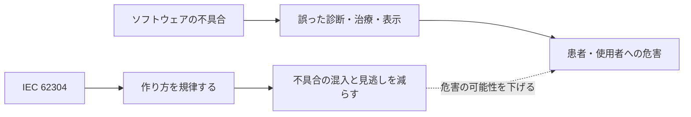

ハードウェアと違い、ソフトウェアは「摩耗」では壊れません。壊れるのは**設計・実装・変更管理のミス**です。だから品質は完成品の検査だけでは担保できず、作り方（プロセス）を管理する必要があります。これが62304の根本的な考え方です。

### 2.3 規格が「やらないこと」

| やらない | 補足 |
|---|---|
| 特定の開発ライフサイクルモデルの指定 | モデルは自分で選び、規格の活動との対応を説明する |
| 医療機器としてのバリデーション、最終リリース | 別の規格・規制で扱う |
| 品質マネジメントシステムそのものの定義 | ISO 13485等を前提とする |
| サイバーセキュリティ要求の詳細 | 別規格（IEC 81001-5-1等）と併用する |

---

## 3. 最初に覚える用語

| 用語 | 意味（初学者向けの言い換え） |
|---|---|
| ソフトウェアシステム | 医療機器に含まれる、完成したソフトウェア全体 |
| ソフトウェアアイテム | ソフトウェアシステムを構成する識別可能な部品（モジュール、コンポーネント等） |
| ソフトウェアユニット | それ以上分割しない最小単位（関数、クラスなど） |
| SOUP | Software Of Unknown Provenance。IEC 62304:2006/Amd 1:2015 の定義（3.29）では、次のいずれかに該当するソフトウェアアイテム。①**既に開発され、一般に入手可能で、当該医療機器に組み込む目的で開発されたものではない**ソフトウェアアイテム（いわゆる既製ソフトウェア。市販ライブラリ、OSS、OSなど）、②**開発プロセスの十分な記録が利用できない**既開発のソフトウェアアイテム。なお、**医療機器ソフトウェアシステムそのものを SOUP とみなすことはできない** |
| 危害（Harm） | 人の身体的な傷害や健康への損害、または財産や環境への損害 |
| 危険状態（Hazardous situation） | 人・財産・環境が危険にさらされる状況 |
| リスクコントロール手段 | リスクを下げるための設計上の対策 |
| セグリゲーション（分離） | 高クラスのアイテムを、低クラスのアイテムから実質的に切り離すこと |
| レガシーソフトウェア | IEC 62304:2006/Amd 1:2015 の定義では、**合法的に市場投入され、現在も販売中**の医療機器ソフトウェアのうち、**本規格の現行版に適合して開発されたことを示す客観的証拠が不十分**なもの。これに該当する場合に限り、Clause 4.4 の代替手順（リスクと既存文書の評価、ギャップ分析、ギャップを埋める活動の計画とその計画の実行、対象ソフトウェアの版および継続使用の根拠の記録）が適用できる。この代替手順でも、最低限の成果物としてソフトウェアシステムテスト記録（5.7.5）が必要。現行版で開発中の新規ソフトウェアや、販売終了したソフトウェアは対象外 |
| 検証（Verification） | 「作り方・仕様どおりに作れているか」の確認 |
| バリデーション | 「使う目的・ニーズに合っているか」の確認（機器レベルは本規格の対象外） |

---

## 4. 規格の位置づけ（関連規格マップ）

62304は単独では機能しません。周辺規格との関係を先に押さえると、全体像が掴みやすくなります。

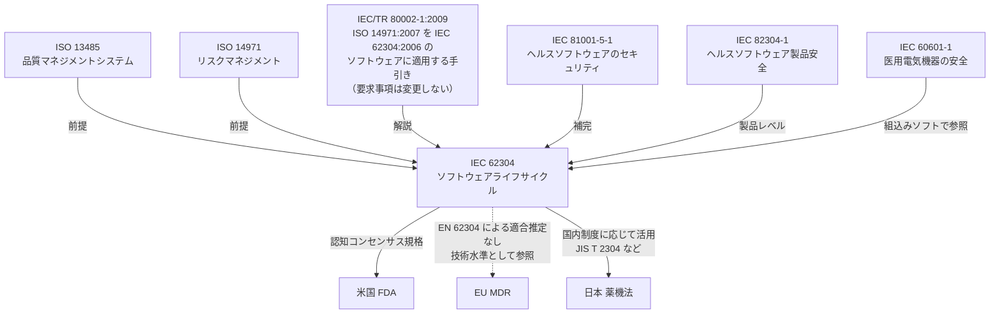

> 各国規制での扱いは一律ではありません。米国では FDA の認知コンセンサス規格、EU MDR では EN 62304 による適合推定は得られず（第20章参照）、日本では国内制度に応じて活用されます。

| 関連規格 | 62304との関係 | 一言メモ |
|---|---|---|
| ISO 13485 | 前提（QMS） | 62304はQMSの中で運用する |
| ISO 14971 | 前提（リスク） | 62304の安全クラス判定やリスク活動の土台 |
| IEC/TR 80002-1:2009 | 手引き | ISO 14971:2007 を IEC 62304:2006 のソフトウェアに適用する際のガイダンス。両規格の要求事項を追加・変更するものではない。なお ISO 14971 の現行版は 2019 年版だが、本報告書は 2019 年版向けに改訂されておらず、その要求事項を置き換えたり更新したりするものでもない |
| IEC 81001-5-1 | 補完 | サイバーセキュリティは62304本体では詳細に扱わない |
| IEC 82304-1 | 補完 | 専用ハードを持たないヘルスソフトウェアの製品要求 |
| FDA | 規制当局がコンセンサス規格として認識 | 米国では文書化レベルの考え方が別にある（Step 2参照） |

---

## 5. 版の歴史と現在の状況

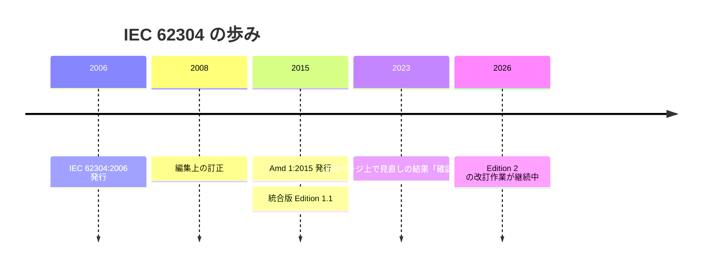

| 版 | 年 | 位置づけ |
|---|---|---|
| IEC 62304:2006 | 2006 | 原典（Edition 1.0）。ISOのページ（今回の参照URL）はこの版 |
| Amd 1:2015 | 2015 | 追加改訂。**安全クラス判定の考え方やレガシーソフトウェアの扱い**などが整理された |
| 統合版 2006+A1:2015 | 2015 | 実務で使う版。本文と改訂を一体化したもの |
| Edition 2 | 未発行（2026年10月時点） | 第20章参照 |

> **実務のポイント**：ISOの該当ページに掲載されているのは2006年の本体と、別ID（Amd 1）の2つです。**実務ではAmd 1を含めた統合版**を入手して使うのが基本です。購入前に「統合版（CSV 付き版など）」の表記を確認してください。

---

## 6. 規格の構成（条項マップ）

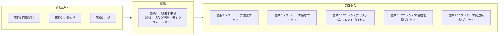

| 箇条 | 内容 | このガイドの章 |
|---|---|---|
| 1〜3 | 適用範囲、引用規格、用語 | 第2〜3章、Step 1 |
| 4 | 一般要求事項（QMS、リスクマネジメント、安全クラス、レガシー） | Step 2 |
| 5 | 開発プロセス（計画〜リリース） | Step 4 |
| 6 | 保守プロセス | Step 7 |
| 7 | リスクマネジメントプロセス | Step 5 |
| 8 | 構成管理プロセス | Step 6 |
| 9 | 問題解決プロセス | Step 7 |
| 附属書 | 根拠、手引き、他規格との関係、実装ガイド | 原文で確認 |

---

## Step 1：自分のソフトウェアが対象か判断する

### 1.1 適用対象の判断

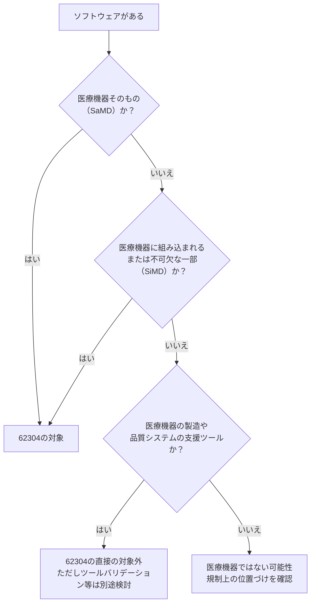

| 区分 | 例 | 62304 |
|---|---|---|
| SaMD（ソフトウェア単体の医療機器） | 画像診断支援プログラム、血糖値管理アプリ（医療機器該当の場合） | 対象 |
| SiMD（組込みソフトウェア） | 輸液ポンプの制御ソフト、人工呼吸器のファームウェア | 対象 |
| 製造・品質支援ツール | 社内のテスト自動化ツール、構成管理ツール | 直接の対象外（ただし品質システム側で管理） |
| 医療機器でない一般ソフト | 一般的な業務システム | 対象外（医療機器でなければ） |

> 「医療機器に該当するかどうか」は規制側（薬機法、FDA、EU MDRなど）の判断です。62304自体は**該当を判定しません**。

### 1.2 スコープの限界

規格は、**機器のバリデーションと最終リリース**を扱いません。ソフトウェアのみで成り立つ医療機器であっても同じです。これらは別の枠組み（ISO 13485の設計開発、各国規制）で対応します。

---

## Step 2：ソフトウェア安全クラスを決める

### 2.1 3つのクラス

62304は、ソフトウェアが引き起こしうる**危害の重大性**に応じて、3クラスに分類します。

| クラス | 定義（概要） | 例 | 必要な厳格さ |
|---|---|---|---|
| **A** | ソフトウェアが危険状態に**寄与しない**、または寄与しても**ソフトウェア外のリスクコントロール手段を考慮した後のリスクが許容可能** | 管理業務系、データのログ記録 | 低 |
| **B** | **重大ではない傷害**の可能性がある | 患者モニタのアラーム関連、一部の画像診断支援 | 中 |
| **C** | **死亡または重大な傷害**の可能性がある | 輸液ポンプの投与量制御、放射線治療の制御 | 高 |

### 2.2 判定フロー

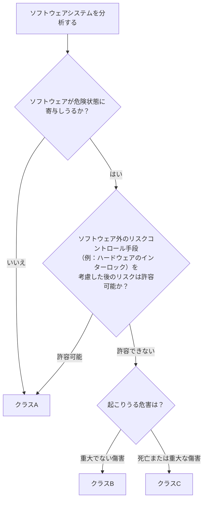

### 2.3 判定のコツ

| ポイント | 説明 |
|---|---|
| 確率ではなく重大性で決める | 不具合の発生確率は安全クラス判定に使わない。Johner Instituteの解説でも、確率は判定を決めないとされている |
| ソフトウェア外の対策は考慮できる | ハードウェアでの保護機構など、ソフトウェアの外にあるリスクコントロール手段によってクラスを下げることは認められる。**ソフトウェア内の対策だけではクラスは下がらない** |
| クラスはシステム単位が基本 | 分割して別クラスにするには、ソフトウェアアイテムの**セグリゲーション**を文書化して正当化する必要がある |
| 迷ったらC | 高クラスの要求を満たす作り方にしておけば、後でクラスが変わっても手戻りが小さい。Johner Instituteもクラス C 相当の文書化に合わせる運用を推奨している |

### 2.4 セグリゲーション（分離）の考え方

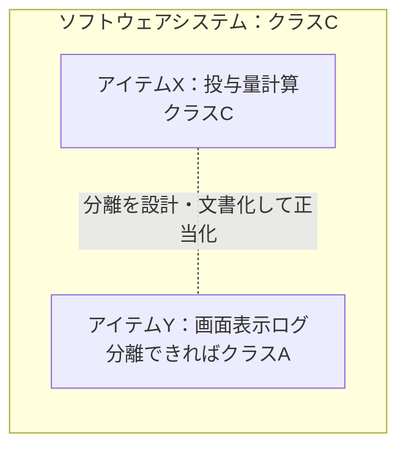

分離を主張するには、「Yが故障してもXに悪影響が及ばない」ことを**アーキテクチャ上で説明・検証**できなければなりません。分離できない場合、全体が高いクラスになります。

### 2.5 FDAの「文書化レベル」との違い

| 観点 | IEC 62304 | FDA |
|---|---|---|
| 区分 | ソフトウェア安全クラス（A / B / C） | 文書化レベル（旧：Level of Concern）。最近のガイダンスでは2区分（基本／拡張） |
| 判定の単位 | ソフトウェアシステムまたはアイテム | 機能（intended useの側面）単位でも可 |
| 目的 | プロセス・文書化の厳格さを決める | 申請に含める文書化量を決める |
| 注意 | **FDAのデバイスクラス（Class I〜III）とは別物** | |

> ベンダーが「FDAのClass II」と「62304のClass B」を混同する例は、実務でも頻繁に報告されています。**必ず別の概念**として扱ってください。

---

## Step 3：クラスごとの必要活動を把握する

### 3.1 全体マトリクス

「○」は要求あり、「—」は要求なし（または限定的）を表します。細部は条項ごとに異なるため、**必ず原文で確認**してください。

| 活動（箇条） | クラスA | クラスB | クラスC |
|---|:---:|:---:|:---:|
| 開発計画（5.1） | ○ | ○ | ○ |
| ソフトウェア要求事項分析（5.2） | ○ | ○ | ○ |
| アーキテクチャ設計（5.3） | — | ○ | ○ |
| 詳細設計（5.4） | — | 一部 | ○ |
| ユニット実装（5.5） | ○ | ○ | ○ |
| ユニット検証（5.5） | — | ○ | ○ |
| 統合と統合テスト（5.6） | — | ○ | ○ |
| システムテスト（5.7） | ○ | ○ | ○ |
| リリース（5.8） | ○ | ○ | ○ |
| 保守（箇条6） | ○ | ○ | ○ |
| リスクマネジメント（箇条7） | ○（一部） | ○ | ○ |
| 構成管理（箇条8） | ○ | ○ | ○ |
| 問題解決（箇条9） | ○ | ○ | ○ |

### 3.2 クラスと厳格さのイメージ

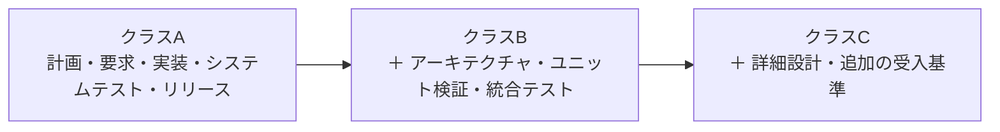

---

## Step 4：開発プロセスを回す（箇条5）

### 4.1 開発プロセス全体像

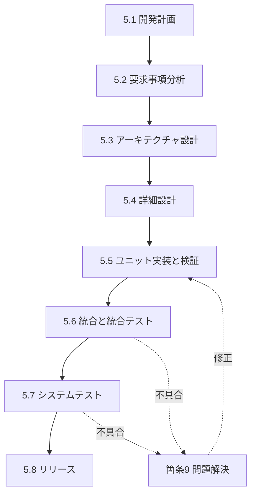

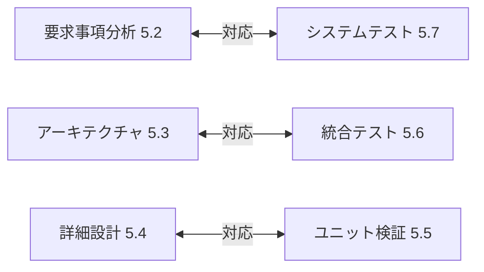

> 左側（作る）と右側（確かめる）が**V字**で対応します。要求とテスト、設計とテストが**追跡可能**であることが、監査で最も見られるポイントの一つです。

### 4.2 各ステップの要点

#### 5.1 ソフトウェア開発計画

| 項目 | 内容 |
|---|---|
| 目的 | 何を、誰が、いつ、どのプロセスで作るかを決める |
| 計画に含める内容 | 使用するプロセスとライフサイクルモデル、成果物、トレーサビリティ、構成管理、問題解決、SOUP管理、検証、リスク管理との関係 |
| 成果物 | ソフトウェア開発計画書（SDP） |
| 注意 | 計画書の内容は**変更時に更新**する。更新されない計画書は監査の指摘対象 |

#### 5.2 ソフトウェア要求事項分析

| 項目 | 内容 |
|---|---|
| 目的 | システム要求からソフトウェア要求を導出し、**テスト可能な形**で定義する |
| 含めるもの | 機能・性能要求、入出力、インタフェース、セキュリティ関連、使用性、データ定義、リスクコントロール手段としての要求 |
| 成果物 | ソフトウェア要求仕様書（SRS） |
| 注意 | 曖昧な表現は避ける。リスク分析の結果として生まれた要求が漏れないこと |

#### 5.3 アーキテクチャ設計（クラスB・C）

| 項目 | 内容 |
|---|---|
| 目的 | ソフトウェアをアイテムに分割し、役割とインタフェースを定める |
| 含めるもの | アイテム構成、アイテム間インタフェース、SOUPの機能・性能要求と動作環境、**セグリゲーション** |
| 成果物 | ソフトウェアアーキテクチャ設計書 |
| 注意 | クラスの分離を主張するなら、ここで根拠を示す |

#### 5.4 詳細設計

| 項目 | 内容 |
|---|---|
| 目的 | アイテムをユニットに分割し、実装できる粒度まで設計する |
| 要求の差 | ユニット分割はB・C、ユニットの詳細設計はC中心 |
| 成果物 | 詳細設計書 |

#### 5.5 ユニット実装と検証

| 項目 | 内容 |
|---|---|
| 目的 | 各ユニットを実装し、**意図どおりに動くか**を確認する |
| 検証の例 | ユニットテスト、コードレビュー、静的解析 |
| 受入基準 | あらかじめ定める（例：コーディング規約の遵守、メモリ・資源の扱い、レビュー完了） |
| 注意 | クラスAでは検証要求がない。ただし、品質上は実施するのが望ましい |

#### 5.6 ソフトウェア統合と統合テスト（クラスB・C）

| 項目 | 内容 |
|---|---|
| 目的 | ユニット・アイテムを統合し、**統合された状態で正しく動く**ことを確認する |
| 含めるもの | 統合計画、統合テスト、テスト結果の記録、回帰テスト、問題の記録 |

#### 5.7 ソフトウェアシステムテスト

| 項目 | 内容 |
|---|---|
| 目的 | すべてのソフトウェア要求が満たされているかを確認する |
| 成果物 | システムテスト計画・手順・結果、要求とのトレーサビリティ |
| 注意 | 不具合が出たら問題解決プロセス（箇条9）を使う。変更後は**回帰テスト** |

#### 5.8 ソフトウェアリリース

| 項目 | 内容 |
|---|---|
| 目的 | 検証が完了したソフトウェアを、管理された形で**ソフトウェアとして**リリースする |
| 含めるもの | 全クラス（A・B・C）：既知の残存異常の文書化、リリース版の識別（バージョン）。クラスB・C：既知の残存異常の評価、リリースしたソフトウェアの生成手順・環境の記録（ビルドの再現性）、計画上の活動・タスクと関連文書の完了確認（5.8.6）。全クラス（A・B・C）：ソフトウェアのアーカイブ（5.8.7）、信頼できる配布の確保（5.8.8）。あわせてリリース記録を残す |
| 注意 | これは**ソフトウェアのリリース**であり、医療機器としての最終リリースとは別 |

---

## Step 5：リスクマネジメントを組み込む（箇条7）

ISO 14971で機器全体のリスクを管理し、62304の箇条7は**ソフトウェアに特有の部分**を補います。

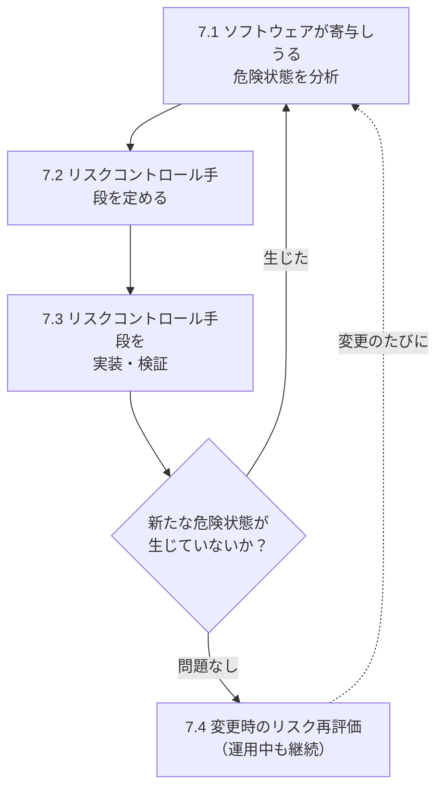

| 要点 | 内容 |
|---|---|
| 分析の対象 | ソフトウェアアイテムが危険状態の原因になりうるか。SOUPの既知の異常も確認する |
| リスクコントロール手段 | ソフトウェアで実装するなら、要求として**5.2に反映** |
| 検証 | 実装した手段が**有効に機能すること**を確認し、記録する |
| 変更時 | 変更によって既存のリスクコントロール手段に影響が出ないか、新しい危険状態が生まれないかを評価 |

---

## Step 6：構成管理と変更管理（箇条8）

| 活動 | 目的 | 具体例 |
|---|---|---|
| 構成識別 | 管理対象を特定する | ソース、設計書、テスト、ツール、**SOUP（名前とバージョン）** |
| 変更管理 | 変更を統制する | 変更要求→評価→承認→実装→検証、全体の追跡可能性 |
| 構成状況の記録 | 何が、いつ、どの版かを追跡 | リリース時点の構成を再現できる |

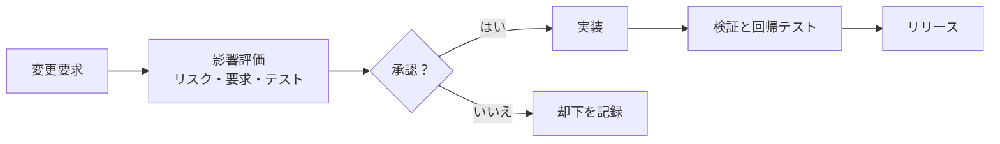

> Gitなどのバージョン管理は、構成管理の**手段**にすぎません。プルリクエストのレビュー記録、承認、課題管理との紐付けをどう残すかが、規格への適合の本質です。

---

## Step 7：保守と問題解決（箇条6・9）

### 7.1 保守プロセス（箇条6）

保守は、出荷後のソフトウェアに起きる**問題の受付・評価・修正**を管理するプロセスです。

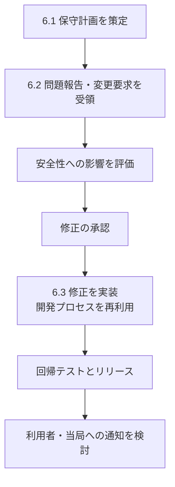

| 要点 | 内容 |
|---|---|
| 保守計画 | 問題報告の受付、評価、修正、SOUPの更新対応を計画しておく |
| 安全性の評価 | 受け取ったすべての問題報告について、**安全性への影響**を評価する |
| 修正の実装 | 開発プロセス（箇条5）を再利用し、変更の影響を評価して再検証する |

### 7.2 問題解決プロセス（箇条9）

| 手順 | 内容 |
|---|---|
| 1. 問題報告の作成 | 不具合・異常を記録する |
| 2. 調査 | 原因と影響（安全性を含む）を調べる |
| 3. 通知 | 必要に応じて関係者に通知する |
| 4. 変更要求の承認 | 修正の可否を判断する |
| 5. 記録の維持 | 問題と解決の履歴を残す |
| 6. 傾向分析 | 問題の傾向を分析する |
| 7. 解決の検証 | 修正が有効で、新たな問題を生まないことを確認する |

---

## 14. SOUP（出自不明ソフトウェア）の扱い

### 14.1 SOUPとは

IEC 62304:2006/Amd 1:2015 の定義（3.29）では、SOUP は次の 2 つの条件のいずれかに該当するソフトウェアアイテムです。

| 条件 | 内容 |
|---|---|
| ① 既製ソフトウェア | 既に開発され、一般に入手可能で、当該医療機器に組み込む目的で開発されたものではないソフトウェアアイテム（off-the-shelf software） |
| ② 記録が不十分な既開発ソフトウェア | 以前に開発されたが、開発プロセスの十分な記録が利用できないソフトウェアアイテム |

> **注意**：SOUP は医療機器ソフトウェアシステムを構成する「アイテム」に対する概念です。**医療機器ソフトウェアシステムそのものを SOUP とみなすことはできません**。

| 分類 | 例 |
|---|---|
| OS | Linux、Android、RTOS |
| ライブラリ・フレームワーク | OSSのライブラリ、通信スタック、暗号ライブラリ |
| ミドルウェア | データベース、メッセージキュー |
| 商用既製品（COTS） | 購入したSDK |

### 14.2 SOUPの管理サイクル

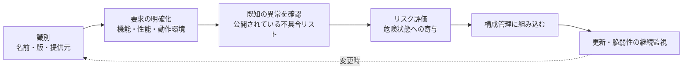

| 管理項目 | 記録する内容 |
|---|---|
| 識別 | 名称、メーカー／提供元、バージョン |
| 要求 | そのSOUPに期待する機能・性能、必要なシステム環境 |
| 異常リスト | 公開されている既知の不具合、評価結果 |
| リスク | 危険状態への寄与、対策 |
| 変更管理 | バージョン更新時の影響評価 |

> 実務の失敗例として、「サードパーティだから他人の問題」と扱うことが挙げられています。**使う以上、機器全体の安全には自社が責任を持ちます**。

---

## 15. アジャイル・CI/CDとの付き合い方

62304は特定のモデルを指定しません。アジャイルでも適合できますが、**規格の活動とのマッピング**を説明できることが条件です。

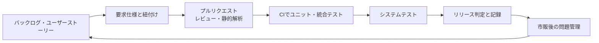

| 規格の活動 | アジャイル／CI/CDでの対応例 |
|---|---|
| 開発計画 | 開発計画書に、スプリント運用と成果物の対応を記載 |
| 要求事項 | バックログ項目を要求仕様と紐付け、受入基準をテストに接続 |
| ユニット検証 | CIで自動実行されるユニットテスト、静的解析、レビュー |
| 構成管理 | ブランチ戦略、タグ、ビルドの再現性 |
| 変更管理 | プルリクエストと変更要求の紐付け、承認の記録 |
| リリース | リリース判定のチェックリスト、既知異常の評価記録 |

> 注意：自動化した記録は、**監査で提示できる形で保管・追跡**できる必要があります。ツール自体の妥当性確認（ツールバリデーション）も品質システム側で検討してください。

---

## 16. 成果物（ドキュメント）一覧

| 成果物 | 関連箇条 | A | B | C |
|---|---|:---:|:---:|:---:|
| ソフトウェア開発計画書 | 5.1 | ○ | ○ | ○ |
| ソフトウェア要求仕様書 | 5.2 | ○ | ○ | ○ |
| アーキテクチャ設計書 | 5.3 | — | ○ | ○ |
| 詳細設計書 | 5.4 | — | 一部 | ○ |
| ユニット検証記録 | 5.5 | — | ○ | ○ |
| 統合テスト計画・結果 | 5.6 | — | ○ | ○ |
| システムテスト計画・結果 | 5.7 | ○ | ○ | ○ |
| リリース記録・既知異常リスト（活動・タスクと関連文書の完了確認 5.8.6：B/C、アーカイブ 5.8.7：全クラス、信頼できる配布 5.8.8：全クラス） | 5.8 | ○ | ○ | ○ |
| ソフトウェア保守計画書 | 6 | ○ | ○ | ○ |
| ソフトウェアリスク分析記録 | 7 | 一部 | ○ | ○ |
| SOUPリスト（識別：名称・製造者・固有識別子） | 8.1.2 | ○ | ○ | ○ |
| SOUPの機能・性能要求、動作環境、既知異常の評価 | 5.3.3 / 5.3.4 / 7.1 | — | ○ | ○ |
| 構成管理計画・構成項目リスト | 8 | ○ | ○ | ○ |
| 問題報告書 | 9 | ○ | ○ | ○ |
| トレーサビリティマトリクス | 横断 | ○ | ○ | ○ |

> 表の○／—は典型例です。実際の要否は条項とクラスの組合せで決まるため、原文と自社QMSで確認してください。

---

## 17. QAエンジニア視点のチェックポイント

### 17.1 トレーサビリティの全体像

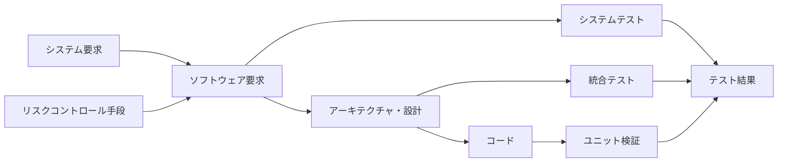

### 17.2 チェックリスト

| 観点 | 確認内容 | 状態 |
|---|---|:---:|
| 計画 | 開発計画書が最新の運用を反映しているか | ☐ |
| 分類 | 安全クラスの判定根拠が記録されているか | ☐ |
| 要求 | 各要求が曖昧さなくテスト可能か | ☐ |
| リスク | リスクコントロール手段が要求・テストまで追跡できるか | ☐ |
| 設計 | セグリゲーションの根拠が文書化されているか | ☐ |
| 検証 | ユニット検証の受入基準が事前に定義されているか | ☐ |
| テスト | 全要求がシステムテストでカバーされているか | ☐ |
| 回帰 | 変更時の回帰テストの範囲が根拠付きか | ☐ |
| SOUP（識別・全クラス） | 使用するSOUPごとに、名称・製造者（提供元）・版などの識別情報が記録されているか | ☐ |
| SOUP（異常リスト・クラスB/C） | クラスB・Cでは、SOUPの既知異常リストを評価した結果が記録されているか（クラスAでは要求されない） | ☐ |
| リリース | 既知の残存異常が評価・文書化されているか | ☐ |
| 変更 | 変更要求から検証までの記録がつながるか | ☐ |
| 保守 | 市販後の問題を受付・評価する手順が動いているか | ☐ |

---

## 18. よくある失敗と対策

| 失敗 | 何が起きるか | 対策 |
|---|---|---|
| 安全クラスの判定根拠が曖昧 | 監査で再判定を求められ手戻り | 判定フローと根拠を記録する |
| FDAのクラスと62304のクラスを混同 | 申請・監査の説明が破綻 | 別概念として整理して用語を統一 |
| SOUPを「他人の問題」とする | 既知の異常の見落とし | SOUPリストと異常評価を運用に組み込む |
| 62304を単独の規格として扱う | リスク管理・QMSとの不整合 | ISO 13485 / 14971と一体で設計 |
| 保守を非公式に運用 | 市販後の問題が記録・評価されない | 問題解決・保守プロセスを手順化 |
| 計画書が更新されない | 実態と文書の乖離 | 変更のたびに計画書を更新するルール |
| 計画段階でなく最後に適用 | 大規模な手戻り | 企画・計画の段階から取り込む |

---

## 19. 導入ロードマップ例

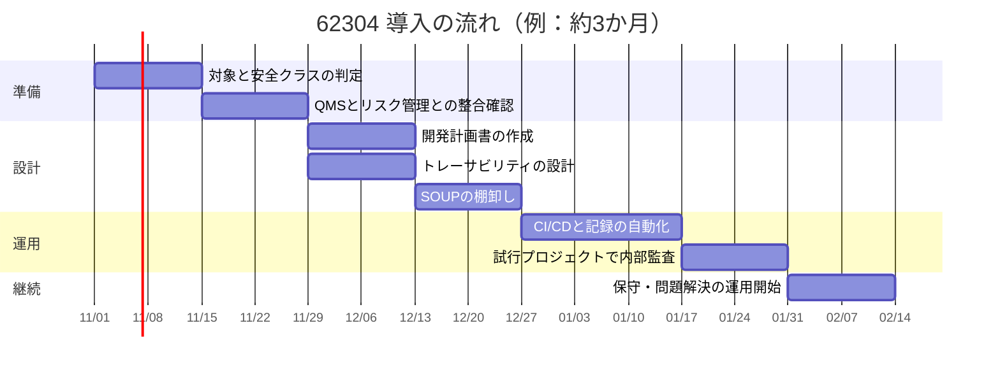

---

## 20. Edition 2（改訂版）の動向

### 20.1 状況（2026年10月11日時点）

Edition 2 の状況は、情報源によって**記述が食い違っています**。

| 情報源（日付） | 内容 |
|---|---|
| Critical Software（2026年6月12日） | FDIS段階が2026年5月に始まり、公式予測は2027年初頭〜中頃と記載 |
| QARA PULSE（2026年8月12日） | CD2が送付され、コメント解決は2026年8月19日開始、承認段階は10月21日、公開予測は2028年 |
| Quickbird Medical（2026年10月初旬頃） | IEC予測では2028年10月26日公開。以前の2027年4月予測から大幅に遅延と記載 |
| MD Regulatory（2026年8月下旬頃） | Edition 2は未存在。**現行は2006+A1:2015**。FDISは2028年以前に見込まれないと記載 |

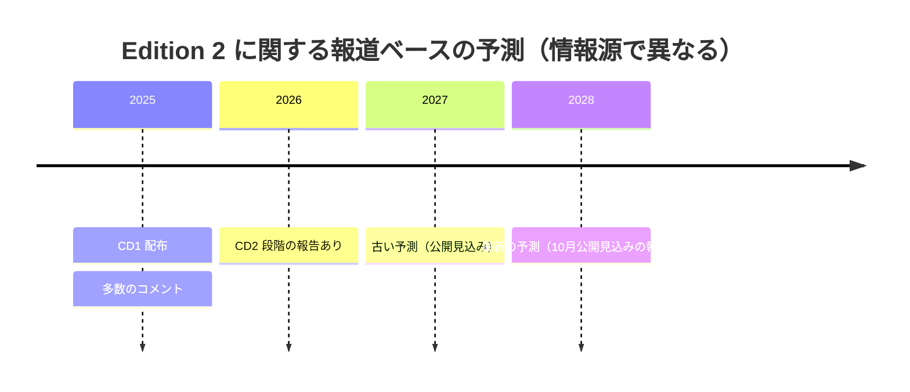

### 20.2 実務上の結論

- 新しい情報源ほど「**未発行・2028年見込み**」で一致しており、ISOの公式ページでも2006年版が「現行・2023年に確認済み」と表示されています。
- EUでは、法的な要求事項はMDR／IVDR（一般安全・性能要求事項など）であり、整合規格の利用は**任意**です。整合規格が欧州連合官報（OJEU）に掲載されると、その規格に適合することで、規格が対象とする要求事項への**適合推定**が得られます。新版が公開されても、OJEUに整合規格として掲載されるまでは、この適合推定の効果は得られません。
- したがって、**現時点では2006+A1:2015を前提に設計**するのが妥当です。
- ただし、「2026年8月公開」を断定した古い記事も多く出回っています。**必ずIEC公式サイトの最新ステータスで確認**してください。

### 20.3 ドラフトで報じられている主な方向性（確定ではありません）

| 項目 | Edition 1（現行） | Edition 2（ドラフトの報道） |
|---|---|---|
| 適用範囲 | 医療機器ソフトウェア | **ヘルス関連ソフトウェア全般**へ拡大 |
| 分類 | 安全クラス A / B / C | **2段階のプロセス厳格度（I / II）** |
| AI／ML | 明示的な要求は限定的 | AI／MLのライフサイクルに関する要求を追加 |
| サイバーセキュリティ | 本体では詳細に扱わない | 引き続き別規格（IEC 81001-5-1等）を参照する方向 |
| ISO 13485／14971への参照 | 参照あり | ヘルスソフトウェア全般を対象とするため参照を外す方向 |

> 準備のコツ：Edition 2が公開されても、**プロセスの本質（計画、要求、設計、検証、変更管理、保守、リスク）は大きく変わらない**とする分析もあります。今は現行版を堅実に運用し、動向を追うのが現実的です。

---

## 21. FAQ

**Q1. 62304に「認証」はありますか？**
A. 規格そのものに認証制度はありません。ISO 13485の監査や、各国規制の審査・適合性評価の中で、62304への適合が確認されます。

**Q2. 英語版しか読めませんか？**
A. 英語、仏語のほか、スペイン語版などが提供されています。日本では、国内規格（JIS T 2304）として対応する規格が整備されています（最新の版や対応関係は規格協会で確認してください）。

**Q3. クラスAなら何もしなくてよい？**
A. いいえ。クラスAでも、開発計画、要求事項、システムテスト、リリース、保守、構成管理、問題解決などの要求があります。

**Q4. OSSは使えますか？**
A. 使えます。ただし**SOUPとして識別・評価・管理**する必要があります。

**Q5. 規格に適合すれば機器は安全ですか？**
A. 適合は、決められたプロセスに従ったことの証拠です。機器のバリデーションや臨床的な安全性は、別の活動で確認します。

**Q6. アジャイルで開発してもよい？**
A. 可能です。規格の活動との対応関係を説明でき、必要な記録が残せれば問題ありません。

**Q7. 生成AIやAI／MLを含む場合は？**
A. 現行版にはAI／ML固有の要求は限定的です。Edition 2のドラフトで追加される方向ですが、現時点ではFDAやEUのAI関連ガイダンスを併せて確認してください。

---

## 22. 参考ソース一覧

> 検索日：2026年10月12日（基準日：2026年10月11日）。
> 規格本文は有償のため、公式の概要ページ、国際的に知られる規制コンサルタント・専門家の解説、業界ベンダーの解説を組み合わせています。ベンダー系の記事は営業目的を含む場合があるため、**公式情報と専門家の解説を優先**して読み比べてください。

### 22.1 公式・規格団体

| 参照先 | URL | 参照した内容 |
|---|---|---|
| ISO：IEC 62304:2006 | <https://www.iso.org/standard/38421.html> | 2006年5月発行、2023年に確認済み、Amd 1:2015が別IDで存在 |
| IEC Webstore：IEC 62304:2006 | <https://webstore.iec.ch/publication/6792> | 概要、スコープ（バリデーション・最終リリースは対象外）、より新しい版（Amd 1統合版）の存在 |
| EVS（エストニア規格協会） | <https://www.evs.ee/en/iec-62304-2006> | 規格情報、関連規格（IEC TR 80002-1） |
| UNE（スペイン規格協会） | <https://www.en.une.org/encuentra-tu-norma/busca-tu-norma/iec?c=6792> | 概要とスコープの確認 |
| SCC（カナダ規格評議会） | <https://scc-ccn.ca/standardsdb/standards/2010245> | 発行日と概要 |
| AFNOR | <https://www.boutique.afnor.org/en-gb/standard/iec-623042006/medical-device-software-software-life-cycle-processes/xs016608/245731> | 概要の確認 |

### 22.2 国際的に知られる専門家・コンサルタント

| 参照先 | URL | 参照した内容 |
|---|---|---|
| Johner Institute（Christian Johner） 安全クラスの解説 | <https://blog.johner-institute.com/iec-62304-medical-software/safety-class-iec-62304/> | 安全クラス A / B / C、確率ではなく重大性、FDA文書化レベルとの違い、クラスC相当で開発する推奨、Edition 2ドラフトで2区分化の予定 |
| Johner Institute：安全クラスとFDA Level of Concern | <https://johner-institute.com/articles/software-iec-62304/safety-classes-level-of-concern> | クラスの定義、ソフトウェア外の手段によるクラス低減、FDAとの対応 |
| Johner Institute：記事一覧（2025年10月15日） | <https://blog.johner-institute.com/2025/10/15/> | 安全クラス記事の概要 |
| Greenlight Guru：IEC 62304 ベストプラクティス資料 | <https://www.greenlight.guru/hubfs/Developing%20IEC%2062304%20Compliant%20Software-%20Proven%20Tips%20%26%20Best%20Practices.pdf> | ライフサイクルモデルは指定されない、反復型開発との関係 |
| Greenlight Guru：SaMD準拠度スコアカード | <https://www.greenlight.guru/hubfs/2026%20custom%20code/SaMD%20Scorecard_Q2%202026.html> | QMS基盤、計画と分類、トレーサビリティ、変更管理、保守と問題解決の観点 |
| Freyr Solutions：62304準拠ガイド | <https://www.freyrsolutions.com/blog/iec-62304-compliance-the-complete-guide-to-medical-device-software-development-without-the-pitfalls> | クラス定義、SOUP管理、よくある失敗（SOUPを他人の問題とする等） |
| ComplianceOnline：要求事項の概要 | <https://www.complianceonline.com/iec-62304-medical-device-software-life-cycle-process-standard-overview-and-summary-of-requirements-for-software-development-12570-prdad> | ライフサイクルモデルを規定しないこと、開発計画書の記載内容 |

### 22.3 Edition 2 の動向

| 参照先 | URL | 参照した内容 |
|---|---|---|
| MD Regulatory | <https://mdregulatory.com/iec-62304/> | Edition 2は未発行、現行は2006+A1:2015、FDISは2028年以前に見込まれない |
| Quickbird Medical | <https://quickbirdmedical.com/en/news/iec-62304-edition-2-august-2026/> | 公開予測が2028年10月26日、クラスA/B/CからI/IIへの変更案、AI/ML、スコープ拡大、EUでの整合規格化の遅れ |
| QARA PULSE | <https://qarapulse.com/en/resources/iec-62304-edition-2-revision/> | CD2の状況、コメント解決の日程、2028年公開予測 |
| Critical Software | <https://criticalsoftware.com/en/newsroom/iec-62304-edition-2-changes> | FDIS段階とする別の見方（他情報と食い違う点に注意） |
| Montevideo Medical Devices | <https://mmd.uy/resources/iec-62304-evolution> | 改訂は進化的で、プロセス規格という本質は変わらないという分析 |
| 8Fold Governance | <https://8foldgovernance.com/iec-62304-edition-2-big-changes-in-samd-requirements/> | ISO 13485／14971参照の削除、保守と開発の区別 |
| IntuitionLabs：Edition 2の変更点 | <https://intuitionlabs.ai/articles/iec-62304-edition-2-medical-software-changes> | ドラフトの変更点の整理（予測日程は古い可能性あり） |
| LFH Regulatory | <https://lfhregulatory.co.uk/iec-62304-update-2026/> | 旧い日程情報（公開予測が実際とずれた例として参照） |

### 22.4 総合解説・実務資料

| 参照先 | URL | 参照した内容 |
|---|---|---|
| IntuitionLabs：IEC 62304ガイド | <https://intuitionlabs.ai/articles/iec-62304-medical-device-software-life-cycle> | 箇条構成、SOUPの定義、QMSとの関係 |
| IntuitionLabs：IEC 62304総合ガイド | <https://intuitionlabs.ai/articles/iec-62304-medical-device-software-guide> | 版の履歴、監査での位置づけ |
| jamb（OSSのトレーサビリティツール）の解説 | <https://jamb.readthedocs.io/en/latest/_sources/iec-62304/safety-classifications.md.txt> | クラス別の必要活動の一覧 |
| adacovex ドキュメント | <https://adacovex.readthedocs.io/en/latest/api-docs/adacovex-class-levels.html> | クラスごとの重大性と例 |
| Censinet：医療機関向けガイド | <https://censinet.com/perspectives/iec-62304-guide-hdos> | 5つのプロセス、FDAクラスと62304クラスの混同、サイバーセキュリティ規格との併用 |
| 62304チェックリスト（SlideShare） | <https://www.slideshare.net/slideshow/iec62304checklistpdf/258780350> | 条項ごとの要求のチェックリスト |
| 医療機器ソフトウェア概説（SlideShare） | <https://www.slideshare.net/slideshow/medical-device-software/11921917> | 開発・保守・問題解決の流れ、保守でのSOUP変更評価 |
| EVS：IEC 62304（別ページ） | <https://www.evs.ee/en/iec-62304-2006> | スタンダード履歴（2015年のAmd 1） |

### 22.5 このガイドの根拠の強さについて

| 内容 | 根拠の強さ | 備考 |
|---|---|---|
| 規格の概要、スコープ、版の履歴 | 強い | ISO・IEC・各国規格協会の公式ページで一致 |
| 安全クラスの定義、重大性による判定 | 強い | Johner Institute等の専門家解説で一致 |
| クラス別の必要活動、各条項の詳細 | 中程度 | 二次資料と一般的な理解にもとづく。**原文で要確認** |
| Edition 2の日程 | 弱い（情報源で食い違い） | 新しい情報源ほど2028年見込みで一致。**IEC公式で要確認** |
| FDAとの関係の細部 | 中程度 | FDAの最新ガイダンスで要確認 |

---

*作成日：2026年10月12日／情報基準日：2026年10月11日*
