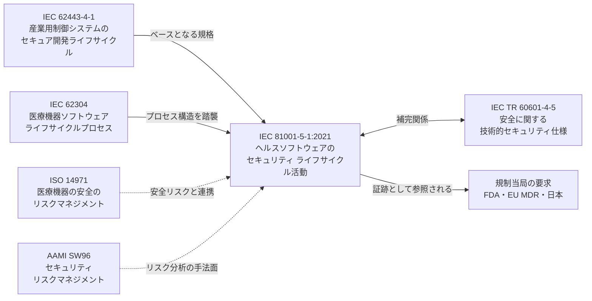
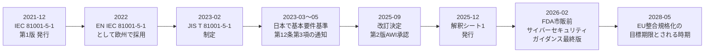
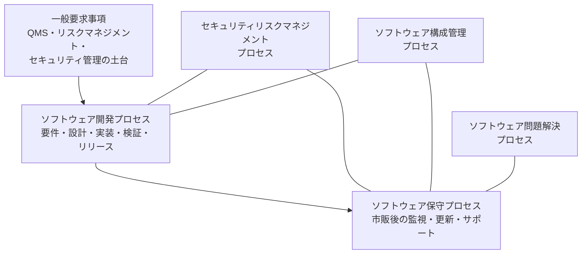
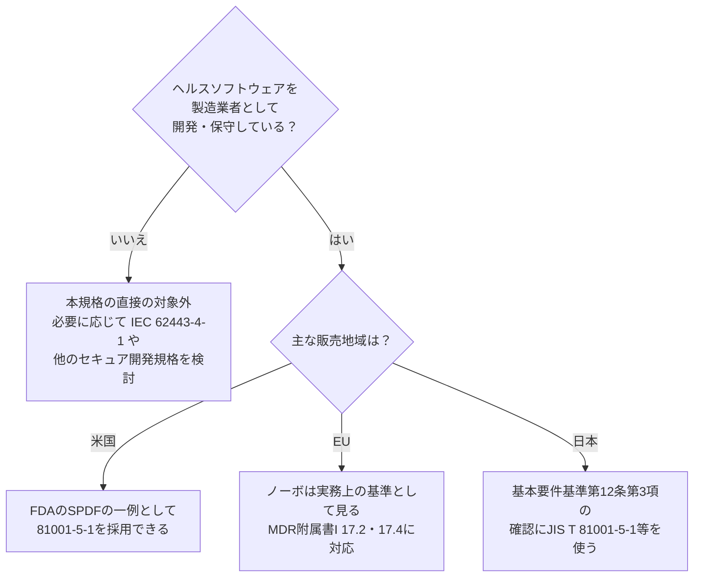
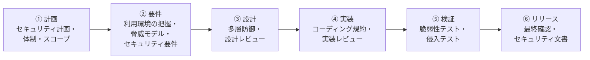
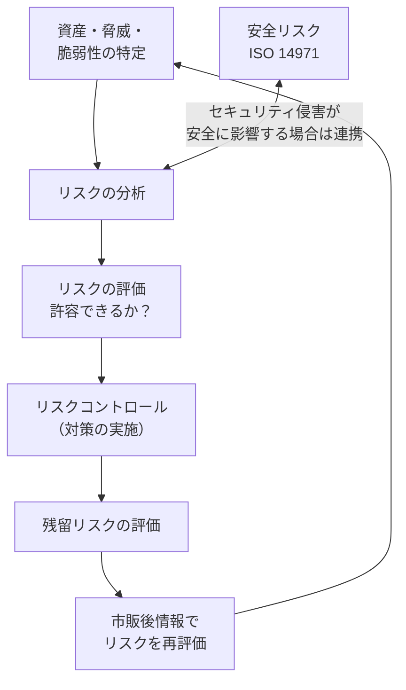
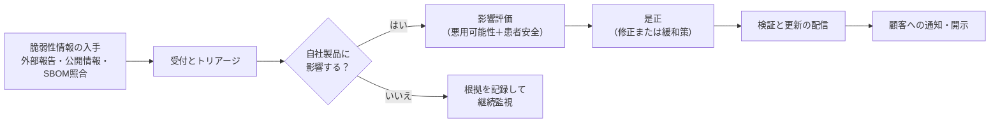
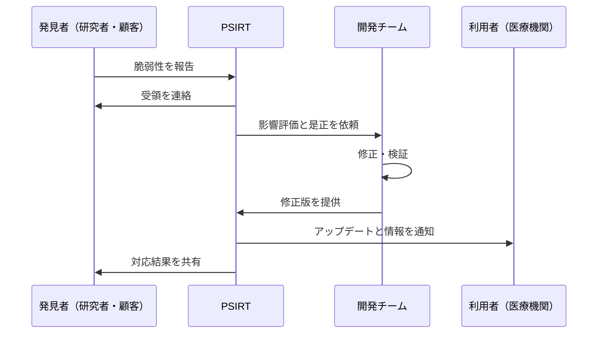
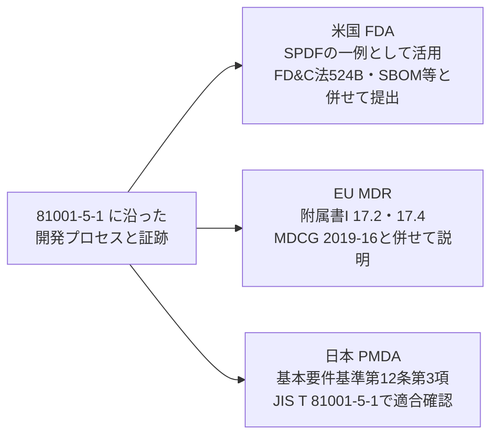
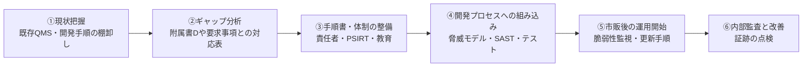

# IEC 81001-5-1:2021 初学者向け完全ガイド

> **対象規格**：IEC 81001-5-1:2021「ヘルスソフトウェア及びヘルスITシステムの安全、有効性及びセキュリティ — 第5-1部：セキュリティ — 製品ライフサイクルにおけるアクティビティ」
> **情報の基準日**：2026年10月13日（この日までに確認できた公開情報にもとづく）
> **想定読者**：ソフトウェアエンジニア／QAエンジニア／医療機器・ヘルスソフトウェアの開発に初めて関わる方
> **公式ページ**：<a href="https://www.iso.org/standard/76097.html" target="_blank" rel="noopener noreferrer">https://www.iso.org/standard/76097.html</a>

---

## 目次

1. [この規格を一言でいうと](#1-この規格を一言でいうと)
2. [最初に押さえる用語](#2-最初に押さえる用語)
3. [関連規格との位置付け](#3-関連規格との位置付け)
4. [発行状況と最新動向（2026年10月13日時点）](#4-発行状況と最新動向2026年10月13日時点)
5. [規格の全体構造](#5-規格の全体構造)
6. [ステップバイステップ解説](#6-ステップバイステップ解説)
7. [IEC 62443-4-1 の8プラクティスとの対応](#7-iec-62443-4-1-の8プラクティスとの対応)
8. [IEC 62304・ISO 14971 との関係（安全とセキュリティの両立）](#8-iec-62304iso-14971-との関係安全とセキュリティの両立)
9. [規制対応：米国・EU・日本](#9-規制対応米国eu日本)
10. [QAエンジニア視点：テストと証跡](#10-qaエンジニア視点テストと証跡)
11. [導入ロードマップ](#11-導入ロードマップ)
12. [よくある誤解と落とし穴](#12-よくある誤解と落とし穴)
13. [チェックリスト](#13-チェックリスト)
14. [用語集](#14-用語集)
15. [根拠ソース一覧（URL）](#15-根拠ソース一覧url)

---

## 1. この規格を一言でいうと

### 1.1 ひとことで

**「医療・ヘルスケア用ソフトウェアを、作る段階から運用・保守の段階まで、サイバー攻撃に強い形で開発し続けるための"作業の型"を定めた規格」** です。

製品そのものの機能（パスワード長は何文字、通信はTLS1.3、など）を細かく決める規格ではありません。**「どんな活動を、どんな順序で、どんな記録を残しながら行うか」というプロセス（やり方）の規格** です。

### 1.2 たとえ話：建物の防犯

| 建物の防犯 | ソフトウェアのセキュリティ |
|---|---|
| 設計段階で「どこから侵入されうるか」を考える | 脅威モデリング・セキュリティ要件定義 |
| 鍵・防犯カメラ・壁の強度を設計に織り込む | セキュアな設計（多層防御など） |
| 施工後に防犯診断を受ける | 脆弱性テスト・侵入テスト |
| 引き渡し後も警備会社が巡回・見直しをする | 脆弱性監視・セキュリティアップデート |
| 防犯設備の台帳を作る | 構成管理・部品表（SBOM等） |

IEC 81001-5-1 は、この「設計から引き渡し後の警備まで」を **ソフトウェアのライフサイクル全体** に当てはめて整理したものです。

### 1.3 規格の正式な目的（要約）

公式の概要によると、次の2点を目的としています。

1. ヘルスソフトウェアの **サイバーセキュリティを高める**（そのために、ライフサイクルの各プロセスに特定のアクティビティとタスクを組み込む）
2. **ソフトウェア開発・保守のプロセス自体の安全性** も高める（作る側の環境が攻撃されない、など）

さらに、**安全性（Safety）・有効性（Effectiveness）・セキュリティ（Security）のバランス** をとることが重要だと明記されています（ISO 81001-1 の考え方）。なお、取扱説明書など「付属文書の中身」の仕様は対象外です。

> 💡 **ここが大事**：IEC 81001-5-1 は **IEC 62443-4-1**（産業用制御システム向けのセキュア製品開発ライフサイクル規格）への適合を **ヘルスソフトウェアの事情に合わせて支える** 位置付けです。つまり「ゼロから作られた新概念」ではなく、実績のある産業セキュリティ規格を医療向けに翻訳・拡張した規格といえます。

---

## 2. 最初に押さえる用語

| 用語 | やさしい説明 | 本規格での意味合い |
|---|---|---|
| **ヘルスソフトウェア** | 健康・医療に関わるソフトウェア全般 | 医療機器ソフトウェア、SaMD、医療機器に組み込まれるソフト、医療機器に該当しないヘルスソフトも含む |
| **SaMD** | Software as a Medical Device。ソフトウェア単体で医療機器となるもの | 対象に含まれる |
| **セキュリティ（Security）** | 悪意ある攻撃から守ること | 機密性・完全性・可用性の確保 |
| **セーフティ（Safety）** | 患者・利用者に危害が及ばないこと | セキュリティ侵害が安全に波及しうる点に注意 |
| **脅威モデリング** | 「誰が・どこから・何を狙うか」を事前に洗い出す作業 | 要件・設計の入力になる |
| **脆弱性** | 攻撃に悪用されうるソフトの弱点 | 開発中にも市販後にも見つかる |
| **SOUP/外部コンポーネント** | 自社で開発していない既存ソフト（OSS・商用ライブラリ等） | 供給元のセキュリティも管理対象 |
| **SBOM** | ソフトウェア部品表。使っている部品の一覧 | 構成管理・脆弱性監視の実践手段として重視される |
| **PSIRT** | 製品のセキュリティ問題を受け付け・対応する窓口／チーム | 市販後の脆弱性対応の要 |
| **セキュリティアップデート** | 脆弱性を直すための更新 | 配信・検証の手順が必要 |
| **TPLC** | Total Product Life Cycle。企画から廃止まで全期間 | 日本の規制文脈でも重要な考え方 |
| **移行期ヘルスソフトウェア（Transitional health software）** | 本規格の発行前に開発済みのソフト | 附属書で「既存ソフトの扱い」が整理されている |

---

## 3. 関連規格との位置付け

### 3.1 関連規格マップ

### 3.2 一覧表

| 規格・文書 | 役割 | 81001-5-1 との関係 |
|---|---|---|
| IEC 62443-4-1 | 産業用の安全な製品開発ライフサイクル | 本規格はその適合を支えるためのヘルスソフト向け要求を定める |
| IEC 62304 | 医療機器ソフトウェアのライフサイクル | 本規格はこの構造（開発・保守・リスク・構成管理・問題解決）を踏襲。ソフトウェア安全クラスに関わらず適用できる設計 |
| IEC 82304-1 | ヘルスソフトウェア製品の安全（単体ソフト） | 補完関係。ヘルスソフトウェア全般のセーフティ側を担う |
| ISO 14971 | 医療機器のリスクマネジメント（安全） | 安全リスクとセキュリティリスクの連携が必要 |
| ISO 81001-1 | ヘルスソフト／ITの安全・有効性・セキュリティの基本概念 | 3要素のバランスの考え方の出典 |
| IEC TR 60601-4-5 | 医用電気機器の技術的セキュリティ仕様 | 製品側の技術要件を補う。プロセス規格の81001-5-1と相互補完 |
| AAMI TIR57 / SW96 | 医療機器セキュリティリスクマネジメント | FDAの文脈で参照される、リスク分析の具体手法 |
| MDCG 2019-16 | EUのサイバーセキュリティガイダンス | EU MDR対応の考え方を示す |

---

## 4. 発行状況と最新動向（2026年10月13日時点）

### 4.1 規格自体のステータス

| 項目 | 内容 | 出典の種類 |
|---|---|---|
| 版 | 第1版（Edition 1）、2021年12月発行（約114ページ） | ISO公式 |
| 担当 | ISO/TC 215（ヘルスインフォマティクス）とIEC SC 62Aの合同WG（JWG 7）が作成 | ISO/IEC公式 |
| 現在のステージ | **90.92「改訂予定（To be revised）」**（2025年9月19日付） | ISO公式 |
| 改訂版 | **IEC/AWI 81001-5-1（第2版）** が新規プロジェクトとして承認済み（2025年9月22日、ステージ10.99）。起草が始まった段階 | ISO公式 |
| 解釈シート | **IEC 81001-5-1:2021/ISH1:2025**（解釈シート1、3ページ）が2025年12月4日に発行 | IEC Webstore |
| 欧州版 | EN IEC 81001-5-1:2022（EN規格として採用） | CENELEC系の規格情報 |
| 日本版 | JIS T 81001-5-1（2023年2月25日制定） | PMDA規格情報 |

> 💡 **初学者向けメモ**：「改訂予定」は **「現行版が使えなくなった」という意味ではありません**。ISOの規格は5年ごとに見直され、その結果「改訂する」と決まった状態です。第2版が出るまでは第1版（2021年版）が現行です。解釈シート（ISH1）は IEC Webstore の掲載価格が CHF 0 と表示されていますが、本ガイドでは内容を確認できていません。入手条件は IEC Webstore で確認し、実務で使う場合は原文を入手して確認してください。

### 4.2 年表

### 4.3 地域ごとの現状（要点）

| 地域 | 現状（確認できた範囲） | 注意点 |
|---|---|---|
| **米国** | FDA承認コンセンサス標準として認識され、市販前サイバーセキュリティガイダンスでも、セキュア製品開発フレームワーク（SPDF）の例として参照されている | ガイダンスは2026年2月3日付。QMSR（2026年2月2日施行）に用語を合わせた改訂が中心で、SPDFの考え方自体は変わっていない、との解説がある |
| **EU** | 欧州委員会の標準化要請（M/575）で整合規格化の対象に挙がっている。ノーボ（公認機関）側は「最新技術水準（state of the art）」として扱う傾向 | **整合規格として官報に掲載済みかは、情報源により記述が割れている**（4.4参照） |
| **日本** | 2023年3月31日付の通知で基本要件基準第12条第3項が新設。JIS T 81001-5-1等への適合確認が参照規格として示された。経過措置は2024年3月31日まで | 通知上の追加要求（窓口・脆弱性開示手順）が規格本文にない点に注意（9.3参照） |

### 4.4 EU整合規格化の状況について（要確認事項）

調査の結果、次のように **情報源間で記述が一致していません**。

- Johner Institute の解説は、整合化の計画日を **2028年5月27日** へ変更（2025年5月9日付の更新）と記載。URM Consulting も、期限が2028年5月27日に移ったと記載
- 一方、あるサイバーセキュリティ企業のブログは「官報（OJ 2024/1878）経由で整合済み」と記載
- 欧州委員会の公式一覧では、MDRの整合規格決定（2021/1182）の改正が2024年3月6日・2024年10月8日・2025年4月8日・2025年10月17日・2026年1月28日・2026年4月1日・2026年6月11日（決定 (EU) 2026/1231）と並んでおり、**2024年7月付の改正は見当たらない**。2026年6月11日付の決定は生物学的評価・記号・医用電気機器・洗浄消毒器などの規格を対象としており、民間の解説が挙げる収録規格の一覧にも本規格は含まれていない。ただし、官報の附属書本文は今回の調査で直接確認できておらず、2025年10月以降の各改正に本規格が含まれるかは未確認

> ⚠️ **結論**：「EUで整合済みか」は **本ガイドでは断定しません**。EU市場向けの場合は、欧州委員会の整合規格ページ（15章の出典）で最新の官報リストを直接確認してください。整合の有無にかかわらず、ノーボが81001-5-1を実務上の基準として見る点は複数の情報源で一致しています。

---

## 5. 規格の全体構造

### 5.1 6つのプロセス

IEC 81001-5-1 は、IEC 62304 と似た「プロセスの並べ方」をとっています。公開されている目次・概要から確認できる構成は次のとおりです。

| 構成要素 | 内容のイメージ | 初学者向けの一言 |
|---|---|---|
| 一般要求事項 | QMS（品質マネジメントシステム）、リスクマネジメント、責任体制、外部コンポーネントの扱いなど | 「土台づくり」 |
| ソフトウェア開発プロセス | セキュリティ要件、セキュアな設計、実装、検証、リリース | 「作る時にやること」 |
| ソフトウェア保守プロセス | 市販後の脆弱性監視、更新、サポート | 「出した後にやること」 |
| セキュリティリスクマネジメント | 脅威・脆弱性の特定、評価、対策、残留リスク | 「リスクを管理する」 |
| ソフトウェア構成管理 | 構成要素の識別、変更管理、完全性の確保 | 「部品と変更を追跡する」 |
| ソフトウェア問題解決 | 問題（脆弱性を含む）の受付・分析・是正 | 「見つかった問題を直し切る」 |

### 5.2 附属書（公開情報で確認できる範囲）

| 附属書 | 内容 |
|---|---|
| 附属書A | 関連規格（IEC 62443、IEC 62304など）との関係 |
| 附属書B（参考） | セキュリティ ライフサイクル アクティビティの実装ガイダンス |
| 附属書D | IEC 81001-5-1 と IEC 62443-4-1:2018 の **双方向の対応表** |
| 附属書F | **移行期ヘルスソフトウェア**（発行前に開発済みのソフトの扱い） |

> 💡 **使い方のコツ**：IEC 62443-4-1 を知っている組織は、まず附属書Dの対応表で「すでに満たしている部分」と「ヘルスソフトで追加が必要な部分」を切り分けると、ギャップ分析が速く進みます。

---

## 6. ステップバイステップ解説

ここからが本編です。**「自分の製品に当てはめるとき、何を順番に考えればよいか」** をステップで説明します。

> 📌 **読み方の注意**：標準本文は有償で、著作権があります。以下は公開情報と、ベースとなる IEC 62443-4-1 の実務的な考え方を踏まえた **一般的な解説** であり、本文の逐語的な要求ではありません。正式な適合判断には必ず原文を参照してください。

### Step 0：自分の製品は対象か？

- 対象は **医療機器ソフトウェア、SaMD、医療機器に組み込まれるソフト、医療機器に当たらないヘルスソフト** まで広い
- IEC 62304 は安全クラス（A/B/C）でライフサイクル活動が変わるが、81001-5-1 は **安全クラスに関わらず適用できる** 設計とされている（法律事務所の解説による）

### Step 1：土台をつくる（一般要求事項）

**目的**：セキュリティ活動が「個人の頑張り」ではなく「組織の仕組み」になるようにする。

| やること | 具体例 |
|---|---|
| 品質マネジメントシステム（QMS）に組み込む | ISO 13485 のQMSの中に、セキュリティ活動の手順書・記録を位置付ける |
| 責任と権限を決める | セキュリティ責任者、PSIRT担当、レビュー担当の明確化 |
| 力量（スキル）を確保する | セキュアコーディング教育、脅威モデリングの訓練 |
| 開発環境を守る | ソースコード・署名鍵・ビルド環境へのアクセス制御、秘密鍵の管理 |
| 外部コンポーネントを管理する | OSS・商用ライブラリ・外部委託先のセキュリティ要件の確認 |
| プロセス自体を検証・改善する | 内部監査、振り返り、継続的改善 |

> 💡 **つまずきポイント**：「開発環境のセキュリティ」を忘れがちです。**製品が安全でも、ビルドサーバが乗っ取られれば製品に不正コードが混入します**。本規格がプロセス自体の安全性（目的の2点目）に触れているのはこのためです。

### Step 2：セキュリティ要件を決める（開発プロセス前半）

**① 計画**：セキュリティ活動を計画に組み込む。何を・誰が・いつ・どの深さで行うか。

**② 要件**（ここが肝）

1. **製品のセキュリティコンテキストを把握する** — どこで使われるか（病院ネットワーク、在宅、クラウド連携、USB、無線）
2. **脅威モデルを作る** — 守る資産（患者データ、診断結果、設定値）、攻撃者、攻撃経路を洗い出す
3. **セキュリティ要件を書く** — 認証、権限、通信保護、ログ、更新、データ保護など。**テストできる形** で書く
4. **要件をレビューする** — 安全要件と矛盾していないかも確認

> 💡 **QAの視点**：要件が「安全に通信すること」では、テストできません。「外部通信はTLS1.2以上、証明書検証を必須とする」のように **合否が判定できる文** にします。

### Step 3：セキュアに設計・実装する

**設計**

- **多層防御（Defense in depth）**：1つの防御が破られても次が守る
- **攻撃対象領域（Attack surface）の縮小**：不要なポート・機能・デバッグ口を残さない
- **最小権限**：各コンポーネントに必要最小限の権限だけを与える
- **設計レビュー**：セキュリティの観点で、設計を第三者目線で見る

**実装**

- **セキュアコーディング規約** を定め、守る
- **実装レビュー**：コードレビュー、静的解析（SAST）の活用
- **外部コンポーネントの確認**：既知の脆弱性がないか

| よくあるセキュアコーディングの観点 | 例 |
|---|---|
| 入力検証 | 想定外の長さ・形式の入力を拒否する |
| メモリ安全 | バッファオーバーフローの防止 |
| 認証・認可 | 権限のチェック漏れを作らない |
| 秘密情報 | パスワード・鍵をソースにハードコードしない |
| エラー処理 | 内部情報をエラーメッセージに出さない |

### Step 4：検証する（セキュリティテスト）

| テストの種類 | 目的 | 備考 |
|---|---|---|
| セキュリティ要件テスト | 要件どおり実装されているか | 要件ごとにトレース |
| 脅威対策テスト | 脅威モデルの対策が効いているか | 脅威→対策→テストの対応 |
| 脆弱性テスト | 既知の脆弱性・ファジング等で弱点を探す | 自動ツールの活用 |
| 侵入テスト | 攻撃者の視点で破れるか試す | 独立性（担当を分ける）が求められうる |
| テスト担当の独立性 | 開発者本人だけで済ませない | レベルは段階的（graded）に考える |

> 💡 **ここが81001-5-1らしい点**：検証で見つかった問題は、「次のリリースで直そう」ではなく、**ソフトウェア問題解決プロセス** に乗せて追跡・是正・再検証まで管理します（Step 7）。

### Step 5：セキュリティリスクを管理する

- セキュリティリスクマネジメントは **一度きりではなく、循環する活動** です
- セキュリティの問題が **患者安全に影響しうる場合は、ISO 14971 の安全リスクマネジメントと連携** します（詳細は8章）
- 実務では AAMI TIR57 / SW96 が、分析手法（脅威の評価の仕方など）の参考にされます

### Step 6：構成を追跡する（構成管理）

| やること | 狙い |
|---|---|
| 構成要素の識別 | 何がどのバージョンで製品に入っているか分かる |
| 変更管理 | 誰が・なぜ・何を変えたか追える |
| 完全性の確保 | 配布物が改ざんされていないことを担保（署名・ハッシュ等） |
| 外部コンポーネントの一覧管理 | 脆弱性公表時に影響範囲を即座に調べられる |

> 💡 **SBOMとの関係**：SBOMは「部品表を機械可読な形で持つ」実践手段です。日本の実務解説（KPMG）でも、基本要件基準第12条第3項への適合の重点分野としてSBOMの作成・活用とPSIRT体制が挙げられています。**ただし規格本文でのSBOMの扱いは有償本文で確認してください**。

### Step 7：出荷後も守る（保守・問題解決）

**市販後に特に重要な活動**

| 活動 | 内容 |
|---|---|
| 脆弱性の継続的な監視 | CVE・ベンダー情報・OSSの公開情報を追う |
| 受付窓口（PSIRT） | 外部の研究者や顧客から報告を受ける入口を用意する |
| 影響評価 | 悪用のしやすさ ＋ **患者安全への影響** を併せて評価する |
| セキュリティアップデート | 検証 → 配信 → 適用状況の把握までを手順化する |
| 顧客・利用者への情報提供 | 脆弱性や回避策を知らせる |
| 製品のサポート終了への備え | 終了後の扱い・廃棄時のガイドも用意 |

**脆弱性報告の典型的なやり取り**

### Step 8：既存ソフトの扱い（移行期ヘルスソフトウェア）

- 規格の発行前に開発済みで、本規格に沿って作られていないソフトのための考え方が **附属書F** にまとめられています
- 手順の考え方：現状の把握 → 不足するセキュリティ活動の洗い出し → リスクに応じた補完 → 以降の変更は新しいプロセスで管理
- IEC 62304 のレガシーソフトウェアの考え方に近い位置付けです

---

## 7. IEC 62443-4-1 の8プラクティスとの対応

81001-5-1 は 62443-4-1 への適合を支える規格なので、**62443-4-1 の8つのプラクティス** を頭に入れておくと全体が見通せます。

| 略号 | プラクティス | 内容のイメージ | 本ガイドの対応Step |
|---|---|---|---|
| SM | セキュリティマネジメント | 体制・教育・開発環境・外部コンポーネント管理 | Step 1 |
| SR | セキュリティ要件の仕様化 | セキュリティコンテキスト・脅威モデル・要件 | Step 2 |
| SD | セキュアな設計 | 設計原則・多層防御・設計レビュー | Step 3 |
| SI | セキュアな実装 | コーディング規約・実装レビュー | Step 3 |
| SVV | セキュリティの検証・妥当性確認テスト | 要件テスト・脆弱性テスト・侵入テスト | Step 4 |
| DM | セキュリティ関連問題の管理 | 受付・評価・是正・開示 | Step 7 |
| SUM | セキュリティアップデート管理 | 更新の適格性確認・文書化・配信 | Step 7 |
| SG | セキュリティガイドライン | 利用者向けの堅牢化・運用・廃棄のガイド | Step 7 |

> ⚠️ これは **概念的な対応** です。厳密な条項レベルの対応関係は、規格の **附属書D（双方向の対応表）** を参照してください。

---

## 8. IEC 62304・ISO 14971 との関係（安全とセキュリティの両立）

### 8.1 なぜ連携が必要か

- **セーフティ**は「システムが意図せず患者に害を与えないこと」
- **セキュリティ**は「悪意ある者に不正利用されないこと」

両者は別物ですが、**セキュリティ侵害が患者安全に影響する** ことがあります（例：投与量の設定値が改ざんされる）。逆に、安全対策のための機能がセキュリティを弱めることもあります。

| 観点 | 安全リスク（ISO 14971） | セキュリティリスク（81001-5-1・SW96等） |
|---|---|---|
| 起点 | ハザード（危険源） | 脅威・脆弱性 |
| 原因 | 偶発的な不具合・誤使用が中心 | **悪意ある行為** を含む |
| 時間変化 | 比較的安定 | **新しい脆弱性で日々変化する** |
| 市販後 | 苦情・不具合情報 | 脆弱性情報の継続監視 |
| 連携のポイント | セキュリティ侵害が危害につながる経路を安全側でも評価する | 安全影響の大きいものを優先度高く扱う |

### 8.2 IEC 62304 との使い分け

| | IEC 62304 | IEC 81001-5-1 |
|---|---|---|
| 主な焦点 | 安全なソフトウェアのライフサイクル | **セキュリティ** のライフサイクル活動 |
| 構造 | 開発・保守・リスク・構成管理・問題解決 | 同じ枠組みにセキュリティ活動を重ねる |
| 実務 | 両方を **ひとつのQMS・ひとつの開発プロセス** に統合するのが現実的 | 同左 |

> 💡 **実務の知恵**：両規格を別々の手順書にすると、運用が二重になります。**62304のプロセス図の各工程に、セキュリティ活動を書き足す形** で1つに統合すると、教育・監査が楽になります。

---

## 9. 規制対応：米国・EU・日本

### 9.1 米国（FDA）

| 項目 | 内容 |
|---|---|
| 位置付け | FDAの承認コンセンサス標準として認識。ガイダンス中で、SPDF（セキュア製品開発フレームワーク）の枠組みの例として参照 |
| 最新ガイダンス | 2026年2月3日発行の市販前サイバーセキュリティガイダンス（2025年6月27日版を置き換え） |
| 変更点 | QSRからQMSRへの用語整合が中心。SPDF等の実質的な要求は継続との解説あり |
| 法的な根拠 | FD&C法524B条（「サイバーデバイス」に対する法定要件）。ガイダンスは「現在の考え方」であり、法律そのものとは区別される |
| 併せて求められるもの | SBOM、脅威モデリング、市販後の脆弱性管理計画など |

> ⚠️ ガイダンスの正式な題名の表記は情報源によって揺れがあります。提出前には FDA の原文（<https://www.fda.gov/media/119933/download>）で最新の題名・要求を確認してください。

### 9.2 欧州（EU MDR）

| 項目 | 内容 |
|---|---|
| 関連要求 | MDR附属書I の一般安全性能要求事項（ソフトウェア関連の17.2、ITセキュリティの17.4など） |
| ガイダンス | MDCG 2019-16（サイバーセキュリティ） |
| 本規格の位置付け | 整合規格化の対象（標準化要請M/575）。**官報掲載の有無は4.4の通り要確認** |
| 実務 | ノーボは実務上の基準として見る傾向。EN IEC 81001-5-1:2022 への対応を準備するのが安全 |

### 9.3 日本（厚生労働省・PMDA）

| 項目 | 内容 |
|---|---|
| 法令 | 2023年3月31日付で医療機器の基本要件基準に **第12条第3項（サイバーセキュリティ）** が新設 |
| 参照規格 | JIS T 81001-5-1 等への適合性を示すことで確認できるとされた（IEC 81001-5-1 等の国際規格も可） |
| 適用時期 | 2023年4月1日から適用、**経過措置は2024年3月31日まで** |
| 適合性確認通知 | 令和5年5月23日付 薬生機審発0523第1号 |
| 注意点 | PMDAのQ&Aによると、**「セキュリティに対する窓口の明確化」「顧客への脆弱性等の開示手順」は JIS T 81001-5-1 に明示的に含まれていない** が、通知上の要求事項として別途対応が必要 |

> 💡 **日本向けの落とし穴**：「JIS T 81001-5-1 に適合すれば十分」と考えると、**窓口と開示手順が抜ける** 可能性があります。規格 + 通知・手引書の **両方を満たす文書マッピング** を作りましょう。

---

## 10. QAエンジニア視点：テストと証跡

### 10.1 QAが関わるポイント

| ライフサイクル | QAの関わり方 |
|---|---|
| 要件 | セキュリティ要件が **テスト可能** かレビュー |
| 設計 | 脅威→対策→テストの **トレーサビリティ** 設計 |
| 実装 | 静的解析・依存関係スキャンの CI 組み込み |
| 検証 | 脆弱性テスト・ファジング・侵入テストの計画・実施・記録 |
| リリース | セキュリティ関連の未解決事項の最終確認 |
| 保守 | 更新パッチの回帰テスト、更新機構自体の検証 |

### 10.2 トレーサビリティの例

| 脅威（例） | セキュリティ要件（例） | 設計上の対策（例） | 検証（例） |
|---|---|---|---|
| 不正な管理者操作 | 管理機能は認証済みの管理者のみ | ロールベースのアクセス制御 | 権限昇格を試す認可テスト |
| 通信の盗聴・改ざん | 外部通信は暗号化し、サーバ証明書を検証する | TLS設定の強制 | 不正証明書を提示する異常系テスト |
| 不正なファームウェア | 署名検証に通った更新のみ適用する | 署名付き更新パッケージ | 改ざんパッケージの適用拒否テスト |
| 既知脆弱性のある部品 | 出荷時点で既知の重大な脆弱性を残さない | 依存関係の管理・更新 | SBOMとのスキャン照合 |

### 10.3 証跡（記録）として一般的に用意される文書例

| 目的 | 文書例（名称は組織で異なる） |
|---|---|
| 計画 | セキュリティ計画書、サイバーセキュリティ管理計画 |
| 要件・リスク | 脅威モデル、セキュリティリスク管理ファイル、セキュリティ要件仕様 |
| 設計・実装 | セキュリティ設計書、コーディング規約、レビュー記録 |
| 検証 | セキュリティテスト計画・報告書、侵入テスト報告書 |
| 構成管理 | SBOM、構成管理計画、リリース記録 |
| 保守 | 脆弱性対応手順書、PSIRT手順、更新手順、顧客向け情報 |
| 利用者向け | セキュリティガイド（堅牢化・運用・廃棄） |

> 📌 日本では、規格の要求事項と社内文書をマッピングし、不足文書を作成するアプローチが実務解説（KPMG Japan）で紹介されています。

---

## 11. 導入ロードマップ

| 段階 | 主なアウトプット | 期間の目安（一般論） |
|---|---|---|
| ①現状把握 | 既存プロセス一覧 | 数週間 |
| ②ギャップ分析 | 対応表・不足一覧 | 数週間〜 |
| ③整備 | 手順書・体制 | 数か月 |
| ④組み込み | パイロット製品での運用 | 製品サイクルに依存 |
| ⑤運用 | PSIRT・監視の稼働 | 継続 |
| ⑥改善 | 監査記録・改善計画 | 年次 |

> 💡 **現実的な進め方**：すべての製品に一斉適用せず、**規制要求の厳しい新製品 1 つ** を先行適用してプロセスを磨き、他製品へ展開する方が失敗が少ないです。

---

## 12. よくある誤解と落とし穴

| 誤解 | 実際 |
|---|---|
| 「この規格に準拠すれば製品は安全」 | プロセス規格であり、**製品が破られないことを保証するものではない** |
| 「脆弱性テストを1回やればよい」 | 市販後も **継続的に監視・更新** する |
| 「セキュリティは開発部門だけの仕事」 | QMS・購買・サポート・経営まで **組織の仕組み** が必要 |
| 「62304があるので別に要らない」 | 62304は主に安全。セキュリティ活動は **別途の要求** がある |
| 「SBOMを出せば終わり」 | SBOMは **使って初めて価値がある**（脆弱性の照合・影響調査） |
| 「日本はJIS T 81001-5-1だけでOK」 | 通知上の **窓口・開示手順の要求** も必要（9.3参照） |
| 「改訂予定なら現行版は使えない」 | 第2版の発行までは **現行（2021年版）が有効** |

---

## 13. チェックリスト

**組織・体制**

- [ ] セキュリティ活動がQMSの手順書に位置付けられている
- [ ] セキュリティ責任者とPSIRT担当が決まっている
- [ ] 開発環境（ソースコード・署名鍵・ビルド）のアクセス制御がある
- [ ] 外部コンポーネント・委託先のセキュリティ要件を確認している

**開発**

- [ ] 製品のセキュリティコンテキストと脅威モデルがある
- [ ] セキュリティ要件がテスト可能な形で書かれている
- [ ] 設計レビュー・実装レビューを実施している
- [ ] セキュアコーディング規約を運用している

**検証**

- [ ] 要件・脅威対策・脆弱性・侵入の各テストを計画・実施している
- [ ] 見つかった問題が問題解決プロセスで追跡されている

**市販後**

- [ ] 脆弱性の入手・トリアージ・評価の手順がある
- [ ] 更新の検証・配信の手順がある
- [ ] 顧客への情報提供・開示の手順がある

**リスク・規制**

- [ ] 安全リスクとセキュリティリスクを連携して管理している
- [ ] 販売地域ごとの要求（FDA・EU・日本）を文書マッピングしている

---

## 14. 用語集

| 用語 | 説明 |
|---|---|
| AWI | Approved Work Item。新規プロジェクトとして承認された段階 |
| CVE | 公開されている脆弱性の共通識別子 |
| Defense in depth | 多層防御 |
| FDA SPDF | FDAが提唱するセキュア製品開発フレームワーク |
| ISH | Interpretation Sheet（解釈シート）。規格の解釈を補う文書 |
| MDCG | EUの医療機器調整グループ |
| QMSR | 米国の品質マネジメントシステム規則（ISO 13485:2016を参照） |
| SAST | 静的アプリケーションセキュリティテスト |
| SPDF | Secure Product Development Framework |
| TPLC | 製品の全ライフサイクル |

---

## 15. 根拠ソース一覧（URL）

> 🔎 **調査の注記**：今回の調査では、**特定の個人開発者のブログ記事よりも、規格団体・規制当局・認証機関・専門コンサルティングの公開記事** が主な情報源となりました。各情報には、公式情報と民間解説の区別を意識して出典を付けています。

### 15.1 規格団体・公式情報（最優先）

| 内容 | URL |
|---|---|
| ISO：IEC 81001-5-1:2021 公式ページ（ステージ・概要） | <a href="https://www.iso.org/standard/76097.html" target="_blank" rel="noopener noreferrer">https://www.iso.org/standard/76097.html</a> |
| ISO：IEC/AWI 81001-5-1（第2版・開発中） | <a href="https://www.iso.org/standard/92904.html" target="_blank" rel="noopener noreferrer">https://www.iso.org/standard/92904.html</a> |
| IEC Webstore：解釈シート ISH1:2025 | <a href="https://webstore.iec.ch/en/publication/108664" target="_blank" rel="noopener noreferrer">https://webstore.iec.ch/en/publication/108664</a> |
| 目次情報（iTeh） | <a href="https://iteh.eu/catalog/standards/iso/227a3148-4206-42e3-ad21-05f80dda507a/iec-81001-5-1-2021" target="_blank" rel="noopener noreferrer">https://iteh.eu/catalog/standards/iso/227a3148-4206-42e3-ad21-05f80dda507a/iec-81001-5-1-2021</a> |
| BSI：概要 | <a href="https://knowledge.bsigroup.com/products/health-software-and-health-it-systems-safety-effectiveness-and-security-security-activities-in-the-product-life-cycle-1" target="_blank" rel="noopener noreferrer">https://knowledge.bsigroup.com/products/health-software-and-health-it-systems-safety-effectiveness-and-security-security-activities-in-the-product-life-cycle-1</a> |
| 欧州版 EN IEC 81001-5-1:2022（Genorma） | <a href="https://genorma.com/en/standards/en-iec-81001-5-1-2022" target="_blank" rel="noopener noreferrer">https://genorma.com/en/standards/en-iec-81001-5-1-2022</a> |
| オーストラリア デジタルヘルス庁：規格情報 | <a href="https://developer.digitalhealth.gov.au/standards/health-software-and-health-it-systems-safety-effectiveness-and-security-part-5-1-security-activities-in-the-product-life-cycle" target="_blank" rel="noopener noreferrer">https://developer.digitalhealth.gov.au/standards/health-software-and-health-it-systems-safety-effectiveness-and-security-part-5-1-security-activities-in-the-product-life-cycle</a> |

### 15.2 規制当局

| 内容 | URL |
|---|---|
| FDA：市販前サイバーセキュリティガイダンス（2026年2月3日） | <a href="https://www.fda.gov/media/119933/download" target="_blank" rel="noopener noreferrer">https://www.fda.gov/media/119933/download</a> |
| 欧州委員会：医療機器の整合規格 | <a href="https://health.ec.europa.eu/medical-devices-topics-interest/harmonised-standards_en" target="_blank" rel="noopener noreferrer">https://health.ec.europa.eu/medical-devices-topics-interest/harmonised-standards_en</a> |
| 欧州委員会：整合規格の官報掲載の一覧 | <a href="https://single-market-economy.ec.europa.eu/single-market/goods/european-standards/harmonised-standards/medical-devices_en" target="_blank" rel="noopener noreferrer">https://single-market-economy.ec.europa.eu/single-market/goods/european-standards/harmonised-standards/medical-devices_en</a> |
| 欧州委員会：標準化要請 M/575 | <a href="https://health.ec.europa.eu/document/download/6eb9d1d8-7d9c-4442-9016-1eb84ab8492f_en?filename=md_mdr-ivdr-consolidated-stand-req-m-575.pdf" target="_blank" rel="noopener noreferrer">https://health.ec.europa.eu/document/download/6eb9d1d8-7d9c-4442-9016-1eb84ab8492f_en?filename=md_mdr-ivdr-consolidated-stand-req-m-575.pdf</a> |
| 厚生労働省：医療機器のサイバーセキュリティ関連 | <a href="https://www.mhlw.go.jp/stf/seisakunitsuite/bunya/0000179749_00009.html" target="_blank" rel="noopener noreferrer">https://www.mhlw.go.jp/stf/seisakunitsuite/bunya/0000179749_00009.html</a> |
| PMDA：基本要件基準第12条第3項のQ&A | <a href="https://www.pmda.go.jp/files/000269641.pdf" target="_blank" rel="noopener noreferrer">https://www.pmda.go.jp/files/000269641.pdf</a> |
| PMDA：規格情報（IEC 81001-5-1 Ed.1の概要） | <a href="https://www.std.pmda.go.jp/stdDB/Data_en/InfData/Infetc/kikaku_info_iec81001-5-1_ed1.pdf" target="_blank" rel="noopener noreferrer">https://www.std.pmda.go.jp/stdDB/Data_en/InfData/Infetc/kikaku_info_iec81001-5-1_ed1.pdf</a> |

### 15.3 専門家・コンサルティング・認証機関の解説

| 発信元 | 内容 | URL |
|---|---|---|
| Johner Institute | 規格の全体像・EU整合化の計画日 | <a href="https://blog.johner-institute.com/iec-62304-medical-software/iec-81001-5-1/" target="_blank" rel="noopener noreferrer">https://blog.johner-institute.com/iec-62304-medical-software/iec-81001-5-1/</a> |
| Johner Institute | FDAガイダンスとの関係 | <a href="https://blog.johner-institute.com/iec-62304-medical-software/fda-guidance-on-cybersecurity/" target="_blank" rel="noopener noreferrer">https://blog.johner-institute.com/iec-62304-medical-software/fda-guidance-on-cybersecurity/</a> |
| MD101 Consulting | 規格の実務的な見方・EUノーボの視点 | <a href="https://blog.cm-dm.com/post/2024/02/23/IEC-81001-5-1-Right-Here-Right-Now" target="_blank" rel="noopener noreferrer">https://blog.cm-dm.com/post/2024/02/23/IEC-81001-5-1-Right-Here-Right-Now</a> |
| MD101 Consulting | 発行前の位置付けの解説 | <a href="https://blog.cm-dm.com/post/2021/07/09/Cybersecurity-standards:-IEC-81001-5-1-and-IEC/TR-60601-4-5" target="_blank" rel="noopener noreferrer">https://blog.cm-dm.com/post/2021/07/09/Cybersecurity-standards:-IEC-81001-5-1-and-IEC/TR-60601-4-5</a> |
| King & Spalding | 62304との関係・移行期ソフト（附属書F） | <a href="https://www.kslaw.com/attachments/000/009/407/original/New_Standard_Maps_Medical_Device_Software_Development_Standard_to_Health_Software_and_Health_IT_Cybersecurity.pdf?1644335254=" target="_blank" rel="noopener noreferrer">https://www.kslaw.com/attachments/000/009/407/original/New_Standard_Maps_Medical_Device_Software_Development_Standard_to_Health_Software_and_Health_IT_Cybersecurity.pdf?1644335254=</a> |
| TÜV SÜD | 規格解説ウェビナー（英語） | <a href="https://www.tuvsud.com/en-us/resource-centre/webinar/cybersecurity-in-medical-devices-and-the-role-of-iec-81001-5-1" target="_blank" rel="noopener noreferrer">https://www.tuvsud.com/en-us/resource-centre/webinar/cybersecurity-in-medical-devices-and-the-role-of-iec-81001-5-1</a> |
| テュフズード（日本） | 日本の要求と規格の解説 | <a href="https://www.tuvsud.com/ja-jp/services/training/ac/medical/open-schedule/iec81001-5-1" target="_blank" rel="noopener noreferrer">https://www.tuvsud.com/ja-jp/services/training/ac/medical/open-schedule/iec81001-5-1</a> |
| Intertek | 規格の概要ブログ | <a href="https://www.intertek.com/blog/2025/03-11-iec-81001-5-1/" target="_blank" rel="noopener noreferrer">https://www.intertek.com/blog/2025/03-11-iec-81001-5-1/</a> |
| URM Consulting | 整合規格化の期限・FDA認定の経緯 | <a href="https://www.urmconsulting.com/blog/iso-13485-and-beyond-key-updates-shaping-the-medical-device-regulatory-landscape" target="_blank" rel="noopener noreferrer">https://www.urmconsulting.com/blog/iso-13485-and-beyond-key-updates-shaping-the-medical-device-regulatory-landscape</a> |
| Exponent | FDAガイダンスとSPDFの関係 | <a href="https://www.exponent.com/article/navigating-fdas-cybersecurity-medical-devices-guidance" target="_blank" rel="noopener noreferrer">https://www.exponent.com/article/navigating-fdas-cybersecurity-medical-devices-guidance</a> |
| Hattrick IT | 2026年2月版FDAガイダンスの変更点 | <a href="https://www.hattrick-it.com/blog/cybersecurityguidanceupdate/" target="_blank" rel="noopener noreferrer">https://www.hattrick-it.com/blog/cybersecurityguidanceupdate/</a> |

### 15.4 日本語の解説

| 発信元 | 内容 | URL |
|---|---|---|
| @IT MONOist | 国内の医療サイバーセキュリティ規制の整備状況 | <a href="https://monoist.itmedia.co.jp/mn/articles/2401/17/news010_2.html" target="_blank" rel="noopener noreferrer">https://monoist.itmedia.co.jp/mn/articles/2401/17/news010_2.html</a> |
| @IT MONOist | 経過措置と適合性確認 | <a href="https://monoist.itmedia.co.jp/mn/articles/2402/22/news027_2.html" target="_blank" rel="noopener noreferrer">https://monoist.itmedia.co.jp/mn/articles/2402/22/news027_2.html</a> |
| KPMG Japan | JIS T 81001-5-1 を例にした企業側の対応 | <a href="https://kpmg.com/jp/ja/insights/2024/05/med-equipment-cyber.html" target="_blank" rel="noopener noreferrer">https://kpmg.com/jp/ja/insights/2024/05/med-equipment-cyber.html</a> |

### 15.5 情報の確度についての注記

| 注記 | 内容 |
|---|---|
| 公式情報で確認できたこと | 発行年月、ステージ（改訂予定）、第2版のAWI承認、解釈シートの存在、日本の通知・経過措置 |
| 民間解説に依拠していること | FDAでの認定の経緯、EUノーボの実務的な見方、各ステップの実務的な説明 |
| 未確認・要確認 | EUでの整合規格としての官報掲載の有無、解釈シートISH1の内容、規格本文の逐語的な要求 |

---

*本ガイドは公開情報にもとづく学習用の解説であり、規格本文の代替ではありません。規格本文は著作権で保護されています。適合判断・規制対応・申請書類の作成には、必ず最新の規格原文・規制文書・専門家の助言をご確認ください。*
