# IEC 62304:2006 初学者向けステップバイステップ解説ガイド

**医療機器ソフトウェア ― ソフトウェアライフサイクルプロセス**

> **情報時点**: 2026年10月23日までに確認できた公開情報に基づきます。
> **重要**: 本ガイドは学習用の解説です。規格本文の転載は行っておらず、要求事項の最終判断（特にクラス別の適用範囲）は、必ず規格原文（IEC 62304:2006+AMD1:2015 / JIS T 2304:2017）で確認してください。

---

## 目次

1. [30秒でわかる IEC 62304](#1-30秒でわかる-iec-62304)
2. [規格の基本情報](#2-規格の基本情報)
3. [適用範囲：何を決める規格で、何を決めない規格か](#3-適用範囲何を決める規格で何を決めない規格か)
4. [最低限おさえる用語](#4-最低限おさえる用語)
5. [全体像：規格の構造マップ](#5-全体像規格の構造マップ)
6. [Step 1：ソフトウェア安全クラスを決める（箇条4.3）](#6-step-1ソフトウェア安全クラスを決める箇条43)
7. [Step 2：開発プロセスを回す（箇条5）](#7-step-2開発プロセスを回す箇条5)
8. [Step 3：保守プロセス（箇条6）](#8-step-3保守プロセス箇条6)
9. [Step 4：ソフトウェアリスクマネジメント（箇条7）](#9-step-4ソフトウェアリスクマネジメント箇条7)
10. [Step 5：構成管理（箇条8）](#10-step-5構成管理箇条8)
11. [Step 6：問題解決（箇条9）](#11-step-6問題解決箇条9)
12. [SOUP とレガシーソフトウェア](#12-soup-とレガシーソフトウェア)
13. [関連規格との関係](#13-関連規格との関係)
14. [規制上の位置づけ（EU / 米国 / 日本）](#14-規制上の位置づけeu--米国--日本)
15. [アジャイル・CI/CD・AI との付き合い方](#15-アジャイルcicdai-との付き合い方)
16. [第2版（Edition 2）の最新動向](#16-第2版edition-2の最新動向)
17. [導入ロードマップと成果物チェックリスト](#17-導入ロードマップと成果物チェックリスト)
18. [よくある失敗と対策](#18-よくある失敗と対策)
19. [理解度チェック](#19-理解度チェック)
20. [根拠ソース一覧（URL）](#20-根拠ソース一覧url)

---

## 1. 30秒でわかる IEC 62304

| 問い | 答え |
|---|---|
| 何の規格？ | 医療機器に使われる**ソフトウェアの開発と保守のプロセス**を定めた国際規格 |
| 何を求める？ | 計画 → 要求 → 設計 → 実装 → 検証 → リリース → 保守、そしてリスク管理・構成管理・問題解決を**文書化された形で実施すること** |
| 一番の特徴は？ | ソフトウェアを**安全クラス A / B / C** に分類し、**クラスが高いほど厳格なプロセス**を求める |
| どのモデルで開発する？ | 特定のライフサイクルモデル（ウォーターフォール等）は**指定しない** |
| 製品の合否を決める？ | 決めない。**プロセスの規格**であり、製品の安全性・性能そのものやバリデーションは対象外 |
| 日本では？ | **JIS T 2304:2017** として同等内容が存在し、QMS省令関連の要求として位置づけられている |

> **一言でいうと**: 「どんなソフトを作るか」ではなく、「**どう作り、どう直し、どう証明するか**」を決める規格です。

---

## 2. 規格の基本情報

ISO のカタログページ（ご指定のURL）で確認できた内容と、各機関の情報を整理します。

| 項目 | 内容 |
|---|---|
| 規格番号 | IEC 62304:2006 |
| 英語タイトル | Medical device software — Software life cycle processes |
| 日本語タイトル | 医療機器ソフトウェア ― ソフトウェアライフサイクルプロセス |
| 発行年月 | 2006年5月（第1版） |
| 技術委員会 | ISO/TC 210（ISOカタログ上の表示） |
| 追補 | Amendment 1:2015（1件） |
| 統合版 | IEC 62304:2006+AMD1:2015 CSV（通称「Version 1.1」） |
| ISOカタログ上の状態 | 2023年8月に見直しのうえ**確認（confirmed）**、現行版として有効 |
| 日本のJIS | JIS T 2304:2017（IEC 62304:2006 + Amd.1:2015 に対応） |
| 次期改訂 | 第2版が改訂中（[第16章](#16-第2版edition-2の最新動向)参照）。**2026年10月時点で未発行** |

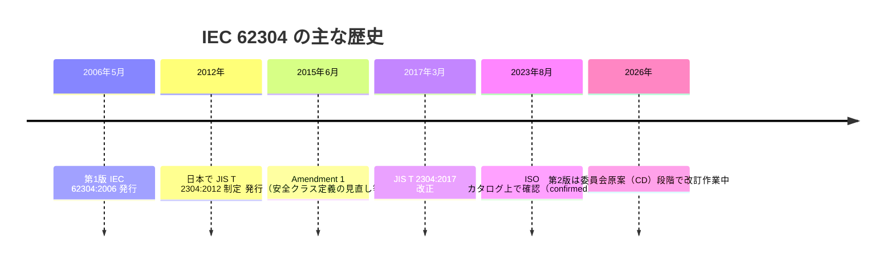

> **ポイント**: 実務で「IEC 62304」といえば、通常は **2006年版に2015年の追補を統合した Version 1.1** を指します。

---

## 3. 適用範囲：何を決める規格で、何を決めない規格か

### 3.1 適用される対象

規格の目的は、医療機器ソフトウェアのライフサイクル要求事項を定義することです。適用対象は、**医療機器ソフトウェアの開発と保守**です。対象には次の両方が含まれます。

| 対象の種類 | 例 |
|---|---|
| ソフトウェア**自体が**医療機器 | 画像診断支援アプリ、心電図解析アプリ（いわゆる SaMD） |
| 医療機器に**組み込まれる／一体のソフトウェア** | ペースメーカーのファームウェア、人工呼吸器の制御ソフト（いわゆる SiMD） |

### 3.2 規格が「やらないこと」

| 規格がやらないこと | 実務上の意味 |
|---|---|
| 組織構造や役割分担の指定 | 誰がやるかは自社で決める |
| 文書の名称・書式・詳細内容の指定 | 文書名は自由。ただし**中身の要求**は満たす必要がある |
| 特定のライフサイクルモデルの指定 | アジャイルでも適合可能（[第15章](#15-アジャイルcicdai-との付き合い方)） |
| 医療機器としてのバリデーションと最終リリース | 別の規格・規制（例：IEC 82304-1、IEC 62366-1 等）で扱う |
| ソフトウェアが医療機器に該当するかの判定 | 各国の法規制と意図する用途で決まる |

### 3.3 「適合」とは

この規格での適合とは、**ソフトウェア安全クラスに応じた**プロセス・活動・タスクをすべて実施することです。つまり「クラスを決める」ことが適合の出発点になります。

---

## 4. 最低限おさえる用語

初学者がつまずきやすい用語を、先に整理します。

| 用語 | やさしい説明 | 補足 |
|---|---|---|
| **ソフトウェアシステム** | 完成品として扱うソフトウェア全体 | 安全クラスはまずこの単位で付ける |
| **ソフトウェアアイテム** | ソフトウェアシステムを構成する識別可能な部品（入れ子にできる） | 規格上のいちばん広い「部品」概念 |
| **ソフトウェアユニット** | これ以上分割しない最小単位のアイテム | 関数・クラス・モジュール等に対応させる例が多い |
| **SOUP** | Software of Unknown Provenance。出自の不明なソフト | 既製品（OTS）や十分な開発記録がない既存ソフト等。OS、OSS、ライブラリが典型 |
| **レガシーソフトウェア** | すでに市場に出ているが、現行版の規格に沿って開発された客観的証拠が不十分なソフト | 後述の箇条4.4で扱う |
| **危険状態（hazardous situation）** | 人が危害にさらされる状況 | リスクマネジメントの基本概念 |
| **リスクコントロール手段** | リスクを下げるための対策 | ソフトウェア内の対策と、ソフトウェア外の対策がある |
| **セグリゲーション（分離）** | 安全上重要な部分とそうでない部分を切り離すこと | 低いクラスの部品を分けて負担を減らす考え方 |
| **トレーサビリティ** | 要求 ↔ 設計 ↔ テスト ↔ リスクの追跡可能性 | 審査・監査で最も見られる観点の一つ |

---

## 5. 全体像：規格の構造マップ

IEC 62304 は大きく、**共通の土台（箇条4）**の上に **5つの主要プロセス（箇条5〜9）**が載る構造です。

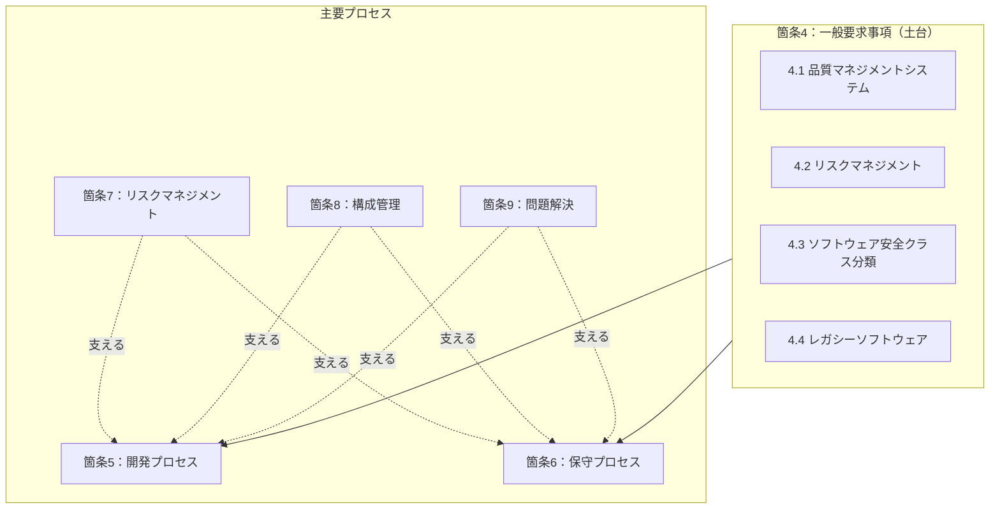

| 箇条 | 内容 | 役割 |
|---|---|---|
| 1〜3 | 適用範囲、引用規格、用語 | 前提知識 |
| 4 | 一般要求事項 | QMS、リスク管理、安全クラス、レガシー |
| 5 | ソフトウェア開発プロセス | 作る |
| 6 | ソフトウェア保守プロセス | 直す |
| 7 | ソフトウェアリスクマネジメントプロセス | 安全を守る |
| 8 | ソフトウェア構成管理プロセス | 版を管理する |
| 9 | ソフトウェア問題解決プロセス | 不具合を処理する |
| 附属書A〜C | 根拠、ガイダンス、他規格との関係 | 理解の補助（附属書は参考情報として使う） |

---

## 6. Step 1：ソフトウェア安全クラスを決める（箇条4.3）

### 6.1 なぜ最初にやるのか

安全クラスが**以降のすべての作業量と厳格さを決める**からです。Johner Institute は、安全クラスは文書化・開発・テストの要求を決める要素だと説明しています。

### 6.2 クラスの考え方（2015年追補後）

| クラス | 考え方（要約） | 具体イメージ |
|---|---|---|
| **A** | 危険状態に寄与しない、または寄与してもソフトウェア外のリスクコントロール後に**許容できないリスクにならない** | 予約・事務系機能、診断に影響しない表示 |
| **B** | 許容できないリスクがあり、起こりうる危害が**重傷ではない** | 傷害の可能性はあるが重症化しにくい機能 |
| **C** | 許容できないリスクがあり、起こりうる危害が**死亡または重傷** | 人工呼吸器制御、投薬量計算など |

> **2015年追補での大きな変更点**: クラス判定で、故障確率を考慮しない形に整理されました。以前の版にあった確率の扱いが見直され、**危害の重大さ（深刻度）中心**で考えます。

### 6.3 判定フロー

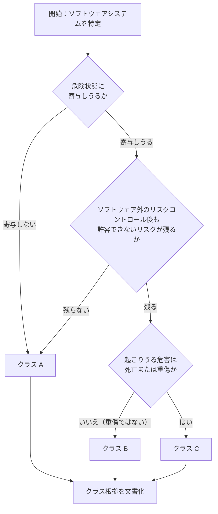

### 6.4 クラスを決めるときの重要ルール

| ルール | 内容 |
|---|---|
| **未分類は最高クラス** | 製造業者が分類しない場合、ソフトウェアとその構成要素はクラス C 扱い |
| **クラスを下げられるのは「ソフトウェア外」の手段のみ** | 同じソフトウェアシステム内の監視機能は、リスク低減には使えても、クラス引き下げの根拠にはならない（Johner Institute の整理） |
| **アイテム単位でクラスを分けられる** | 設計で部品を識別し、インターフェースを明確にして分離すれば、部品ごとに異なるクラスを割り当てられる |
| **根拠を残す** | なぜそのクラスかを、リスクマネジメントファイルと整合させて文書化する |
| **FDA の Level of Concern とは別物** | 米国のドキュメンテーションレベルと IEC 62304 の安全クラスは直接対応しない |

### 6.5 実務的な考え方

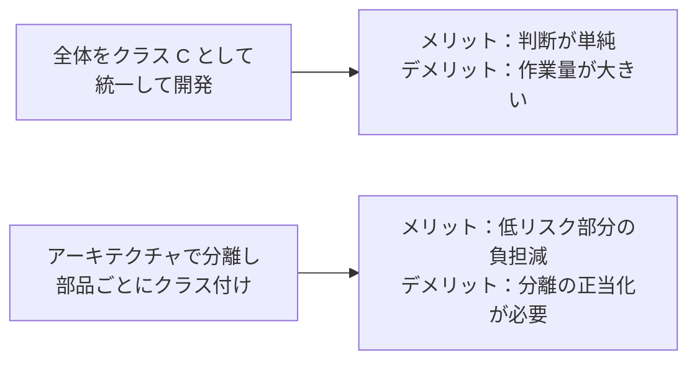

> Johner Institute は、分類の議論に時間をかけるより、ソフトウェアを専門的に開発して**クラス C の要求を満たす形で進める**ことを推奨しています。小規模チームの現実解として有力です。

---

## 7. Step 2：開発プロセスを回す（箇条5）

### 7.1 開発プロセス全体像（8つの活動）

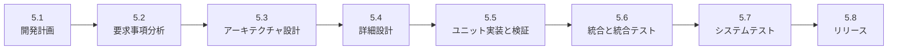

> この順番は**論理的な流れ**であって、「ウォーターフォールで一回だけ回せ」という意味ではありません。反復して回してかまいません。

### 7.2 各活動のやさしい解説

#### 5.1 ソフトウェア開発計画（SDP）

**目的**: 何を、どの手順で、どの道具で作るかを先に決める。

| 計画に含める内容 | 説明 |
|---|---|
| ライフサイクルモデル | どの開発方式でプロセスを回すか |
| 成果物と検証 | 何を作り、いつ検証するか |
| 追跡性 | 要求からテストまでのつながりの取り方 |
| リスクマネジメント計画 | ソフトウェアリスクをいつ・どう扱うか |
| 文書化計画 | 文書の目的・読み手・承認方法 |
| 構成管理計画 | 版管理・変更管理の方法 |
| 開発標準・方法・ツール | **クラス C で計画に含める要求** |
| 統合・統合テスト計画 | クラス B・C で要求 |

> 計画は**生きた文書**です。開発が進めば更新します。

#### 5.2 ソフトウェア要求事項分析

**目的**: 「このソフトは何をすべきか」を、検証可能な形で書く。

| 書くべき要求の種類 | 例 |
|---|---|
| 機能・性能要求 | 「心拍数を1秒ごとに更新表示する」 |
| インターフェース要求 | 他システム・ハードウェアとの接続仕様 |
| セキュリティ要求 | 認証・通信保護など |
| ユーザビリティ要求 | 誤操作を防ぐ表示・確認 |
| **リスクコントロール手段** | リスク分析から導かれた安全機能（クラス B・C で要求） |

要求は**テスト可能**でなければなりません。「使いやすいこと」ではなく、「確認ダイアログが2回表示されること」のように、判定できる形にします。

#### 5.3 ソフトウェアアーキテクチャ設計（クラス B・C）

**目的**: ソフトウェアを部品に分け、役割とつながりを決める。

| 活動 | 要点 |
|---|---|
| 要求をアーキテクチャへ変換 | 部品と構造の決定 |
| インターフェース設計 | 部品間・外部との接続の明確化 |
| **SOUP の要求仕様** | SOUP に求める機能・性能、動作に必要なハード/ソフトの明記 |
| **分離の識別** | リスクコントロールに必要な分離（クラス C） |
| アーキテクチャの検証 | 要求を満たし、SOUP の制約に適合するか確認 |

#### 5.4 ソフトウェア詳細設計（クラス C が中心）

**目的**: 各ユニットを「コードを書ける粒度」まで具体化する。

| クラス | 要求の違い |
|---|---|
| A | 不要 |
| B | アーキテクチャを**ユニットに分割**するところまで |
| C | 各ユニットの**詳細設計**、インターフェースの詳細設計、詳細設計の検証まで |

#### 5.5 ユニット実装と検証

| クラス | 要求の違い |
|---|---|
| A | 実装のみ（ユニット検証は不要） |
| B | ユニット検証のプロセスと**受入基準**を定めて検証 |
| C | B に加えて、**追加の受入基準**（例：エラー処理、メモリ関連、境界値など）を設定 |

> 受入基準の具体例（カバレッジ目標値など）は、規格自体は指定しません。自社で根拠を持って決めます。

#### 5.6 ソフトウェア統合と統合テスト（クラス B・C）

ユニットを組み合わせ、**組み合わせたときの動作**を確認します。統合テストは、テスト内容・手順・記録・回帰テストまで求められます。

#### 5.7 ソフトウェアシステムテスト（**全クラス**）

**目的**: 完成したソフトウェアシステムが、要求を満たすことを確認する。

> **2015年追補で、システムテストはクラス A でも必須**になりました（Johner Institute）。「クラス A なら何もしなくてよい」は誤解です。

#### 5.8 ソフトウェアリリース

**目的**: 「これで出荷してよい」と言える状態を、記録を伴って確認する。

| リリース活動 | 対象クラス |
|---|---|
| 検証が完了していることの確認 | A・B・C |
| 既知の残存異常の文書化 | A・B・C |
| 既知の残存異常の評価（安全上の影響） | A・B・C |
| リリースしたバージョンの文書化 | A・B・C |
| リリース版の作成方法の文書化 | B・C |
| 活動とタスクの完了確認 | B・C |
| ソフトウェアのアーカイブ | A・B・C |
| 配布の信頼性の確保 | A・B・C |

### 7.3 クラス別の要求サマリ（学習用の概観）

| 活動 | クラス A | クラス B | クラス C |
|---|:---:|:---:|:---:|
| 5.1 開発計画 | ○ | ○ | ○（開発標準・方法・ツールも） |
| 5.2 要求事項分析 | ○ | ○ | ○ |
| 5.3 アーキテクチャ設計 | － | ○ | ○（分離の識別も） |
| 5.4 詳細設計 | － | △（ユニット分割まで） | ○ |
| 5.5 ユニット実装 | ○ | ○ | ○ |
| 5.5 ユニット検証 | － | ○ | ○（追加受入基準あり） |
| 5.6 統合・統合テスト | － | ○ | ○ |
| 5.7 システムテスト | ○ | ○ | ○ |
| 5.8 リリース | ○ | ○ | ○（B・C は追加項目あり） |

> **注意**: この表は理解のための要約です。個々のタスク（例：5.1.4、5.3.5、5.8.5 など）ごとにクラスの指定があるため、**実務では規格本文の該当タスクで必ず確認**してください。

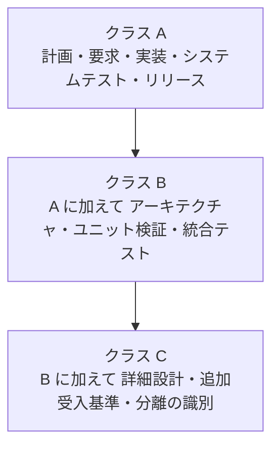

---

## 8. Step 3：保守プロセス（箇条6）

**保守とは**: 出荷後に、不具合修正や改良のためソフトウェアを変更する活動です。

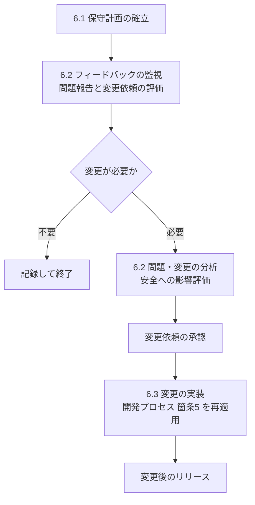

| 要点 | 内容 |
|---|---|
| 保守計画 | 出荷前から計画しておく（計画は SDP に含めても可） |
| フィードバック監視 | 顧客の声、不具合報告、市場の情報を継続的に集める |
| 安全影響の分析 | 変更が**既存のリスクコントロールに悪影響を与えないか**を確認 |
| 変更の実装 | 変更部分は、開発プロセス（箇条5）を**再び適用**して実施 |

> **よくある誤解**: 「小さな修正だから文書は要らない」は危険です。小さな変更でも、安全影響の分析と、必要な再検証が求められます。

---

## 9. Step 4：ソフトウェアリスクマネジメント（箇条7）

IEC 62304 は **ISO 14971**（医療機器のリスクマネジメント）と組み合わせて使います。Freyr 社の解説でも、62304 は 14971 を置き換えるのではなく、**ソフトウェア固有のリスクで拡張する**関係と説明されています。

### 9.1 4つの活動

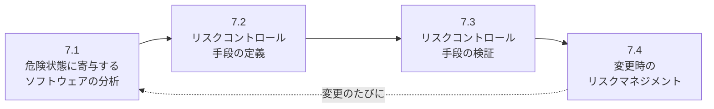

| 活動 | 内容 | クラス |
|---|---|---|
| 7.1 分析 | 危険状態に寄与しうるソフトウェアアイテムの特定、原因の特定、**公開されている SOUP の既知異常リストの評価**、文書化 | 主に B・C |
| 7.2 コントロール手段 | リスクを下げる手段を定義し、要求に反映 | 主に B・C |
| 7.3 検証 | リスクコントロール手段が実装され、効果があることを確認 | 主に B・C |
| 7.4 変更時 | 変更が安全に与える影響を分析し、既存の対策への影響を確認 | A・B・C |

### 9.2 ソフトウェアに特有のリスクの考え方

ソフトウェアは、ハードウェアのように「摩耗して壊れる」のではなく、**設計や実装の誤り（システマティックな不具合）**が原因になります。そのため、確率で評価するよりも、**「この機能が誤動作したらどうなるか」という深刻度中心の分析**が基本になります。

| ソフトウェアの原因の例 | 起こりうる危険状態 |
|---|---|
| 計算式の誤り | 投薬量の過大・過小 |
| 競合状態・タイミング不良 | 警報の遅延 |
| 入力値の未検証 | 想定外の値で機器が動作 |
| SOUP の既知バグ | 外部ライブラリ起因の誤動作 |

### 9.3 ソフトウェア内外のリスクコントロール

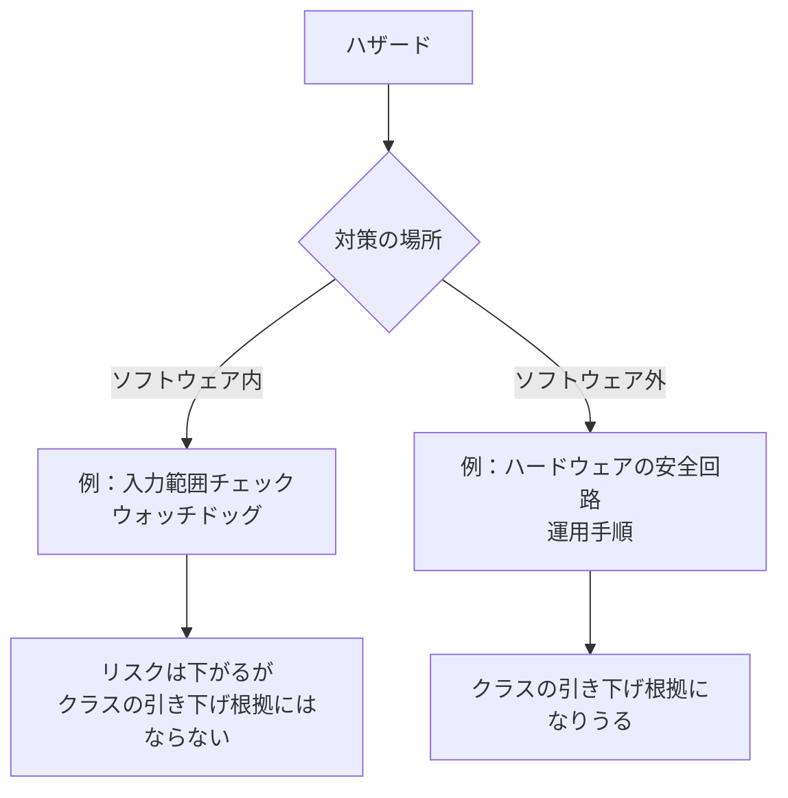

---

## 10. Step 5：構成管理（箇条8）

**構成管理とは**: 「どのバージョンの何が、どう変更されたか」を常に追跡できる状態にすることです。

| 活動 | 内容 | 実務での例 |
|---|---|---|
| 8.1 構成の識別 | 管理対象（構成アイテム）を決め、識別する | ソースコード、ドキュメント、**SOUP の名称とバージョン**、ビルド設定 |
| 8.2 変更管理 | 変更を依頼 → 承認 → 実施 → 検証の流れで管理 | Pull Request の承認ルール、変更依頼チケット |
| 8.3 構成状況の記録 | 変更履歴とバージョンの状態を記録 | リリースタグ、変更履歴、ビルドの出所 |

> **SOUP も構成管理の対象**です。使っているライブラリの名前とバージョンを、一覧で管理します。

---

## 11. Step 6：問題解決（箇条9）

**問題解決とは**: 出荷前後に見つかった不具合や懸念を、漏れなく記録・分析・処置する仕組みです。

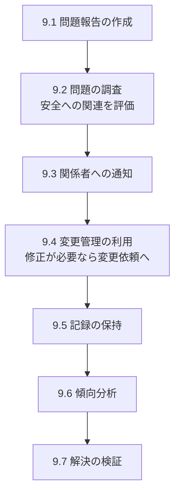

| 要点 | 内容 |
|---|---|
| 問題報告 | 不具合の内容、種別、重大度、影響範囲を記録 |
| 調査 | 原因と、**安全への関連**の有無を評価 |
| 変更管理との連携 | 修正は変更管理を通す（箇条8と接続） |
| 傾向分析 | 同種の不具合が続いていないかを分析 |
| 検証 | 修正後、問題が解決し、新たな問題が生じていないことを確認 |

---

## 12. SOUP とレガシーソフトウェア

### 12.1 SOUP（出自不明のソフトウェア）

OS、OSS ライブラリ、通信スタック、クラウド API、暗号ライブラリなどは、典型的な SOUP です（Freyr 社の例示）。

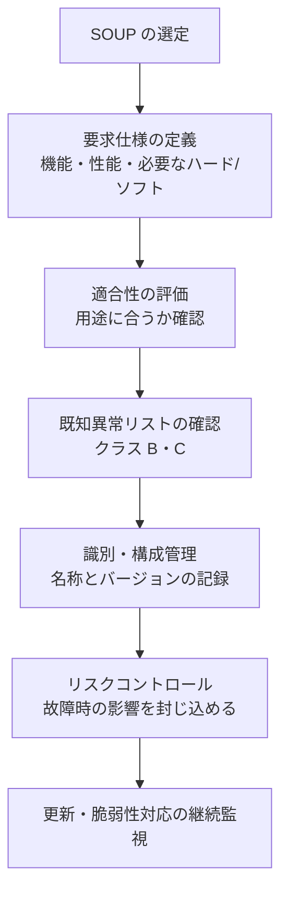

#### SOUP のクラス別要求（要点）

| 活動 | A | B | C |
|---|:---:|:---:|:---:|
| 構成管理での SOUP 識別（8.1.2） | ○ | ○ | ○ |
| SOUP の機能・性能要求の明示（5.3.3） | － | ○ | ○ |
| SOUP が必要とするハード/ソフトの明示（5.3.4） | － | ○ | ○ |
| 公開異常リストの評価（7.1.3） | － | ○ | ○ |

#### SOUP 管理の実務ポイント

| ポイント | 内容 |
|---|---|
| 一覧表を作る | 名称、バージョン、提供元、用途、選定理由、既知の問題 |
| 更新に備える | バージョン更新のたびに影響分析を行う |
| 「他人のソフト」と考えない | 製造業者が責任を負う。**使う判断を正当化**する |
| 隔離する | 故障しても全体に波及しないよう、監視と分離を設計する |

### 12.2 レガシーソフトウェア（箇条4.4）

**レガシーソフトウェア**とは、すでに合法的に市場に出ていて現在も販売されているが、現行版の規格に沿って開発された**客観的証拠が不十分**なソフトウェアです。

| 項目 | 内容 |
|---|---|
| 基本的な考え方 | 過去の開発記録が不十分な部分は、**市販後の実績やフィードバックのデータ**を使って評価する |
| 実務のコツ | 既存の記録とのギャップ分析を行い、リスクが許容できるか確認し、結果を記録する |
| 日本での扱い | PMDA の資料では、設計が完了している機器について、JIS T 2304 との**差分を分析し、リスクマネジメントの中で対応して記録を残す**考え方が示されている |

---

## 13. 関連規格との関係

IEC 62304 は**単独では完結しません**。複数の規格が役割分担しています。

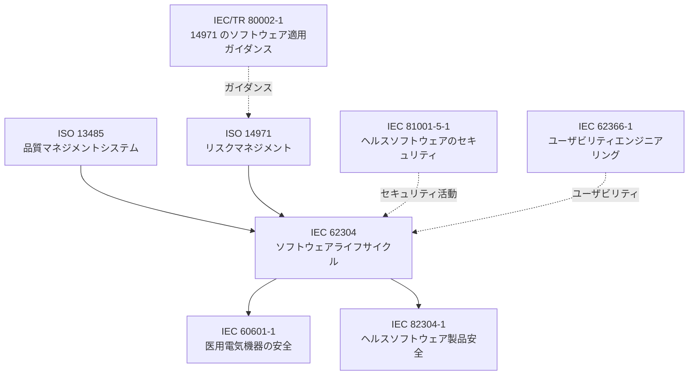

| 規格 | 62304 との関係 |
|---|---|
| **ISO 13485** | 開発を支える品質マネジメントシステム。62304 は QMS の存在を前提とする |
| **ISO 14971** | 医療機器全体のリスクマネジメント。62304 の箇条7が接続する |
| **IEC/TR 80002-1** | ISO 14971 をソフトウェアに適用するための技術報告（ガイダンス） |
| **IEC 60601-1** | 医用電気機器の安全規格。ソフトウェアを含む機器では 62304 と連携 |
| **IEC 62366-1** | ユーザビリティエンジニアリング。ユーザーインターフェースの安全性 |
| **IEC 82304-1** | 単独のヘルスソフトウェア製品の安全。バリデーションなど**62304 が扱わない領域**を補う |
| **IEC 81001-5-1** | ヘルスソフトウェアのセキュリティライフサイクル。62304 だけでは薄いセキュリティを補う |

> 日本では、単体ソフトウェア製品の製品安全を扱う **JIS T 82304-1:2018** が、JIS T 2304 を引用して使う関係にあります（PMDA 資料）。

---

## 14. 規制上の位置づけ（EU / 米国 / 日本）

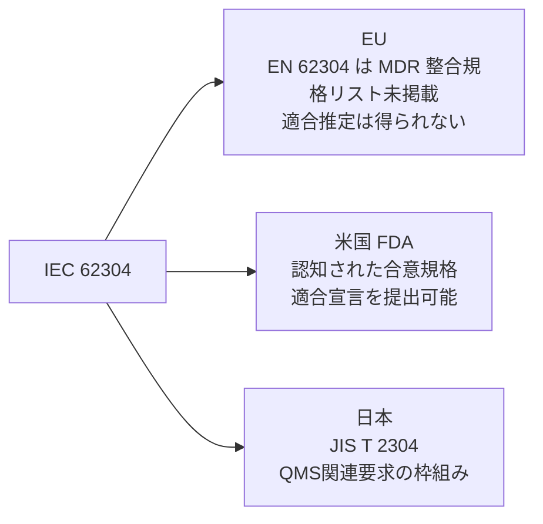

| 地域 | 位置づけ | 補足 |
|---|---|---|
| **EU** | EN 62304:2006+A1:2015 は欧州規格として広く利用されるが、欧州委員会が公表する MDR の整合規格リストには掲載されていない | 整合規格ではないため、適合しても MDR 要求への**適合推定**は得られない。一般安全性能要求（GSPR）への適合を示す手段の一つとして、技術文書で根拠を説明する |
| **米国** | FDA が合意規格として認知。適合宣言を提出して市販前要求を満たす材料にできる | IMDRF の整理でも、FDA は 62304 の認知を明記 |
| **日本** | JIS T 2304:2017 が対応規格。基本要件基準第12条第2項（平成17年厚生労働省告示第122号）への適合は、**JIS T 2304 またはこれと同等以上の適切な国際規格等**への適合で示す | 同等の国際規格（IEC 62304 等）を用いる場合は、製造販売承認・認証の申請や届出の際に、その規格が JIS T 2304 と同等以上であることを申請資料で説明できることが条件。JIS T 2304 は IEC 62304 の一致規格（IDT） |
| **その他** | 豪州・カナダ等でも認知された規格として扱われる | IMDRF/MC/N35（2015年）が各法域の使い方を整理 |

> **注意**: 規制の詳細は更新されます。申請や審査の前には、必ず最新の通知・ガイダンスを確認してください。

---

## 15. アジャイル・CI/CD・AI との付き合い方

### 15.1 アジャイルは使えるか

**使えます。** 規格は特定のモデルを指定しません。誤解が多い点ですが、Visure 社なども「62304 はモデルに依存せず、アジャイルを支持する」と整理しています。

| アジャイルの実践 | 62304 での対応づけ |
|---|---|
| スプリント計画 | 5.1 開発計画の運用 |
| ユーザーストーリー・受入条件 | 5.2 要求事項（テスト可能な形） |
| Pull Request レビュー | 5.5 検証、8.2 変更管理 |
| 自動テスト（CI） | 5.5 ユニット検証、5.6 統合テスト |
| リリース判定 | 5.8 リリース活動 |
| バックログの不具合 | 箇条9 問題解決 |

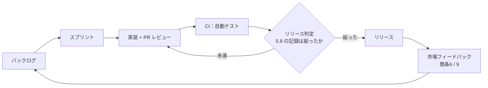

> 秘訣は、**成果物を「後からまとめる」のではなく、ツールが自動的に残す仕組みにする**ことです。チケット、PR、CI のログがそのまま記録になります。

### 15.2 CI/CD での注意

| 論点 | 対応 |
|---|---|
| 頻繁なリリース | リリースごとに 5.8 の要件（残存異常の評価など）を満たす |
| 継続的な依存更新 | SOUP の変更ごとに影響分析 |
| 自動デプロイ | 配布の信頼性（5.8.8）の確保、構成管理の記録 |

### 15.3 AI/ML を含む場合

IEC 62304 第1版は AI を想定していません。第2版の草案では、適応型アルゴリズムを含むソフトウェア向けの AI ライフサイクルの考え方が盛り込まれる方向と、複数の解説で紹介されています（**草案段階の情報であり変更の可能性あり**）。AI を含む製品は、62304 に加え、AI 固有の規格・ガイダンスも併せて確認してください。

---

## 16. 第2版（Edition 2）の最新動向

### 16.1 状況（2026年10月23日時点）

| 項目 | 確認できた情報 |
|---|---|
| 発行状況 | **未発行**。IEC では開発中として掲載 |
| 現在の段階 | 第2回委員会原案（CD2）の段階 |
| CD2 | 文書番号 62A/1761/CD。2026年8月7日に回付、コメント期限は2026年11月27日（Jama Software の解説が IEC SC 62A 情報を引用） |
| 発行予定 | IEC の予定として **2028年10月26日**（以前は2027年4月30日）。Johner Institute の関係者は、さらに遅れる可能性にも言及 |
| EU での拘束力 | 官報に整合規格として掲載されて初めて有効。実務上は 2030年頃との見方もある |

> **情報の食い違いに注意**: 一部の解説サイトには「FDIS 段階に入った」「2026年中に発行」と書かれたものがありますが、IEC の予定や SC 62A の情報を引用する解説（上表）とは**食い違っています**。本ガイドは後者を採用しました。**当面は第1版（Version 1.1）が実務の基準**です。

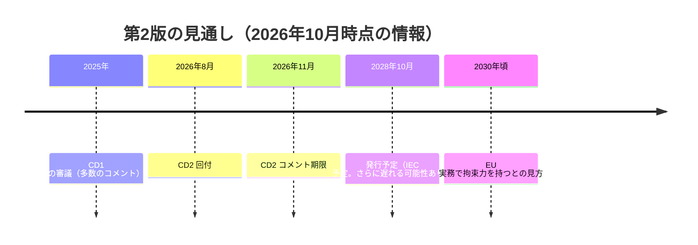

### 16.2 草案で議論されている主な変更点（確定ではない）

| 論点 | 第1版（2006+A1:2015） | 第2版の草案 |
|---|---|---|
| 適用範囲 | 医療機器ソフトウェア | **ヘルスソフトウェア全般**（医療機器ソフトウェアはその一部） |
| プロセスの厳格度 | 安全クラス A / B / C の3区分 | **2段階の「ソフトウェアプロセス厳格度」**（Level I / II）に整理される方向 |
| ISO 13485 / ISO 14971 | 参照あり | 参照を**外す**方向（規制対象外ソフトも対象にするため） |
| AI | 記載なし | AI 開発ライフサイクルの考え方を導入する方向 |
| セキュリティ | 直接は扱わない | IEC 81001-5-1 との連携を強める方向 |
| レガシー | 箇条4.4 | 附属書で扱う構造に変わる方向との解説あり |
| 旧クラス A | 最小限の要求 | 旧クラス A 相当の Level I で、旧B・C にあった一部要求（アーキテクチャ設計・統合など）が加わる可能性（最新の公開草案に基づく解説） |

> すべて**草案段階の情報**です。確定するまでは、第1版の知識がそのまま実務の土台になります。第2版は、第1版の骨格（計画 → 要求 → 設計 → 検証 → 保守）を大きく変えるものではない、という見方が一般的です。

---

## 17. 導入ロードマップと成果物チェックリスト

### 17.1 初めて 62304 に取り組む手順

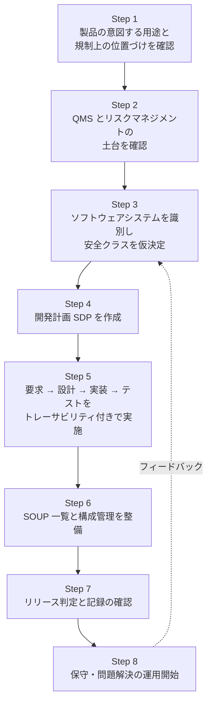

### 17.2 成果物チェックリスト（目安）

| 成果物 | 関連箇条 | 対象クラス |
|---|---|---|
| ソフトウェア開発計画（SDP） | 5.1 | A・B・C |
| ソフトウェア要求仕様書（SRS） | 5.2 | A・B・C |
| 安全クラス判定の根拠 | 4.3 | A・B・C |
| ソフトウェアアーキテクチャ設計書 | 5.3 | B・C |
| 詳細設計書 | 5.4 | C |
| ユニット検証の基準と記録 | 5.5 | B・C |
| 統合テスト計画と記録 | 5.6 | B・C |
| システムテスト計画と記録 | 5.7 | A・B・C |
| リリース記録（残存異常の評価を含む） | 5.8 | A・B・C |
| 保守計画 | 6.1 | A・B・C |
| ソフトウェアリスク分析とコントロール手段の検証記録 | 7 | 主に B・C（変更時は A・B・C） |
| SOUP 一覧 | 8.1、5.3 | A・B・C（深さは異なる） |
| 構成管理の記録・変更管理の記録 | 8 | A・B・C |
| 問題報告と解決の記録 | 9 | A・B・C |
| **トレーサビリティマトリクス** | 横断 | 全クラスで実質必須 |

> 規格は文書の名称を指定しません。上の名称は一般的な呼び方で、**要求される中身が満たされていれば名称や統合の仕方は自由**です（1つの文書に統合してもよい）。

---

## 18. よくある失敗と対策

| # | 失敗 | なぜ問題か | 対策 |
|---|---|---|---|
| 1 | **クラスを甘く見積もる** | 監査で根拠を求められ、やり直しになる。未分類はクラス C 扱い | リスクファイルと整合したクラス根拠を残す。迷ったら高めに |
| 2 | **クラス A ならテスト不要と誤解** | 2015年追補以降、システムテストは全クラスで必須 | クラス A でもシステムテストを計画 |
| 3 | **SOUP を放置** | 外部ライブラリの既知バグが事故原因になる | 一覧管理、既知異常リストの確認、更新時の影響分析 |
| 4 | **後付けで文書を作る** | 実際のプロセスと記録が食い違う | 開発の最初から、ツールで記録が残る運用にする |
| 5 | **小さな変更で保守プロセスを省略** | 安全影響の見落としにつながる | 変更の大小を問わず影響分析を実施 |
| 6 | **FDA の Level of Concern と混同** | 別の概念で、直接対応しない | 米国向け資料と 62304 の分類は別々に整理 |
| 7 | **規格を「製品の保証」と誤解** | 62304 はプロセスの規格。製品のバリデーションは別 | IEC 82304-1 等も併せて確認 |
| 8 | **セキュリティを後回し** | 62304 単体では薄い | IEC 81001-5-1 など併用 |

---

## 19. 理解度チェック

<strong>Q1.</strong> 安全クラスを分類しなかった場合、どのクラスとして扱われますか？

**クラス C** として扱われます。最も厳格な要求が適用されるため、分類は省力化の意味でも重要です。

<strong>Q2.</strong> 2015年追補以降、クラス A で必須となった活動は何ですか？

**ソフトウェアシステムテスト（5.7）** です。

<strong>Q3.</strong> ソフトウェア安全クラスを引き下げる根拠にできるリスクコントロールは、ソフトウェアの内と外のどちらですか？

**ソフトウェア外**の手段です。同じソフトウェアシステム内の監視機能は、リスク低減には役立っても、クラス引き下げの根拠にはなりません。

<strong>Q4.</strong> 詳細設計（5.4）の全面的な文書化が求められるのは、どのクラスですか？

**クラス C** です。クラス B はユニットへの分割までです。

<strong>Q5.</strong> OSS ライブラリは何に分類されますか？ 構成管理上、何をすべきですか？

多くの場合 **SOUP** に該当します。名称とバージョンを識別し、構成管理の対象にします（全クラスで必要）。

<strong>Q6.</strong> IEC 62304 はウォーターフォール開発を要求しますか？

**いいえ。** 特定のライフサイクルモデルは指定されず、アジャイルでも適合できます。

<strong>Q7.</strong> 第2版は2026年10月23日時点で発行されていますか？

**いいえ。** 委員会原案（CD2）の段階で、発行予定は 2028年10月（IEC の予定）とされています。現行の実務基準は Version 1.1 です。

---

## 20. 根拠ソース一覧（URL）

本ガイドの根拠として参照した情報源です。国際的に知られた規制・品質コンサルタントや公的機関の情報を優先しました。

### 20.1 規格・公的機関（一次情報に近いもの）

| 情報源 | 参照した内容 | URL |
|---|---|---|
| ISO（ご指定ページ） | 規格の基本情報、2023年の確認、追補の存在、技術委員会 | https://www.iso.org/standard/38421.html |
| IEC Webstore | IEC 62304:2006 の概要、統合版の存在、バリデーション・最終リリースを対象外とする旨 | https://webstore.iec.ch/publication/6792 |
| IMDRF/MC/N35（2015年） | EU・米国・豪州・カナダ・日本など各法域での 62304 の位置づけ | https://www.imdrf.org/sites/default/files/docs/imdrf/final/procedural/imdrf-proc-151002-medical-device-software-n35.pdf |
| AMED（医療機器ソフトウェア関連ガイダンス、2026年4月版） | 日本での QMS省令・基本要件基準第12条第2項と JIS T 2304 の関係 | https://www.amed.go.jp/content/000165660.pdf |
| JSA Webdesk（JIS T 2304:2017 プレビュー） | JIS T 2304:2017 が IEC 62304:2006 + Amd.1:2015 に対応すること | https://webdesk.jsa.or.jp/preview/pre_jis_t_02304_000_000_2017_j_ed10_ch.pdf |
| PMDA（JIS T 2304 の説明資料） | 設計完了済み機器の JIS T 2304 差分分析とリスクマネジメントでの対応 | https://www.pmda.go.jp/files/000268882.pdf |
| PMDA（JIS T 82304-1 との関係） | 62304 と 82304-1 の適用範囲の関係 | https://www.pmda.go.jp/files/000252043.pdf |
| 日本医療機器産業連合会（JFMDA）Q&A | JIS T 2304 が IEC 62304 の一致規格であること、JIS T 2304:2012 からの移行 | https://www.jfmda.gr.jp/wp/wp-content/uploads/2017/07/c483cd75448d9aa162fd6d5d6657db05.pdf |

### 20.2 国際的な専門家・コンサルタント

| 情報源 | 参照した内容 | URL |
|---|---|---|
| Johner Institute（Prof. Dr. Christian Johner）: 安全クラス | クラス定義、未分類時の扱い、クラス引き下げの考え方、システムテストのクラス A 必須化 | https://blog.johner-institute.com/iec-62304-medical-software/safety-class-iec-62304/ |
| Johner Institute: 安全クラスと Level of Concern の比較 | IEC 62304 と FDA の分類が直接対応しないこと | https://johner-institute.com/articles/software-iec-62304/safety-classes-level-of-concern |
| Johner Institute: 第2版の適用範囲と変更点（2026年7月8日） | 第2版の範囲拡大、現行有効版（Version 1.1） | https://blog.johner-institute.com/iec-62304-medical-software/iec-62304-2nd-edition-all-areas-of-application-and-changes/ |
| Quickbird Medical: 第2版の遅延（2026年） | 発行予定が2028年10月へ、EU 整合規格の扱い、旧クラス A の変更見込み | https://quickbirdmedical.com/en/news/iec-62304-edition-2-august-2026/ |
| Jama Software: IEC 62304 ガイド | CD2（62A/1761/CD）の回付とコメント期限、FDA CSA に関する補足 | https://www.jamasoftware.com/requirements-management-guide/medical-devices/iec-62304/ |
| OpenRegulatory: 要求事項と文書のマッピング | タスク別のクラス適用（5.1、5.7、5.8、7.1、8.1 など） | https://openregulatory.com/iec-62304-mapping-requirements-documents/ |
| Greenlight Guru: IEC 62304 コンプライアンス | SDP を起点とした成果物整理、クラス分類の粒度 | https://www.greenlight.guru/blog/iec-62304-compliance-what-to-build-first |
| Freyr Solutions: IEC 62304 コンプライアンス完全ガイド | SOUP の例示と管理方針、ISO 14971 との関係、よくある失敗 | https://www.freyrsolutions.com/index%2Ephp/blog/iec-62304-compliance-the-complete-guide-to-medical-device-software-development-without-the-pitfalls |
| Visure Solutions: クラス A/B/C とアジャイル | モデル非依存性、アジャイルとの両立、第2版の2段階モデルの紹介 | https://visuresolutions.com/?p=47801 |
| NSF: 第2版草案の解説（2025年2月） | 安全クラスの簡素化、ヘルスソフトウェアへの範囲拡大、AI | https://www.nsf.org/th/en/life-science-news/iec-62304-draft-of-the-2nd-edition-optimized-safety-classes-extended-scope-for-healthcare-software-and-ai |
| MedDeviceGuide（Ran Chen、2026年5月） | 第2版草案の主要変更（範囲、2段階の厳格度、AI、セキュリティ） | https://meddeviceguide.com/blog/iec-62304-edition-2-2026-software-lifecycle-standard-update-guide |
| IntuitionLabs（2026年10月更新） | 第2版の進捗の整理、FDA の認知記録への言及 | https://intuitionlabs.ai/articles/iec-62304-edition-2-medical-software-changes |

### 20.3 情報の信頼度に関する注記

| 論点 | 注記 |
|---|---|
| 第2版の進捗 | 解説サイトにより「FDIS 段階」「2026年内発行」「CD2 段階で2028年予定」と**食い違い**がある。本ガイドは IEC の予定や SC 62A の情報を引用している資料を優先した |
| クラス別の詳細要求 | 解説サイトの表記には揺れがある。**最終判断は規格原文**（IEC 62304:2006+AMD1:2015 または JIS T 2304:2017）の各タスクで行うこと |
| 草案の内容 | 第2版に関する記述はすべて草案段階の情報で、確定までに変更される可能性がある |

---

## 付録：ひとことまとめ

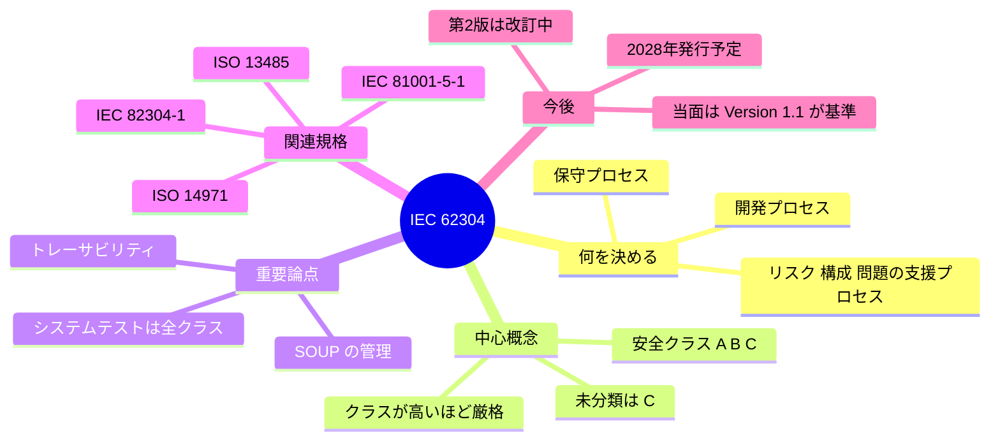

> **最後に**: 62304 は「重い規格」に見えますが、本質は**「リスクに見合った規律で作り、残す」**ことです。まずは安全クラスを決め、計画を書き、要求から試験までを追跡できる状態にする。この3点から始めれば、全体像は自然とつながっていきます。
