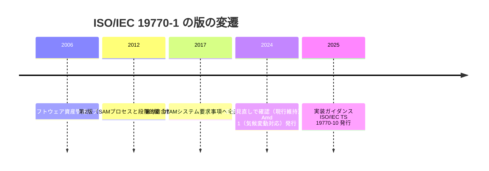
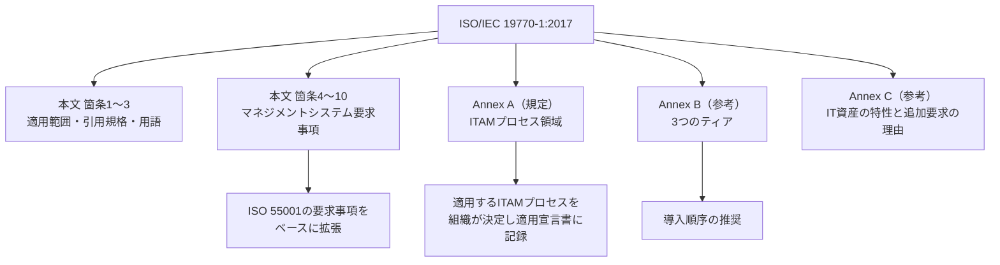
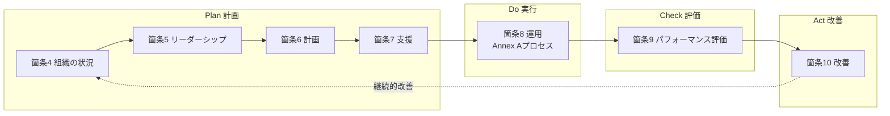
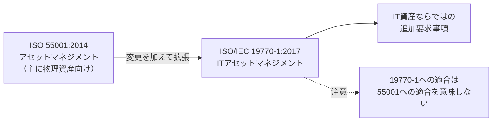
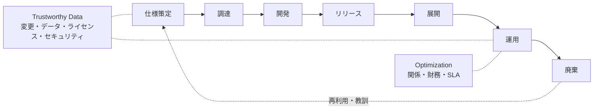
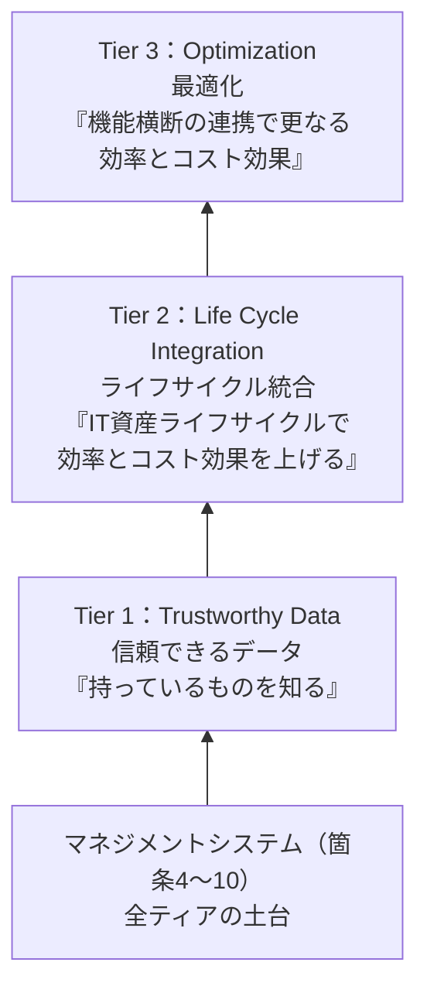
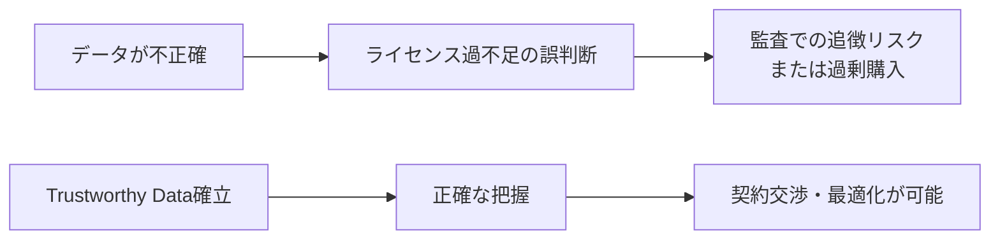
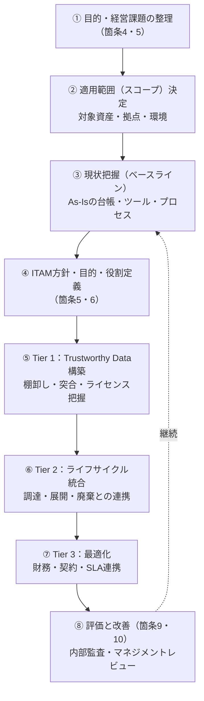
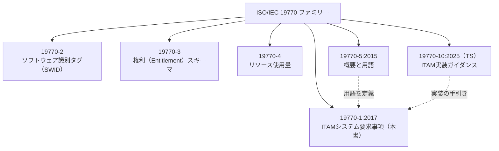
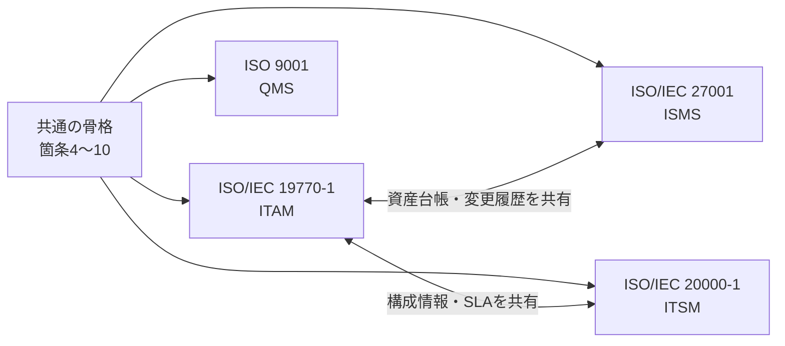

# ISO/IEC 19770-1:2017 初学者向けステップバイステップ解説ガイド

> **IT資産管理（ITAM）システム — 要求事項**
> 情報時点：**2026年10月26日**

---

## 目次

1. [この規格を一言でいうと](#step-1-この規格を一言でいうと)
2. [規格の基本情報（2026年10月26日時点）](#step-2-規格の基本情報2026年10月26日時点)
3. [なぜ必要？ — 背景とSAMからITAMへの進化](#step-3-なぜ必要--背景とsamからitamへの進化)
4. [規格の全体像と立ち位置](#step-4-規格の全体像と立ち位置)
5. [マネジメントシステムの骨格（箇条4〜10）](#step-5-マネジメントシステムの骨格箇条410)
6. [ISO 55001との関係](#step-6-iso-55001との関係)
7. [Annex A：ITAMプロセス領域](#step-7-annex-aitamプロセス領域)
8. [Annex B：3つのティア（段階的導入）](#step-8-annex-b3つのティア段階的導入)
9. [導入ロードマップ（実務の進め方）](#step-9-導入ロードマップ実務の進め方)
10. [関連規格ファミリー（19770シリーズ）](#step-10-関連規格ファミリー19770シリーズ)
11. [他のISOマネジメントシステムとの統合](#step-11-他のisoマネジメントシステムとの統合)
12. [よくある誤解とつまずきポイント](#step-12-よくある誤解とつまずきポイント)
13. [理解度チェック](#step-13-理解度チェック)
14. [根拠ソース一覧（URL）](#根拠ソース一覧url)

---

## Step 1. この規格を一言でいうと

**「組織が持つIT資産（ハードウェア・ソフトウェア・クラウド等）を、ライフサイクル全体にわたって正しく把握・管理・改善し続けるための『仕組み（マネジメントシステム）』の要求事項」** です。

ポイントは次の3つです。

| キーワード | 意味 |
|---|---|
| **IT資産** | サーバ・PC等の機器だけでなく、実行ソフト（OS・アプリ）や非実行ソフト（フォント・設定情報）、SaaSやクラウド環境も含む |
| **マネジメントシステム** | 一度きりのプロジェクトではなく、Plan-Do-Check-Actで回し続ける組織的な仕組み |
| **要求事項** | 「何を満たすべきか」を定めるもの。「どうやるか（手順・書式）」は定めない |

> 💡 **初学者向けメモ**：この規格は「IT資産管理の作業マニュアル」ではありません。「IT資産管理がちゃんと運営されている組織とはこういう状態です」という**到達すべき姿のチェックリスト**に近い存在です。

---

## Step 2. 規格の基本情報（2026年10月26日時点）

| 項目 | 内容 |
|---|---|
| 規格番号 | ISO/IEC 19770-1:2017 |
| タイトル | Information technology — IT asset management — Part 1: IT asset management systems — Requirements |
| 版 | 第3版（Edition 3） |
| 発行年月 | 2017年12月 |
| ページ数 | 37ページ |
| 担当委員会 | ISO/IEC JTC 1/SC 7（ソフトウェア及びシステムエンジニアリング） |
| ICS | 35.080（ソフトウェア）、03.100.70 |
| ステータス | **有効（2024年にレビューされ確認済み。この版が現行版）**（ライフサイクル段階 90.93） |
| 追補（Amendment） | ISO/IEC 19770-1:2017/Amd 1:2024（気候変動対応 Climate action changes） |
| 言語 | 英語のみ（ISO公式ページでは仏語・西語版なし） |

### 版の変遷

---

## Step 3. なぜ必要？ — 背景とSAMからITAMへの進化

### 3-1. 第2版（2012）から第3版（2017）で何が変わったか

第2版は「ソフトウェア資産管理（SAM）のプロセス」と「段階的な適合性評価」の規格でした。第3版では、**ISOマネジメントシステム規格（MSS）の共通構造に合わせて全面的に書き直され**、対象もソフトウェアからIT資産全般へ広がりました。

| 観点 | 第2版（2012） | 第3版（2017） |
|---|---|---|
| 対象 | ソフトウェア資産と関連資産（SAM） | ハード・ソフト・クラウド等のIT資産全般（ITAM） |
| 構造 | プロセス中心＋複数のティアによる評価 | マネジメントシステム規格（箇条4〜10）＋Annex A/B/C |
| ティア | 4段階（資料により表記差あり） | **3段階**（Trustworthy Data / Life Cycle Integration / Optimization） |
| 他規格との関係 | 独立性が高い | ISO 27001、ISO 9001、ISO 20000-1等と共通構造で統合しやすい |

### 3-2. 変更の狙い

Flexera社（ITAM分野の主要ベンダー）のブログでは、第3版の改訂意図として次が挙げられています。

1. 他の主要ISO規格が採用するMSS構造に整合させる
2. オンプレ・SaaS・PaaS・IaaSに広がるIT資産の複雑さに対応する
3. ISO 27001（情報セキュリティ）などと共通の設計思想で運用できるようにする

また、ITAM業界の実務家からも「第3版はISO 27001や9001を含むISOマネジメントシステム規格と互換になるよう書き直され、ティアによる段階的利用が可能」との評価が出ています（出典は末尾の一覧）。

---

## Step 4. 規格の全体像と立ち位置

### 4-1. 規格の構成

| 部分 | 区分 | 役割 |
|---|---|---|
| 箇条4〜10 | 規定（必須） | マネジメントシステムとしての枠組み |
| **Annex A** | 規定（必須） | ITAMプロセス領域。組織は適用するプロセスを決定し、除外の正当化とともに適用宣言書（Statement of Applicability）に記録する（全領域が一律に必須ではない） |
| **Annex B** | 参考 | プロセス目的を3ティアに束ね、段階導入と評価の目安を示す |
| **Annex C** | 参考 | ISO 55001にはない追加要求が必要になる、IT資産の特性の説明 |

### 4-2. 適用範囲（スコープ）の押さえどころ

| できること | しないこと（制限） |
|---|---|
| あらゆる種類・規模の組織が適用できる | プロセスの方法・手順は詳細に規定しない |
| ハードウェア、実行／非実行ソフトウェアに適用できる | 実施すべきステップの順序は規定しない |
| オンプレ、仮想化、SaaS、クラウド、レガシー環境すべてに適用できる | 文書の名称・書式・記録媒体は規定しない |
| 組織自身のITAM要求への適合を、内部・外部が評価する際に使える | 財務・会計・特定資産種別の技術要求は規定しない |

> ⚠️ **注意**：組込みソフトウェアやファームウェアへの適用可否は十分に検証されていない旨が、規格紹介ページ（カナダSCC掲載の抄録）に記載されています。また「情報そのものを資産として管理する」ことは意図していません（IT資産に関する情報は対象）。

---

## Step 5. マネジメントシステムの骨格（箇条4〜10）

ISOのマネジメントシステム規格は共通の章立てを持ちます。これに慣れておくと、ISO 27001や9001を学ぶ際にも役立ちます。

### 5-1. PDCAサイクルとの対応

### 5-2. 各箇条の初学者向け要約

| 箇条 | 名称 | 何をする？ | 具体例 |
|---|---|---|---|
| 4 | 組織の状況 | 自組織の内外の状況、利害関係者のニーズを把握し、**ITAMSの適用範囲**を決める | 「全社のPC・サーバ・SaaSを対象。ただし工場の制御系は対象外」と決める |
| 5 | リーダーシップ | 経営層のコミットメント、ITAM方針、役割・責任・権限を定める | 経営会議でITAM方針を承認、責任者を任命 |
| 6 | 計画 | リスクと機会への対処、ITAM目的の設定と達成計画 | 「ライセンス違反リスクを低減」「未使用ライセンスを削減」等の目標設定 |
| 7 | 支援 | 資源、力量、認識、コミュニケーション、**文書化した情報** | 担当者の教育、資産台帳の管理ルール |
| 8 | 運用 | 計画を実行し、**Annex Aのプロセス**を運用する | 調達〜廃棄までのIT資産ライフサイクル運用 |
| 9 | パフォーマンス評価 | 監視・測定、内部監査、マネジメントレビュー | 資産台帳の正確性を定期点検、年1回の内部監査 |
| 10 | 改善 | 不適合と是正処置、継続的改善 | 監査で見つかった台帳の差異を是正し再発防止 |

> 📌 目次の確認結果として、規格プレビューには 4.3「ITAMシステムの適用範囲の決定」、4.4「ITAMシステム」、6.1「リスク及び機会への取組み」、6.2「ITAM目的とその達成計画」（運用プロセス仕様、運用プロセスの目的、全体目的、達成計画に細分）、7.5「情報に関する要求事項」などの節が確認できます。

---

## Step 6. ISO 55001との関係

ISO/IEC 19770-1:2017 は、**ISO 55001:2014（アセットマネジメント — マネジメントシステム要求事項）の「分野特化型の拡張」** です。ただし、ISO 55001の特定業種向け適用版ではないと位置づけられています。

| ポイント | 説明 |
|---|---|
| 位置づけ | ISO 55001の**ディシプリン特化型の拡張**（変更を伴う） |
| 追加要求 | IT資産特有の性質（複製容易、契約・ライセンス依存、構成変化が速い等）に対応する要求を追加 |
| 重要な注意 | 19770-1に適合しても、ISO 55001に適合したことにはならない |

---

## Step 7. Annex A：ITAMプロセス領域

Annex A（規定）は、**ITAMプロセス領域**を定めます。すべての領域の運用が一律に必須なのではなく、ISO/IEC 19770-1:2017 の要求事項に基づき、組織は自らに適用するITAMの運用プロセスを決定し、除外する場合はその正当性を示したうえで、決定内容を**適用宣言書（Statement of Applicability）**に記録します。ISO JTC 1/SC 7の公式プロジェクトページでは**15のプロセス領域**と説明されています。

一方、Flexera社の解説ブログでは、実務上の整理として**14の主要能力領域**を3カテゴリに分けて紹介しています。以下はそれに基づく整理です。

> ⚠️ **正確性に関する注意**：プロセス領域の数え方・グルーピングは解説資料により差があります（公式は15、ブログは14）。**15番目の領域の名称を無料公開の資料から確認できていません**。試験・監査・社内規程への引用では、必ず規格原文のAnnex Aを確認してください。

### 7-1. 3カテゴリ×プロセス領域（Flexera社の整理）

| ティア（カテゴリ） | 領域 | 初学者向けの意味 |
|---|---|---|
| **Trustworthy Data** | 変更管理 | 資産記録の変更履歴（誰が何を変えたか）を追える |
| | データ管理 | 複数の台帳・ツールのデータを突合し、正確性を保つ |
| | ライセンス管理 | 契約・権利情報を把握し、更新や監査に備える |
| | セキュリティ管理 | EOL/EOSなどの情報を脆弱性・パッチ管理と連携する |
| **Life Cycle Integration** | 仕様策定（Specification） | 新規要求の要件を定める |
| | 調達（Acquire） | 購買を調達プロセスで一元管理する |
| | 開発（Development） | 開発で使う技術スタックを評価・定義する |
| | リリース（Release） | 新リリースの計画・合意 |
| | 展開（Deployment） | 何がどこに展開されているかを把握する |
| | 運用（Operate） | プロビジョニング、サイズ変更、回収の管理 |
| | 廃棄（Retirement） | 廃棄資産を追跡し、ソフトの再利用を可能にする |
| **Optimization** | 関係・契約管理 | ベンダーや事業部門との契約・要件を定期的に見直す |
| | 財務管理 | ソフトウェアの無駄（オンプレ・クラウド）を特定する |
| | サービスレベル管理 | ITAMのバリューチェーンのサービスレベルを定める |

### 7-2. IT資産ライフサイクルの流れ

> 💡 **補足**：ISO/IEC TS 19770-10:2025（実装ガイダンス）のスコープには、変更管理、データ管理、ライセンス管理、セキュリティ管理、関係・契約管理、財務管理、サービスレベル管理、その他のリスク管理といった機能管理プロセスや、調達、リリース、展開、運用、廃棄といったライフサイクル管理プロセスが挙がっています。Annex Aの領域を実務に落とすときの参考になります。

---

## Step 8. Annex B：3つのティア（段階的導入）

ティアは「**全部を一度にやらず、段階的に成熟させる**」ための目安です。ITAMSそのもの（箇条4〜10）はティアの土台であり、ティアには割り当てられません。

### 8-1. 3ティアの積み上げ

| ティア | 名称 | ねらい | 主な担当 |
|---|---|---|---|
| 1 | **Trustworthy Data** | 「持っているものを知る」。インフラ・契約・ライセンスデータの収集、突合、分析 | **ITAMチームの責任** |
| 2 | **Life Cycle Integration** | 調達〜廃棄の各段階にITAMを組み込む | 既存プロセスとの**共同責任** |
| 3 | **Optimization** | 契約・財務・SLAなど隣接する機能管理と統合し最適化 | 既存プロセスとの**共同責任** |

### 8-2. 「Trustworthy Data」が最重要な理由

ITAMのトップカンファレンスでの講演（IAITAM ACE 2022、Jeremy Boerger氏）では、Trustworthy Dataを「実際に管理できる状態にするための土台」と位置づけ、CMDBが信頼できるデータを持っているかを検証する手法が紹介されています。Flexera社のブログも、**「把握していないものは最適化できない」（ブラックホール状態での最適化は危険）** と述べています。

---

## Step 9. 導入ロードマップ（実務の進め方）

> 📝 規格自体は「導入のステップ順序」を定めていません。以下は、公開されている実務解説を踏まえた**一般的な進め方の例**です。

### 実務のコツ（Flexera社ブログの要点を整理）

| 観点 | ポイント |
|---|---|
| 進め方 | まず低い所から段階的に。対象範囲は契約種別、リスク、更新時期などで優先づける |
| 体制 | ITAMチームだけでなく、情報セキュリティ、調達、財務、ITSM等と**横断的に**進める |
| 最適化の順序 | 把握が不十分な段階での最適化は避ける。ただし、クラウドやSaaSで早期に成果を出す並行戦略もある |
| よくある課題 | データのサイロ化、手作業での正規化、契約情報の粒度不足、ユーザーとアプリの利用関係が不明 |

---

## Step 10. 関連規格ファミリー（19770シリーズ）

| パート | 内容 | 本書との関係 |
|---|---|---|
| 19770-1:2017 | ITAMシステムの要求事項 | **本ガイドの対象** |
| 19770-2 | ソフトウェア識別タグ（データ標準） | データ面の標準 |
| 19770-3 | 権利（ライセンス）の表現スキーマ | ライセンス管理で関連 |
| 19770-4 | リソース使用量の標準 | 最適化で関連 |
| 19770-5:2015 | 概要と用語 | 用語の定義元 |
| **19770-10:2025（TS）** | ITAM実装ガイダンス（144ページ、2025年6月発行） | 実装の手引き。ITAMプロセスの考え方を詳しく解説 |

> 🔗 用語に迷ったら、まず ISO/IEC 19770-5 を参照するのが定石です。

---

## Step 11. 他のISOマネジメントシステムとの統合

第3版の大きな特徴は、**MSS共通構造の採用により、他のISOマネジメントシステムと一体運用しやすくなった**ことです。

| 統合先の規格 | 統合しやすいポイント |
|---|---|
| ISO/IEC 27001（情報セキュリティ） | 資産台帳、リスクアセスメント、内部監査、マネジメントレビューを共通化 |
| ISO/IEC 20000-1（ITサービスマネジメント） | 構成情報、変更管理、サービスレベルとの連携 |
| ISO 9001（品質） | 文書化した情報、是正処置、継続的改善の共通化 |

Boerger氏の講演でも、ISO/IECが示す関連規格（19770、20000、27001）それぞれが自分用の台帳を持つ現実を踏まえ、信頼できるデータをどう確立し共有するかが論点として紹介されています。

---

## Step 12. よくある誤解とつまずきポイント

| 誤解 | 正しい理解 |
|---|---|
| 「ライセンス管理ツールを入れれば適合」 | ツールは手段。**マネジメントシステム**（方針・体制・監査・改善）が求められる |
| 「ソフトウェアだけが対象」 | 第3版は**IT資産全般**（HW、SW、クラウド、SaaS等）が対象 |
| 「ISO 55001に適合していれば自動的にOK」 / 「19770-1に適合すれば55001にも適合」 | **どちらも成り立たない**。19770-1適合は55001適合を意味しない |
| 「導入手順が規格に書いてある」 | 手順・順序・文書書式は**規定されていない** |
| 「3ティアは必須」 | Annex Bは**参考（推奨順序）**。ただしAnnex Aは規定 |
| 「第2版のティアがそのまま使える」 | 第3版でティアは再構成された。旧版資料の読み替えに注意 |
| 「原文を読まなくてもブログで十分」 | プロセス領域の数など、**解説により差がある**。最終確認は規格原文で |

---

## Step 13. 理解度チェック

<strong>Q1. 第3版（2017）で、本規格の対象はどう変わった？</strong>

ソフトウェア資産管理（SAM）から、**IT資産全般のマネジメントシステム（ITAMS）**へ拡張された。MSS共通構造に整合している。

<strong>Q2. 3つのティアを順に挙げよ。</strong>

1. Trustworthy Data（信頼できるデータ）
2. Life Cycle Integration（ライフサイクル統合）
3. Optimization（最適化）

<strong>Q3. Annex AとAnnex Bの位置づけの違いは？</strong>

Annex Aは**規定**（適用するプロセスを組織が決定し、除外の正当化とともに適用宣言書に記録する）、Annex Bは**参考**（ティアによる導入順序の目安）。

<strong>Q4. ISO 55001との関係で注意すべきことは？</strong>

19770-1は55001の分野特化型の拡張だが、**19770-1への適合は55001への適合を意味しない**。

<strong>Q5. 規格が「定めていないこと」を2つ挙げよ。</strong>

ITAMプロセスの詳細な方法・手順、実施ステップの順序、文書の名称・書式・記録媒体、財務・会計・特定資産種別の技術要求、のうち任意の2つ。

<strong>Q6. 2026年10月26日時点でこの版は現行版か？</strong>

はい。2024年にレビューされ確認済みで、ISOは「この版は現行」と表示している。Amd 1:2024（気候変動対応）も発行されている。

---

## 根拠ソース一覧（URL）

### A. 規格の公式・準公式情報（一次情報に近いもの）

| No. | ソース | URL | 参照した内容 |
|---|---|---|---|
| 1 | ISO 公式（規格ページ） | [ISO 公式（規格ページ）](https://www.iso.org/standard/68531.html) | 版、発行年月、ステータス、Amd 1:2024 |
| 2 | ISO 公式（仏語版ページ） | [ISO 公式（仏語版ページ）](https://www.iso.org/fr/standard/68531.html) | 2024年に確認済み、現行である旨 |
| 3 | ISO 公式（依頼されたURL） | [ISO 公式（依頼されたURL）](https://www.iso.org/cms/live/live/en/sites/isoorg/contents/data/standard/06/85/68531.html) | 対象規格の公式ページ |
| 4 | ISO/IEC JTC 1/SC 7 公式委員会ページ | [ISO/IEC JTC 1/SC 7 公式委員会ページ](https://committee.iso.org/sites/jtc1sc7/home/projects/flagship-standards/isoiec-19770-12017.html) | ITAMSの定義、PDCA、Annex A 15領域、Annex Bの3ティア |
| 5 | VDE Verlag（規格プレビューPDF） | [VDE Verlag（規格プレビューPDF）](https://www.vde-verlag.de/iec-normen/preview-pdf/info_isoiec19770-1{ed3.0}en.pdf) | 目次（箇条4〜7の節構成） |
| 6 | IEC Webstore | [IEC Webstore](https://webstore.iec.ch/publication/62222) | 抄録、版、ページ数、担当委員会 |
| 7 | カナダ標準評議会（SCC）規格DB | [カナダ標準評議会（SCC）規格DB](https://scc-ccn.ca/standardsdb/standards/2029763) | 適用範囲の補足（組込み・情報資産の扱い） |
| 8 | チリ国家規格機関（INN）ストア | [チリ国家規格機関（INN）ストア](https://ecommerce.inn.cl/isoiec-19770-1201770152) | ISO 55001の拡張、適用範囲、制限事項 |
| 9 | AFNOR | [AFNOR](https://www.boutique.afnor.org/en-gb/standard/iso-iec-1977012017/information-technology-it-asset-management-part-1-it-asset-management-syste/xs128745/127436) | 55001適合との関係 |

### B. 著名な実務家・ベンダー・業界団体の解説

| No. | ソース（発信者） | URL | 参照した内容 |
|---|---|---|---|
| 10 | Flexera — Kareen Tan「The 14 Key Competencies of SAM (and ISO 19770-1:2017)」 | [Flexera — Kareen Tan「The 14 Key Competencies of SAM (and ISO 19770-1:2017)」](https://www.flexera.com/blog/it-asset-management/14-key-competencies-of-sam/) | 改訂の狙い、14の能力領域、実務4ステップ |
| 11 | IAITAM ACE 2022 — Jeremy Boerger（Boerger Consulting）「Trustworthy Data」 | [IAITAM ACE 2022 — Jeremy Boerger（Boerger Consulting）「Trustworthy Data」](https://ace.iaitam.org/wp-content/uploads/sites/19/2022/05/Jeremy-Boerger.pdf) | 成熟度モデル3ティア、Trustworthy Dataの考え方 |
| 12 | Jamf（Boerger Consultingとの講演紹介） | [Jamf（Boerger Consultingとの講演紹介）](https://www.jamf.com/resources/videos/achieving-trustworthy-data-how-to-satisfy-iso-iec-197702017-with-jamf/) | 2017年にティアが3段階に整理された旨 |
| 13 | Noventiq — Moving from SAM to ITAM（Part 3） | [Noventiq — Moving from SAM to ITAM（Part 3）](https://knowledgebase.noventiq.co.uk/moving-from-sam-to-itam-repositioning-of-processes-and-tiers-part-3-of-3) | ティアの責任分担、旧版からの再配置 |
| 14 | ITAssetManagement.net（業界メディア） | [ITAssetManagement.net（業界メディア）](https://itassetmanagement.net/?p=24955) | 第3版の評価（MSS互換、ティア） |
| 15 | SmartSuite（フレームワーク解説） | [SmartSuite（フレームワーク解説）](https://www.smartsuite.com/frameworks/iso-iec-19770-1-2017-it-asset-management-systems-requirements) | Annex A/B/Cの役割整理 |
| 16 | Wikipedia — ISO/IEC 19770 | [Wikipedia — ISO/IEC 19770](https://en.wikipedia.org/wiki/ISO/IEC_19770) | シリーズ全体の構成、旧版のティア |

### C. 関連規格（実装ガイダンス）

| No. | ソース | URL | 参照した内容 |
|---|---|---|---|
| 17 | ISO — ISO/IEC TS 19770-10:2025 | [ISO — ISO/IEC TS 19770-10:2025](https://www.iso.org/standard/86588.html) | 実装ガイダンス（2025年6月発行、144ページ） |
| 18 | BSI Knowledge — ISO/IEC TS 19770-10 | [BSI Knowledge — ISO/IEC TS 19770-10](https://knowledge.bsigroup.com/products/information-technology-it-asset-management-guidance-for-implementing-itam) | スコープ（ライフサイクルプロセス等） |

---

### 本ガイドに関する注意事項

- 本ガイドは**学習用の要約**であり、規格原文の代替ではありません。要求事項の正確な文言・番号は、ISOまたは各国の規格団体から入手した規格原文でご確認ください。
- Annex Aのプロセス領域数は、公式プロジェクトページでは**15**、Flexera社ブログでは**14の能力領域**と、資料により数え方が異なります。本ガイドでは15番目の領域名を特定できていません。
- 第2版のティア数（4段階）は Wikipedia の記載に基づきます。資料によって表記が異なる場合があります。
- 情報は **2026年10月26日時点**の公開情報に基づきます。
