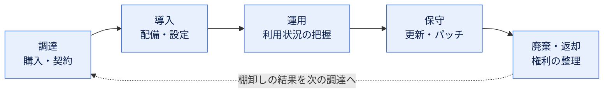
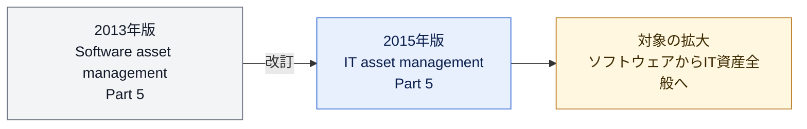
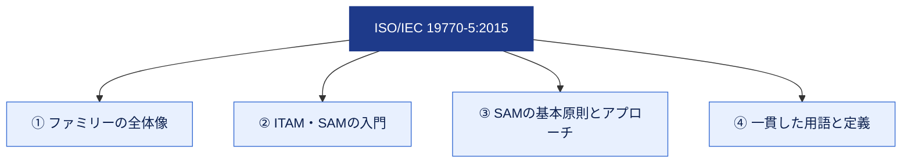
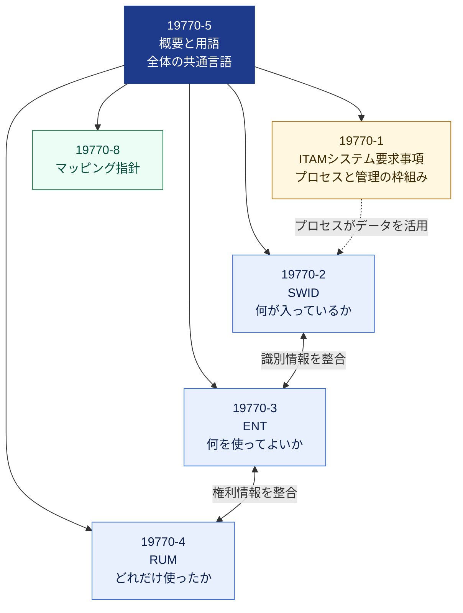
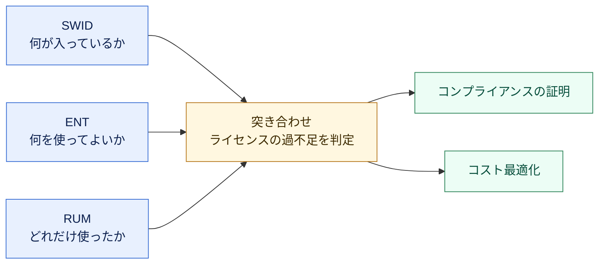
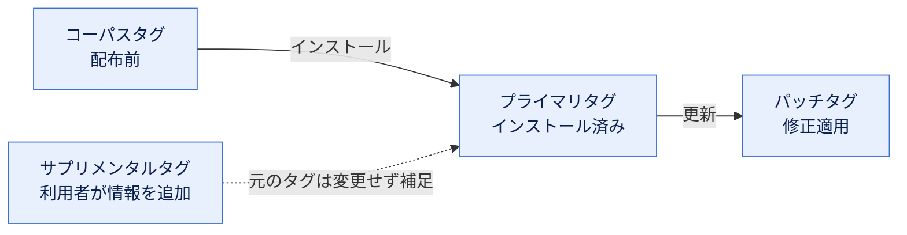
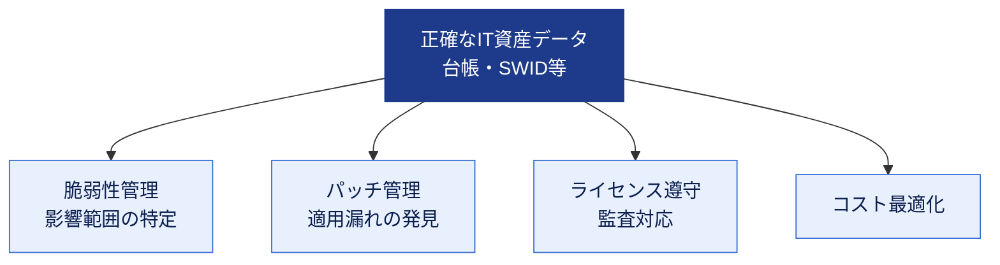
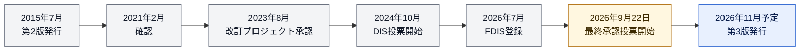
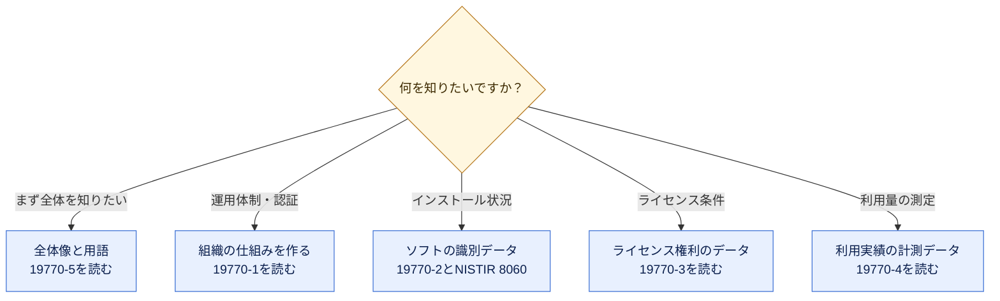

# ISO/IEC 19770-5:2015 初学者向け解説ガイド

## ITアセットマネジメント（ITAM）の「共通言語」を学ぶ

> **情報の基準日**：2026年10月18日現在
> **対象読者**：ITAM／SAM（ソフトウェア資産管理）を初めて学ぶ方、QA・開発・情シス・監査の担当者
> **ご注意**：本ガイドは規格本文の**転載ではなく、公開情報に基づく解説**です。正式な定義・条文は、無料で入手できる原文で必ず確認してください（入手先は「参考ソース一覧」を参照）。

---

## 目次

1. [この規格を一言でいうと](#1-この規格を一言でいうと)
2. [Step 1：まず基本用語を押さえる](#step-1まず基本用語を押さえる)
3. [Step 2：規格の基本情報を確認する](#step-2規格の基本情報を確認する)
4. [Step 3：規格が扱う4つの柱を理解する](#step-3規格が扱う4つの柱を理解する)
5. [Step 4：ISO/IEC 19770ファミリー全体像](#step-4isoiec-19770ファミリー全体像)
6. [Step 5：データ標準（SWID・ENT・RUM）のつながり](#step-5データ標準swidentrumのつながり)
7. [Step 6：なぜ今ITAMが重要か（セキュリティとの関係）](#step-6なぜ今itamが重要かセキュリティとの関係)
8. [Step 7：改訂動向（第3版への置き換え）](#step-7改訂動向第3版への置き換え)
9. [Step 8：学習ロードマップと読む順番](#step-8学習ロードマップと読む順番)
10. [よくある誤解 Q&A](#よくある誤解-qa)
11. [理解度チェックリスト](#理解度チェックリスト)
12. [参考ソース一覧（URL）](#参考ソース一覧url)
13. [本ガイドの調査範囲と限界](#本ガイドの調査範囲と限界)

---

## 1. この規格を一言でいうと

ISO/IEC 19770-5:2015 は、**ITアセットマネジメント（ITAM）に関する規格群「ISO/IEC 19770ファミリー」の入口となる“概要と用語集”**です。

| たとえると | 説明 |
|---|---|
| 地図の「凡例」 | ファミリー内の各規格がどこを担当しているかを示す |
| 辞書 | 規格群全体で使う用語を統一し、読み手同士の認識ズレを防ぐ |
| 入門書 | ITAM／SAMとは何か、基本的な考え方を短く紹介する |

> 💡 **ポイント**：この規格自体は「やるべき要求事項（○○しなければならない）」を並べる規格ではありません。**要求事項は19770-1、データ形式は19770-2/-3/-4**が担当し、19770-5は**全体を理解するための土台**です。

---

## Step 1：まず基本用語を押さえる

規格の話に入る前に、最低限の言葉を整理します。（以下は初学者向けの**やさしい言い換え**で、規格本文の定義そのものではありません）

| 用語 | 略称 | やさしい説明 | 具体例 |
|---|---|---|---|
| IT Asset Management | ITAM | 組織が持つITの資産を、入手から廃棄まで管理して価値を引き出す活動 | PC、サーバー、ソフトウェア、クラウド契約の管理 |
| Software Asset Management | SAM | ITAMのうち、特に**ソフトウェア**を対象にした管理 | ライセンス数と実際の利用数の突き合わせ |
| Hardware Asset Management | HAM | ITAMのうち、**ハードウェア**を対象にした管理 | 端末の台帳管理、保守期限の管理 |
| 資産（アセット） | — | 組織にとって価値があり、管理すべきもの | ライセンス、サーバー、アプリケーション |
| 権利（エンタイトルメント） | ENT | ソフトウェアを**どう使ってよいか**という利用権の情報 | 「100ユーザーまで」「1サーバーまで」 |
| ソフトウェア識別タグ | SWID | ソフトウェア自身が持つ「名札」のようなデータ | 製品名・版数・提供元などを記録したXML |
| 資源利用の測定 | RUM | 実際にどれだけ使われたかの計測データ | CPU使用量、ユーザー数、利用時間 |

### ITAMの基本サイクル

SAMは「購入・導入・保守・利用・廃棄」といった**ライフサイクル全体**を管理する事業活動として説明されます。

---

## Step 2：規格の基本情報を確認する

### 2-1. 基本プロフィール

| 項目 | 内容 |
|---|---|
| 規格番号 | ISO/IEC 19770-5:2015 |
| 正式名称 | Information technology — IT asset management — Part 5: Overview and vocabulary |
| 日本語訳（目安） | 情報技術—ITアセットマネジメント—第5部：概要及び用語 |
| 版 | 第2版（Edition 2） |
| 発行時期 | 2015年7月末〜8月（ISOのステージ表記では2015-07-31に発行） |
| ページ数 | 19ページ |
| 担当委員会 | ISO/IEC JTC 1/SC 7（ソフトウェア及びシステムズエンジニアリング） |
| ICS分類 | 35.080（ソフトウェア） |
| 前の版 | ISO/IEC 19770-5:2013（既に廃止） |
| 適用対象 | 営利企業、行政機関、非営利組織など**あらゆる種類の組織** |
| 価格 | **無料**（ISOのITTFサイトで公開されている規格） |

### 2-2. 2013年版からの大きな変化

2013年版の表題は「**ソフトウェア**資産管理（Software asset management）」でしたが、2015年版では「**IT**資産管理（IT asset management）」に変わっています。対象が**ソフトウェアだけでなくIT資産全般**に広がったことを示す変化です。

### 2-3. 現在のステータス（2026年10月18日時点）

| 観点 | 状況 |
|---|---|
| 現行版としての扱い | **有効（Published）**。2021年に見直しの結果「確認（confirmed）」された |
| 改訂ステージ | ISOのステージ表示は **90.92「改訂予定（To be revised）」**（2023-08-21に遷移） |
| 後継 | **ISO/IEC PRF 19770-5（第3版）**が最終承認フェーズ。ISOページ上の発行予定は**2026年11月** |

> ⚠️ **重要**：後継版は題名が「Part 5: **Vocabulary**」となっており、**「Overview（概要）」が題名から外れています**。第3版では用語集としての性格がより強まる可能性があります。ただし、本文は発行前のため、本ガイドでは内容に踏み込みません（詳細は Step 7）。

---

## Step 3：規格が扱う4つの柱を理解する

ISOの公式な要旨（abstract）によると、本規格は次の4点を提供します。

| 柱 | 公式要旨の内容（言い換え） | 初学者向けの理解 |
|---|---|---|
| ① 全体像 | ISO/IEC 19770ファミリーの概要 | 「どの規格が何を担当しているか」の地図 |
| ② 入門 | ITAMとSAMの紹介 | 「そもそもITAM／SAMとは何か」の導入 |
| ③ 基本原則 | SAMの土台となる原則やアプローチの簡潔な説明 | 「なぜそのやり方をするのか」の考え方 |
| ④ 用語 | ファミリー全体で一貫して使う用語と定義 | 「同じ言葉は同じ意味」にそろえる共通辞書 |

### ITAM／SAMを実践する意義（3つの目的）

ISO/IEC 19770の策定を担うコミュニティ（ITAM Standards）は、導入効果を次のように整理しています。

| 目的 | 内容 | 現場でのうれしさ |
|---|---|---|
| リスク管理 | ITサービスの中断、契約違反、監査リスクを抑える | ライセンス監査で慌てない |
| コスト削減 | 重複購入や使われていないソフトの無駄をなくす | 更新時に不要なライセンスを手放せる |
| 意思決定の質向上 | 正確なデータに基づいて判断できる | 「どの製品を何人が使っているか」を即答できる |

---

## Step 4：ISO/IEC 19770ファミリー全体像

19770-5は「地図」なので、地図に載っている**他の規格**も知っておきましょう。

### 4-1. 各パートの役割

| パート | 名称（略称） | 種類 | 役割 |
|---|---|---|---|
| **19770-1**:2017 | ITアセットマネジメントシステム—要求事項 | マネジメントシステム規格 | 組織がITAMの仕組み（ITAMS）を確立・運用・改善するための要求事項 |
| **19770-2**:2015 | ソフトウェア識別タグ（SWID） | データ標準 | ソフトウェアを識別・説明するための**XMLデータ形式** |
| **19770-3**:2016 | 権利スキーマ（ENT） | データ標準 | ソフトウェアの**利用権（ライセンス条件）**を表すデータ形式 |
| **19770-4**:2017 | 資源利用の測定（RUM） | データ標準 | **実際の利用量**を表すデータ形式 |
| **19770-5**:2015 | 概要と用語 | 概要・用語集 | **本ガイドの対象**。全体像と共通用語 |
| **19770-8**:2020 | 業界プラクティスのマッピング指針 | ガイドライン | 他の業界慣行と19770シリーズを対応づける文書の作り方 |

> 💡 **19770-1の位置づけ**：2017年版は **ISO 55001:2014（アセットマネジメント）の分野別拡張**として作られており、管理システム規格に共通する構造に沿っています。なお2012年版までは「プロセス＋段階（ティア）評価」型でしたが、2017年版で現在の管理システム型に改められました。また、2024年に追補（Amd 1:2024、気候変動対応の変更）が出ています。

### 4-2. ファミリーの関係図

### 4-3. 今後追加が計画されているパート

ITAM Standardsの「Coming Soon」ページには、次の計画が掲載されています（**計画段階のため変更・中止の可能性あり**）。

| 計画中のパート | 内容 |
|---|---|
| 19770-2 | SWID 第3版の改訂 |
| 19770-5 | 概要と用語 第3版の改訂（Step 7参照） |
| 19770-6 | ハードウェア識別タグ |
| 19770-7 | ITAMデータ構造要素のオーケストレーション（技術報告書の可能性） |
| 19770-8の次版 | 業界プラクティスと19770ファミリーを相互にマッピングするための指針 |
| 19770-10 | 19770-1とMSS（マネジメントシステム規格）のガイダンス（技術報告書の可能性） |
| 19770-11 | ITAMシステムの審査・認証を行う機関への要求事項 |

---

## Step 5：データ標準（SWID・ENT・RUM）のつながり

19770-5の「概要」部分を理解する最大のコツは、**3つのデータ標準が1つの問いに答えるために連携する**と捉えることです。

| 問い | 担当する標準 | 例え |
|---|---|---|
| 「何がインストールされているか？」 | SWID（19770-2） | 荷物の**名札** |
| 「何を使う権利があるか？」 | ENT（19770-3） | 購入した**チケット** |
| 「実際どれだけ使われたか？」 | RUM（19770-4） | 実際の**利用記録** |

3つを突き合わせれば、「権利は足りているか（過不足）」「使われていないものはないか」を定量的に判断できます。19770-4は、識別情報（19770-2）や権利情報（19770-3）と整合するよう設計されている、と説明されています。

### SWIDタグのライフサイクル（補足）

SWIDタグには、ソフトウェアの状態に応じた種類があります（NIST IR 8060の整理による）。

| タグの種類 | 意味 | 作られるタイミング |
|---|---|---|
| コーパス（Corpus） | インストール前のソフト（パッケージなど）を表す | 配布前 |
| プライマリ（Primary） | インストール済みの製品そのものを表す | インストール時 |
| パッチ（Patch） | 修正プログラムを表す | パッチ適用時 |
| サプリメンタル（Supplemental） | 利用者側が追加情報を足すためのタグ | 利用者が随時 |

> 💡 **IETFの発展形**：SWIDのXML形式をコンパクトなバイナリ形式（CBOR）にした **CoSWID** が、IETFの **RFC 9393（2023年6月）**として標準化されています。RFC 9393自身が、ISO/IEC 19770-2:2015のSWIDタグを土台にしていると明記しており、ISO規格が**インターネット標準の基盤**として実際に使われている好例です。

---

## Step 6：なぜ今ITAMが重要か（セキュリティとの関係）

ITAMは「ライセンス節約の話」だけではなく、**セキュリティの土台**でもあります。

| 観点 | 説明 | 根拠となる動き |
|---|---|---|
| 脆弱性管理 | 何が入っているか分からなければ、脆弱性の影響範囲も分からない | NISTは、SWIDタグがソフトウェア管理と情報セキュリティ管理の両方に役立つと説明 |
| 自動化 | タグ等の標準データがあれば、棚卸しや報告を自動化しやすい | NISTはSCAP 1.3にSWIDタグの利用を取り込んでいる |
| 管理システム統合 | ISO/IEC 27001などの資産管理と、ITAMの正確な台帳がつながる | 19770-1は管理システム規格の共通構造に沿っている |

> 📌 **QAエンジニア視点のヒント**：テスト環境や検証ツールを含めた「使用ソフトウェアの一覧」を正確に持つことは、監査・再現性・脆弱性対応のいずれにも効きます。ITAMの用語（資産・権利・利用実績）を共通言語にすると、開発・QA・情シス・法務の会話がかみ合いやすくなります。

---

## Step 7：改訂動向（第3版への置き換え）

### 7-1. 改訂の経緯（ISOのステージ記録より）

| 時期 | できごと |
|---|---|
| 2015年7月 | 第2版（現行版）発行 |
| 2021年2月 | 定期見直しの結果、現行版が「確認（confirmed）」 |
| 2023年8月 | 「改訂予定」ステージへ。同日、新規プロジェクトが承認され委員会ドラフト登録 |
| 2024年8月〜10月 | DIS（国際規格案）登録、10月23日にDIS投票開始（12週間） |
| 2025年1月 | DIS投票終了 |
| 2026年7月 | DIS承認→FDIS登録（7月3日、7月14日） |
| 2026年9月22日 | 最終承認投票（8週間）開始（ステージ50.20） |
| 2026年11月（予定） | 第3版発行予定 |

### 7-2. 第2版（現行）と第3版（予定）の比較

| 項目 | 第2版（2015年） | 第3版（PRF／2026年11月予定） |
|---|---|---|
| 題名 | Part 5: Overview and vocabulary | Part 5: **Vocabulary** |
| ページ数 | 19ページ | 16ページ |
| ICS | 35.080 | 35.020 / 01.040.35（用語分野の分類が追加） |
| 関連するSDGs | 9 | 9、8、12 |
| 状態 | 有効（改訂予定） | 最終承認フェーズ（制定前） |

> ⚠️ **実務上の注意**：第3版が発行されると、現行の第2版は置き換えられる見込みです。**社内規程や調達仕様書で規格を引用する場合は、版（年）を明記**し、発行後は第3版の本文で用語の変更点を確認してください。なお、題名の変更（Overviewの削除）や、ページ数の減少から、内容構成の変更が想定されますが、**中身は発行まで確認できないため断定はできません**。

---

## Step 8：学習ロードマップと読む順番

### 8-1. 目的別・次に読む規格

### 8-2. 初学者向け5ステップ学習プラン

| ステップ | 内容 | 目安時間 | ゴール |
|---|---|---|---|
| ① | 本ガイドを通読する | 30〜40分 | 全体像をつかむ |
| ② | 19770-5の原文（無料）を読む | 1時間 | 用語の公式定義を確認する |
| ③ | ITAM Standardsのサイトで各パートの概要を見る | 30分 | ファミリーの関係を理解する |
| ④ | NIST IR 8060／RFC 9393の概要を読む | 1〜2時間 | SWIDの実務利用を知る |
| ⑤ | 19770-1を読む（有償） | 数時間 | ITAMシステムの要求事項を理解する |

---

## よくある誤解 Q&A

| 誤解 | 実際 |
|---|---|
| 19770-5を取得すると「ITAM認証」が受けられる | 19770-5は概要・用語の規格であり、**認証対象となる要求事項を規定する規格ではありません**。管理システムの要求事項は**19770-1**です（認証機関向けの19770-11は計画段階） |
| ソフトウェアのライセンス管理だけの規格 | 2015年版でタイトルが「IT資産管理」に変わり、**IT資産全般**を対象にしています。ただしSAMの基本原則の説明が中心である点は変わりません |
| 規格は有償で買わないと読めない | 19770-5:2015は**無料**で入手できます（ISOの公開規格） |
| 19770-5だけ読めば実装できる | 実装には**19770-1（仕組み）と、SWID・ENT・RUMなどのデータ標準**の理解が必要です |
| 最新版はすでに第3版 | 2026年10月18日時点では、第3版は**制定前（最終承認フェーズ）**で、**現行は第2版**です |
| SWIDはISO内だけの規格 | IETFのRFC 9393（CoSWID）やNISTの指針、SCAP 1.3など、**外部の標準・指針が活用**しています |

---

## 理解度チェックリスト

学習後に、次の項目を確認してみましょう。

- [ ] ISO/IEC 19770-5が「概要と用語」を扱う規格であることを説明できる
- [ ] ITAM、SAM、HAMの違いを自分の言葉で言える
- [ ] 本規格が提供する4つの柱（全体像・入門・基本原則・用語）を挙げられる
- [ ] 19770-1／-2／-3／-4の役割の違いを説明できる
- [ ] SWID・ENT・RUMが「何が入っているか／何を使ってよいか／どれだけ使ったか」に対応することを理解した
- [ ] 19770-5自体が認証対象の要求事項を定める規格ではないことを理解した
- [ ] 現行は第2版（2015年）で、第3版（Vocabulary）が制定前であることを説明できる
- [ ] 社内文書で規格を引用するときは「版（年）を明記する」ことを意識できる

---

## 参考ソース一覧（URL）

調査日：2026年10月18日。**一次情報（ISO・標準化コミュニティ・NIST・IETF）を優先**して参照しました。

### A. 一次情報：ISO／IEC／標準化コミュニティ

| # | ソース | URL | 参照した内容 |
|---|---|---|---|
| A1 | ISO 規格ページ（本ガイドの対象） | <https://www.iso.org/standard/68291.html> | 版・発行日・ページ数・要旨・ライフサイクル（確認2021、改訂予定2023）・後継の案内 |
| A2 | ISO 後継版ページ（PRF 19770-5） | <https://www.iso.org/standard/87660.html> | 第3版の題名「Vocabulary」、16ページ、ステージ50.20（2026-09-22）、発行予定2026-11 |
| A3 | ISO/IEC 19770-5 無料PDF（zip） | <https://standards.iso.org/ittf/PubliclyAvailableStandards/c068291_ISOIEC_19770-5_2015.zip> | 原文入手先（ITAM StandardsのページからのリンクをISO ITTFが公開） |
| A4 | ITAM Standards：19770-5 | <https://itamstandards.org/19770-5/> | 規格の概要、4つの内容、無料コピーの案内 |
| A5 | ITAM Standards：トップ（About 19770） | <https://itamstandards.org> | ファミリー構成、WG21（2004年設立）、ITAMの3つの目的 |
| A6 | ITAM Standards：Coming Soon | <https://itamstandards.org/coming-soon/> | 今後のパート（19770-6／-7／-10／-11等）の計画 |
| A7 | ITAM Standards：19770-4 | <https://itamstandards.org/19770-4/> | RUMとSWID／ENTの整合性、利用目的 |
| A8 | IEC Webstore：19770-5:2015 | <https://webstore.iec.ch/en/publication/23051> | 19ページ、価格CHF 0、JTC 1/SC 7 |
| A9 | ISO 19770-1:2017 規格ページ | <https://www.iso.org/fr/standard/68531.html> | 19770-1:2017の範囲、ISO 55001の拡張という位置づけ、Amd 1:2024 |
| A10 | SIS（スウェーデン規格協会）19770-1 | <https://www.sis.se/en/produkter/information-technology-office-machines/software-development-and-system-documentation/isoiec-19770-12017/> | 19770-1:2017が有効であること、2012年版を置き換えた点 |

### B. 国際的な技術コミュニティ／政府機関の技術文書

| # | ソース | URL | 参照した内容 |
|---|---|---|---|
| B1 | IETF RFC 9393（CoSWID／2023年6月） | <https://www.rfc-editor.org/rfc/rfc9393.html> | ISO/IEC 19770-2:2015のSWIDをCBORで簡潔表現、タグのライフサイクル |
| B2 | NIST IR 8060（2016年4月） | <https://doi.org/10.6028/NIST.IR.8060> | SWIDタグの運用・作成ガイドライン（David Waltermire ほか） |
| B3 | NIST CSRC：NISTIR 8060 公開情報 | <https://csrc.nist.gov/publications/detail/nistir/8060/final> | 公開情報、関連資料 |
| B4 | NIST CSRC：SWID Tagging Guidelines | <https://csrc.nist.gov/Projects/Software-Identification-SWID/guidelines> | SCAP 1.3への取り込み、検証ツール、IETFでの取り組み |
| B5 | NIST IR 8060 PDF | <https://nvlpubs.nist.gov/nistpubs/ir/2016/NIST.IR.8060.pdf> | 本文（SWIDタグの種類とライフサイクル） |

> 補足：19770-5は**用語集系の規格**のため、個人開発者のブログ等で詳細に論じられることは少なく、**国際的に信頼性の高い標準化団体（ISO／IETF／NIST）の公式文書**を中心に参照しています。

### C. 補助的な参考（二次情報・要注意）

| # | ソース | URL | 参照した内容 |
|---|---|---|---|
| C1 | Wikipedia：ISO/IEC 19770 | <https://en.wikipedia.org/wiki/ISO/IEC_19770> | ファミリーの概観（一般向けの補助） |
| C2 | SmartSuite：19770-1:2017 フレームワーク解説 | <https://www.smartsuite.com/frameworks/iso-iec-19770-1-2017-it-asset-management-systems-requirements> | ITAMと情報セキュリティ（ISO/IEC 27001等）の関係の説明（民間事業者の解説） |
| C3 | IT Law Wiki：ISO/IEC 19770 | <https://itlaw.fandom.com/wiki/ISO/IEC_19770> | SAMの定義（調達・展開・保守・利用・廃棄）の説明 |

---

## 本ガイドの調査範囲と限界

| 項目 | 内容 |
|---|---|
| 規格原文 | 無料公開されているものの、**本ガイド作成時には原文PDFの全文を直接確認していません**。要旨・ISOの公式ページ・関連規格の公開情報・標準化コミュニティの資料に基づいて解説しています |
| 用語の説明 | Step 1の用語表は**初学者向けの言い換え**です。**正式な定義は原文の用語集で確認**してください |
| 第3版 | 制定前のため、**本文の内容は未確認**です。発行後に改めて確認してください |
| 著作権 | 規格本文の転載は行っていません |

---

*本ガイドは学習用の解説です。社内規程・契約・認証対応などで規格を利用する際は、必ず最新の原文で確認してください。*
