# ISO/IEC 27031:2025 初学者向けステップバイステップ解説

> **対象規格**: ISO/IEC 27031:2025 *Cybersecurity — Information and communication technology readiness for business continuity*（サイバーセキュリティ — 事業継続のための情報通信技術（ICT）の準備）
> **情報時点**: 2026年10月26日
> **想定読者**: ICT運用・インフラ・SRE・情報セキュリティ・BCP担当の初学者〜中級者
> **この資料の立ち位置**: 規格本文は有償・著作権保護のため転載せず、公開されている目次・序文・適用範囲・各機関の概要情報をもとに、自分の言葉で解説しています

---

## 0. 先に知っておきたい「この資料の確度」

規格の本文そのものは有料です。そのため、本ガイドは次の3段階で情報の確度を分けて書いています。

| 区分 | 内容 | 根拠 |
|---|---|---|
| 確度A | 規格の公式な構成（章立て・附属書）、適用範囲、序文、第2版の主な変更点 | 公開されている目次・序文プレビュー、ISO等の公式概要 |
| 確度B | 規格の狙いや位置づけの解説 | ISO・BSI・各国規格機関・専門家の解説記事 |
| 確度C | 実務への落とし込み（クラウドDRパターンとの対応、演習例など） | 筆者による補足。規格の要求事項ではない |

> **重要**: 各章の「詳細な要求・推奨内容」は本文を読まないと確定できません。実際の導入・監査対応では、必ず正式版を購入して確認してください。

---

## 1. ISO/IEC 27031:2025 を一言でいうと

**「事業を止めないために、ICT（情報システム・ネットワーク）側が何をどこまで準備しておくか」を整理するための手引き（ガイダンス）規格です。**

- ICTの障害・サイバー攻撃・災害などで業務が止まるリスクに対して、ICT部門が**事前に計画し、準備し、復旧できる状態**を作ることを扱います。
- この「準備ができている状態」を **IRBC（ICT Readiness for Business Continuity：事業継続のためのICT準備）** と呼びます。
- 認証を取る規格（ISO/IEC 27001のような認証制度）ではなく、**考え方と進め方を示すガイダンス**です。

### 1.1 基本情報

| 項目 | 内容 |
|---|---|
| 規格番号 | ISO/IEC 27031:2025 |
| 版 | 第2版（Edition 2） |
| 発行 | 2025年5月（ISO/IEC） |
| 担当委員会 | ISO/IEC JTC 1/SC 27（情報セキュリティ、サイバーセキュリティ及びプライバシー保護） |
| ICS分類 | 35.030（ITセキュリティ） |
| ページ数 | 33ページ |
| 前版 | ISO/IEC 27031:2011（2025年5月16日付で置き換え・廃止） |
| 性格 | 要求事項ではなく、考え方と方法を示す手引き（認証対象ではない） |

---

## 2. まず覚える6つの用語

初学者が最初につまずくのは、略語です。先にここを押さえると、以降が楽になります。

| 用語 | 正式名称 | 初学者向けの説明 |
|---|---|---|
| **BCM** | Business Continuity Management（事業継続マネジメント） | 災害や障害が起きても、重要な事業を続ける・早く戻すための組織的な取り組み全体 |
| **BIA** | Business Impact Analysis（事業影響度分析） | 「どの業務が止まると、どれだけ困るか」を調べる作業 |
| **IRBC** | ICT Readiness for Business Continuity | 事業継続を支えるために、ICTが復旧できるよう備えている状態 |
| **MBCO** | Minimum Business Continuity Objective（最低限の事業継続目標） | 障害中でも最低限これだけは提供し続ける、という業務・サービスの水準 |
| **RTO** | Recovery Time Objective（目標復旧時間） | 停止してから、どれくらいの時間以内に復旧させたいか |
| **RPO** | Recovery Point Objective（目標復旧時点） | 障害時に、どれくらい前の状態までのデータ損失なら許容できるか |

> 規格の適用範囲（Scope）には、ICTの事業継続計画の一部として **MBCO・RPO・RTO** に応える、と明記されています。

### 2.1 RTOとRPOを図で理解する

### 2.2 RTOとRPOの違いを表で整理

| 観点 | RTO | RPO |
|---|---|---|
| 問い | 「いつまでに戻すか」 | 「どこまでのデータ損失なら許せるか」 |
| 単位 | 時間（分・時間・日） | 時間（直近◯分/◯時間分のデータ） |
| 主に影響する対策 | 待機環境の用意、自動化、復旧手順 | バックアップ頻度、レプリケーション方式 |
| 小さくする代償 | コスト増・運用の複雑化 | コスト増・同期の仕組みの複雑化 |

---

## 3. この規格はどこに位置づく？（関連規格マップ）

ISO/IEC 27031 は単独で完結せず、**事業継続の規格群**と**情報セキュリティの規格群**の橋渡しをします。

規格の序文では、27031が ISO/IEC 27002 の事業継続関連コントロールを補完し、ISO/IEC 27005 の情報セキュリティリスクマネジメントを支援する、と述べられています。また、適用範囲の引用規格には ISO 22301、ISO/IEC 27035-1:2023 なども挙がっています。

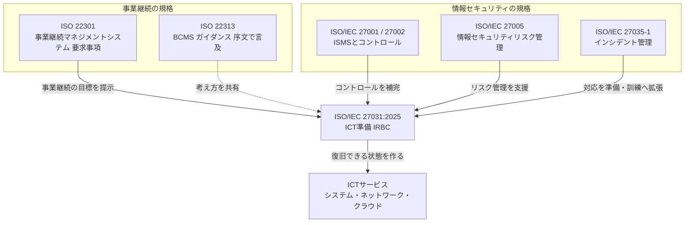

### 3.1 初学者向け：3つの規格の役割分担

| 規格 | 一言でいうと | 27031との関係 |
|---|---|---|
| ISO 22301 | 組織全体の事業継続の仕組みを作るための要求事項 | 27031は、その中の**ICT部分の準備**を深掘りする |
| ISO/IEC 27001 / 27002 | 情報セキュリティを管理する仕組みと対策集 | 27031は、**ICT継続の観点**でそれを補完する |
| ISO/IEC 27031 | ICTが事業継続を支えられる状態を作る手引き | 上記2つの間をつなぐ |

> 補足：専門家の中には、「ISO 22301がこの領域をすでによくカバーしており、ICT災害復旧そのものは ISO/IEC 24762 が扱う」という指摘もあります（iso27001security.com の解説）。ただし ISO/IEC 24762:2008（ICT災害復旧サービスの指針）はすでに廃止（withdrawn）されており、歴史的には ICT 災害復旧サービスの指針を担っていた規格です。27031は「ICT側の準備」に焦点を当てる位置づけ、と理解すると整理しやすいです。

---

## 4. 2011年版から何が変わった？

第2版は、2011年の初版以来**約14年ぶりの大きな改訂**です。

### 4.1 公式に示されている主な変更点（確度A）

| 変更点 | 内容 |
|---|---|
| 構成の変更 | 文書の章構成が組み替えられた |
| 適用範囲の明確化 | スコープの記述が整理された |
| 技術内容の追加 | 6.4、6.5、6.6、9.2、10.1.5 に技術的内容が追加された |

### 4.2 追加された節が意味すること

| 追加・拡充された節 | テーマ | 実務上のポイント |
|---|---|---|
| 6.4 | IRBCのためのリスクマネジメントと適用するコントロール | リスク評価とコントロール選定をICT継続につなげる |
| 6.5 | インシデントマネジメントとIRBCの関係 | 日常のインシデント対応と継続計画をつなげる |
| 6.6 | BCM戦略とIRBCの整合 | 事業側の戦略とICT側の準備をそろえる |
| 9.2 | IRBC戦略の選択肢 | 人材・設備・技術・データ・プロセス・供給者の6観点で考える |
| 10.1.5 | 技術的ソリューション | 復旧計画で使う技術の考慮 |

### 4.3 改訂の背景（確度B）

序文では、クラウドなどインターネットベースのICTサービスが主流になったことで、**備えの性質が「自社の内部プロセス中心」から「他組織のサービス品質や取引関係への依存」へ変わった**と述べられています。ISOの概要ページでも、依存先であるクラウド事業者などのサードパーティまで含めて準備を考える点が強調されています。

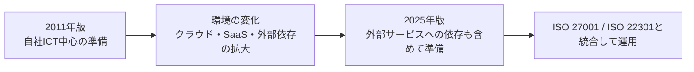

---

## 5. 規格の全体構造（章マップ）

公開されている目次にもとづく構成です（確度A）。

| 章 | タイトル（日本語訳は筆者） | ざっくり何をする章か |
|---|---|---|
| 1 | 適用範囲 | 何を対象にするか |
| 2 | 引用規格 | 併せて参照する規格 |
| 3 | 用語及び定義 | 用語の意味 |
| 4 | 略語 | 略語の一覧 |
| 5 | 本文書の構成 | この文書の読み方 |
| **6** | **IRBCのBCMへの統合** | ガバナンス・目標・リスク・インシデント・戦略との接続 |
| **7** | **IRBCに対する事業側の期待** | リスクレビュー、BIAの入力、対象範囲と依存関係 |
| **8** | **IRBCの前提条件の定義** | 事前準備、目的設定、RTO・RPO目標の決定 |
| **9** | **IRBC戦略の決定** | 戦略の選択肢（人・設備・技術・データ・プロセス・供給者） |
| **10** | **ICT継続計画の決定** | 計画の前提、発動、復旧計画、代替策、外部連絡先 |
| **11** | **試験・演習・監査** | 計画が実際に機能するかを確かめる |
| **12** | **最終的なMBCO** | 最低限の事業継続目標の確定 |
| **13** | **IRBC評価に関する経営層の責任** | 経営層が評価・関与する |
| 附属書A（参考） | RTOとRPOをICT復旧の事業目標と比較する | 目標値と事業目標の整合確認 |
| 附属書B（参考） | FMEAのためのリスク報告 | 故障モード影響解析の観点でのリスク報告 |

### 5.1 全体の流れ

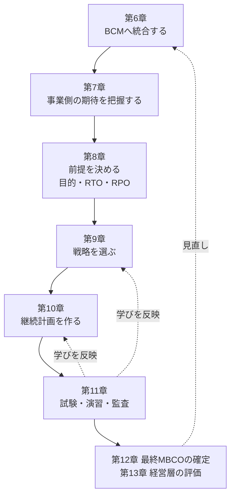

> **読み方のコツ**: 第6〜13章は、「統合 → 期待把握 → 前提設定 → 戦略 → 計画 → 検証 → 経営評価」という**一本の流れ**になっています。第11章の検証結果は、戦略や計画へフィードバックされます。

---

## 6. ステップバイステップ解説

ここからは、章の流れに沿って**Step 1〜Step 7**で解説します。
（各Stepの「規格上の位置づけ」は公開目次に基づく確度A、「やさしく言うと」「実務のヒント」は筆者の補足です）

---

### Step 1：IRBCをBCM（事業継続マネジメント）に組み込む【第6章】

**規格上の位置づけ**（確度A）：第6章は次の5つの節で構成されます。

| 節 | タイトル | 趣旨 |
|---|---|---|
| 6.1 | 一般 | 全体の考え方 |
| 6.2 | ガバナンスの実現 | 責任体制・意思決定の枠組み |
| 6.3 | 事業継続マネジメントの目標 | BCMの目標とIRBCの結びつけ |
| 6.4 | リスクマネジメントとIRBCに適用するコントロール | リスクと対策の整理 |
| 6.5 | インシデントマネジメントとIRBCの関係 | 平時のインシデント対応との連携 |
| 6.6 | BCM戦略とIRBCの整合 | 事業継続戦略とICT準備をそろえる |

**やさしく言うと**
IRBCを「ICT部門だけの別活動」にせず、会社全体の事業継続の取り組みの中に位置づける段階です。

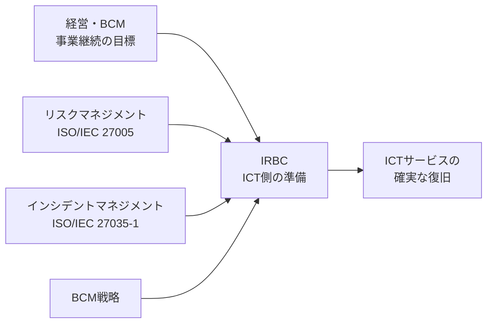

**実務のヒント**（確度C）
- ICT部門が単独で目標値を決めない。事業部門・リスク管理・経営層と一緒に決める。
- 既に ISO/IEC 27001 や ISO 22301 を運用している場合は、**二重の仕組みを作らず既存の運用に接続する**（序文でも、既存の標準に沿った仕組みを考慮し二重プロセスを避けることが望ましいと述べられています）。

---

### Step 2：事業側の期待を把握する【第7章】

**規格上の位置づけ**（確度A）

| 節 | タイトル | 趣旨 |
|---|---|---|
| 7.1 | リスクレビュー | 脅威・事象の監視、検知、分析を含む |
| 7.2 | 事業影響度分析（BIA）からの入力 | 重要なICTサービスの理解、事業継続要件に対するICTの準備状況の評価 |
| 7.3 | 範囲と接点 | ICTの依存関係、依存関係に関する契約面の確認 |

**やさしく言うと**
「事業側が何を守りたいか」を聞き取り、それを支えるICTサービスと、その**裏にある依存関係**（ネットワーク、クラウド、外部委託先など）を洗い出します。

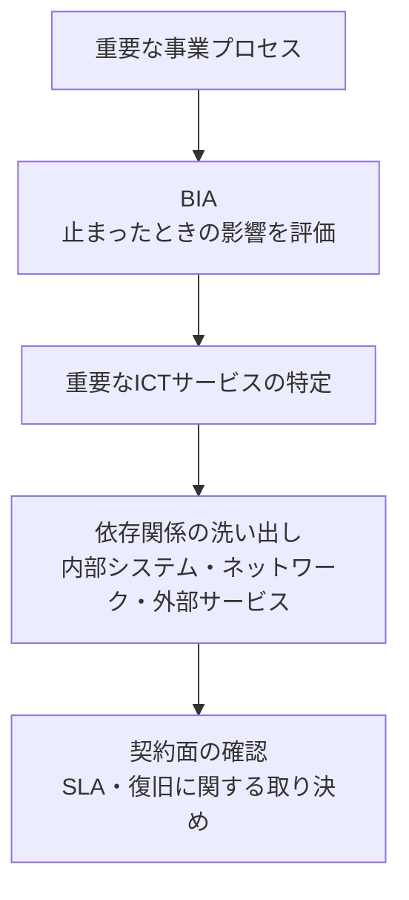

**実務のヒント**（確度C）
- 依存関係の洗い出しでは、クラウドのリージョン、認証基盤、DNS、メール、決済など、**見落としやすい共通基盤**を必ず含める。
- 契約（SLA）に書かれた復旧時間が、自社のRTOを満たすか確認する。

---

### Step 3：前提条件を決め、RTO・RPOの目標を定める【第8章】

**規格上の位置づけ**（確度A）

| 節 | タイトル |
|---|---|
| 8.1 | インシデントベース：インシデント前の準備（一般、ICT復旧能力、IRBCの確立、目的の設定、IRBCの成果・便益の決定、設備の冗長化計画、目的に関連するICTサービス範囲の決定） |
| 8.2 | ICTの目標RTOとRPOの決定 |

**やさしく言うと**
「何を、どこまで、どれくらいの速さで戻すか」を決める、全体の肝になる章です。

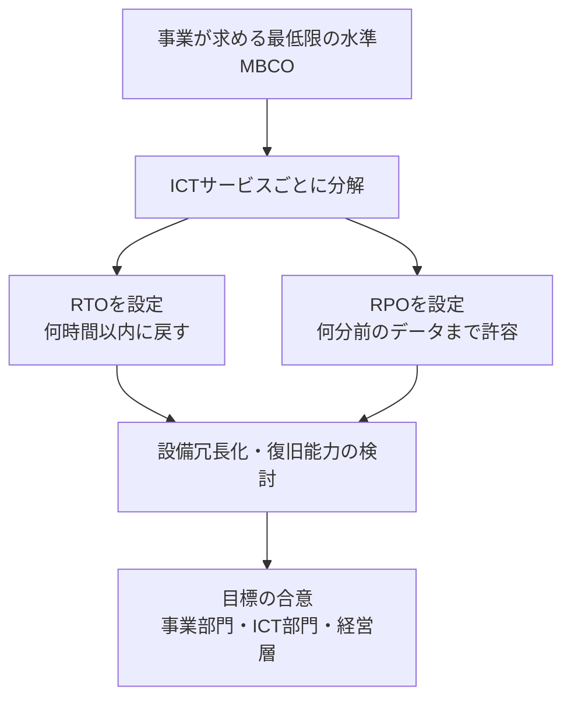

#### 3.1 目標値の考え方（架空の例）

> **これは説明用の架空例であり、規格が示す値ではありません。**

| ICTサービス | 事業上の重要度 | RTO（例） | RPO（例） | 考え方 |
|---|---|---|---|---|
| 決済処理 | 最重要 | 数分 | ほぼゼロ | 止まると売上と信用に直結 |
| 会員向けWebサイト | 重要 | 1時間 | 15分 | 一定の停止は許容するが長時間は不可 |
| 社内の経費精算 | 通常 | 1営業日 | 1日 | 数日は紙や別手段で代替可能 |
| 過去ログ分析基盤 | 低 | 3日 | 1週間 | 止まっても事業への即時影響は小さい |

> **ポイント**: 全部を「最速・最小」にすると、コストが膨れます。重要度に応じて**メリハリ**をつけるのが基本です。

---

### Step 4：IRBC戦略を選ぶ【第9章】

**規格上の位置づけ**（確度A）

| 節 | タイトル |
|---|---|
| 9.1 | 一般 |
| 9.2 | IRBC戦略の選択肢（9.2.2〜9.2.7 の6観点） |

**9.2 の6観点**

| 観点 | 節 | 考えること（筆者の補足） |
|---|---|---|
| 人材・知識 | 9.2.2 | 復旧できる人がいるか、手順を知っているか、代替要員は誰か |
| 設備・施設 | 9.2.3 | 代替拠点、電源、空調、物理的な場所 |
| 技術 | 9.2.4 | 冗長構成、バックアップ、フェイルオーバーの仕組み |
| データ | 9.2.5 | バックアップ方式、世代管理、複製の頻度 |
| プロセス | 9.2.6 | 復旧手順、運用プロセス、連絡の流れ |
| 供給者 | 9.2.7 | クラウド事業者・委託先・保守ベンダーへの依存 |

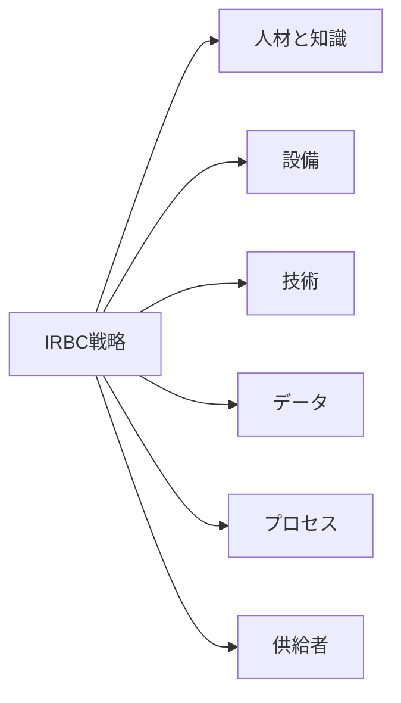

**実務のヒント**（確度C）
- 技術だけを冗長化しても、**手順を知る人がいなければ復旧は進みません**。6つの観点をセットで確認します。
- 供給者（クラウド事業者など）に任せる部分と、自社で担う部分の**責任分界**を明確にします。

---

### Step 4.5（実務補足）：RTO・RPOからクラウドDR方式を選ぶ【規格外の補足】

> **注意**: この節は ISO/IEC 27031 の要求事項ではありません。27031が示す「RTO・RPOを決める → 戦略を選ぶ」を、クラウド実務に当てはめた際の**参考例**です（確度C）。

AWSの災害復旧ホワイトペーパーおよびAWS Well-Architected Frameworkでは、DR戦略を4つに整理しています。Google Cloudでは、cold・warm・hotの3つのパターンで整理されています。

| 考え方 | AWS | Google Cloud | 復旧速度 | コスト |
|---|---|---|---|---|
| バックアップから復元 | Backup and Restore | Cold | 遅い（時間単位） | 低 |
| 最小限の中核だけ常時稼働 | Pilot Light | Cold〜Warm | 数十分程度 | 低〜中 |
| 縮小版を常時稼働 | Warm Standby | Warm | 分単位 | 中〜高 |
| 本番相当を複数拠点で稼働 | Multi-site active/active | Hot | ほぼゼロ | 最高 |

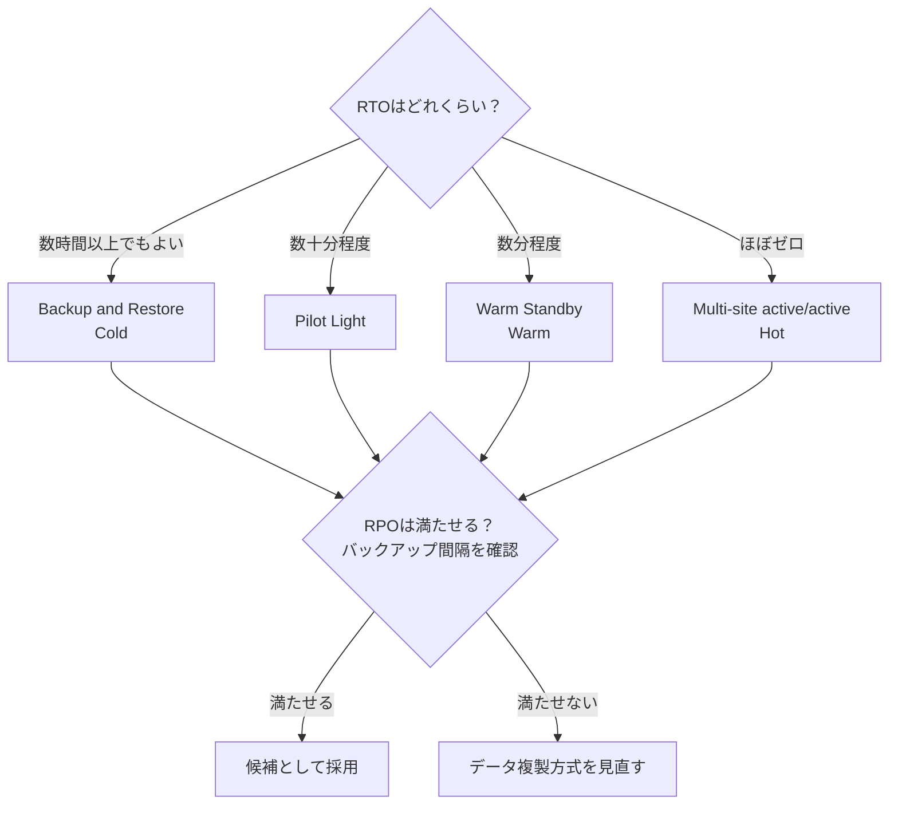

**根拠となる整理**
- AWSのWell-Architected Frameworkは、Backup and Restore、Pilot Light、Warm Standby、Multi-Region（Multi-site）active-activeを、RPO・RTOとコストのバランスで選ぶ戦略として紹介しています。
- Google Cloudの災害復旧ガイドは、DR対策を「アプリケーションがどれだけ速く復旧できるか」を示すcold・warm・hotのパターンで整理しています。

---

### Step 5：ICT継続計画を作る【第10章】

**規格上の位置づけ**（確度A）

| 節 | タイトル | 内容の概要 |
|---|---|---|
| 10.1 | 計画策定の前提条件 | 復旧組織、計画策定・報告・試験の時間枠、資源、IRBC要員の力量、技術的ソリューション |
| 10.2 | 復旧計画の発動 | ICT事業継続計画（BCP）の発動、エスカレーション |
| 10.3 | ICT復旧計画 | RPO・RTO計画、施設、技術、データ、対応・復旧手順、人員 |
| 10.4 | 一時的な回避策計画 | 完全復旧までの暫定手段 |
| 10.5 | 外部連絡先と手続き | 外部との連絡窓口・手順 |

**やさしく言うと**
Step 3〜4で決めた目標と戦略を、**「誰が・いつ・何をするか」という行動計画**に落とし込みます。

#### 5.1 計画の発動イメージ（説明用の例）

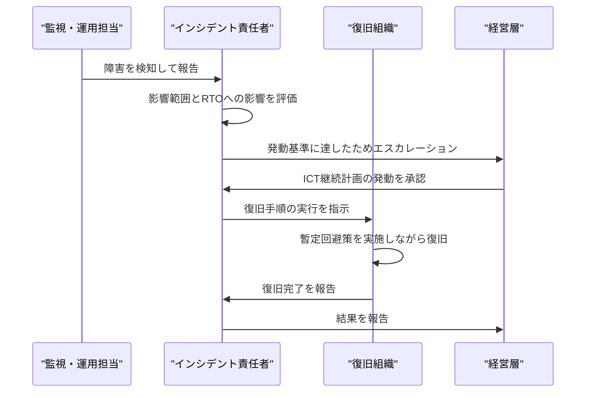

**実務のヒント**（確度C）
- 「発動の基準」と「誰が発動を決めるか」を事前に決める。曖昧だと、肝心なときに判断が遅れる。
- 暫定回避策（手作業、縮退運転など）は、**復旧そのものと並行して動かせる**ように用意する。
- 外部連絡先（クラウド事業者の窓口、保守ベンダー、監督当局など）は、**常に最新**に保つ。

---

### Step 6：試験・演習・監査で「本当に動くか」を確かめる【第11章】

**規格上の位置づけ**（確度A）

| 節 | タイトル |
|---|---|
| 11.1 | 性能基準 |
| 11.2 | 依存関係の試験（試験と演習、プログラム、範囲、計画、アラートベースと復旧段階ごとの違い、演習の管理） |
| 11.3 | 試験からの学び |
| 11.4 | IRBCの監査 |
| 11.5 | 文書化された情報の管理 |

**やさしく言うと**
計画は「作っただけ」では意味がありません。**実際に動かして、穴を見つけて、直す**ことが重要です。

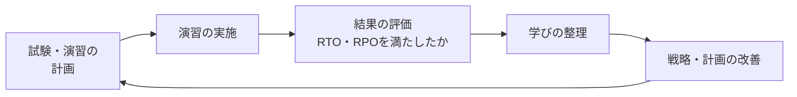

#### 6.1 演習で確認したいこと（筆者の補足）

| 確認項目 | 具体例 |
|---|---|
| 目標を満たせたか | 復旧にかかった時間はRTO以内か、失われたデータはRPO以内か |
| 手順は実行可能か | 手順書どおりに復旧できたか。前提知識が抜けていないか |
| 連絡は機能したか | エスカレーション、外部連絡先は正しく機能したか |
| 依存先は想定どおりか | クラウドや委託先の挙動が想定と合っていたか |
| 文書は最新か | 構成変更に手順書が追従しているか |

---

### Step 7：最終MBCOの確定と、経営層による評価【第12・13章】

**規格上の位置づけ**（確度A）

| 章・節 | タイトル |
|---|---|
| 12 | 最終的なMBCO |
| 13.1 | 一般 |
| 13.2 | 経営層の責任 |

**やさしく言うと**
試験や演習の結果をふまえて、**「最低限ここまでは維持できる」という現実的な水準（MBCO）**を確定し、経営層がIRBCの有効性を評価します。

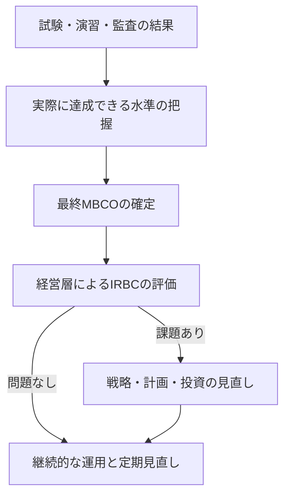

**ポイント**
- 公式な「MBCO」は、最初に事業側の希望として設定され、**検証を経て現実的な値に確定**する、という流れで読み取れます（第8章での目標設定と、第12章での最終確定が対応）。
- 経営層がIRBCを評価・関与することで、ICTの継続性が「技術の問題」から「経営課題」へ引き上げられます。

---

## 7. 附属書の読み方

| 附属書 | タイトル | 初学者向けの要点 |
|---|---|---|
| 附属書A（参考） | RTOとRPOをICT復旧の事業目標と比較する | 決めたRTO・RPOが、事業側の目標に見合っているかを**突き合わせる**ための考え方 |
| 附属書B（参考） | FMEAのためのリスク報告 | FMEA（故障モード影響解析）の観点で、障害の原因・影響・優先度を**整理して報告する**ための考え方 |

> 附属書の詳細は本文確認が必要です。ここでは位置づけのみ示しています。

---

## 8. 初学者向け：全体を1本のストーリーで理解する（架空の例）

> 以下は理解のための**架空の事例**です。

**状況**: ネット通販会社が、決済システムとWebサイトのICT継続を整備したい。

| Step | やること | 具体例 |
|---|---|---|
| 1 | BCMに組み込む | 事業継続委員会の下にICT継続の担当を置く |
| 2 | 事業側の期待を確認 | 決済が止まると1時間で大きな機会損失、と事業部門から聞き取る |
| 3 | RTO・RPOを決める | 決済：RTO 数分／RPO ほぼゼロ、サイト：RTO 1時間／RPO 15分 |
| 4 | 戦略を選ぶ | 決済は複数拠点で稼働、サイトはスケールダウン版を待機 |
| 5 | 計画を作る | 発動基準、担当、手順書、暫定手段（電話受付）を定める |
| 6 | 演習する | 半期に1回、拠点停止を想定して復旧演習。結果をRTO・RPOと比較 |
| 7 | 経営層が評価 | 結果を報告し、最終MBCOと追加投資を決定 |

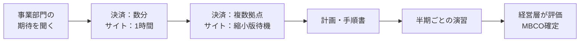

---

## 9. よくある誤解（FAQ）

| 誤解 | 正しい理解 |
|---|---|
| 27031を満たすと認証が取れる | ガイダンス規格であり、認証制度の対象ではない（認証対象となるのはISO/IEC 27001やISO 22301など） |
| 27031は災害復旧（DR）の技術規格 | DRも含むが、より広く「事業継続を支えるICT準備」の枠組み。ICTの災害復旧サービスはかつて ISO/IEC 24762:2008 が扱っていたが、同規格は廃止済み |
| ICT部門だけで取り組めばよい | 経営層・事業部門・リスク管理との連携が前提。第6章・第13章がその部分 |
| バックアップを取れば十分 | バックアップは一部。復旧手順、人、設備、供給者、試験まで含めて準備する |
| クラウドに載せれば安全 | 外部依存が増えるため、供給者の障害も含めて準備する必要がある |
| 一度作れば終わり | 試験・演習・監査と見直しを繰り返す |

---

## 10. 導入チェックリスト（初学者向け）

- [ ] 重要な事業プロセスとICTサービスの対応関係を整理した
- [ ] BIAの結果を、ICT側のRTO・RPOに反映した
- [ ] ICTの依存関係（クラウド・委託先・共通基盤）を洗い出した
- [ ] 依存先との契約（SLA）がRTOを満たすか確認した
- [ ] 戦略を「人・設備・技術・データ・プロセス・供給者」の6観点で点検した
- [ ] 発動基準・エスカレーション先・暫定回避策を決めた
- [ ] 試験・演習の計画を作り、結果をRTO・RPOと比較している
- [ ] 経営層へ評価結果を報告する仕組みがある
- [ ] ISO/IEC 27001・ISO 22301など既存の仕組みと二重にならないよう整理した

---

## 11. 参考ソース（URL）

> 情報時点：2026年10月26日。
> ご指定のISO公式ページ（`https://www.iso.org/cms/live/live/en/sites/isoorg/contents/data/standard/08/09/80975.html`）は、取得時にボット判定でアクセスが遮断されました。そのため、同じ規格の公式ページの別URLと、他機関・専門家の情報で補完しています。

### 11.1 規格の公式・準公式情報

| 種別 | 内容 | URL |
|---|---|---|
| ご指定のISO公式ページ | ISO/IEC 27031:2025（今回は取得不可） | https://www.iso.org/cms/live/live/en/sites/isoorg/contents/data/standard/08/09/80975.html |
| ISO公式 | 規格の概要・FAQ・発行情報（2025年5月、第2版） | https://www.iso.org/standard/27031 |
| ISO公式 | 同規格のページ（ID 80975） | https://www.iso.org/standard/80975.html |
| ISO/IEC 規格プレビュー（VDE Verlag配布） | 目次・序文・適用範囲・主な変更点の確認に使用（確度A） | https://www.vde-verlag.de/iec-normen/preview-pdf/info_isoiec27031%7Bed2.0%7Den.pdf |
| IEC Webstore | 発行日、版、ページ数、委員会 | https://webstore.iec.ch/en/publication/107542 |
| IEC Webstore（2011年版） | 旧版の位置づけ | https://webstore.iec.ch/publication/11304 |
| 各国規格機関（SIS） | 発行・置き換え関係 | https://www.sis.se/en/produkter/information-technology-office-machines/it-security/isoiec-270312025/ |

### 11.2 解説・専門家による情報

| 内容 | URL |
|---|---|
| ISO27k Forum系（iso27001security.com）：27031の構造・位置づけと専門家コメント | https://www.iso27001security.com/html/27031 |
| BSI：BS ISO/IEC 27031:2025 の概要と主な変更点 | https://knowledge.bsigroup.com/products/cybersecurity-information-and-communication-technology-readiness-for-business-continuity |
| Mitratech：2025年版の更新ポイントと2011年版との比較 | https://mitratech.com/resource-hub/blog/how-iso-27031-supports-ict-resilience-in-2025/ |

### 11.3 実務補足（クラウドDR）の根拠

| 内容 | URL |
|---|---|
| AWS：Disaster Recovery of Workloads on AWS（DRオプション） | https://docs.aws.amazon.com/whitepapers/latest/disaster-recovery-workloads-on-aws/disaster-recovery-options-in-the-cloud |
| AWS Well-Architected：REL13-BP02 定義した復旧戦略で復旧目標を満たす | https://docs.aws.amazon.com/wellarchitected/latest/framework/rel_planning_for_recovery_disaster_recovery.html |
| AWS Architecture Blog：DR architecture on AWS Part I | https://aws.amazon.com/blogs/architecture/disaster-recovery-dr-architecture-on-aws-part-i-strategies-for-recovery-in-the-cloud |
| Google Cloud：Disaster recovery planning guide | https://docs.cloud.google.com/architecture/dr-scenarios-planning-guide |
| Google Cloud：DR scenarios for applications（cold・warm・hot） | https://docs.cloud.google.com/architecture/dr-scenarios-for-applications |
| Google Cloud：Architecting disaster recovery for cloud infrastructure outages | https://docs.cloud.google.com/architecture/disaster-recovery |

### 11.4 ソースの信頼度メモ

| 区分 | 扱い |
|---|---|
| ISO/IEC/IEC Webstore/規格プレビュー | 規格の構造・範囲・変更点の根拠（最優先） |
| BSI・各国規格機関 | 概要・変更点の補強 |
| 専門家・ベンダー記事 | 位置づけ・背景の補足。**規格本文の代わりにはならない** |
| AWS・Google Cloud公式 | 実務的なDRパターンの参考。27031の要求事項ではない |

---

## 12. 次の一歩（学習ロードマップ）

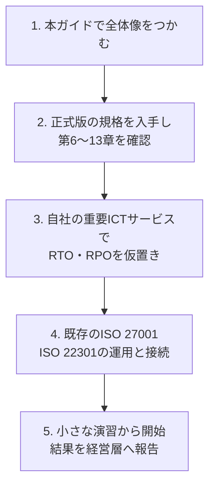

> **免責**: 本資料は学習目的の解説であり、規格本文の代替ではありません。認証・監査・契約対応など正式な用途では、必ずISO/IEC 27031:2025の正式版をご確認ください。
