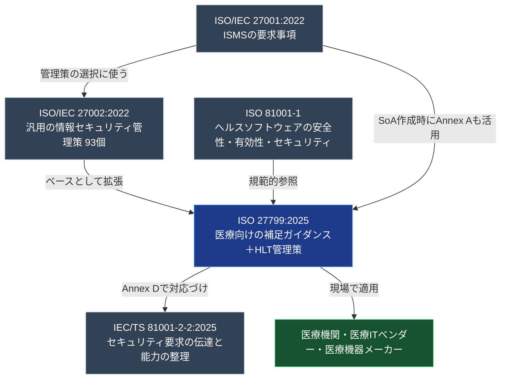
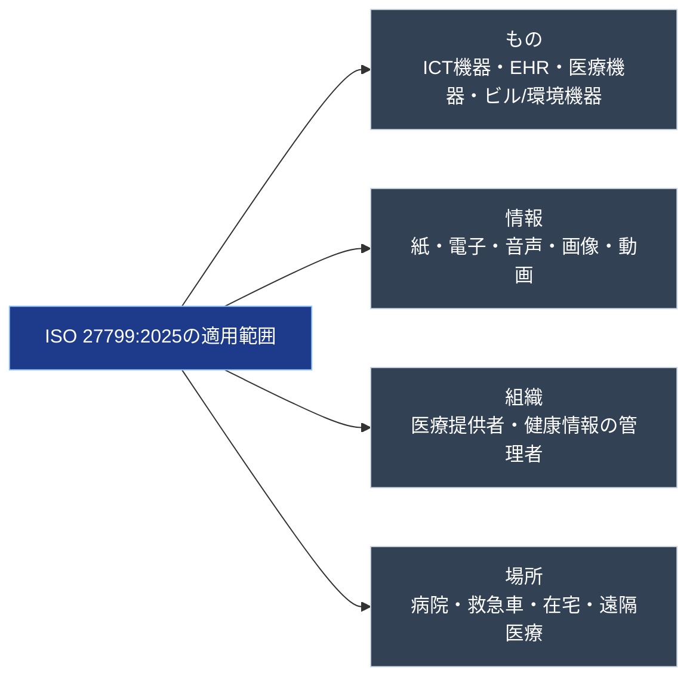
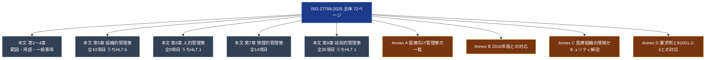
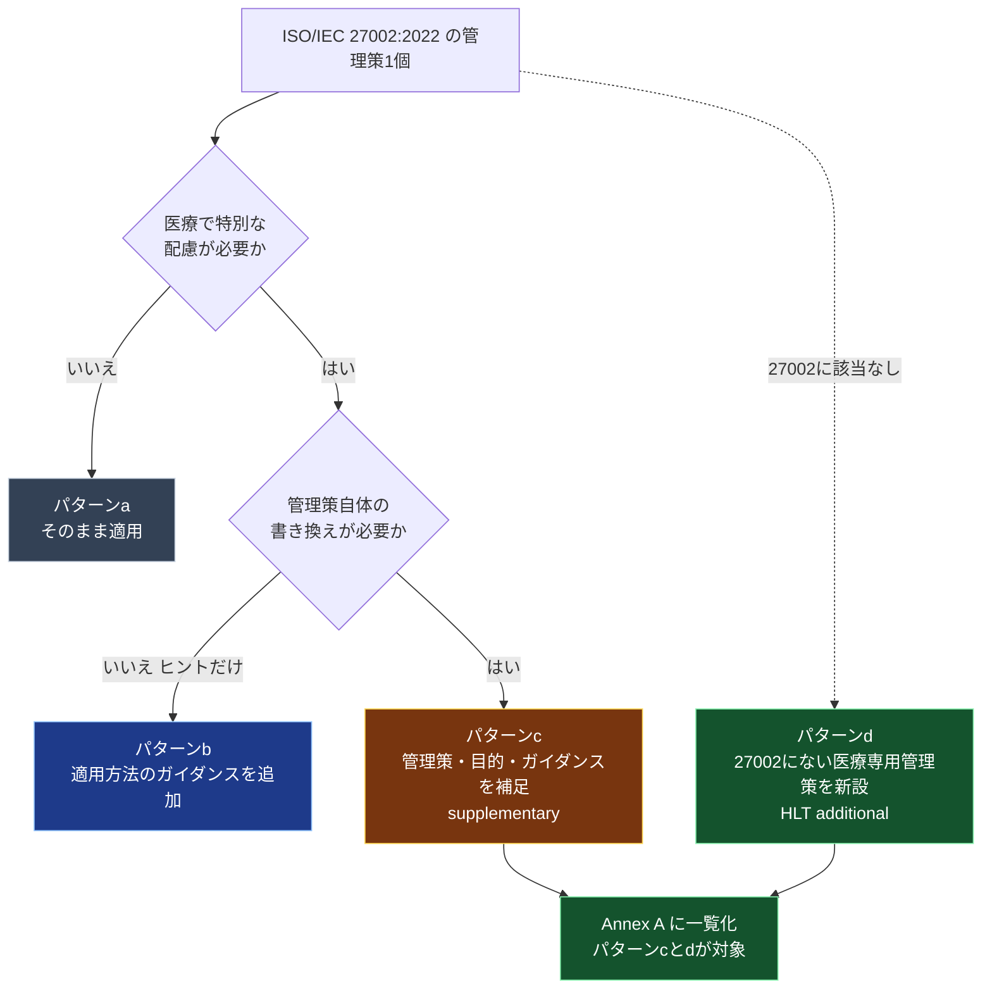
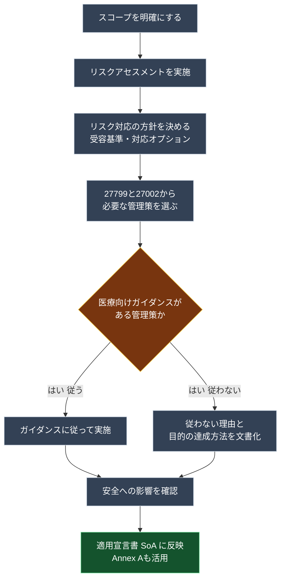
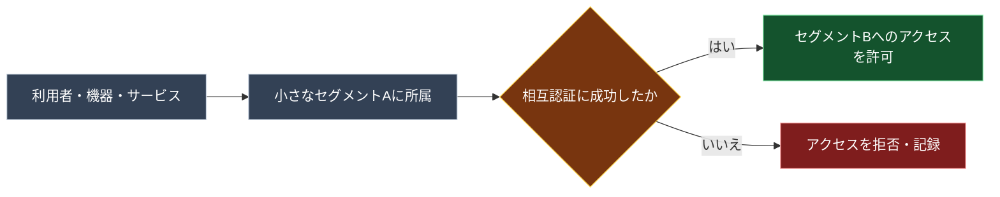
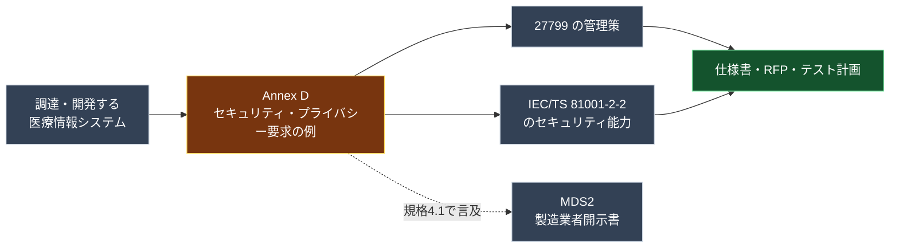
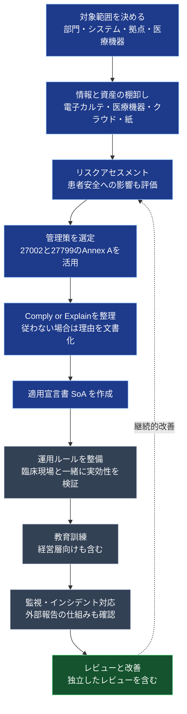
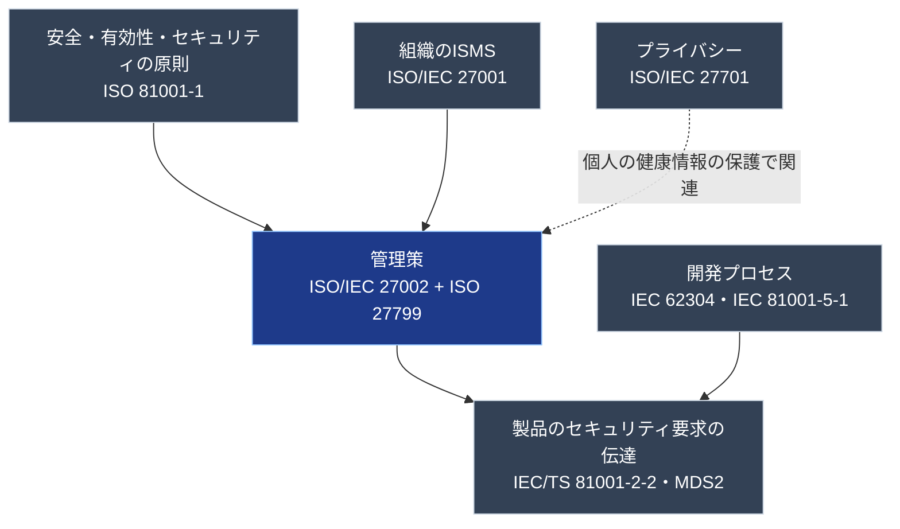

# ISO 27799:2025 初学者向けステップバイステップ解説ガイド

> **Health informatics — Information security controls in health based on ISO/IEC 27002**
> （ヘルスインフォマティクス — ISO/IEC 27002 に基づく医療・ヘルス分野の情報セキュリティ管理策）

| 項目 | 内容 |
|---|---|
| 対象規格 | ISO 27799:2025（第3版 / Edition 3） |
| 発行 | 2025年12月（ISO上のステージ 60.60：International Standard published、2025-12-18） |
| 作成主体 | ISO/TC 215（ヘルスインフォマティクス）。CEN/TC 251 と Vienna Agreement に基づき共同作成 |
| ページ数 | 72ページ（英語版）／ 参考価格 CHF 204（ISO Store） |
| ICS | 35.030（ITセキュリティ）／ 35.240.80（医療分野のIT応用） |
| 置き換え対象 | ISO 27799:2016 および ISO/TS 14441:2013 |
| 欧州での扱い | CEN が **EN ISO 27799:2026** として修正なしで承認 |
| 情報時点 | 2026年10月13日 |
| 想定読者 | 初学者（ISO 27001/27002 をこれから学ぶ人、医療IT・医療機器ソフト・QAに関わる人） |

> **この文書の位置づけ**：ISO 27799:2025 は有償規格です。本ガイドは、ISO公式ページ、規格プレビュー（目次・まえがき・序文・第1〜4章・5.1の冒頭）、専門家サイトの公開情報をもとに、初学者向けに**要約・言い換え**したものです。各コントロールの細かい要求・ガイダンスの全文は、必ず正規の規格書で確認してください（詳細は「付録B：調査の限界」を参照）。

---

## 目次

1. [Step 0：この規格を一言でいうと](#step-0この規格を一言でいうと)
2. [Step 1：なぜ医療に専用の規格が必要なのか](#step-1なぜ医療に専用の規格が必要なのか)
3. [Step 2：規格ファミリーの中での位置づけ](#step-2規格ファミリーの中での位置づけ)
4. [Step 3：何が・誰に・どこまで適用されるか（スコープ）](#step-3何が誰にどこまで適用されるかスコープ)
5. [Step 4：先に覚える用語](#step-4先に覚える用語)
6. [Step 5：規格全体の構造を地図で見る](#step-5規格全体の構造を地図で見る)
7. [Step 6：27002 とのつながり方（4パターン）](#step-6-27002-とのつながり方4パターン)
8. [Step 7：第4章 General の読みどころ（安全性・Comply or Explain・27001併用）](#step-7第4章-general-の読みどころ安全性comply-or-explain27001併用)
9. [Step 8：4つのテーマ別コントロール早見（93＋HLT 8）](#step-8-4つのテーマ別コントロール早見93hlt-8)
10. [Step 9：医療専用の追加コントロール「HLT」8個を理解する](#step-9医療専用の追加コントロールhlt8個を理解する)
11. [Step 10：付録 Annex A〜D の使い方](#step-10付録-annex-ad-の使い方)
12. [Step 11：2016年版から何が変わったか](#step-11-2016年版から何が変わったか)
13. [Step 12：導入の進め方（実務フロー）](#step-12導入の進め方実務フロー)
14. [Step 13：ソフトウェア／QAエンジニアの視点](#step-13ソフトウェアqaエンジニアの視点)
15. [Step 14：関連規格との関係](#step-14関連規格との関係)
16. [Step 15：つまずきやすいポイント FAQ](#step-15つまずきやすいポイント-faq)
17. [Step 16：理解度チェックリスト](#step-16理解度チェックリスト)
18. [付録A：参考ソースURL一覧](#付録a参考ソースurl一覧)
19. [付録B：調査の限界と注意](#付録b調査の限界と注意)

---

## Step 0：この規格を一言でいうと

**「ISO/IEC 27002:2022 の汎用的な情報セキュリティ管理策を、病院・クリニック・医療ITベンダー・医療機器の現場で使えるように"医療向けに翻訳・補強"した規格」**です。

| 観点 | ポイント |
|---|---|
| ベース | ISO/IEC 27002:2022（4テーマ・93管理策） |
| 追加されるもの | 医療向けの補足ガイダンス＋医療専用の追加管理策（タイトルに **HLT** が付く8個） |
| 守る対象 | 個人の健康情報（Personal Health Information）を中心に、医療で扱うあらゆる情報 |
| 特徴 | 「セキュリティ」「患者安全」「システムの有効性」を**セットで**考える |
| 性格 | 認証用の要求事項規格ではなく、**管理策とガイダンスの規格**（ISMSの要求事項は ISO/IEC 27001 側） |

> **重要**：2025年版では、2016年版にあった ISO/IEC 27001（ISMS）に関する内容が外され、**「管理策（コントロール）に集中した規格」**になりました。ISMSの枠組みそのものは ISO/IEC 27001 で学びます。

---

## Step 1：なぜ医療に専用の規格が必要なのか

ISO/IEC 27002 は「あらゆる業種で使える」ように、意図的に汎用的に書かれています。ところが医療には、他の業界にはない（あるいは特に強い）事情があります。規格の序文は、その背景を次のように整理しています（要旨）。

| 医療ならではの事情 | かみ砕いた説明 |
|---|---|
| 医療専用のデジタル機器 | ソフトウェアを組み込んだ**医療機器**が代表例 |
| 臨床の安全・有効性とのバランス | セキュリティを強くしすぎて診療が止まると本末転倒 |
| プライバシーと診療上の必要性の両立 | 診断・治療に必要な人には**必要なときに**見せつつ、不要な閲覧は防ぐ |
| 情報が分散している | 組織内・組織間（時には法域をまたぐ）で共有され、高い相互運用性が必要 |
| 利用者が多様 | 医師・看護師・研修医・学生・技師・事務・ボランティア・患者本人・代理人など |
| 組織間の依存関係が多い | 医療・臨床研究・教育・研修の情報の流れが絡み合う |
| 24時間365日の可用性 | 災害などで需要が急増することもある |
| 法令・契約要件が多様 | 医療提供者も、システム・機器の製造者・供給者も対象。法域で異なる |
| 責任の重なりや抜け | IT担当と医療機器担当など、職種間で責任範囲があいまいになりやすい |

### 具体例で理解する

> **例**：救急外来で、診療記録システムが「セキュリティのため」に何度も再認証を求めてくる。
> → 医師が忙しさのあまり、IDカードを共有して使い回す（ワークアラウンド）。
> → 誰が何を見たか追跡できなくなり、**かえってセキュリティも患者安全も悪化**する。

このような「セキュリティ対策が臨床の現場で逆効果になる」事態を避けるために、医療向けの視点が必要になります。

---

## Step 2：規格ファミリーの中での位置づけ

ISO 27799 は単独では動きません。**ISO/IEC 27001（ISMS）と ISO/IEC 27002（管理策集）の"医療版アドオン"**として使います。また、規格本文は **ISO 81001-1**（ヘルスソフトウェア／ヘルスITシステムの安全性・有効性・セキュリティの原則と概念）を規範的参照にしています。

### 3つの規格の役割分担

| 規格 | 一言でいうと | 学ぶタイミング |
|---|---|---|
| ISO/IEC 27001 | ISMSを**作って回す**ための要求事項（認証の対象） | 最初 |
| ISO/IEC 27002 | 具体的な**管理策のカタログ**と実施ガイダンス | 次 |
| ISO 27799 | 27002を**医療向けに補強**した管理策とガイダンス | その次 |

---

## Step 3：何が・誰に・どこまで適用されるか（スコープ）

規格の適用範囲は、ISO公式ページの Abstract／規格の第1章で次のように示されています（要約）。

### 3-1. 対象となる「もの」

| 区分 | 例 |
|---|---|
| 汎用ICT機器・ソフトウェア | PC、サーバ、ネットワーク機器、一般業務ソフト |
| 医療専用のソフト・システム | **電子カルテ（EHR）システム**、ソフトウェアを組み込んだ**医療機器**（プログラム済み／プログラム可能、ソフトウェアやファームウェアを含む） |
| 医療現場にあるその他のデジタル機器 | 環境・感染制御、ビル管理、物理セキュリティ用の機器 |

### 3-2. 対象となる「情報」

あらゆる形態の情報が対象です。テキスト・数値、音声、図面、画像、動画。取得方法、保存方法（紙・電子）、伝達方法（口頭、手渡し、郵送、可搬媒体、直接接続、ネットワーク）も問いません。

### 3-3. 対象となる「組織」と「場所」

| 観点 | 範囲 |
|---|---|
| 組織 | 医療を提供する組織、または他の理由で**個人の健康情報の管理者（カストディアン）**となっている、あらゆる種類・規模の組織 |
| 情報の置き場所 | オンプレミスでもクラウドでも対象 |
| 物理的な場所 | 病院、診療所、救急車、移動式の画像診断／検査ユニットなど |
| 医療が行われる他の場所 | 居住施設・在宅など |
| サービスの提供方法 | **遠隔医療・バーチャルな医療**を含む |

> **補足**：序文では、対象読者として「医療提供者」「医療向けソフト・機器・サービスの提供者」「医療の規制・認定・検査・保証を担う機関」が挙げられ、特に「ICT／医療機器の専門家」と「医療分野に不慣れな情報セキュリティ専門家（コンサルタント、ペネトレーションテスター、監査員など）」に有用とされています。

---

## Step 4：先に覚える用語

規格の第3章で定義されている主要用語です（意味を要約）。

| 用語 | 意味（要約） | 補足 |
|---|---|---|
| health（健康） | 身体的・精神的・社会的に完全に良好な状態 | 病気や虚弱がないだけではない（WHO憲章に基づく） |
| health software（ヘルスソフトウェア） | 個人の健康の管理・維持・改善、またはケアの提供のために使うソフトウェア、または医療機器に組み込む目的で開発されたソフトウェア | **SaMD（医療機器としてのソフトウェア）を完全に含む**（ISO 81001-1由来） |
| healthcare（ヘルスケア） | 個人の健康に関わるケア活動・サービス・管理・供給 | |
| personal health information（個人の健康情報） | 識別できる個人の心身の健康、またはその人への医療サービスの提供に関する情報 | 登録情報、支払い・資格情報、健康目的の識別番号、診療中に収集された情報、検体検査の結果、医療提供者としての識別なども含みうる |
| subject of care（ケアの対象者） | 医療を受けようとする／受けている／受けた人 | いわゆる「患者」より広い言い方 |
| proxy（代理人） | ケアの対象者に代わって意思決定する権利を持つ人 | 未成年者の親、判断能力が不十分な成人の後見人など |
| HLT | health の略。医療専用の追加コントロール名の接頭辞 | 「HeaLTh」 |
| PII | 個人を特定できる情報 | **個人の健康情報は PII の部分集合** |

> **ポイント**：個人の健康情報には、**匿名化されて個人を識別できなくなった情報は含まれません**（他の情報と組み合わせても識別できない場合）。

---

## Step 5：規格全体の構造を地図で見る

### 5-1. 本文の章構成

| 章 | 内容 | 備考 |
|---|---|---|
| 1 | Scope（適用範囲） | Step 3 参照 |
| 2 | Normative references（規範的参照） | ISO/IEC 27002:2022、ISO 81001-1 |
| 3 | Terms, definitions and abbreviated terms | Step 4 参照 |
| **4** | **General（一般）** | 構造、安全性、コントロールの選択と適用、27001との併用 |
| **5** | **Organizational controls（組織的管理策）** | 5.1〜5.43（うちHLT 6個） |
| **6** | **People controls（人的管理策）** | 6.1〜6.9（うちHLT 1個） |
| **7** | **Physical controls（物理的管理策）** | 7.1〜7.14 |
| **8** | **Technological controls（技術的管理策）** | 8.1〜8.35（うちHLT 1個） |

> 第5〜8章の番号体系は、ISO/IEC 27002:2022 の第5〜8章と**同じ**です。27002の「5.15 アクセス制御」は、27799でも「5.15 アクセス制御」です。HLTの追加分だけが、末尾の番号（5.38〜5.43、6.9、8.35）に追加されています。

### 5-2. 付録（Annex）の構成

| Annex | 区分 | 内容 | ページ（英語版目安） |
|---|---|---|---|
| A | 参考 | 医療向けの管理策の**リファレンス一覧**（補足管理策＋追加管理策） | 約2ページ |
| B | 参考 | **2016年版との対応表**（移行用） | 約1ページ |
| C | 参考 | 医療組織における情報セキュリティ（医療ならではの重要な側面の解説） | 約11ページ |
| D | 参考 | 医療情報システムの**セキュリティ／プライバシー要求の例**と、27799管理策・IEC/TS 81001-2-2のセキュリティ能力との対応づけ | 約20ページ（最大） |

### 5-3. 管理策の数を整理する

| テーマ | 27002:2022 の管理策 | 27799 で追加（HLT） | 27799 での合計 |
|---|---|---|---|
| 組織的（5章） | 37 | 6（5.38〜5.43） | 43 |
| 人的（6章） | 8 | 1（6.9） | 9 |
| 物理的（7章） | 14 | 0 | 14 |
| 技術的（8章） | 34 | 1（8.35） | 35 |
| **合計** | **93** | **8** | **101** |

---

## Step 6：27002 とのつながり方（4パターン）

規格の4.1は、27002の各管理策をどのように扱うかを、次の4パターンで説明しています（要約）。

| パターン | 27799での扱い | 呼び方 |
|---|---|---|
| (a) そのまま適用 | 27002の管理策・目的・ガイダンス等が、医療でも**変更なしで適用**される | 変更なし |
| (b) 適用のヒントを追加 | 27002の管理策について、医療での適用方法のガイダンスやその他の情報を**追加** | 追加ガイダンス |
| (c) 内容を補足 | 管理策そのもの・目的・ガイダンスを**医療向けに補足**（その他の情報も追加される場合あり） | **supplementary（補足）** |
| (d) 医療専用を新設 | 27002に元となる管理策がない、**医療専用の管理策**を新設（タイトルに **HLT** を付与） | **additional（追加）** |

### 具体例：5.1「情報セキュリティのための方針」（補足の実例）

プレビューで確認できる 5.1 では、27002の5.1がそのまま適用されることを示したうえで、医療向けの補足として次のような内容が示されています。

| 項目 | 内容（要約） |
|---|---|
| 管理策（医療向け補足） | 情報セキュリティ方針は、情報セキュリティの管理アプローチを定め、**最高位の経営層が承認**し、**少なくとも年1回、および重大なセキュリティインシデント発生後にレビュー**する |
| 目的（医療向け補足） | 経営トップのコミットメントを確保し、最新の状態を維持する |
| ガイダンス | 方針には、医療の情報セキュリティの必要性、目標、順守の範囲、法令・規制などに関する記述を含めるべき（以降は規格書で確認） |

---

## Step 7：第4章 General の読みどころ（安全性・Comply or Explain・27001併用）

第4章は短いですが、**規格の思想**が詰まっています。必ず読みましょう。

### 7-1. 4.2 Safety（安全性）：セキュリティ・安全・有効性は相互依存

規格は、**セキュリティ、（患者）安全、医療情報システムの有効性は互いに依存する**と明言しています。

| 例 | 起きること |
|---|---|
| システム／データが診療の場で使えない | 単なるセキュリティ事故ではなく、**診療の意思決定が損なわれ、安全上の重大な影響**になりうる |
| 不正アクセス対策のために制御を厳しくしすぎる | 使い勝手・可用性が下がり、**システムの有効性が損なわれる** |
| 現場が不便さを回避するワークアラウンドを始める | **安全性に悪影響**を及ぼすおそれ |

> **規格の要請**：管理策の選択・適用を含む、**情報セキュリティ管理のあらゆる局面で安全性を考慮**し、管理策の導入時には安全への影響も検討すること。

### 7-2. 4.3 管理策の選択と適用

| 小節 | 要点 |
|---|---|
| 4.3.1 管理策の決定 | **明確に定義した範囲でのリスクアセスメント**の結果に基づき、リスク受容基準・リスク対応の選択肢・組織のリスクマネジメント手法に沿って決める。国内外の法令・規制も考慮し、管理策同士の相互作用による**多層防御**も考える。27799と27002の両方から選び、必要なら**新しい管理策を設計**してもよい |
| 4.3.2 ガイダンスの適用 | 医療向けガイダンスがある管理策を実施するなら、**それに従うか、従わない理由と、管理策の目的をどう満たすかの説明を文書化**する（**Comply or Explain**＝順守するか、説明するか） |
| 4.3.3 27001との併用 | 27001準拠のISMSで医療向けの管理策を決める際に、Annex Aの補足・追加管理策を活用できる。27001の6.1.3が求める**適用宣言書（SoA）**の作成にも、Annex Aを使える |

---

## Step 8：4つのテーマ別コントロール早見（93＋HLT 8）

> ここでは各コントロールの**名称**（規格目次に基づく）と、**初学者向けの一言解説**を示します。一言解説は、一般的な意味の説明であり、27799が追加ガイダンスを持つかどうかは**Annex A**で確認してください。HLTは **太字** で示します。

### 8-1. 第5章 組織的管理策（Organizational controls）

| 番号 | 名称 | 初学者向けの一言 |
|---|---|---|
| 5.1 | 情報セキュリティのための方針 | 経営層が承認する、組織の基本方針。医療向けの補足あり（Step 6） |
| 5.2 | 役割と責任 | 誰が何に責任を持つかを決める |
| 5.3 | 職務の分離 | 1人に権限を集中させず、相互牽制を働かせる |
| 5.4 | 経営陣の責任 | 経営層が方針の順守を率先して求める |
| 5.5 | 関係当局との連絡 | 規制当局・捜査機関などへの連絡窓口を持つ |
| 5.6 | 専門組織との連絡 | 業界団体や専門家コミュニティとの情報交換 |
| 5.7 | 脅威インテリジェンス | 最新の脅威情報を収集・分析して対策に活かす |
| 5.8 | プロジェクト管理における情報セキュリティ | システム導入・開発の企画段階からセキュリティを組み込む |
| 5.9 | 情報及びその他の関連資産の目録 | 守る対象（情報・機器・システム）の棚卸し |
| 5.10 | 情報及び関連資産の許容される利用 | 使ってよい範囲・方法のルール |
| 5.11 | 資産の返却 | 退職・異動時に機器や情報を返す |
| 5.12 | 情報の分類 | 重要度や機微度で情報を区分する |
| 5.13 | 情報のラベル付け | 分類を表示して取り扱いを間違えにくくする |
| 5.14 | 情報転送 | 組織内外へ情報を送る際のルール・保護 |
| 5.15 | アクセス制御 | 誰がどの情報にアクセスできるかの規則 |
| 5.16 | 識別情報の管理 | ユーザIDなどの発行・管理・廃止 |
| 5.17 | 認証情報 | パスワード等の割当て・保護 |
| 5.18 | アクセス権 | 権限の付与・見直し・削除 |
| 5.19 | 供給者関係における情報セキュリティ | 委託先・ベンダーとの関係でのリスク管理 |
| 5.20 | 供給者との合意における情報セキュリティ | 契約にセキュリティ要件を盛り込む |
| 5.21 | ICTサプライチェーンの情報セキュリティ管理 | 部品・ソフト・サービスの連鎖全体の管理 |
| 5.22 | 供給者サービスの監視・レビュー・変更管理 | 委託先サービスの継続的な確認 |
| 5.23 | クラウドサービス利用の情報セキュリティ | クラウドの選定・利用・終了までの管理 |
| 5.24 | インシデント管理の計画と準備 | 事前に体制・手順を整える |
| 5.25 | 情報セキュリティ事象の評価と決定 | 事象がインシデントかどうかを判断する |
| 5.26 | インシデントへの対応 | 手順に沿って対処する |
| 5.27 | インシデントからの学習 | 再発防止・改善につなげる |
| 5.28 | 証拠の収集 | 調査・法的対応に使える形で証拠を保全する |
| 5.29 | 中断時の情報セキュリティ | 障害・災害時も必要なセキュリティを保つ |
| 5.30 | 事業継続のためのICTの備え | 診療継続のためのICT復旧計画・訓練 |
| 5.31 | 法令・規制・契約上の要求事項 | 適用される法令などを特定し順守する |
| 5.32 | 知的財産権 | ライセンス・著作権の順守 |
| 5.33 | 記録の保護 | 診療記録などの改ざん・紛失・不正アクセス防止 |
| 5.34 | プライバシー及びPIIの保護 | 個人情報（個人の健康情報を含む）の保護 |
| 5.35 | 情報セキュリティの独立したレビュー | 第三者的な視点で見直す |
| 5.36 | 方針・規則・標準の順守 | 決めたことが守られているか確認する |
| 5.37 | 文書化された運用手順 | 運用手順を文書化し、必要な人が使えるようにする |
| **5.38** | **HLT 情報セキュリティ要求事項の分析と仕様化** | 医療情報システムを調達・開発する際に要求を整理する |
| **5.39** | **HLT ケアの対象者の一意な識別** | 患者の取り違えを防ぐ識別の仕組み |
| **5.40** | **HLT 表示・印刷されたデータの妥当性確認** | 画面や帳票の表示内容が正しいか、ケアの対象者を安全に識別できる情報が含まれるかを確認する |
| **5.41** | **HLT 公開されている健康情報** | 一般向けに公開する健康情報の正確性・完全性を守る |
| **5.42** | **HLT 緊急時の通信** | 緊急時にも必要な連絡手段を確保する |
| **5.43** | **HLT 外部へのインシデント報告** | 外部機関などへの報告の仕組み |

### 8-2. 第6章 人的管理策（People controls）

| 番号 | 名称 | 初学者向けの一言 |
|---|---|---|
| 6.1 | 選考（スクリーニング） | 採用前の適格性確認 |
| 6.2 | 雇用条件 | 雇用契約にセキュリティ責任を明記 |
| 6.3 | 情報セキュリティの意識向上・教育・訓練 | 職種に応じた研修・啓発 |
| 6.4 | 懲戒手続 | 違反があった場合の手続を定める |
| 6.5 | 雇用終了・変更後の責任 | 退職・異動後も続く守秘義務など |
| 6.6 | 秘密保持契約（NDA） | 守秘に関する合意 |
| 6.7 | リモートワーク | 在宅・遠隔での業務時の保護 |
| 6.8 | 情報セキュリティ事象の報告 | 気づいた事象を速やかに報告できる仕組み |
| **6.9** | **HLT マネジメント向け訓練** | 経営・管理層がセキュリティを理解し責任を果たすための訓練 |

### 8-3. 第7章 物理的管理策（Physical controls）

| 番号 | 名称 | 初学者向けの一言 |
|---|---|---|
| 7.1 | 物理的セキュリティ境界 | 区域を区切って保護する |
| 7.2 | 物理的入退 | 入退室の管理 |
| 7.3 | オフィス・部屋・施設のセキュリティ | 重要な部屋（サーバ室・薬品庫・記録室）の保護 |
| 7.4 | 物理的セキュリティの監視 | 監視カメラ・警報などの活用 |
| 7.5 | 物理的・環境的脅威からの保護 | 火災・水害・停電などへの備え |
| 7.6 | セキュリティ領域での作業 | 重要区域内での作業ルール |
| 7.7 | クリアデスク・クリアスクリーン | 机や画面に情報を放置しない |
| 7.8 | 装置の設置・保護 | 機器の置き場所と保護 |
| 7.9 | 構外の資産のセキュリティ | 持ち出し機器の保護 |
| 7.10 | 記憶媒体 | USBやディスクなどの管理 |
| 7.11 | サポートユーティリティ | 電源・空調など支える設備 |
| 7.12 | ケーブル配線のセキュリティ | 配線の盗聴・損傷対策 |
| 7.13 | 装置の保守 | 保守を適切に行う |
| 7.14 | 装置のセキュリティを保った処分または再利用 | 廃棄・再利用時にデータを確実に消去 |

### 8-4. 第8章 技術的管理策（Technological controls）

| 番号 | 名称 | 初学者向けの一言 |
|---|---|---|
| 8.1 | ユーザエンドポイント機器 | PC・タブレット・スマホの保護 |
| 8.2 | 特権アクセス権 | 管理者権限を最小限にして厳格に管理 |
| 8.3 | 情報へのアクセス制限 | 必要な情報だけに絞って見せる |
| 8.4 | ソースコードへのアクセス | 開発コードの保護 |
| 8.5 | セキュリティを保った認証 | 本人確認の強化（多要素認証など） |
| 8.6 | キャパシティ管理 | 容量・性能不足による停止を防ぐ |
| 8.7 | マルウェアからの保護 | ウイルス・ランサムウェア対策 |
| 8.8 | 技術的脆弱性の管理 | 脆弱性の把握・パッチ適用 |
| 8.9 | 構成管理 | 機器・ソフトの設定を標準化し管理 |
| 8.10 | 情報の削除 | 不要になった情報を確実に削除 |
| 8.11 | データマスキング | 一部を隠して扱う（テスト・研究・表示） |
| 8.12 | データ漏えい防止 | 不正な持ち出し・漏えいの検知と防止 |
| 8.13 | 情報のバックアップ | 復旧できる形で取得・検証 |
| 8.14 | 情報処理施設の冗長性 | 可用性のための二重化 |
| 8.15 | ログ取得 | 誰がいつ何をしたかを記録 |
| 8.16 | 監視活動 | 異常を検知する |
| 8.17 | クロック同期 | 時刻を揃えてログの相関を可能にする |
| 8.18 | 特権的なユーティリティプログラムの使用 | 強力なツールの利用を制限 |
| 8.19 | 運用システムへのソフトウェアのインストール | 無許可のインストールを防ぐ |
| 8.20 | ネットワークセキュリティ | ネットワークの保護 |
| 8.21 | ネットワークサービスのセキュリティ | 通信事業者・クラウド網等の要件 |
| 8.22 | ネットワークの分離 | 区画（セグメント）に分ける |
| 8.23 | Webフィルタリング | 危険なWebへのアクセス制限 |
| 8.24 | 暗号の利用 | 暗号化・鍵管理 |
| 8.25 | セキュリティに配慮した開発ライフサイクル | 開発全体にセキュリティを組み込む |
| 8.26 | アプリケーションのセキュリティ要求事項 | 要件定義時にセキュリティ要件を明確化 |
| 8.27 | セキュアなシステムアーキテクチャ及び設計原則 | 設計段階のセキュリティ原則 |
| 8.28 | セキュアコーディング | 脆弱性を作り込まないコーディング |
| 8.29 | 開発及び受入れにおけるセキュリティテスト | セキュリティ観点のテスト |
| 8.30 | 外部委託による開発 | 委託開発の管理・監督 |
| 8.31 | 開発・テスト・本番環境の分離 | 環境を分けて事故を防ぐ |
| 8.32 | 変更管理 | 変更を審査・記録・テストして適用 |
| 8.33 | テスト用情報 | テストデータの選定と保護（実データ利用に注意） |
| 8.34 | 監査テスト中の情報システムの保護 | 監査や検査が業務に悪影響を与えないようにする |
| **8.35** | **HLT ゼロトラストの原則** | 暗黙の信頼を置かず、通信・アクセスごとに検証する |

---

## Step 9：医療専用の追加コントロール「HLT」8個を理解する

HLT はこの規格の**目玉**です。27002には存在しない、医療ならではの管理策です。

| 番号 | 名称 | 規格内でのボリューム感（英語版目次ページ） |
|---|---|---|
| 5.38 | 情報セキュリティ要求事項の分析と仕様化 | 約1ページ（p.18） |
| 5.39 | ケアの対象者の一意な識別 | 約1.5ページ（p.19〜20）。HLT中で最長級 |
| 5.40 | 表示・印刷されたデータの妥当性確認 | 約0.5ページ（p.20） |
| 5.41 | 公開されている健康情報 | 約1ページ（p.20〜21） |
| 5.42 | 緊急時の通信 | 約0.5ページ（p.21） |
| 5.43 | 外部へのインシデント報告 | 約1ページ（p.21〜22） |
| 6.9 | マネジメント向け訓練 | 約0.5ページ（p.25） |
| 8.35 | ゼロトラストの原則 | 約0.5ページ（p.36） |

### 9-1. HLTがなぜ必要か（考え方）

| HLT | 医療で特に重要になる理由（一般的な背景） |
|---|---|
| 5.38 要求事項の分析・仕様化 | 医療情報システム・医療機器は調達・開発の段階でセキュリティを組み込むと効果が大きい。Annex Dの要求例とも連動 |
| 5.39 ケアの対象者の一意な識別 | **患者の取り違え**は、セキュリティ（機密性・完全性）と患者安全の両方に直結する。同姓同名・複数システム間の連携で問題になりやすい |
| 5.40 表示・印刷データの妥当性確認 | 画面表示・帳票・ラベルの誤りは、診療判断の誤りに結びつく。**完全性**の問題が安全の問題になる。表示・印刷された個人の健康情報に、ケアの対象者を安全に識別できる情報が含まれないと、取り違えにもつながる |
| 5.41 公開されている健康情報 | 一般向けの健康情報は、改ざんや誤情報が人々の行動に影響する。**秘密にする情報ではなく、正確さを守る情報** |
| 5.42 緊急時の通信 | 災害・停電・システム障害時にも、医療継続に必要な連絡を維持する必要がある |
| 5.43 外部へのインシデント報告 | 規制当局・関係組織などへの報告が求められる場面に備える |
| 6.9 マネジメント向け訓練 | 経営・管理層の理解不足は、予算・方針・文化に影響する |
| 8.35 ゼロトラストの原則 | 医療は多拠点・多業者・多機器の接続が当たり前であり、境界防御だけでは守りきれない |

### 9-2. ゼロトラスト（8.35）の補足

規格書の本文は有償のため、ここでは**オランダの医療向け規格 NEN 7510 の同一内容の管理策**に関する公開説明を参考にします。それによれば、ネットワークセグメントに割り当てる情報サービス・利用者・情報システムのグループは**できるだけ小さく保ち**、別のセグメントへのアクセスは**双方が相互に認証された後に限る**という考え方が示されています（出典は付録A）。

> **注意**：上図は**考え方の説明**です。27799の8.35の実際の文言・要求の粒度は、規格書で確認してください。

---

## Step 10：付録 Annex A〜D の使い方

### 10-1. 目的別・付録の使い分け

| やりたいこと | 見る場所 | 使い方 |
|---|---|---|
| 医療向けに補足・追加された管理策だけを素早く知りたい | **Annex A** | 補足管理策と追加管理策の一覧。27001の適用宣言書（SoA）作成にも活用できる |
| 2016年版から移行したい | **Annex B** | 2016年版との対応表で、どの管理策がどう移ったかを確認 |
| 医療の特性をまず理解したい | **Annex C** | 医療組織で情報セキュリティが重要になる側面の解説（約11ページ） |
| システムを調達・開発するときの要求例が欲しい | **Annex D** | 医療情報システムのセキュリティ・プライバシー要求の例。27799管理策と IEC/TS 81001-2-2 のセキュリティ能力への対応づけ付き |

### 10-2. Annex D のイメージ

Annex D は、2013年の ISO/TS 14441（EHRシステムのセキュリティ・プライバシー要求）の5.3をもとに、**更新した要求例**を載せたものです。規格の4.1の説明では、**MDS2（医療機器セキュリティの製造業者開示書）**との対応づけも触れられています。

---

## Step 11：2016年版から何が変わったか

規格のまえがきが示す「主な変更点」と、専門家サイトの整理をまとめます。

| 観点 | 2016年版（第2版） | 2025年版（第3版） |
|---|---|---|
| タイトル | Information security **management** in health using ISO/IEC 27002 | Information security **controls** in health based on ISO/IEC 27002 |
| ベース | ISO/IEC 27002:2013（14箇条・114管理策） | ISO/IEC 27002:2022（4テーマ・93管理策） |
| 構成 | 27002:2013 の章立て（方針・資産管理・アクセス制御など） | 27002:2022 の構成（組織・人・物理・技術）に整合 |
| ISMS | 27001／ISMSに関する内容を含んでいた | **27001に関する内容を除去。管理策に集中** |
| 医療専用の管理策 | 限定的 | **HLT 8個**を改訂・追加 |
| 重複の整理 | 2016年版のみの内容が、その後27002:2022に取り込まれた | **取り込まれた内容は削除** |
| 付録 | 旧版の構成 | **Annex C（医療組織のセキュリティ解説）** と **Annex D（要求例）** を追加 |
| 置き換え対象 | ISO 27799:2016 | ISO 27799:2016 と ISO/TS 14441:2013 |

> **補足**：ISO公式ページのライフサイクル情報では、2025年版は2022年2月16日に新規プロジェクトが承認され、2025年1月20日にDISの12週間の投票が開始、2025年9月18日にFDISの8週間の投票が開始、2025年12月18日に発行されています。

### 移行するときの考え方

| 状況 | 推奨アクション |
|---|---|
| 2016年版でISMSの運用をしている | Annex Bの対応表で管理策の対応を確認し、27002:2022ベースの管理策セットに見直す |
| 27001:2022 に移行済み | 適用宣言書（SoA）にAnnex Aの医療向け管理策（補足・追加）を反映する |
| これから新規に取り組む | 27001と27002を先に学び、27799で医療向けに補強する |

---

## Step 12：導入の進め方（実務フロー）

27799は「認証用の要求事項規格」ではなく、**27001のISMSの中で管理策を選ぶ際に使う**位置づけです。次は一般的な進め方の例です（規格が定める唯一の手順ではありません）。

### 立場別：どこから読むか

| 立場 | 先に読む場所 | 次に読む場所 |
|---|---|---|
| 病院のIT／情報システム部門 | 第4章 → Annex C | 第5章・第8章 → Annex A |
| 臨床現場の管理者（看護・診療部門） | 第4章（安全性）→ Annex C | 5.39〜5.42、6.3、6.9 |
| 医療ITベンダー・開発チーム | 第4章 → 5.38 | 8.25〜8.33 → Annex D |
| 医療機器メーカー | 第4章 → Annex D | 8章全体、IEC/TS 81001-2-2 |
| 監査員・コンサルタント | Annex A → Annex C | 第5〜8章、Annex B |
| 27001の担当者 | 4.3.3 → Annex A | SoA作成との連携 |

---

## Step 13：ソフトウェア／QAエンジニアの視点

ここでは、開発・テストの立場で**とくに関係が深い管理策**をピックアップします（管理策の名称は規格目次に基づきます）。

### 13-1. 関係の深い管理策

| 管理策 | エンジニアの仕事との関わり |
|---|---|
| 5.8 プロジェクト管理における情報セキュリティ | 企画・要件定義の段階でセキュリティ要件を組み込む |
| **5.38 HLT 要求事項の分析と仕様化** | 要求仕様にセキュリティ・プライバシー要件を落とし込む（Annex Dが参考） |
| **5.39 HLT ケアの対象者の識別** | 患者ID・突合（マッチング）・重複登録・取り違えに関する設計とテスト |
| **5.40 HLT 表示・印刷データの妥当性確認** | 画面・帳票・ラベル出力の正確性のテスト（表示の欠落・丸め・単位・桁など）。個人の健康情報の表示・印刷に、ケアの対象者を安全に識別できる情報が含まれるかも確認する |
| 8.15 ログ取得／8.16 監視活動 | 誰が何を閲覧・変更したかを追跡できる設計 |
| 8.25〜8.28 セキュアな開発ライフサイクル／要求／アーキテクチャ／コーディング | 開発プロセス全体にセキュリティを組み込む |
| 8.29 開発・受入れにおけるセキュリティテスト | 脆弱性診断、ペネトレーションテスト、受入基準 |
| 8.31 環境の分離／8.32 変更管理 | 開発・テスト・本番の分離、変更の承認とテスト |
| 8.33 テスト用情報 | **実患者データをテストに使うリスク**。マスキング（8.11）などと併せて検討 |
| 8.8 技術的脆弱性の管理 | 脆弱性情報の収集・パッチ適用・影響評価 |
| 5.21 ICTサプライチェーン／5.23 クラウド | OSS、SaaS、外部APIなどの依存関係の管理 |

### 13-2. テスト設計のヒント（一般論）

| テストの観点 | 例 |
|---|---|
| 権限・アクセス | 役割ごとに見える範囲が適切か。緊急時の例外アクセス手順があるか、その記録が残るか |
| 識別・突合 | 同姓同名、誕生日が同じ、旧姓・外字、表記ゆれの場合に取り違えが起きないか |
| 表示・出力の妥当性 | 画面と印刷結果の一致、単位・桁・日付形式、長いデータの切れ、ケアの対象者を安全に識別できる情報が画面・印刷物に含まれるか |
| 可用性 | 障害時に、診療に必要な最小限の情報へアクセスできる手段（縮退運用）があるか |
| ログ | 参照・更新・削除・エクスポートの記録が残り、時刻が揃っているか |
| テストデータ | 実データを使っていないか。使う場合のマスキングと削除は確実か |
| 安全とのトレードオフ | 認証強化が現場操作を妨げ、ワークアラウンドを誘発しないか（ユーザビリティテストと連動） |

> **QAの視点の核心**：医療では「セキュリティ要件のテスト」と「臨床上の安全要件のテスト」を**別々に**やると、相互影響（Step 7-1）を見落とします。**同じ受入シナリオの中で両方の観点を検証**することが重要です。

---

## Step 14：関連規格との関係

| 規格 | 内容 | 27799との関係 |
|---|---|---|
| ISO/IEC 27001:2022 | ISMSの要求事項 | 27799の管理策を使って、SoAを作成・実施できる |
| ISO/IEC 27002:2022 | 情報セキュリティ管理策（93個） | **27799のベース**。併用が前提 |
| ISO 81001-1 | ヘルスソフトウェア／ヘルスITの安全性・有効性・セキュリティ：原則と概念 | **規範的参照**。用語（health software など）の出典 |
| IEC/TS 81001-2-2:2025 | ヘルスソフトウェアのセキュリティ上のニーズ・リスク・管理策の実装・開示・伝達のガイダンス | Annex Dで、セキュリティ能力との**対応づけ**がある。2025年10月公開。IEC TR 80001-2-2 と 80001-2-8 を置き換え、対象をヘルスソフトウェア全般に拡大 |
| IEC 81001-5-1:2021 | ヘルスソフトウェアの製品ライフサイクルにおけるセキュリティ活動 | 製品開発側のプロセス要求。27799は組織の管理策、81001-5-1は開発ライフサイクルの活動という補完関係 |
| IEC 62304 | 医療機器ソフトウェアのライフサイクルプロセス | 開発プロセスの規格。27799の8.25〜8.33と関連 |
| ISO/IEC 27701（2025年10月改訂） | プライバシー情報マネジメント | 2025年版でスタンドアロンの規格になった。個人の健康情報のプライバシー管理で関連 |
| ISO/TS 14441:2013 | EHRシステムのセキュリティ・プライバシー要求 | 27799:2025により**置き換え**（Annex Dに内容が反映） |
| NEN 7510（オランダ） | 医療の情報セキュリティ規格 | 27799の管理策（HLTを含む）に対応した国別の規格。欧州ではEN ISO 27799:2026として採用 |

---

## Step 15：つまずきやすいポイント FAQ

| 質問 | 回答 |
|---|---|
| 27799だけ読めばよい？ | **いいえ**。27799は27002の管理策の構造を前提にしており、27002（できれば27001も）の理解が必須です。規格自体も、27002の知識が不可欠であるという趣旨の前提で書かれています |
| 27799で認証（審査・登録）できる？ | 規格は**管理策とガイダンス**の位置づけで、ISMS認証の要求事項は27001側です。27001のISMSで医療向け管理策を選ぶ際の補助として使います。認証サービスを謳う事業者もありますが、制度上の扱いは機関や国によって異なるため、各機関に確認してください |
| HLTは必須？ | 規格は管理策の選択をリスクアセスメントに基づいて決めるとしています（4.3.1）。医療向けガイダンスがあるものを実施する場合は、**従うか、従わない理由を文書化**します（Comply or Explain） |
| 病院だけが対象？ | **いいえ**。医療提供者に加え、個人の健康情報のカストディアン、システム・機器・サービスの供給者なども想定読者です |
| 医療機器メーカーは関係ある？ | スコープに、ソフトウェアやファームウェアを含む医療機器が明示されています。製品側のセキュリティ要求は、Annex Dや IEC/TS 81001-2-2 も併せて確認します |
| 紙の記録は対象？ | **対象**です。情報はあらゆる形態・保存方法・伝達方法を含みます |
| クラウドやSaaSは対象？ | **対象**です。情報の保管・処理場所が、オンプレミスでもクラウドでも対象です（5.23も参照） |
| 遠隔医療は？ | 遠隔・バーチャルな医療を含むサービス提供方法が対象です |
| 日本の法令との関係は？ | 規格は法令順守（5.31）や国内外の法令を考慮することを求めます。日本の個別の法令・ガイドラインとの対応は、本ガイドの範囲外なので、所管省庁のガイドラインと併せて確認してください |
| 買わずに読める部分は？ | ISO公式ページのAbstract、規格プレビュー（目次・まえがき・序文・第1〜4章・5.1冒頭）で概要を把握できます |

---

## Step 16：理解度チェックリスト

- [ ] ISO 27799:2025 が「ISO/IEC 27002:2022 の医療向け版」であることを説明できる
- [ ] 2025年版が「管理策に集中し、27001（ISMS）関連の内容を外した」ことを説明できる
- [ ] 規格の本文構成（第4〜8章）と付録（Annex A〜D）の役割を言える
- [ ] 27002の管理策の扱い方4パターン（変更なし・ガイダンス追加・補足・HLT追加）を説明できる
- [ ] 管理策数（93＋HLT 8＝101）とHLTの8個の番号・名称を言える
- [ ] 「セキュリティ・安全・有効性は相互依存」の意味を具体例で説明できる
- [ ] Comply or Explain の意味を説明できる
- [ ] 個人の健康情報、ケアの対象者、代理人、ヘルスソフトウェアの意味を説明できる
- [ ] 適用宣言書（SoA）とAnnex Aの関係を説明できる
- [ ] ISO 81001-1、IEC/TS 81001-2-2、IEC 81001-5-1 との役割の違いを説明できる

---

## 付録A：参考ソースURL一覧

> 信頼度の目安：**A** = 規格発行元・標準化機関の一次情報、**B** = 規格の公開プレビュー・標準化専門サイト、**C** = 専門家個人／ベンダーの解説（補助情報）

### A-1. 規格の一次情報（信頼度 A〜B）

| # | ソース | URL | 本ガイドでの利用箇所 |
|---|---|---|---|
| 1 | ISO公式：ISO 27799:2025（Abstract、ライフサイクル、ステージ、委員会、前版との関係） | <a href="https://www.iso.org/standard/84647.html" target="_blank" rel="noopener noreferrer">https://www.iso.org/standard/84647.html</a> | 基本情報、スコープ、ライフサイクル |
| 2 | iTeh Standards：ISO 27799:2025（規格プレビュー：目次・まえがき・序文・第1〜4章・5.1冒頭、Annex概要） | <a href="https://standards.iteh.ai/catalog/standards/iso/ce4938c7-6fa0-484e-8fa1-8913515796ed/iso-27799-2025" target="_blank" rel="noopener noreferrer">https://standards.iteh.ai/catalog/standards/iso/ce4938c7-6fa0-484e-8fa1-8913515796ed/iso-27799-2025</a> | 構造、HLT一覧、用語、4.1〜4.3、主要な変更点 |
| 3 | iTeh Standards：EN ISO 27799:2026（CENによる修正なしの承認） | <a href="https://standards.iteh.ai/catalog/standards/cen/df1233f6-8950-4f5b-b978-c92c6180dcef/en-iso-27799-2026" target="_blank" rel="noopener noreferrer">https://standards.iteh.ai/catalog/standards/cen/df1233f6-8950-4f5b-b978-c92c6180dcef/en-iso-27799-2026</a> | 欧州での採用 |
| 4 | AFNOR：ISO 27799:2025 | <a href="https://www.boutique.afnor.org/en-gb/standard/iso-277992025/health-informatics-information-security-controls-in-health-based-on-iso-iec/xs146849/457306" target="_blank" rel="noopener noreferrer">https://www.boutique.afnor.org/en-gb/standard/iso-277992025/health-informatics-information-security-controls-in-health-based-on-iso-iec/xs146849/457306</a> | 前版・関連規格の位置づけ |
| 5 | Genorma：ISO 27799:2016（旧版のスコープ・性格） | <a href="https://genorma.com/en/standards/iso-27799-2016" target="_blank" rel="noopener noreferrer">https://genorma.com/en/standards/iso-27799-2016</a> | 2016年版との比較 |
| 6 | iTeh Standards：IEC/TS 81001-2-2:2025 | <a href="https://standards.iteh.ai/catalog/standards/iso/25a40142-54e0-436b-9b3b-0553c5bc73d7/iec-ts-81001-2-2-2025" target="_blank" rel="noopener noreferrer">https://standards.iteh.ai/catalog/standards/iso/25a40142-54e0-436b-9b3b-0553c5bc73d7/iec-ts-81001-2-2-2025</a> | 関連規格 |

### A-2. 国際的に知られた専門家・コミュニティの情報（信頼度 B〜C）

| # | ソース | URL | 本ガイドでの利用箇所 |
|---|---|---|---|
| 7 | ISO27k Forum / IsecT（ISO/IEC 27000ファミリーの国際的な解説サイト）：ISO 27799 解説ページ（構成、Annex、経緯） | <a href="https://www.iso27001security.com/html/27799" target="_blank" rel="noopener noreferrer">https://www.iso27001security.com/html/27799</a> | 章構成、Annex、第2版・第3版の経緯 |
| 8 | IsecT ブログ：ISO 27799 updated - health infosec controls（2025年12月19日） | <a href="https://www.iso27001security.com/post/iso-17799-updated-health-infosec" target="_blank" rel="noopener noreferrer">https://www.iso27001security.com/post/iso-17799-updated-health-infosec</a> | 27001関連内容の削除、4テーマへの集中 |

### A-3. 補助情報（信頼度 C）

| # | ソース | URL | 本ガイドでの利用箇所 |
|---|---|---|---|
| 9 | Wikipedia：ISO/IEC 27002 | <a href="https://en.wikipedia.org/wiki/ISO/IEC_27002" target="_blank" rel="noopener noreferrer">https://en.wikipedia.org/wiki/ISO/IEC_27002</a> | 27002の4テーマ構成 |
| 10 | Wikipedia：ISO/IEC 27701 | <a href="https://en.wikipedia.org/wiki/ISO/IEC_27701" target="_blank" rel="noopener noreferrer">https://en.wikipedia.org/wiki/ISO/IEC_27701</a> | 27701の2025年改訂 |
| 11 | CFE Cert：2016年版と2025年版の違い | <a href="https://cfecert.com/what-are-the-differences-between-the-2016-and-2025-versions-of-the-iso-27799-standard/" target="_blank" rel="noopener noreferrer">https://cfecert.com/what-are-the-differences-between-the-2016-and-2025-versions-of-the-iso-27799-standard/</a> | 構造変更の補助的整理 |
| 12 | Accountable：ISO 27799 解説 | <a href="https://www.accountablehq.com/post/iso-27799-in-healthcare-what-it-is-key-requirements-and-how-to-achieve-compliance" target="_blank" rel="noopener noreferrer">https://www.accountablehq.com/post/iso-27799-in-healthcare-what-it-is-key-requirements-and-how-to-achieve-compliance</a> | 一般的な実務観点の補助 |
| 13 | Cyberday：NEN 7510 の 8.35 HLT ゼロトラスト（オランダ語） | <a href="https://www.cyberday.ai/requirement/nen-7510-8-35-hlt-zero-trust-principes" target="_blank" rel="noopener noreferrer">https://www.cyberday.ai/requirement/nen-7510-8-35-hlt-zero-trust-principes</a> | 8.35の考え方の補足 |

---

## 付録B：調査の限界と注意

| 項目 | 内容 |
|---|---|
| 規格本文の確認範囲 | 有償規格のため、確認できたのは **ISO公式ページ、規格プレビュー（目次・まえがき・序文・第1〜4章・5.1冒頭）** が中心です。各管理策（5.2以降）の本文・ガイダンス、Annex A〜Dの詳細は**未確認**です |
| 一言解説の位置づけ | Step 8の一言解説は、管理策名と一般的な意味に基づく**初学者向けの説明**です。27799が追加ガイダンスを持つ管理策の特定には Annex A を、要求の正確な内容には規格書本文を確認してください |
| HLTの内容 | HLT 8個の**名称と位置づけ**は目次・規格紹介で確認できましたが、実際の要求・ガイダンスの文言は未確認です。Step 9-1の「必要な理由」は一般的な背景の説明です |
| 8.35 ゼロトラスト | 公開されているNEN 7510版の説明を参考にしています。27799の本文と完全に同一とは限らないため、規格書で確認してください |
| 「著名で国際的な開発者の投稿」について | 2025年12月発行の新しい規格であり、公開されている個人の技術者による詳細な解説はまだ限られています。そのため、**ISO27k Forum／IsecT**（国際的に知られた27000ファミリー解説サイト）と、標準化機関の一次情報を中心に参照しました。なお、検索結果には2016年版（27002:2013準拠・14箇条構成）の内容で説明している古いサイトもありましたが、**2025年版の説明としては採用していません** |
| 日付の表記 | ISO公式ページでは発行日が2025-12-18（ステージ 60.60）、一部の標準化サイトでは2025-12-17と記載されています。本ガイドはISO公式ページに従いました |
| 法的・認証上の助言ではありません | 日本の法令・ガイドラインへの適合、認証の可否は、所管官庁・認証機関・専門家に確認してください |
| 著作権 | 規格本文はISOの著作物です。本ガイドは要約・言い換えであり、規格書の代替ではありません。実務で使う場合は、正規版をISO Store、各国の標準化団体から入手してください |

---

*作成：2026年10月13日時点の公開情報に基づく初学者向け解説。規格本文の確認は正規版で行ってください。*
