# ISO/IEC/IEEE 29119-1:2022 初学者向け解説ガイド

> **ソフトウェアテストの「共通言語」を学ぶ：一般概念（General concepts）をステップバイステップで理解する**
>
> 情報の基準日：2026年10月21日 ／ 対象読者：テスト・QA・開発の初学者〜中級者 ／ 図解：Mermaid + Markdown表（ASCII図解は不使用）

---

## 目次

- [STEP 0：このガイドの使い方と前提](#step-0このガイドの使い方と前提)
- [STEP 1：規格の全体像](#step-1規格の全体像)
- [STEP 2：2013年版からの変更点](#step-22013年版からの変更点)
- [STEP 3：規格の構成を地図で把握する](#step-3規格の構成を地図で把握する)
- [STEP 4：ソフトウェアテストの基本概念（4.1節）](#step-4ソフトウェアテストの基本概念41節)
- [STEP 5：テスト計画とテスト戦略（4.2節）](#step-5テスト計画とテスト戦略42節)
- [STEP 6：テストフレームワーク（4.3節）](#step-6テストフレームワーク43節)
- [STEP 7：テスト設計と実行（4.4節）](#step-7テスト設計と実行44節)
- [STEP 8：プロジェクト管理・報告・インシデント管理（4.5〜4.7節）](#step-8プロジェクト管理報告インシデント管理4547節)
- [STEP 9：システム特性とテストの役割（附属書A・B）](#step-9システム特性とテストの役割附属書ab)
- [STEP 10：実務への適用手順](#step-10実務への適用手順)
- [STEP 11：この規格をめぐる議論を知っておく](#step-11この規格をめぐる議論を知っておく)
- [STEP 12：理解度チェック（10問）](#step-12理解度チェック10問)
- [用語集](#用語集)
- [根拠ソース一覧（URL）](#根拠ソース一覧url)

---

## STEP 0：このガイドの使い方と前提

### 0-1. 学習ロードマップ

規格の章立て（4.1 → 4.7 → 附属書）に沿って進みます。各STEPは「結論 → 図解 → 具体例 → 確認」の順で読めます。

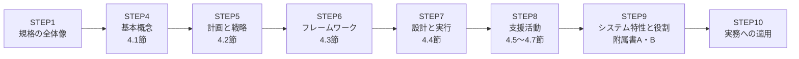

### 0-2. このガイドの根拠と限界（重要）

| 項目 | 内容 |
|---|---|
| 規格本文の入手性 | ISO/IEC/IEEE 29119-1:2022 の本文は、ISO・IEC の公開ページで**無償提供**されています |
| 本ガイドと規格本文の関係 | 本ガイドは**規格本文を転載していません**。本文の記述は要約・言い換えで紹介し、正確な文言は公開ページの正式版で確認してください |
| 著作権・利用条件 | 無償提供は閲覧・ダウンロードを認めるものであり、著作権は ISO・IEC・IEEE に帰属します。複製・再配布・転載は各機関の利用条件に従ってください |
| 実際に確認できた一次情報 | ISO公式ページ、IECストア、各国規格機関の目次・要約、公開プレビュー（序文・変更点・目次・用語定義の冒頭部分） |
| 記述の区分 | 「規格が述べていること」と「解説者による補足・具体例」を、表や注記で区別しています |
| 補足例の扱い | 各STEPの具体例（年齢入力、決定表、組合せ表など）は**学習用に作成した例**であり、規格本文の例ではありません |
| 厳密な適合判断 | 認証・契約・監査で使う場合は、必ず規格の正式版（および適合条項を持つ Part 2・3・4・5）を参照してください |

> 💡 **学習のヒント**：Part 1 は「情報提供（informative）」の位置付けです。「守らなければならない要求事項」が並ぶ文書ではなく、**テストの考え方と用語をそろえるための土台**として読むと理解しやすくなります。

---

## STEP 1：規格の全体像

### 1-1. 一言でいうと

ISO/IEC/IEEE 29119-1 は、ソフトウェアテストに関する**一般概念を定め、29119シリーズ全体の鍵となる考え方を示す文書**です（ISOの要約による）。

### 1-2. 基本情報

| 項目 | 内容 |
|---|---|
| 規格番号 | ISO/IEC/IEEE 29119-1:2022 |
| 題名 | Software and systems engineering — Software testing — Part 1: General concepts |
| 日本語での呼び方（例） | ソフトウェアおよびシステム工学 — ソフトウェアテスト — 第1部：一般概念 |
| 版 | 第2版（Edition 2） |
| 発行 | 2022年（ISOの表示：2022-02-04 発行、版表記は 2022-01） |
| 分量 | 英語版 47ページ |
| 担当委員会 | ISO/IEC JTC 1/SC 7（ソフトウェアおよびシステム工学）／ 起草は WG 26（ソフトウェアテスト） |
| 協力組織 | IEEE Computer Society（Systems and Software Engineering Standards Committee） |
| 分類 | ICS 35.080（ソフトウェア） |
| 状態（2026年10月21日時点でISOページ確認） | 発行済み（Stage 60.60）。前版 ISO/IEC/IEEE 29119-1:2013 は廃止（Withdrawn） |
| 言語 | 英語・フランス語 |

### 1-3. 29119シリーズの中での位置付け

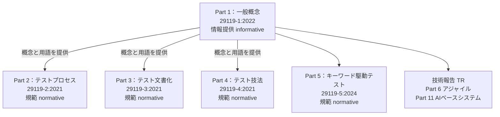

| パート | 主題 | 性格 |
|---|---|---|
| Part 1 | 一般概念（本ガイドの対象） | 情報提供。適合要求を含まない |
| Part 2 | テストプロセス（組織・テスト管理・動的テストの3層） | 規範。適合主張のための要求を含む |
| Part 3 | テスト文書化（テンプレートと例） | 規範 |
| Part 4 | テスト技法 | 規範 |
| Part 5 | キーワード駆動テスト（フレームワークとツール） | 規範。キーワード駆動テストのフレームワークとツールに関する要求事項を含む（2024年版） |
| TR（Part 6、Part 11 など） | アジャイルでの利用、AIベースシステムのテストなどの技術報告 | 技術報告（ガイダンス） |

> ⚠️ **よくある誤解**：「29119に準拠＝全文書を作らなければならない」ではありません。序文は、要求事項のすべてに従わない正当な理由がある利用者（例：アジャイル開発）が、**テーラリング（調整）の程度と根拠を記述して合意すれば「調整適合（tailored conformance）」を主張できる**と述べています。

### 1-4. 他の規格との関係

| 関連規格 | 関係 |
|---|---|
| ISO/IEC/IEEE 12207 / 15288 | ライフサイクルモデルを定める規格。テストの詳細は29119を参照する、という使い分けが序文で例示されている |
| ISO/IEC 25010:2023 | 製品品質モデルと品質特性を定義し、品質の仕様化・測定・評価に使える参照モデルを提供する。29119は「どうテストして証拠化するか」を扱う（arc42による整理） |
| ISO/IEC 20246 | 成果物レビュー（Work product reviews）の規格。レビューのプロセスと技法を定め、29119の静的テストのうちレビューを扱う（arc42による整理） |
| ISO/IEC/IEEE 24765 | システム・ソフトウェア工学の用語集（SEVOCAB）。本規格の用語節から参照されている |

---

## STEP 2：2013年版からの変更点

2022年版の「まえがき」には、主な変更点が8項目列挙されています。初学者向けに「何が変わり、なぜ重要か」を整理します。

| 変更点（まえがきの趣旨） | 初学者向けの意味 |
|---|---|
| 規格内で使わない用語の定義を削除し、題名を「Concepts and definitions」から「General concepts」へ変更 | 用語辞典の役割は薄まり、「概念の説明書」に性格が寄った |
| テスト概念の扱いを簡潔にし、並べ替えた | 読みやすさの改善。章立てが4.1〜4.7に整理された |
| 複雑さを理由に**テストサブプロセスの概念を削除**し、テストプロセスの**インスタンス化**の説明を追加 | 「プロセスを自分の現場向けに具体化する」ことが明示された |
| **テスト戦略の期待内容**を明確化 | 戦略に何を書くべきかが分かりやすくなった |
| 簡素化したテスト設計プロセスを記述。テストケースは**テスト条件ではなくテストモデルから導出** | 「モデルを作ってからケースを作る」考え方が前面に出た |
| メトリクス（測定値）の説明を附属書から**本文へ移動** | 測定が本編の重要テーマになった |
| ライフサイクルモデルごとのテストの位置付けを説明する附属書を削除 | 特定の開発モデルへの言及を減らし、汎用性を重視 |
| **システム特性ごとのテスト方法の例を示す新附属書（附属書A）を追加** | AI・組込み・モバイルなど、対象システムの性質に合わせたテスト選択を支援 |

### 変更の読み取り方（図解）

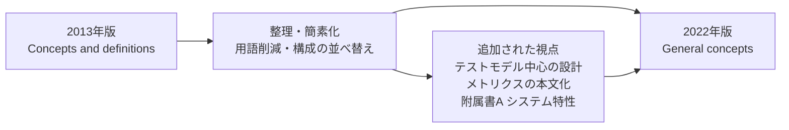

---

## STEP 3：規格の構成を地図で把握する

### 3-1. 章立て（2022年版）

| 章・節 | 内容 | 本ガイドの対応STEP |
|---|---|---|
| 1 適用範囲 | 一般概念を規定し、シリーズの鍵概念を示す | STEP 1 |
| 2 規範的参照 | **なし**（規範的参照文書を持たない） | － |
| 3 用語と定義 | A/Bテストから静的テストまでの用語（神経網・ニューロンカバレッジなどAI関連語を含む） | 用語集 |
| 4.1 ソフトウェアテスト入門 | 品質マネジメントとの関係、V&V、静的/動的、網羅テスト、ヒューリスティック、テストベース、テストオラクル、独立性 | STEP 4 |
| 4.2 テスト計画とテスト戦略 | リスク、テストアプローチ、ライフサイクル、ドメインとシステム特性、戦略の内容 | STEP 5 |
| 4.3 テストフレームワーク | テストプロセス、文書、構成管理、ツール、プロセス改善、メトリクス | STEP 6 |
| 4.4 テスト設計と実行 | テストモデル、MBT、スクリプト/探索、技法、経験ベース、回帰、自動化、継続的テスト、A/B、ファズ、環境、データ | STEP 7 |
| 4.5〜4.7 | プロジェクト管理、コミュニケーションと報告、欠陥・インシデント管理 | STEP 8 |
| 附属書A（参考） | システム特性とテスト：例（AI、自律、組込み、IoT、科学技術 など13特性） | STEP 9 |
| 附属書B（参考） | テストの役割 | STEP 9 |

### 3-2. 構成図

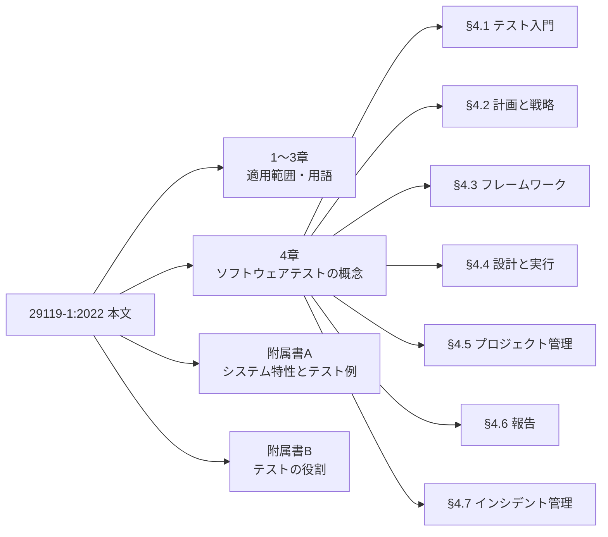

> 📌 目次の節番号は、ISO/IEC/IEEE 29119-1:2022 の公開目次（各国規格機関・プレビュー）で確認できる範囲に基づいています。

---

## STEP 4：ソフトウェアテストの基本概念（4.1節）

序文は、4.1節で「品質マネジメントや検証・妥当性確認（V&V）の中でのテストの役割」「静的テストと動的テスト」「網羅テストの非現実性とサンプリングの必要性」「テストベースとテストオラクルの重要性」「テスト独立性の利点」を説明すると述べています。

### 4-1. 10個の基本概念を一覧で理解する

| 節 | 概念 | 一言で言うと | 初学者向けの例（学習用） |
|---|---|---|---|
| 4.1.2 | 品質マネジメントとの関係 | テストは品質保証・品質管理の取り組みの一部 | 「テストだけで品質は作れない」。設計・レビューと組み合わせる |
| 4.1.3 | 検証と妥当性確認（V&V） | 検証＝仕様どおりに作れたか、妥当性確認＝正しいものを作ったか | 仕様どおりの画面でも、ユーザーが使えなければ妥当性は低い |
| 4.1.4 | テストアイテム（test item） | テストの対象となる成果物 | 関数、API、画面、システム全体など |
| 4.1.5 | 静的／動的テスト | 実行しないで調べる／実行して評価する | レビュー・静的解析／実際に操作して結果を見る |
| 4.1.6 | 網羅テストとサンプリング | すべての入力の組合せは試せないので、選んで試す | 下記の計算例を参照 |
| 4.1.7 | ヒューリスティックとしてのテスト | テストは正しさを保証する手段ではなく、経験則的に不具合を探す手段 | 「テストで不具合が出ない＝不具合がない」ではない |
| 4.1.8 | テストの目的 | 品質情報の提供、リスク低減など | リリース判断の材料を出す |
| 4.1.9 | テストベース（test basis） | テストケースを設計する根拠になる情報 | 要求仕様書、設計書、または文書化されていない期待動作の理解 |
| 4.1.10 | テストオラクル（test oracle） | 期待結果を判断する拠り所 | 仕様、旧バージョンの出力、有識者の知識など |
| 4.1.11 | テスト独立性 | 作った人と別の視点でテストする利点 | 開発者自身／同チーム別人／別チーム／外部組織、と独立度が上がる |

> 補足：4.1.7〜4.1.11 の表中の説明は、節の見出しと序文の要約を手がかりにした一般的な解説です。本文の厳密な記述は正式版でご確認ください。

### 4-2. 静的テストと動的テスト

規格の用語定義では、**動的テスト**は「テストアイテムを実行して評価するテスト」、**静的テスト**は「実行せずに品質基準などに照らして調べるテスト」で、例にレビューと静的解析が挙げられています。

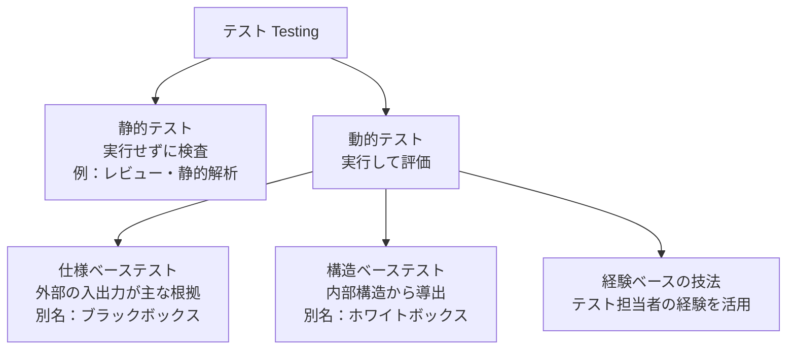

### 4-3. なぜ網羅テストは不可能か（計算例）

規格は、網羅テストを「入力値と事前条件のすべての組合せをテストするアプローチ」と定義し、非自明な場面ではほぼ不可能と注記しています。

| 前提（学習用の仮定） | 値 |
|---|---|
| 関数の入力 | 32ビット整数が2個 |
| 入力の組合せ数 | 2の64乗 ＝ 約 1.8 × 10の19乗 通り |
| 1秒に10億件テストできると仮定 | 約 1.8 × 10の10乗 秒 |
| 年に換算 | **約 585 年** |

結論：すべてを試すことはできないため、**リスクに基づいて「どこを・どの深さで」試すかを選ぶ（サンプリング）**ことが戦略の本質になります（STEP 5へ）。

### 4-4. テストベースとテストオラクルの関係

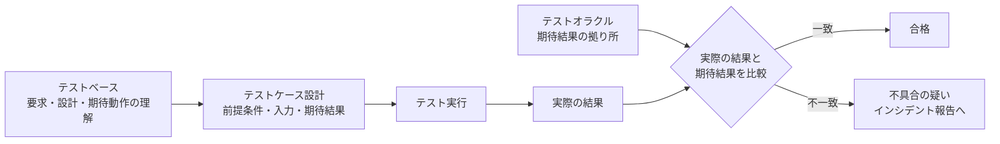

---

## STEP 5：テスト計画とテスト戦略（4.2節）

序文は、テスト計画とテスト戦略を**リスクベースドテスト**の文脈で説明し、これを「29119シリーズの根底にある、戦略立案とテスト管理の推奨アプローチ」「テストの優先順位付けと焦点の基礎」と位置付けています。

### 5-1. リスクの2種類

| 種類 | 規格の定義（趣旨） | 例 |
|---|---|---|
| プロダクトリスク | 製品が機能・品質・構造のどこかで欠陥を持つ可能性 | 決済計算の誤り、個人情報の漏えい |
| プロジェクトリスク | プロジェクトの管理に関するリスク | 人員不足、厳しい納期、要求の変更 |

### 5-2. リスクベースドテストとは

規格は、**テスト活動と資源の管理・選択・優先順位付け・使用が、分析されたリスクの種類とレベルに意識的に基づいているテスト**と定義しています。

### 5-3. 具体例：リスク分析からテストの深さを決める（学習用）

ECサイトの機能を例にした簡易表です。

| 機能 | 起こりやすさ | 影響度 | リスク | テストの方針（例） |
|---|---|---|---|---|
| 決済処理 | 中 | 高 | **高** | 仕様ベース技法（同値分割・境界値・決定表）＋構造ベース（分岐・MC/DC）＋回帰を自動化 |
| 会員登録 | 中 | 中 | 中 | 仕様ベース技法＋探索的テスト |
| 商品レビュー表示 | 低 | 低 | 低 | 基本動作の確認と探索的テスト少量 |
| 配送状況ページ | 高 | 中 | 中〜高 | 外部連携の異常系を重点的に確認 |

### 5-4. テスト戦略とテストアプローチ

規格の定義では、**テストアプローチ**は「テスト戦略を設計する活動の中で通常行う、高レベルのテスト実装上の選択」で、典型的にはテストレベル・テストタイプ・テスト技法・テストプラクティス・静的テストの形態を選びます。

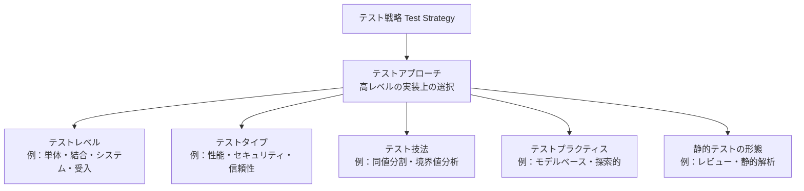

### 5-5. テスト戦略とテスト計画の違い（整理）

| 観点 | テスト戦略 | テスト計画 |
|---|---|---|
| 主な問い | どんな考え方で、何を重視してテストするか | いつ・誰が・どの環境で・何をテストするか |
| 位置付け | 特定のプロジェクト、テストレベル、またはテストタイプに対するテスト計画の一部として定める（Part 3 では「テスト計画（テスト戦略を含む）」として登場する）。組織レベルの文書は「組織テスト戦略」として別に扱う | 特定のプロジェクト、テストレベル、またはテストタイプに対する具体的計画（その一部としてテスト戦略を含む） |
| 変わりやすさ | 比較的安定 | プロジェクト状況で更新される |

> 📌 4.2.7「テスト戦略の内容」は、2022年版で**期待内容が明確化**された節です（まえがきによる）。具体的な項目の厳密な一覧は正式版でご確認ください。本ガイドは、テストアプローチの定義（上記）から導ける範囲に絞っています。

### 5-6. 4.2節の残り2項目

| 節 | 内容 | ポイント |
|---|---|---|
| 4.2.5 開発・保守ライフサイクルでのテスト | ライフサイクルとテストの関係 | 2022年版は特定ライフサイクル解説の附属書を削除し、汎用性を優先 |
| 4.2.6 ドメインとシステム特性 | システムの種類・性質がテスト戦略に影響する | 詳細は**附属書A**（STEP 9）で例示 |

---

## STEP 6：テストフレームワーク（4.3節）

序文は、テストプロセス（およびプロセス改善）、テストメトリクス、テスト文書、構成管理、ツール支援を「テストフレームワーク」として紹介すると述べています。

### 6-1. テストプロセスの3層モデル

Part 2 が詳細を定めるテストプロセスは、**組織レベル・テスト管理レベル・動的テストレベル**の3層で捉えます（Part 1 序文・ISO/ANSI等の Part 2 解説）。

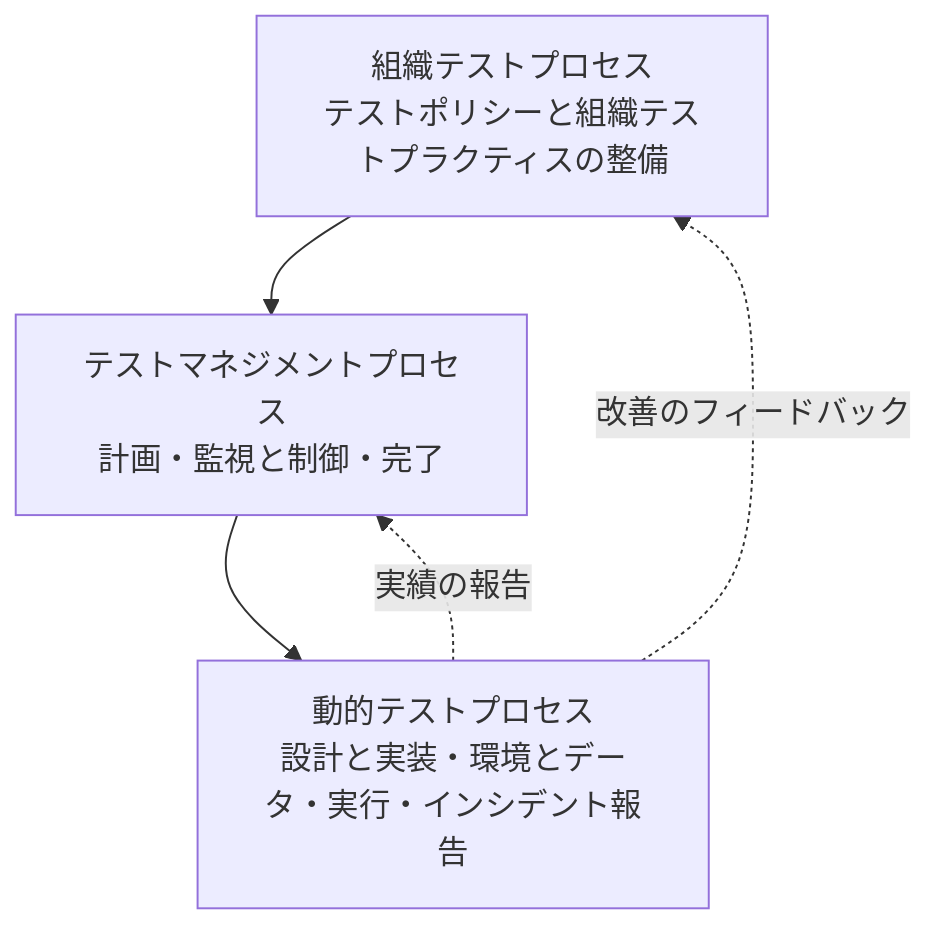

| 層 | 役割 | 具体例（学習用） |
|---|---|---|
| 組織レベル | 組織共通のルールを決める | 「全プロジェクトでリスクベースドテストを採る」というポリシー |
| テスト管理レベル | プロジェクトやテストレベル単位で計画・監視・完了させる | 結合テスト計画の作成、進捗の監視、完了判断 |
| 動的テストレベル | 実際にテストを設計・実行する | テストケースを作り、環境を用意して実行し、不具合を報告 |

### 6-2. プロセスの「インスタンス化」と「プロジェクトベース」

2022年版では、テストサブプロセスの概念を削除し、代わりに**テストプロセスのインスタンス化（現場に合わせた具体化）**の説明が加わりました。目次には、プロジェクト単位のテスト（project-based testing）を扱う項目もあります。

### 6-3. テスト文書（3つのレベル）

目次で確認できる文書名を、層ごとに整理します。テンプレートや記載例は Part 3 が定めます。

| レベル | 文書（目次で確認できるもの） | 概要 |
|---|---|---|
| 組織レベル | テストポリシー、組織テストプラクティス | 組織としてのテストの方針と、推奨するやり方 |
| テスト管理レベル | テスト計画、テスト状況報告（ほかに完了報告などが Part 3 に存在） | 計画と進捗の共有 |
| 動的テストレベル | テスト仕様、テスト環境要求・テストデータ要求、テスト環境報告・テストデータ準備状況報告 | 何をどう試すか、環境とデータの準備状況 |

> 規格の用語定義：**組織テストプラクティス**は「組織内で行うテストに推奨される方法・やり方を記した文書」で、テストポリシーと整合させます。モバイルアプリ用と安全重視システム用など、**複数持ってもよい**と注記されています。

### 6-4. 4.3節のその他の項目

| 節 | 内容 | ポイント（学習用の整理） |
|---|---|---|
| 4.3.3 文書化の要求 | 文書に何を求めるか | 必要十分な量に調整する |
| 4.3.4 構成管理とテスト | テスト資産の版管理 | テストケースと対象ソフトのバージョンを対応づける |
| 4.3.5 ツール支援 | テストの自動化・管理ツール | ツールは目的に合わせて選ぶ |
| 4.3.6 プロセス改善とテスト | テスト自体を継続的に改善 | 実績を測って見直す |
| 4.3.7 テストメトリクス | テストの測定 | 2022年版で**附属書から本文へ移動** |

### 6-5. メトリクスの例（学習用）

| 測定対象 | 指標の例 | 読み取り方 |
|---|---|---|
| 進捗 | 実行済みテストケース数／計画数 | 計画との差を把握 |
| 結果 | 合格率、失敗数 | 品質の傾向を把握 |
| 欠陥 | 重大度別の欠陥数、再発率 | リスクの高い領域を把握 |
| カバレッジ | 要求カバレッジ、分岐カバレッジ | テストの網羅度を把握 |

> ⚠️ 数値は目的ではなく**意思決定の材料**です。「合格率100%」だけで安心せず、何を試していないかも併せて確認します。

---

## STEP 7：テスト設計と実行（4.4節）

序文は、テストモデルを使ったテスト設計と実行を説明し、重要な選択として**スクリプト化テストと探索的テスト、テストケース作成のための技法、テストパターン、再テストと回帰テスト、手動と自動、バックトゥバック、A/Bテスト**を挙げています。

### 7-1. テストモデルから実行まで（概念図）

2022年版では、テストケースの導出元が「テスト条件」から**「テストモデル」**に変わりました。

> 📌 上図は、まえがきの変更点（テストモデルからのケース導出）と用語定義（テストケース＝前提条件・入力・期待結果、テストカバレッジ項目など）を組み合わせた**概念整理**です。手順名や粒度は、Part 2・Part 4 の記述を正としてください。

### 7-2. テストモデルとモデルベーステスト（4.4.1／4.4.2）

| 項目 | 説明 | 具体例（学習用） |
|---|---|---|
| テストモデル | テスト対象の振る舞いなどを抽象化した表現 | 状態遷移図、決定表、分類木 |
| モデルベーステスト（MBT） | モデルからテストケースを導出するプラクティス | 注文ステータスの状態遷移図から「遷移を1回ずつ通る」ケースを作る |

### 7-3. スクリプト化テストと探索的テスト（4.4.3）

| 観点 | スクリプト化テスト | 探索的テスト |
|---|---|---|
| 規格の定義（趣旨） | **文書化されたテストスクリプトに基づいて行う**テスト（通常、手動実行のものを指す） | テスト担当者が、既存の知識、これまでの探索結果、ヒューリスティック（経験則）に基づき、**その場でテストを設計・実行する**経験ベースのテスト |
| 強み | 再現しやすい、実行者に依存しにくい | 隠れた振る舞いや想定外の相互作用を見つけやすい |
| 弱み | スクリプトにない問題を見つけにくい | 記録や再現の工夫が必要 |

規格の注記は、探索的テストが「単独では無害でも他の性質と干渉してソフトウェアが失敗するリスクとなる、**隠れた性質（隠れた振る舞い）**を探す」と述べています。

#### 選び方の考え方（解説者による判断の目安）

2022年版は両者を並べて紹介しており、どちらか一方に固定するものでも、両方の使用を前提とするものでもありません。テストベースの安定性や証跡の要否などの状況に応じて、スクリプト化テスト・探索的テストのいずれか、または**併用を選択肢として検討**します。

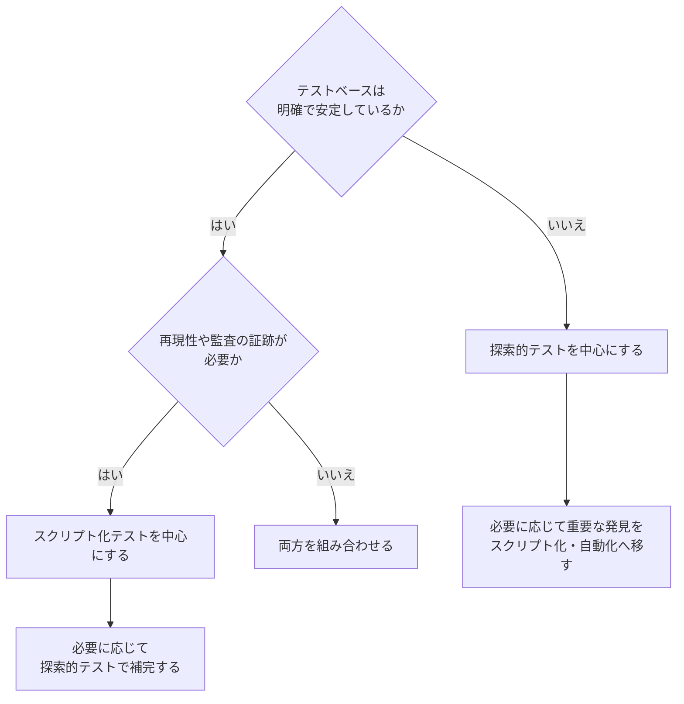

### 7-4. テスト技法：3つの分類と代表例（4.4.4）

規格の用語定義に基づく分類と代表技法です。

| 分類 | 根拠 | 代表技法（用語定義に登場するもの） |
|---|---|---|
| 仕様ベース（ブラックボックス） | 外部の入出力（通常は仕様） | 同値分割、境界値分析、決定表テスト、因果グラフ、状態遷移テスト、シナリオテスト、組合せテスト（ペアワイズなど）、ランダムテスト、メタモルフィックテスト、要求ベーステスト |
| 構造ベース（ホワイトボックス） | 内部構造（ソースコードなど） | 文網羅（ステートメント）、分岐（ブランチ）、判定（デシジョン）、MC/DC |
| 経験ベース | テスト担当者の経験 | エラー推測、探索的テスト、チェックリストベース、テストツアー・攻撃・欠陥分類の活用 |

#### 具体例①：同値分割と境界値分析（学習用）

仕様：「年齢0〜120歳を受け付け、0〜12歳＝子ども、13〜64歳＝大人、65歳以上＝シニアの料金区分にする」

| 同値パーティション | 範囲 | 代表値 | 境界値（2値法の例） |
|---|---|---|---|
| 無効（下） | −1以下 | −5 | −1 と 0 |
| 子ども | 0〜12 | 6 | 0、12 |
| 大人 | 13〜64 | 30 | 13、64 |
| シニア | 65〜120 | 80 | 65、120 |
| 無効（上） | 121以上 | 200 | 120 と 121 |

テスト入力の例：**−1、0、12、13、64、65、120、121**（境界値）＋各区分の代表値。

#### 具体例②：決定表テスト（学習用）

仕様：「会員かつクーポンありなら15%引き、会員のみなら5%引き、クーポンのみなら10%引き、どちらもなければ割引なし」

| ルール | 会員 | クーポン | 割引 |
|---|---|---|---|
| R1 | はい | はい | 15% |
| R2 | はい | いいえ | 5% |
| R3 | いいえ | はい | 10% |
| R4 | いいえ | いいえ | 0% |

各ルールを1ケースとして、4ケースですべての条件の組合せを確認できます。

#### 具体例③：ペアワイズ（組合せテスト）（学習用）

パラメータ：ブラウザ（Chrome／Firefox／Edge）× OS（Windows／macOS／Linux）× 言語（日本語／英語）。全組合せは 3×3×2＝18通りですが、**すべてのパラメータ値の「ペア」を1回以上含む**ように選ぶと9ケースで足ります。

| No. | ブラウザ | OS | 言語 |
|---|---|---|---|
| 1 | Chrome | Windows | 日本語 |
| 2 | Chrome | macOS | 英語 |
| 3 | Chrome | Linux | 日本語 |
| 4 | Firefox | Windows | 英語 |
| 5 | Firefox | macOS | 日本語 |
| 6 | Firefox | Linux | 英語 |
| 7 | Edge | Windows | 日本語 |
| 8 | Edge | macOS | 英語 |
| 9 | Edge | Linux | 日本語 |

> 規格の用語定義でも、ペアワイズは**組合せテストの最も一般的な形**とされています。実際の環境では存在しない組合せ（例：特定ブラウザと特定OSの非対応）は別途除外してください。

#### 具体例④：MC/DC（構造ベース）（学習用）

判定：`if (A && (B || C))` に対して、**各条件が単独で判定結果を変えること**を示すテストを選びます（4ケース＝条件数＋1）。

| テスト | A | B | C | 結果 | 独立性を示す相手 |
|---|---|---|---|---|---|
| T1 | 真 | 真 | 偽 | 真 | 基準 |
| T2 | 偽 | 真 | 偽 | 偽 | T1との比較でAが結果を変える |
| T3 | 真 | 偽 | 偽 | 偽 | T1との比較でBが結果を変える |
| T4 | 真 | 偽 | 真 | 真 | T3との比較でCが結果を変える |

#### 具体例⑤：メタモルフィックテスト（学習用）

「正解が分からなくても、入力を変えたときの**出力の関係（メタモルフィック関係）**は分かる」場面で使います（AIや科学計算で特に有用）。

| 対象 | メタモルフィック関係 | テスト |
|---|---|---|
| 検索機能 | 絞り込み条件を追加しても件数は増えない | 条件なしの件数 ≧ 条件ありの件数 を確認 |
| 三角関数の実装 | sin(x) と sin(π − x) は等しい | 複数のxで両者を比較 |

#### 具体例⑥：エラー推測（経験ベース）

過去の不具合や一般的な失敗パターンの知識から、テストを作る技法です。規格は、知識を**欠陥データベースや「バグ分類（バグタクソノミー）」**に蓄積して活用できると注記しています。

| 失敗パターンの例 | テスト入力の例 |
|---|---|
| 空入力の見落とし | 空文字、空白のみ |
| 文字種の想定外 | 絵文字、全角・半角混在 |
| 上限の見落とし | 最大長＋1文字 |

### 7-5. 経験ベースのテスト（4.4.5）

規格の用語注記は、経験ベーステストに**テスト攻撃、ツアー、エラー分類**などの概念が含まれ得ると述べています。目次には**チェックリストベーステスト**の項目もあります。

| 手法 | 概要（一般的な説明） |
|---|---|
| チェックリストベース | 過去の経験をチェック項目にして網羅漏れを防ぐ |
| ツアー | 機能の「旅行コース」を決めて探索する（例：金融系フローを一巡する） |
| 攻撃 | 典型的な弱点を狙った入力を与える |

### 7-6. 再テストと回帰テスト（4.4.6）

| 種類 | 目的 | 規格の整理（趣旨） |
|---|---|---|
| 再テスト（確認テスト） | 修正が欠陥を取り除けたか確認 | 不具合を直したあとに行う |
| 回帰テスト | 変更の影響で、変更していない部分が壊れていないか確認 | 修正が正しく動くかではなく、**他の部分が偶発的に影響を受けていないか**を見る |

### 7-7. 手動テストと自動テスト（4.4.7）、継続的テスト（4.4.8）

| 項目 | 説明 |
|---|---|
| 手動テスト | 人間がテストアイテムに情報を入力し、結果を確認する。ツール・ロボット・実行エンジンは使わない（規格の定義の趣旨） |
| 自動テスト | ツール、ロボット、その他のテスト実行エンジンでテストを実行する |
| 継続的テスト（4.4.8） | 目次にある項目。一般には、開発のパイプラインにテストを組み込み、継続的にフィードバックを得る考え方（詳細は正式版を参照） |

> 💡 **学習のヒント**：自動化は「手動をなくす」ことではありません。回帰テストなど**繰り返し価値が高い部分から**自動化し、探索的テストは人間が担う、という役割分担が基本です。

### 7-8. バックトゥバックテスト（4.4.9）

**別バージョンのシステム**に同じ入力を与えて、期待結果を作り、比較する方法です（別名：差分テスト）。

| 別バージョンの例（規格の例示） | 具体例（学習用） |
|---|---|
| 既存のシステム | 旧システムと新システムの出力を比較（移行プロジェクト） |
| 独立チームが開発したシステム | 同じ仕様から別チームが作った実装と比較 |
| 別のプログラミング言語での実装 | Javaの実装とPythonの実装で比較 |

### 7-9. A/Bテスト（4.4.10）

規格は、**2つのシステム（またはコンポーネント）のどちらがより良く機能するかを統計的に判断する**テストアプローチと定義しています（別名：スプリットラン）。

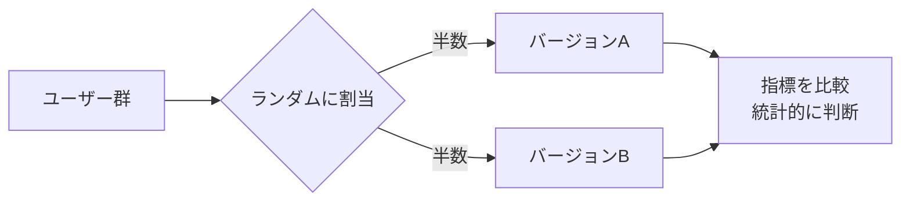

例（学習用）：購入ボタンの色を2案用意し、購入率を比較する。

### 7-10. 数学ベースのテストとファズテスト（4.4.11）

規格の用語定義では、**ファズテスト**は大量のランダム（またはランダムに近い）データ（fuzz）をテストアイテムの入力に使うアプローチです。

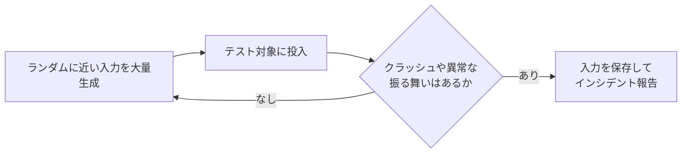

### 7-11. テスト環境とテストデータ管理（4.4.12／4.4.13）

| 項目 | 内容 | 具体例（学習用） |
|---|---|---|
| テスト環境 | テスト実行のために必要なハード・ソフト・ネットワークの構成 | 本番に近い構成のステージング環境 |
| テストデータ管理 | テストに使うデータの準備・保護・再利用 | 個人情報を含まないマスキング済みデータ |

文書面では、**テスト環境要求／テストデータ要求**と、**テスト環境報告／テストデータ準備状況報告**が目次に挙がっています（STEP 6参照）。

---

## STEP 8：プロジェクト管理・報告・インシデント管理（4.5〜4.7節）

序文は、テスト設計・実行を直接支える活動として、**テスト環境、テストデータ管理、コミュニケーションと報告、欠陥・インシデント管理**を紹介しています。

### 8-1. 各節の概要

| 節 | 内容 | ポイント |
|---|---|---|
| 4.5 プロジェクト管理とテスト | テストとプロジェクト管理の接点 | プロジェクトリスク（人員・納期・要求変更）をテスト計画に反映 |
| 4.6 コミュニケーションと報告 | テスト状況・結果の伝え方 | 受け手に合わせた粒度で、判断材料として伝える |
| 4.7 欠陥・インシデント管理 | 不具合の記録と追跡 | 後述 |

### 8-2. インシデントとは

規格は、**インシデント**を「プロジェクト・製品・サービス・システムのライフサイクル中に起きる、異常または予期しない事象・状態」と定義し、**インシデント報告**は同義語が非常に多い（不具合報告、バグ報告、欠陥報告、エラー報告、課題、障害報告など）と注記しています。

### 8-3. インシデントのライフサイクル（典型例）

以下は一般的な運用例の図解であり、規格が定める必須の状態遷移ではありません。

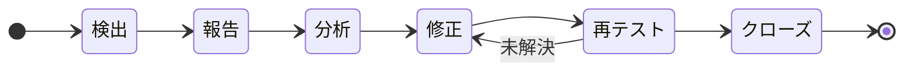

### 8-4. 良いインシデント報告の項目（学習用チェックリスト）

| 項目 | 記載例 |
|---|---|
| 概要 | 「注文確定ボタンを2回押すと二重請求される」 |
| 再現手順 | 1回目クリック直後に2回目をクリック |
| 期待結果／実際の結果 | 1件の請求／2件の請求 |
| 環境 | OS、ブラウザ、ビルド番号 |
| 重大度・優先度 | 重大度：高、優先度：高 |
| 添付 | スクリーンショット、ログ |

---

## STEP 9：システム特性とテストの役割（附属書A・B）

### 9-1. 附属書A：システム特性とテスト（例）

2022年版で**新設**された附属書です。序文は、テスト対象システムに当てはまる特性を特定できたら、その特性に挙げられた**専門的なテスト（specialized testing）**を、テスト戦略に含めるか検討する、という使い方を示しています。

#### 附属書Aで扱われる13特性

| 節 | 特性 | 初学者向けの注目ポイント（解説者の補足） |
|---|---|---|
| A.2 | 人工知能（AI） | 学習データ、非決定性、メタモルフィックテスト、ニューロンカバレッジの考え方 |
| A.3 | 自律システム | 人間の介入なしで長時間動く。想定外状況での振る舞い |
| A.4 | 特注（Bespoke） | 利用者要求への適合、受入テスト |
| A.5 | クローズドループ | 出力が入力に戻る制御系。フィードバック挙動 |
| A.6 | COTS（市販パッケージ） | ソース非公開が多く、仕様ベース・互換性中心 |
| A.7 | 組込み | ハードとの結合、資源制約、実機環境 |
| A.8 | Fit and forget（設置したら放置） | 長期間の信頼性、保守が難しい前提 |
| A.9 | IoT | 多数のデバイス、通信、セキュリティ |
| A.10 | モバイル | 多様な端末・OS、通信状態、バッテリー |
| A.11 | リアルタイム | 時間制約、タイミングの検証 |
| A.12 | 規制対象 | 法規制・標準への適合、証跡 |
| A.13 | 安全関連 | 人命・財産・環境への影響、厳格な構造ベーステスト |
| A.14 | 科学技術（Scientific/technical） | 数値精度、正解が不明な場合の検証 |

> 📌 目次では、附属書Aの各特性に「Specialized testing（A.x.3）」の節が確認できます（AI、自律、特注、クローズドループ、COTS、組込み、Fit and forget など）。**特性ごとの具体的な推奨テストの中身**は正式版でご確認ください。表の注目ポイントは、特性名から導ける一般的な観点の補足です。

#### AI関連の用語が増えた（2022年版の用語節）

| 用語 | 規格の定義（趣旨） |
|---|---|
| AIベースシステム | AIを実装した構成要素を1つ以上含むシステム |
| 神経網（ニューラルネットワーク） | 重み付きリンクで結ばれた処理要素のネットワーク |
| ニューロンカバレッジ | ニューラルネット内の「活性化したニューロン」の割合（テストセットに対して） |
| 非決定的システム | 同じ入力・初期状態でも、常に同じ出力・最終状態を出すとは限らないシステム |
| メタモルフィックテスト | 既存のテストケースとメタモルフィック関係から、新たなテストケースを作る仕様ベースの技法 |

### 9-2. システム特性から戦略を考える流れ

### 9-3. 附属書B：テストの役割

附属書B（参考）は、**汎用的なテストの役割とその責任の概要**を紹介します。組織では「役職名」ではなく「役割」でテスト活動を捉えると、小規模チームやアジャイル開発でも責務の整理に役立ちます。

| 観点 | 整理のしかた（学習用） |
|---|---|
| 1人が複数の役割を担う | 小規模チームでは普通。役割と人を分けて考える |
| 独立性の確保 | 重要な領域は、作成者と別の人がテストする（STEP 4参照） |
| 責任の明確化 | 計画・設計・実行・報告・環境管理など、誰が何を担うか |

---

## STEP 10：実務への適用手順

### 10-1. 導入ステップ

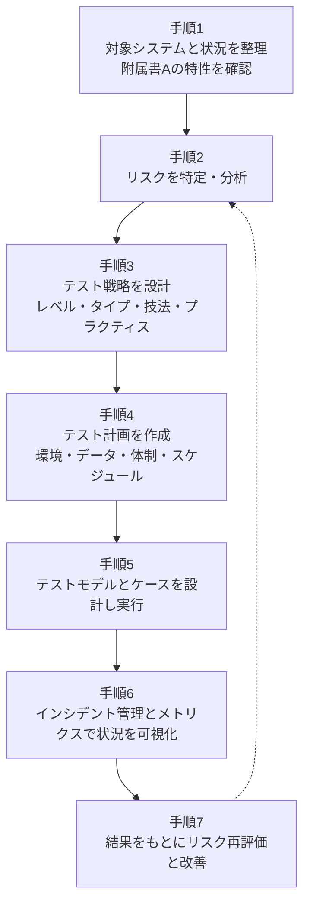

### 10-2. 現場での使い方の指針

| 場面 | 活かし方 |
|---|---|
| チームの用語がそろっていない | Part 1 の用語を共通語彙として使う（例：再テストと回帰テストを区別する） |
| テスト戦略が属人的 | テストアプローチ（レベル・タイプ・技法・プラクティス）を表にして書き出す |
| 優先順位が曖昧 | リスクベースドテストの考え方で「なぜその順か」を説明できるようにする |
| アジャイル／DevOps | 序文の「調整適合（tailored conformance）」の考え方で、必要な部分だけ取り入れる。要求事項に従わない正当な理由がある場合は、調整の程度と根拠を記述し、関係者と合意したうえで適合を主張する。Part 6（アジャイル技術報告）も参照 |
| AIを含むシステム | 附属書Aと Part 11（AIベースシステムのテスト技術報告）を併読する |

### 10-3. 初学者が最初にやるべき3つのこと

| 順番 | アクション | 目的 |
|---|---|---|
| ① | 自分のプロジェクトの「テストアプローチ表」を作る | 現状の言語化 |
| ② | 主な機能を3段階（高・中・低）でリスク評価する | 優先順位の根拠づくり |
| ③ | 再テストと回帰テストを区別して計画に書く | 用語の統一 |

---

## STEP 11：この規格をめぐる議論を知っておく

29119シリーズ（特に初期の2013〜2016年の各パート）は、テストコミュニティで大きな議論を呼びました。中立的に整理します。

### 11-1. 議論の概要

| 立場 | 主な論点 | 代表的な発信者・出典 |
|---|---|---|
| 反対（コンテキスト駆動テストの立場） | 規格がテストを文書化中心の作業にしてしまう懸念。コンテキスト駆動の考え方が策定過程で十分に反映されなかったという主張。標準化の動機への疑問 | James Bach、Michael Bolton、James Christie（CAST 2014）、Huib Schoots など。国際ソフトウェアテスト協会（ISST）が中止を求める署名活動を実施（InfoQ、SD Times） |
| 推進側 | 国際的に合意された共通の枠組みを提供する。リスクベースドテストを基盤とする。規格は組織が使える柔軟なもの | Stuart Reid（WG26議長）が2014年9月に反論を発信（Wikipedia 系資料、SoftwareTestPro など） |
| 中立的見解 | 大半のテスターはこの論争に関与していない。単一の学派や規格でテスト世界を定義できない | SD Times 編集部の論説 |

### 11-2. 2022年版の読み方への示唆

| 観点 | 2022年版Part 1に見られる点（序文・目次による） |
|---|---|
| 探索的テスト | 4.4.3 でスクリプト化テストと**並べて**扱われ、用語定義も立てられている |
| 経験ベース | 4.4.5 に専用節があり、エラー推測・チェックリスト・ツアーなどに言及 |
| 適合の柔軟性 | 序文で**調整適合（tailored conformance）**を明示 |
| 位置付け | Part 1 自体は**情報提供**で、要求事項を課す文書ではない |

> ⚖️ 重要：上記は規格の記述を示すもので、論争の当事者が2022年版をどう評価しているかを示すものではありません。批判的視点も含めて**自分の現場で何が役立つかを検討する**姿勢が大切です。

### 11-3. ISTQBとの関係

ポーランドのテスターコミュニティ（testerzy.pl）の紹介では、本規格はISTQB Foundation Level のシラバスに**部分的に取り込まれている**ため、元の定義に当たる意義があると述べられています。ISTQB の用語と本規格の用語は近いものが多いですが、定義の細部が異なる場合があるため、試験対策では各シラバスを正としてください。

---

## STEP 12：理解度チェック（10問）

問題を表示

1. ISO/IEC/IEEE 29119-1:2022 の位置付けは、「規範（normative）」と「情報提供（informative）」のどちらですか。
2. 2022年版で題名が「Concepts and definitions」から変わった新しい題名は何ですか。
3. 「動的テスト」と「静的テスト」の違いを説明してください。
4. 網羅テスト（exhaustive testing）が現実的でない理由と、その代わりに必要になる考え方は何ですか。
5. リスクベースドテストを、一文で説明してください。
6. 「テストアプローチ」に含まれる典型的な選択要素を5つ挙げてください。
7. 再テストと回帰テストの違いを説明してください。
8. ペアワイズテストは、どの種類のテストに分類されますか。
9. 2022年版で新設された附属書Aは何を示していますか。
10. 「調整適合（tailored conformance）」とは何ですか。

解答例を表示

1. 情報提供（informative）。Part 2・3・4・5 が規範です。
2. 「General concepts（一般概念）」。
3. 動的テストはテストアイテムを実行して評価する。静的テストは実行せずに（レビュー・静的解析などで）調べる。
4. すべての入力値と事前条件の組合せを試すことは、ほとんどの場合不可能だから。リスクに基づく選択（サンプリング）が必要。
5. テスト活動と資源の管理・選択・優先順位付け・使用を、分析したリスクに意識的に基づかせるテスト。
6. テストレベル、テストタイプ、テスト技法、テストプラクティス、静的テストの形態。
7. 再テストは修正が欠陥を取り除いたかの確認。回帰テストは変更していない部分に偶発的な悪影響が出ていないかの確認。
8. 組合せテスト（仕様ベースのテスト設計技法の一種）。
9. 対象システムの特性（AI、組込み、モバイルなど）と、それに応じた専門的なテストの例。
10. すべての要求事項に従わない正当な理由がある場合に、調整の程度と根拠を記述し合意したうえで適合を主張すること。

---

## 用語集

| 用語（英） | 日本語 | 意味（要約） |
|---|---|---|
| A/B testing | A/Bテスト | 2つのシステムまたはコンポーネントのどちらがよく機能するかを統計的に判断する |
| Back-to-back testing | バックトゥバックテスト（差分テスト） | 別バージョンのシステムで期待結果を作って比較する |
| Boundary value analysis | 境界値分析 | 同値パーティションの境界を試す仕様ベースの技法 |
| Equivalence partitioning | 同値分割 | 同様に扱われる入力の区分から代表値を選ぶ技法 |
| Error guessing | エラー推測 | 過去の失敗や一般的な失敗モードの知識からテストを作る技法 |
| Exhaustive testing | 網羅テスト | すべての入力値・事前条件の組合せを試すこと（通常は不可能） |
| Exploratory testing | 探索的テスト | 経験や直観に基づき、その場でテストを設計・実行する経験ベースのテスト |
| Fuzz testing | ファズテスト | 大量のランダムに近いデータを入力に使うテスト |
| Incident | インシデント | ライフサイクル中の異常または予期しない事象・状態 |
| MC/DC | 修正条件判定カバレッジ | 各条件が単独で判定結果に影響することを示す構造ベースの技法 |
| Metamorphic testing | メタモルフィックテスト | 入力変更と出力変化の関係を使ってテストケースを増やす技法 |
| Product risk | プロダクトリスク | 製品が機能・品質・構造で欠陥を持つ可能性 |
| Project risk | プロジェクトリスク | プロジェクト管理に関わるリスク |
| Regression testing | 回帰テスト | 変更後に、変更していない部分の不具合を検出するテスト |
| Retesting | 再テスト（確認テスト） | 欠陥の修正が成功したかを確認するテスト |
| Risk-based testing | リスクベースドテスト | 分析されたリスクに基づいてテストを管理・選択・優先順位付けする |
| Scripted testing | スクリプト化テスト | 文書化されたテストスクリプトに基づくテスト |
| Static testing | 静的テスト | 実行せずに品質基準に照らして調べるテスト |
| Dynamic testing | 動的テスト | テストアイテムを実行して評価するテスト |
| Test approach | テストアプローチ | テスト戦略設計での高レベルの実装上の選択 |
| Test basis | テストベース | テストケースの設計・実装の根拠になる情報 |
| Test case | テストケース | 前提条件・入力・期待結果の組 |
| Test oracle | テストオラクル | 期待結果を判断する拠り所 |
| Test practice | テストプラクティス | テストを容易にするために、組織・テスト管理・動的テストの各プロセスに適用できる概念的枠組み（例：モデルベーステスト、探索的テスト） |

---

## 根拠ソース一覧（URL）

調査日：2026年10月21日。確認できた範囲の公開情報に基づきます。

### A. 一次情報（規格の公式ページ・公開プレビュー）

| 内容 | URL |
|---|---|
| ISO公式ページ（状態・版・前版との関係・ライフサイクル） | <https://www.iso.org/standard/81291.html> |
| IECストア（版・ページ数・発行日・言語） | <https://webstore.iec.ch/publication/74072> |
| iTeh Standards（公開プレビュー：まえがき・序文・目次・用語定義の冒頭） | <https://standards.iteh.ai/catalog/standards/iso/9ecff7b0-b812-4c9b-a9e0-81ce4428d7ab/iso-iec-ieee-29119-1-2022> |
| ANSI Webstore（BSI版プレビュー） | <https://webstore.ansi.org/preview-pages/BSI/preview_30432285.pdf> |
| Standards Australia（目次：節番号・附属書の構成） | <https://store.standards.org.au/product/as-nzs-iso-iec-ieee-29119-1-2022> |
| AFNOR（版情報・前版の置換関係） | <https://www.boutique.afnor.org/en-gb/standard/iso-iec-ieee-2911912022/software-and-systems-engineering-software-testing-part-1-general-concepts/xs138986/320139> |
| EVS（エストニア規格機関：有効日・履歴） | <https://www.evs.ee/en/iso-iec-ieee-29119-1-2022> |
| テスト界コミュニティ記事（目次の紹介・ISTQB との関係） | <https://testerzy.pl/news/flash/iso-29119-1-testerski-standard-udostepniony-za-darmo> |

### B. シリーズ全体・関連規格

| 内容 | URL |
|---|---|
| 29119シリーズの各パート状況・関連規格との関係（arc42 Quality Model） | <https://quality.arc42.org/standards/iso-iec-ieee-29119> |
| Part 2 の概要（3層プロセス・リスクベース） | <https://webstore.ansi.org/standards/iso/isoiecieee291192021-2455205> |
| Part 2 の概要（SIS：スウェーデン規格機関） | <https://www.sis.se/produkter/informationsteknik-kontorsutrustning/programutveckling-och-systemdokumentation/isoiecieee-29119-22021> |
| シリーズの成立経緯（Wikipedia 系ミラー） | <https://limswiki.org/index.php/ISO/IEC_29119> |

### C. 著名な実践者・研究者の発信（国際的）

| 発信者・テーマ | URL |
|---|---|
| Stuart Reid（WG26 議長）：29119 と ISO 20246 の構造・テスト計画とリスク（講演資料） | <https://www.slideshare.net/slideshow/55th/50236180> |
| リスクベースドテストの分類体系と 29119 への適用（arXiv 論文：A Taxonomy to Assess and Tailor Risk-based Testing in Recent Testing Standards） | <https://arxiv.org/abs/1905.10676> |
| SD Times：Software testing schism（James Bach らの反対と Reid の立場） | <https://sdtimes.com/software-testing-schism/> |
| SD Times 編集部論説：Focus on the ends, not the means | <https://sdtimes.com/?p=8432> |
| InfoQ：Software testing reaction（Bach、Christie、Schoots、Zilberfeld の論点整理） | <https://www.infoq.com/news/2014/09/software-testing-reaction/> |
| Slashdot：論争のまとめと関連記事へのリンク | <https://developers.slashdot.org/story/14/09/03/1411216/can-iso-29119-software-testing-standard-really-be-a-standard> |
| SoftwareTestPro：ISO 29119 の概要とリスクベースの考え方 | <https://www.softwaretestpro.com/?p=4419> |

### D. 本ガイドの注意事項

| 項目 | 内容 |
|---|---|
| 一次情報の限界 | 規格本文は無償で公開されていますが、本ガイドは本文を転載しない方針のため、節ごとの本文記述（特に 4.1.7〜4.1.11、4.2.7、4.4.8、附属書A・Bの本文）は**目次・序文・まえがき・用語定義**の範囲で整理し、それ以外は一般的な解説として区別しています |
| 具体例 | 年齢入力、決定表、ペアワイズ表、MC/DC表、インシデントの状態遷移図などは**学習用の例**です |
| 議論の出典 | STEP 11 は2014年前後の公開記事に基づきます。2022年版に対する各当事者の現在の評価を示すものではありません |
| 適合判断 | 認証・契約・監査では、正式版の規格（および Part 2・3・4・5）を参照してください |

---

*本ガイドは学習目的の解説資料であり、ISO/IEC/IEEE 29119-1:2022 の本文を転載するものではありません。規格の正式な内容・最新状況は、ISO・IEC・IEEE の公式情報をご確認ください。*
