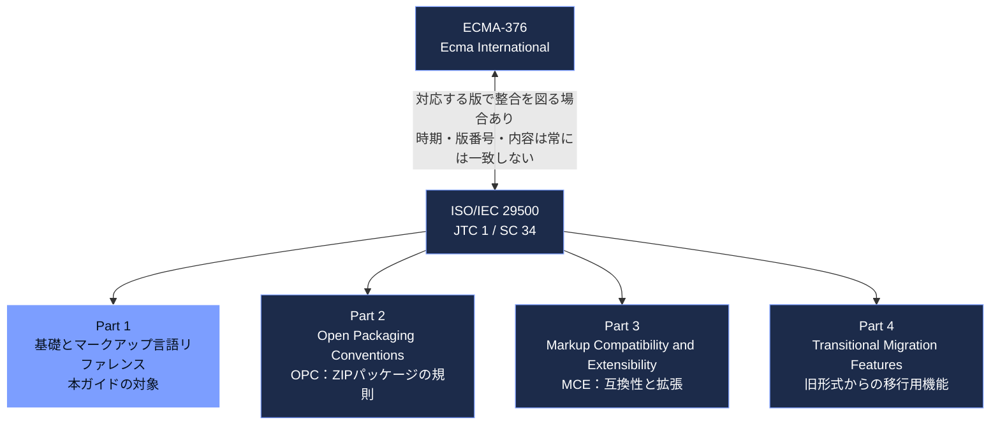
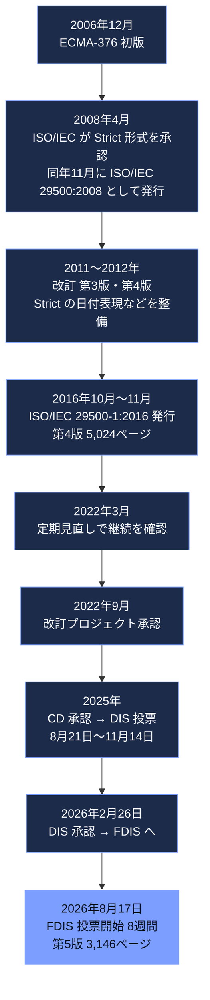
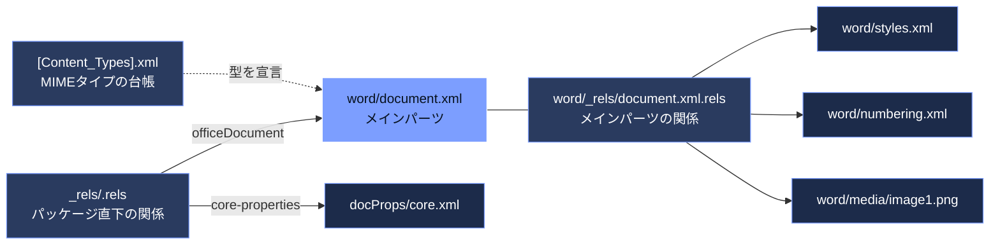
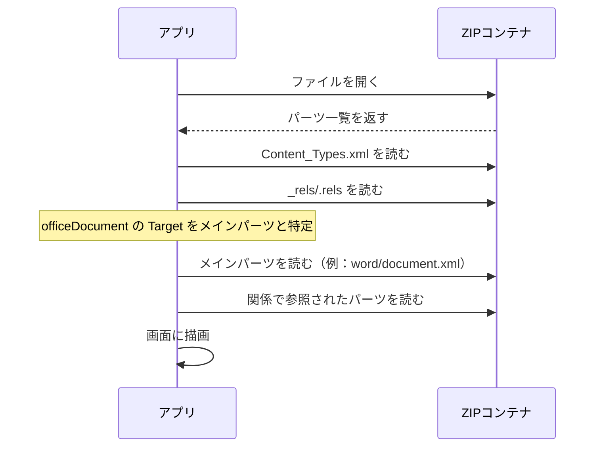
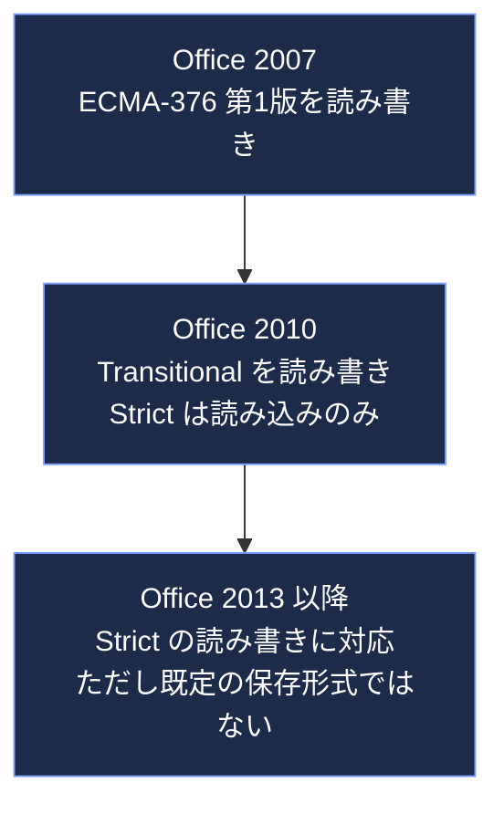
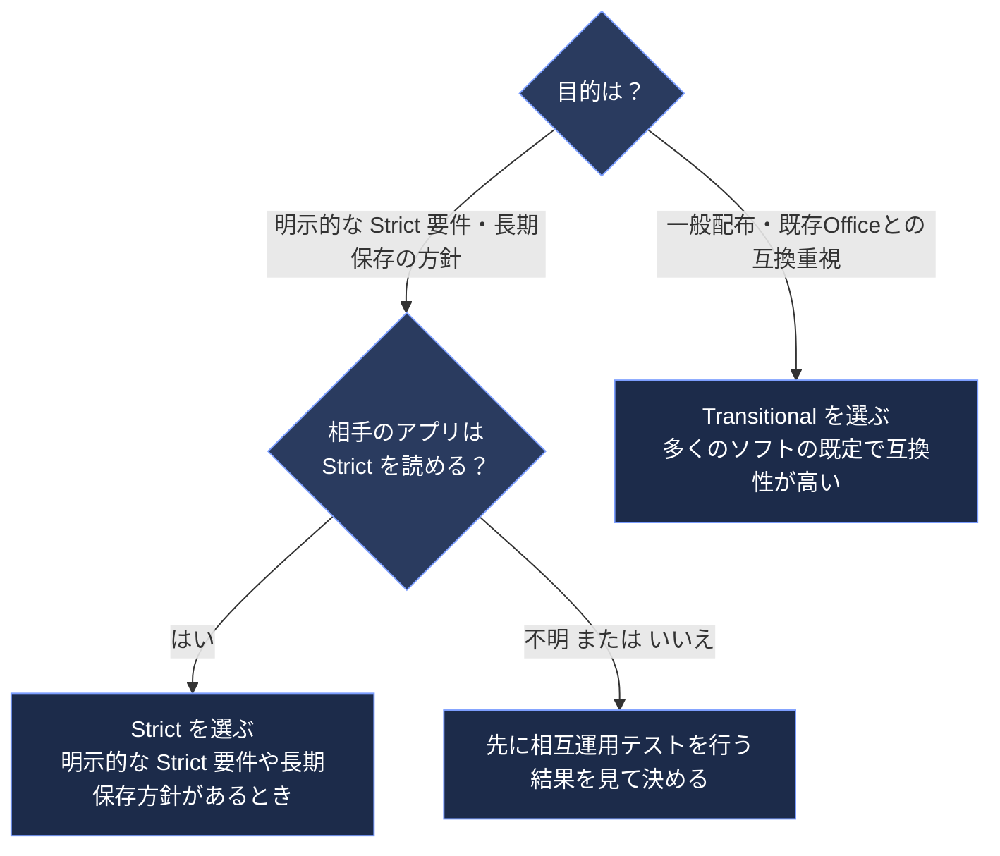
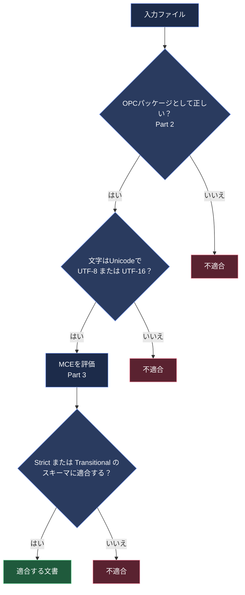
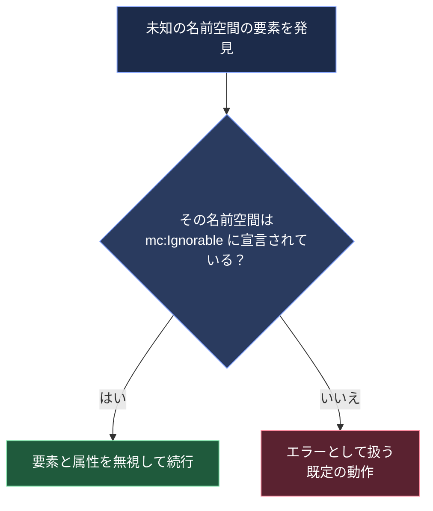

# ISO/IEC 29500-1:2016（Office Open XML）初学者向け解説ガイド

> **対象規格**：ISO/IEC 29500-1:2016「Information technology — Document description and processing languages — Office Open XML File Formats — Part 1: Fundamentals and Markup Language Reference」
> **情報の基準日**：2026年10月16日（この日までに確認できた公開情報）
> **対象読者**：Word / Excel / PowerPoint のファイル（`.docx` `.xlsx` `.pptx`）の中身を、規格レベルで理解したい初学者〜中級者のエンジニア・QAエンジニア
> **根拠の表記**：本文中の `[S1]` `[S2]` … は、末尾「参照ソース一覧」の番号に対応します。

---

## 規格の基本情報（2026年10月16日時点）

| 項目 | 内容 | 根拠 |
|---|---|---|
| 規格番号 | ISO/IEC 29500-1:2016 | \[S1\] |
| 通称 | OOXML（Office Open XML）。Ecma International 側の対応規格は ECMA-376 | \[S1\]\[S3\] |
| 版（Edition） | 第4版（2016年11月） | \[S1\] |
| ページ数 | 5,024ページ | \[S1\] |
| 担当委員会 | ISO/IEC JTC 1/SC 34（Document description and processing languages） | \[S1\] |
| ステータス | **Published（現行版）**。2022年の見直しで「継続」と確認済み。ただしステージは 90.92（改訂予定）で、ISOページは「近く ISO/IEC 29500-1 の新版に置き換わる見込み」と記載 | \[S1\] |
| 後継（改訂版） | ISO/IEC FDIS 29500-1（第5版、3,146ページ）。2026年8月17日にFDIS投票（8週間）が開始（ステージ 50.20） | \[S2\] |
| 入手性 | ISOページの価格表示は CHF 0（無料公開）。ISOの「Publicly Available Standards」から取得可 | \[S1\]\[S4\] |

> ⚠️ **このガイドの位置づけ**：ISOは規格本文のAI利用を制限しています。そのため本稿は規格本文を転載・要約せず、ISO/Ecma/Library of Congress の公開メタデータ、Microsoft Learn、国際的な専門家・開発者の公開記事、OSSのドキュメントをもとに構成しています。条文レベルの正確な要求事項は、必ず一次資料（規格PDF）で確認してください。

---

## 目次

1. [STEP 0：このガイドのゴールと読み方](#step-0このガイドのゴールと読み方)
2. [STEP 1：OOXMLとは何か（全体像）](#step-1ooxmlとは何か全体像)
3. [STEP 2：規格ファミリー（ECMA-376 と ISO/IEC 29500 の関係）](#step-2規格ファミリーecma-376-と-isoiec-29500-の関係)
4. [STEP 3：歴史と「いま」（2026年10月の状況）](#step-3歴史といま2026年10月の状況)
5. [STEP 4：Part 1 の構成を地図で理解する](#step-4part-1-の構成を地図で理解する)
6. [STEP 5：ファイルの器「パッケージ」を分解する（OPC）](#step-5ファイルの器パッケージを分解するopc)
7. [STEP 6：3つの言語 WML・SML・PML を読む](#step-63つの言語-wmlsmlpml-を読む)
8. [STEP 7：Strict と Transitional（最重要ポイント）](#step-7strict-と-transitional最重要ポイント)
9. [STEP 8：適合性（Conformance）と拡張の仕組み](#step-8適合性conformanceと拡張の仕組み)
10. [STEP 9：手を動かす（解析スクリプトと実験）](#step-9手を動かす解析スクリプトと実験)
11. [STEP 10：開発者向けツールとエコシステム](#step-10開発者向けツールとエコシステム)
12. [STEP 11：QAエンジニア向けテスト観点](#step-11qaエンジニア向けテスト観点)
13. [STEP 12：学習ロードマップと理解度チェック](#step-12学習ロードマップと理解度チェック)
14. [用語集](#用語集)
15. [参照ソース一覧（URL）](#参照ソース一覧url)

---

## STEP 0：このガイドのゴールと読み方

### ゴール

このガイドを読み終えると、次の4つができるようになります。

| # | できるようになること |
|---|---|
| ① | `.docx` を解凍し、どのファイルが何の役割かを説明できる |
| ② | ECMA-376 と ISO/IEC 29500、Part 1〜4 の関係を説明できる |
| ③ | **Strict と Transitional の違い**を、名前空間レベルで見分けられる |
| ④ | OOXMLを扱うソフト（生成・変換・検証）のテスト観点を設計できる |

### 読み方のコツ

- 先に **STEP 1〜3**（背景）を読み、**STEP 5**（パッケージ）で手を動かすと理解が早まります。
- 規格の本体（Part 1）は数千ページあります。**全部読む必要はありません**。「地図」（STEP 4）を持って、必要な章だけを参照するのが実務的な使い方です。

---

## STEP 1：OOXMLとは何か（全体像）

**Office Open XML（OOXML）** は、ワープロ文書・表計算ブック・プレゼンテーションを、**XML パーツと画像などの非 XML パーツをまとめた ZIP パッケージ** として表現するためのファイル形式の規格です。Microsoft Office 2007以降の標準形式として広く使われています \[S9\]\[S18\]。

ISO/IEC 29500-1 の概要説明（抄録）によると、この規格は次の2つを目標にしています \[S1\]。

- **既存資産の忠実な表現**：Microsoft Office 97〜2008 で作られた既存の文書を、忠実に表現できること
- **相互運用性と拡張性**：複数ベンダー・複数プラットフォームでの実装を可能にすること


### 身近な例え

「引っ越しのダンボール箱」を想像してください。

| 例え | OOXMLでの対応 |
|---|---|
| 箱そのもの | ZIPファイル（`.docx` など） |
| 箱の中の荷物一覧表 | `[Content_Types].xml` と `_rels/.rels` |
| 荷物（本、食器、衣類） | `document.xml`、`styles.xml`、画像などの「パーツ」 |
| 荷物の仕分けルール | ISO/IEC 29500 の各Part |

---

## STEP 2：規格ファミリー（ECMA-376 と ISO/IEC 29500 の関係）

OOXMLには **2つの標準化団体** が関わっています。

- **Ecma International**：最初に標準化（ECMA-376）
- **ISO/IEC**：その後の版を ISO/IEC 29500 として標準化

Ecmaのサイトは、Ecmaが初版を標準化し、ISO/IECが以降の版を ISO/IEC 29500 として標準化したと説明しています \[S3\]\[S18\]。2つは、対応する版・Part どうしで**技術的な整合が図られる場合があります**。ただし、**改訂の時期・版番号・内容が常に一致するとは限りません**（たとえば Ecma 側の Part 2 だけが2021年版です。下の「版の対応表」を参照）\[S3\]\[S9\]\[S10\]。

### 4つのPart



| Part | 内容 | 補足 |
|---|---|---|
| **Part 1** | 基礎とマークアップ言語リファレンス（WordprocessingML・SpreadsheetML・PresentationML・DrawingML など、**Strict形式**の語彙定義） | 本ガイドの主役 |
| Part 2 | Open Packaging Conventions（OPC）。ZIPの中のパーツ・関係・MIMEタイプの規則 | `.xps` など他形式でも利用される \[S18\] |
| Part 3 | Markup Compatibility and Extensibility（MCE）。拡張要素を古いソフトが安全に無視するための仕組み | STEP 8で解説 |
| Part 4 | Transitional Migration Features。旧バイナリ形式との互換のための機能群（VML など） | **Transitional形式**に必要 \[S9\]\[S10\] |

> 📌 ISO化の審議の過程で、元のECMA-376は複数のPartに分割されました（Part 1に3つのML、Part 2にOPC、Part 3に拡張仕様）。当時の審議を追っていた Wictor Wilén 氏のブログでも、この分割が主要な変更点の一つとして紹介されています \[S16\]。

### 版の対応表

| ECMA-376 | ISO/IEC 29500 | 備考 |
|---|---|---|
| 第1版（2006年12月） | なし | Office 2007が読み書きした形式 \[S9\] |
| 第2版（2008年12月） | 29500:2008 | Strict / Transitional が導入された版 \[S9\]\[S10\] |
| 第3版（2011年6月） | 29500:2011 | \[S3\]\[S10\] |
| 第4版（2012年12月） | 29500:2012 | ISO側の旧版（29500-1:2012）は第4版の発行により廃止扱い \[S1\]\[S3\] |
| 第5版 Part 1（2016年12月） | **29500-1:2016**（Part 3:2015、Part 4:2016 も同時期） | **本ガイドの対象** \[S3\]\[S10\] |
| 第5版 Part 2（2021年12月） | （OPCは別の版番号で改訂） | Ecma側の Part 2 のみ2021年版 \[S3\] |

---

## STEP 3：歴史と「いま」（2026年10月の状況）

### 3-1. 歴史の流れ

OOXMLは、標準化の過程で大きな論争を呼んだ規格です。当時のISO側の議長役（Ballot Resolution Meeting のコンビーナー）だった **Alex Brown** 氏は、「Strict」と「Transitional」の2つに分割したことが改訂プロセスの突破口だったと述べています \[S5\]\[S6\]。



> 根拠：H1〜H3 は \[S3\]\[S5\]\[S10\]、H4〜H9 のステージ日付は ISO の2つのページ \[S1\]\[S2\] による。

### 3-2. 2026年10月16日時点で確認できたこと

| 項目 | 状況 | 根拠 |
|---|---|---|
| 現行版 | ISO/IEC 29500-1:2016 は **Published**。見直しで継続と確認済み | \[S1\] |
| 改訂版 | ISO/IEC FDIS 29500-1（第5版）が **承認フェーズ（50.20）**。2026年8月17日にFDIS投票が開始 | \[S2\] |
| 投票終了日の目安 | 投票期間は8週間のため、**2026年10月12日前後**が目安（計算値）。ただし ISOページには終了日・結果の記載がなく、**可決・発行の確認は取れていません** | \[S2\]＋計算 |
| 版の継続性 | 新版が発行されるまでは、2016年版が現行規格 | \[S1\] |
| Ecma側 | ECMA-376 の掲載は **第5版**（Part 1：2016年12月、Part 2：2021年12月）。Ecmaページの更新日は2022年1月と表示されており、新版の掲載は確認できませんでした | \[S3\] |

> 📌 **実務メモ**：設計書・テスト計画書に引用するときは、「ISO/IEC 29500-1:2016（改訂版 FDIS 審議中、2026年10月16日時点）」のように **基準日付きで書く** と、後から読んだ人が混乱しません。ISOページ（\[S1\]\[S2\]）のステージ表示を、発行のタイミングで再確認してください。

### 3-3. 第4版と第5版のページ数が大きく違う理由

ISOページ上の数字は、第4版が5,024ページ、FDIS（第5版）が3,146ページです \[S1\]\[S2\]。差の理由は、公開情報からは **確認できませんでした**（組版の違いなのか内容の整理なのかは不明）。推測で断定せず、新版を入手した段階で差分を確認するのが安全です。

---

## STEP 4：Part 1 の構成を地図で理解する

Part 1 は「**語彙の辞書**」です。目次（公開されている各版のプレビュー）から読み取れる大きな構成は次のとおりです \[S19\]。

| 章 | 内容 | 初学者の読みどころ |
|---|---|---|
| 前半（概要など） | 適合性、用語、表記規約、各MLの概要（8章に WordprocessingML・SpreadsheetML・PresentationML・Supporting MLs の概説） | まず概要だけ読む |
| 14章 | DrawingML（概要と用語集） | 図形・テキスト表現の共通基盤 |
| 15章 | Shared（共有部分の概要と用語集） | 文書・表・スライドで共通の要素 |
| **17章** | **WordprocessingML リファレンス**（要素・属性の辞書、設定、メールマージ、単純型 など） | Word 文書の要素を調べるとき |
| **18章** | **SpreadsheetML リファレンス**（共有文字列テーブル、数式、単純型 など） | Excel ブックの要素を調べるとき |
| **19章** | **PresentationML リファレンス** | PowerPoint スライドの要素を調べるとき |
| 20章 | DrawingML のフレームワーク（Main・Picture・Locked Canvas・WordprocessingML Drawing・SpreadsheetML Drawing） | 図形・画像の配置 |
| 21章 | DrawingML のコンポーネント（Main・**Charts**・Chart Drawings・**Diagrams**） | グラフ・SmartArt |
| 22章 | Shared MLs リファレンス（共有の語彙、共有単純型） | 数式・書誌・カスタムXMLなど |
| 附属書 | スキーマ（W3C XML Schema と RELAX NG は電子インサートとして配布）、ECMA-376:2006 との差異（参考） | 検証ツールを作るとき |

> 💡 **学習のヒント**：Part 1 を「辞書」と考え、最初は **17章の `document` `body` `p` `r` `t`** と **18章の `workbook` `sheet` `row` `c` `v`** だけを引けば、基本のファイルが読めます（STEP 6）。

---

## STEP 5：ファイルの器「パッケージ」を分解する（OPC）

OOXMLのファイルは、ZIPの中に **パーツ（part）** が並び、**関係（relationship）** がパーツ同士をつなぐ構造です（ルールはPart 2の OPC）。

### 5-1. docx に入っている主なパーツ

実際に `python-docx` で作った最小の `.docx`（17パーツ）の中身から、主要なものをまとめます。

| パーツ名 | 役割 |
|---|---|
| `[Content_Types].xml` | 各パーツの **MIMEタイプ** を宣言する台帳 |
| `_rels/.rels` | パッケージ直下の **関係**。メインパーツ（`word/document.xml`）への入口 |
| `word/document.xml` | **本文**（メインパーツ） |
| `word/_rels/document.xml.rels` | 本文から参照される関連パーツへの関係 |
| `word/styles.xml` | スタイル定義 |
| `word/numbering.xml` | 箇条書き・番号の定義 |
| `word/settings.xml` | 文書設定 |
| `word/theme/theme1.xml` | テーマ（色・フォント） |
| `docProps/core.xml` | 作成者・作成日時などのコアプロパティ |
| `docProps/app.xml` | アプリケーション情報（拡張プロパティ） |

### 5-2. 関係（relationship）でつながる



### 5-3. ルートの関係ファイルの例

```xml
<?xml version="1.0" encoding="UTF-8" standalone="yes"?>
<Relationships xmlns="http://schemas.openxmlformats.org/package/2006/relationships">
  <Relationship Id="rId1"
    Type="http://schemas.openxmlformats.org/officeDocument/2006/relationships/officeDocument"
    Target="word/document.xml"/>
  <Relationship Id="rId2"
    Type="http://schemas.openxmlformats.org/package/2006/relationships/metadata/core-properties"
    Target="docProps/core.xml"/>
</Relationships>
```

読み方：

- `Type` が `officeDocument` の正式な関係型 URI と **完全一致** する関係が **メインパーツへの入口** です。末尾や名前空間の接頭辞だけで判定すると、別の関係型を取り違えます。
- 判定に使う正式な関係型 URI は次の2つです（STEP 7、STEP 9 のスクリプトと同じ完全一致の判定）\[S4\]\[S15\]。
  - Transitional：`http://schemas.openxmlformats.org/officeDocument/2006/relationships/officeDocument`
  - Strict：`http://purl.oclc.org/ooxml/officeDocument/relationships/officeDocument`

### 5-4. アプリがファイルを開く流れ



> ⚠️ MS Learn によると、Open XML SDK で文書を作るとき、文書タイプ（`WordprocessingDocumentType`）と拡張子が一致していないと、Wordで開く際にエラーになります \[S11\]。`[Content_Types].xml` の宣言と拡張子の整合は、QAの重要観点です（STEP 11）。

---

## STEP 6：3つの言語 WML・SML・PML を読む

Part 1 が定める主役は、次の3つの「マークアップ言語」です。

| 略称 | 正式名 | 対象 | メインパーツ（慣例） |
|---|---|---|---|
| **WML** | WordprocessingML | Word 文書 | `word/document.xml` |
| **SML** | SpreadsheetML | Excel ブック | `xl/workbook.xml` |
| **PML** | PresentationML | PowerPoint | `ppt/presentation.xml` |
| （共通） | DrawingML | 図形・画像・グラフ・テキストの共通表現 | 各MLから参照 |

> 📌 メインパーツの名前（`xl/workbook.xml` など）は慣例であり、規格が固定しているわけではありません。**入口は常に `_rels/.rels` の `officeDocument` 関係**です \[S4\]。

### 6-1. WordprocessingML：文書は「段落 → ラン → テキスト」

MS Learn は、WordprocessingML の基本構造を「`document` と `body` の下に、段落 `p` などのブロック要素が並ぶ」と説明しています \[S11\]。

```xml
<w:document xmlns:w="http://schemas.openxmlformats.org/wordprocessingml/2006/main">
  <w:body>
    <w:p>
      <w:r>
        <w:t>Hello, Word!</w:t>
      </w:r>
    </w:p>
  </w:body>
</w:document>
```

| 要素 | 意味 | 日本語での例え |
|---|---|---|
| `w:document` | 文書のルート | 本全体 |
| `w:body` | 本文領域 | 本文ページ |
| `w:p` | 段落（paragraph） | 1つの段落 |
| `w:r` | ラン（run）：書式が同じ連続したテキスト | 同じ書体のひと続き |
| `w:t` | テキスト本体 | 文字列 |
| `w:pPr` / `w:rPr` | 段落／ランのプロパティ（書式） | 書式メモ |
| `w:tbl` | 表 | 表 |
| `w:sectPr` | セクション設定（用紙・余白など） | ページ設定 |

> 💡 **ハマりどころ**：見た目では1つの単語でも、書式が途中で変わると `w:r` が分かれます。**文字列の検索・置換を実装するときは、ランをまたぐ**ことを前提にしてください。

### 6-2. SpreadsheetML：セルの文字列は「共有文字列テーブル」を参照

SpreadsheetML の文字列セルには、主に次の2つの格納方式があります。

- **共有文字列方式（`t="s"`）**：文字列を **共有文字列テーブル（`sharedStrings.xml`）** に集約し、セルの `<v>` には番号だけを入れて参照します（Part 1 の 18.4 章が共有文字列テーブルを扱います \[S19\]）。Excel が保存するファイルで一般的な方式です。
- **インライン文字列方式（`t="inlineStr"`）**：文字列をセル内の `<is>` 要素（その中の `<t>`）に直接格納します。共有文字列テーブルを参照しないため、`sharedStrings.xml` がないブックでも値を読み取れます。ライブラリが生成するファイルなどで使われます。

読み取り側は、`t` 属性を見て両方の方式に対応する必要があります。

```xml
<worksheet xmlns="http://schemas.openxmlformats.org/spreadsheetml/2006/main">
  <sheetData>
    <row r="1">
      <c r="A1" t="s"><v>0</v></c>   <!-- t="s"：値は共有文字列の番号 -->
      <c r="B1"><v>42</v></c>        <!-- 数値はそのまま保持 -->
      <c r="C1" t="inlineStr"><is><t>Hello</t></is></c>  <!-- t="inlineStr"：値はセル内の is に直接格納 -->
    </row>
  </sheetData>
</worksheet>
```


| 要素 | 意味 |
|---|---|
| `workbook` | ブック全体（シート一覧など） |
| `sheet` / `worksheet` | シートの参照／シート本体 |
| `sheetData` → `row` → `c` | 行とセル |
| `c@r` | セルの位置（A1形式） |
| `c@t` | セルの型。`s` は共有文字列、`inlineStr` はインライン文字列 |
| `v` | 値 |

> 📌 日付の扱いは **StrictとTransitionalで異なります**（STEP 7）。Strictにはセル型 `d`（ISO 8601の日付）がありますが、Transitionalでは許可されていません \[S4\]。

### 6-3. PresentationML：スライドは「図形ツリー」

PresentationML は、プレゼン全体（`presentation`）、スライドマスター、スライド（`sld`）、その中の図形ツリー（`spTree`）といった階層でスライドを表現します。テキストや図形の見た目は、共通語彙の **DrawingML（`a:` 名前空間）** で表されます。

> 詳細な要素名はPart 1 の19章・20章・21章で引いてください。初学者は、**PowerPoint で1枚だけのスライドを作り、解凍して `ppt/slides/slide1.xml` を眺める**のが最短の学習法です（STEP 9）。

---

## STEP 7：Strict と Transitional（最重要ポイント）

この規格を理解するうえで **最も重要なのが、2つの「適合クラス」** です。

### 7-1. なぜ2つあるのか

Library of Congress（米国議会図書館）のフォーマット解説は、次のように整理しています \[S4\]。

- **Strict**：旧Office形式の不具合や古い機能の名残を除いた、**規格本来の形**。マークアップは Transitional の **サブセット** に近いが、名前空間が別でスキーマも別配布
- **Transitional**：既存のOffice文書を高い忠実度で移行するため、**旧機能を許容する形**
- 当初の意図は「新規文書は Strict で作る」ことだったが、後方互換の圧力により、**実際の新規ファイルの多くは Transitional で作られている**

Alex Brown 氏は、改訂プロセスの鍵が「StrictとTransitionalへの分割」であり、Microsoftが実装していたのはECMAが承認した Transitional だったと整理しています \[S5\]。

### 7-2. 何が違うか

LOCの解説から、主な違いをまとめます \[S4\]。

| 観点 | Strict | Transitional |
|---|---|---|
| グラフィックス | **DrawingML のみ**（VML は不可） | VML など旧形式も許容（Part 4） |
| 文字 | **Unicode ベース**。他の文字セット・コードページ技術は不可 | 旧技術を許容 |
| 方向を表す名前 | `left` / `right` の代わりに、**文字の向きに依存しない名前**（start / end 系）を使う | `left` / `right` の旧名称を許容 |
| 保護機能 | 旧来のブック保護技術は不可 | 許容 |
| 日付セル | セル型 **`d`（ISO 8601 形式）** を使える | **許可されない**（シリアル値を使う） |
| 割合の表現 | 0〜100 の範囲外の整数による百分率表現は不可 | 許容 |
| 名前空間 | `purl.oclc.org/ooxml/…` | `schemas.openxmlformats.org/…` |

### 7-3. 名前空間で見分ける

| 言語 | Transitional の名前空間 | Strict の名前空間 |
|---|---|---|
| WordprocessingML | `http://schemas.openxmlformats.org/wordprocessingml/2006/main` | `http://purl.oclc.org/ooxml/wordprocessingml/main` |
| SpreadsheetML | `http://schemas.openxmlformats.org/spreadsheetml/2006/main` | `http://purl.oclc.org/ooxml/spreadsheetml/main` |
| PresentationML | `http://schemas.openxmlformats.org/presentationml/2006/main` | `http://purl.oclc.org/ooxml/presentationml/main` |
| DrawingML | `http://schemas.openxmlformats.org/drawingml/2006/main` | `http://purl.oclc.org/ooxml/drawingml/main` |
| 関係の型 | `http://schemas.openxmlformats.org/officeDocument/2006/relationships` | `http://purl.oclc.org/ooxml/officeDocument/relationships` |

> 出典：OSSライブラリの実装定数 \[S20\] と、LOCの解説 \[S4\]、実際のツール不具合報告 \[S15\]。**Strict の文書は、パッケージ内に Transitional の名前空間を混在させてはいけません**（実装時の検証ポイント）。

### 7-4. 実際に起きた不具合の例

OSSの翻訳フレームワーク Okapi には、「Strict 形式の `.xlsx` をOpenXMLフィルターが処理できない」という報告が上がっています。原因は、`.rels` の `Type` が `purl.oclc.org` を指す Strict 形式だったことでした \[S15\]。**Strict の存在を知らないツールは、見た目は同じ拡張子の別形式として失敗します。**

### 7-5. Office はどちらをサポートするか（歴史）



> 根拠：Office 2007〜2010 の対応は MS Learn \[S9\]。Excel 2013 以降が Strict を読み書きできる点は LOC \[S4\]。Office 2013 以降の「Strict 対応だが既定ではない」は Wikipedia の記述 \[S18\]。**現在の各製品の最新の対応状況は、各製品の公式ドキュメントで確認してください**（本稿では2026年時点の最新確認は取れていません）。

### 7-6. 専門家たちの議論（国際的な視点）

| 人物・媒体 | 主張（要約） | 根拠 |
|---|---|---|
| **Alex Brown**（元 BRM コンビーナー） | Office 2010 が Transitional のみだと、ISOが承認した形式ではなく、否決された形式を出荷することになる、と強く批判（2010年） | \[S6\] |
| **Doug Mahugh**（Microsoft） | Strict の読み書きは、遅くとも次期メジャーリリース（Office “15”）までに実装すると表明。Office 2010 では Transitional が顧客と既存エコシステムに適すると説明 | \[S7\]\[S8\] |
| **Gareth Horton**（表計算の専門家） | Transitional でシリアル日付が必要な理由を解説（ISO 8601日付の議論） | \[S4\] |
| **Jesper Stocholm**（OOXMLツール開発者） | ISO 8601日付による「静かなデータ欠落」の危険を指摘 | \[S4\] |

> 💡 **学び**：規格は「正しさ」だけでなく、**既存ソフトの互換性と政治的な妥協**の産物です。実務では「規格上はどうか」と「主要ソフトはどう動くか」を **両方** 確認する癖をつけましょう。

### 7-7. どちらを選ぶか（判断フロー）



> 📌 **ISO/IEC 29500 準拠だけでは Strict を選ぶ理由になりません**：Strict と Transitional は、どちらも ISO/IEC 29500 が定める適合クラスです（STEP 8）。「ISO/IEC 29500 準拠」が求められているだけなら、どちらのクラスでも要件を満たせます。Strict を選ぶのは、調達仕様などで Strict が明示的に指定されている場合や、長期保存の方針で Strict を採用している場合に限られます。

---

## STEP 8：適合性（Conformance）と拡張の仕組み

### 8-1. 文書の適合条件（概要）

Alex Brown 氏がSC 34 WG 4のメーリングリストに投稿した、Part 1 の適合性条項に関する議論から、条件の骨子が確認できます \[S14\]。要点を言い換えると次のとおりです。

| 条件 | 内容 |
|---|---|
| ① パッケージ | OPCパッケージであること（Part 2） |
| ② スキーマ | **MCEの評価後**に、Transitional または Strict のスキーマに適合すること |
| ③ カテゴリ | Wordprocessing・Spreadsheet・Presentation のいずれかであること |
| ④ 文字 | Unicode（ISO/IEC 10646）で、UTF-8 または UTF-16 のXML |
| ⑤ 拡張 | 規格にない要素・属性は、**規定の拡張機構**（Part 1 と Part 3）を使うこと |
| ⑥ 混在禁止 | Strict の文書は、Transitional の文書を埋め込んではいけない |



> ⚠️ 上記は ISO のメーリングリスト上の公開議論 \[S14\]（2010年の版を対象）にもとづく骨子です。**2016年版の条文の正確な文言は、規格本文で確認してください。**

### 8-2. MCE（Part 3）：新しい機能を古いソフトで壊さない仕組み

Office は新バージョンで機能を追加します。古いソフトがその拡張要素に出会ったとき、**無視してよいもの**と**エラーにするもの**を区別するのが MCE（Markup Compatibility and Extensibility）です。

ルート要素の宣言の例（Word 文書でよく見る形）：

```xml
<w:document
  xmlns:w="http://schemas.openxmlformats.org/wordprocessingml/2006/main"
  xmlns:w14="http://schemas.microsoft.com/office/word/2010/wordml"
  xmlns:mc="http://schemas.openxmlformats.org/markup-compatibility/2006"
  mc:Ignorable="w14">
  ...
</w:document>
```



> 📌 `mc:AlternateContent`（`Choice` と `Fallback`）による「新機能が使えるときは Choice、使えないときは Fallback」という切り替えも MCE の機能です。**MCEの詳細な挙動は Part 3 の本文で確認してください**（本稿の公開ソースでは、Part 3 が独立した規格であることまでを確認しています \[S3\]\[S10\]）。

---

## STEP 9：手を動かす（解析スクリプトと実験）

### 9-1. 実験A：docx を解凍して眺める

```bash
# ① 空の docx を作る（Python）
pip install python-docx
python -c "from docx import Document; d=Document(); d.add_paragraph('Hello, Word!'); d.save('t.docx')"

# ② 中身の一覧を見る
unzip -l t.docx

# ③ 本文を整形して読む
unzip -p t.docx word/document.xml | python -c "import sys, xml.dom.minidom; print(xml.dom.minidom.parseString(sys.stdin.buffer.read()).toprettyxml())"
```

### 9-2. 実験B：Strict / Transitional 判定スクリプト

`_rels/.rels` の `officeDocument` 関係と、メインパーツのルート名前空間から判定する最小スクリプトです。関係の `Type` と名前空間が同じ適合クラス（Strict 同士、または Transitional 同士）を指すときだけ判定を確定し、食い違うときは `unknown` を返します。

> ⚠️ **このスクリプトは信頼済みファイル専用です**：自分で作成した、または出所を確認したファイルの学習・調査に使ってください。ZIP エントリのサイズ上限と、外部エンティティや DTD を拒否する XML パーサー（`defusedxml`、`pip install defusedxml` で導入）は最低限の防御であり、信頼できない入力を受け付ける本番処理の代わりにはなりません。

```python
import posixpath
import sys
import zipfile
from urllib.parse import unquote

# 標準の xml.etree は DTD や実体参照の展開を拒否できないため、defusedxml で解析する
from defusedxml import ElementTree as ET

REL_NS = "http://schemas.openxmlformats.org/package/2006/relationships"
# メインパーツへの関係型は Strict と Transitional の正式な URI だけを完全一致で受け入れる。
# 末尾一致にすると、別の関係型が main_target を上書きしてしまうため。
# 値は関係型が属する適合クラス。ルート名前空間のクラスと突き合わせるために使う。
OFFICE_DOCUMENT_REL_TYPES = {
    "http://purl.oclc.org/ooxml/officeDocument/relationships/officeDocument": "Strict",
    "http://schemas.openxmlformats.org/officeDocument/2006/relationships/officeDocument": "Transitional",
}
# メインパーツのルート名前空間（WML・SML・PML）だけを完全一致で判定する。
# 接頭辞一致にすると Relationships 名前空間など無関係な名前空間まで分類してしまうため。
STRICT_NAMESPACES = {
    "http://purl.oclc.org/ooxml/wordprocessingml/main",
    "http://purl.oclc.org/ooxml/spreadsheetml/main",
    "http://purl.oclc.org/ooxml/presentationml/main",
}
TRANSITIONAL_NAMESPACES = {
    "http://schemas.openxmlformats.org/wordprocessingml/2006/main",
    "http://schemas.openxmlformats.org/spreadsheetml/2006/main",
    "http://schemas.openxmlformats.org/presentationml/2006/main",
}
# 1パーツあたりの解凍後サイズの上限（ZIP 爆弾対策）。学習用の小さなファイルを想定した値
MAX_PART_SIZE = 10 * 1024 * 1024


def read_part(z, name):
    # 解凍前に宣言サイズを確認し、宣言が偽装されていても実際の解凍量を上限で打ち切る
    info = z.getinfo(name)
    if info.file_size > MAX_PART_SIZE:
        raise ValueError(f"{name} is too large: {info.file_size} bytes")
    with z.open(info) as f:
        data = f.read(MAX_PART_SIZE + 1)
    if len(data) > MAX_PART_SIZE:
        raise ValueError(f"{name} exceeds {MAX_PART_SIZE} bytes when decompressed")
    return data


def probe(path):
    with zipfile.ZipFile(path) as z:
        names = z.namelist()
        # DTD を含む XML は OOXML では不要なため、宣言の段階で拒否する
        rels = ET.fromstring(read_part(z, "_rels/.rels"), forbid_dtd=True)
        main_target = main_type = None
        for rel in rels.findall(f"{{{REL_NS}}}Relationship"):
            rel_type = rel.get("Type", "")
            if rel_type in OFFICE_DOCUMENT_REL_TYPES:
                main_type, main_target = rel_type, rel.get("Target")
        if main_target is None:
            return {"error": "officeDocument relationship not found"}
        # Target はパッケージルート基準の相対 URI。「./word/document.xml」や
        # 「/word/document.xml」も同じパーツになるよう正規化し、ZIP エントリ名に変換する。
        part_name = posixpath.normpath(posixpath.join("/", unquote(main_target)))
        root = ET.fromstring(read_part(z, part_name.lstrip("/")), forbid_dtd=True)
        root_ns = root.tag.split("}")[0].lstrip("{")
    if root_ns in STRICT_NAMESPACES:
        ns_variant = "Strict"
    elif root_ns in TRANSITIONAL_NAMESPACES:
        ns_variant = "Transitional"
    else:
        ns_variant = "unknown"
    # 名前空間と officeDocument 関係の Type が同じ適合クラスを指すときだけ判定を確定する。
    # 片方だけ Strict のパッケージは混在であり、どちらとも断定できない。
    variant = ns_variant if ns_variant == OFFICE_DOCUMENT_REL_TYPES[main_type] else "unknown"
    return {
        "parts": len(names),
        "main_part": main_target,
        "relationship_type": main_type,
        "root_namespace": root_ns,
        "variant": variant,
    }


if __name__ == "__main__":
    for p in sys.argv[1:]:
        print(p, probe(p))
```

**実行結果（このガイドの作成時に実際に実行）**

| 入力 | パーツ数 | メインパーツ | ルート名前空間 | 判定 |
|---|---|---|---|---|
| `t.docx`（python-docx で生成） | 17 | `word/document.xml` | `schemas.openxmlformats.org/wordprocessingml/2006/main` | **Transitional** |
| `t.xlsx`（openpyxl で生成） | 9 | `xl/workbook.xml` | `schemas.openxmlformats.org/spreadsheetml/2006/main` | **Transitional** |
| `s.docx` / `s.xlsx`（上記の名前空間と `officeDocument` 関係の `Type` を purl に書き換えた**デモ用**ファイル） | 17 / 9 | 同上 | `purl.oclc.org/ooxml/…` | **Strict** と判定 |
| 名前空間だけを purl に書き換え、関係の `Type` は Transitional のままのファイル | — | 同上 | `purl.oclc.org/ooxml/…` | **unknown**（適合クラスの不一致） |

> ⚠️ `s.docx` は判定ロジックを確かめるために名前空間だけを書き換えた疑似ファイルで、**規格に適合した本物の Strict 文書ではありません**。本物の Strict 文書は、Excel の「Strict Open XML スプレッドシート」として保存したファイルなどで試してください \[S4\]。

### 9-3. 実験C：Strict を「名乗るだけ」のツールに注意

UniOffice（Go言語のOffice文書ライブラリ）のドキュメントには、`SetStrict(true)` を呼んでも **名前空間は Transitional のまま**で、`conformance` 属性だけが変わる、と明記されています。また、Strict 文書を開いて保存し直すと **Transitional として書き出される**とも説明されています \[S21\]。

| 学び | 内容 |
|---|---|
| 「Strict対応」の意味を確認する | フラグだけ立てるのか、名前空間まで書き換えるのかは、ツールごとに違う |
| 往復変換でクラスが変わることがある | 開く → 保存 で Strict → Transitional に変わる実装がある |

---

## STEP 10：開発者向けツールとエコシステム

| ツール | 言語・環境 | 用途 | 根拠 |
|---|---|---|---|
| **Open XML SDK**（`DocumentFormat.OpenXml`） | .NET（MITライセンス、.NET Foundation プロジェクト） | Word / Excel / PowerPoint の生成・編集・検証。型付きクラスで要素を操作 | \[S11\]\[S13\]\[S22\] |
| Open XML Powertools | .NET | 文書の分割・結合など、幅広いシナリオのサンプルコード | \[S13\] |
| **OOXML Validator** | VS Code 拡張 | Office Open XML ファイルの検証。ただし Strict と Transitional を区別して検証する機能は、作者の回答によると未対応（SDK側の機能に依存） | \[S13\]\[S23\] |
| ClosedXML / OfficeIMO / ShapeCrawler | .NET | Open XML SDK の上位ラッパー（Excel / Word / PowerPoint） | \[S13\] |
| **python-docx** | Python（MITライセンス） | `.docx` の読み書き。作者は Steve Canny 氏 | \[S12\] |

> 📌 Open XML SDK は、検索時点でNuGetに 3.5.1（2026年3月公開）が最新安定版として表示されていました \[S22\]。**利用前に最新版を確認してください。**

### ツール選定の目安

| やりたいこと | 候補 |
|---|---|
| .NET で文書を生成・編集する | Open XML SDK（高度な制御）または上位ラッパー |
| Python で `.docx` をテンプレート生成する | python-docx |
| 既存ファイルの中身を調べる | `unzip` と XMLビューアー、または STEP 9 のスクリプト |
| 形式の妥当性を確認する | Open XML SDK の検証機能 |

---

## STEP 11：QAエンジニア向けテスト観点

OOXMLを扱うソフト（エクスポート機能、変換ツール、文書生成サービス、ビューア、検索インデックス作成など）をテストするときの観点を整理します。

### 11-1. テスト観点一覧

| # | 観点 | 具体例 | 根拠・背景 |
|---|---|---|---|
| ① | **Strict / Transitional の判別** | 名前空間とリレーションの `Type` で分岐できるか | \[S4\]\[S15\] |
| ② | **Strict の読み込み** | Strict の `.xlsx` を読み込み、失敗せず値が取れるか | \[S15\] |
| ③ | **往復変換でのクラス保持** | Strict を開いて保存したとき、意図せず Transitional に変わらないか | \[S21\] |
| ④ | **「Strict対応」の実体** | フラグだけでなく名前空間・要素名まで Strict になっているか | \[S21\] |
| ⑤ | **Strict で禁止される要素** | VML、旧い文字セット、`left`/`right` 旧名称が Strict 出力に混入していないか | \[S4\] |
| ⑥ | **日付** | Strict の `d` 型日付を正しく扱えるか。Transitional の出力に `d` 型が出ていないか | \[S4\] |
| ⑦ | **Content Types と拡張子の整合** | `.docx` なのに別タイプを宣言していないか（Word でエラーになる） | \[S11\] |
| ⑧ | **関係の参照切れ** | `.rels` の `Target` が実在するパーツを指すか | STEP 5 |
| ⑨ | **未知の拡張の扱い** | `mc:Ignorable` の拡張を含む文書を、古い実装が無視して開けるか | STEP 8 |
| ⑩ | **ランをまたぐ文字列** | 書式が途中で変わる単語を検索・置換できるか | STEP 6 |
| ⑪ | **共有文字列** | 同じ文字列が複数セルにあるとき、参照番号が正しいか | STEP 6 |
| ⑫ | **文字コード** | UTF-8 / UTF-16 のXMLを正しく読めるか。日本語・絵文字・サロゲートペア | \[S14\] |

### 11-2. 受け入れチェックリスト（コピーして使えます）

- [ ] 出力ファイルを解凍でき、`[Content_Types].xml` と `_rels/.rels` が存在する
- [ ] `_rels/.rels` の `officeDocument` 関係が、実在するメインパーツを指している
- [ ] メインパーツのルート名前空間が、宣言した適合クラス（Strict / Transitional）と一致している
- [ ] Strict を名乗る場合、パッケージ内に Transitional の名前空間が混在していない
- [ ] 拡張子と Content Type の対応が正しい
- [ ] Open XML SDK など公式系の検証でエラーが出ない
- [ ] 主要アプリ（Word / Excel / PowerPoint と、対象ユーザーが使うその他のビューア）で開ける
- [ ] 日本語・長文・表・画像を含むサンプルで、往復変換しても内容が保たれる

### 11-3. 受け入れの判断フロー


---

## STEP 12：学習ロードマップと理解度チェック

### 12-1. 学習ロードマップ


### 12-2. 理解度チェック

| # | 問い | 答えの要点 |
|---|---|---|
| Q1 | OOXMLファイルの正体は？ | XML パーツと画像などの非 XML パーツをまとめた ZIP パッケージ（OPC パッケージ） |
| Q2 | ECMA-376 と ISO/IEC 29500 の関係は？ | 同じ形式を2団体が標準化。初版は Ecma、以降の版を ISO/IEC が 29500 として標準化。対応する版・Part で技術的な整合が図られる場合はあるが、改訂時期・版番号・内容は常に一致するとは限らない |
| Q3 | Part 1〜4 の役割は？ | 1：語彙と基礎、2：パッケージ（OPC）、3：互換と拡張（MCE）、4：Transitional の移行機能 |
| Q4 | Strict と Transitional を一番簡単に見分ける方法は？ | 名前空間（`purl.oclc.org/ooxml` か `schemas.openxmlformats.org` か） |
| Q5 | Strict で使えない代表例は？ | VML、旧い文字セット、`left`/`right` 旧名称（Transitional のみ） |
| Q6 | 日付セルの違いは？ | Strict は型 `d`（ISO 8601）を使える。Transitional では許可されない |
| Q7 | 2026年10月16日時点の規格の状態は？ | 2016年版が現行。改訂版（第5版）の FDIS 投票が2026年8月17日に開始、発行の確認は未取得 |
| Q8 | メインパーツへの入口はどこ？ | `_rels/.rels` の `officeDocument` 関係の `Target` |

### 12-3. ハンズオン課題

1. Excel で「Strict Open XML スプレッドシート」として保存し、STEP 9 のスクリプトで **Strict** と判定されることを確認する。
2. 同じブックを通常の `.xlsx` で保存し、`xl/workbook.xml` の名前空間を比較する。
3. Strict の `.xlsx` を自分の使っているライブラリで読み込み、成功するかを確認する（STEP 11 の観点②）。

---

## 用語集

| 用語 | 意味 |
|---|---|
| OOXML | Office Open XML。Office文書のXMLベースのファイル形式 |
| ECMA-376 | Ecma International が定めるOOXMLの標準。ISO/IEC 29500 とは対応する版・Part で技術的な整合が図られる場合があるが、改訂時期・版番号・内容は常に一致するとは限らない |
| ISO/IEC 29500 | ISO/IEC が定めるOOXMLの国際規格（Part 1〜4） |
| JTC 1/SC 34 | 本規格を担当する ISO/IEC の合同技術委員会の分科会 |
| OPC | Open Packaging Conventions。ZIPパッケージの構造規則（Part 2） |
| パーツ（part） | パッケージ内の個々のファイル（XMLや画像） |
| 関係（relationship） | パーツ同士をつなぐ参照（`.rels` ファイルで定義） |
| Content Type | パーツのMIMEタイプ（`[Content_Types].xml` で宣言） |
| WML / SML / PML | WordprocessingML / SpreadsheetML / PresentationML |
| DrawingML | 図形・画像・グラフ・テキスト装飾の共通語彙 |
| MCE | Markup Compatibility and Extensibility。拡張の互換性規則（Part 3） |
| Strict | 規格本来の形（旧機能を除いた適合クラス） |
| Transitional | 旧文書の移行用に旧機能を許容する適合クラス（Part 4 が規定） |
| VML | Vector Markup Language。旧来の図形表現。Strict では不可 |
| FDIS | Final Draft International Standard。最終国際規格案（投票の最終段階） |
| DIS | Draft International Standard。国際規格案 |
| BRM | Ballot Resolution Meeting。投票時のコメントを解決する会議 |
| 共有文字列 | SpreadsheetML でセルの文字列を集約するテーブル（`sharedStrings.xml`） |

---

## 参照ソース一覧（URL）

> 取得・確認日：2026年10月16日。ソースは **規格団体の一次情報 → 国際的な専門家・開発者の記事 → 開発ツールの公式ドキュメント** の順に並べています。

### A. 規格・標準化団体の一次情報

| ID | 内容 | URL |
|---|---|---|
| S1 | ISO：ISO/IEC 29500-1:2016 のページ（ステータス、版、ページ数、ライフサイクル） | https://www.iso.org/standard/71691.html |
| S2 | ISO：ISO/IEC FDIS 29500-1（第5版）のページ（FDIS 投票の日付、3,146ページ） | https://www.iso.org/standard/85626.html |
| S3 | Ecma International：ECMA-376（第5版、各Partの版と日付、旧版アーカイブ） | https://ecma-international.org/publications-and-standards/standards/ecma-376/ |
| S19 | 規格目次のプレビュー（2016年版のPart 1 構成の確認に使用） | https://iteh.es/catalog/standards/iso/4b68b56c-c890-4f38-8c21-6f55e648977d/iso-iec-29500-1-2016 |

### B. 国際的な専門家・開発者の記事

| ID | 内容 | URL |
|---|---|---|
| S4 | Library of Congress：XLSX Strict の形式解説（Strict と Transitional の違い、名前空間、Office 対応、Gareth Horton 氏と Jesper Stocholm 氏のブログへの参照を含む）。ISO公開の規格PDF（`standards.iso.org`）への案内もこのページに記載 | https://www.loc.gov/preservation/digital/formats/fdd/fdd000401.shtml |
| S5 | Alex Brown 氏の論考（Consortium Info による紹介）。Strict/Transitional 分割の経緯と Office 2010 への懸念 | https://consortiuminfo.org/opendocument-and-ooxml/alex-brownwithout-action-the-entire-ooxml-project-is-now-surely-heading-for-failure/ |
| S6 | The Register：Office 2010 の対応をめぐる Alex Brown 氏の批判（2010年4月） | https://www.theregister.co.uk/2010/04/06/microsoft_ooxml_standards_fail/ |
| S7 | Redmond Magazine：Doug Mahugh 氏による説明（Office 2010 は Transitional を選択した理由） | https://redmondmag.com/Articles/2010/04/07/Office-2010-Breaks-ISO-IEC-Standard.aspx |
| S8 | Doug Mahugh 氏（Microsoft）のブログ：Office の ISO/IEC 29500 Strict サポートの表明 | https://learn.microsoft.com/sv-se/archive/blogs/dmahugh/offices-support-for-isoiec-29500-strict |
| S14 | Alex Brown 氏による SC 34 WG 4 メーリングリスト投稿（適合性条項の議論） | https://mailman.vse.cz/pipermail/sc34wg4/2010-March/001256.html |
| S16 | Wictor Wilén 氏のブログ：DIS 29500 の主な変更点（Part 分割など）の解説（背景調査に使用） | https://www.wictorwilen.se/blog/all-ooxml-comments-reviewed-and-answered/ |

### C. 公式ドキュメント・OSS

| ID | 内容 | URL |
|---|---|---|
| S9 | Microsoft Learn：Office Open XML、ECMA-376、ISO/IEC 29500（Office 2007〜2010 の対応、Strict/Transitional の説明） | https://learn.microsoft.com/en-us/previous-versions/office/developer/office-2010/gg607163(v=office.14) |
| S10 | Antenna House：OOXMLとは（ECMA-376 と ISO/IEC 29500 の版の対応表） | https://www.antennahouse.com/osdc-what-is-office-open-xml |
| S11 | Microsoft Learn：WordprocessingML 文書の構造（Open XML SDK） | https://learn.microsoft.com/en-us/office/open-xml/word/structure-of-a-wordprocessingml-document |
| S12 | python-docx（作者 Steve Canny 氏） | https://github.com/python-openxml/python-docx |
| S13 | Open XML SDK（.NET Foundation、MIT） | https://github.com/dotnet/open-xml-sdk |
| S15 | Okapi Framework：Strict 形式の `.xlsx` を処理できない不具合報告 | https://bitbucket.org/okapiframework/okapi/issues/646/openxml-support-for-strict-mode-documents |
| S18 | Wikipedia：Office Open XML（Office 2013 以降の Strict 対応に関する記述。検索結果ではミラーサイト経由で内容を確認） | https://en.wikipedia.org/wiki/Office_Open_XML |
| S20 | office_oxide（Rust製OSS）の名前空間定数（Strict / Transitional の対応の実装例） | https://docs.rs/crate/office_oxide/0.1.4/source/src/core/xml.rs |
| S21 | UniOffice のドキュメント：Strict モードの実装上の注意 | https://docs.unidoc.io/unioffice/guides/document/strict-mode/ |
| S22 | NuGet 公式ページ（Open XML SDK `DocumentFormat.OpenXml` 3.5.1） | https://www.nuget.org/packages/DocumentFormat.OpenXml/3.5.1 |
| S23 | OOXML Validator（VS Code拡張）の議論：Strict/Transitional の区別は未対応 | https://github.com/mikeebowen/ooxml-validator-vscode/discussions/13 |

### 補足

- **規格PDFの入手先**：LOC \[S4\] によると、ISO/IEC 29500-1:2016 の本文PDFとスキーマ（W3C XML Schema・RELAX NG）は、ISOの Publicly Available Standards から無償で取得できます。URL：https://standards.iso.org/ittf/PubliclyAvailableStandards/c071691_ISO_IEC_29500-1_2016.zip（このURLは \[S4\] の記載から転記したもので、本稿作成時にダウンロードはしていません）
- **未確認事項**：（a）FDIS 投票の結果と第5版の発行有無、（b）第4版と第5版のページ数差の理由、（c）2026年時点での各ソフトの Strict 対応の最新状況。いずれも2026年10月16日時点の公開情報では確認できませんでした。

---

*このガイドは、2026年10月16日までの公開情報にもとづく学習用の解説です。規格本文の引用ではなく、条文の正確な内容は必ず ISO/IEC の一次資料で確認してください。*
