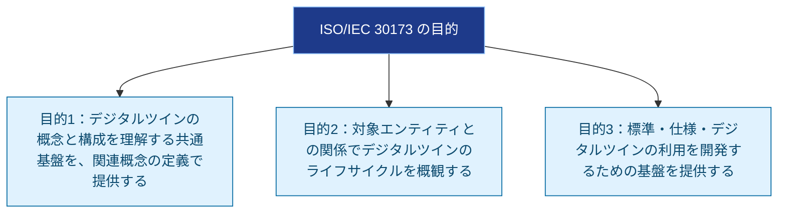
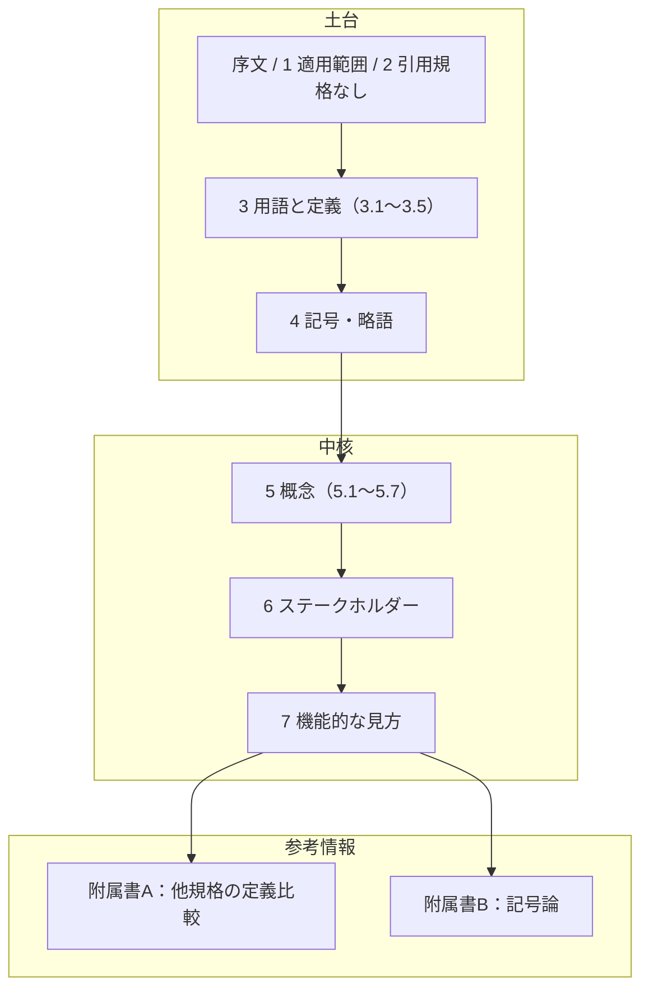
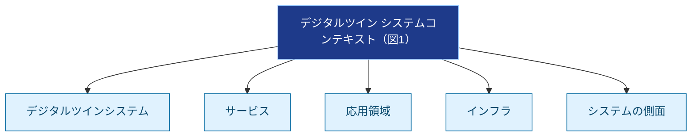
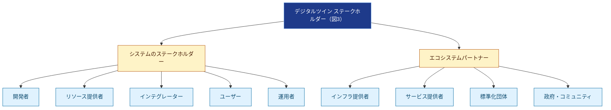
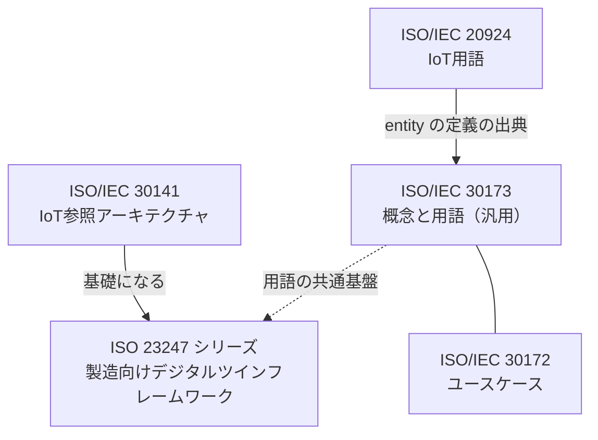
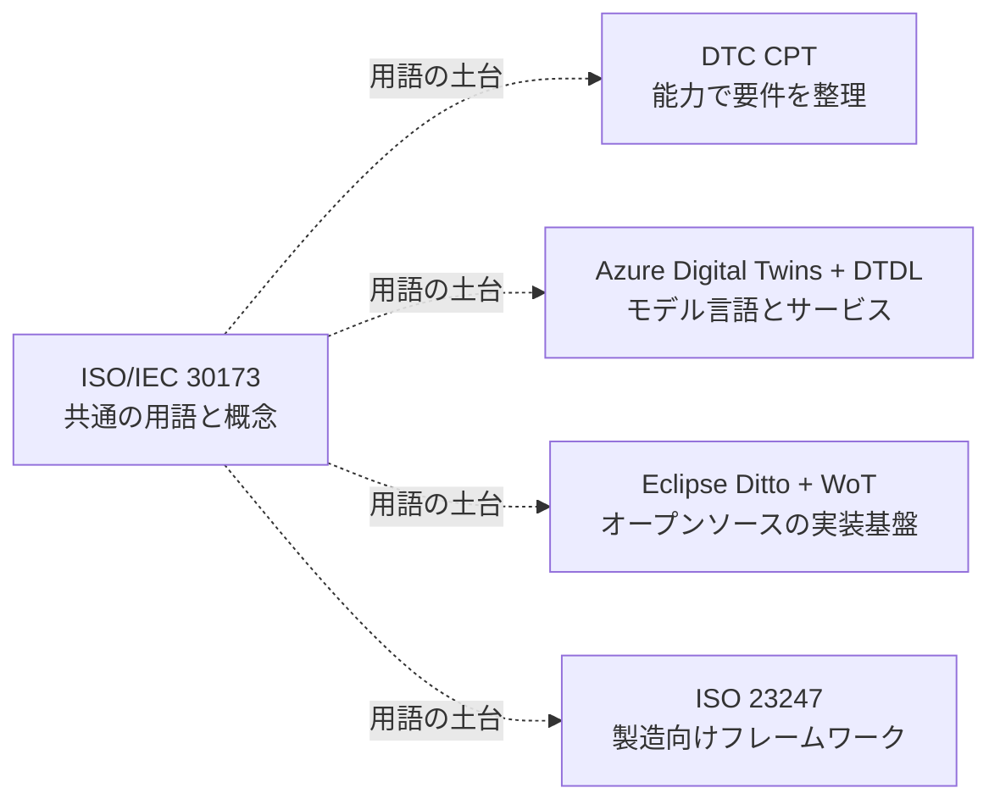
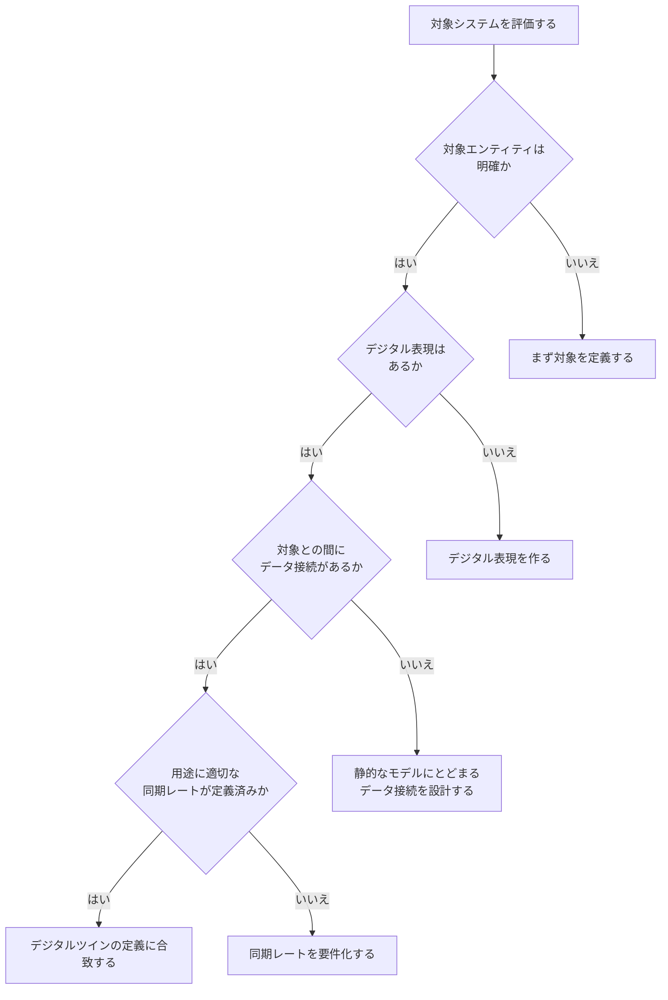
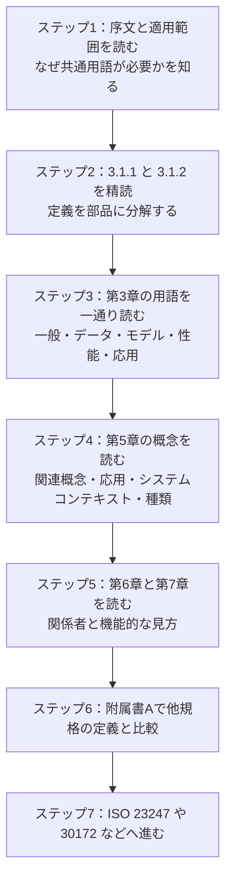

# ISO/IEC 30173:2023（デジタルツイン 概念と用語）初学者向けステップバイステップ解説

> **対象読者**: ソフトウェアエンジニア、QAエンジニア、DX・IoT・医療/製造分野の担当者で、「デジタルツイン」という言葉を共通理解で使えるようになりたい初学者
> **調査日**: 2026年10月22日
> **対象規格**: ISO/IEC 30173:2023 *Digital twin — Concepts and terminology*
> **表記**: 図解はMermaidとMarkdownのみ（ASCIIアートは使用しません）。規格本文の長い引用は避け、すべて日本語で言い換えています。

---

## 0. はじめに：この解説の「確実さ」の範囲

この規格の本文は有償です（ISO公式で CHF 159）。今回の調査で私が**実際に確認できた範囲**は次のとおりです。

| 区分 | 確認できた内容 | 確実さ |
|---|---|---|
| 公式メタ情報 | 発行年月、版、ページ数、所管委員会、ICS | 高（ISO公式ページ） |
| 目次（全章・全節） | 第1章〜第7章、附属書A・B、図表一覧 | 高（VDE出版の無料プレビューPDF） |
| 序文（Introduction）と適用範囲 | 規格の目的、対象、利点の例 | 高（同PDF） |
| 用語 3.1.1「digital twin」と 3.1.2「entity」 | 定義と注記 | 高（同PDF） |
| 第5章〜第7章の本文詳細 | **目次レベルまで** | 中（章題のみ確認。詳細は本文で要確認） |

> **注意**: 第5章以降の「中身」は目次の章題から読み取れる範囲で整理しています。**各節で規格が具体的に何と書いているかは、規格本文で必ず確認してください**。本ガイドで本文未確認の部分には「📌 要確認」を付けています。

---

## 1. 全体像：この規格は何をする文書か

### 1-1. 一言でいうと

**「デジタルツインとは何か」を、業界をまたいで共通の言葉で説明するための"辞書＋概念図"の規格**です。

仕様（API、データ形式、プロトコル）を決める規格ではありません。この規格自身が、他の規格づくりや関係者間のコミュニケーションの土台になると述べています。

### 1-2. メタ情報

| 項目 | 内容 |
|---|---|
| 規格番号 | ISO/IEC 30173:2023 |
| 題名 | Digital twin — Concepts and terminology |
| 版 | 第1版（Edition 1） |
| 発行 | 2023年11月 |
| ステータス | 発行済み（国際規格、ステージ60.60） |
| ページ数 | 28ページ |
| 所管 | ISO/IEC JTC 1/SC 41（IoTおよびデジタルツイン） |
| ICS | 35.020（情報技術一般） |
| 規定の引用規格 | なし（Normative references は無し） |

### 1-3. この規格が「やること」と「やらないこと」

| やること | やらないこと |
|---|---|
| 用語と定義を揃える | 特定のデータ形式・APIを定める |
| 概念（システムコンテキスト、ライフサイクル、種類）を整理する | 実装方法や製品を指定する |
| 関係者（ステークホルダー）を整理する | 認証・適合性評価を提供する |
| 機能的な見方（Functional view）を示す | 業界固有の詳細設計を与える |
| 他規格づくりの共通基盤になる | |

> 補足: 序文によると、本規格は「どの分野・組織でも、または分野をまたいで使える汎用の概念と用語」を提供します。

---

## 2. STEP 1：まず「なぜ必要か」を理解する（序文より）

序文は、背景として次の点を述べています。

1. デジタルツインの考え方は新しくない。航空宇宙では50年以上、ツイニング（twinning）の考え方が使われてきた。
2. 産業用IoTなどのデジタル化の進展で、資本集約型産業の外にも広がった。
3. スマート製造、スマートシティ、スマート農業、スマートエネルギー、スマートビル、スマートヘルスケア、スマート鉱業など、多くの分野で使えうる。
4. しかし**分野ごとに独立して発展した結果、概念と用語がバラバラになった**。
5. だから共通の土台と用語が必要。

### 2-1. 利点の例（序文に挙げられている5分野）

| 分野 | 序文が示す利点の方向性 |
|---|---|
| 製造 | 製品・生産ラインのシミュレーションと予測により、生産サイクルとコストを削減 |
| 都市計画 | シミュレーションモデルによる都市建設の最適化と、可視化・都市管理の知能化 |
| 農業 | 生産運用の監視・最適化、機械設備の予知診断 |
| エネルギー | 生産・送電の可視監視、故障分析、遠隔運用保守 |
| 医療 | 患者のリアルタイム状態の監視、個別化医療、医療資源の動的最適化 |

> 利点の大きさは、そのデジタルツインが想定するユースケースと、実装の質、そして**対象をどれだけ信頼して表現できるか**に左右される、と序文は注意しています。

### 2-2. 規格の3つの目的

---

## 3. STEP 2：デジタルツインの「本質」を押さえる

### 3-1. 序文が述べる本質：2つのものの「ペアリング」

序文は、デジタルツインの本質を**2つのものの組み合わせ**として説明しています。

| 要素 | 役割 | 例 |
|---|---|---|
| **対象エンティティ（target entity）** | 現実世界で機能的な目的を果たすもの | 自動車、石油化学プラットフォーム |
| **デジタルエンティティとしての表現** | 接続・統合・分析・シミュレーション・可視化・最適化・協調、必要なら対象への外部管理のために作る表現 | その自動車のデジタル上の表現 |

### 3-2. 用語 3.1.1「digital twin（DTw）」の定義（日本語の言い換え）

規格は、デジタルツインを次のように定義しています（要旨）。

> **対象エンティティのデジタル表現であって、物理状態とデジタル状態を「適切な同期の速さ」で収束させられるデータ接続を備えたもの**

#### 定義を分解して読む

| 定義の部品 | 意味 | 初学者向けの見方 |
|---|---|---|
| デジタル表現（digital representation） | 対象を表すデジタルな存在 | 3Dモデルだけでなく、データ・モデル・ルールの組み合わせでもよい |
| 対象エンティティ（target entity） | ツイン化される現実の側 | 物（機械）だけでなく、プロセスや概念も含みうる |
| データ接続 | 両者をつなぐデータの流れ | **これが無い「ただのモデル」はこの定義に当てはまらない** |
| 収束（convergence） | 物理側とデジタル側の状態が揃っていく | 常に完全一致とは言っていない |
| 適切な同期レート | 用途に見合った更新頻度 | 秒単位かもしれないし、日単位かもしれない |

> **ポイント**: 「リアルタイム」とは書かれていません。**用途に対して適切な速さ**で十分です。要件定義では「適切」の中身（例: 何秒以内）を自分で決める必要があります。

### 3-3. 注記（Note 1・Note 2）の要旨

| 注記 | 要旨 |
|---|---|
| 注記1 | デジタルツインは、接続・統合・分析・シミュレーション・可視化・最適化・協調などの能力の**一部または全部**を持つ |
| 注記2 | デジタルツインは、対象エンティティの**ライフサイクル全体を通じた統合的な見方**を提供しうる |

> つまり「分析・シミュレーション・最適化まで必須」ではありません。**能力の組み合わせは用途で変わる**、という整理です。

### 3-4. 用語 3.1.2「entity」の定義（要旨）

| 項目 | 内容 |
|---|---|
| 定義 | 物理的か非物理的かを問わず、明確な存在を持つもの |
| 例 | 人、物体、出来事、概念、プロセスなど |
| 出典 | ISO/IEC 20924:2021 の 3.1.18 に例を追加して修正したもの |

> 「エンティティ」が**物理的なものに限らない**ため、デジタルツインの対象にはプロセスなども入りうる点が重要です。

### 3-5. 概念図：デジタルツインの基本形

---

## 4. STEP 3：規格の構成（目次）を地図として使う

目次（無料プレビューPDFで確認済み）の全体像です。

### 4-1. 章構成の一覧

| 章 | タイトル | 何が書かれているか（目次から） |
|---|---|---|
| 序文 | Introduction | 背景、デジタルツインの本質、規格の3つの目的 |
| 1 | Scope | 適用範囲 |
| 2 | Normative references | **なし** |
| 3 | Terms and definitions | 用語（3.1 一般、3.2 データ関連、3.3 モデル関連、3.4 性能関連、3.5 アプリケーション関連） |
| 4 | Symbols and abbreviated terms | 記号・略語 |
| 5 | Concepts | 概念（5.1〜5.7） |
| 6 | Digital twin stakeholders | ステークホルダー |
| 7 | Functional view of digital twin | 機能的な見方 |
| 附属書A（参考） | Definition of digital twin in different standards | 他規格での定義の比較表（表A.1） |
| 附属書B（参考） | Semiotics | 記号論（図B.1「ガレージのジャガー」のユースケース） |

### 4-2. 構成の俯瞰図

### 4-3. 用語章（第3章）のカテゴリ

| 節 | カテゴリ | 初学者向けの見方 |
|---|---|---|
| 3.1 | General terms（一般用語） | デジタルツイン、エンティティ、対象エンティティ、デジタル表現などの基本語 |
| 3.2 | Data-related terms | データに関する用語 |
| 3.3 | Model-related terms | モデルに関する用語 |
| 3.4 | Performance-related terms | 性能に関する用語 |
| 3.5 | Application-related terms | 応用に関する用語 |

> 📌 要確認: 3.1.3 以降の各用語の個別の定義文は、本ガイドでは未確認です。規格本文で確認してください。

---

## 5. STEP 4：第5章「概念」を節ごとに理解する

### 5-1. 5.2 デジタルツインの利点と効果

序文の利点の例（第2章で整理）と対応する節です。📌 要確認: 5.2 の本文での整理方法。

### 5-2. 5.3 デジタルツインと関連概念

目次から、次の5つの関連概念との関係を整理していることがわかります。

| 節 | 関連概念 | 初学者向けの理解の入口 |
|---|---|---|
| 5.3.1 | 記号論の三角形（semiotic triangle） | 附属書Bとセット。「実物」「概念」「記号（表現）」の関係で整理する考え方 |
| 5.3.2 | 情報モデルにおけるシステム制御要素の利用 | 制御の観点でどう位置づくか |
| 5.3.3 | シミュレーション | デジタルツインとシミュレーションは同じか？という疑問に対応する節 |
| 5.3.4 | サイバーフィジカルシステム（CPS） | 物理と計算の融合システムとの関係 |
| 5.3.5 | IoT | IoTとの関係 |

> 📌 要確認: 各節が結論として何を述べているか（例: 「シミュレーションとの違い」の具体的な書きぶり）は本文で確認してください。

### 5-3. 5.4 デジタルツインの応用分野

目次から、規格が応用として取り上げている分野が確認できます。

| 節 | 分野 |
|---|---|
| 5.4.2 | 製造 |
| 5.4.3 | 建築物と土木インフラ |
| 5.4.4 | ヘルスケア |
| 5.4.5 | 都市 |

### 5-4. 5.5 デジタルツインのシステムコンテキスト

目次から、システムコンテキスト（図1）を次の5要素で説明していることがわかります。

| 節 | 要素 |
|---|---|
| 5.5.2 | Digital twin system（デジタルツインシステム） |
| 5.5.3 | Services（サービス） |
| 5.5.4 | Application domains（応用領域） |
| 5.5.5 | Infrastructure（インフラ） |
| 5.5.6 | System aspects（システムの側面） |

> 📌 要確認: 上図は**目次に出てくる5要素を並べたもの**で、要素同士の矢印関係（依存の向きなど）は本文の図1で確認してください。

### 5-5. 5.6 デジタルツインのライフサイクルプロセス

- 目次から、**図2「デジタルツインのライフサイクルフェーズ」**があることがわかります。
- 序文の目的2が「対象エンティティとの関係でのライフサイクルの概観」であることから、**対象エンティティのライフサイクルとデジタルツインのライフサイクルを対応づけて見る**ことが主眼と読めます。
- 📌 要確認: フェーズの具体的な名称と数は本文の図2で確認してください。

### 5-6. 5.7 デジタルツインの種類（4種類）

| 節 | 種類 | 対象の粒度の目安（目次の並びからの理解） |
|---|---|---|
| 5.7.2 | Component digital twin（コンポーネント） | 部品・要素 |
| 5.7.3 | Asset digital twin（アセット） | 設備・資産 |
| 5.7.4 | System digital twin（システム） | 複数の要素からなるシステム |
| 5.7.5 | Process digital twin（プロセス） | 業務・製造などのプロセス |

> 📌 要確認: 矢印は目次の並び順を示すだけで、「包含関係」かどうかは本文で確認してください。

---

## 6. STEP 5：第6章「ステークホルダー」を理解する

目次から、2つのグループに分けて整理していることがわかります（図3）。

### 6-1. デジタルツインシステムのステークホルダー（6.2）

| 節 | 役割 |
|---|---|
| 6.2.1 | Developers（開発者） |
| 6.2.2 | Resource providers（リソース提供者） |
| 6.2.3 | Integrators（インテグレーター） |
| 6.2.4 | Users（ユーザー） |
| 6.2.5 | Operators（運用者） |

### 6-2. エコシステムパートナー（6.3）

| 節 | 役割 |
|---|---|
| 6.3.1 | Infrastructure provider（インフラ提供者） |
| 6.3.2 | Service provider（サービス提供者） |
| 6.3.3 | Standards development organization（標準化団体） |
| 6.3.4 | Government and community（政府とコミュニティ） |

---

## 7. STEP 6：第7章「機能的な見方」と附属書

### 7-1. 第7章 Functional view of digital twin（図4）

- 目次から、デジタルツインを**機能の観点で整理した図4**があることがわかります。
- 📌 要確認: 機能ブロックの名称と接続関係は本文の図4で確認してください。

### 7-2. 附属書A：他規格での「デジタルツイン」の定義（表A.1）

- 複数の規格が、デジタルツインをそれぞれどう定義しているかを比較する表です。
- 「定義がバラバラ」という序文の問題意識を、実例で示す役割と読めます。

### 7-3. 附属書B：記号論（Semiotics）

| 節 | 内容（目次から） |
|---|---|
| B.1 | 記号論の紹介 |
| B.2 | デジタルツインと記号論的写像（semiotic morphisms） |
| B.3 | デジタルツインのシステムコンテキストと記号論の三角形の関係 |
| 図B.1 | ユースケース「ガレージのジャガー」を3つの記号論的領域に写像 |

> 📌 要確認: 「ガレージのジャガー」の具体的な説明は本文で確認してください。

---

## 8. STEP 7：関連する規格・業界の取り組みとの位置づけ

### 8-1. 関連規格との関係

| 規格・仕様 | 位置づけ | 30173との関係 |
|---|---|---|
| ISO/IEC 30172 | デジタルツインのユースケース | 30173とセットで紹介される（Sirris資料） |
| ISO 23247 シリーズ | 製造向けデジタルツインフレームワーク（Part 1〜、観測可能な製造要素 OME を対象） | 製造分野に特化。汎用の30173と役割が異なる |
| ISO/IEC 30141 | IoT参照アーキテクチャ | ISO 23247 の枠組みの基礎になっている（Sirris資料） |
| ISO/IEC 20924 | IoT用語 | 30173 の用語 3.1.2「entity」の出典 |

> 上図のうち「30141 → 23247」は Sirris の解説、「20924 → 30173」は規格本文の出典表記に基づきます。「30173 → 23247」の破線は、**汎用の用語基盤という性格からの私の整理**であり、規格自体が明示している関係ではありません。

### 8-2. 製造向けISO 23247の要点（比較のため）

| 項目 | 内容 |
|---|---|
| 対象 | 人員、設備、材料、製造プロセス、施設、環境、製品、支援文書などの「観測可能な製造要素（OME）」のデジタルツイン |
| 目的の例 | リアルタイム制御、予知保全、工程内適応、ビッグデータ分析、機械学習 |
| 性格 | フレームワークであり、特定のデータ形式や通信プロトコルは規定しない |
| Part 4 | 情報交換（ユーザーネットワーク、サービスネットワーク、アクセスネットワーク、近接ネットワークの要件） |

---

## 9. STEP 8：国際的な開発者コミュニティの実践と対応づける

> ここからは**規格本文の内容ではなく**、著名な国際コミュニティの公開情報を、30173の概念と並べて理解するための補助です。

### 9-1. Digital Twin Consortium（OMG傘下）：Capabilities Periodic Table（CPT）

- CPTは、アーキテクチャや技術に依存しない**要件定義フレームワーク**です。能力を共通の特徴ごとにグループ化する「周期表」方式です。
- バージョン1.1は2024年4月に発表され、「責任（responsibility）」や「検索（search）」などの能力が追加されました。
- 発表時のコメントは、DTCのCTOであるDan Isaacs氏と、XMProのCEOでDTC関連ワーキンググループ共同議長のPieter van Schalkwyk氏によるものです。

| 30173の概念 | CPTとの対応の見方（私の整理） |
|---|---|
| 注記1：接続・統合・分析・シミュレーション・可視化・最適化・協調などの能力の一部または全部を持つ | 「能力で要件を捉える」という考え方と相性がよい |
| ライフサイクル（5.6） | CPTも、デジタルツインとデジタルスレッドのライフサイクルを通じた能力を扱う |

### 9-2. Microsoft：Azure Digital Twins と DTDL

- Azure Digital Twins のモデルは、JSON-LDベースの**Digital Twins Definition Language（DTDL）**で定義されます。
- DTDLは特定のプログラミング言語に依存せず、Azure Digital Twins専用でもありません。
- DTDLは、スマートデバイス・資産・空間・環境のデジタルツインのモデルを記述する言語で、データだけでなく**意味（セマンティクス）の注釈**を付けられます。

| 30173の概念 | DTDLとの対応の見方（私の整理） |
|---|---|
| デジタル表現 | DTDLのモデル（インターフェース）がデジタル表現の「型」を定める |
| 用語を揃える | モデルに意味注釈を付けることで、分析やUIが意味を扱える |

### 9-3. Eclipse Ditto（Eclipse IoT／オープンソース）

- Eclipse Dittoは、IoTアプリケーション向けに**「デジタルツイン」パターン**を提供するフレームワークで、物理デバイスをクラウド上のデジタル表現として写します。
- 統一的なリソースベースAPIで、デバイス種別や接続方式の違いを抽象化します。
- 能力の記述には、**W3C Web of Things（WoT）のThing Model**へ参照を張れます。Thing Modelから、APIの説明を含むThing Descriptionを生成できます。
- 状態の永続化、検索、認可（ポリシー）を備えます。

| 30173の概念 | Dittoとの対応の見方（私の整理） |
|---|---|
| 対象エンティティ | 物理デバイス |
| デジタル表現 | Ditto上の「Thing」（属性とフィーチャーを持つ） |
| データ接続 | Hono・MQTT などのコネクティビティ層を介した状態同期 |

### 9-4. 実装例との対応マップ

> 破線は「30173が明示的にこれらを参照している」という意味では**ありません**。用語を共通化する目的の規格なので、実装や他の取り組みを読むときの物差しとして使える、という位置づけの私の整理です。

---

## 10. STEP 9：エンジニア（特にQA）向けの実務での使い方

> この章は規格本文の内容ではなく、**本ガイドの著者としての実務上の提案**です。

### 10-1. 「これはデジタルツインか？」を判定するチェックリスト

3.1.1 の定義の部品に沿った確認項目です。

| チェック項目 | 確認の観点 | OKなら |
|---|---|---|
| 対象エンティティが明確か | 何をツイン化しているか言える | ☐ |
| デジタル表現があるか | 対象を表すデータ・モデルがある | ☐ |
| データ接続があるか | 対象とデジタル表現の間にデータの流れがある | ☐ |
| 同期レートが決まっているか | 用途に対して適切な更新頻度が定義されている | ☐ |
| 収束の確認方法があるか | 物理状態とデジタル状態のズレを測れる | ☐ |

### 10-2. 要件・テスト文書で曖昧になりやすい点

| 曖昧な言い方 | 問題 | 改善の方向性 |
|---|---|---|
| 「リアルタイムで同期する」 | 定義は「適切な同期レート」であり、リアルタイムとは限らない | 数値（例: 許容遅延）で要件化する |
| 「デジタルツイン＝3Dモデル」 | 定義の要点はデータ接続を伴うこと | 接続の有無を別項目で確認する |
| 「デジタルツイン＝シミュレーション」 | 規格は5.3.3で別節として関係を整理している | 本文でどう区別されているか確認して引用する |
| 「ツインの種類」が不明 | 5.7で4種類が整理されている | コンポーネント／アセット／システム／プロセスのどれかを明記する |

### 10-3. テスト観点のヒント（私の提案）

| 観点 | 例 |
|---|---|
| 同期の適切性 | 物理側の変化がデジタル側に反映されるまでの遅延が要件内か |
| 収束 | 一定時間後に両者の状態が許容範囲内で一致するか |
| 異常系 | 通信断・遅延・データ欠損時にデジタル表現がどう振る舞うか |
| ライフサイクル | 対象の変更（改修、廃止）に対してデジタル表現が追随するか |
| ステークホルダー | 開発者・運用者・ユーザーなどの役割ごとの権限と責務が整理されているか |

---

## 11. 学習ロードマップ

---

## 12. 理解度チェック（自己点検）

| # | 問い | 答え（要旨） |
|---|---|---|
| 1 | 30173は何を規定する規格か | デジタルツインの用語と概念。実装仕様ではない |
| 2 | デジタルツインの定義の核心は | 対象エンティティのデジタル表現＋物理とデジタルの状態を収束させるデータ接続 |
| 3 | 「適切な同期レート」とは | 用途に見合った更新頻度。必ずしもリアルタイムではない |
| 4 | エンティティは物理的なものだけか | いいえ。プロセスや概念なども含みうる |
| 5 | デジタルツインの4種類は | コンポーネント、アセット、システム、プロセス |
| 6 | ステークホルダーの2グループは | システムのステークホルダーと、エコシステムパートナー |
| 7 | 引用規格はあるか | ありません |
| 8 | 製造向けの専用規格は | ISO 23247 シリーズ |

---

## 13. 根拠ソース一覧（URL）

### 13-1. 規格の一次情報（公式・目次・本文冒頭）

| # | ソース | URL | 確認できた内容 |
|---|---|---|---|
| 1 | ISO公式ページ（ご指定のURL） | <https://www.iso.org/standard/81442.html> | 発行年月、版、ページ数、価格、所管、抄録 |
| 2 | VDE出版 無料プレビューPDF（IEC版） | <https://www.vde-verlag.de/iec-normen/preview-pdf/info_isoiec30173{ed1.0}en.pdf> | 目次全体、序文、適用範囲、3.1.1・3.1.2の定義 |
| 3 | iTeh Standards（目次の抜粋） | <https://iteh.es/catalog/standards/iec/e0ed45a5-319d-4cbc-a742-3706ec7c40ed/iso-iec-30173-2023> | 目次の一部 |
| 4 | AFNOR | <https://www.boutique.afnor.org/en-gb/standard/iso-iec-301732023/digital-twin-concepts-and-terminology/xs144498/354004> | 28ページ、発行2023年11月 |
| 5 | ANSI Webstore | <https://webstore.ansi.org/standards/iso/isoiec301732023> | 抄録、版情報 |
| 6 | StandICT.eu | <https://standict.eu/standards-repository/isoiec-30173-ed1digital-twin-concepts-and-terminology> | 規格開発段階での抄録（ライフサイクル、分類などの記述） |

### 13-2. 関連規格

| # | ソース | URL | 確認できた内容 |
|---|---|---|---|
| 7 | ISO 23247-1:2021 概要（iTeh） | <https://iteh.eu/catalog/standards/iso/7df6fef2-6487-43da-9a48-eaba332a9ffc/iso-23247-1-2021> | 製造向けDTフレームワークの概要と一般原則 |
| 8 | ISO 23247-2 概要（BSI） | <https://shop-checkout.bsigroup.com/products/automation-systems-and-integration-digital-twin-framework-for-manufacturing-reference-architecture> | 参照アーキテクチャ、OMEの対象 |
| 9 | ISO 23247-4 概要（BSI） | <https://shop-checkout.bsigroup.com/products/automation-systems-and-integration-digital-twin-framework-for-manufacturing-information-exchange> | 4種類のネットワーク要件 |
| 10 | Sirris 解説PDF | <https://sirris.be/print/pdf/node/13329> | 23247が30141に基づくこと、30172・30173との位置づけ |

### 13-3. 国際的な開発者コミュニティ・ベンダーの公開情報

| # | ソース | URL | 確認できた内容 |
|---|---|---|---|
| 11 | DTC Capabilities Periodic Table 1.1（プレスリリース） | <https://www.automation.com/article/digital-twin-capabilities-periodic-table-v1-1> | 2024年4月のv1.1発表、Dan Isaacs氏のコメント |
| 12 | Control Engineering（CPT v1.1） | <https://www.controleng.com/digital-twin-capabilities-periodic-table-released/> | Pieter van Schalkwyk氏のコメント、新能力（責任・検索） |
| 13 | DTC CPT ユーザーガイド v1.1 | <https://www.digitaltwinconsortium.org/wp-content/uploads/sites/3/2024/04/DTC_Capabilities-Periodic-Table-User-Guide-v1.1.pdf> | CPTの構成 |
| 14 | Philly ETE 2023 Dan Isaacs講演 | <https://chariotsolutions.com/screencast/philly-ete-2023-demystifying-digital-twins-the-digital-twin-consortiums-capabilities-periodic-table-dan-isaacs/> | CPTの要件定義での使い方 |
| 15 | Microsoft Learn: Azure Digital Twins モデル | <https://learn.microsoft.com/azure/digital-twins/concepts-models> | DTDLの概要、v2・v3対応 |
| 16 | DTDL v2 言語仕様（GitHub Pages） | <https://azure.github.io/opendigitaltwins-dtdl/DTDL/v2/DTDL.v2.html> | DTDLの目的とメタモデル |
| 17 | Eclipse Ditto プロジェクトページ | <https://projects.eclipse.org/projects/iot.ditto> | デジタルツインパターンのフレームワークとしての説明 |
| 18 | Eclipse Ditto 紹介スライド（2023年1月） | <https://eclipse.dev/ditto/slides/2023_01_ditto-in-30-min/index.html> | 状態永続化、検索、認可、WoT連携 |
| 19 | Eclipse Ditto × WoT 統合 | <https://eclipse.dev/ditto/basic-wot-integration.html> | Thing ModelとThing Descriptionの関係 |
| 20 | Eclipse Newsroom（Ditto紹介記事） | <https://newsroom.eclipse.org/node/39109> | W3C WoTとの連携 |

---

## 14. 本ガイドの限界と次のアクション

| 項目 | 内容 |
|---|---|
| 未確認の範囲 | 第3章の3.1.3以降の各用語定義、第5章各節の本文、第6章・第7章の本文、図1〜図4の内容、附属書Aの表A.1の中身 |
| 推奨アクション | ISO公式（CHF 159）または各国の規格団体で本文を入手し、📌要確認の箇所を照合する |
| 改訂の確認 | 今回の検索では、2026年10月22日時点で本規格の改訂版や廃止を示す情報は見つかりませんでした。ただし、網羅的な確認ではないため、ISO公式ページで最新状態を確認してください |
| 公表日の表記 | 販売サイトにより2023年11月6日／7日の表記差があります。本ガイドでは「2023年11月」と記載しました |

---

*本ガイドは、公開情報（目次、序文、適用範囲、用語3.1.1・3.1.2、各社の公開ページ）に基づく初学者向けの解説であり、規格本文の代替ではありません。第10章は著者の実務上の提案です。規格の正確な文言は、必ず正規の入手先で確認してください。*
