# ISO/IEC 14496-22:2026（Open Font Format）初学者向けステップバイステップ解説

> **対象規格**：ISO/IEC 14496-22:2026 *Information technology — Coding of audio-visual objects — Part 22: Open font format*（第5版）
> **情報の基準日**：2026年10月13日（この日までに公開されていた情報を調査）
> **想定読者**：フォントや文字表示の内部を初めて学ぶソフトウェアエンジニア・QAエンジニア
> **作りの方針**：図解は Mermaid（フローチャート）と Markdown の表のみ。ASCII アートは使いません。

---

## 0. このガイドの読み方と、調査の限界（先に必ず読んでください）

💡 この章では、このガイドが「何を根拠に」「どこまで確認できているか」を最初に示します。規格の解説では、根拠の範囲を知っておくと、後の説明を正しく受け取れます。

なぜ最初に書くのか：ISO 規格の本文は有料で、著作権上の制約もあります。私が直接読めたのは ISO の公式ページ、試し読み（プレビュー）の目次、そして規格と内容がほぼ連動している Microsoft の OpenType 仕様書（OpenType 1.9.1）です。**規格本文の全文は確認できていません。** そのため、条項番号を引用するような書き方は避け、「公開情報から確認できる事実」と「そこからの解説」を分けて書いています。

| 区分 | このガイドでの扱い |
|------|------------------|
| ISO 公式ページの記載（版・日付・ページ数・要約） | 事実として記載 |
| Microsoft OpenType 1.9.1 仕様書の記載 | 事実として記載（ISO 第5版の「作業草案」を取り込んだ版と明記されている） |
| Chrome・HarfBuzz・Fontations 関連の公開記事 | 実装の現状として記載 |
| 第5版の最終本文と OpenType 1.9.1 の差分 | **未確認**（購入して照合が必要） |

| 章 | 内容 | 読み方の目安 |
|----|------|------------|
| 1〜3 | 全体像と規格の位置づけ | まずここだけでも読む |
| 4〜8 | ファイルの中身と表示までの流れ | 仕組みの理解 |
| 9〜11 | 可変フォント・カラー・日本語 | 応用機能 |
| 12〜15 | 実装・テスト・まとめ・根拠URL | 実務への接続 |

📖 このセクションで登場した用語
- OpenType：Microsoft と Adobe が作ったフォント形式の名前。ISO 14496-22 と中身がほぼ対応している
- プレビュー：ISO が無料で公開している、規格の表紙と目次などの試し読み
- 作業草案（Working Draft）：正式発行の前に作られる、まだ確定していない文書

---

## 1. この規格を一言でいうと

💡 この章では、規格の目的を1文で押さえます。以降の章は、すべてこの1文の「中身の説明」になります。

**ISO/IEC 14496-22 は「パソコンやスマホが文字を表示するために読み込む、フォントファイルの中身の約束事」を定めた国際規格です。**

ISO の公式ページにある要約（abstract）を、意味を保ったまま日本語にすると次のとおりです。

- TrueType 形式と CFF 形式という2種類の輪郭（アウトライン）の形式を含む Open Font Format（OFF）を定める
- 文書中には TrueType と PostScript への言及が多い。OFF のフォントは両方の技術を組み合わせたものだから
- 各種フォントテーブルのデータ構造を定め、**フォントの描画エンジンと、文字の並べ方を決める「レイアウト／シェーピング」エンジンを、この規格に準拠して作るための詳細を示す**

### 例え話：フォントファイルは「楽譜と演奏ルールの入った巻物」

フォントは単なる「文字の絵のコレクション」ではありません。次の対応で考えると理解しやすくなります。

| フォントの要素 | 例え | 役割 |
|--------------|------|------|
| グリフ（＝文字の形そのもの） | 楽譜の音符 | 画面に描く形 |
| cmap テーブル | 索引（文字コード → 音符の番号） | 「あ」という文字がどの形か探す |
| GSUB/GPOS テーブル | 演奏記号（スラー・強弱） | 続けて書くとき形を替える・位置を調整する |
| 規格そのもの | 楽譜の書き方の国際ルール | どのアプリでも同じように読める |

規格があるおかげで、Windows で作ったフォントを macOS や Android のブラウザで読むことができます。

📖 このセクションで登場した用語
- フォント：文字の形と、その並べ方の情報をまとめたデータ
- グリフ：1つ1つの文字の形（「あ」「A」など）
- シェーピング：文字コードの並びを、実際に描くグリフの並びと位置に変換する処理
- アウトライン：文字の輪郭を曲線で表したもの。拡大しても滑らか

---

## 2. なぜ必要なのか：TrueType と PostScript の統合の歴史

💡 この章では、規格が「2つの技術の組み合わせ」と説明される理由を、歴史の流れで説明します。

なぜ歴史を先に見るのか：後の章で出てくる `glyf` と `CFF` という2つの輪郭テーブルの存在理由は、この歴史を知らないと分かりにくいためです。

Microsoft の仕様書は「OpenType は元の TrueType 形式の拡張で、Microsoft と Adobe Systems が共同で開発した」と説明しています。そして OpenType は、TrueType 仕様にもともとあったテーブルに加えて、より多くのテーブルを使えるようにし、フォントにより高度な知性を持たせています。

この図は、2つの流れが1つの形式に合流する様子を表しています。左から右へ読み進めてください。

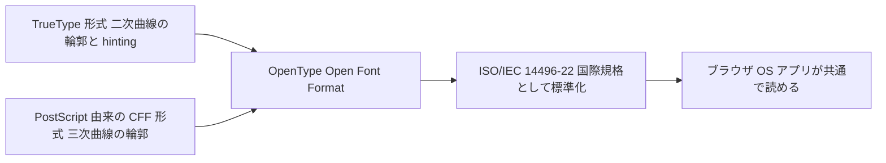

各ノードの意味：
- 「TrueType 形式」：`glyf` テーブルに輪郭を持つ系統。もとは Apple が作り、Microsoft も採用した
- 「PostScript 由来の CFF 形式」：Adobe の印刷技術に由来する輪郭の表し方。`CFF` や `CFF2` テーブルに入る
- 「OpenType」：TrueType 輪郭と CFF/CFF2 輪郭のどちらでも収められる共通構造「sfnt というラッパー（＝包み紙）」を使う形式。2つの輪郭方式は形式上の選択肢であり、1つのフォントの中で両方の輪郭を同居させるという意味ではない（どちらを使うかは章5の sfntVersion で区別する）
- 「ISO/IEC 14496-22」：その仕様を ISO/IEC の国際規格にしたもの
- 「共通で読める」：ブラウザや OS が同じ規格を実装するため、フォントの互換性が保たれる

### 日本の読者にとっての意味

Microsoft の仕様書は、ファイル拡張子として `.OTF` `.TTF` `.OTC` `.TTC` を挙げ、`.OTC` と `.TTC` は「フォントコレクション」専用と書いています。日本語フォントでよく見る `.ttc`（複数書体をまとめた1ファイル）は、この規格の一部です。詳しくは章11で扱います。

📖 このセクションで登場した用語
- TrueType：Apple 発祥のフォント形式。輪郭を二次曲線で表す
- CFF（Compact Font Format）：Adobe 由来のコンパクトな輪郭形式。三次曲線を使う
- sfnt：フォントファイル全体を包む「テーブルの目次付きコンテナ」の仕組み
- 拡張子：ファイル名の末尾にある種類の目印（.ttf など）

---

## 3. 規格の基本情報と改訂の流れ

💡 この章では、ISO 公式ページで確認できる「版・日付・ページ数・過去版との関係」を整理します。

なぜ表にするのか：規格の調査では「どの版が今有効か」を取り違える事故が起きやすいためです。

### 3-1. 基本情報

| 項目 | 内容（ISO 公式ページより） |
|------|------------------------|
| 規格番号 | ISO/IEC 14496-22:2026 |
| 英題 | Information technology — Coding of audio-visual objects — Part 22: Open font format |
| 版 | 第5版（Edition 5） |
| 発行年月 | 2026年7月（公式ページの段階表示では 2026-07-16 に発行） |
| 状態 | Published（段階コード 60.60：国際規格発行済み） |
| ページ数 | 1003 ページ |
| 担当委員会 | ISO/IEC JTC 1/SC 29（音声・画像・マルチメディア・ハイパーメディア情報の符号化） |
| ICS（国際規格分類） | 35.040.40 |
| 言語・形式 | 英語・PDF／紙 |
| 置き換えた旧版 | ISO/IEC 14496-22:2019、同 Amd 1:2020、同 Amd 2:2023（いずれも Withdrawn＝廃止） |

注意：価格表示は、取得したページ上で「CHF 0」と表示される場合と、検索結果のスナップショットで「CHF 227」と表示される場合がありました。購入前に公式ページで最新の表示を確認してください。

### 3-2. 第5版ができるまで

この図は、公式ページの「ライフサイクル」に記録された主要な日付を上から下へ並べたものです。

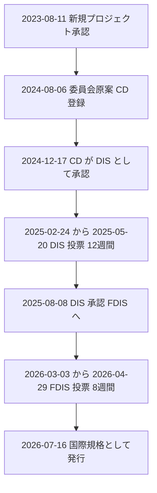

各ノードの意味：
- 「CD」（Committee Draft＝委員会原案）：専門家グループが最初にまとめる原案
- 「DIS」（Draft International Standard＝国際規格案）：各国が投票する段階。12週間の投票
- 「FDIS」（Final Draft International Standard＝最終国際規格案）：最後の承認投票。8週間
- 「発行」：投票が通ったあと、出版の工程を経て規格として公開される

規格の開発開始から発行まで、約3年かかっていることが日付から分かります。

📖 このセクションで登場した用語
- JTC 1/SC 29：ISO と IEC が共同で作る、メディア符号化を担当する委員会
- 段階コード：規格の進行状況を表す番号（60.60 は発行済み）
- Amendment（Amd）：既に発行された規格に対する追補（部分的な改訂）
- 廃止（Withdrawn）：新しい版に置き換わり、使わなくなった状態

---

## 4. ISO 規格と OpenType 仕様の関係

💡 この章では、「ISO の規格」と「Microsoft の OpenType 仕様」の関係を整理します。実際の開発では、無料で読める Microsoft の仕様書を参照することが多いためです。

なぜ整理するのか：「規格を読みたいが有料」という場面で、どの資料をどこまで頼れるかを判断するためです。

Microsoft の OpenType 仕様書（バージョン 1.9.1）のトップページには、次の趣旨の記載があります。

- **OpenType 1.9.1 は、ISO/IEC 14496-22 第5版の「作業草案（preliminary working draft）」の改訂内容を取り込んでいる**
- 仕様書の変更履歴では、1.9.1 は 2024年5月のリリースと記録されている
- 同じ変更履歴は 2026年9月にも更新されており、新しい Unicode のスクリプトタグ（Unicode 17.0、18.0 向け）が「リリース後の更新」として追加されている

この図は、2つの文書の関係です。

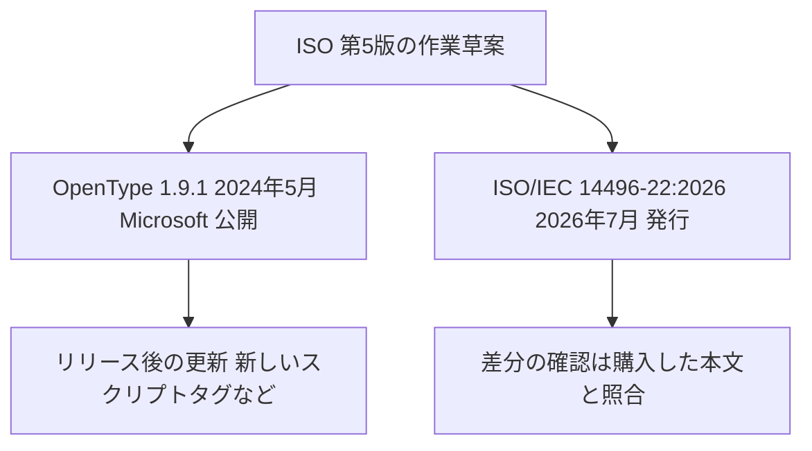

各ノードの意味：
- 「作業草案」：両方の元になった同じ原稿
- 「OpenType 1.9.1」：無料で読める実務向けの仕様書（図や例が豊富）
- 「ISO 2026」：正式な国際規格。**最終本文は作業草案から変わっている可能性がある**
- 「差分の確認」：このガイドでは未確認の部分。厳密な適合性が必要な場合は、規格本文との照合が必要

### 実務での使い分け

| 目的 | おすすめの資料 |
|------|--------------|
| 仕組みを学ぶ・実装する | Microsoft OpenType 1.9.1（無料） |
| 契約や認証で「ISO 準拠」を主張する | ISO/IEC 14496-22:2026 本文 |
| 各ライブラリの挙動を知る | HarfBuzz・Fontations などの公式ドキュメント |

📖 このセクションで登場した用語
- 適合性（コンフォーマンス）：規格の要求を満たしていること
- スクリプトタグ：文字体系（ラテン文字、ひらがななど）を表す4文字の識別子
- 変更履歴（change log）：仕様書の改訂内容を記録した文書

---

## 5. フォントファイルの構造：sfnt コンテナを読んでみる

💡 この章では、フォントファイルの「一番外側の構造」を説明します。ここを理解すると、フォントを読むプログラムを自分で書けるようになります。

なぜこの構造から学ぶのか：フォントのすべてのデータは、最初に「どのテーブルがファイルのどこにあるか」という目次を読まないと取り出せないためです。

### 5-1. 例え話：引き出しがたくさんある書類キャビネット

フォントファイルは、「目次（テーブルディレクトリ）」と「引き出し（テーブル）」でできたキャビネットです。目次には、引き出しの名前（4文字のタグ）、場所（オフセット）、大きさ（長さ）、中身の検査用の数（チェックサム）が書いてあります。

### 5-2. 全体の流れ

この図は、ファイルを開いて目的のテーブルを取り出すまでの流れです。上から下へ読み進めてください。

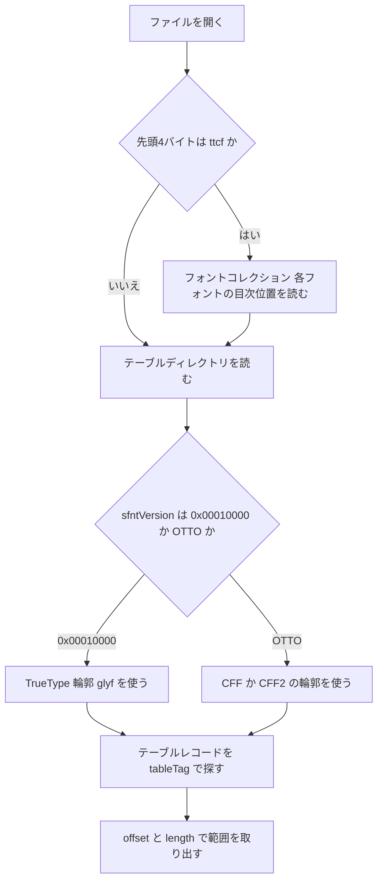

各ノードの意味：
- 「ttcf か」（ひし形）：フォントコレクションかどうかの判定。`ttcf` はコレクションの目印のタグ
- 「テーブルディレクトリ」：目次。先頭から順に `sfntVersion`、`numTables` などが並ぶ
- 「sfntVersion」（ひし形）：輪郭の種類の目印。TrueType 輪郭なら `0x00010000`、CFF 系なら `OTTO`（0x4F54544F）
- 「テーブルレコード」：1テーブルにつき1件。タグ、チェックサム、オフセット、長さを持つ

### 5-3. 目次（テーブルディレクトリ）の中身

Microsoft の仕様書による定義です。**すべての数値はビッグエンディアン（＝大きい桁のバイトを先に並べる方式）です。**

| フィールド | 型 | 意味 |
|-----------|-----|------|
| sfntVersion | uint32 | 0x00010000 または OTTO |
| numTables | uint16 | テーブルの数 |
| searchRange | uint16 | 2のべき乗のうち numTables 以下で最大のもの × 16 |
| entrySelector | uint16 | その2のべき乗の log2 |
| rangeShift | uint16 | numTables × 16 − searchRange |
| tableRecords[numTables] | TableRecord の配列 | 各テーブルの情報 |

TableRecord は次の4項目です。

| フィールド | 型 | 意味 |
|-----------|-----|------|
| tableTag | Tag | テーブルの名前（例：cmap、head） |
| checksum | uint32 | テーブルの検査用の合計値 |
| offset | Offset32 | ファイル先頭からの位置 |
| length | uint32 | テーブルの長さ（詰め物を含まない実際の長さ） |

守るべき決まり事（仕様書より）：
- Tag は 0x20〜0x7E の範囲のバイト4つ（表示できる ASCII 文字）。大文字小文字を区別する
- テーブルレコードは tag の昇順に並べる
- 各テーブルは4バイト境界から始め、余った部分は0で埋める
- 仕様で定義されたタグのテーブルは、1つのフォントにつき最大1件とする（複数あると挙動が予測できず、アプリがどれか1つを任意に選んだり、フォントを不正として拒否したりする）
- 仕様外の独自タグのテーブルは、その外部仕様が複数を許している場合、その仕様に従う

### 5-4. 動作トレース：searchRange などを計算してみる

例として、テーブルが 17 個あるフォントを考えます（数値は説明用の仮の例です）。

| 手順 | 計算 | 結果 |
|------|------|------|
| 1. 17 以下で最大の2のべき乗を探す | 16 | 16 |
| 2. searchRange = 16 × 16 | 16 × 16 | **256** |
| 3. entrySelector = log2(16) | 4 | **4** |
| 4. rangeShift = 17 × 16 − 256 | 272 − 256 | **16** |

なぜこの3つの値があるのか：仕様書によると、昔の性能が低い機器でテーブルを二分探索（＝半分ずつ絞って探す方法）するための補助値です。さらに、**誤った値が攻撃に使われうるため、読む側は numTables から自分で計算し直すことが強く推奨**されています。ファイルを作る側は、互換性のため正しい値を書き続けます。

### 5-5. 実装例：Python で目次を読む

なぜ標準ライブラリだけで書くのか：外部ライブラリなしで構造を見ると、規格の定義と1対1で対応づけられるためです。

```python
import struct  # バイト列を数値に変換する標準ライブラリ。ビッグエンディアン指定に使う

def read_table_directory(path):
    with open(path, "rb") as f:
        # 先頭12バイトが目次の見出し部分。
        # ">" はビッグエンディアンの指定。OpenType は必ずこの並びのため、
        # 指定を忘れると数値が逆順に読めてしまう。
        header = f.read(12)
        # ファイルが短いと struct.error になり原因が分かりにくいため、先に長さを検証する。
        if len(header) < 12:
            raise ValueError(f"ヘッダが不足しています: 12バイト必要ですが {len(header)} バイトしかありません")
        sfnt_version, num_tables, _sr, _es, _rs = struct.unpack(">4sHHHH", header)

        # searchRange など3つの値は読み捨てる（_ で始まる変数名）。
        # 仕様書が「numTables から自分で計算し直すこと」を推奨しているため。

        # フォントコレクション（ttcf）はこの関数の対象外。
        # 構造が違う（TTC ヘッダが先頭に来る）ため、先に弾く。
        if sfnt_version == b"ttcf":
            raise ValueError("フォントコレクションです。TTC ヘッダの読み取りが必要です")

        # 単体フォントの sfntVersion は 0x00010000（TrueType 輪郭）か OTTO（CFF 系）のみ。
        # それ以外の値は OpenType ではないか壊れたファイルなので、目次を読む前に拒否する。
        if sfnt_version not in (b"\x00\x01\x00\x00", b"OTTO"):
            raise ValueError(f"未対応の sfntVersion です: {sfnt_version.hex()}")

        records = []
        for i in range(num_tables):
            # TableRecord は1件16バイト（tag 4 + checksum 4 + offset 4 + length 4）。
            record = f.read(16)
            # numTables が実際のレコード数より大きい壊れたファイルでも、内容が分かるエラーにする。
            if len(record) < 16:
                raise ValueError(
                    f"テーブルレコード {i} が不足しています: 16バイト必要ですが {len(record)} バイトしかありません"
                )
            tag, checksum, offset, length = struct.unpack(">4sIII", record)
            records.append({
                "tag": tag.decode("ascii"),   # Tag は表示可能な ASCII と決まっている
                "checksum": checksum,
                "offset": offset,
                "length": length,
            })
        return sfnt_version, records
```

実行結果のイメージ（説明用の仮の例）：

| tag | offset | length |
|-----|--------|--------|
| GPOS | 1204 | 5132 |
| GSUB | 6336 | 1420 |
| cmap | 7756 | 902 |
| glyf | 8660 | 91204 |
| head | 100 | 54 |

### 5-6. チェックサムの考え方

仕様書の手順を要約します。各テーブルのチェックサムは「4バイトずつの符号なし整数の合計」です。テーブルの長さが4の倍数でない場合は、末尾を0で4バイト境界まで補ってから4バイト単位で加算します。これは `head` テーブルにも適用します。ただし、目次の `tableRecord.length` には補った0を含めず、テーブル本来の長さを書きます。`head` テーブルだけは特別で、ファイル全体の整合を保つための `checksumAdjustment` 欄があります。

次の手順は**単体の sfnt フォント**（.ttf / .otf）に適用します。

1. `checksumAdjustment` を 0 にする
2. すべてのテーブルのチェックサムを計算し、目次に書く
3. ファイル全体のチェックサムを計算する
4. 0xB1B0AFBA からその値を引く
5. 結果を `checksumAdjustment` に書く

なぜこの手順なのか：ファイル全体の合計値を決まった定数（0xB1B0AFBA）に揃えておくと、ファイルが壊れていないかを後から検査できるためです。

**例外：フォントコレクション（TTC / OTC）**では、`head.checksumAdjustment` は使われません。コレクション内のフォントについては上の手順を使わず、`checksumAdjustment` は 0 に設定してかまいません（仕様書の表現は “may be set to zero”）。各テーブルのチェックサム自体は、コレクションファイル内のテーブルの内容に対して計算します。

📖 このセクションで登場した用語
- ビッグエンディアン：多バイトの数を、上位のバイトから先に並べる方式
- オフセット：ファイルの先頭から何バイト目かを表す数
- 二分探索：並んだデータを半分ずつ絞って探す方法
- チェックサム：データの合計値。壊れていないかの検査に使う
- uint16 / uint32：符号なしの16ビット／32ビット整数

---

## 6. テーブルの全体地図

💡 この章では、フォントの中に入っているテーブルを「役割ごと」に分けた地図を示します。1003ページある規格の大部分は、これらのテーブルの定義です。

なぜ分類するのか：数十種類あるテーブルを1つずつ覚えるのは負担が大きいため、「どの役割のグループか」で整理すると全体を見失いません。

### 6-1. 必須テーブル（どの種類のフォントでも必要）

Microsoft の仕様書は、TrueType 輪郭でも CFF 輪郭でも、次の8つを必須としています。

| タグ | 名前 | 何が書いてあるか |
|------|------|---------------|
| cmap | Character to glyph mapping | 文字コード → グリフ番号の対応表 |
| head | Font header | フォント全体の基本情報（座標の単位数など） |
| hhea | Horizontal header | 横書きの基本寸法 |
| hmtx | Horizontal metrics | 各グリフの横幅など |
| maxp | Maximum profile | グリフ数などの上限値 |
| name | Naming table | フォント名・著作権表示などの文字列 |
| OS/2 | OS/2 and Windows specific metrics | 太さ・幅・ベンダー識別などの追加情報 |
| post | PostScript information | PostScript 用の情報・グリフ名 |

### 6-2. 役割別のグループ

この図は、テーブルのグループ構成です。

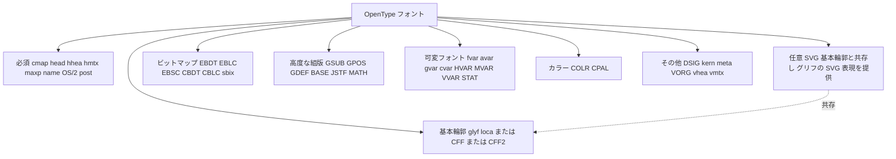

各ノードの意味：
- 「基本輪郭」：文字の形そのもの。TrueType なら `glyf`（形）と `loca`（位置の索引）の組、CFF 系なら `CFF` か `CFF2`。基本輪郭の形式はこの3種類に限られる
- 「任意 SVG」：基本輪郭の代わりにはならない任意のテーブル。基本輪郭と共存し、対応するグリフに SVG 表現を追加で提供する
- 「ビットマップ」：小さいサイズ向けの点の絵や、カラー絵文字の画像
- 「高度な組版」：合字（fi など）の置き換えや、文字間の位置調整
- 「可変フォント」：太さや幅を連続的に変えるための追加データ
- 「カラー」：色つき文字（絵文字など）

### 6-3. 輪郭の方式の比較

基本輪郭の形式は次の3種類です。

| 方式 | テーブル | 特徴 |
|------|---------|------|
| TrueType 輪郭 | glyf, loca | 二次曲線。ヒンティング（小さいサイズで形を整える命令）を持てる |
| CFF | CFF | 三次曲線。Adobe の PostScript 由来 |
| CFF2 | CFF2 | CFF の後継。可変フォントの「blend」演算を含められる |

次のテーブルは基本輪郭の代わりにはならず、基本輪郭と共存して追加の表現を提供します。

| 方式 | テーブル | 特徴 |
|------|---------|------|
| SVG（任意） | SVG | 基本輪郭と共存し、対応するグリフの SVG 表現（色つき・グラデーション向け）を提供する |
| ビットマップ | EBDT など | 点の絵。手作業で調整した小サイズ表示向け |

Microsoft の仕様書によると、CFF2 は `glyf` の代替として使える形式で、COLR・CPAL と組み合わせて色つきグリフも表せます。

📖 このセクションで登場した用語
- cmap：文字コードからグリフ番号を引く対応表
- ヒンティング：小さいサイズで、文字の形が崩れないように整える仕組み
- 二次曲線／三次曲線：輪郭を表す曲線の種類（三次のほうが少ない点で複雑な形を表せる）
- ビットマップ：点（ピクセル）の並びで表した絵

---

## 7. 文字が画面に出るまで：表示パイプライン

💡 この章では、「あ」という文字コードが画面の1文字になるまでの流れを説明します。各テーブルがどの段階で使われるかが分かります。

なぜ流れで見るのか：テーブルの一覧だけでは「いつ使われるのか」が分からないためです。表示の不具合調査（QA）では、どの段階で問題が起きたかを切り分けられると原因に早くたどり着けます。

### 7-1. 例え話：レストランの注文から配膳まで

- 文字コード → 注文票
- cmap → メニュー表（注文を料理番号に直す）
- GSUB → 盛り付けの変更（セット料理に替える）
- GPOS → 皿の置き位置の調整
- 輪郭の描画（ラスタライズ）→ 実際の配膳

### 7-2. 全体の流れ

この図は、上から下へ処理が進む様子です。

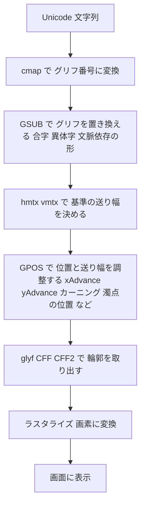

各ノードの意味：
- 「cmap で変換」：Unicode の文字を、そのフォント内のグリフ番号（Glyph ID）に直す。番号はフォントごとに違う
- 「GSUB」：Glyph Substitution。グリフの置き換え。たとえば f と i を合字 fi に替える
- 「送り幅」：次の文字を置く位置までの距離。まず `hmtx`（横書き）／`vmtx`（縦書き）で基準値が決まる
- 「GPOS」：Glyph Positioning。グリフの位置調整。基準の送り幅を `xAdvance`／`yAdvance` で増減したり（カーニングなど）、アクセント記号を文字の上に置いたりする
- 「ラスタライズ」：輪郭を画面の点（ピクセル）に塗り分ける処理

HarfBuzz の公式ユーザーマニュアルも、同じ考え方を説明しています。OpenType フォントはグリフ番号で並んだグリフの集合であり、グリフ番号は文字コードと直接の関係を持たないため、フォント内の `cmap` テーブルで対応づける必要があります。さらに、シェーピングは文字コード列を、フォントの能力に合わせたグリフ列に変えます。

### 7-3. 「規格が定めること」と「アプリが決めること」

| 項目 | 規格が定める | アプリ／エンジンが決める |
|------|------------|-------------------|
| テーブルのバイト配置 | ✅ | |
| GSUB/GPOS の記述方法 | ✅ | |
| 文字体系ごとの細かい処理順序（アラビア文字など） | 一部のみ | ✅（シェーピングエンジンの領域） |
| 画面のどの画素を塗るか | | ✅（ラスタライザの領域） |

なぜ分かれているのか：規格の要約にある通り、規格は「描画エンジンとレイアウト／シェーピングエンジンを作るための詳細」を提供する立場で、エンジン自体を定めるものではないためです。

📖 このセクションで登場した用語
- Glyph ID：フォント内でグリフにふられた通し番号
- 合字（リガチャ）：複数の文字を1つの形にまとめたもの（fi、ffi など）
- カーニング：特定の文字の組み合わせで間隔を詰める調整
- ラスタライズ：輪郭を画素（ピクセル）の濃淡に変換する処理
- シェーピングエンジン：文字列をグリフ列と位置に変換するソフトウェア（HarfBuzz など）

---

## 8. 高度な組版：GSUB と GPOS をもう少し詳しく

💡 この章では、フォントが自分で持っている「組版のルールブック」である GSUB と GPOS の骨組みを説明します。

なぜ取り上げるのか：多言語対応（日本語の縦書き、アラビア文字など）の品質は、この2つのテーブルでほぼ決まるためです。

Microsoft の仕様書によると、OpenType Layout は次の5つのテーブルを使います。

| テーブル | 名前 | 役割 |
|---------|------|------|
| GSUB | Glyph Substitution | グリフの置き換え |
| GPOS | Glyph Positioning | グリフの位置調整 |
| BASE | Baseline | ベースライン（文字を揃える基準線）情報 |
| JSTF | Justification | 両端揃えの調整情報 |
| GDEF | Glyph Definition | グリフの分類（基本字か記号か等） |

さらに数式用に MATH テーブルがあります。

### 8-1. GSUB と GPOS の共通の骨組み

仕様書によると、GSUB と GPOS は同じ形式のデータで、次の3つのリストと、必要なら FeatureVariations で構成されます。

この図は、「文字体系 → 機能 → 具体的な処理」と絞り込んでいく階層構造です。

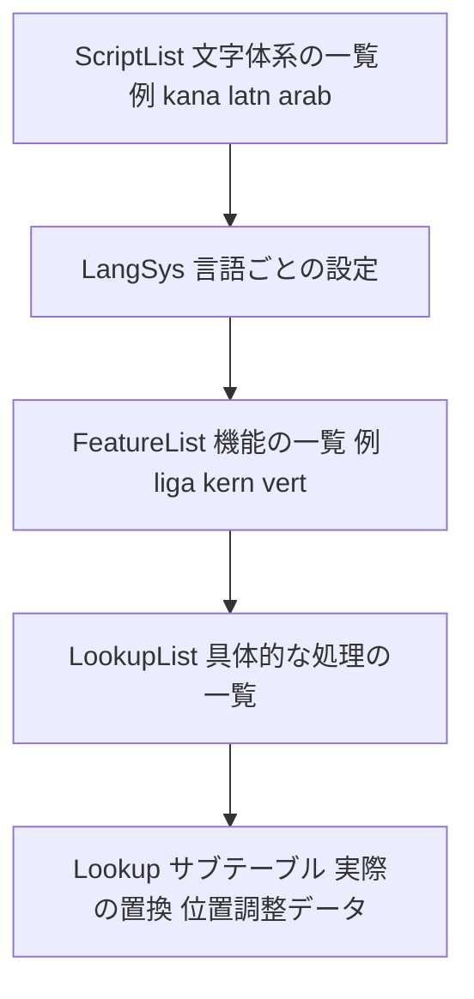

各ノードの意味：
- 「ScriptList」：どの文字体系に対応するかの一覧
- 「LangSys」：同じ文字体系の中での言語別の設定（日本語と中国語で漢字の形を替える、など）
- 「FeatureList」：`liga`（標準合字）、`kern`（カーニング）、`vert`（縦書き用の形）といった4文字の機能名
- 「LookupList」：機能が実際に呼び出す処理の本体

### 8-2. 処理の種類の数

仕様書の記載では、GSUB のルックアップは8種類、GPOS のルックアップは9種類あります。

例え話：機能（feature）は「料理名のメニュー」、ルックアップ（lookup）は「厨房のレシピ」です。メニュー名は `liga` のように決まっていますが、レシピの中身はフォントごとに違います。

### 8-3. 日本語に関係する機能タグの例

OpenType 1.9.1 の変更履歴に挙げられている機能名のうち、日本語組版に関わるものの例です。

| タグ | 意味の目安 |
|------|-----------|
| vert | 縦書き用の字形に置き換える |
| vrt2 | 縦書き用の字形（別方式） |
| palt | プロポーショナル（文字ごとに幅を変える）な送り幅 |
| halt | 半角の送り幅 |
| hwid / fwid | 半角幅／全角幅の字形 |
| jp78 / jp83 / jp90 / jp04 | 年代別の JIS 字形に切り替える |
| hkna / vkna | ひらがな・カタカナの字形（横／縦） |

📖 このセクションで登場した用語
- Feature（機能）：`liga` のような4文字のタグで呼び出す組版の機能
- Lookup（ルックアップ）：機能の実体となる置換・位置調整の処理
- ベースライン：文字をそろえる基準になる水平線
- 両端揃え（ジャスティフィケーション）：行の左右の端をそろえる処理

---

## 9. 可変フォント（OpenType Font Variations）

💡 この章では、1つのフォントファイルで太さや幅を連続的に変えられる「可変フォント」の仕組みを説明します。

なぜ重要なのか：Web では「Regular と Bold の2ファイル」を、1ファイルにまとめられるためです。ファイル数が減り、細かい太さの調整もできます。

### 9-1. 例え話：音量つまみ

従来のフォントは「音量が小・中・大の3段階だけのスイッチ」です。可変フォントは「つまみ」で、どの位置にも止められます。つまみ1つが「軸（axis）」で、太さ（weight）や幅（width）が代表です。

### 9-2. 仕組みの骨組み

Microsoft の仕様書によると：

- 軸ごとに最小値・標準値（デフォルト）・最大値を `fvar` テーブルに書く
- デフォルトの輪郭は `glyf` などに普通に入れておく
- 他の太さの輪郭は、デフォルトからの**差分（デルタ）**として `gvar` に入れる
- 可変フォントには `fvar` と `STAT` の2つが必須
- 軸の位置は内部では **−1 〜 +1 に正規化**され、最小が −1、デフォルトが 0、最大が +1 になる

この図は、太さ 650 を指定したときの処理の流れです。

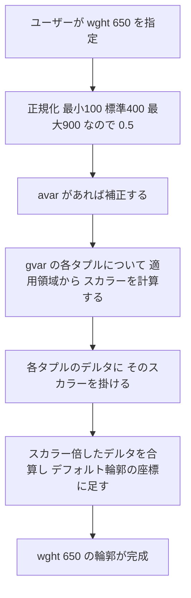

各ノードの意味：
- 「正規化」：ユーザーの値を −1〜+1 に直す。標準より大きい側は（値 − 標準）÷（最大 − 標準）で計算する
- 「avar」：正規化の途中の値をなめらかに曲げる補正（任意のテーブル）
- 「スカラーを計算する」：gvar には、適用される領域（ピーク位置と範囲）を持つタプルが複数入る。現在の正規化座標がその領域内のどこにあるかで、タプルごとに 0〜1 のスカラーが決まる
- 「デルタに掛ける」「合算する」：各タプルのデルタをスカラー倍し、すべてのタプルの結果を足し合わせる
- 例：wght 軸だけを持ち、ピークが +1 のタプルが1つだけ（avar なし）という単純な前提なら、スカラーは 0.5 になり、最大太さへの変化量の半分が適用される

### 9-3. 動作トレース：仕様書の例を追いかける

仕様書は、軸の最小が 100、標準が 400、最大が 900 のとき、ユーザー値 250 の場合を例にしています。

| 手順 | 計算 | 結果 |
|------|------|------|
| 1. 標準より小さい側なので、下側の式を使う | −(400 − 250) ÷ (400 − 100) | −150 ÷ 300 = **−0.5** |
| 2. avar の区間（−0.75 → −0.5 と 0 → 0）を探す | 比率 = (−0.5 − (−0.75)) ÷ (0 − (−0.75)) | 約 **0.3333** |
| 3. 補正後の値 | −0.5 + 0.3333 × (0 − (−0.5)) | 約 **−0.3333** |

なぜ avar があるのか：太さの値は、見た目の変化が均等になるとは限りません。補正することで、デザイナーが意図した見た目の変化になめらかに合わせられます。

### 9-4. 可変フォントで必要になる追加テーブル

| 輪郭の種類 | 追加で必要・推奨になるもの |
|-----------|------------------------|
| TrueType 輪郭 | gvar（輪郭の差分）、HVAR 推奨（横幅の計算を速くするため） |
| CFF2 輪郭 | 差分は CFF2 テーブル内に入る。hmtx は必須。HVAR は横送り幅が変化するかどうかにかかわらず必須（OpenType 1.9.1 の記載。ISO 第5版の最終本文との差分は未確認） |
| 共通 | fvar と STAT が必須。MVAR（全体の寸法の変化）は必要に応じて |

注意：仕様書によると、従来の `CFF` テーブル（CFF2 ではないもの）の輪郭は可変フォントに対応していません。

### 9-5. 来歴

仕様書は、TrueType 輪郭向けのフォント可変機構は Apple の「TrueType GX」が最初で、OpenType Font Variations のテーブルの一部はその仕様を改良して取り入れたものだと説明しています。

📖 このセクションで登場した用語
- 軸（axis）：太さ・幅・傾きなど、連続的に変えられる設計上の変数
- デルタ（差分）：デフォルトからの変化量
- 正規化：値を決まった範囲（−1〜+1）に直すこと
- named instance：「Light」「Semibold」のように名前をつけた特定の軸位置
- 補間：2点の間の値を、比率で計算して求めること

---

## 10. カラーフォントと絵文字

💡 この章では、色や グラデーションを持つ文字を、フォントでどう表すかを説明します。

なぜ取り上げるのか：絵文字や色つきアイコンは、現代の UI で毎日使われるためです。

Microsoft の仕様書は、カラーフォント関連のテーブルとして次を挙げています。

| テーブル | 方式 | 特徴 |
|---------|------|------|
| COLR + CPAL | ベクターの層を重ねる | 軽量。COLR は v0 と v1 がある |
| SVG | SVG 文書でグリフを描く | 表現力が高い |
| CBDT + CBLC | ビットマップ（Google 系） | 画像なのでサイズが大きくなりがち |
| sbix | ビットマップ（Apple 系） | 同上 |

### COLRv1 の位置づけ

Chrome 開発チームの記事（Chrome 98）によると、COLRv1 は COLRv0 の発展形で、グラデーション、合成・ブレンド、内部での形の再利用を加え、**小さく、よく圧縮できるカラーベクターフォント**を広めることが狙いです。同記事は、当時ほとんどの利用者が目にするカラーフォントは絵文字だけで、ビットマップ型は大きなサイズが Web フォント利用の障壁だったと述べています。

また、OpenType 1.9 の変更履歴には「COLR に version 1 のヘッダと関連構造を追加」と記録されており、1.9.1 では COLR のグラデーションの停止点の順序や放射状グラデーションの挙動などについて説明が追加されています。

📖 このセクションで登場した用語
- COLR / CPAL：色つきグリフの層の定義／色パレットの定義
- グラデーション：色が滑らかに変わる塗り方
- ベクター：拡大しても荒れない、図形で表した絵
- Web フォント：ネットワーク経由でブラウザに配信されるフォント

---

## 11. 日本語の読者に関係するポイント

💡 この章では、日本語のフォントを扱うときに、この規格のどの部分が効いてくるかを整理します。

なぜ個別に扱うのか：日本語は文字数が多く、縦書きもあるため、規格の中でも「フォントコレクション」と「縦書き関連」の機能が特に重要になるためです。

### 11-1. フォントコレクション（.ttc / .otc）で漢字を共有する

Microsoft の仕様書は、フォントコレクションの利点を次の例で説明しています。複数の日本語フォントがそれぞれ違うかなの字形を持ちつつ、漢字は同じデザインを使う場合、通常の1ファイル1書体では漢字のデータを各ファイルに複製するしかありません。コレクションなら、漢字のデータを共有できます。

この図は、2つの書体が1つの `glyf` テーブルを共有する様子です。

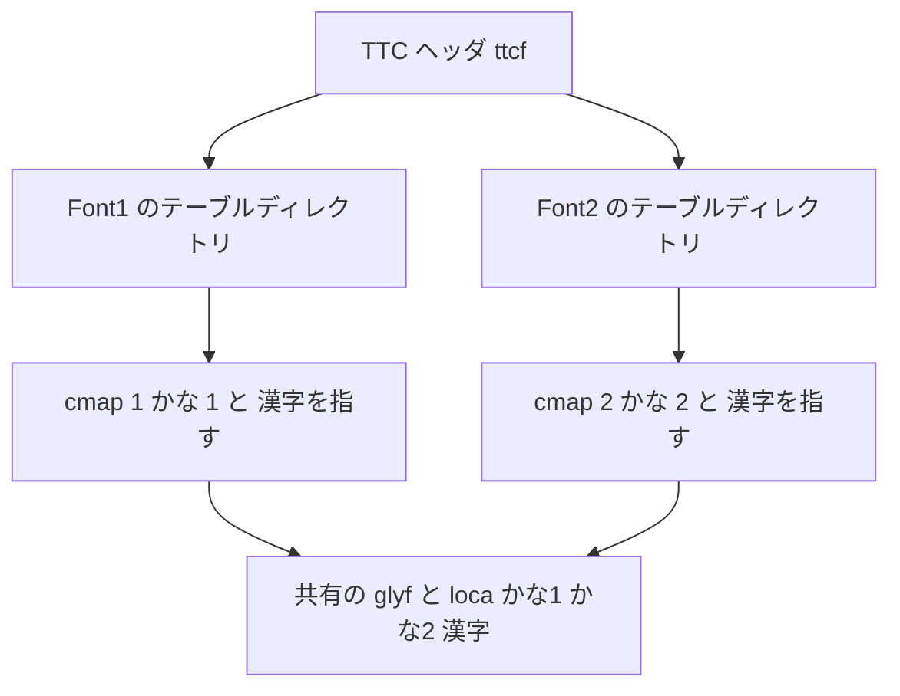

各ノードの意味：
- 「TTC ヘッダ」：先頭にあり、各フォントの目次の位置を並べた表
- 「Font1 / Font2」：コレクションに含まれる個々のフォント
- 「cmap 1 / cmap 2」：フォントごとに別々に持つ対応表。**かなは別々の形、漢字は同じ形を指す**
- 「共有の glyf」：両方のフォントが同じテーブルを指す

仕様書の指針：
- フォントごとに別に持つべきテーブル：`cmap`、`name`、`OS/2`（識別や文字対応に使うため）
- 共有してよいテーブル：`glyf`、`loca`、`hmtx`、`maxp` など（グリフのデータや、グリフ番号で引くデータ）
- 拡張子：TrueType 輪郭を含むコレクションは `.TTC`、CFF/CFF2 輪郭を含むものは `.OTC` を使う

### 11-2. 縦書き

仕様書は、縦書きに使う CFF 系の OpenType フォントには `VORG`（Vertical Origin）テーブルを入れることを強く推奨しています。1.9.1 の変更履歴では、VORG を CFF2 とあわせて使えると明確化されました。

### 11-3. 字形の切り替え（章8の機能タグ）

`vert`、`jp90`、`jp04` などの機能により、同じ文字コードでも書体内で別の字形を呼び出せます。QA では「機能が有効なアプリと無効なアプリで見た目が違う」ことがありえます（章13参照）。

📖 このセクションで登場した用語
- フォントコレクション：複数のフォントを1ファイルにまとめた形式
- 縦書き：文字を上から下に並べる書き方
- VORG：縦書きでの文字の基準点を決める CFF 向けテーブル
- 字形：同じ文字の、デザイン上のバリエーション

---

## 12. 実装の現状：誰がこの規格を動かしているのか

💡 この章では、規格を実際のソフトウェアが使っている様子を、著名な開発者・開発組織の公開情報で確認します。

なぜ実装を見るのか：規格は「紙の上の約束」であり、実際の動作は実装で決まるためです。バグや脆弱性の調査にも役立ちます。

### 12-1. HarfBuzz（シェーピングエンジン）

- 開発者：Behdad Esfahbod（創設者・主要開発者）、Khaled Hosny。HarfBuzz の名前はペルシア語の「open type」の音訳です
- 役割：Unicode の文字列、フォントファイル、文字体系と言語の情報を入力に、グリフの選択と配置を行う
- 規模：公式リポジトリの README は「HarfBuzz は現代の画面上の文章の大部分を整形する」と説明し、2026年に「HarfBuzz at 20!」のスライドを公開している
- 多様なシェーパー：OpenType シェーパー、Universal Shaping Engine（USE）、実験的な WebAssembly シェーパーなど
- バージョン：2026年3月に 13.0.1 が公開された。また、2026年6月〜8月に SkiaSharp や LWJGL といった下流プロジェクトへ 14.2.1 や 14.3.1 が取り込まれた例を確認できた。これらは下流プロジェクトで確認できた過去の例であり、情報基準日時点の最新版を示すものではない（最新版は HarfBuzz の公式リリースで確認すること）

### 12-2. Fontations と Skrifa（Rust 製のフォント基盤）

Google Fonts が開発している Fontations は、OpenType フォントを読み書きする Rust 製のクレート（＝ライブラリ）の集合です。

| クレート／ツール | 役割 |
|---------------|------|
| font-types | OpenType 仕様の基本的な型の定義 |
| read-fonts | フォントファイルを読む（解析する） |
| write-fonts | フォントファイルを作る・編集する |
| skrifa | 輪郭やメタデータにアクセスする、より高レベルのライブラリ |
| fontc | Rust 製のフォントコンパイラ |

### 12-3. Chrome が FreeType から Skrifa に移行した話

Chrome 開発チーム（Dominik Röttsches、Rod Sheeter、Chad Brokaw）の記事「Memory safety for web fonts」の要点です。

- **背景**：Web では、信頼できない提供元のフォントを安全に扱う必要がある。Chrome はフォントを OpenType Sanitizer（OTS）に通し、処理を隔離（サンドボックス）し、ライブラリをファズテストして守っていた
- **課題**：FreeType は安全でない言語で書かれていて、メモリ管理の問題が繰り返し出ていた。COLRv1 や OT-SVG の新規対応でも問題が出ており、ある COLRv1 の高深刻度の脆弱性は発見に10か月以上かかった
- **対応**：メモリ安全な Rust 製の Skrifa に置き換えた

この図は、記事と更新注記に書かれた導入の時系列です。

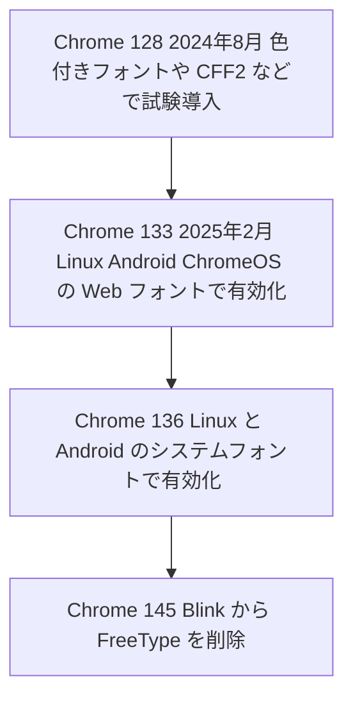

各ノードの意味：
- 「試験導入」：利用が少ない形式で安全に試した段階
- 「Web フォントで有効化」：ネットワーク経由のフォントすべてに拡大
- 「システムフォント」：OS に入っているフォントも対象に
- 「FreeType を削除」：記事の 2026年4月24日付の追記に記載されている最新状況

記事は、2024年6月から継続的にファジングをしており、見つかった39件のバグはいずれもセキュリティ上の重大なものではなかったと報告しています。

### 12-4. ここから学べること

| 観点 | 内容 |
|------|------|
| 規格の複雑さ | フォントは「動画ファイルに近い複雑さ」で、複数のテーブルが互いに依存する |
| 脆弱性 | 輪郭の命令列（ヒンティング、CharString）は一種のプログラムで、仮想機械が必要 |
| 検証 | 構造を考慮したファジングや、別実装との出力比較（fauntlet）が有効 |

📖 このセクションで登場した用語
- クレート：Rust 言語のライブラリの単位
- サンドボックス：問題が起きても被害を広げないように、処理を隔離する仕組み
- ファジング：でたらめや壊れた入力を大量に与えて、バグを見つけるテスト手法
- OTS（OpenType Sanitizer）：不正なフォントを弾く、フォントの検疫ツール
- メモリ安全：メモリの範囲外アクセスなどが起きにくい性質

---

## 13. QA・テスト観点：フォント対応を検証するには

💡 この章では、QA エンジニアの視点で、フォントに関わる機能のテスト観点を整理します。

なぜこの章を入れるのか：フォントの不具合は「特定の環境でだけ文字が崩れる」という形で現れ、原因の切り分けが難しいためです。章7の表示パイプラインに沿って観点を並べると、漏れを減らせます。

### 13-1. パイプライン段階別のテスト観点

| 段階 | 起きる不具合の例 | 確認の観点 |
|------|---------------|-----------|
| ファイル読み込み | フォントが読み込めない、拒否される | テーブルディレクトリの値、チェックサム、必須8テーブルの有無 |
| cmap | 特定の文字が豆腐（□）になる | 対象文字が cmap に入っているか |
| GSUB | 合字・縦書き字形が出ない | 機能タグ（liga、vert など）の有無と、アプリ側の有効化設定 |
| GPOS | 濁点や記号の位置がずれる | 位置調整ルールとアプリの対応状況 |
| 輪郭／ヒンティング | 小サイズで形が崩れる | 環境（OS、ラスタライザ）ごとの見え方の比較 |
| 可変フォント | 太さを変えても反映されない | fvar／STAT の有無、アプリが可変フォントに対応しているか |
| カラー | 色が出ない、白黒になる | COLR v0/v1・SVG・ビットマップのうち何を持つか、環境の対応状況 |

### 13-2. セキュリティ・堅牢性のテスト観点

章12の Chrome の事例から、次の観点が導けます。

1. **壊れたフォント入力**：numTables に実際より大きな値、offset や length がファイル範囲外、など
2. **探索補助値への依存**：searchRange などの値を信用していないか（仕様書が非推奨としている点）
3. **未知のバージョン**：仕様書によると、未対応のメジャーバージョンのテーブルは「存在しない」として扱う必要がある
4. **重複テーブル**：同じタグが複数ある場合の挙動が不定になるため、拒否または安全な側に倒す

### 13-3. 回帰テストの比較方法

Chrome のチームは、Skrifa と FreeType の出力を大量のフォントと設定で比べる専用ツール（fauntlet）や、Skia 上の画素比較を使って、品質低下を防いでいます。同じ考え方で、**「旧実装と新実装の出力を同じ入力で比較する」** 方式は、フォント関連ライブラリの更新時の回帰テストに応用できます。

📖 このセクションで登場した用語
- 豆腐：対応するグリフがなく、□で表示される状態
- 回帰テスト：変更で既存の動作が壊れていないかを確かめるテスト
- 堅牢性：不正な入力でも安全に動き続ける性質
- 画素比較：画面の絵を画素単位で比べるテスト手法

---

## 14. まとめと学習ロードマップ

💡 この章では、全体を振り返り、次に何を学ぶかの順序を示します。

### 14-1. 要点の整理

1. ISO/IEC 14496-22:2026 は **OpenType（Open Font Format）の国際規格**で、第5版として 2026年7月に発行された（1003ページ）
2. フォントは **sfnt というコンテナ**で、「目次（テーブルディレクトリ）＋テーブル」でできている
3. 文字表示は **cmap → GSUB → GPOS → 輪郭 → ラスタライズ** の順に進む
4. **可変フォント**は、デフォルトの輪郭と差分（デルタ）で連続的な変化を表す
5. 実装は HarfBuzz（シェーピング）や Fontations/Skrifa（Rust 製の読み書き）などが支えている
6. 規格と無料の OpenType 1.9.1 仕様書は内容が近いが、**最終本文との差分は購入して確認する必要がある**

### 14-2. 学習ロードマップ

この図は、初学者が進める順序の例です。

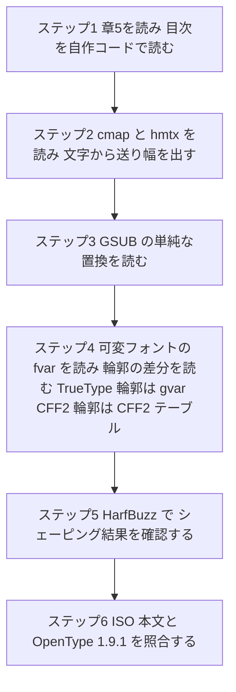

各ノードの意味：
- 「ステップ1」：章5の Python コードを自分の環境で動かし、実際のフォントで試す
- 「ステップ2」：文字を数値に変え、構造の理解を深める
- 「ステップ3〜4」：応用機能に進む。gvar は TrueType の glyf 輪郭向けの差分テーブルなので、CFF2 輪郭のフォントも対象にする場合は CFF2 テーブル内の差分（blend 演算）を読む経路も学ぶ
- 「ステップ5」：既成のエンジンの結果と、自分の理解を突き合わせる
- 「ステップ6」：厳密さが必要になった段階で、本文を購入して差分を確認する

📖 このセクションで登場した用語
- ロードマップ：学習の道筋を順序立てて示したもの
- 照合：2つの資料の内容を突き合わせて違いを確認すること

---

## 15. 根拠ソース一覧（URL）

このガイドで使った情報源です。基準日 2026年10月13日までに確認できたものを挙げています。

### 15-1. 規格の公式情報

| 用途 | ソース | URL |
|------|-------|-----|
| 規格ページ（版・日付・要約・ライフサイクル） | ISO | https://www.iso.org/standard/14496-22 |
| 試し読み（目次の一部） | ANSI Webstore のプレビュー | https://webstore.ansi.org/preview-pages/ISO/preview_ISO+IEC+14496-22-2026.pdf |
| 発行前の記録（Will replace 2019 版の記載） | ISO（発行前ページ） | https://www.iso.org/standard/87621.html |

### 15-2. 仕様書・実装者の公開情報（著名な開発者・組織）

| 内容 | 著者・組織 | URL |
|------|-----------|-----|
| OpenType 仕様 1.9.1 トップ（ISO 第5版草案を取り込み） | Microsoft（Peter Constable ら） | https://learn.microsoft.com/en-us/typography/opentype/spec/ |
| フォントファイル構造（sfnt、テーブル一覧、TTC） | Microsoft | https://learn.microsoft.com/en-us/typography/opentype/spec/otff |
| 可変フォントの概要（正規化・補間） | Microsoft | https://learn.microsoft.com/en-us/typography/opentype/spec/otvaroverview |
| 変更履歴（1.9.1 と 2026年9月の更新） | Microsoft | https://learn.microsoft.com/en-us/typography/opentype/spec/changes |
| OpenType Layout 共通形式（GSUB/GPOS の骨組み） | Microsoft | https://learn.microsoft.com/en-us/typography/opentype/spec/chapter2 |
| CFF2 テーブル | Microsoft | https://learn.microsoft.com/en-us/typography/opentype/spec/cff2 |
| Memory safety for web fonts（Skrifa、FreeType からの移行） | Dominik Röttsches、Rod Sheeter、Chad Brokaw（Google Chrome） | https://developer.chrome.com/blog/memory-safety-fonts |
| COLRv1 カラーベクターフォント（Chrome 98） | Chrome・Google Fonts チーム | https://developer.chrome.com/blog/colrv1-fonts |
| Fontations（Rust 製フォントライブラリ群） | Google Fonts | https://github.com/googlefonts/fontations |
| fontc（Rust 製フォントコンパイラ） | Google Fonts | https://pypi.org/project/fontc/ |
| HarfBuzz（README・2026年の資料への案内） | Behdad Esfahbod、Khaled Hosny ほか | https://github.com/harfbuzz/harfbuzz |
| HarfBuzz とは何か（ユーザーマニュアル） | HarfBuzz プロジェクト | https://harfbuzz.github.io |
| HarfBuzz の解説記事（Behdad Esfahbod の見解を紹介） | LWN.net | https://lwn.net/Articles/741722/ |

### 15-3. 参考（二次情報）

| 内容 | URL |
|------|-----|
| HarfBuzz 13.0.1 の更新（Pillow の PR） | https://github.com/python-pillow/Pillow/pull/9453 |
| SkiaSharp 4.150.0（HarfBuzz 14.2.1 を同梱） | https://mono.github.io/SkiaSharp/staging/4372/docs/releases/4.150.0.html |

### 15-4. 未確認事項（再掲）

- 第5版の最終本文と OpenType 1.9.1 の差分の一覧
- 第5版で新たに加わった具体的な条項（公開情報からは特定できていません）
- ISO ストアの最新の価格表示

厳密な内容が必要な場合は、ISO から規格本文を入手して確認してください。
