# ISO/IEC 21838-2:2021（Basic Formal Ontology：BFO）初学者向けステップバイステップ解説

> **調査日**：2026年10月16日　／　**対象規格**：ISO/IEC 21838-2:2021 *Information technology — Top-level ontologies (TLO) — Part 2: Basic Formal Ontology (BFO)*
> **公式ページ**：https://www.iso.org/standard/74572.html
> **本ガイドの位置づけ**：ISO公式ページ（要旨・ライフサイクル）、BFO開発チームの公開リポジトリ・公式サイト、BFO開発者（Barry Smith、Alan Ruttenberg、John Beverley ら）による論文・書籍・講演資料をもとに、初学者向けに再構成した解説です。規格本文（有償）の逐語的な引用や転載は行っていません。
> **表記ルール**：図解は Mermaid と Markdown のみを使用し、ASCII アートは使用していません。

---

## 目次

1. [まず結論：この規格は何か（3分で理解）](#1-まず結論この規格は何か3分で理解)
2. [前提知識：オントロジーと上位オントロジー](#2-前提知識オントロジーと上位オントロジー)
3. [ISO/IEC 21838 シリーズ全体の中での位置づけ](#3-isoiec-21838-シリーズ全体の中での位置づけ)
4. [規格の基本情報とライフサイクル](#4-規格の基本情報とライフサイクル)
5. [規格が扱う範囲・扱わない範囲](#5-規格が扱う範囲扱わない範囲)
6. [規格が提供する成果物（BFO-2020 の中身）](#6-規格が提供する成果物bfo-2020-の中身)
7. [BFO の考え方：3つの基本原則](#7-bfo-の考え方3つの基本原則)
8. [BFO-2020 の36クラスを理解する](#8-bfo-2020-の36クラスを理解する)
9. [ステップバイステップ：身の回りのものを BFO で分類する](#9-ステップバイステップ身の回りのものを-bfo-で分類する)
10. [具体例：医療シナリオを BFO で表現する](#10-具体例医療シナリオを-bfo-で表現する)
11. [BFO を使って自分のオントロジーを作る手順](#11-bfo-を使って自分のオントロジーを作る手順)
12. [BFO エコシステム：誰がどう使っているか](#12-bfo-エコシステム誰がどう使っているか)
13. [歴史：なぜ ISO 標準になったのか](#13-歴史なぜ-iso-標準になったのか)
14. [QAエンジニア視点：BFO ベースのオントロジーを品質保証する](#14-qaエンジニア視点bfo-ベースのオントロジーを品質保証する)
15. [注意点・よくある誤解](#15-注意点よくある誤解)
16. [理解度チェック](#16-理解度チェック)
17. [用語集](#17-用語集)
18. [参考ソース（URL付き）](#18-参考ソースurl付き)

---

## 1. まず結論：この規格は何か（3分で理解）

### 1.1 ひとことで言うと

**「あらゆる分野のデータに共通して使える、一番上位の"分類の骨組み"（BFO）を、国際標準として定義した規格」** です。

### 1.2 3つのポイント

| # | ポイント | 内容 |
|---|---------|------|
| ① | 何を定めている？ | BFO-2020 という上位オントロジーの用語・関係・公理（OWL 2 と Common Logic）と、規格 21838-1 への適合の説明 |
| ② | 何のため？ | 異なる情報システムやドメインオントロジー同士で、データを**つなぎやすく・比較しやすく**するための共通の土台 |
| ③ | 何ではない？ | 医療や製造といった**特定分野の用語集ではない**（ドメイン中立）。OWL などの言語そのものの規格でもない |

### 1.3 なぜエンジニアが知っておくとよいか

- 異なるチームが作ったデータモデルを統合するとき、「そもそも"もの"と"出来事"と"性質"をどう区別するか」が揃っていないと統合コストが爆発します。
- BFO は、その区別を**最上位で先に決めておく**ための共通語彙です。
- 医療・バイオ（OBO Foundry）、製造（IOF）、防衛・情報（Common Core Ontologies）など、実運用のオントロジー群の土台として広く使われています。

### 1.4 全体像（鳥瞰図）

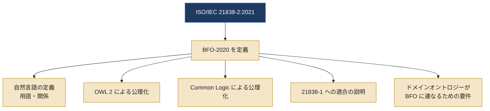

---

## 2. 前提知識：オントロジーと上位オントロジー

### 2.1 用語を3つだけ押さえる

| 用語 | やさしい説明 | 身近な例え |
|------|------------|-----------|
| オントロジー | ある領域に存在する「ものの種類」と「それらの関係」を、コンピュータが扱える形で整理した体系 | 共通の辞書＋分類表 |
| 上位オントロジー（TLO） | 特定分野に依存しない、最も一般的な種類（もの・出来事・性質など）を定める最上位の層 | 図書館の「十進分類」の最上位の大区分 |
| ドメインオントロジー | 医療・製造など特定分野の種類を定める層 | 分野別の専門辞書 |

### 2.2 3つの層の関係

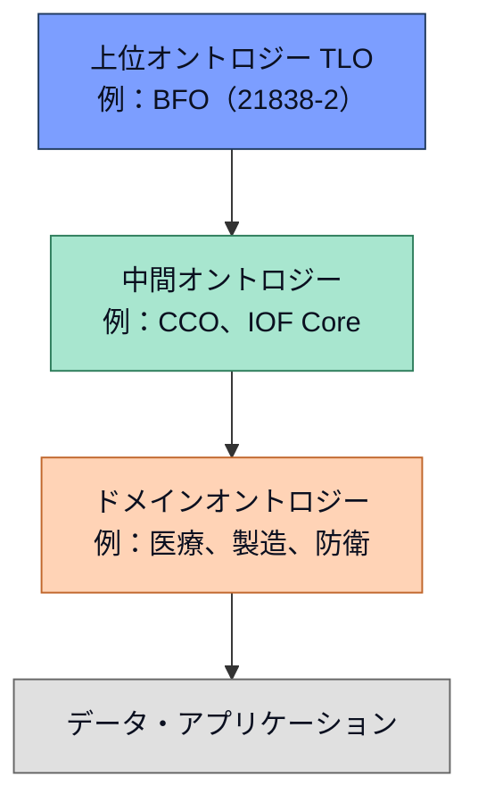

> 💡 **ポイント**：中間層は必須ではありません。BFO の直下にドメインオントロジーを置く構成も、間に Common Core Ontologies のような中間オントロジーを挟む構成もあります。

### 2.3 OWL と Common Logic（CL）

| 言語 | 役割 | 強み |
|------|------|------|
| OWL 2 | Web 上で広く使われるオントロジー記述言語。直接意味論（Direct Semantics）に基づく自動推論に使う | ツールが豊富（エディタ・推論器） |
| Common Logic（CL） | 一階述語論理に近い表現力の高い言語（ISO/IEC 24707） | OWL では書けない複雑な公理を表現できる |

> BFO は**両方**で公開されています。OWL は実用、CL は意図した意味を正確に固定する役割、と考えると理解しやすいです。

---

## 3. ISO/IEC 21838 シリーズ全体の中での位置づけ

### 3.1 シリーズ構成

| パート | 題名 | 発行 | 役割 |
|--------|------|------|------|
| Part 1 | Requirements | 2021 | 上位オントロジーが満たすべき**要件**を定める |
| **Part 2** | **Basic Formal Ontology（BFO）** | **2021-11** | **本ガイドの対象。Part 1 に適合する上位オントロジーの一つとして BFO を記述** |
| Part 3 | DOLCE | 2023 | 言語・認知工学向けの記述的オントロジー DOLCE を記述 |
| Part 4 | TUpper | 2023 | TUpper を記述（ISO のページでは設計・統合・推論・意味統合を支援する資源と説明） |

### 3.2 親子関係

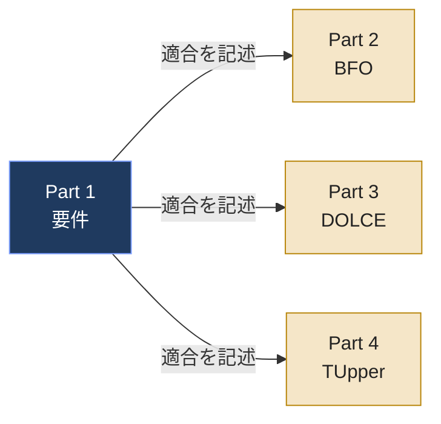

### 3.3 Part 1 が求める主な要件（ざっくり）

| 要件の種類 | 概要 |
|-----------|------|
| 自然言語の文書 | ドメイン中立な用語・関係の一覧、原始語（循環せずには定義できない語）の明示、非循環で簡潔な定義 |
| 機械可読な公理化 | OWL 2（直接意味論）による公理化に加え、Common Logic による公理化も用意する |
| 補足文書 | 使い方、OWL と CL の論理的な導出関係、適用範囲の広さの実証、管理方針 |
| 適用範囲の広さ | 空間と時間、部分と全体、性質、因果・過程、情報、人工物など、広範なデータ種別に対応できることの実証 |

> 📝 ここでの要件の整理は、公開されている解説（Wikipedia の ISO/IEC 21838 項目）に基づく概要です。正確な要求事項の文言は Part 1 の規格本文で確認してください。

---

## 4. 規格の基本情報とライフサイクル

### 4.1 基本情報

| 項目 | 内容 |
|------|------|
| 規格番号 | ISO/IEC 21838-2:2021 |
| 題名 | Information technology — Top-level ontologies (TLO) — Part 2: Basic Formal Ontology (BFO) |
| 版 | Edition 1 |
| 発行 | 2021年11月（公式ページの公開日：2021-11-30） |
| ページ数 | 13ページ（公式ページ表記） |
| 担当委員会 | ISO/IEC JTC 1/SC 32（データ管理および交換） |
| ICS | 35.060（情報技術で用いる言語）、01.040.35（情報技術の用語） |
| 現在のステージ | 60.60（International Standard published） |
| 言語 | 英語 |
| SDGs | 目標9（産業と技術革新の基盤をつくろう）に寄与と表示 |

### 4.2 策定の経過（公式ページのステージ履歴）

> 💡 提案から発行まで約4年半。途中で CD（2018-09）や FDIS（2020-12）の差し戻しがあり、慎重に審議されたことが読み取れます。

---

## 5. 規格が扱う範囲・扱わない範囲

### 5.1 範囲内（スコープ内）

| # | 内容 |
|---|------|
| ① | BFO-2020 の用語と関係の**定義** |
| ② | BFO-2020 の OWL 2 および CL による**公理化** |
| ③ | BFO-2020 が Part 1 の要件に**適合していることの文書化** |
| ④ | ドメインオントロジーが、BFO を最上位のハブとするオントロジー群の**モジュール**になるための要件 |
| ⑤ | 下位のオントロジーで定義や公理を書くときに、BFO の用語が果たす役割の**仕様** |

### 5.2 範囲外（スコープ外）

| # | 内容 | 補足 |
|---|------|------|
| ① | RDF・OWL・CL といったオントロジー言語そのものの仕様 | それぞれ W3C や ISO の別規格 |
| ② | オントロジーを使った推論の方法 | 推論器（リーズナー）の領域 |
| ③ | 異なるオントロジー言語間の変換器の仕様 | ツール実装の領域 |

### 5.3 範囲の切り分けイメージ

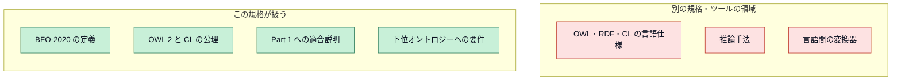

---

## 6. 規格が提供する成果物（BFO-2020 の中身）

規格の「本体」は13ページと短く、実際の定義・公理は BFO 開発チームが公開する成果物として配布されています。

### 6.1 成果物一覧

| 成果物 | 形式 | 用途 |
|--------|------|------|
| 用語表 | xlsx | 用語と関係の定義・例（規格の節番号順） |
| IRI 表 | xlsx | 全クラス・関係の IRI（識別子）と自然言語ラベルの対応 |
| 関係表 | xlsx | 関係、その逆関係、時間付き（temporalized）の版の一覧 |
| OWL | RDF/XML、Functional-style、Turtle | ツールで読み込んで使う実用版（現行リリースは `bfo-core.owl`） |
| OWL（一部時間関係なし版） | RDF/XML | 規格の付属書 A.1.2 に対応する、「ある時点で常に／ある時点で」型の時間付き関係を除いた版 |
| Common Logic | CLIF（サブ理論ごとに分割） | 意図した意味を厳密に固定する公理化 |
| 一階述語論理 PDF | PDF | CL 公理化を従来の一階論理記法で記したもの |
| Prover9 | Prover9 形式 | 自動定理証明器で扱える公理化 |
| SPARQL | SPARQL | `bfo-core.owl` の更新が設計原則を破っていないかを確かめる品質検査 |

> ✅ ライセンスは **CC BY 4.0**（出典を表示すれば再利用可）。最新版は GitHub リポジトリ（`BFO-ontology/BFO-2020`）に置かれます。

### 6.2 成果物どうしの関係

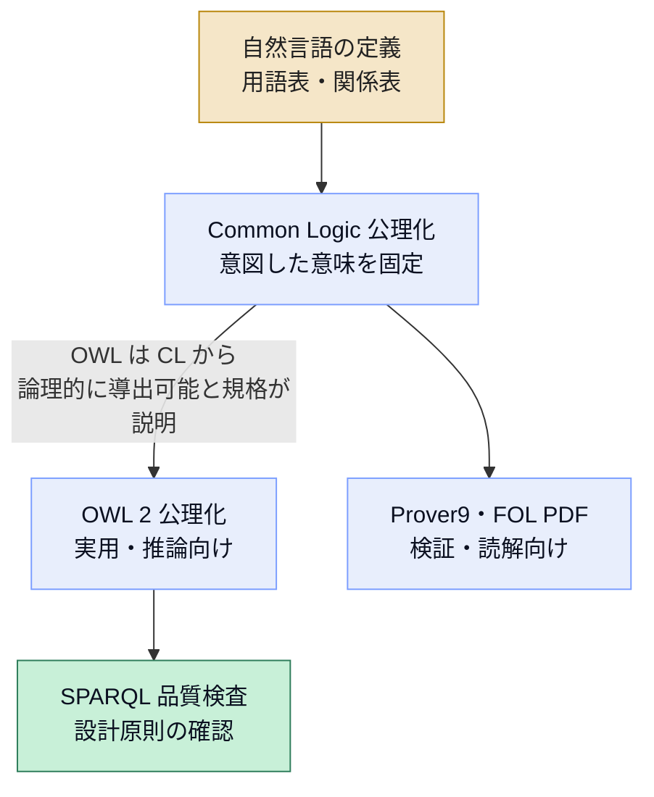

---

## 7. BFO の考え方：3つの基本原則

### 7.1 原則①：リアリズム（実在論）

- BFO は、**現実に存在するもの**を記述することを目指します。
- 「言葉」や「概念」ではなく、世界の側にある**種類（ユニバーサル）**を扱う、という立場です。
- そのため、現実に存在しないもの（たとえば「存在しないこと」そのもの）を**クラスとして置かない**設計になります。

### 7.2 原則②：ドメイン中立

- BFO には、物理・医学・心理学など特定分野に特有の用語が**含まれません**。
- 公式の論文（Otte, Beverley, Ruttenberg 2022）は、BFO を**36クラス**から成る上位オントロジーとして紹介しています。
- 分野固有の用語は、BFO の下に作るドメインオントロジー側の仕事です。

### 7.3 原則③：小さく・単純に

| 設計上の特徴 | 意味 |
|-------------|------|
| 単一継承の分類 | 各クラスの親が基本的に一本の道筋になり、分類が追いやすい |
| 最上位の二分割 | すべての存在（entity）を **continuant** と **occurrent** に大別 |
| 関係の整備 | 部分、参加、依存などの関係を別途定義（時間付きの版も用意） |

---

## 8. BFO-2020 の36クラスを理解する

### 8.1 最上位：continuant と occurrent

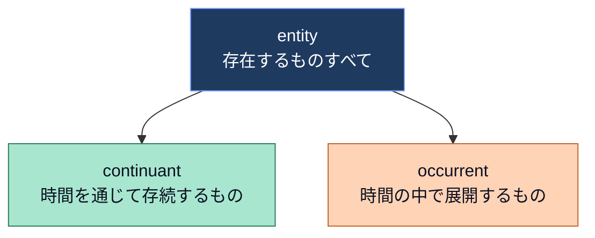

| 区分 | やさしい説明 | 例（解説用） |
|------|------------|------------|
| continuant | ある時点に全体が存在し、時間が経っても同じものとして存続する。時間的な部分をもたず、出来事に**参加**する | 人、石、体温、役割、部屋 |
| occurrent | 時間の中で**起こる／展開する**。時間的な部分をもつ | 歩く、手術、会議、ある1日 |

### 8.2 continuant の下位分類（全体像）

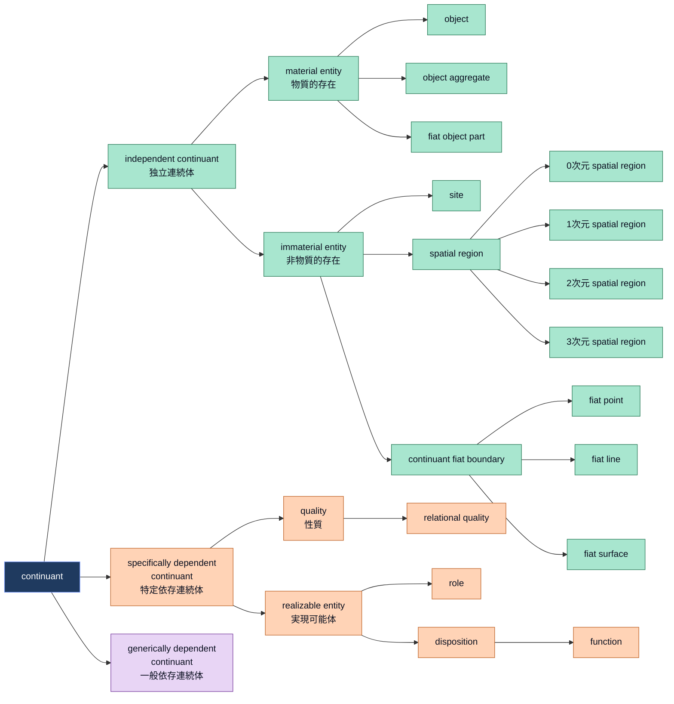

### 8.3 occurrent の下位分類

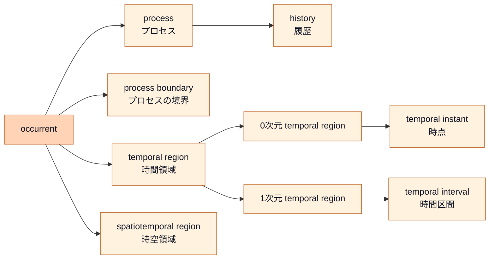

### 8.4 クラス早見表（36クラスの内訳）

BFO-2020 の公式リポジトリに掲載されている階層図にあるクラスは、`entity` を含めて36です。

| グループ | クラス | やさしい説明 | 例（解説用） |
|----------|--------|------------|------------|
| 最上位 | entity | 存在するものすべて | — |
| | continuant | 存続するもの | — |
| | occurrent | 展開するもの | — |
| 独立連続体 | independent continuant | 他のものに存在を依存しない連続体 | 人、石、部屋 |
| | material entity | 物質を部分としてもつ | 人、机 |
| | object | まとまった一つの物質的単位 | 一人の患者、一台の機器 |
| | object aggregate | 複数の object の集まり | 患者グループ、群れ |
| | fiat object part | 人が恣意的に区切った物質的な部分 | 体の上半分 |
| | immaterial entity | 物質を部分にもたない | 空洞、領域 |
| | site | 物の内部や周囲の「場所」 | 鼻腔、部屋の空間 |
| | spatial region | 空間そのもの（0〜3次元の4種） | ある立体領域 |
| | continuant fiat boundary | 人が決めた境界（点・線・面の3種） | 国境線 |
| 特定依存連続体 | specifically dependent continuant | 特定の担い手が存在して初めて存在する | 体温、役割 |
| | quality | 担い手がもつ測れる性質 | 色、質量、温度 |
| | relational quality | 複数の担い手の間にある性質 | 二者間の距離 |
| | realizable entity | 対応する過程で実現されうる存在。実現の過程が始まる前から担い手に存在し、実現されなくても存在し続ける | 役割、傾向、機能 |
| | role | 状況や文脈によって担い手が得る | 患者という役割 |
| | disposition | 担い手の物理的な構成に基づく傾向 | もろさ、溶けやすさ |
| | function | 設計や進化に由来する disposition | 心臓が血液を送る機能 |
| 一般依存連続体 | generically dependent continuant | 特定の担い手に縛られず、複製して複数の担い手に存在できる | 文書の内容、データ |
| プロセス系 | process | 時間的な部分をもつ出来事 | 手術、歩行 |
| | history | ある存在の生涯全体にわたる出来事の総体 | ある患者の一生の出来事 |
| | process boundary | プロセスの端（瞬間的な境界） | 手術が始まる瞬間 |
| 領域系 | temporal region | 時間の領域（0次元と1次元） | 時点、時間区間 |
| | temporal instant / interval | 時点／区間 | 2026年10月16日 12:00、午前中 |
| | spatiotemporal region | 空間と時間にまたがる領域 | あるプロセスが占める時空 |

> 📝 「例」の列は初学者向けに私が補った説明用の例です。公式の定義文は BFO 用語表（`bfo-2020-terms.xlsx`）で確認してください。

### 8.5 重要な3区分を丁寧に

| 区分 | キーワード | 見分け方の質問 |
|------|-----------|--------------|
| independent continuant | 独立 | 「それは他の何かがなくても存在できるか？」 |
| specifically dependent continuant | 特定の担い手に依存 | 「それは**この個体**がなければ存在できないか？」（例：この人の体温） |
| generically dependent continuant | 複製可能 | 「それは別の担い手にコピーして存在できるか？」（例：文書の内容） |

---

## 9. ステップバイステップ：身の回りのものを BFO で分類する

### 9.1 分類の流れ（判定フロー）

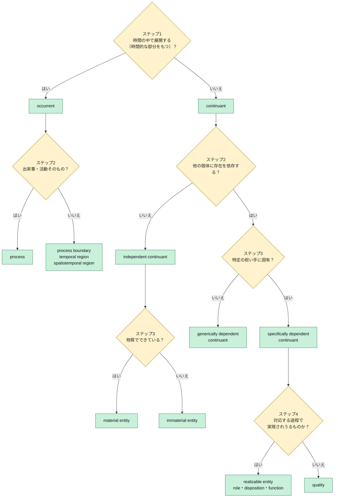

### 9.2 ステップの解説

| ステップ | 判断 | ポイント |
|---------|------|---------|
| ステップ1 | continuant か occurrent か | 「ある瞬間に全体を指させるか」で考える。人は今この瞬間にそこにいるが、「手術」はある瞬間を切り取っても一部分でしかない |
| ステップ2 | 独立か依存か | 依存するかどうかは「その個体なしに存在できるか」で判断する |
| ステップ3 | 物質的か、特定依存か一般依存か | 体温は「その人」がいなければ存在しない。文書の内容は印刷してもコピーしても同じ内容として存在できる |
| ステップ4 | 性質か実現可能体か | 「重さ」は常にある（quality）。「割れやすさ」は割れる出来事（過程）で実現されるが、割れる前からガラスに存在している（disposition） |

### 9.3 練習：次のものを分類してみよう

| 対象 | 答え | 理由 |
|------|------|------|
| ある一人の患者 | object（material entity の一種） | 独立して存在する物質的な単位 |
| その患者の体温 | quality | その患者という担い手がいなければ存在しない測れる性質 |
| 診察という出来事 | process | 時間的な部分（問診、触診など）をもつ |
| 診察室の内部の空間 | site | 物質を部分にもたない場所 |
| 医師という立場 | role | 社会的な文脈で担い手が得る実現可能体 |
| 薬の「効きやすさ」 | disposition | 物質の構成に基づく傾向 |
| 検査レポートの内容 | generically dependent continuant | 複製して複数の担い手に存在できる |
| 2026年10月16日 | temporal interval | 時間の1次元領域 |

> ⚠️ 実際のオントロジー設計では、「検査レポートの内容」のような情報実体の詳細は、BFO の外側の**情報実体のオントロジー（Information Artifact Ontology：IAO）**で扱います（後述）。

---

## 10. 具体例：医療シナリオを BFO で表現する

### 10.1 シナリオ

「患者の体温を看護師が測定し、結果が診療記録に記載される」

### 10.2 関係図

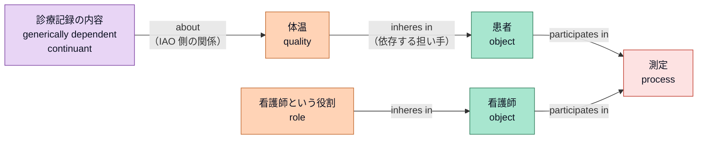

### 10.3 読み解き

| 要素 | BFO での分類 | 読み解き |
|------|------------|---------|
| 患者・看護師 | object | 独立連続体。測定という出来事に**参加**する |
| 体温 | quality | 患者に**依存**する。患者がいなければ存在しない |
| 看護師という役割 | role | 病院という文脈で得る実現可能体。看護師の身体構成ではなく文脈による |
| 測定 | process | 時間の中で展開し、患者と看護師が参加する |
| 診療記録の内容 | generically dependent continuant | 紙でも電子でも同じ内容を複製できる |

> 💡 **設計の旨み**：体温（性質）と測定（出来事）と記録の内容（情報）を最上位で区別しておくと、後からデータを統合するときに「体温」という語が「測る行為」を指しているのか「測った結果の値」を指しているのかで混乱しにくくなります。

---

## 11. BFO を使って自分のオントロジーを作る手順

> 📝 この節は、BFO 開発者の書籍・論文で示されている考え方（BFO の直下から下位を細分化する、OBO Foundry の原則に沿う、など）をもとにした**実務上の目安**です。規格の条文そのものではありません。

### 11.1 全体フロー

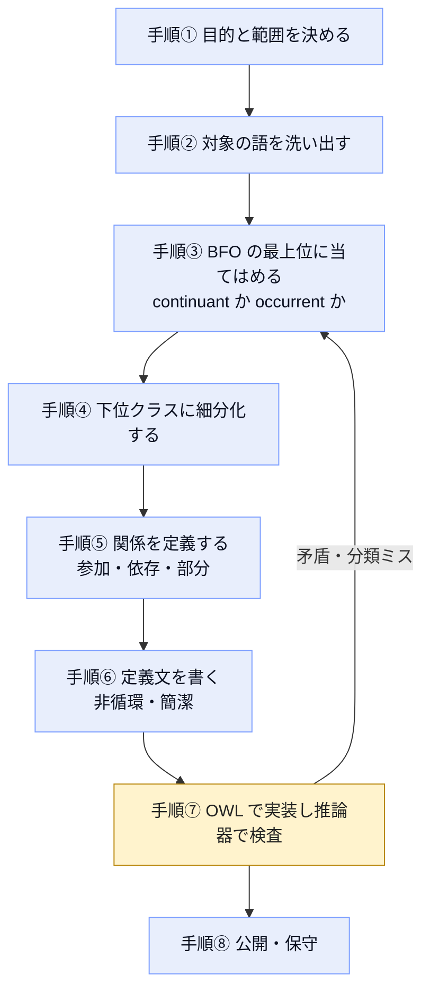

### 11.2 各手順のポイント

| 手順 | やること | 注意点 |
|------|---------|--------|
| ① | 何のデータを統合・検索したいか決める | 目的が曖昧だと粒度がぶれる |
| ② | 業務用語・既存データの項目名を集める | 同じ語が別の意味（例：post が「柱」と「郵便」）で使われていないか確認 |
| ③ | 各語を BFO の最上位に割り当てる | 第9章の判定フローを使う |
| ④ | 親クラスの下に具体的なクラスを作る | 親クラスの性質をすべて満たすか（is-a の検証） |
| ⑤ | 関係を定義する | 「担い手」「参加」など BFO の関係を再利用する |
| ⑥ | 定義文を書く | 定義が自分自身を使う循環になっていないか |
| ⑦ | OWL で記述し、推論器で矛盾を検査 | BFO の公理と矛盾しない（BFO の分離条件を壊さない） |
| ⑧ | 利用方針・管理方針を公開する | Part 1 は管理方針の文書化も求める（概要） |

### 11.3 よくある分類の落とし穴

| 落とし穴 | 例 | 対処 |
|---------|----|------|
| 出来事を物として扱う | 「手術」を object にする | 時間的な部分があるなら process |
| 性質を独立した物として扱う | 「体温」を object にする | 担い手に依存するなら quality |
| 役割と性質を混同 | 「医師」を quality にする | 文脈で得る立場は role |
| 情報と物理媒体を混同 | 「診断書（紙）」と「診断書の内容」を同一視 | 紙は object、内容は generically dependent continuant |

---

## 12. BFO エコシステム：誰がどう使っているか

### 12.1 全体図

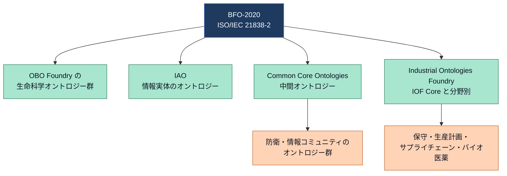

### 12.2 各コミュニティの概要

| コミュニティ | 概要 | 根拠となる情報 |
|-------------|------|---------------|
| OBO Foundry | 生命科学分野のオントロジー群。BFO は長年にわたり指定の上位オントロジー | 学術論文（Grounding Realizable Entities, 2024） |
| IAO | BFO に適合する情報実体のオントロジー。BFO 自身には文や出版物のような情報実体の用語がないため、IAO が補う | Wikipedia の ISO/IEC 21838 項目 |
| Common Core Ontologies（CCO） | BFO を拡張する11個のモジュールから成る中間オントロジー群。防衛・情報コミュニティで BFO とともに基準標準として位置づけられている | CCO 論文（Cox, Beverley ら）、Beverley 氏のガバナンス委員会の告知 |
| Industrial Ontologies Foundry（IOF） | 製造・デジタル製造向け。IOF の全オントロジーは BFO 2020 を基盤とし、Core が中間層を担う。公式ブラウザは 202601 リリースを公開 | IOF 公式サイト |

> 📈 **採用規模の目安**（時期ごとに値が異なる点に注意）
> - 2022年4月の論文：350超のプロジェクトで使用
> - 2022年5月のバッファロー大学ニュース：約500の組織・グループ
> - 2024年の論文：600超のオープンソースのオントロジー・プロジェクトで使用
>
> 数え方が異なるため単純比較はできませんが、利用が広がっていることは読み取れます。

### 12.3 最近の動き（2026年時点で確認できたもの）

| 内容 | 出典 |
|------|------|
| BFO と情報交換標準（Information Exchange Standard：IES）の整合に関する初期研究（2026年） | John Beverley 氏の出版物一覧 |
| BFO と CCO の関係（理論的基盤、設計パターン、実装慣行）を論じる論文 | 同上 |
| BFO と CCO が防衛・情報コミュニティのオントロジー開発の基準として指示されている旨の言及 | Beverley 氏のブログ（2024年3月） |

> ⚠️ ISO のページでは、本規格のステージは 60.60（発行済み）のままです。公開情報の範囲では、2026年10月16日時点で改訂版の発行は確認できていません。最新状況は ISO のページで確認してください。

---

## 13. 歴史：なぜ ISO 標準になったのか

### 13.1 流れ

### 13.2 背景の解説

| 時期 | 出来事 | 意味 |
|------|--------|------|
| 1998〜2004 | Gene Ontology が普及する中で、化学や解剖学など他のオントロジーとつなぐときの論理的な問題が表面化 | 上位の共通骨組みの必要性が明確になった |
| 2010 | 米国陸軍が情報分野で BFO の利用を検討。のちに国防総省や情報コミュニティの複数機関が追随 | 生命科学以外へ広がるきっかけ |
| 2015 | Robert Arp、Barry Smith、Andrew Spear による教科書（MIT Press）が出版 | 学習・普及の基盤 |
| 2021-11 | ISO/IEC 21838-2 が発行 | 哲学の成果として初めて国際標準の承認を受けたとバッファロー大学が報告 |

> 💡 **なぜ標準化が重要か**：バッファロー大学の記事では、独立に作られたデータベースの定義の食い違い（例：エアバス A380 の胴体設計での「穴」の扱いの違い）が、統合時の大きな手戻りコストにつながる事例が紹介されています。上位の共通語彙は、こうした食い違いを**設計の最初に**避けるための仕組みです。

---

## 14. QAエンジニア視点：BFO ベースのオントロジーを品質保証する

> 📝 この節は、公開されている BFO リポジトリの品質検査の仕組みと、一般的なテスト設計の考え方を組み合わせた**実務上の提案**です。

### 14.1 検査の観点

| 観点 | 何を確かめるか | 手段の例 |
|------|--------------|---------|
| 構文の妥当性 | OWL ファイルが正しく読み込めるか | OWL パーサー、ロード検査 |
| 無矛盾性 | BFO の公理と自作クラスが矛盾しないか | 推論器（リーズナー）による一貫性検査 |
| 分類の妥当性 | 親子関係（is-a）が実世界の意味に合うか | 専門家レビュー、判定フロー（第9章）の適用 |
| 命名・注釈の規約 | ラベルや定義が一貫して付いているか | SPARQL による検査（BFO リポジトリには言語ごとのラベルがちょうど1つであることを確認する検査がある） |
| 定義の品質 | 定義が非循環で簡潔か | レビュー（Part 1 の要件に対応） |
| 回帰 | 上位オントロジーの更新で下位が壊れないか | BFO の更新時に再度、一貫性検査と SPARQL 検査を回す |

### 14.2 検査パイプラインの例

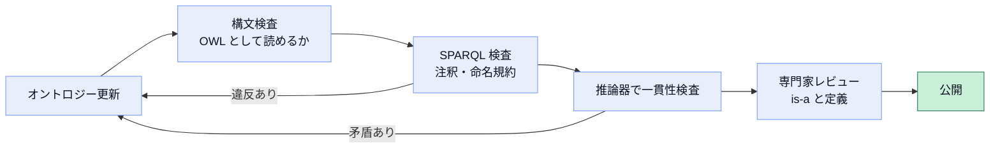

---

## 15. 注意点・よくある誤解

| 誤解 | 実際 |
|------|------|
| BFO は医療用のオントロジー | ドメイン中立。生命科学で育ったが、製造や防衛など他分野でも使われる |
| BFO に何でも入っている | 最上位の36クラスのみ。体温や患者のような具体的な語は下位のオントロジーが定義する |
| 情報（文書・データ項目）も BFO だけで十分表現できる | BFO 自体には情報実体の専用語がない。IAO などの下位オントロジーが補う |
| ISO 規格を買わないと BFO を使えない | 実際の成果物（OWL、CL など）は CC BY 4.0 で公開されている。規格本文は ISO で入手する |
| BFO が唯一の上位オントロジー | ISO/IEC 21838 には DOLCE（Part 3）と TUpper（Part 4）もある |
| 規格にオントロジーの推論方法が書かれている | 推論方法は範囲外 |
| BFO は固定で変わらない | 規格の対象は BFO-2020。リポジトリは更新・議論が続いている（Issues、Discussions など） |

> ⚠️ **本ガイドの限界**：ISO 規格本文は有償・著作権保護のため、条文の逐語的な確認は行っていません。公式ページに掲載されている要旨、公開リポジトリ、開発者の論文・資料に基づく説明です。正確な要求事項や用語の公式定義が必要な場合は、規格本文および BFO 用語表を確認してください。

---

## 16. 理解度チェック

| # | 質問 | 答え |
|---|------|------|
| 1 | ISO/IEC 21838-2 は何の規格か | 上位オントロジー BFO（BFO-2020）を記述する規格。Part 1 の要件に適合する上位オントロジーの一つ |
| 2 | BFO の最上位の二分は | continuant と occurrent |
| 3 | 「患者の体温」は BFO のどのクラスか | quality（specifically dependent continuant の一種） |
| 4 | 「手術」はどのクラスか | process（occurrent の一種） |
| 5 | BFO の形式化に使われる2つの言語は | OWL 2 と Common Logic |
| 6 | 規格の範囲外のものは | オントロジー言語の仕様、推論方法、言語間変換器の仕様 |
| 7 | BFO に情報実体の用語がない場合、どうするか | IAO など BFO に適合する下位オントロジーを利用する |
| 8 | BFO を土台にする代表的な3つの取り組みは | OBO Foundry、IOF、Common Core Ontologies |
| 9 | 規格のステージは現在どこか | 60.60（国際標準として発行済み） |
| 10 | BFO の成果物のライセンスは | CC BY 4.0 |

---

## 17. 用語集

| 用語 | 説明 |
|------|------|
| TLO | Top-Level Ontology（上位オントロジー） |
| BFO | Basic Formal Ontology |
| CL | Common Logic（ISO/IEC 24707） |
| OWL 2 | Web Ontology Language 第2版（W3C） |
| 直接意味論 | OWL 2 の意味論の一つ。推論器が前提とする |
| continuant | 時間を通じて存続し、時間的な部分をもたないもの |
| occurrent | 時間の中で展開し、時間的な部分をもつもの |
| 実在論（リアリズム） | 概念や言葉ではなく、現実に存在する種類を記述する立場 |
| ユニバーサル | 個体が共通してもつ「種類」 |
| 担い手（bearer） | 性質などが依存する独立連続体 |
| inheres in | 依存する性質などが担い手に宿る関係 |
| participates in | 連続体がプロセスに参加する関係 |
| IRI | 国際化リソース識別子。クラスや関係の一意な識別子 |
| OBO Foundry | 生命科学分野の相互運用可能なオントロジーの連合 |
| IAO | Information Artifact Ontology（情報実体オントロジー） |
| CCO | Common Core Ontologies（BFO に基づく中間オントロジー群） |
| IOF | Industrial Ontologies Foundry（産業向けオントロジー連合） |
| CC BY 4.0 | 出典表示で再利用を認めるライセンス |

---

## 18. 参考ソース（URL付き）

> 以下はすべて 2026年10月16日に参照・確認したものです。ISO の規格本文は有償のため、公式ページに公開されている範囲のみを参照しました。

### 18.1 一次情報（規格・公式）

| 種別 | ソース | URL |
|------|--------|-----|
| 規格公式ページ | ISO/IEC 21838-2:2021（要旨、ライフサイクル、基本情報） | https://www.iso.org/standard/74572.html |
| 規格公式ページ | ISO/IEC 21838-1:2021（Part 1：要件） | https://www.iso.org/standard/71954.html |
| 規格公式ページ | ISO/IEC 21838-3:2023（DOLCE） | https://www.iso.org/standard/78927.html |
| 規格公式ページ | ISO/IEC 21838-4:2023（TUpper） | https://www.iso.org/standard/78928.html |
| 規格保守ポータル | ISO Standards Maintenance Portal（21838-2） | https://standards.iso.org/iso-iec/21838/-2/ed-1/en/ |

### 18.2 BFO 開発チームによる公式成果物

| 種別 | ソース | URL |
|------|--------|-----|
| 公開リポジトリ | BFO-ontology/BFO-2020（階層図、成果物、ディレクトリ構成、ライセンス、開発チーム） | https://github.com/BFO-ontology/BFO-2020 |
| 公式サイト | BFO 2020 ドキュメントページ（用語表・IRI 表・OWL・CL の一覧） | https://basic-formal-ontology.org/bfo-2020 |
| 公式サイト | BFO 利用者一覧 | https://basic-formal-ontology.org/users.html |
| NCOR Wiki | BFO 2020 のファイル一覧と説明 | https://www.ncorwiki.buffalo.edu/index.php/BFO_2020 |

### 18.3 国際的な開発者・研究者による文献

| 著者・組織 | 内容 | URL |
|-----------|------|-----|
| J. Neil Otte、John Beverley、Alan Ruttenberg | 「BFO: Basic Formal Ontology」（Applied Ontology, 2022）。36クラス、変化を扱う設計パターン | https://philarchive.org/rec/OTTBBF |
| Robert Arp、Barry Smith、Andrew Spear | 書籍 *Building Ontologies with Basic Formal Ontology*（MIT Press, 2015）の紹介ページ | https://ontology.buffalo.edu/BOBFO |
| 同上 | MIT Press の書籍ページ | https://mitpress.mit.edu/9780262527811/building-ontologies-with-basic-formal-ontology/ |
| Alexander Cox、John Beverley ら | 「The Common Core Ontologies」（BFO と CCO の関係、continuant/occurrent の整理） | https://arxiv.org/pdf/2404.17758 |
| Beverley ら | 「Grounding Realizable Entities」（BFO の利用規模、IOF・CCO・防衛での位置づけ） | https://arxiv.org/pdf/2405.00197 |
| John Beverley | Common Core Ontologies ガバナンス委員会の告知（BFO と CCO が基準標準として指示されている旨） | https://johnbeverley.com/blogic/2024/3/13/common-core-ontologies-governance-board |
| John Beverley | 出版物一覧（2026年の BFO と IES の整合研究を含む） | https://philpeople.org/profiles/john-beverley/publications |
| FOUST VII 論文集 | BFO の process・continuant 変化に関する論文（CEUR-WS） | https://ceur-ws.org/Vol-3637/paper33.pdf |

### 18.4 報道・解説・コミュニティ

| 種別 | ソース | URL |
|------|--------|-----|
| 大学ニュース | バッファロー大学「UB professor's ontology work recognized as an international standard」（2022-05-05、Barry Smith 氏のコメント、歴史、事例） | https://www.buffalo.edu/ubnow/stories/2022/05/smith-ontology-standard.html |
| 百科事典 | Wikipedia「ISO/IEC 21838」（シリーズ構成、Part 1 の要件の整理） | https://en.wikipedia.org/wiki/ISO/IEC_21838 |
| 産業コミュニティ | Industrial Ontologies Foundry（リリース 202601。全オントロジーが BFO 2020 を基盤） | https://spec.industrialontologies.org/portal/release/202601/ |

### 18.5 さらに学ぶための推奨リンク

| テーマ | ソース | URL |
|--------|--------|-----|
| realizable entity（役割・傾向・機能） | Arp & Smith「Realizable Entities in Basic Formal Ontology」 | https://ontology.buffalo.edu/smith/articles/realizables.pdf |
| function | Spear、Ceusters、Smith「Functions in Basic Formal Ontology」 | https://philarchive.org/rec/SPEFIB |
| process の分類 | Smith「Classifying Processes: An Essay in Applied Ontology」 | https://www.ncbi.nlm.nih.gov/pmc/articles/PMC3718480 |

---

*本ガイドは2026年10月16日時点の公開情報に基づく学習用の解説です。規格の正確な要求事項・用語の公式定義は ISO 規格本文および BFO 公式成果物を参照してください。*
