# ISO/IEC 21838-2:2021 初学者向けステップバイステップ解説ガイド

> **規格名**：Information technology — Top-level ontologies (TLO) — Part 2: Basic Formal Ontology (BFO)
> **日本語訳（仮）**：情報技術 — トップレベルオントロジー（TLO）— 第2部：基本形式オントロジー（BFO）
> **情報基準日**：2026年10月8日（この日までに確認できた公開情報にもとづく）
> **対象読者**：オントロジー・ナレッジグラフ・データ統合・AIシステム設計・QA/テスト設計に関わる初学者〜中級者
> **前提知識**：「クラスとインスタンス」「RDF/OWLという言葉を聞いたことがある」程度でOK

---

## 0. このガイドの読み方

### 0-1. 全体マップ

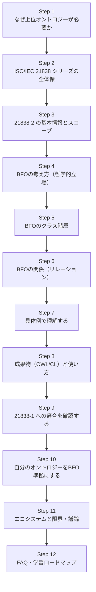

### 0-2. 先に結論（3行まとめ）

| # | ポイント |
|---|---|
| 1 | **ISO/IEC 21838-2:2021 は、BFO（Basic Formal Ontology）というトップレベルオントロジーを国際標準として規定した文書**である |
| 2 | BFOは「あらゆる分野に共通する最も一般的なカテゴリ（物・プロセス・性質・役割…）」を提供し、**異なる分野のオントロジーを同じ土台でつなぐ**ために使われる |
| 3 | 規格は**用語・関係の定義**と**OWL 2 / Common Logic による公理化**、および**21838-1の要件への適合文書**で構成される。つまり「読み物」ではなく**使える成果物のセット**である |

---

## Step 1. なぜ「上位オントロジー（トップレベルオントロジー）」が必要か

### 1-1. 問題：同じ言葉でも、システムごとに意味がバラバラ

たとえば医療データ基盤で、次の3つのシステムが連携するとします。

| システム | 「検査」という言葉の意味 |
|---|---|
| 電子カルテ | 医師が出した**オーダー**（指示書） |
| 検査室システム | 実際に行われた**測定作業**（出来事） |
| 研究DB | 測定の**結果データ**（記録） |

同じ「検査」でも、**指示（情報）・作業（プロセス）・結果（データ）** と、種類の異なるものを指しています。これを区別せずに統合すると、集計や推論が壊れます。

### 1-2. 解決：最上位の共通カテゴリを決めておく

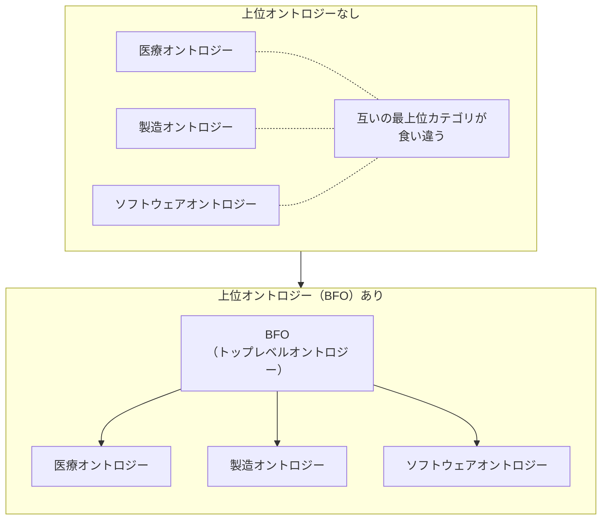

- **上位（トップレベル）オントロジー**＝特定分野に依存しない、最も一般的なカテゴリの集合
- **ドメインオントロジー**＝医療・製造・ITなど特定分野の用語集合
- ドメイン側の用語を、上位側のカテゴリの**サブクラス**として位置づけることで、分野をまたいだデータ統合・検索・分析がやりやすくなります

### 1-3. たとえ話

> 図書館の「大分類（NDC：0類〜9類）」が上位オントロジー、各図書館の細かい棚が各分野のオントロジー、というイメージです。
> 大分類が共通だから、別の図書館同士でも本の置き場所が対応づけられます。

---

## Step 2. ISO/IEC 21838 シリーズの全体像

21838は複数パートからなるシリーズです。公開情報によると、現時点で次の4パートがあります。

| パート | 内容 | 発行 | 役割 |
|---|---|---|---|
| **21838-1** | 要件（Requirements） | 2021 | 「トップレベルオントロジーが満たすべき条件」を定める**ものさし** |
| **21838-2** | **BFO** | 2021 | 1つ目の適合例。**本ガイドの対象** |
| 21838-3 | DOLCE | 2023 | 別のトップレベルオントロジー |
| 21838-4 | TUpper | 2023 | さらに別のトップレベルオントロジー |

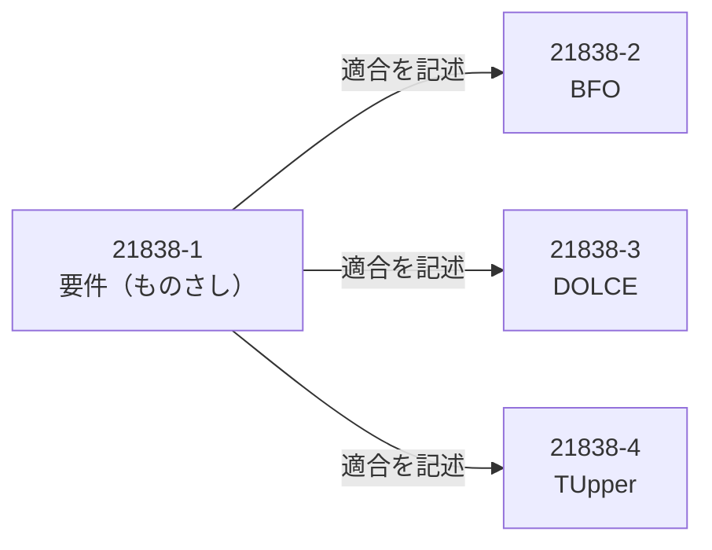

**ポイント**：21838-1が「合格基準」、2〜4が「その基準に合格したオントロジーの紹介と仕様」という関係です。BFOだけが唯一の標準ではなく、**複数のトップレベルオントロジーが並立**している点が重要です。

---

## Step 3. ISO/IEC 21838-2:2021 の基本情報とスコープ

### 3-1. 基本情報（ISOの規格ページより）

| 項目 | 内容 |
|---|---|
| 規格番号 | ISO/IEC 21838-2:2021 |
| 版 | Edition 1 |
| 発行 | 2021年11月（ISOページのステージ履歴では 2021-11-30 に 60.60「International Standard published」） |
| ページ数 | 13ページ |
| 担当委員会 | ISO/IEC JTC 1/SC 32（Data management and interchange） |
| ICS | 35.060 / 01.040.35 |
| ステータス | Published |
| メンテナンス | 「Maintenance Agency または Registration Authority により更新される」と明記 |
| 価格表示 | ISOページ上は **CHF 0** と表示（※購入・入手条件は変更されうるため、利用前にISOページで確認すること） |

> **名称の注意**：標準としての発行は**2021年**ですが、中身のBFOのバージョン名は **BFO-2020** です。GitHubリポジトリの説明文には「ISO 21838-2:2020」という表記も見られます。「BFO 2020」＝オントロジー本体のバージョン名、「21838-2:2021」＝それを規定したISO規格、と区別すると混乱しません。

### 3-2. 規格が扱う範囲（スコープ）

ISOページのスコープ記述を、要点だけ言い換えて整理します。

| 区分 | 内容 |
|---|---|
| **範囲内** | ① BFO-2020の用語と関係の**定義** |
| | ② BFO-2020の **OWL 2 と CL（Common Logic）による公理化** |
| | ③ BFO-2020が21838-1の要件に**適合していることの文書化** |
| | ④ BFOをトップとするオントロジー群のモジュールになるドメインオントロジーが満たすべき**要件の規定** |
| | ⑤ 下位オントロジーの定義・公理を書くときの**BFO用語の役割**の規定 |
| **範囲外** | ① オントロジー言語（RDF、OWL、CLなど）自体の仕様 |
| | ② オントロジーを使った**推論方法**の仕様 |
| | ③ 異なるオントロジー記法間の**変換ツール**の仕様 |

### 3-3. 制定の経緯（ISOページのステージ履歴より）

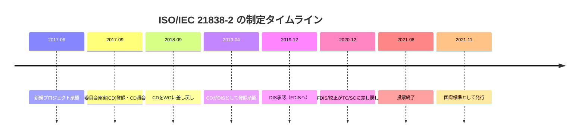

**読み取れること**：原案の提出から発行まで約4年。途中で2回の差し戻しがあり、慎重に審議された規格であることがわかります。

---

## Step 4. BFOの考え方（哲学的立場）

### 4-1. BFOは「何でも詰め込む百科事典」ではない

BFOは、約**数十個**の非常に一般的なクラスと少数の関係だけを持つ、**小さく抽象的な骨組み**です。医療・製造・ITなどの具体的な用語は、BFOの外側（ドメインオントロジー）で作ります。

| BFOに**ある**もの | BFOに**ない**もの |
|---|---|
| 物、プロセス、性質、役割、空間・時間領域 など | 「心臓」「ネジ」「注文」といった分野固有の用語 |
| 「参加する」「存在する」など汎用的な関係 | 情報・文章・データ項目といった**情報エンティティの専用クラス** |

> 21838-1に関するWikipediaの解説では、BFO自体にはデータ項目や文・出版物のような情報エンティティを表す固有の用語はなく、BFO準拠のIAO（Information Artifact Ontology）がそれを補う、と説明されています。

### 4-2. 2つの方法論的立場

BFOの開発者コミュニティ（OBO Foundry、CCOなど）は、BFOが受け継ぐ方法論としておおむね次の2点を挙げています。

| 立場 | 意味（かんたん版） |
|---|---|
| **リアリズム（実在論）** | オントロジーは「人間の頭の中の概念」ではなく、**現実世界に実在する種類・個体**を記述するもの |
| **可謬主義（Fallibilism）** | 現時点の科学的理解にもとづくので、**間違いが見つかれば改訂する**。BFOも固定の真理ではなく改良され続ける |

### 4-3. 最上位の二分法：continuant と occurrent

BFOを理解する最大のカギは、**「時間の中での存在の仕方」による二分類**です。

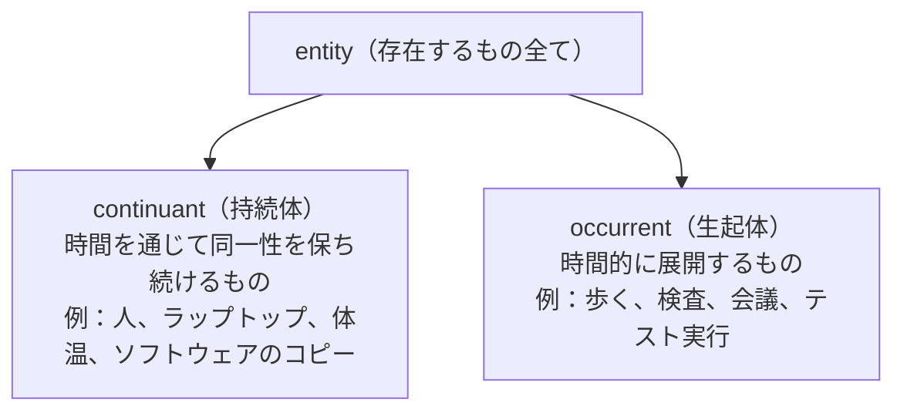

| | continuant（持続体） | occurrent（生起体） |
|---|---|---|
| 時間との関係 | **ある時点に丸ごと存在**し、時間を通じて持続する（enduring） | **時間にまたがって展開**する（unfolding） |
| 時間的部分 | 持たない | **持つ**（歩行の「最初の1分」など） |
| 例 | 患者、薬のボトル、血圧という性質 | 診察、投薬、テスト実行 |
| 覚え方 | **名詞**の世界（もの・性質） | **動詞／出来事**の世界（できごと） |

> CCO（Common Core Ontologies）の論文でも、occurrentは時間的に延び時間的部分を持ち、continuantは時間的部分を持たず時間を通じて持続して occurrent に参加する、と説明されています。

---

## Step 5. BFOのクラス階層

### 5-1. 全体像（GitHubのBFO-2020リポジトリのREADMEの階層図にもとづく）

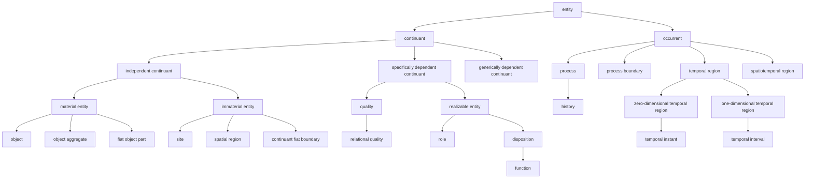

### 5-2. continuant（持続体）の3系統

| クラス | 平易な説明 | 具体例 |
|---|---|---|
| **independent continuant**（独立持続体） | 他のものに存在を依存しない | 患者、ノートPC、実験室の部屋 |
| ├ material entity（物質的存在） | 物質を部分として持つ | 患者の脳、サーバー機 |
| │　├ object（対象物） | まとまりのある個体 | 1人の人、1個のマウス |
| │　├ object aggregate（対象物集合） | 複数のobjectの集まり | 研究参加者グループ、ロックバンド |
| │　└ fiat object part | 人間の取り決めで切り出した部分 | 「左半球」「ラックの上段」 |
| ├ immaterial entity（非物質的存在） | 物質を部分として持たない | |
| │　├ site（場所） | 物が入りうる空間的な窪み・領域 | 部屋の内部、トンネル内 |
| │　├ spatial region（空間領域） | 空間そのもの（0〜3次元） | 座標で決まる体積 |
| │　└ continuant fiat boundary | 取り決めで引いた境界 | 赤道、国境線 |
| **specifically dependent continuant**（特定依存持続体） | **特定の担い手（bearer）に依存**して存在 | 体温、「この薬の効き目」 |
| ├ quality（質） | 常に完全に現れている性質 | 色、質量、形状 |
| │　└ relational quality | 複数の担い手にまたがる質 | 「AさんとBさんの身長差」 |
| └ realizable entity（実現可能実体） | 条件が整うと**実現（realize）される** | |
| 　├ role（役割） | 状況や取り決めで担う | 患者、被験者、テスト担当者 |
| 　└ disposition（傾向性） | 内在的な構造に基づく | 脆さ、溶解性、免疫（※functionはdispositionの一種） |
| **generically dependent continuant**（一般依存持続体） | 担い手は必要だが**どの担い手でもよい**（コピー可能） | PDFの内容、プログラムのソース、テストケースの記述内容 |

> CCO論文では generically dependent continuant を「複数の担い手の間でコピーできるもの」の置き場、specifically dependent continuant を「必ず特定の independent continuant に依存するもの（例：野球ボールの質量や形状）」として説明しています。

### 5-3. occurrent（生起体）の系統

| クラス | 平易な説明 | 具体例 |
|---|---|---|
| **process**（プロセス） | 時間の中で展開し、時間的部分を持つ。少なくとも1つの物質的存在に依存して起こる | 歩行、投薬、心拍、テスト実行 |
| ├ history（歴史） | ある対象に関するプロセス全体の総和 | 患者Aの一生の生理過程の総体 |
| **process boundary** | プロセスの境界（始まり／終わり） | 発作の開始の瞬間 |
| **temporal region**（時間領域） | 時間そのもの | 2026年10月8日 |
| ├ temporal instant | 時間の点 | 14:00:00.000 |
| └ temporal interval | 時間の区間 | 午後の会議の時間帯 |
| **spatiotemporal region** | 時空の領域 | プロセスが占める時空間 |

### 5-4. 3つのIDで押さえるコアクラス

OBO系のOLS/Ontobeeで確認できる主要クラスのIRIは `http://purl.obolibrary.org/obo/BFO_XXXXXXX` の形式です。公開情報から確認できたものは次のとおりです。

| クラス | ID |
|---|---|
| entity | BFO_0000001 |
| continuant | BFO_0000002 |
| occurrent | BFO_0000003 |
| independent continuant | BFO_0000004 |
| disposition | BFO_0000016 |
| specifically dependent continuant | BFO_0000020 |
| generically dependent continuant | BFO_0000031 |

> 他のクラスのIDは、必ず **OLS／Ontobee／bfo-core.owl** で最新のものを確認してください（本ガイドでは検索で直接確認できたものだけを表に載せています）。

---

## Step 6. BFOの関係（リレーション）

クラスだけではオントロジーは作れません。「どう関わるか」を表す関係が必要です。主要なものを整理します。

### 6-1. 主要な関係の一覧

| 関係（英語） | 日本語イメージ | 主な使い方 |
|---|---|---|
| **instance of** | 〜の事例である | 個体とクラスをつなぐ（患者Aは patient の instance） |
| **continuant part of / has continuant part** | 〜の（持続体としての）部分である | 心臓は体の部分 |
| **occurrent part of / has occurrent part** | 〜の（生起体としての）部分である | 手術の「麻酔導入」は手術の部分 |
| **participates in / has participant** | 〜に参加する | 患者は診察プロセスに参加する |
| **occurs in** | 〜の中で起こる | 手術はある部屋（site）やある物質的存在の中で起こる |
| **located in / location of** | 〜に位置する | 結節は脳内に位置する |
| **inheres in / bearer of** | 〜に内属する／担い手である | 体温は患者に内属する（患者は体温の担い手） |
| **specifically depends on** | 特定のものに依存する | 質は担い手に依存 |
| **concretizes / is concretized by** | 具体化する | ファイル内の情報（GDC）を、ディスク上の特定の質（SDC）が具体化する |
| **realizes / realized in** | 実現する | 傾向性・役割が、あるプロセスで実現される |
| **exists at** | ある時点に存在する | continuantは時点と結びつく |

> **注意**：BFO-2020のOWL実装（bfo-core.owl）では、時間パラメータを持つ関係が時間に索引づけされない形で表現されるなど、**公理化の方式（CLとOWL）で表現力に差**があります。GitHubリポジトリにはCLIF版とOWL版が別々に置かれ、「時間をより強く扱う拡張」は別途 *temporal extensions* として研究開発中と説明されています。

### 6-2. 関係の関係図（概念）

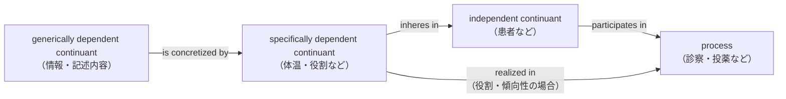

---

## Step 7. 具体例で理解する（QA／AIシステムの場面）

BFOの抽象クラスが実務でどう効くのか、ソフトウェアテストの場面で見てみます。

### 7-1. シナリオ

> テスト担当者の田中さんが、ノートPC上のテストケース「ログイン失敗時のエラー表示」を実行し、結果をレポートに記録した。

### 7-2. BFOカテゴリへの分類

| 登場するもの | BFO上の分類 | 理由 |
|---|---|---|
| 田中さん（人） | **object**（independent continuant → material entity） | 物質的な個体 |
| ノートPC | **object** | 同上 |
| 田中さんの「テスト担当者」というあり方 | **role**（realizable entity） | 状況・取り決めで担う。テスト実行で実現される |
| PCの処理性能（できること） | **disposition** | 内在的な構造にもとづく傾向性 |
| テストケースの記述内容（コピー可能） | **generically dependent continuant** | 紙・PDF・DBなど複数の担い手に複製できる |
| テストケースを記録した特定のファイルの“具体的な存在” | **specifically dependent continuant**（GDCの具体化） | 特定のディスク領域などに依存 |
| テスト実行 | **process**（occurrent） | 時間的に展開する |
| 実行にかかった時間帯 | **temporal interval** | 時間領域 |

### 7-3. 関係を図にすると

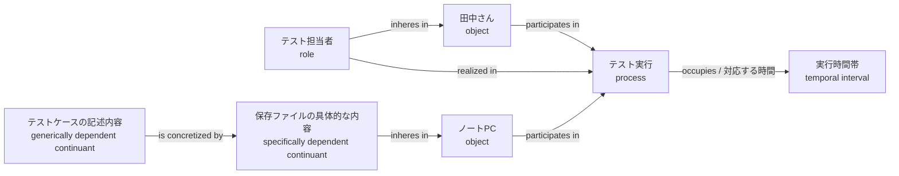

### 7-4. この整理で何が嬉しいか

| 良いこと | 説明 |
|---|---|
| **「テスト」の曖昧さが消える** | 「テスト」は“テストケース（GDC）”なのか“テスト実行（process）”なのか“テスト結果（情報）”なのかを区別できる |
| **システム間統合がしやすい** | 別チームのDBでも「process」「role」の意味が共通なので、対応づけが明確 |
| **推論・クエリの質が上がる** | 「ある役割（role）を実現したプロセスだけ抽出」などの意味的クエリが書きやすい |

---

## Step 8. 規格の成果物（OWL・CL）と使い方

### 8-1. 成果物の全体像

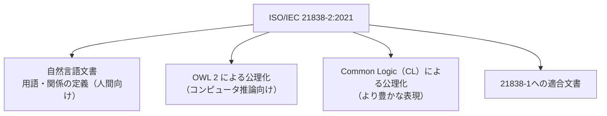

| 成果物 | 役割 | 誰が使うか |
|---|---|---|
| 自然言語文書 | 用語と関係の**意味を人間が理解**するための基準 | 設計者、ドメイン専門家 |
| OWL 2 公理化 | **推論エンジン／オントロジーエディタ**で読み込める | オントロジーエンジニア、ソフトウェア開発者 |
| CL 公理化 | OWLでは表現しきれない一階述語論理レベルの公理 | 形式化・検証を行う研究者 |
| 適合文書 | 21838-1の要件を満たすことの根拠 | 標準化担当、導入判断者 |

### 8-2. 公式リポジトリ（GitHub: BFO-ontology/BFO-2020）の構成

| ディレクトリ | 内容 |
|---|---|
| `21838-2/owl` | OWL 2 の実装（RDF/XML、Functional-style、Turtle） |
| `21838-2/common-logic` | CLIF による実装（サブ理論ごとに分割。例：material-entity.cl） |
| `21838-2/prover9` | 自動定理証明器Prover9で読める形式 |
| `21838-2/sparql` | 更新時の品質チェック用SPARQL（例：言語ごとにprefLabelがちょうど1つ） |
| `documentation` | 公理化のPDF、FAQ、ユーザーガイド（計画中） |
| `temporal extensions` | 時間表現を強めた研究開発 |

- 現行リリースは同リポジトリの **`21838-2/owl/bfo-core.owl`**
- ライセンスは **CC BY 4.0**
- 開発チームはBarry Smith、Alan Ruttenberg、John Beverley（READMEより）

### 8-3. 手を動かす：Protégéで読み込む（ハンズオン）

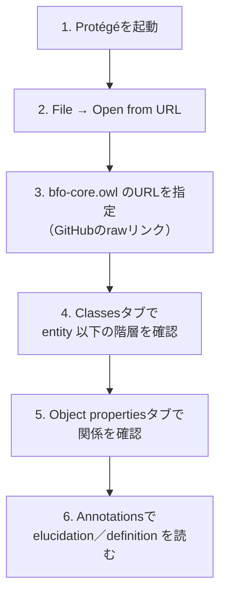

**確認ポイント**

| 観点 | 見るところ |
|---|---|
| クラス階層 | Step 5の図と一致するか |
| 注釈 | 各クラスの elucidation（説明的記述）や定義が付いているか |
| 関係 | participates in / has participant など |

### 8-4. 手を動かす：自分のドメイン用語をBFOの下に置く（Turtle例）

以下は**学習用の最小例**です。クラスIDは必ず最新の `bfo-core.owl`／OLSで確認してから使ってください。

```turtle
@prefix owl:  <http://www.w3.org/2002/07/owl#> .
@prefix rdfs: <http://www.w3.org/2000/01/rdf-schema#> .
@prefix obo:  <http://purl.obolibrary.org/obo/> .
@prefix ex:   <http://example.org/qa#> .

ex:TestExecution a owl:Class ;
    rdfs:subClassOf obo:BFO_0000015 ;   # process
    rdfs:label "テスト実行"@ja .

ex:TesterRole a owl:Class ;
    rdfs:subClassOf obo:BFO_0000023 ;   # role
    rdfs:label "テスト担当者ロール"@ja .

ex:TestCaseContent a owl:Class ;
    rdfs:subClassOf obo:BFO_0000031 ;   # generically dependent continuant
    rdfs:label "テストケース記述内容"@ja .
```

### 8-5. 手を動かす：Pythonで階層を確認する（rdflib）

```python
from rdflib import Graph, RDFS, URIRef

g = Graph()
# bfo-core.owl をローカルに保存してから読み込む
g.parse("bfo-core.owl", format="xml")

continuant = URIRef("http://purl.obolibrary.org/obo/BFO_0000002")
for sub in g.subjects(RDFS.subClassOf, continuant):
    print(sub)
```

---

## Step 9. 21838-1 への適合を確認する

### 9-1. 21838-1が求めるもの（公開情報の整理）

| 要件の種類 | 内容 |
|---|---|
| 自然言語文書 | ドメイン中立な用語・関係の一覧、**原始用語（primitive）の明示**、非原始用語の**循環のない・無矛盾・簡潔な定義** |
| シグネチャ | 特定の分野でだけ使われる用語を**含まない** |
| 機械可読な公理化 | **OWL 2（直接意味論）**（またはその後継DL）で提供 |
| CL公理化 | ISO/IEC 24707 に適合するCommon Logicでも提供（該当する場合） |
| 補足文書 | 利用方法、OWLがCLから導出可能であること、**カバー範囲の広さの実証**、運用ポリシー |

### 9-2. BFOはどう満たしているか（Wikipediaによる整理）

| 21838-1の要件 | BFO側の対応 |
|---|---|
| 自然言語の定義文書 | 21838-2に用語・関係の定義文書を収録 |
| シグネチャのドメイン中立性 | 特定分野に偏った用語を含まない |
| OWL 2 公理化 | `21838-2/owl` として公開 |
| CL 公理化 | `21838-2/common-logic` として公開 |
| 運用ポリシー | OBO Foundryの原則を参照・採用 |
| 利用者向け資料 | 開発者ガイド、利用組織・再利用オントロジーの一覧（basic-formal-ontology.org/users.html） |

### 9-3. 「カバー範囲」の考え方

21838-1は、データが扱う典型的なテーマ（空間・時間、部分と全体、質、量、因果・プロセス、構成、情報、人工物・社会的構築物、心的実体など）を挙げ、TLOがそれらにどう対処するか（**自身で用語を持つ／TLOを使って作られたオントロジーに委ねる**）を示すことを求めています。

> 例：BFOには情報エンティティ（文、データ項目、出版物）専用の用語がなく、**BFO準拠のIAO**がそれを担う。これは「BFO単体で全てを賄う」のではなく「BFO＋BFO準拠のオントロジー群」でカバーする設計思想を示しています。

---

## Step 10. 自分のオントロジーをBFO準拠にするには

規格の範囲には「BFOを最上位ハブとするオントロジー群のモジュールとなるドメインオントロジーが満たすべき要件」も含まれます（スコープ④⑤）。実務での考え方を、フローチャートで整理します。

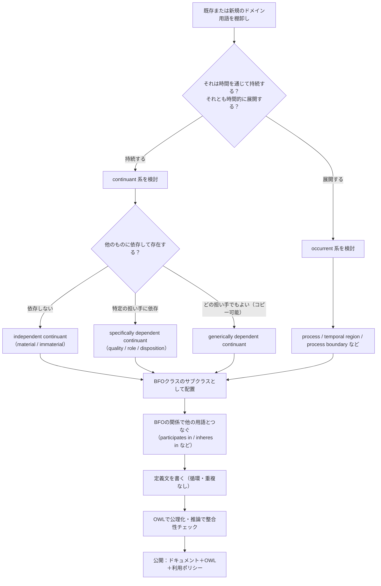

### 10-1. 初学者がつまずきやすいポイント

| つまずき | 対処 |
|---|---|
| 「検査」「テスト」などが**プロセスか情報か**で揺れる | 「実行（process）」と「記述内容・結果（GDC）」を**別クラス**にする |
| 役割（role）と種類（class）の混同 | 「患者」は人の**種類**ではなく状況で担う**役割**。人の種類は “person” |
| 性質（quality）と傾向性（disposition）の混同 | 常に完全に現れる＝quality、条件が整ったときに実現される＝disposition |
| 関係を「is-a」だけで済ませる | 参加・内属・具体化など、**BFOの関係を使い分ける** |

---

## Step 11. エコシステムと限界・議論

### 11-1. 利用実績（公開情報）

| 領域 | 内容 |
|---|---|
| **OBO Foundry** | 生物医学オントロジー群のトップレベルアーキテクチャとして利用（2018年のICBOワークショップ資料では「生物学・生物医学の約300グループが利用」と紹介） |
| **IOF（Industrial Ontologies Foundry）** | 産業分野のオントロジー群 |
| **CCO（Common Core Ontologies）** | 11のオントロジーがBFOを拡張。CCOは“middle-in”戦略（トップレベルの制約下で下から作る）を採用 |
| 利用規模の目安 | 2025年のFOIS論文は「600以上のオントロジーがBFOを利用」と記述 |

> 数値は出典ごとに時期・数え方が異なります。「規模の目安」として扱ってください。

### 11-2. 既知の議論点・限界（研究コミュニティの指摘）

| 論点 | 内容 | 出典の種類 |
|---|---|---|
| **GDCに役割・傾向性・機能を持たせられない** | BFO 2020では realizable entity は independent continuant に内属するため、ソフトウェアやデータセットのような generically dependent continuant は役割や機能の担い手になれない、という指摘 | FOIS 2025（CEUR-WS）掲載論文 |
| **非物質的存在（境界・場所）の役割・傾向性の扱い** | 同論文が制約として議論 | 同上 |
| **時間表現の強さ** | 時間をより強く扱う拡張が `temporal extensions` として研究開発中 | GitHubリポジトリ |
| **プロセスの同一性** | プロセスの同一性の捉え方に複数のアプローチがある | JOWO 2023 / FOUST VII（CEUR-WS） |

**初学者へのメッセージ**：BFOは「完成された唯一解」ではなく、**議論と改訂を前提とした標準**です。規格がメンテナンス機関によって更新される旨がISOページに明記されているのも、この性格の表れです。

### 11-3. BFOと他のトップレベルオントロジーの位置づけ

| 観点 | BFO（21838-2） | DOLCE（21838-3） | TUpper（21838-4） |
|---|---|---|---|
| 規格上の立場 | 21838-1に適合するTLOの1つ | 同左 | 同左 |
| 主な利用領域（公開情報で確認できる範囲） | 生物医学（OBO）、産業（IOF）、CCOなど | 言語・認知工学を志向（名称より） | 本ガイドでは詳細未確認 |

> DOLCE・TUpperの詳細は本ガイドの範囲外です。比較検討する場合は各パートの規格ページを参照してください。

---

## Step 12. FAQ と学習ロードマップ

### 12-1. よくある質問

| Q | A |
|---|---|
| **Q1. BFOを使うとオントロジーのクラスが全部決まる？** | いいえ。BFOは最上位の骨組みだけ。具体的な用語はドメインオントロジーで作る |
| **Q2. OWLだけ読めばBFOは分かる？** | OWLだけでは定義の意図が伝わりにくい。自然言語の定義（elucidation）と合わせて読む |
| **Q3. 規格は有償？** | ISOページでは価格がCHF 0と表示されている。入手条件は変更されうるので、必ず当該ページで確認する |
| **Q4. 「BFO 2020」と「21838-2:2021」は違うもの？** | 前者はオントロジーのバージョン名、後者はそれを規定したISO規格の番号・年。同じ対象を指す |
| **Q5. BFOはAI（LLM）と関係ある？** | 直接の規定はないが、ナレッジグラフ設計やデータ統合の土台として利用できる。LLMの出力を構造化する際の分類枠組みとしても発想は応用できる（これは筆者の見立てであり、規格の記述ではない） |
| **Q6. 日本語の定訳はある？** | 本ガイドの日本語表記は学習用の仮訳。公式な訳語は確認していないため、論文・実務では原語併記を推奨 |

### 12-2. 学習ロードマップ


| レベル | 目標 | 所要の目安 |
|---|---|---|
| 1 | continuant/occurrentの二分法を説明できる | 1時間 |
| 2 | Protégéでクラス階層・注釈を見られる | 半日 |
| 3 | 自分の用語を分類し、迷う箇所を言語化できる | 1〜2日 |
| 4 | 教科書で設計パターンを学ぶ | 1〜2週間 |
| 5 | 既存オントロジーの設計判断を読み解ける | 継続 |
| 6 | 規格・公理化を批判的に読める | 継続 |

---

## 付録A. 用語集

| 用語 | 意味 |
|---|---|
| TLO（Top-Level Ontology） | 特定ドメインに依存しない最上位のオントロジー |
| BFO | Basic Formal Ontology。21838-2の対象 |
| continuant | 時間を通じて持続するもの |
| occurrent | 時間的に展開するもの |
| elucidation | 原始用語に与えられる説明的記述（厳密な定義の代わり） |
| primitive term | 循環なしには定義できない原始用語 |
| OWL 2 | W3Cのウェブオントロジー言語 |
| CL（Common Logic） | ISO/IEC 24707 の一階述語論理ベースの言語 |
| CLIF | Common Logic Interchange Format |
| OBO Foundry | 生物医学オントロジーの協調開発コミュニティ |
| IOF | Industrial Ontologies Foundry |
| CCO | Common Core Ontologies。BFOを拡張する11のオントロジー群 |
| IAO | Information Artifact Ontology。BFO準拠の情報エンティティ用オントロジー |

---

## 付録B. 参照ソース一覧（URL）

> **情報基準日**：2026年10月8日。以下は本ガイド作成時に取得・確認したソースです。
> **確認区分**：◎＝ページ本体を取得して確認 ／ ○＝検索結果の抜粋で確認 ／ △＝他資料の参考文献欄にある文献（本ガイドでは本文を直接確認していない）

### B-1. 規格・公式ページ

| 区分 | ソース | URL |
|---|---|---|
| ◎ | ISO/IEC 21838-2:2021（ISO公式ページ） | <https://www.iso.org/standard/74572.html> |
| ○ | ISO/IEC 21838-1:2021（ISO公式ページ） | <https://www.iso.org/standard/71954.html> |
| ○ | IEC Webstore：21838-2 | <https://webstore.iec.ch/en/publication/72703> |
| ○ | IEC Webstore：21838-1 | <https://webstore.iec.ch/publication/70570> |
| ○ | カナダ規格評議会（SCC）：21838-2 | <https://scc-ccn.ca/standardsdb/standards/8170241> |
| △ | ISO Standards Maintenance Portal（21838-2 公開成果物） | <https://standards.iso.org/iso-iec/21838/-2/ed-1/en/> |

### B-2. BFO開発者・コミュニティ（著名な国際的開発者）

| 区分 | ソース | URL |
|---|---|---|
| ◎ | **BFO-ontology/BFO-2020**（公式リポジトリ。開発チーム：Barry Smith、Alan Ruttenberg、John Beverley） | <https://github.com/BFO-ontology/BFO-2020> |
| ○ | **ICBO 2018 Workshop W09: Building Ontologies with BFO**（Barry Smith） | <https://icbo2018.cgrb.oregonstate.edu/W09> |
| △ | BFO公式ドキュメントページ | <https://basic-formal-ontology.org/bfo-2020.html> |
| △ | BFO利用組織一覧 | <https://basic-formal-ontology.org/users.html> |
| △ | Building Ontologies with Basic Formal Ontology（Arp, Smith, Spear / MIT Press, 2015） | <https://mitpress.mit.edu/9780262527811/building-ontologies-with-basic-formal-ontology/> |
| △ | Otte, Beverley, Ruttenberg: *BFO: Basic Formal Ontology*, Applied Ontology 17(1), 2022 | <https://philpapers.org/archive/OTTBBF.pdf> |
| △ | Barry Smith 公式ページ | <http://ontology.buffalo.edu/smith/> |

### B-3. 研究論文・技術資料

| 区分 | ソース | URL |
|---|---|---|
| ○ | The Common Core Ontologies（CCOとBFOの関係。arXiv） | <https://arxiv.org/pdf/2404.17758> |
| ○ | Capabilities: An Ontology（BFO階層の解説。arXiv） | <https://arxiv.org/pdf/2405.00183> |
| ○ | Dispositions and Roles of Generically Dependent Entities（FOIS 2025。arXiv v1/v2） | <https://arxiv.org/html/2506.17085v2> |
| ○ | 同上（CEUR-WS 掲載版） | <https://ceur-ws.org/Vol-4176/power-4.pdf> |
| ○ | Two Approaches to the Identity of Processes in BFO（FOUST VII / JOWO 2023） | <https://ceur-ws.org/Vol-3637/paper33.pdf> |
| ○ | BFO OWL 生成ドキュメント（OBO Library） | <http://purl.obolibrary.org/obo/bfo/2019-08-26/bfo.owl> |
| ○ | BFO（OBO Foundry系ブラウザ上の定義表示） | <https://v2a.virtualflybrain.org/blog/ontologies/bfo/> |

### B-4. 概説資料

| 区分 | ソース | URL |
|---|---|---|
| ◎ | Wikipedia：ISO/IEC 21838（シリーズ概要と21838-1要件の整理） | <https://en.wikipedia.org/wiki/ISO/IEC_21838> |
| △ | Buffalo大学ニュース：Smith's ontology work recognized as global standard | <https://www.buffalo.edu/ubnow/stories/2022/05/smith-ontology-standard.html> |
| △ | FAZ（Jansen, Brochhausen）：KIと哲学 — オントロジーが産業規格に | <https://www.faz.net/aktuell/wissen/geist-soziales/ki-und-philosophie-eine-ontologie-wurde-als-industrienorm-anerkannt-18344816.html> |

---

## 付録C. 本ガイドの確認事項と注意

| 項目 | 内容 |
|---|---|
| 規格本文について | ISOサイトには、機械学習・AIでの利用を制限する旨の著作権表示があります。本ガイドは**公開されているスコープ記述、開発者コミュニティの公開資料、論文**にもとづく解説であり、**規格本文の転載ではありません**。厳密な条文解釈が必要な場合は、必ず規格本文を参照してください |
| 数値・ID | クラスIDや利用規模の数値は出典・時期で変わりうるため、実務では最新の `bfo-core.owl`／OLS／各出典で再確認してください |
| 筆者の見立て | 「FAQ Q5」「Step 7の分類例」「Step 10の判断フロー」は、学習のための**筆者による整理・例示**であり、規格の条文ではありません |
| 規格の更新 | ISOページには、この規格がメンテナンス機関により更新される旨の記載があります。10月8日時点で確認できた範囲では21838-2:2021（Edition 1）が現行版（Published）ですが、**改訂の有無は定期的にISOページで確認**してください |
