# ISO/IEC 2382-15:1999 初学者向け解説ガイド

**情報技術 ― 用語 ― 第15部：プログラミング言語（Information technology — Vocabulary — Part 15: Programming languages）**

> 📅 情報時点：2026年10月11日
> 📌 対象読者：プログラミング経験はあるが、標準規格の読み方には慣れていないエンジニア・QA 担当者
> 🧭 表記ルール：図はすべて Mermaid または Markdown 表で示します（ASCII アートは使いません）
> ⚠️ 重要な前提：ISO/IEC 2382-15 の本文は有料で、ISO の著作権表示では AI による利用も制限されています。そのため本ガイドは**規格本文の用語定義を転載せず**、公開されている書誌情報・目次情報・著名な開発者の公開資料をもとに、概念を自分の言葉で説明します。節名と用語の正確な定義は、末尾の公式プレビューで必ず確認してください。

---

## 目次

1. [この規格を一言でいうと](#第1章-この規格を一言でいうと)
2. [ISO/IEC 2382 シリーズの中での位置づけ](#第2章-isoiec-2382-シリーズの中での位置づけ)
3. [ライフサイクルと現在のステータス（2026年10月11日時点）](#第3章-ライフサイクルと現在のステータス2026年10月11日時点)
4. [規格が扱う概念の地図](#第4章-規格が扱う概念の地図)
5. [ステップ別解説：ソースコードが動くまで](#第5章-ステップ別解説ソースコードが動くまで)
6. [1999年の語彙と2026年の現場のギャップ](#第6章-1999年の語彙と2026年の現場のギャップ)
7. [実務での使いどころ（エンジニア・QA 向け）](#第7章-実務での使いどころエンジニアqa-向け)
8. [理解度チェック](#第8章-理解度チェック)
9. [根拠となるソース一覧（URL）](#第9章-根拠となるソース一覧url)

---

## 第1章 この規格を一言でいうと

💡 この章では、ISO/IEC 2382-15:1999 が「何を決めた文書なのか」を最初に押さえます。ここを理解しておくと、後の章で出てくる用語の置き場所が分かりやすくなります。

### 1-1. なぜ最初に「何の規格か」を確認するのか

規格には種類があります。「ルールを守れ」と求める規格、「手順を示す」規格、そして「言葉の意味をそろえる」規格です。ISO/IEC 2382-15 は最後の種類です。種類を取り違えると、読む目的がずれてしまいます。

### 1-2. 結論

| 項目 | 内容 |
|---|---|
| 正式名称 | ISO/IEC 2382-15:1999 Information technology — Vocabulary — Part 15: Programming languages |
| 種類 | 用語集（Vocabulary）。プログラミング言語に関する概念と用語を定義する国際規格 |
| 発行 | 1999年6月（第1版） |
| ページ数 | 46ページ（英語・フランス語の二か国語） |
| 担当委員会 | ISO/IEC JTC 1（情報技術） |
| ICS 分類 | 35.060（情報技術で使う言語）、01.040.35（情報技術の用語集） |
| 目的 | 情報技術分野の国際的なコミュニケーションを円滑にすること。定義は特定の言語の癖に寄らないよう書かれている |

つまりこの規格は、「Python の書き方」や「C++ の文法」を決める文書ではありません。**どの言語の話をするときでも通じる共通語**を決める文書です。

### 1-3. たとえ話：国際会議の通訳用語集

各国の代表（Python、C++、Go、Rust など）が集まる会議を想像してください。それぞれが母語で話すと議論が進みません。そこで会議が通訳用の用語集を作ります。ISO/IEC 2382-15 は、この**通訳用語集**にあたります。母語（個々の言語仕様）には口を出さず、「この言葉はこの意味で使おう」という約束だけを決めます。

### 1-4. 規格の種類を整理する図

この図は、規格の種類と 2382-15 の位置を表しています。上から下へ読んでください。

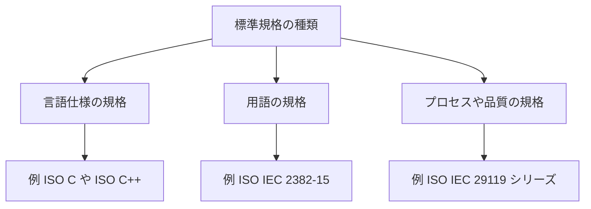

各ノードの意味：

- 「標準規格の種類」：規格を大きく3つに分けるための出発点
- 「言語仕様の規格」：特定の言語の文法や動作を決める規格
- 「用語の規格」：言葉の意味をそろえる規格。2382-15 はここに入る
- 「プロセスや品質の規格」：作業手順や品質の考え方を決める規格

📖 このセクションで登場した用語

- 規格（スタンダード）：多くの人が同じやり方・同じ意味で使えるように、合意して決めた文書
- 用語集（ボキャブラリ）：用語とその定義を集めた文書
- JTC 1：ISO と IEC が共同で設ける、情報技術分野の合同技術委員会
- ICS：国際規格分類。規格を分野別に整理する番号体系

---

## 第2章 ISO/IEC 2382 シリーズの中での位置づけ

💡 この章では、2382-15 が「ISO/IEC 2382 という大きな用語集シリーズの第15部」であることと、シリーズ全体の再編の中でどう扱われているかを説明します。

### 2-1. なぜシリーズ構造を知る必要があるのか

2382-15 だけを見ていると、「なぜ番号が15なのか」「他の部は何か」が分かりません。シリーズ全体の構造を知ると、関連する用語がどの部にあるかを探せるようになります。

### 2-2. たとえ話：百科事典の巻

ISO/IEC 2382 は、情報技術の用語を分野ごとに分けた**百科事典**のようなものです。第1部が基本用語の巻、第7部がコンピュータプログラミングの巻、第15部がプログラミング言語の巻、というように分冊されています。

### 2-3. 主な部の例

| 部 | 題名（英語） | 日本語での意味 |
|---|---|---|
| Part 1 | Fundamental terms | 基本用語 |
| Part 4 | Organization of data | データの編成 |
| Part 7 | Computer programming | コンピュータプログラミング |
| Part 15 | Programming languages | プログラミング言語（本ガイドの対象） |
| Part 16 | Information theory | 情報理論 |
| Part 17 | Databases | データベース |
| Part 19 | Analog computing | アナログ計算 |

※ Part 19 の題名は私の知識によるもので、今回の検索では題名まで確認できていません。第1・4・7・15・16・17部の題名は、公開されている目録の表示から確認しています。

### 2-4. 2015年の統合版との関係

2015年に ISO/IEC 2382:2015（Information technology — Vocabulary）が発行されました。これは複数の部を一つにまとめ直した用語集で、多くの旧パートが廃止されました。ISO の委員会ページの一覧では、次のように整理されています。

| 状態 | 該当する部（一覧に表示されたもの） |
|---|---|
| 廃止（Withdrawn） | 1, 2, 3, 5, 6, 8, 9, 10, 12, 13, 14, 17, 18, 20, 21, 23〜29, 31, 32, 34, 37 など |
| 現行（Published） | 4, 7, **15**, 16, 19 |
| 新版を開発中（Under development） | 1.2, 3, 4, 7, 9, 12.2, 13, **15**, 16, 17, 18, 19, 22, 25, 26, 38.2 |

この図は、2382-15 が辿ってきた系譜を表しています。左から右へ、時間順に読んでください。

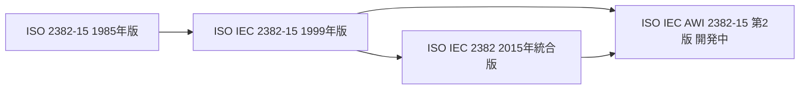

各ノードの意味：

- 「1985年版」：旧版。1999年版の発行時に廃止された
- 「1999年版」：本ガイドの対象。現行として登録されている
- 「2015年統合版」：複数の部を一冊にまとめた用語集
- 「AWI 2382-15 第2版」：2025年12月に登録された、改訂版の作業項目

📖 このセクションで登場した用語

- Part（部）：大きな規格シリーズを分野ごとに分けた1冊
- Withdrawn（廃止）：規格が取り下げられ、現行ではなくなった状態
- AWI：Approved Work Item。改訂や新規作成の作業項目として承認された段階
- 統合版：複数の規格を1つにまとめ直した版

---

## 第3章 ライフサイクルと現在のステータス（2026年10月11日時点）

💡 この章では、規格の「今の状態」を ISO の公式ページで確認した結果を示します。規格は古いまま現行扱いのこともあるため、日付つきで確認することが大切です。

### 3-1. なぜ「現行かどうか」を確認するのか

1999年の規格を、2026年にそのまま使ってよいのか、という疑問が生まれます。ステータスを見れば、「有効だが改訂が予定されている」のか「廃止された」のかが分かります。

### 3-2. 確認できた事実（ISO 公式ページより）

| 項目 | 内容 |
|---|---|
| ステータス | Published（発行済み） |
| 最新の確認 | 2025年に見直し（レビュー）され、現行のまま維持と確認された（2025-12-12 にステージ 90.93 で確認） |
| 現在のステージ | 90.92（International Standard to be revised：改訂予定） |
| 改訂版 | ISO/IEC AWI 2382-15（第2版）。2025-12-12 に新規プロジェクトとして承認・登録（ステージ 20.00） |
| 旧版 | ISO 2382-15:1985（廃止済み） |

### 3-3. 読み方の注意：情報源によって表示が違う

ISO のページのステージ履歴には、2015-04-29 付の「Withdrawal」という行が残っています。一方、ISO はこの1999年版を現行（Published）として示しています。これに対し IEC Webstore は、この1999年版を「Replaced」と表示し、2015年版と廃止日を記載しています。同じページには「Valid」と安定期限（2026年）も示されています。

ここから分かるのは、**ISO と IEC の表示が一致しておらず、原因（キャッシュ遅延など）を断定できない**という点です。購入や引用の前に、ISO と IEC の両方の表示を確認し、違いがあることを前提に扱ってください。

### 3-4. ステージの流れ

この図は、規格ができてから改訂に至るまでの流れを表しています。上から下へ読んでください。

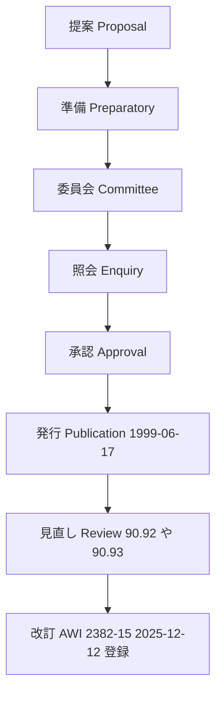

各ノードの意味：

- 「提案」から「承認」：規格案を作り、各国が投票して固める段階（本規格は1991年に登録され、1996年に DIS 投票、1999年1月に最終投票）
- 「発行」：1999年6月17日に国際規格として発行された
- 「見直し」：ほぼ5年ごとに「そのまま維持」「改訂」「廃止」のいずれかを決める
- 「改訂」：2025年12月に第2版の作業項目が登録された。2026年10月時点のステージは20.00（新規プロジェクト登録済み）

📖 このセクションで登場した用語

- ステージコード：規格の進行段階を表す番号。90.92 は「改訂予定」、90.93 は「現行のまま確認」
- DIS：Draft International Standard。国際規格案
- 見直し（Systematic Review）：定期的に規格が今も適切かを確認する手続き
- キャッシュ：情報の古いコピー。更新が遅れて古い内容が表示されることがある

---

## 第4章 規格が扱う概念の地図

💡 この章では、規格の節構成から「どんな概念が整理されているか」の地図を作ります。細かい定義に入る前に全体像をつかんでおくと、迷子になりません。

### 4-1. なぜ地図から始めるのか

用語集は、辞書のように索引で引くこともできますが、初学者は「どの分野の言葉か」の見当がつかないと探せません。分野の地図が先にあると、読む順序を決められます。

### 4-2. 節構成（確認できた範囲）

規格の第2章「Terms and definitions」には「15 Programming languages」があり、その下に 15.01〜15.10 の小節が並びます。ANSI の公開プレビューの記載にもとづき、15.02 は「Declarations（宣言）」、15.08 は「Execution（実行）」、15.09 は「Object-oriented programming」としています。15.02 は、JTC 1/SC 22 のドラフト審査資料に「15.02.04 implicit declaration」という用語があることとも整合します。その他の節名は、同一規格を採用した中国国家規格 GB/T 5271.15-2008 の目次（機械翻訳）から再構成したもので、本調査ではプレビューと突き合わせられていません。

| 節 | 分野（日本語） | 英語での推定表記 | 確認度 |
|---|---|---|---|
| 15.01 | 字句トークン | Lexical tokens | 第三者目次から再構成 |
| 15.02 | 宣言 | Declarations | ✅ ANSI プレビューの記載（SC22 資料の用語番号とも整合） |
| 15.03 | データオブジェクト | Data objects | 第三者目次から再構成 |
| 15.04 | データ型 | Data types | 第三者目次から再構成 |
| 15.05 | 文と式 | Statements and expressions | 第三者目次から再構成 |
| 15.06 | プログラム部品 | Program parts | 第三者目次から再構成 |
| 15.07 | タスク | Tasks | 第三者目次から再構成 |
| 15.08 | 実行 | Execution | ✅ ANSI プレビューの記載 |
| 15.09 | オブジェクト指向プログラミング | Object-oriented programming | ✅ ANSI プレビューで確認 |
| 15.10 | 機能と特性 | Features and characteristics | 第三者目次から再構成 |

> 🔎「第三者目次から再構成」とした節は、機械翻訳された目次にもとづくため、英語の節名を断定していません。公式プレビュー（第9章）で確認してください。

### 4-3. たとえ話：言語を「料理」にたとえる

| 規格の分野 | 料理にたとえると |
|---|---|
| 字句トークン | 材料を切り分けた一片（にんじんの輪切り、玉ねぎのみじん切り） |
| データオブジェクト・データ型 | 材料の種類と、入れる容器（液体用、固体用） |
| 文と式 | 「切る」「炒める」という手順の1行（文）と、「2 たす 3」のように結果が出る計算（式） |
| プログラム部品 | 「ソースを作る」という再利用できる小さなレシピ |
| タスク・実行 | 複数人で同時に調理する段取りと、実際に火にかける工程 |
| オブジェクト指向 | 道具と材料をひとまとめにした調理セット |
| 機能と特性 | 言語ごとの得意技（早い、安全、読みやすい、など） |

### 4-4. 概念の地図

この図は、ソースコードが書かれてから動くまでの流れの中に、各分野を配置したものです。左から右へ読んでください。

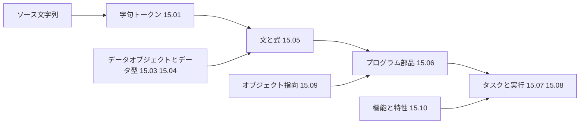

各ノードの意味：

- 「ソース文字列」：人間が書いたプログラムのテキスト
- 「字句トークン」：文字列を意味のある最小の単位に区切ったもの
- 「文と式」：トークンを組み合わせて命令や計算を作る
- 「プログラム部品」：文と式を束ねた、再利用できるかたまり
- 「実行とタスク」：部品を実際に動かす段階
- 「データオブジェクトとデータ型」：文と式が扱う値と、その種類の約束
- 「オブジェクト指向」：部品の作り方の一つの流儀
- 「機能と特性」：言語全体の性質（安全性や速度など）

📖 このセクションで登場した用語

- Part 15（第15部）：本規格の部番号。用語番号「15.xx.xx」の先頭の 15 はこの部番号に対応する。ICS 分類（35.060、01.040.35）とは別の番号体系である
- GB/T：中国の推奨国家規格。ISO/IEC 2382-15 を同一の内容で採用（IDT）している
- プレビュー：購入前に一部のページを読める公式の見本
- 機械翻訳：自動翻訳。誤訳が混じるため、重要な箇所は原典で確認する

---

## 第5章 ステップ別解説：ソースコードが動くまで

💡 この章では、第4章の地図を順にたどり、各分野の概念を実際のコードで確認します。コード例は規格の定義の転載ではなく、各言語の公式資料や著名な開発者の説明にもとづく、概念理解のための例です。

### STEP 1：字句トークン（Lexical tokens）

**なぜここから始めるのか**：コンピュータはまず「文字の並び」を読みます。意味のある最小単位に切り分けないと、その先の処理（文や式の解釈）が始められないためです。

**たとえ話**：文章を読むとき、人は文字ではなく「単語」で区切って理解します。トークンへの分割は、日本語の分かち書き（文を単語に区切ること）に似ています。

**用語**：トークン（＝コードを意味のある最小の部品に区切ったもの。名前、数値、記号など）

```python
import io
import tokenize

# 解析したいソースコードの文字列。
# 実ファイルを使わずに済ませるため、文字列で用意する。
source = "total = price * 3\n"

# generate_tokens は「文字列を1行ずつ返す関数」を要求する。
# StringIO(...).readline を渡すのは、文字列をファイルのように
# 1行ずつ読ませるためである。
tokens = tokenize.generate_tokens(io.StringIO(source).readline)

for tok in tokens:
    # tokenize.tok_name で番号を名前に直す。
    # 数字のままだと意味が読み取れないため。
    print(tokenize.tok_name[tok.type], repr(tok.string))
```

**動作トレース**（入力：`total = price * 3`）

| 順 | トークンの種類 | 文字列 | 役割 |
|---|---|---|---|
| 1 | NAME | `total` | 名前（変数名） |
| 2 | OP | `=` | 代入の記号 |
| 3 | NAME | `price` | 名前（変数名） |
| 4 | OP | `*` | かけ算の記号 |
| 5 | NUMBER | `3` | 数値 |
| 6 | NEWLINE | 改行 | 文の終わり |
| 7 | ENDMARKER | 終端 | 入力の終わり |

上の表は Python 標準ライブラリの `tokenize` が返す種類の名前にもとづく例です。ENCODING トークンの有無は、Python のバージョンではなく使う API で決まります。この例の `tokenize.generate_tokens()` は文字列を読むため ENCODING を出しません。バイト列を受け取る `tokenize.tokenize()` は、先頭に ENCODING トークンを出します。

この図は、トークンに分ける前後の流れを表しています。上から下へ読んでください。

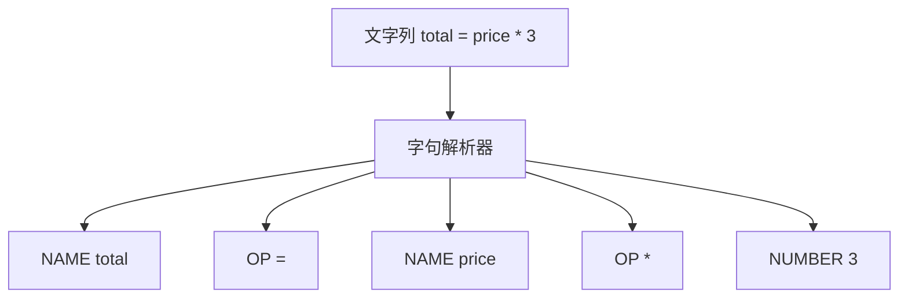

各ノードの意味：

- 「字句解析器」：文字列を先頭から読み、トークンに区切る部品（レキサ、トークナイザとも呼ぶ）
- 「NAME」「OP」「NUMBER」：トークンの種類（名前、記号、数値）

📖 このセクションで登場した用語

- トークン：コードを意味のある最小の部品に区切ったもの
- 字句解析：文字列をトークンの列に変える処理
- 標準ライブラリ：言語に最初から付いてくる部品集

---

### STEP 2：データオブジェクトとデータ型（Data objects / Data types）

**なぜ必要か**：同じ「3」でも、整数として足すのか、文字として並べるのかで結果が変わります。値にどんな種類の約束があるかを決めるのが、データ型です。

**たとえ話**：引き出しとラベル。引き出し（データオブジェクト）が値を入れる場所で、ラベル（データ型）が「ここには文房具だけ」という約束です。

**用語**：データオブジェクト（＝値を保持する入れ物）、データ型（＝入れ物に入れられる値の種類と、できる操作の約束）

```typescript
// 型注釈 number は「この入れ物には数値だけ」という約束。
// 実行前（コンパイル時）に誤りを見つけるために付ける。
const price: number = 120;

// 文字列を足そうとすると、型チェッカーが実行前に止める。
// 実行してから発覚する不具合を減らすための仕組みである。
// const total: number = price + "3"; // ← 型エラーになる

const count: number = 3;
const total: number = price * count; // 数値同士なので通る
```

TypeScript の型チェックは、TypeScript 7.0 から Go で書かれたネイティブ実装の `tsc` が担います。Microsoft は 7.0 を 2026年7月8日に公開し、フルビルドで通常 8〜12 倍速いと説明しています。型検査を省く変換専用ツールとは異なり、完全な型検査を保ったまま高速化している点が特徴です（詳細は第9章のソース）。

#### 静的型付けと動的型付けの比較

| 観点 | 静的型付け（例：TypeScript、Go、Rust） | 動的型付け（例：Python） |
|---|---|---|
| 型の検査時期 | 実行前（コンパイル時） | 実行時 |
| 利点 | 誤りを早く見つけやすい。大規模開発で見通しがよい | 書き始めが速い。試行錯誤しやすい |
| 注意点 | 型を書く手間がある | 実行して初めて分かる誤りが出る |

この図は、型の検査がどの時点で行われるかを表しています。左から右へ読んでください。

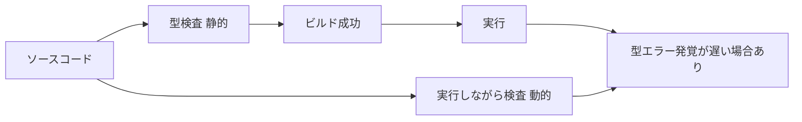

各ノードの意味：

- 「型検査 静的」：実行前に型の矛盾を探す工程
- 「実行しながら検査 動的」：実行の途中で型を確認する方式
- 「型エラー発覚が遅い場合あり」：動的方式では、その行に到達して初めて誤りに気づく場合がある

📖 このセクションで登場した用語

- 型注釈：変数や関数の型を明示的に書くこと
- 静的型付け：実行前に型を検査する方式
- コンパイル時：ソースコードを実行可能な形に変換する時点
- 型チェッカー：型の矛盾を探すツール

---

### STEP 3：文と式（Statements and expressions）

**なぜ区別するのか**：「結果の値を返すもの」と「動作を命じるだけのもの」を分けて考えると、コードの読み方が整理できます。

**たとえ話**：式は「電卓に打ち込む計算」で、答えが出ます。文は「お風呂を沸かす」のような指示で、実行しても答えの数字は返ってきません。

**用語**：式（＝評価すると値になるもの）、文（＝動作を指示する1単位）

```python
# 式の例。評価すると値（ここでは 15）になる。
# 値が返るので、他の式の一部にもできる。
result = (2 + 3) * 3

# 文の例。if は動作の流れを決める文。
# 文そのものは値を返さない（Python の if 文は式としては使えない）。
if result > 10:
    print("大きい")
```

```rust
// Rust では if が式として使える。
// 値を返せる分、別の変数へ直接代入できるのが特徴である。
let label = if 15 > 10 { "大きい" } else { "小さい" };
```

言語によって、文と式の境界は異なります。この違いが「その言語らしさ」を作ります。

この図は、式と文の関係を表しています。上から下へ読んでください。

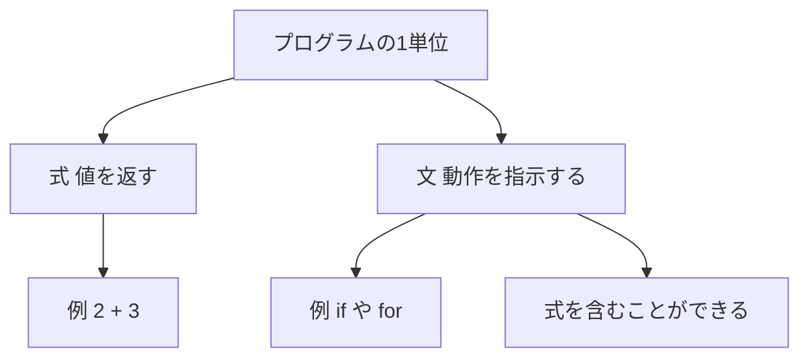

各ノードの意味：

- 「式」：評価すると値になる。計算式や関数の呼び出しなど
- 「文」：処理の流れを作る。条件分岐や繰り返しなど
- 「式を含むことができる」：文の中に式を入れて、条件や計算に使える

📖 このセクションで登場した用語

- 評価：式を計算して値を得ること
- 代入：変数に値を入れること
- 条件分岐：条件によって処理を切り替える仕組み（if など）

---

### STEP 4：プログラム部品（Program parts）

**なぜ必要か**：大きなプログラムを一枚岩で書くと、読めず、直せず、再利用もできません。部品に分けると、役割ごとに理解できます。

**たとえ話**：レシピ集。「ソースの作り方」という小さなレシピを別に書いておくと、複数の料理から呼び出せます。

**用語**：関数（＝名前を付けた処理のかたまり）、パッケージ（＝関連する関数をまとめた単位）

Go の設計者の一人である Rob Pike は、Go を「大規模なソフトウェアを書き、読み、デバッグし、保守する人のために設計した」と述べています。彼は 2012年の講演で、依存関係を言語の構文で表す設計や、ビルド速度の重視を説明しました。部品の分け方が、言語設計の中心課題になることが分かります。

```go
// package で「この部品が属するまとまり」を宣言する。
// Go は依存関係を言語の構文で明示させ、ビルドを速くする設計である。
package main

import "fmt"

// 関数 add：2つの整数を受け取り、合計を返す部品。
// 型を引数と戻り値に書くのは、呼び出し側が使い方を
// 実装を読まずに把握できるようにするためである。
func add(a int, b int) int {
    return a + b
}

func main() {
    fmt.Println(add(2, 3)) // 5 が表示される
}
```

この図は、部品が組み合わさって一つのプログラムになる様子を表しています。上から下へ読んでください。

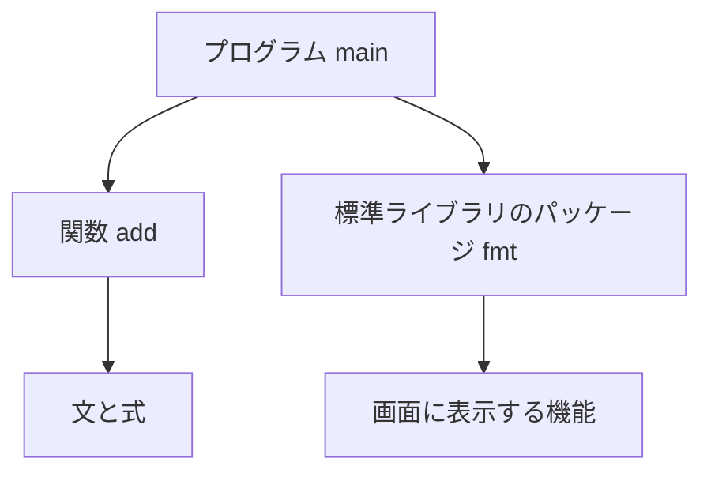

各ノードの意味：

- 「プログラム main」：実行の入口になる部品
- 「関数 add」：自分で書いた小さな部品
- 「標準ライブラリのパッケージ fmt」：Go の標準ライブラリに含まれる部品。画面表示などを担う

📖 このセクションで登場した用語

- 依存関係：ある部品が別の部品を必要とする関係
- 関数：名前を付けた処理のかたまり
- パッケージ：関連する部品をまとめた単位
- 戻り値：関数が呼び出し元へ返す値

---

### STEP 5：タスクと実行（Tasks / Execution）

**なぜ必要か**：書いたプログラムは、実行して初めて意味を持ちます。実行の仕方（コンパイルするのか、解釈するのか）と、同時に動く仕組み（タスク）を知ると、性能や不具合の原因が読み解けます。

#### 5-1. 実行方式の違い

**たとえ話**：外国語の本を読むのに、①全文を翻訳してから読む（コンパイル）、②1行ずつ通訳を付けて読む（インタープリタ）、③いったん中間の言語に訳してから、通訳が読み上げる（バイトコード＋仮想マシン）、という違いです。

| 方式 | 動き | 例 |
|---|---|---|
| コンパイル | ソースを先に機械語へ変換してから実行 | C++、Go、Rust |
| インタープリタ | ソースを読みながら実行 | 古典的な処理系 |
| バイトコード＋仮想マシン | ソースを中間表現（バイトコード）へ変換し、仮想マシンが実行 | Python（CPython） |

Python の公式用語集では、ソースコードはバイトコードにコンパイルされ、仮想マシンがそれを実行する、と説明されています。C++ については、Bjarne Stroustrup が「C は機械モデルに近く、C++ はそこへ抽象化の仕組みを加えた」という趣旨の説明を残しています。

```python
import dis

def greet(name):
    return f"Hello, {name}!"

# dis モジュールでバイトコードを人間が読める形に出す。
# 実行の裏側で何が起きているかを確認するための道具である。
dis.dis(greet)
```

この図は、Python のソースが実行されるまでの流れを表しています。左から右へ読んでください。


各ノードの意味：

- 「バイトコードへ変換」：人間向けのコードを、仮想マシン向けの命令列に直す
- 「pyc キャッシュ」：変換結果を保存し、次回の実行を速くする
- 「仮想マシンが実行」：バイトコードを1命令ずつ処理する

#### 5-2. タスク（同時に進める仕事）

**たとえ話**：レストランの厨房で、複数の料理人が同時に別々の料理を作る状態です。皿（データ）を2人が同時に触ると混乱するので、受け渡しの約束が要ります。

Go は、軽量な並行処理の仕組み（ゴルーチン）を言語に組み込みました。Rob Pike の講演では、Go が「コンパイルされ、並行処理に対応し、ガベージコレクションを持ち、静的に型付けされる言語」として紹介されています。

```go
package main

import (
    "fmt"
    "sync"
)

func main() {
    var wg sync.WaitGroup // 全タスクの終了を待つための仕組み。
    // 待たないと main が先に終わり、他のタスクが途中で打ち切られるため。

    for i := 1; i <= 3; i++ {
        wg.Add(1) // 待つ対象を1つ増やす
        go func(n int) { // go を付けると別タスクとして動く
            defer wg.Done() // 終わったことを知らせる
            fmt.Println("タスク", n)
        }(i) // 引数で i を渡すのは、ループ変数の共有による取り違えを避けるため
    }

    wg.Wait() // 3つが終わるまでここで待つ
}
```

Python では、2025年10月に公開された Python 3.14 で、GIL（グローバルインタプリタロック）を使わない「フリースレッド版」が PEP 779 によって公式サポートに移行しました。ただし標準ビルドとは別で、任意に選ぶ位置づけです。

| 言語 | 同時実行の主な仕組み（本ガイドで確認した範囲） |
|---|---|
| Go | ゴルーチン（言語組み込み）と同期の仕組み |
| Python 3.14 | フリースレッド版（公式サポート、標準ビルドとは別）、複数インタープリタ（`concurrent.interpreters`） |
| C++26 | 非同期処理の統一的な枠組み（InfoQ の報道による。詳細は第9章） |

この図は、複数のタスクが進み、最後に待ち合わせる様子を表しています。上から下へ読んでください。

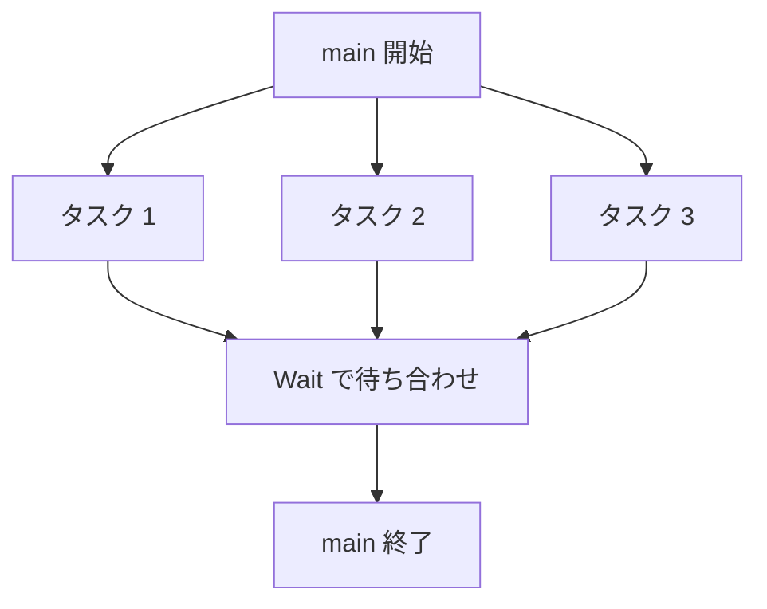

各ノードの意味：

- 「タスク 1」から「タスク 3」：同時に進む仕事
- 「Wait で待ち合わせ」：全てのタスクが終わるまで main を止める地点

📖 このセクションで登場した用語

- コンパイル：ソースを実行できる形へ先に変換すること
- インタープリタ：ソースを読みながら実行する処理系
- バイトコード：仮想マシン用の中間的な命令列
- 仮想マシン：ソフトウェアで作った架空の計算機
- GIL：GIL が有効な CPython で、Python バイトコードを同時に実行できるスレッドを1つに制限する仕組み。I/O 待ちなどで GIL を手放している間は、他のスレッドが動ける。フリースレッド版（Python 3.13 で実験的に導入、3.14 で公式サポート）のビルドでは GIL を無効にできる。ただし、環境変数 `PYTHON_GIL=1` や `-X gil=1` を指定した場合や、フリースレッド対応を宣言していない C 拡張を読み込んだ場合は、GIL が有効になる
- ゴルーチン：Go の軽量な並行処理の単位
- ガベージコレクション：使い終わったメモリを自動で回収する仕組み

---

### STEP 6：オブジェクト指向プログラミング（Object-oriented programming）

**なぜ必要か**：データと、そのデータを扱う処理を一緒にまとめると、大規模なプログラムの見通しがよくなります。

**たとえ話**：調理セット。包丁とまな板をバラバラに置くより、「寿司セット」として箱にまとめれば、使う人は中身の細部を気にせず使えます。

**用語**：クラス（＝設計図）、オブジェクト（＝設計図から作った実体）、カプセル化（＝中身を隠し、必要な操作だけ公開すること）

Stroustrup は、C++ の考え方を次のように説明しています。Simula のような「人間にとって扱いやすい抽象化」と、C のような「ハードウェアに近い効率」を一つの言語で両立させる、というものです。効率の良い抽象化を、インフラを支える場面でも使えるようにすることが強みだと述べています。

```cpp
#include <iostream>

// クラスは「データ」と「そのデータを扱う処理」をまとめる設計図。
class Counter {
public:
    void increment() { ++value_; } // 公開する操作はこれだけに絞る
    int get() const { return value_; }

private:
    // value_ を外から直接触らせない（カプセル化）。
    // 不正な値に書き換えられる事故を防ぎ、内部の作りを後から
    // 変えても使う側のコードが壊れないようにするためである。
    int value_ = 0;
};

int main() {
    Counter c;       // 設計図から実体（オブジェクト）を作る
    c.increment();
    std::cout << c.get() << "\n"; // 1
}
```

この図は、クラスとオブジェクトの関係を表しています。上から下へ読んでください。

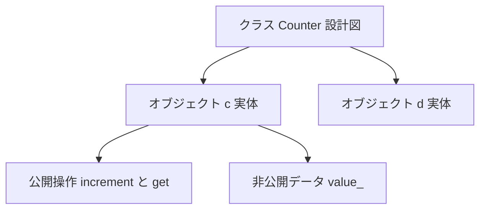

各ノードの意味：

- 「クラス」：データと操作の定義。実体を作る元になる
- 「オブジェクト」：クラスから作られた、実際に動く実体
- 「公開操作」：外から呼べる操作
- 「非公開データ」：外から直接触れない内部の値

📖 このセクションで登場した用語

- クラス：データと処理をまとめた設計図
- オブジェクト：クラスから作った実体
- カプセル化：内部を隠し、公開する操作を絞ること
- 抽象化：細部を隠して本質だけを扱えるようにすること

---

### STEP 7：言語の機能と特性（Features and characteristics）

**なぜ必要か**：言語は、何を重視するかで設計が変わります。速度、安全性、読みやすさなど、「その言語の性格」を見分けられると、用途に合った選択ができます。

**たとえ話**：自動車の性格づけ。スポーツカーは速さ、ミニバンは積載量、といった具合に、設計の優先順位が異なります。

#### 7-1. Rust：所有権によるメモリ安全性

Rust の公式ドキュメントは、所有権（Ownership）を「Rust 特有の機能で、ガベージコレクタなしにメモリ安全性を保証できる」ものと説明しています。ルールは次の3つです。

1. 各値には「所有者」と呼ぶ変数が1つある
2. 所有者は同時に1つだけ
3. 所有者がスコープ（有効範囲）を出ると、値は破棄される

**たとえ話**：図書館の本の貸し出し。本（値）は一度に1人（所有者）しか持てません。借りた人が退館（スコープ外）するときに本は返却されます。

```rust
fn main() {
    let a = String::from("hello"); // a が文字列の所有者
    let b = a;                     // 所有権が b へ移動（move）する

    // println!("{}", a); // ← エラー。a はもう所有者ではない。
    // 同じメモリを2人が解放する二重解放を、コンパイル時に防ぐ。
    println!("{}", b);    // b は使える
}
```

#### 7-2. C++26：契約とリフレクション

C++ の標準化を長く担ってきた Herb Sutter は、2026年3月29日に「C++26 の技術作業が完了した」と報告しました。報道では、C++26 には次の機能が含まれるとされています。

| 機能 | 概要 |
|---|---|
| リフレクション | コンパイル時にコードの構造を調べ、コード生成にも使える |
| 契約（Contracts） | 関数の事前条件・事後条件と、言語組み込みの表明（アサーション）文 |
| 標準ライブラリの強化 | 未定義動作の一部を契約違反として扱うなどの安全性向上 |
| 非同期の枠組み | 並行・並列処理の統一的な枠組み |

契約は賛否があり、最終投票は賛成 114、反対 12、棄権 3 でした（報道による）。また、規格文書は国際承認投票と編集作業を経て ISO から発行される予定で、2026年10月11日時点で発行済みかは本調査では確認できていません。

この図は、言語が何を重視するかの違いを表しています。左から右へ読んでください。

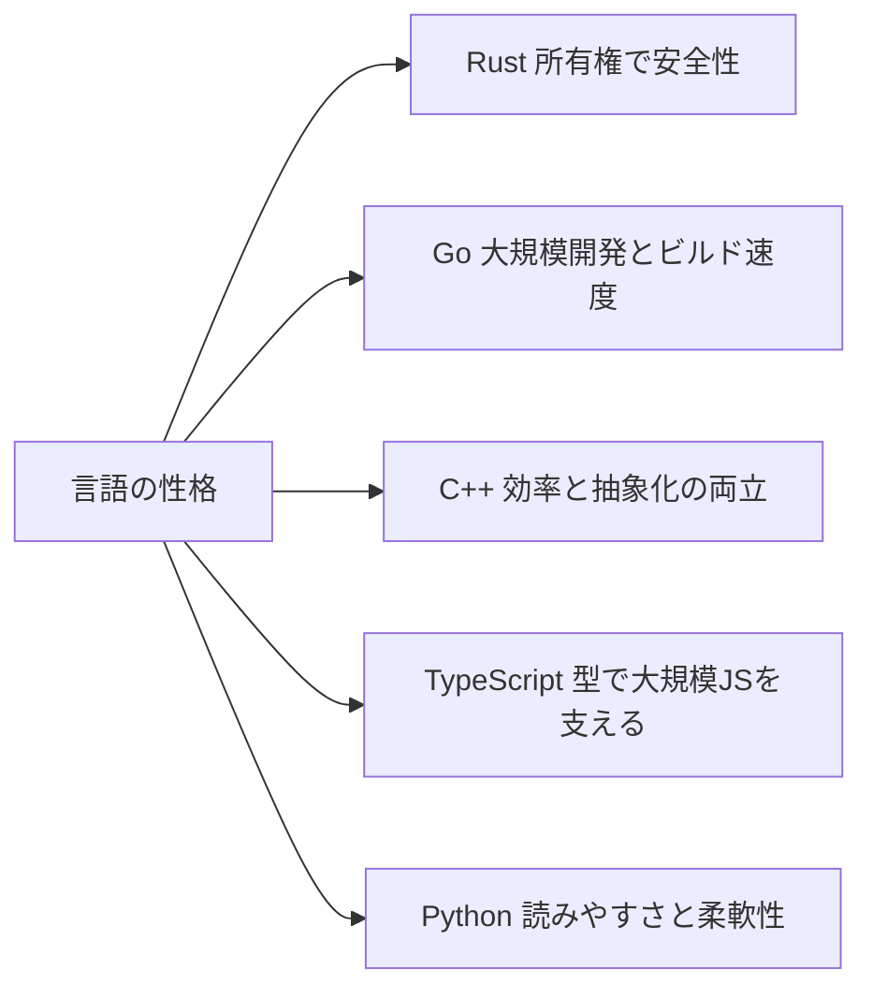

各ノードの意味：

- 「Rust 所有権で安全性」：コンパイル時にメモリの誤用を防ぐ設計
- 「Go 大規模開発とビルド速度」：大きな組織の開発の遅さを減らす設計
- 「C++ 効率と抽象化の両立」：高度な抽象化を、実行効率を保ったまま使える設計
- 「TypeScript 型で大規模JSを支える」：JavaScript に型を足し、大規模開発を助ける設計
- 「Python 読みやすさと柔軟性」：書き始めの速さと読みやすさを重視する設計（本ガイドでは実装の仕組みを確認）

📖 このセクションで登場した用語

- 所有権：値の持ち主を1人に決め、メモリの管理を安全にする Rust の仕組み
- スコープ：変数が有効な範囲
- 未定義動作：言語の規則が結果を定めていない動作。バグや脆弱性の原因になりやすい
- 契約：関数が守るべき前提と保証を、コードに書く仕組み
- リフレクション：プログラム自身の構造を、プログラムから調べる仕組み

---

## 第6章 1999年の語彙と2026年の現場のギャップ

💡 この章では、1999年に作られた用語集と、2026年の言語事情とのずれを整理します。規格を「古いから無意味」と切り捨てず、「どこまでが土台で、どこからが新しいか」を見分けるための章です。

### 6-1. なぜギャップを知るのか

用語集は、時代の概念の写真です。写真に写っていない概念（後から生まれたもの）は、別の資料で補う必要があります。補う場所が分かれば、規格を土台として安心して使えます。

### 6-2. 土台として今も使える概念と、後から重要になった概念

| 区分 | 概念の例 | 本ガイドでの扱い |
|---|---|---|
| 土台として今も通じる | 字句トークン、データ型、文と式、プログラム部品、実行、オブジェクト指向 | 第5章 STEP 1〜6 |
| 現代で重要性が増した | 型推論と高速な型検査、所有権、契約、コンパイル時リフレクション、フリースレッド、非同期 | 第5章 STEP 2・5・7 |

> 🔎 上の「後から重要になった概念」が1999年版に載っているかどうかは、本文を確認できていないため断定しません。新版（AWI 2382-15）がこれらをどう扱うかは、今後の注目点です。

### 6-3. 2026年10月時点の主な動き（確認できたもの）

| 日付 | 出来事 | 出典の種類 |
|---|---|---|
| 2025-03-11 | Anders Hejlsberg が TypeScript コンパイラの Go によるネイティブ移植を発表 | 本人の発表（報道経由） |
| 2025-10-07 | Python 3.14 が公式リリース。フリースレッド版が公式サポートへ | 日本語解説記事（@IT） |
| 2025-12-12 | ISO/IEC 2382-15 の見直し確認と、第2版 AWI の登録 | ISO 公式 |
| 2026-03-28 / 29 | ISO C++ 委員会が C++26 の技術作業を完了 | Herb Sutter 本人のブログ |
| 2026-07-08 | TypeScript 7.0 が公開（Go ネイティブの `tsc`） | 報道・公式ブログ引用 |

この図は、規格と現代の言語の動きを時間軸で並べたものです。上から下へ、古い順に読んでください。

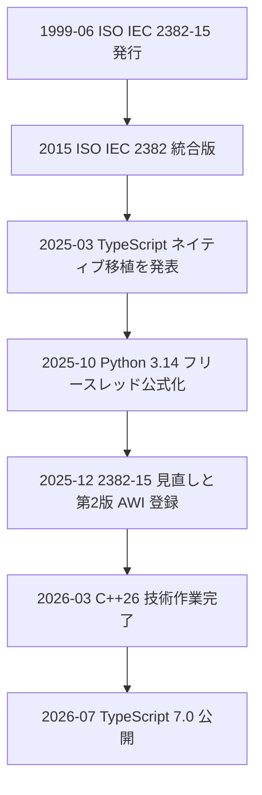

各ノードの意味：

- 「1999-06」：本ガイドの対象規格の発行
- 「2015 統合版」：用語集シリーズの再編
- 「2025〜2026」の各項目：言語・処理系の主要な更新と、規格の改訂着手

📖 このセクションで登場した用語

- 型推論：型を書かなくても、コンパイラが型を判断する仕組み
- ネイティブ実装：特定の機械向けにコンパイルされた実装
- AWI：改訂・新規作成の作業項目として承認された段階
- 技術作業完了：規格の中身を固める委員会作業が終わった段階（ISO 発行とは別）

---

## 第7章 実務での使いどころ（エンジニア・QA 向け）

💡 この章では、用語集としての規格を、日々の仕様書・レビュー・テスト設計にどう活かすかを示します。

### 7-1. なぜ用語をそろえるのか

「関数」「メソッド」「手続き」「サブルーチン」のように、同じものを違う名前で呼ぶと、仕様書とコードとテストが食い違います。共通の用語集があると、認識のずれを早い段階で見つけられます。

### 7-2. 活用の流れ

この図は、用語集を実務に使う流れを表しています。上から下へ読んでください。

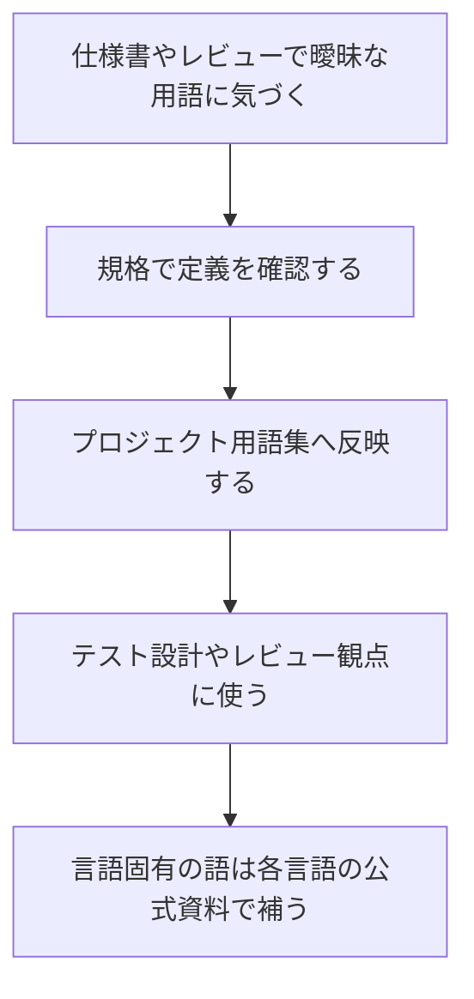

各ノードの意味：

- 「曖昧な用語に気づく」：同じ語が人によって違う意味で使われている状態
- 「規格で定義を確認する」：公式プレビューや正規版で、定義と関連語を調べる
- 「プロジェクト用語集へ反映する」：チーム共通の言葉として文書に残す
- 「言語固有の語は公式資料で補う」：規格にない現代的な概念は、言語ごとの公式資料を参照する

### 7-3. チェックリスト

- [ ] 仕様書で「文」「式」「関数」などの語が、一貫した意味で使われているか
- [ ] 言語固有の語（所有権、ゴルーチンなど）を、一般語と混ぜて使っていないか
- [ ] 引用する定義は、公式の正規版またはプレビューで確認したか
- [ ] 規格のステータス（現行・改訂予定）を、ISO 公式ページの日付つきで確認したか
- [ ] 規格本文を無断で転載せず、要約や参照にとどめているか

📖 このセクションで登場した用語

- 用語集（プロジェクト用）：チームで言葉の意味をそろえるための一覧
- レビュー観点：レビュー時に確認する項目の一覧
- 正規版：公式に発行された完全な版

---

## 第8章 理解度チェック

💡 この章では、ここまでの内容を自分の言葉で説明できるか確認します。答えは `<details>` を開くと表示されます。

**Q1.** ISO/IEC 2382-15:1999 は、言語の「文法」を決める規格ですか、それとも「用語」を決める規格ですか。

<details>
<summary>答えを見る</summary>

用語を決める規格です。プログラミング言語に関する概念を、特定の言語に偏らない形で定義した用語集です。

</details>

**Q2.** 2026年10月11日時点で、ISO 公式ページが示す本規格のステータスと、改訂の状況を述べてください。

<details>
<summary>答えを見る</summary>

ステータスは Published（現行）で、2025年12月12日に見直しの結果として維持が確認されました。ステージは 90.92（改訂予定）で、第2版の作業項目 AWI 2382-15 が同日に登録されています。

</details>

**Q3.** 「式」と「文」の違いを、たとえ話を使って説明してください。

<details>
<summary>答えを見る</summary>

式は評価すると値になるもの（電卓の計算）、文は動作を指示するもの（「お風呂を沸かす」）です。言語によって境界が違い、例えば Rust では if を式として使えます。

</details>

**Q4.** 規格の節名のうち、本ガイドが「公式プレビューで要確認」とした理由は何ですか。

<details>
<summary>答えを見る</summary>

規格本文が有料で、節名の根拠は ANSI のプレビュー（15.02・15.08・15.09）と、中国国家規格の機械翻訳された目次だけだったためです。後者にもとづく節名は、英語の正式名を断定できません。

</details>

**Q5.** Rust の所有権の3つのルールを挙げてください。

<details>
<summary>答えを見る</summary>

各値には所有者が1つある、所有者は同時に1つだけ、所有者がスコープを出ると値が破棄される、の3つです。

</details>

📖 このセクションで登場した用語

- 理解度チェック：学んだ内容を自分の言葉で説明して確認する作業
- details タグ：クリックで内容を開閉できる Markdown/HTML の機能

---

## 第9章 根拠となるソース一覧（URL）

💡 この章では、本ガイドの根拠を種類別に示します。情報は2026年10月11日時点の検索結果にもとづきます。

### 9-1. 規格そのものの情報（一次情報）

| 内容 | URL |
|---|---|
| ISO/IEC 2382-15:1999 公式ページ（ステータス・ステージ履歴） | <a href="https://www.iso.org/standard/7257.html" target="_blank" rel="noopener noreferrer">https://www.iso.org/standard/7257.html</a> |
| ISO/IEC AWI 2382-15（第2版の作業項目） | <a href="https://www.iso.org/standard/93664.html" target="_blank" rel="noopener noreferrer">https://www.iso.org/standard/93664.html</a> |
| ISO/IEC 2382:2015（統合版・各部の状態一覧） | <a href="https://committee.iso.org/standard/63598.html" target="_blank" rel="noopener noreferrer">https://committee.iso.org/standard/63598.html</a> |
| IEC Webstore（書誌情報・安定期限 2026） | <a href="https://webstore.iec.ch/publication/11070" target="_blank" rel="noopener noreferrer">https://webstore.iec.ch/publication/11070</a> |
| ANSI Webstore（スコープ記述） | <a href="https://webstore.ansi.org/standards/iso/isoiec2382151999" target="_blank" rel="noopener noreferrer">https://webstore.ansi.org/standards/iso/isoiec2382151999</a> |
| ANSI 公式プレビュー PDF（目次の一部・15.02・15.08・15.09 の節名） | <a href="https://webstore.ansi.org/preview-pages/ISO/preview_ISO+IEC+2382-15-1999.pdf" target="_blank" rel="noopener noreferrer">https://webstore.ansi.org/preview-pages/ISO/preview_ISO+IEC+2382-15-1999.pdf</a> |

### 9-2. 目次の再構成に使った第三者情報（機械翻訳のため要確認）

| 内容 | URL |
|---|---|
| GB/T 5271.15-2008（ISO/IEC 2382-15:1999 の同一採用規格）の概要 | <https://www.chinesestandard.net/Related.aspx/GBT5271.15-2008> |
| JTC 1/SC 22 のドラフト審査資料（1997年、「15.02.04 implicit declaration」の記載） | <https://open-std.org/jtc1/SC22docs/230> |
| 規格の一覧ページ（1999-06 の発行日の確認） | <https://www.unicode.org/L2/L2001/01178-2382.htm> |

### 9-3. 著名な開発者・コミュニティの一次発信

| 発信者 | 内容 | URL |
|---|---|---|
| Rob Pike（Go 共同設計者） | 「Go at Google」：言語設計をソフトウェア工学のために行う | <https://go.googlesource.com/talks/+/master%5E/content/2012/splash.article> |
| Go 公式ブログ | 上記講演・論文の紹介 | <https://blog.golang.org/two-recent-go-articles> |
| Bjarne Stroustrup（C++ 設計者） | C++ のスタイルと抽象化の考え方 | <https://stroustrup.com/style95.pdf> |
| Bjarne Stroustrup | 抽象化と効率の両立に関するインタビュー | <https://develop-plus.bigthink.com/?p=72983> |
| Herb Sutter（元 ISO C++ 委員会議長） | 「C++26 is done!」2026年3月29日 | <https://herbsutter.com/2026/03/29/c26-is-done-trip-report-march-2026-iso-c-standards-meeting-london-croydon-uk/> |
| Herb Sutter | 2026年6月の委員会報告（C++29 へ向けた契約の拡張） | <https://herbsutter.com/category/c/> |
| Anders Hejlsberg（TypeScript 設計者） | ネイティブ移植の発表（ブログ紹介） | <https://mjtsai.com/blog/?p=47088> |
| Anders Hejlsberg | 発表内容の報道（2025年5月） | <https://www.infoq.com/news/2025/05/new-typescript-compiler-10x-fast> |
| TypeScript チーム | TypeScript 7.0 公開の報道（2026年8月） | <https://www.infoq.com/news/2026/08/typescript-7-released/> |
| TypeScript チーム | typescript-go の今後に関する Q&A（2026年7月9日） | <https://github.com/microsoft/typescript-go/discussions/4576> |
| Rust プロジェクト | 所有権の公式説明 | <https://doc.rust-lang.org/stable/book/ownership.html> |
| Python プロジェクト | Python 3.14.1 リリースページ（PEP 779 を含む主要機能） | <https://www.python.org/downloads/release/python-3141/> |
| Python プロジェクト | What's New in Python 3.14 | <https://docs.python.org/3.14/whatsnew/3.14.html> |
| Python（解説） | バイトコードの用語解説 | <https://realpython.com/ref/glossary/bytecode> |
| Python（日本語解説） | 3.14 のフリースレッド版の経緯 | <https://atmarkit.itmedia.co.jp/ait/spv/2510/09/news014.html> |

### 9-3-補. 報道（C++26）

| 内容 | URL |
|---|---|
| C++26 の機能概要（InfoQ、2026年4月） | <https://www.infoq.com/news/2026/04/cpp-26-reflection-safety-async/> |
| 契約の採否と投票結果（DevClass、2026年4月1日） | <https://www.devclass.com/development/2026/04/01/contracts-are-in-c26-despite-disquiet-over-their-value/5213555> |

### 9-4. このガイドの限界

| 項目 | 内容 |
|---|---|
| 本文の未確認 | 規格本文が有料で、ISO の著作権表示が AI 利用を制限しているため、用語の定義文は確認も転載もしていない |
| 節名の再構成 | 15.02・15.08・15.09 以外の節名は第三者の機械翻訳目次に依存している |
| C++26 の ISO 発行 | 技術作業の完了までは確認したが、ISO 発行済みかは未確認 |
| 現代概念の記載有無 | 1999年版が第6章の「後から重要になった概念」を扱うかは未確認 |

> ✅ 次の一歩：ISO のオンライン閲覧プラットフォーム（OBP）のプレビューで、15.01〜15.10 の正式な節名を確認し、第4章の表の「確認度」を更新すると、文書の精度がさらに上がります。

📖 このセクションで登場した用語

- 一次情報：発言者や発行元が直接出した情報
- OBP：ISO の Online Browsing Platform。規格の一部を画面上で閲覧できる
- 同一採用（IDT）：国際規格を内容変更なしで自国規格にすること

---

*本ガイドは2026年10月11日時点の公開情報にもとづく学習用の解説です。規格の正式な定義・要求事項は、必ず ISO/IEC の正規版でご確認ください。*
