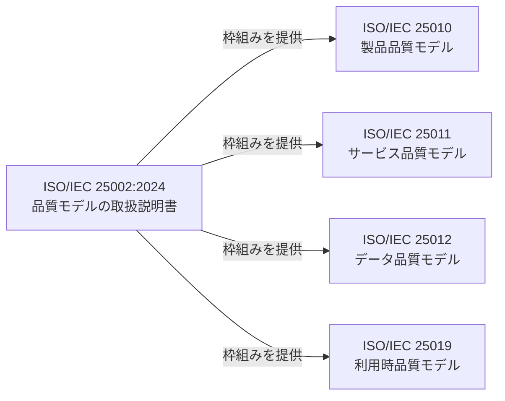
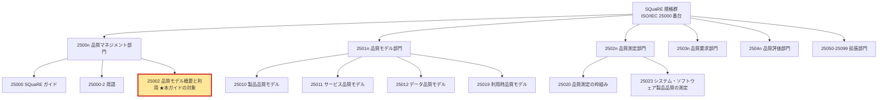
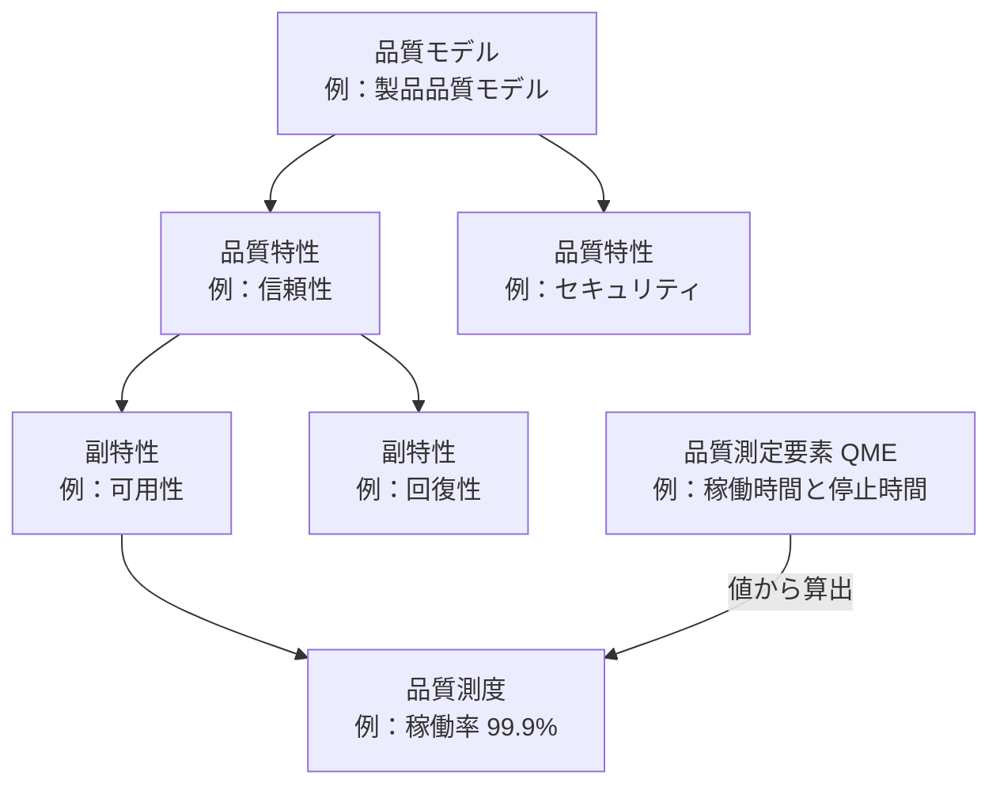
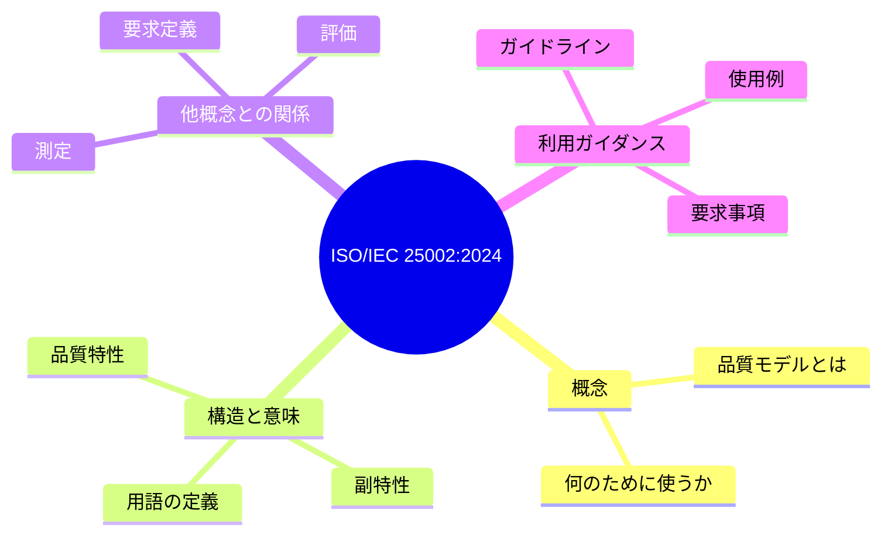
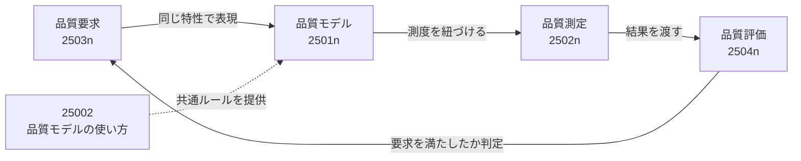
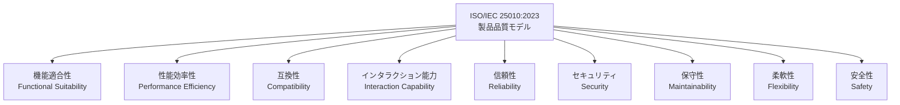
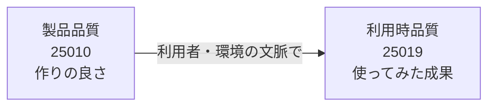
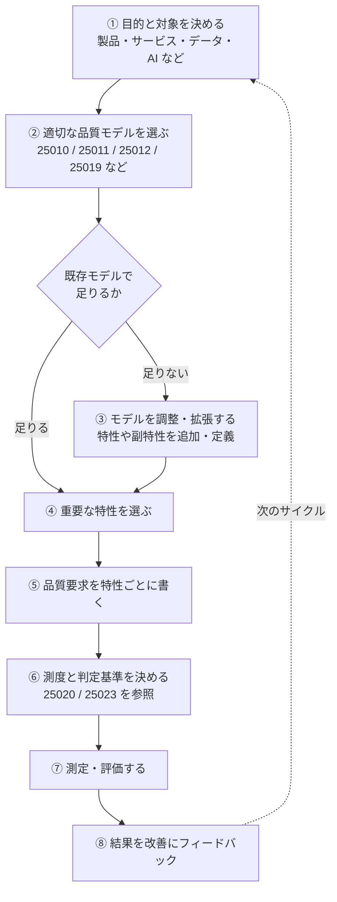
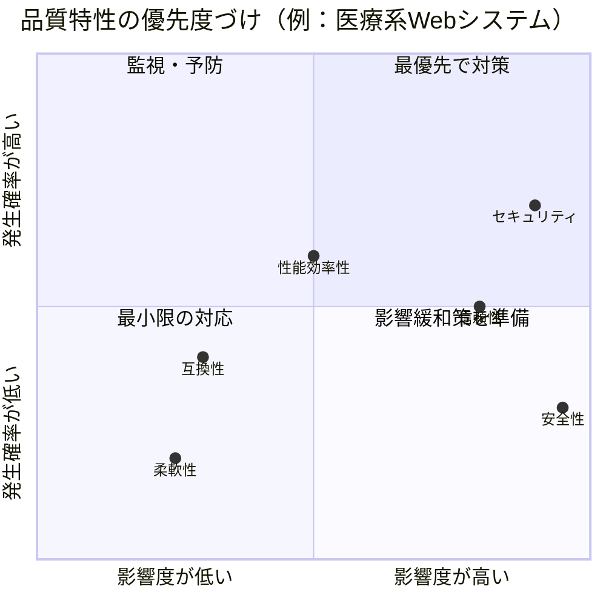
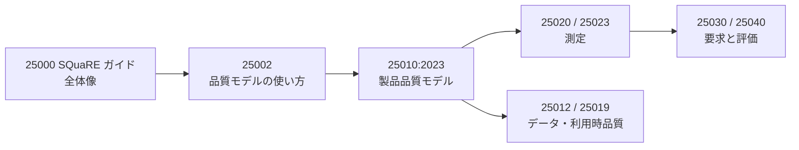

# ISO/IEC 25002:2024 初学者向けステップバイステップ解説ガイド

> **対象規格**：ISO/IEC 25002:2024 *Systems and software engineering — Systems and software Quality Requirements and Evaluation (SQuaRE) — Quality model overview and usage*
> **日本語での通称**：品質モデルの概要と利用（SQuaRE 品質モデル概要と使用法）
> **調査基準日**：2026年10月16日までに公開されている情報
> **想定読者**：ソフトウェア／QAエンジニア、品質保証・テスト設計の初学者

---

## 0. このガイドの読み方と「確度の凡例」

ISO/IEC 25002:2024 は全17ページの規格で、ISO公式ページの価格表示は `CHF 0` です。ただし、価格表示だけでは本文の閲覧可否や提供条件を判断できません。閲覧条件はISO公式ページで確認してください。本ガイドでは、**情報の確かさを3段階で区別**して書いています。

| 記号 | 意味 | 根拠 |
|:---:|---|---|
| ✅ | **公式情報で確認済み** | ISO公式ページ、各国標準機関のストア、ISO/IEC PRF 25000-2（承認段階）の情報 など |
| 📘 | **関連規格・解説記事で確認済み** | ISO/IEC 25010:2023 の解説（arc42 Quality Model、SonarSource 等） |
| 🔶 | **筆者による整理・解説** | 上記を踏まえた初学者向けの噛み砕き。**規格本文の逐語ではありません**。実務で厳密に引用する際は原典で確認してください |

> ⚠️ 規格本文の条項番号・要求事項（shall）の細部は、検索では確認できていません。**「何が書いてあるか」の骨格は ✅、「どう使うか」の具体例は 🔶** と理解してください。

---

## 1. 一言でいうと

**ISO/IEC 25002:2024 は「品質モデル（品質特性・副特性の体系）とは何か、どう作り、どう使うか」を説明する“品質モデルの取扱説明書”です。**

- ✅ 品質特性（quality characteristics）と副特性（sub-characteristics）で構成される**品質モデルを定義するための枠組み**を確立する規格です
- ✅ 具体的な特性の一覧（例：信頼性、セキュリティ）は 25002 ではなく、**ISO/IEC 25010 などの個別モデル規格**が定義します
- 🔶 例えるなら、25010 が「料理のレシピ集」、25002 が「レシピの読み方と、新しいレシピの作り方の手引き」です

---

## 2. 基本情報（✅ 公式情報で確認済み）

| 項目 | 内容 |
|---|---|
| 規格番号 | ISO/IEC 25002:2024 |
| 版 | Edition 1（第1版） |
| 発行時期 | 2024年3月（ISO公式ページの表記は 2024-03。各国ストアでは 2024-03-03/04 と記載） |
| 種別 | 国際規格（International Standard） |
| ステージ | 60.60（国際規格として発行済み） |
| ページ数 | 17ページ |
| 言語 | 英語 |
| 担当委員会 | ISO/IEC JTC 1/SC 7（ソフトウェア及びシステムエンジニアリング） |
| ICS分類 | 35.080（ソフトウェア） |

---

## 3. 全体像：SQuaRE シリーズの中での位置づけ

### 3.1 SQuaRE とは

✅ **SQuaRE（Systems and software Quality Requirements and Evaluation）** は ISO/IEC 25000 番台の規格群で、システム・ソフトウェアの**品質要求と品質評価**を扱います。以前の ISO/IEC 9126 と ISO/IEC 14598 を置き換える体系です。

### 3.2 5つの部門（Division）と拡張部門

✅ ISO/IEC PRF 25000-2（ステージ 50.00、承認段階）の記述に基づく整理です。

| 部門 | 番号帯 | 役割 | 代表的な規格 |
|---|---|---|---|
| 品質マネジメント | 2500n | 全体のガイド・用語・品質モデルの使い方 | 25000、25000-2、**25002** |
| 品質モデル | 2501n | 品質を分解する「物差しの体系」 | 25010、25011、25012、25019 |
| 品質測定 | 2502n | 品質を数値で測る方法 | 25020、25022、25023、25024 |
| 品質要求 | 2503n | 品質要求の定義 | 25030 |
| 品質評価 | 2504n | 品質評価の手順 | 25040 |
| 拡張 | 25050〜25099 | 特定領域向けの補完（例：クラウド、AI） | ISO/IEC TS 25052-1:2022（クラウドサービス品質モデル）、ISO/IEC 25059:2023（AIシステム。第1版。第2版FDISを開発中）など |

> 📘 ISO/IEC 25059:2023（AIシステム向け品質モデル。第1版。第2版FDISを開発中）や ISO/IEC TS 25052-1:2022（クラウドサービス品質モデル）は arc42 Quality Model の一覧で確認できる拡張部門の規格です。

### 3.3 25002 が「品質マネジメント部門」にいる理由 🔶

25002 は個別の品質特性を定義せず、**すべての品質モデルに共通する考え方**を扱うため、個別モデル部門（2501n）ではなく、全体を束ねる部門（2500n）に置かれていると理解すると腑に落ちます。

---

## 4. ステップ1：「品質モデル」って何？（初学者向け導入）

### 4.1 「品質が良い」はそのままでは測れない 🔶

「このアプリは品質が高い」と言われても、人によって意味が違います。

| 立場 | 思い浮かべる「品質」 |
|---|---|
| ユーザー | 使いやすい、速い、落ちない |
| 開発者 | 読みやすい、変更しやすい |
| 運用担当 | 監視しやすい、復旧が早い |
| 経営層 | 事業リスクが低い、コストに見合う |

そこで品質を**共通の言葉に分解した体系**が必要になります。それが**品質モデル**です。

### 4.2 品質モデルの階層構造

✅ 25002 の要旨にある通り、品質モデルは「**品質特性とその副特性で構成される**」ものです。
🔶 品質モデルの階層は品質特性・副特性までです。実務では副特性に**品質測度（quality measure）**を対応づけ、その値を**品質測定要素（quality measure element; QME）**の測定値から算出して、はじめて数値評価ができます（例：稼働時間と停止時間というQMEから稼働率を算出。測定側の詳細は 25020／25023 の担当）。

---

## 5. ステップ2：25002 が扱う4つの柱（✅ 公式要旨より）

ISO公式の要旨では、25002 は次の4点を提供すると明記されています。

| # | 公式要旨（意訳） | 初学者向けの言い換え 🔶 |
|:---:|---|---|
| 1 | 品質モデルの**概念** | 品質モデルとは何で、なぜ必要か |
| 2 | 品質モデルの**構造と意味（セマンティクス）** | 特性・副特性をどう階層化し、言葉をどう定義するか |
| 3 | 品質モデルと**測定・要求定義・評価**など他の概念との関係 | モデルは測定・要求・評価の“共通の土台”になる |
| 4 | 品質モデルを使うための**ガイドライン、要求事項、例** | 実際に選び、作り、使うときの手引き |

---

## 6. ステップ3：品質モデルは「測定・要求・評価」をつなぐハブ

### 6.1 関係図 🔶

品質モデルがないと、要求・測定・評価がそれぞれ別の言葉で語られ、話が噛み合いません。25002 はこの関係を整理する役割を持ちます（✅ 要旨に「測定・要求定義・評価との関係」と明記）。

### 6.2 具体例：ECサイトの「速さ」 🔶

| ステップ | 内容 | 担当する規格領域 |
|---|---|---|
| ① 要求 | 「商品検索は快適であること」 | 要求（2503n） |
| ② モデルで言語化 | 特性＝性能効率性、副特性＝時間効率性 | モデル（2501n／25010） |
| ③ 測度を決める | 検索応答時間の95パーセンタイル | 測定（2502n／25023） |
| ④ 基準を決めて評価 | 95%が1秒以内なら合格 | 評価（2504n） |

「快適」という曖昧な言葉が、**品質モデルを経由して検証可能な基準**に変わるのがポイントです。

---

## 7. ステップ4：代表的な品質モデル ― 25010:2023 の9特性

25002 の枠組みを使う最も有名な個別モデルが **ISO/IEC 25010:2023（製品品質モデル）** です。📘 9つの品質特性で構成されることが確認できます。

### 7.1 9つの品質特性

### 7.2 各特性の意味と主な副特性

| 特性 | 一言説明 | 主な副特性 🔶 |
|---|---|---|
| 機能適合性 | 必要な機能を正しく提供できるか | 完全性、正確性、適切性 |
| 性能効率性 | 速さ・資源効率・容量は十分か | 時間効率性、資源利用性、容量満足性 |
| 互換性 | 他システムと共存・連携できるか | 共存性、相互運用性 |
| インタラクション能力 | 利用者が目的を達成しやすいか（2011版の製品品質モデルの使用性を置換） | 認識容易性、習得性、操作性、ユーザエラー防止性、ユーザ関与性、包摂性、ユーザ支援性、自己記述性 |
| 信頼性 | 期間中、意図通り動き続けるか | 無欠陥性、可用性、耐障害性、回復性 |
| セキュリティ | 情報・機能を適切に守れるか | 機密性、インテグリティ、否認防止性、責任追跡性、真正性、攻撃耐性（resistance：悪意ある攻撃を受けても運用を継続する能力。信頼性の耐障害性とは別概念） |
| 保守性 | 意図した保守者が変更しやすいか | モジュール性、再利用性、解析性、修正性、試験性 |
| 柔軟性 | 環境の変化に適応できるか（2011版の製品品質モデルの移植性を置換） | 適応性、拡張性（スケーラビリティ）、設置性、置換性 |
| 安全性 | 人・事業・環境に害を与えないか（**新規追加**） | 運用制約、リスク識別、フェールセーフ、危険警告、安全な統合 |

> 📘 9特性、ISO/IEC 25010:2023 で2011版の製品品質モデルの Usability を Interaction capability へ、Portability を Flexibility へ置換したこと、「安全性」の追加は arc42 Quality Model と SonarSource の解説で確認できます。
> 🔶 インタラクション能力は、品質インユースモデルの「使用性（Usability）」の改称ではありません。両者は別のモデルに属する別の概念として扱ってください。
> 🔶 副特性の日本語名は筆者による訳語です。JIS／公式訳と異なる場合があります。副特性の最終確認は ISO/IEC 25010:2023 本文で行ってください。

### 7.3 2011版からの主な変更点（📘）

| 観点 | 25010:2011 | 25010:2023 |
|---|---|---|
| 使用性（Usability） | 使用性 | 製品品質モデルでは**インタラクション能力**に置換 |
| 移植性（Portability） | 移植性 | 製品品質モデルでは**柔軟性**に置換 |
| 安全性 | 製品品質特性ではなく、品質インユースの「リスク回避性（freedom from risk）」で安全関連リスクを扱う | **製品品質の特性として新設** |
| 特性数 | 8 | **9** |

---

## 8. ステップ5：25010 以外の品質モデルも同じ枠組みで作られる

| モデル規格 | 対象 | 初学者向け説明 |
|---|---|---|
| ISO/IEC 25010 | システム・ソフトウェア製品 | 作ったものそのものの品質 |
| ISO/IEC 25011 | ITサービス | サービス提供の品質 |
| ISO/IEC 25012 | データ | 構造化データの品質（正確性、完全性、一貫性など） |
| ISO/IEC 25019 | 利用時品質 | 実際に使ったとき、利用者が得る成果の品質 |
| ISO/IEC 25059:2023（第1版。第2版FDISを開発中） | AIシステム | AI特有の観点を加えた品質モデル（拡張部門） |

> ✅ 25011、25012、25019 が品質モデル部門（2501n）に属することは ISO/IEC PRF 25000-2 で確認できます。
> ✅ 25012 が「コンピュータシステム内に構造化形式で保持されるデータ」の一般的なデータ品質モデルであることは ANSI Webstore の記述で確認できます。

### 8.1 「製品品質」と「利用時品質」の違い 🔶

同じアプリでも、**作りが良い（製品品質が高い）のに、使う場面に合わず成果が出ない（利用時品質が低い）**ことがあります。QAではこの両面を意識すると抜けが減ります。

---

## 9. ステップ6：品質モデルを使う手順（実務フロー）

> 🔶 以下は 25002 の「利用ガイダンス」の趣旨（要旨より）を、実務で使いやすい手順に翻訳した**筆者の整理**です。規格本文の条項順ではありません。

### 各ステップの詳細

| # | やること | ポイント 🔶 | アウトプット例 |
|:---:|---|---|---|
| ① | 目的と対象を決める | 「何の品質を」「誰のために」見るかを明確にする | 品質評価の目的書 |
| ② | 品質モデルを選ぶ | 製品なら25010、データなら25012など。複数併用も可 | 採用モデルの一覧 |
| ③ | 必要ならモデルを調整 | 領域固有の特性（例：医療の臨床安全性）があれば追加を検討。**追加時は定義と構造を整合させる** | 拡張モデル定義書 |
| ④ | 重要特性を選ぶ | 全特性を満点にするのは非現実的。**優先順位づけ**が肝 | 品質特性の優先度表 |
| ⑤ | 品質要求を書く | 「速い」ではなく特性・副特性の言葉で書く | 非機能要求一覧 |
| ⑥ | 測度と基準を決める | 数値化できる形にする | 測定計画 |
| ⑦ | 測定・評価 | テスト、レビュー、運用データなどを使う | 評価レポート |
| ⑧ | フィードバック | 結果をバックログやリスク管理に反映 | 改善アクション |

---

## 10. ステップ7：QAエンジニア向け ― テスト設計への落とし込み

### 10.1 品質特性 → テスト観点の対応例 🔶

| 品質特性 | 代表的なテスト種別 | 観点の例 |
|---|---|---|
| 機能適合性 | 機能テスト、受入テスト | 仕様通りか、抜けがないか |
| 性能効率性 | 負荷・性能テスト | 応答時間、スループット、リソース使用量 |
| 互換性 | 互換性・連携テスト | ブラウザ／OS差、外部API連携 |
| インタラクション能力 | ユーザビリティ・アクセシビリティテスト | 迷わず操作できるか、誤操作を防げるか |
| 信頼性 | 障害注入、耐久、復旧テスト | 障害時の挙動、再起動後の整合性 |
| セキュリティ | 脆弱性診断、権限テスト | 認証・認可、入力検証、ログ |
| 保守性 | 静的解析、コードレビュー | 複雑度、テスト容易性、依存関係 |
| 柔軟性 | 移行・構成テスト | 環境変更、スケール、置換 |
| 安全性 | ハザード分析、フェールセーフ検証 | 危険状態の検知と安全側への遷移 |

### 10.2 品質特性ごとのリスクベース優先度づけ 🔶

> 上図の位置はあくまで**説明用の仮の例**です。実際の優先度はプロジェクトのリスク分析で決めます。

---

## 11. ステップ8：よくある誤解と注意点

| よくある誤解 | 正しい理解 |
|---|---|
| 「25002 を読めば品質特性の一覧が分かる」 | 一覧は **25010 など個別モデル規格**にあります。25002 は使い方・枠組みの規格です（✅ 要旨より） |
| 「25002 は認証規格（適合認証を取れる）」 | 🔶 SQuaRE は評価・要求のための**ガイダンス的な体系**で、「25002 認証」という仕組みは一般的ではありません |
| 「全特性を高水準にすべき」 | 🔶 特性間にはトレードオフ（例：セキュリティと使いやすさ）があります。**優先順位づけが必須**です |
| 「25010:2011 の知識がそのまま通用する」 | 📘 2023版で特性の置換・安全性追加など変更があります（§7.3） |
| 「品質モデル＝測定方法」 | 品質モデルは**物差しの体系**で、測定方法は 25020／25023 等の領域です |
| 「規格名を書けば品質活動になる」 | 🔶 重要なのは**自社の文脈に合わせて特性を選び、基準を決めて測る**ことです |

---

## 12. 理解度チェック

Q1. 25002 の主目的は？

品質モデルの概念・構造と意味・他概念との関係・利用ガイドラインを提供し、品質モデルを定義・利用するための枠組みを確立すること。個別の特性一覧は 25010 等が担う。

Q2. 25002 が属する SQuaRE の部門は？

2500n 品質マネジメント部門（25000、25000-2 と同じ部門）。

Q3. 25010:2023 の製品品質モデルで「使用性」は何に置換された？

インタラクション能力（Interaction Capability）。単なる改称ではなく、2011版の製品品質モデルの使用性を置き換えた特性。

Q4. 25010:2023 で新たに特性として加わったものは？

安全性（Safety）。

Q5. 「品質要求→モデル→測定→評価」の流れで、モデルの役割は？

要求・測定・評価が共通の言葉（品質特性・副特性）で語れるようにする、土台・ハブの役割。

---

## 13. まとめ（3行）

1. **25002 は「品質モデルの取扱説明書」**。特性の中身ではなく、モデルの概念・構造・関係・使い方を扱う。
2. 品質モデルは **要求・測定・評価をつなぐ共通言語**。25010:2023 の9特性が最も代表的な実例。
3. 実務では **「モデル選択→特性の優先度づけ→測度設定→評価→改善」** のサイクルで使う。

---

## 14. 根拠となるソース源（URL）

調査基準日：2026年10月16日

### 14.1 25002:2024 本体に関する情報

| # | ソース | URL | このガイドで根拠にした内容 |
|:---:|---|---|---|
| 1 | ISO 公式（規格ページ） | https://www.iso.org/standard/78175.html | 規格名、要旨（4つの柱）、Edition 1、2024-03、17ページ、SC 7、ICS 35.080、ステージ 60.60 |
| 2 | IEC Webstore | https://webstore.iec.ch/publication/92995 | 発行日 2024-03-04、17ページ、要旨 |
| 3 | Standards Council of Canada | https://scc-ccn.ca/standardsdb/standards/8185526 | ステータス Published、発行日 |
| 4 | AFNOR | https://www.boutique.afnor.org/en-gb/standard/iso-iec-250022024/systems-and-software-engineering-systems-and-software-quality-requirements-/xs142437/415373 | 要旨、Current ステータス |
| 5 | Austrian Standards | https://meinnormenradar.austrian-standards.at/radar/RadarDetails.action?id=1306595 | 17ページ、発行 2024-03-04 |

### 14.2 SQuaRE の構造に関する情報

| # | ソース | URL | このガイドで根拠にした内容 |
|:---:|---|---|---|
| 6 | ISO 公式（ISO/IEC PRF 25000-2、ステージ 50.00 承認段階） | https://www.iso.org/standard/91474.html | 部門構成（2500n〜2504n、拡張部門）、25002 が品質マネジメント部門に属すること |
| 7 | ISO/IEC 25020:2019（iTeh カタログ） | https://iteh.es/catalog/standards/iso/6681f67f-6a4e-4919-b395-8fcdd5bdd16a/iso-iec-25020-2019 | 25020／25022／25023／25024 の役割、5部門＋拡張部門の構成 |
| 8 | ANSI Webstore（SQuaRE 概要） | https://webstore.ansi.org/industry/software/software-engineering/square-software-product-quality-requirements-and-evaluation | 25000 の位置づけ、25012 データ品質モデルの説明、9126／14598 からの移行 |

### 14.3 25010:2023 と実務者向け解説

| # | ソース | URL | このガイドで根拠にした内容 |
|:---:|---|---|---|
| 9 | arc42 Quality Model（Gernot Starke、Peter Hruschka ら） | https://quality.arc42.org/standards/iso-25010 | 9特性、インタラクション能力（2011版の使用性を置換）、柔軟性（2011版の移植性を置換）、安全性の定義 |
| 10 | arc42 Quality Model：SQuaRE 全体の整理記事 | https://quality.arc42.org/articles/sum-of-all-iso | SQuaRE 文書一覧（25002、25010、25011、25012、25019、25020、25022〜25025、ISO/IEC TS 25052-1:2022 / ISO/IEC TS 25052-2:2024、ISO/IEC 25059:2023（第1版。第2版FDISを開発中）） |
| 11 | SonarSource：ISO/IEC 25010 解説 | https://www.sonarsource.com/resources/library/iso-iec-25010-explained/ | 25010:2023 の9特性、使用性→インタラクション能力への置換 |
| 12 | ISO 公式（25010:2023 規格ページ） | https://www.iso.org/standard/78176.html | 25010:2023 の規格ページ（上記ガイド記事経由で確認） |
| 13 | ISO 公式（ISO/IEC FDIS 25059 第2版の規格ページ） | https://www.iso.org/standard/88234.html | 25059 第2版が FDIS 段階（ステージ 50.00、2026-07-23）で開発中であり、ISO/IEC 25059:2023 を置き換える予定であること |

> 📝 **ソースについての注記**
> - #9・#10 は arc42 Quality Model（ソフトウェアアーキテクチャ分野で国際的に知られる arc42 コミュニティ）の公開ページです。
> - #11 の SonarSource は静的解析ツールで広く知られるベンダーの解説記事です。
> - 25002:2024 の **規格本文そのものを解説した著名開発者の個人投稿は、今回の検索では見つかりませんでした**。そのため、本文に由来する細部（条項番号、shall要求など）は断定せず、公式要旨と関連規格から確認できた範囲＋🔶の整理として記述しています。

---

## 15. 次のステップ（学習ロードマップ）

1. まず **25010:2023 の9特性**を自分のプロジェクトに当てはめてみる
2. 次に **優先度の高い特性3つ**に絞って、測度と合格基準を書いてみる
3. 必要なら 25002 の本文を購入・入手し、**調整・拡張のルール**を原典で確認する

---

*本ガイドは学習用の解説であり、規格本文の代替ではありません。正式な適合性の主張や監査対応には、必ず原典（ISO/IEC 25002:2024）をご参照ください。*
