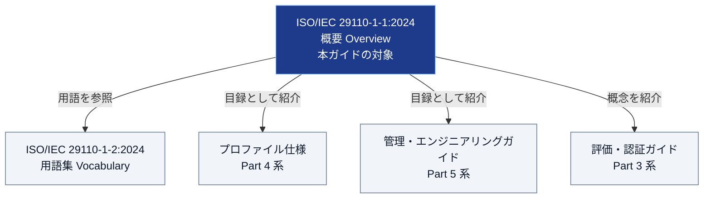
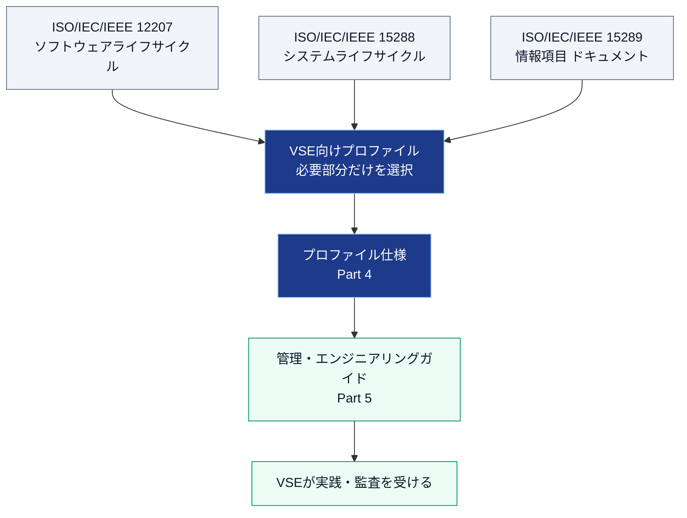
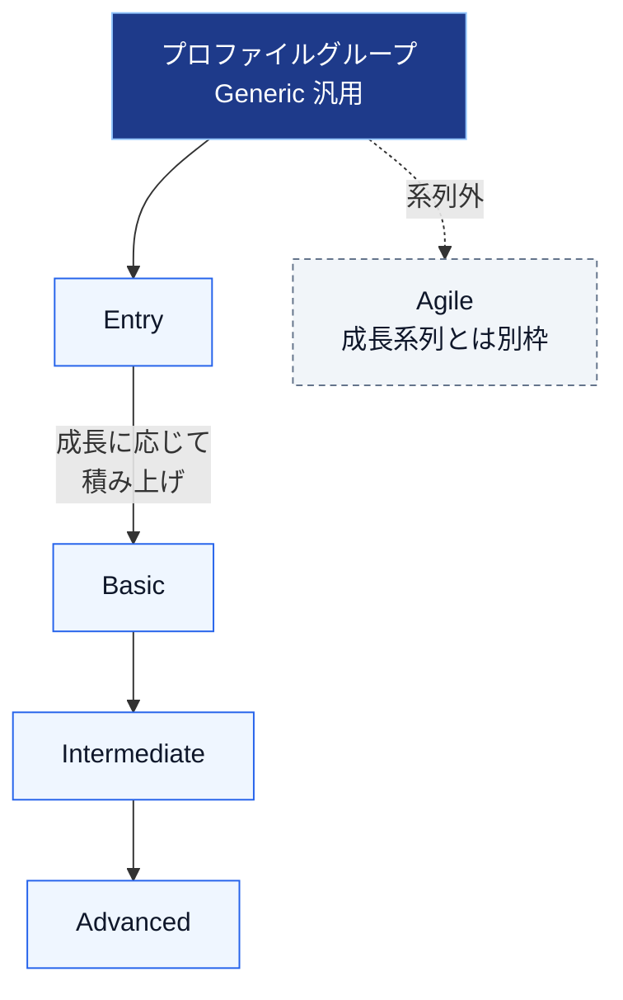
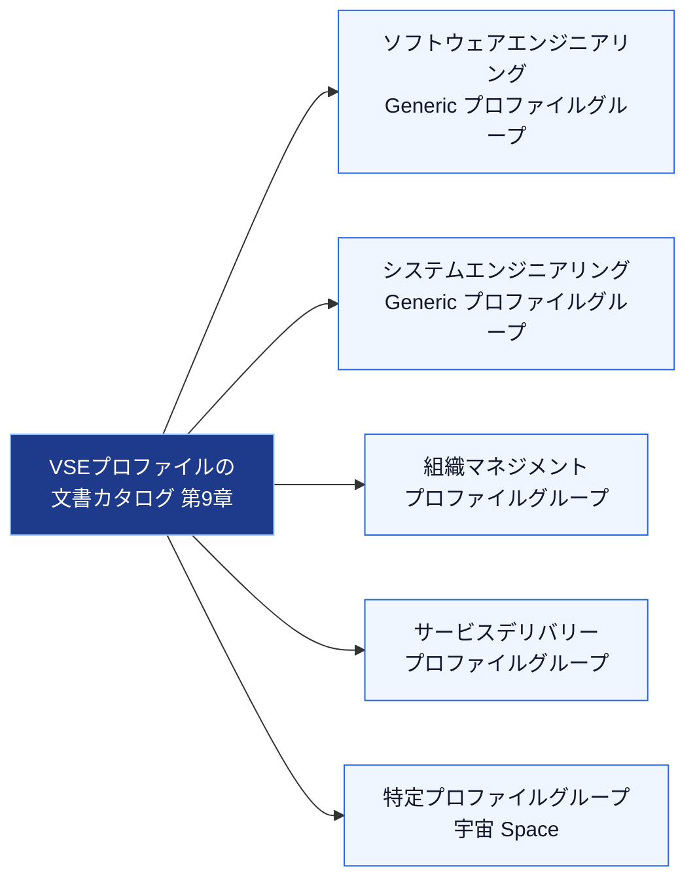
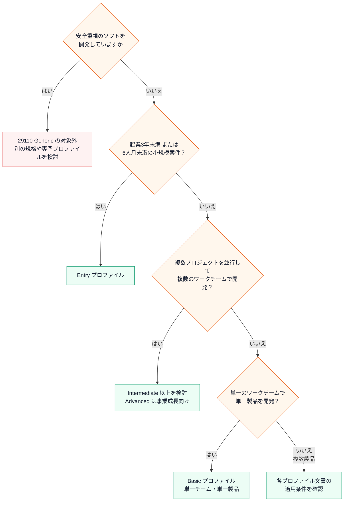
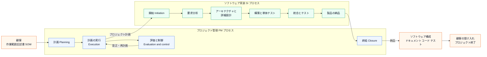
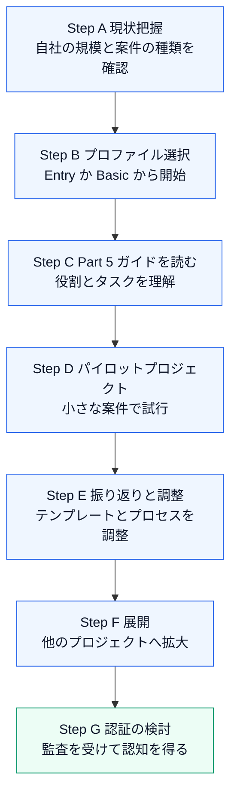
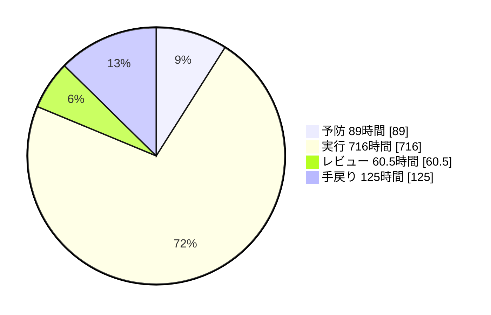
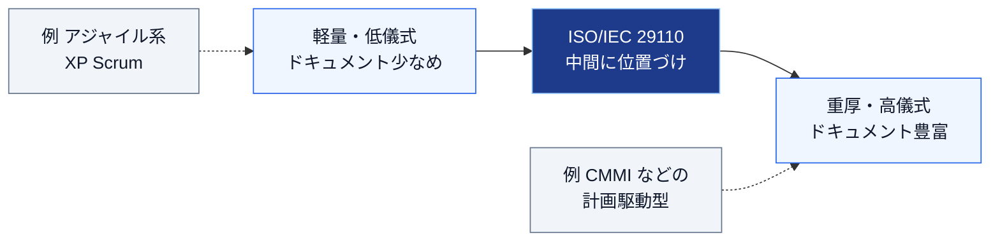

# ISO/IEC 29110-1-1:2024 初学者向けステップバイステップ解説ガイド

> **対象規格**：ISO/IEC 29110-1-1:2024 *Systems and software engineering — Lifecycle profiles for very small entities (VSEs) — Part 1-1: Overview*
> **調査時点**：2026年10月18日
> **想定読者**：ISO規格に初めて触れるソフトウェアエンジニア、QAエンジニア、小規模組織の開発リーダー
> **読み方**：Step 1 から順に読めば、規格の全体像 → 中身 → 実務での使い方 まで一通り理解できる構成です。

---

## 目次

1. [この規格を3分で理解する](#1-この規格を3分で理解する)
2. [Step 1：なぜ VSE 向け規格が必要なのか](#step-1なぜ-vse-向け規格が必要なのか)
3. [Step 2：VSE の特性と期待できる便益](#step-2vse-の特性と期待できる便益)
4. [Step 3：「プロファイル」という発想](#step-3プロファイルという発想)
5. [Step 4：ライフサイクルプロセスの基本概念](#step-4ライフサイクルプロセスの基本概念)
6. [Step 5：プロセス改善と評価の概念](#step-5プロセス改善と評価の概念)
7. [Step 6：標準化の用語（標準・ガイドライン・プロファイル）](#step-6標準化の用語標準ガイドラインプロファイル)
8. [Step 7：プロファイル文書のカタログ](#step-7プロファイル文書のカタログ)
9. [Step 8：ISO/IEC 29110 シリーズの全体像](#step-8isoiec-29110-シリーズの全体像)
10. [Step 9：Basic プロファイルの中身をのぞく](#step-9basic-プロファイルの中身をのぞく)
11. [Step 10：導入の進め方（実務ロードマップ）](#step-10導入の進め方実務ロードマップ)
12. [Step 11：導入事例から学ぶ](#step-11導入事例から学ぶ)
13. [Step 12：他の規格・手法との位置関係](#step-12他の規格手法との位置関係)
14. [2016年版 TR 29110-1 からの変更点](#2016年版-tr-29110-1-からの変更点)
15. [よくある誤解 FAQ](#よくある誤解-faq)
16. [理解度チェック](#理解度チェック)
17. [学習ロードマップ](#学習ロードマップ)
18. [出典URL一覧と調査メモ](#出典url一覧と調査メモ)

---

## 1. この規格を3分で理解する

### 1.1 ひとことで言うと

**「25人以下の小さな組織が、重い規格に押しつぶされずに、品質の高いシステム／ソフトウェアを作っていると示せるようにするための、ISO/IEC 29110 シリーズの"入口"となる解説書」** です。

ISO/IEC 29110-1-1 自体は、開発手順そのものを細かく定めた文書ではありません。**シリーズ全体を理解するための基本概念と、プロファイル文書の目録（カタログ）を示す概要編** です。[S1]、[S2]

### 1.2 基本情報

| 項目 | 内容 |
|---|---|
| 規格番号 | ISO/IEC 29110-1-1:2024 |
| 版 | 第1版（Edition 1） |
| 発行 | 2024年5月（ISOのステージ 60.60 到達は 2024-05-15） |
| ページ数 | 14ページ |
| 担当委員会 | ISO/IEC JTC 1/SC 7（ソフトウェアおよびシステムエンジニアリング） |
| ICS分類 | 35.080（ソフトウェア） |
| 前身 | ISO/IEC TR 29110-1:2016（現在は廃止扱い） |
| 価格 | ISOストアでは CHF 0（無料） |
| 姉妹文書 | ISO/IEC 29110-1-2:2024（用語集 Vocabulary、18ページ） |

出典：[S1]、[S3]

### 1.3 この文書の位置づけ

### 1.4 まず覚える5つのキーワード

| キーワード | 一言で |
|---|---|
| **VSE** | Very Small Entity。最大25人の企業・組織・部門・プロジェクト |
| **プロファイル** | 既存の大きな規格から、VSEに必要な部分だけを選び出した「部分集合」 |
| **プロファイルグループ** | 似た目的・特性のプロファイルを束ねたもの |
| **Generic プロファイルグループ** | 安全重視でない大多数のVSE向け。成長系列は Entry → Basic → Intermediate → Advanced の4段階。Agile はこの系列に含まれない別枠 |
| **適合性評価** | 規格などの要求に合っているかを確かめる活動の総称。試験・検査・妥当性確認・検証・認証・認定などを含む |
| **認証** | 適合性評価の一形態。プロファイルを導入したVSEが、第三者の監査を受けて認められる仕組み |

---

## Step 1：なぜ VSE 向け規格が必要なのか

### 1.1 世の中の企業の大半は「小さい」

規格の序文は、次のような統計を挙げて背景を説明しています。[S2]

| 出典（規格の序文が引用） | 内容 |
|---|---|
| World Bank | 中小企業（SME）は世界の企業の約 **90%** |
| OECD | SMEは全企業の **99%**、雇用の約 **60%** を生み出す |
| 同じくOECD | 約3人に1人が従業員10人未満のマイクロ企業で働く |
| 欧州連合（EU） | 従業員10人未満の企業が **93.5%**、10〜49人の小企業が **5.5%** |

### 1.2 既存の国際規格は小さな組織に合わない

序文が指摘する問題は、次の3点に整理できます。[S2]

1. 調査によれば、**国際規格の多くはVSEのニーズに対応していなかった**。導入や適合が難しい、あるいは事実上不可能だった。
2. その結果、VSEは「品質の高い製品を作る組織」として認めてもらう手段がほとんどなく、**一部の経済活動から排除されてしまう**。
3. 人員・専門性・予算・時間の面で、**過度に複雑なライフサイクルプロセスを作る余裕もメリットも感じにくい**。

Claude Y. Laporte 氏と Rory V. O'Connor 氏も、小規模組織は規格が「大企業向けに作られたもの」と感じて採用しにくいこと、VSEの管理プロセスは非公式で文書化が少なくなりがちなことを論文で述べています。[S4]

### 1.3 解決策の考え方

> **ポイント**：29110は「軽い別の標準」を新しく発明したのではなく、**既存の標準（12207・15288・15289）の中から小規模向けに必要な部分を選んだもの**です。

---

## Step 2：VSE の特性と期待できる便益

### 2.1 VSE の定義

シリーズの定義では、VSEとは **最大25人** の「企業、組織（政府機関・非営利団体など）、部門、またはプロジェクト」です。[S2]、[S3]

> **注意**：「会社全体が25人以下」でなくても構いません。**大企業の中の25人以下のチームやプロジェクト** もVSEに含まれます。Laporte 氏らの論文でも、500人超の事業部が、1つの顧客に集中する小規模プロジェクトチームの運営に29110を選んだ事例が紹介されています。[S4]

### 2.2 VSE の特性を整理する4つの視点

規格は、プロファイルが対象とするVSEの特性・ニーズ・望ましい力量を、次の **4カテゴリ** で整理しています。[S2]

| カテゴリ | 何を見るか（初学者向けの読み解き） |
|---|---|
| **財務とリソース** | 人数・予算・時間・専門性の制約 |
| **顧客との接点** | 顧客との契約、要求の受け取り方、納品・受け入れ |
| **社内のビジネスプロセス** | 日々の開発・管理のやり方 |
| **学習と成長** | 人材育成、改善への投資、成長 |

各特性の詳しい説明は、Part 4（プロファイル仕様）側で補足される、と書かれています。[S2]

### 2.3 VSE が受け取れる便益

規格が挙げる便益は次のとおりです。[S2]

| 便益 | 実務での意味 |
|---|---|
| 良好な社内の開発プロセス | 属人的な進め方からの脱却 |
| ソフトウェア管理プロセスの整備 | 計画・進捗・変更の管理 |
| 顧客の信頼と満足の向上 | 「ちゃんとした会社」という安心感 |
| 製品品質の向上 | 手戻りの削減 |
| 改善活動への後押し（スポンサー獲得） | 経営層に改善の必要性を説明しやすい |
| 開発リスクの低減 | 失敗プロジェクトの減少 |
| 競争力・市場シェアの向上 | 認証が営業上の信頼材料になる |

### 2.4 VSE が「下請け的立場」になる場合

規格は、VSEが契約や合意に基づき、**他組織やコンソーシアムの指示のもとで、ライフサイクルの一部だけを担当する** ケースも想定しています。担当範囲は、作業範囲記述書（Statement of Work）に従い、VSE自身の力量または入札によって決まります。[S2]

---

## Step 3：「プロファイル」という発想

### 3.1 プロファイルとは

規格の序文では、プロファイルの目的を **「VSEの状況に関係する国際規格の部分集合を定めること」** と説明しています。具体的には次のとおりです。[S2]

| 元になる規格 | 切り出すもの |
|---|---|
| ISO/IEC/IEEE 12207（ソフトウェアライフサイクル） | プロセス・アクティビティ・タスク・成果 |
| ISO/IEC/IEEE 15288（システムライフサイクル） | プロセス・アクティビティ・タスク・成果 |
| ISO/IEC/IEEE 15289（情報項目＝ドキュメント） | ソフトウェア／システムの情報項目 |

Laporte 氏らは、プロファイルを **「既存規格のどの要素を取り入れ、どれを取り入れないかを正確に示す一種のマトリクス」** と説明しています。[S4]

### 3.2 全体像

### 3.3 どのライフサイクルでも使える

規格は、29110シリーズが **ウォーターフォール、反復型、インクリメンタル、進化型、アジャイルなど、どのライフサイクルとも併用できる** と明記しています。また、開発フェーズのどこからでも適用できます。[S2]

Laporte 氏らの論文でも、29110は「ドキュメント重視で高儀式（CMMIなど）」と「軽量で低儀式（アジャイルなど）」の **中間あたりに位置づけられる** と図解されています。[S4]

### 3.4 使うべき組織・使わなくてよい組織

| 状況 | 規格の考え方 |
|---|---|
| 12207 / 15288 を **自組織向けにテーラリングした経験や専門性がない** VSE | 29110シリーズの利用が想定されている |
| テーラリングの専門性を **すでに持つ** VSE | 12207や15288を直接使うことが推奨されている |

出典：[S2]

> **一言アドバイス**：「29110は"自分で規格を削る力がない組織のための、削り済みの版"」と覚えると誤解しません。

---

## Step 4：ライフサイクルプロセスの基本概念

規格の第6章は、**29110シリーズの各文書で共通して前提となる考え方** をまとめています。[S2]

### 4.1 システム概念（6.2）

- 問題を解くには、**システムを全体として観察し、部品同士および環境との相互関係を捉える** のが基本。
- システムは、ソフトウェアとハードウェアだけでなく、**より大きな運用の一部として、人や他のシステムも含む** 存在。
- 設計者は、解決策を決める前にこの関係を理解する。要求を小さなモジュールに展開する際も、これが **統合の成功** につながる。

### 4.2 ライフサイクルモデルとステージ（6.3）

| 対象 | 参照先 |
|---|---|
| ソフトウェアのライフサイクルモデル | ISO/IEC/IEEE 12207:2017 の 5.4.2 |
| システムのライフサイクルステージ | ISO/IEC/IEEE 15288:2015 の 5.4.2 |

### 4.3 ライフサイクルの成果物タイプ（6.4）

- 作業の結果は、成果に応じて **情報項目（ドキュメントや記録）** として記録する。これにより、参加者全員が「何を計画し、どう作業したか」を共通認識できる。
- 汎用的な **情報項目タイプ** を使うと、類似の文書に対して一貫した構造・内容・書式を適用でき、使いやすくなる。
- 29110の後続の文書は、**12207・15288のライフサイクルデータを、タスクやアクティビティと「汎用の情報項目タイプ」に結びつけて定義** している。

---

## Step 5：プロセス改善と評価の概念

第7章は、次の3つの概念を扱います（見出しは規格の目次より）。[S2]

| 節 | 見出し | 初学者向けの読み方 |
|---|---|---|
| 7.1 | Process improvement concepts | プロセス改善の基本的な考え方 |
| 7.2 | Capability assessment concepts | プロセス能力を評価する考え方 |
| 7.3 | Conformity assessment | 規格の要求に合っているかを確かめる活動の総称。自己評価やプロセス能力評価とは目的が異なり、第三者による適合性評価（認証はその一形態）も含む |

> **調査メモ**：本ガイド作成時、第7章以降の本文は公開プレビューでは確認できませんでした。そのため、この章は **目次の見出しと、他の公開資料（Laporte氏らの論文）に基づく説明** にとどめています。詳細は規格本文（ISOストアで無料）をご確認ください。

### 5.1 「改善」「能力評価」「適合性評価」の違い

| 概念 | 問い | 主な目的 |
|---|---|---|
| プロセス改善 | もっと良いやり方はないか | 自組織の内側の成長 |
| 能力評価（アセスメント） | 今のプロセスはどのレベルか | 現状把握と改善の優先順位づけ |
| 自己評価 | 自分たちで見て、要求に合っているか | 内部での現状確認と準備 |
| 適合性評価（第三者によるもの。認証はその一形態） | 規格の要求に合っているか | 外部への信頼の証明 |

### 5.2 認証の実績（論文による補足）

Laporte 氏らの論文では、**ブラジルが29110の認証プロセスを整備** し、ベルギー・ブラジル・カナダ・メキシコ・ペルーで監査員が育成されたと報告されています。ブラジルでのパイロット監査では、監査員1社あたり約 **4人日** の作業だったとされます（2013年頃の報告）。[S4]

---

## Step 6：標準化の用語（標準・ガイドライン・プロファイル）

第8章は、規格の「言葉づかい」を整える章です。見出しは次のとおりです。[S2]

| 節 | 用語 | やさしい説明（本ガイドの解釈） |
|---|---|---|
| 8.2 | Standard（標準） | 合意に基づく文書。要求事項を含む |
| 8.3 | Guidelines（ガイドライン） | 実践を助ける手引き。要求ではなく指針 |
| 8.4 | Profile（プロファイル） | 既存標準から選んだ部分集合 |
| 8.5 | Profile group | プロファイルの集まり |
| 8.6 | Generic profile group | 安全重視でない大半のVSE向けの集まり |
| 8.7 | Use of profiles | プロファイルの使い方 |
| 8.8 | Conformity to profiles | プロファイルへの適合 |

### 6.1 Generic プロファイルグループとは

Laporte 氏らの論文では、Generic プロファイルグループを **「重要（クリティカル）なシステムやソフトウェアを開発しない、大多数のVSEに適用できるもの」** と説明しています。[S4] 2025年版の Part 5-1-2 の用語定義にも、「安全重視でないシステムを開発するVSEに適用できるプロファイルグループ」と書かれています。[S8]

> **ポイント**：成長系列の各プロファイル（Entry → Basic → Intermediate → Advanced）は **前のプロファイルのタスクとアクティビティの上に積み上がる** 設計です（Laporte 氏らの説明）。[S4] Agile はこの4段階の第5段階ではなく、系列とは別枠で扱います。

---

## Step 7：プロファイル文書のカタログ

第9章は、この規格の **最大の見どころ** です。プロファイルを基にした文書の「目録」を示します。[S2]

### 7.1 カタログの全体構成

### 7.2 ソフトウェアエンジニアリングの Generic プロファイルグループ（9.3）

規格の目次には、次の5つが並んでいます。[S2] このうち 9.3.2〜9.3.5 の4つが Entry → Basic → Intermediate → Advanced の成長系列で、9.3.6 の Agile はその系列に含まれない別枠です。

| 節 | プロファイル | 対象VSE・特徴（公開情報に基づく） |
|---|---|---|
| 9.3.2 | **Entry** | 起業から日が浅い（目安：3年未満）VSE、または小規模プロジェクト（目安：6人月未満）を行うVSE。安全重視でないソフトウェアが対象 [S7] |
| 9.3.3 | **Basic** | **1つの組織内の単一プロジェクトチーム** が、**単一製品** を開発するVSE。プロジェクト管理（PM）とソフトウェア実装（SI）が中心 [S4]、[S6] |
| 9.3.4 | **Intermediate** | 組織の文脈を活かしつつ、**複数のプロジェクトを並行して、複数のワークチームで開発する** VSE（複数プロジェクトの管理だけでなく、並行開発の体制を持つことが前提） [S4] |
| 9.3.5 | **Advanced** | 競争力のあるソフトウェア事業として **持続・成長** したいVSE。事業管理やポートフォリオ管理に相当する実践を含む [S4] |
| 9.3.6 | **Agile**（アジャイルプロファイル） | 4段階の成長系列には含まれない別枠（Advanced の次の段階ではない）。目次に項目あり。詳細は規格本文で確認してください |

### 7.3 プロファイルの選び方（目安フロー）

> **注意**：上のフローは Entry → Basic → Intermediate → Advanced の成長系列を選ぶための **学習用の目安** です。Agile は系列外の別枠なので、このフローの分岐には含めていません。実際の適用範囲は、各プロファイルの Part 4・Part 5 の記述で必ず確認してください。

### 7.4 システムエンジニアリング、その他のプロファイルグループ

| 節 | 内容 |
|---|---|
| 9.4 | システムエンジニアリングの Generic プロファイルグループ（Entry / Basic / Intermediate / Advanced の4つ） |
| 9.5 | 組織マネジメント（Organizational management）プロファイルグループ |
| 9.6 | サービスデリバリー（Service delivery）プロファイルグループ |
| 9.7 | 特定プロファイルグループ：宇宙（Space）プロファイル |

出典：[S2]

> **補足**：システムエンジニアリング側のガイドは、INCOSE（国際システムエンジニアリング協議会）の作業部会の取り組みから生まれました。ISO/IEC/IEEE 15288 を土台に、ソフトウェア側と同じ4段階構成で作られています。[S4]

---

## Step 8：ISO/IEC 29110 シリーズの全体像

第10章は、**シリーズ全体の地図** を示します。[S2]

### 8.1 第10章の構成

| 節 | 内容 |
|---|---|
| 10.2 | プロファイル固有の文書（VSEプロファイル、Genericプロファイルグループ、プロファイル仕様、管理・エンジニアリングガイドライン、プロダクトラインエンジニアリング） |
| 10.3 | 入門文書（Overview＝本書、Vocabulary＝用語集） |
| 10.4 | フレームワーク |
| 10.5 | ドメイン固有プロファイル |
| 10.6 | 認証・評価のガイドライン（認証ガイドライン、アセスメントガイドライン、自律性に基づく改善のフレームワーク） |
| 10.7 | 特定プロファイルのガイドライン |

### 8.2 パート別の対象読者（Laporte氏らの整理）

| パート | タイトル（旧体系での呼称） | 主な読者 |
|---|---|---|
| Part 1 | Overview | VSE、顧客、アセッサー、標準策定者、ツールベンダー、メソドロジーベンダー |
| Part 2 | Framework and taxonomy | 標準策定者、ツール／メソドロジーベンダー（**VSE向けではない**） |
| Part 3 | Assessment guide | アセッサー、顧客、VSE |
| Part 4 | Profile specifications | 標準策定者、ツール／メソドロジーベンダー（**VSE向けではない**） |
| Part 5 | Management and engineering guide | **VSEと顧客**（VSEにとって最も価値が高い文書） |

出典：[S4]。この表は2010年代前半の整理です。2024年の再編後も、**VSEが実際に読むのは Part 5** という点は変わりません。

> **初学者へのアドバイス**：まず **Part 5-1-1（Entry）または Part 5-1-2（Basic）** を読むのが近道です。Part 1-1（本書）は、その前の「地図」として使ってください。

### 8.3 主な公開済み文書の一覧（調査で確認できたもの）

| 文書 | 内容 | 確認できた版・状況 |
|---|---|---|
| ISO/IEC 29110-1-1 | 概要（本書） | 2024年5月発行 [S1] |
| ISO/IEC 29110-1-2 | 用語集 | 2024年5月発行 [S3] |
| ISO/IEC 29110-4-1 | ソフトウェアのプロファイル仕様（Generic） | 2018年版。2024年に見直し・確認済み [S6] |
| ISO/IEC 29110-5-1-1 | ソフトウェアの管理・エンジニアリングガイド（Entry） | 2025年2月 [S7] |
| ISO/IEC 29110-5-1-2 | ソフトウェアの管理・エンジニアリングガイド（Basic） | 2025年2月 [S8] |
| ISO/IEC TR 29110-5-6-2 | システムエンジニアリングのガイド（Basic） | 2014年 [S9] |

> **自分で確認する際のコツ**：ISOのカタログでは、**ISO/IEC 29110 のどの版が最新か、廃止か** が頻繁に更新されます。必ず ISO の各規格ページの「Life cycle」欄で現行版を確認してください。

---

## Step 9：Basic プロファイルの中身をのぞく

Part 1-1 は概要編ですが、全体像をつかむために、**ソフトウェア Basic プロファイルの構造** を見ておきましょう。以下は Laporte 氏と O'Connor 氏の論文による整理です。[S4]

### 9.1 なぜ「プロジェクト管理」が入っているのか

VSEの本業はソフトウェア開発であり、**財務的な成功は、予算とスケジュールの範囲でプロジェクトを完了させ、利益を出せるかどうかにかかっている**。そのため、Basic プロファイルは **ソフトウェア実装（SI）とプロジェクト管理（PM）** の2つのプロセスで構成されます。[S4]

### 9.2 PM と SI の関係

> **読み方のコツ**：顧客の作業範囲記述書（SOW）で **PM プロセスが始まり**、計画（BP1）を **計画の実行（BP2）** に移すことで、プロジェクト計画が SI の各アクティビティを導きます。実行中は **評価と制御（BP3）** で計画と実績を比べ、ずれがあれば是正・再計画して BP2 に戻します。SI の製品納品（BP10）の後、**PM の終結アクティビティ（BP4）でソフトウェア構成を納品して顧客の受け入れ** を得て、プロジェクトが正式に終わります。[S4]

### 9.3 タスクの書き方（例）

Basic プロファイルでは、各タスクが **「役割・タスク・入力・出力」** の形で定義されます。論文には、プロジェクト計画アクティビティの例が示されています。[S4]

| 役割 | タスクの例 | 入力 | 出力 |
|---|---|---|---|
| PM（プロジェクトマネージャー）、CUS（顧客） | 作業範囲記述書で指定された成果物の納品手順を、顧客と一緒に定義する | 作業範囲記述書（レビュー済み） | プロジェクト計画、納品手順 |
| PM、CUS | プロジェクト計画をレビューし、顧客が承認する | プロジェクト計画（検証済み） | 会議記録、プロジェクト計画（承認済み） |

---

## Step 10：導入の進め方（実務ロードマップ）

### 10.1 導入を助ける「デプロイメントパッケージ（DP）」

29110には、導入を支援する **デプロイメントパッケージ（Deployment Package）** という仕組みがあります。Laporte 氏らによれば、DPは次の要素を含みます。[S4]、[S5]

| DPの構成要素 | 例 |
|---|---|
| プロセス説明 | プロセス・アクティビティ・タスク・ステップ・役割 |
| 成果物 | 製品（情報項目）の説明 |
| 実用ツール | テンプレート、チェックリスト、事例 |
| 参照 | 規格やモデル（12207、CMMIなど）とのマッピング、ツール一覧 |

**DPの設計思想**：29110の全アクティビティを一度に導入しなくても、**必要な部分（例：要求管理、レビュー）から1つずつ導入できる**ようになっています。[S4]

### 10.2 導入ステップ（学習用の標準フロー）

> **根拠**：パイロットプロジェクトを使って導入を加速する考え方は、29110の策定を担ったWG24（ISO/IEC JTC 1/SC 7 の作業部会）が推奨してきたものです。パイロットは、組織面・技術面のリスクを減らしながら学ぶ手段だとされています。[S4]、[S5]

### 10.3 役割の割り当ての例

2名の小さなチームでは、Basic プロファイルの役割を **1人が複数兼任** できます。論文の事例は次のとおりです。[S4]

| 役割 | 担当 |
|---|---|
| アナリスト | メンバーA |
| デザイナー | メンバーB |
| プログラマー | A と B |
| プロジェクトマネージャー | メンバーB |
| テクニカルリーダー | メンバーA |
| ワークチーム | A と B |

> **ポイント**：役割は「人の数」ではなく「責任の分け方」です。1人が複数の役割を持っても構いません。

### 10.4 支援ツール

- Laporte 氏らの論文には、Atlassian 製品群をベースに、DPを使って Basic プロファイルの導入を支援する商用ソリューションの紹介があります。成果物の一元共有、文書管理、進捗ダッシュボードなどを備えています。[S4]
- 論文中で案内されていた Laporte 氏の資料配布サイトは、2026年10月の調査時点でアクセスできませんでした。

---

## Step 11：導入事例から学ぶ

### 11.1 ITスタートアップの事例（Basic プロファイル）

Laporte 氏らの論文が紹介する事例です。**パートタイム開発者2名のチーム** が、旅行計画を共有するWebアプリを、Basic プロファイルを使って開発しました。総工数は約 **1,000時間**（論文上は990.5時間）です。[S4]

| 項目 | 内容 |
|---|---|
| チーム | 2名（パートタイム） |
| 総工数 | 約990.5時間 |
| テストケース | 112件（日付形式の入力検証に関する軽微な欠陥1種を除き成功） |
| 欠陥管理 | 欠陥追跡ツール（Bugzilla）を使用 |
| レビュー | 机上チェック（デスクチェック）で要求仕様とアーキテクチャをレビュー |
| トレーサビリティ | 要求とソフトウェアコンポーネントの対応表を作成 |

### 11.2 工数の内訳

論文の表より、工数の内訳（時間）は次のとおりです。[S4]

| 区分 | 時間 | 全体に対する割合 |
|---|---|---|
| 予防（環境構築など） | 89 | 約 9.0% |
| 実行（実作業） | 716 | 約 72.3% |
| レビュー | 60.5 | 約 6.1% |
| 手戻り（修正） | 125 | 約 12.6% |
| **合計** | **990.5** | **100%** |

### 11.3 この事例が示すこと

- 論文によれば、成熟度の低い組織では **ソフトウェアプロジェクトの40〜50%が手戻り** になることも珍しくありません。大規模プロジェクトの調査でも、手戻りの推定コストは約 **30%** でした。[S4]
- この事例では、手戻りの割合が **12.6%** にとどまりました。論文は、**標準に沿って計画し、レビューを行った効果** として評価しています。
- 著者は、「標準は負担で、創造性を妨げる」と考える人は、この結果を見直すべきだと述べています。[S4]

> **注意**：この事例は **1チーム・1プロジェクトの報告（2013年頃）** であり、すべての組織で同じ結果になることを保証するものではありません。「導入の効果を測る方法の例」として読んでください。

### 11.4 大企業内の小規模プロジェクトの事例

500人超の事業部をもつエンジニアリング企業が、**小規模プロジェクト向けに Entry、中規模プロジェクト向けに Basic のプロジェクト管理プロセス** を文書化した事例も報告されています。選定理由は、「小規模プロジェクト向けに作られている」「既存プロセスに統合しやすい」などの評価基準で、29110が最も適していたことでした。3年間の費用対効果も見積もられています。[S4]

---

## Step 12：他の規格・手法との位置関係

### 12.1 29110 と関連規格

| 規格・手法 | 29110との関係 |
|---|---|
| ISO/IEC/IEEE 12207 | 29110のソフトウェア側プロファイルの **元になる規格** |
| ISO/IEC/IEEE 15288 | 29110のシステム側プロファイルの **元になる規格** |
| ISO/IEC/IEEE 15289 | 29110の **情報項目（ドキュメント）** の元になる規格 |
| CMMI | 高儀式・文書重視の代表。29110はその **より軽量な側** に位置づけられる [S4] |
| アジャイル（XP・Scrumなど） | 29110は **どのライフサイクルとも併用可能**。アジャイル向けプロファイルも目録にある [S2] |

### 12.2 位置づけの図解

---

## 2016年版 TR 29110-1 からの変更点

| 観点 | 2016年版 TR 29110-1 | 2024年版（1-1 と 1-2） |
|---|---|---|
| 文書の種別 | 技術報告書（TR） | 国際規格（IS）へ格上げ |
| 構成 | 1つの文書に概要と用語 | **1-1（概要）と 1-2（用語集）に分割** |
| 主な改訂内容 | — | 2016年以降に公開された29110シリーズの各パートの概念を追加 [S2] |
| 用語集 | — | 2016年以降の新規文書に伴う用語を追加 [S3] |
| 状態 | 廃止（ISOの Life cycle 欄に「Previously: Withdrawn」と表示） | 現行（Published） |

> **補足**：規格の序文には、「本書は ISO/IEC 29110-1-2 とともに、ISO/IEC TR 29110-1:2016 を廃止して置き換える」と書かれています。[S2]

### 気をつけたい小さな注意点

調査で確認できた公開プレビューの「引用規格」の欄には、**29110-1-2 のタイトルとして別の規格の題名らしき表記**（標準大気条件に関する題名）が出ていました。プレビュー版上の表記のため、**正式版で修正されているかは確認できていません**。引用規格を扱う際は、ISOの正式な書誌情報を確認してください。[S2]

---

## よくある誤解 FAQ

### Q1. 29110 を導入するには、25人以下の会社でなければならない？

**いいえ。** 規格は、VSEにも使えるが「VSEより大きな組織が使うことも可能」と明記しています。また、大企業の中の25人以下のチームもVSEと見なされます。[S1]、[S2]

### Q2. 29110 は開発手順をウォーターフォールに縛るもの？

**いいえ。** 規格は、ウォーターフォール、反復型、インクリメンタル、進化型、アジャイルなど、**どのライフサイクルとも併用できる** と述べています。[S2]

### Q3. 安全が最重要な医療機器や車載のソフトにも使える？

Generic プロファイルグループは、**安全重視でないシステム／ソフトウェアを開発するVSE向け** と定義されています。Part 5-1-1 と 5-1-2 の適用範囲にも、「安全重視のソフトウェアは対象外」とあります。[S7]、[S8] 安全性が重要な領域では、別の規格体系（例：IEC 62304 など）を併用または優先して検討してください。

### Q4. Part 1-1 を読めば、すぐに導入できる？

**いいえ。** Part 1-1 は **概要編（地図）** です。実際の導入には、**Part 5-1-1（Entry）または Part 5-1-2（Basic）** の管理・エンジニアリングガイドが必要です。デプロイメントパッケージは必須要件ではなく、これらのガイドの導入を助ける任意の追加資料として利用できます。[S4]

### Q5. 12207 や 15288 をすでに使いこなしている会社は、29110 を使うべき？

規格自身が、**テーラリングの専門性がある組織は、12207や15288を直接使うことを推奨** しています。29110は、その専門性がない組織向けです。[S2]

### Q6. 規格の購入が必要？

ISOストアの表示では、**ISO/IEC 29110-1-1:2024 は CHF 0（無料）** です。[S1] 旧世代の技術報告書（TR）の多くも、WG24の要請でISOから無償公開されていました（論文による）。現在、無償提供の規格はISO Webstoreで入手する案内になっています。[S4]、[S13]

---

## 理解度チェック

Q1. VSE の定義を答えてください

最大25人の企業・組織（政府機関や非営利団体を含む）・部門・プロジェクト。

Q2. 「プロファイル」とは何か、一文で答えてください

12207・15288・15289 などの既存国際規格から、VSEの状況に関係する部分（プロセス、アクティビティ、タスク、成果、情報項目）だけを選び出した部分集合。

Q3. Generic プロファイルグループの4つのプロファイルを、段階順に答えてください

Entry → Basic → Intermediate → Advanced。

Q4. Basic プロファイルを構成する2つのプロセスは？

プロジェクト管理（PM）とソフトウェア実装（SI）。

Q5. VSE が実際に読むべき中心的なパートは？

Part 5（管理・エンジニアリングガイド）。ソフトウェアなら 5-1-1（Entry）または 5-1-2（Basic）。

Q6. 29110 を使わず 12207 を直接使うことが推奨されるのはどんな組織？

12207や15288を、自組織の事情に合わせてテーラリングする専門性をすでに持っているVSE。

Q7. 2024年版は2016年版から何が変わった？

TR 29110-1:2016 が、1-1（概要）と 1-2（用語集）の2つの国際規格に分割・置き換えられ、2016年以降に発行された各パートの概念が追加された。

---

## 学習ロードマップ

| 目的 | おすすめ |
|---|---|
| 全体像を知りたい | 本ガイド → Part 1-1 原文 |
| 用語が分からない | Part 1-2（用語集） |
| 自社に導入したい | Part 5-1-1 / 5-1-2 → デプロイメントパッケージ |
| 事例を知りたい | Laporte & O'Connor の論文 [S4]、[S10] |
| 認証を考えている | 各国の認証機関・ISOの認証ガイドライン（第10.6節の項目を起点に） |

---

## 出典URL一覧と調査メモ

### A. 規格そのものに関する一次情報

| ID | 内容 | URL |
|---|---|---|
| S1 | ISO公式ページ（ISO/IEC 29110-1-1:2024）。発行日、ページ数、ステージ履歴、前身（TR 29110-1:2016）、価格 | https://www.iso.org/standard/85337.html |
| S2 | 規格の公開プレビューPDF（iTeh Standards）。目次、序文、第1〜6章の冒頭まで確認 | https://cdn.standards.iteh.ai/samples/85337/0f676435a6704cc6a711b0d560de43b9/ISO-IEC-29110-1-1-2024.pdf |
| S3 | ISO公式ページ（ISO/IEC 29110-1-2:2024 用語集） | https://www.iso.org/standard/85338.html |
| S6 | ISO公式ページ（ISO/IEC 29110-4-1:2018。2024年に見直し・確認済み） | https://www.iso.org/fr/standard/67223.html |
| S7 | ISO/IEC 29110-5-1-1:2025（Entry）の適用範囲（カナダ規格データベース） | https://ccn-scc.ca/standardsdb/standards/2056770 |
| S8 | ISO/IEC 29110-5-1-2:2025（Basic）の公開プレビューPDF | https://cdn.standards.iteh.ai/samples/82669/53c2b3e0d89b4126aea1556f6bd3c522/ISO-IEC-29110-5-1-2-2025.pdf |
| S9 | ANSI Webstore の VSE 関連規格一覧 | https://webstore.ansi.org/industry/software/software-engineering/vse-very-small-entities |

### B. 国際的に著名な策定者・研究者による論文（本ガイドで重視した情報源）

29110の策定を担った **ISO/IEC JTC 1/SC 7 WG24** の中心人物による資料を優先して参照しました。

| ID | 著者・内容 | URL |
|---|---|---|
| S4 | **Claude Y. Laporte**（École de technologie supérieure、カナダ）と **Rory V. O'Connor**（Dublin City University、アイルランド）：*Systems and Software Engineering Standards for Very Small Entities — Implementation and Initial Results*。VSE定義、プロファイル、Basicプロファイル、DP、事例、認証 | https://doras.dcu.ie/20273/1/PID3323607.pdf |
| S5 | O'Connor & Laporte：*Deploying Lifecycle Profiles for Very Small Entities: An Early Stage Industry View*。パイロットプロジェクトとDPの考え方 | https://doras.dcu.ie/16727/1/10.1007_978-3-642-21233-8_27.pdf |
| S10 | Laporte, O'Connor, García Paucar：*The implementation of ISO/IEC 29110 software engineering standards and guides in very small entities*。7件のケーススタディ | https://doras.dcu.ie/21121/ |
| S11 | Laporte & O'Connor：*Software Engineering Standards and Guides for Very Small Entities*（SCITEPRESS, 2015） | https://www.scitepress.org/papers/2015/53685/53685.pdf |

### C. 規格の入手・利用条件に関するURL

| ID | 内容 | URL |
|---|---|---|
| S13 | ISO Webstore。論文中のITTF無償公開ページは閉鎖済みで、無償提供の規格は現在ISO／IECのWebstoreで入手する案内になっている | https://www.iso.org/store.html |
| S14 | ISO公式：Privacy and Copyright（ISOコンテンツの著作権・利用条件） | https://www.iso.org/privacy-and-copyright.html |

### D. 調査メモ（本ガイドの限界・正直な注意）

1. **第7〜10章の本文は未確認**：公開プレビューで確認できたのは、目次、序文、第1〜6章の冒頭までです。第7章以降は **目次の見出しと、Laporte氏らの論文など公開資料に基づく解説** にとどめています。原文確認が必要な場合は、ISOストアの無料版（CHF 0）をご利用ください。
2. **論文の年代**：Laporte 氏らの論文は 2013〜2016年頃のもので、**旧体系（TR 29110-1:2011/2016 時代）の記述** を含みます。2024年版の規格自体の内容は、S1・S2・S3 を根拠としています。
3. **「3年未満」「6人月未満」などの数値**：Entry プロファイルの対象の目安は、Part 5-1-1:2025 の適用範囲の記述に基づきます [S7]。Part 1-1 自体が定める数値ではない点に注意してください。
4. **Agileプロファイルの詳細**：Part 1-1 の目次には項目がありますが、中身は本ガイドでは確認できていません。
5. **ライセンス**：ISOの規格本文は著作権で保護されています。本ガイドは、規格の内容を **自分の言葉で要約・解説** したもので、原文の転載ではありません。ISOのサイトでは、**ISOコンテンツをAIの学習・応答生成に使うことは、オープンデータを除き禁止** とも明記されています。[S14] 実務で原文を引用する際は、ISOの利用条件を確認してください。
6. **情報の鮮度**：2026年10月18日時点の調査です。ISOのステータス（改訂・確認・廃止）は変わり得るため、実務では必ず ISO の各ページで最新状況を確認してください。

---

*本ガイドは学習用の解説であり、規格の代替ではありません。認証取得や契約上の適合を主張する場合は、必ず規格の正式な全文を参照してください。*

[S1]: https://www.iso.org/standard/85337.html "ISO/IEC 29110-1-1:2024（ISO公式ページ）"
[S2]: https://cdn.standards.iteh.ai/samples/85337/0f676435a6704cc6a711b0d560de43b9/ISO-IEC-29110-1-1-2024.pdf "ISO/IEC 29110-1-1:2024 公開プレビューPDF"
[S3]: https://www.iso.org/standard/85338.html "ISO/IEC 29110-1-2:2024（ISO公式ページ）"
[S4]: https://doras.dcu.ie/20273/1/PID3323607.pdf "Laporte & O'Connor: Systems and Software Engineering Standards for Very Small Entities"
[S5]: https://doras.dcu.ie/16727/1/10.1007_978-3-642-21233-8_27.pdf "O'Connor & Laporte: Deploying Lifecycle Profiles for Very Small Entities"
[S6]: https://www.iso.org/fr/standard/67223.html "ISO/IEC 29110-4-1:2018（ISO公式ページ）"
[S7]: https://ccn-scc.ca/standardsdb/standards/2056770 "ISO/IEC 29110-5-1-1:2025（カナダ規格データベース）"
[S8]: https://cdn.standards.iteh.ai/samples/82669/53c2b3e0d89b4126aea1556f6bd3c522/ISO-IEC-29110-5-1-2-2025.pdf "ISO/IEC 29110-5-1-2:2025 公開プレビューPDF"
[S9]: https://webstore.ansi.org/industry/software/software-engineering/vse-very-small-entities "ANSI Webstore VSE関連規格一覧"
[S10]: https://doras.dcu.ie/21121/ "Laporte, O'Connor, García Paucar: The implementation of ISO/IEC 29110 in very small entities"
[S13]: https://www.iso.org/store.html "ISO Webstore"
[S14]: https://www.iso.org/privacy-and-copyright.html "ISO Privacy and Copyright"
