# ISO/IEC 29110-5-1-2:2025 初学者向けステップバイステップ解説ガイド

> **超小規模組織（VSE）のためのソフトウェア開発ガイドライン「Basicプロファイル」を、ゼロから理解する**

| 項目 | 内容 |
|:--|:--|
| 正式名称 | Systems and software engineering — Life cycle profiles for very small entities (VSEs) — Part 5-1-2: Software engineering guidelines for the generic Basic profile |
| 日本語での呼び方（本ガイド内） | システムおよびソフトウェアエンジニアリング — 超小規模組織（VSE）向けライフサイクルプロファイル — 第5-1-2部：汎用Basicプロファイルのソフトウェアエンジニアリング ガイドライン |
| 発行 | 2025年2月（第1版、93ページ、英語のみ） |
| 種別 | 国際規格（IS）。2011年版のTR（技術報告書）を置き換えた |
| 担当委員会 | ISO/IEC JTC 1/SC 7（ソフトウェアおよびシステムエンジニアリング） |
| 対象読者 | ソフトウェア開発者、QAエンジニア、プロジェクトマネージャ、小規模チームのリーダー、標準化に初めて触れる方 |
| 情報の基準日 | 2026年10月16日まで（Web検索で確認できた範囲） |
| 公式ページ | https://www.iso.org/standard/82669.html |

> 💡 **このガイドの使い方**
> 最初から順に読めば、「VSEとは何か」から「自分のチームで何を始めればよいか」まで一本道で理解できるように構成しています。急ぐ方は **第0章（30秒要約）** と **第9章（導入ステップ）** だけでも要点がつかめます。
>
> ⚠️ **著作権と情報源についての重要な注意（必ずお読みください）**
> ISO規格の本文は著作権で保護されています。ISO規格本文など、Open Dataの対象外で別途許諾を得ていないISO出版物は、AIの学習・応答生成に利用できません。そのため本ガイドは、次の**公開されている情報**だけを根拠に、筆者の言葉で再構成しています。
> - ISO公式ページの要旨・ライフサイクル情報
> - 規格の公開プレビュー（序文、目次、用語の一部）
> - 規格の主要エディターである Claude Y. Laporte 氏らの査読付き論文・解説
>
> 各タスクの細かい条文（何をどの順序で書くか）は、**規格本文での確認が必須**です。確認が必要な箇所には「🔎 要確認」と記しました。

---

## 目次

0. 30秒で分かる要約
1. ステップ1：まず「VSE」という言葉を理解する
2. ステップ2：ISO/IEC 29110シリーズ全体の地図を見る
3. ステップ3：4つのプロファイルとBasicの位置づけ
4. ステップ4：この規格の対象範囲と「使えないケース」
5. ステップ5：2つのプロセス（PMとSI）の全体像
6. ステップ6：PMプロセスを4つの活動で理解する
7. ステップ7：SIプロセスを6つの活動で理解する
8. ステップ8：役割と成果物を整理する
9. ステップ9：導入ステップ（自分のチームで始める）
10. 2025年版で何が変わったか（2011年版TRとの違い）
11. 付録A〜E：追加できる拡張（サポート・テスト・アクセシビリティ・セキュリティ）と導入支援資料（デプロイメントパッケージ）
12. 実践例：2名スタートアップの場合
13. よくある疑問（FAQ）
14. 用語集
15. 理解度チェック
16. 参照ソース一覧

---

## 0. 30秒で分かる要約

| 質問 | 答え |
|:--|:--|
| これは何の規格？ | 25人以下の小さな組織が、**重すぎない**やり方でソフトウェア開発を管理するための**ガイドライン** |
| 何が書かれている？ | **プロジェクト管理（PM）** と **ソフトウェア実装（SI）** の2つのプロセスの目的・活動・タスク・役割・成果物 |
| 誰向け？ | 安全重要でないソフトを、**1つのチーム**で**1つの製品**として開発するVSE |
| 開発手法は？ | ウォーターフォール、反復、アジャイルなど**何でもよい** |
| 2025年版の新しさは？ | 2011年版TRを改訂し、サポート・テスト・アクセシビリティ・セキュリティの**追加された付録（付録A〜D）** が加わった |

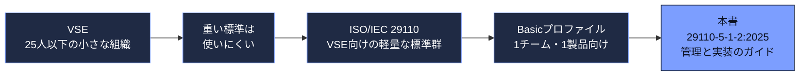

出典：ISO公式ページ（S1）、規格プレビュー（S3）。

---

## 1. ステップ1：まず「VSE」という言葉を理解する

### 1-1. VSEの定義

**VSE（Very Small Entity：超小規模組織）** とは、**最大25人**の企業・組織・部門・プロジェクトを指します。規格の用語の定義では、官公庁や非営利団体も含まれます。（S3）

ここで大切なのは、VSEが「会社」だけを指すのではなく、**大企業の中の小さなプロジェクトチームでも該当する**点です。

### 1-2. なぜVSE向けの規格が必要なのか

規格の序文（S3）は、概ね次の問題意識を述べています。

| 問題 | 内容 |
|:--|:--|
| 規格が大企業向け | 多くの国際規格は、VSEの事情（人数・予算・時間）を想定していない |
| 導入コストが高い | 工数や専門知識が足りず、導入メリットも見えにくい |
| 取引の機会損失 | 規格に準拠できないため、品質を示せず、一部の経済活動から排除されうる |

序文は統計も引用しており、中小企業（SME）は世界の企業の約90%、OECDの数字では全企業の99%を占め、雇用の約60%を生み出しているとされています。（S3）

> 💡 **ポイント**
> 「小さな組織でも、国際規格に基づく品質を**示せる**ようにする」ことが、このシリーズの狙いです。

### 1-3. 研究者が指摘してきた「小さな組織が標準を嫌う理由」

Laporte氏とO'Connor氏の論文（S5）は、VSEが標準を避ける理由として、**コスト・ドキュメント負担・官僚的な印象**を挙げています。ISO/IEC 29110はこれらを避けるために、既存の規格の**一部分だけ**を選んで作られました。ソフトウェア向けのプロファイルは ISO/IEC/IEEE 12207（ソフトウェアライフサイクル）、システム向けのプロファイルは ISO/IEC/IEEE 15288（システムライフサイクル）を土台とし、どちらも文書化については ISO/IEC/IEEE 15289 を参照します。本書（5-1-2）はソフトウェア向けなので、主に12207と15289が土台です。（S3、S5）

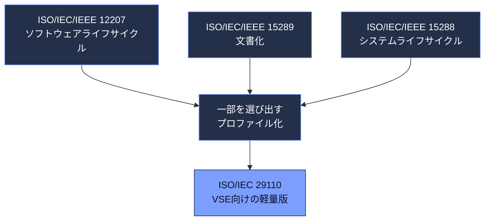

出典：S3（序文）、S5。

---

## 2. ステップ2：ISO/IEC 29110シリーズ全体の地図を見る

ISO/IEC 29110は1冊ではなく、**部（Part）に分かれたシリーズ**です。本書はその中の「第5部」に属します。序文（S3）に基づく整理は次のとおりです。

| Part | 内容（要点） | 主な読者 |
|:--|:--|:--|
| 1-1（ISO/IEC 29110-1-1:2024、現行版） | 概要。VSEの特徴、プロファイルの考え方、プロファイル一覧（タクソノミー） | VSE、顧客、評価者、規格作成者 |
| 1-2（ISO/IEC 29110-1-2:2024、現行版） | シリーズ共通の用語 | 同上 |
| 2（ISO/IEC 29110-2:2011、撤回済み・旧版の構成） | プロファイルの概念。標準プロファイルが共通して満たす構造・適合・評価の要件 | プロファイル作成者、ツールベンダー |
| 3（ISO/IEC TR 29110-3:2011、撤回済み・旧版の構成） | 認証スキーム、評価ガイドライン、適合要件（監査・自己評価） | 監査員、認定機関、VSE |
| 4 | **汎用プロファイル群の仕様**（ISO/IEC 29110-4-1:2018 はソフトウェアBasicプロファイルの仕様） | VSE、顧客、規格作成者 |
| **5** | **管理・エンジニアリング・サービス提供のガイドライン**（本書は5-1-2） | **VSEとその顧客** |
| 6 | 特定プロファイルの仕様 | VSE、顧客、規格作成者 |
| 7 | 特定プロファイルのガイドライン | VSEとその顧客 |

> 💡 **版の状態について**
> Part 2・Part 3 の行は、2011年版の文書番号に基づく旧版の構成です。どちらも撤回済みなので、後継文書の現行版はISO公式ページで確認してください。Part 1-1・1-2 は2024年版が現行版です。

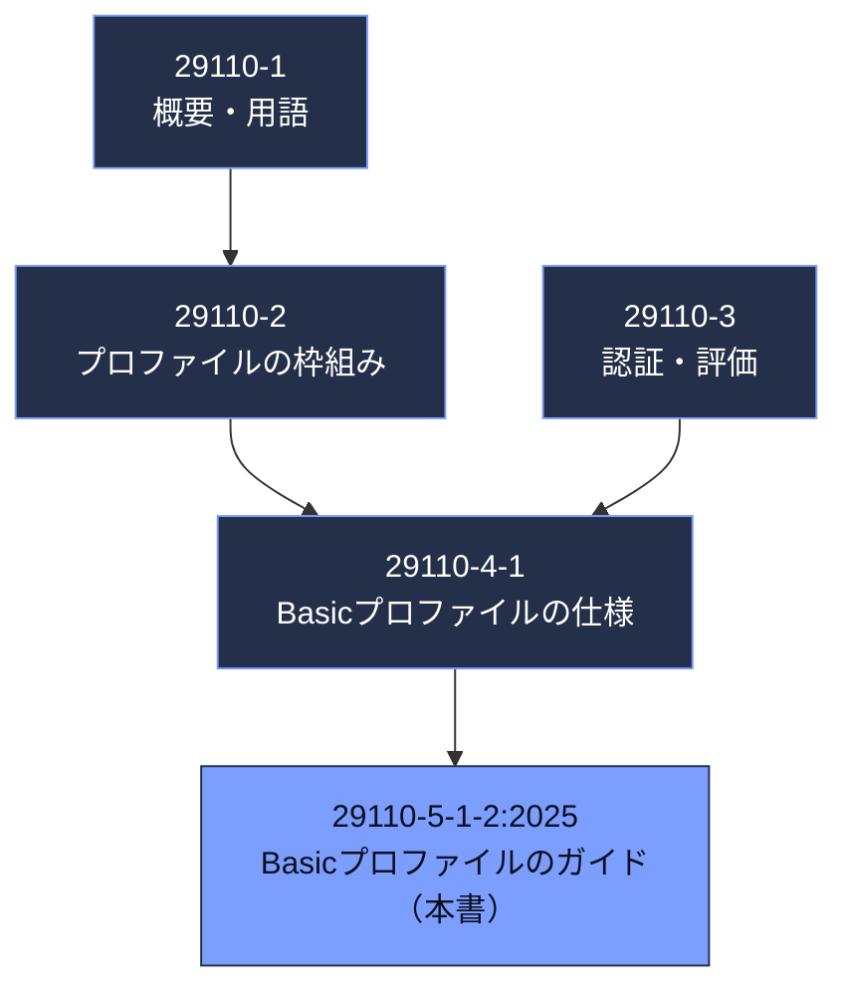

### 2-1. 「仕様（Part 4）」と「ガイド（Part 5）」の違い

初学者が最も混乱しやすい点です。

| 観点 | 29110-4-1（仕様） | 29110-5-1-2（本書・ガイド） |
|:--|:--|:--|
| 役割 | プロファイルの**要求**を定める | 実際に**どう進めるか**を示す |
| 適合要件 | ここに書かれている | 本書は「適合要件は4-1を見よ」としている（S3） |
| 詳しさ | 骨格 | タスク、役割、成果物の内容まで詳しい |
| 向く用途 | 監査・認証の基準 | チームの実務の手引き |

> 💡 **ポイント**
> 本書の序文には「適合要件は ISO/IEC 29110-4-1 にある」と明記されています。**監査や認証を視野に入れるなら、4-1と本書の両方**を見る必要があります。（S3）

出典：S3（序文）。

---

## 3. ステップ3：4つのプロファイルとBasicの位置づけ

### 3-1. 汎用プロファイル群（Generic profile group）

「プロファイル」とは、大きな標準の**一部分（プロセス・活動・タスク・成果）を組み合わせて、特定の目的に合わせたもの**です。（S3）

汎用プロファイル群には、成長段階に応じた4つのプロファイルが用意されています。

| プロファイル | 想定する組織・プロジェクト |
|:--|:--|
| Entry（入門） | 創業から3年未満のVSE、または小規模プロジェクトを行うVSE（小規模の目安の例：6人月未満） |
| **Basic（基本）** | **1つのチームが1つの製品（アプリケーション）を開発する** |
| Intermediate（中級） | 複数のプロジェクトを並行して、複数のチームで進める |
| Advanced（上級） | 事業として持続・成長し、競争力のある開発組織を目指す |

本書の序文は、自らを「4つのプロファイルによるソフトウェアエンジニアリング ロードマップの**2番目**」と位置づけています。（S3）

> 🔎 **要確認**
> ISO公式ページの現行の記載では、本書が扱うのはBasicのみです。Intermediate/Advancedの現行の発行状況は、ISOの29110シリーズ一覧で確認してください。Laporte氏の2016年論文時点では、これら2つは作成途上と述べられています。（S5）

出典：S3、S5、S9（ETSのコース紹介ページ）。

---

## 4. ステップ4：この規格の対象範囲と「使えないケース」

公式の範囲（スコープ）は4点です。（S1）

| # | スコープ | 意味 |
|:--|:--|:--|
| 1 | 4-1で定めたBasicプロファイルに対する、**管理・エンジニアリングのガイドライン**を提供する | PMとSIの2プロセスで構成 |
| 2 | **安全重要（safety-critical）でない**ソフトウェアを開発するVSEに適用する | 後述の定義を参照 |
| 3 | **外部または内部の合意**（契約など）に基づくソフトウェア開発プロジェクトに適用する | 社内向けの開発もOK |
| 4 | **1つの製品を1つの作業チーム**で開発するVSEに適用できる | 複数製品・複数チームは対象外 |

### 4-1. 「安全重要ソフトウェア」とは

規格の用語定義（S3）では、**故障や誤動作が、人の死亡・重傷、機器や財産の大きな損害、自然環境の損害につながりうるソフトウェア**とされています。

### 4-2. 適用してよいか迷ったときの判断フロー

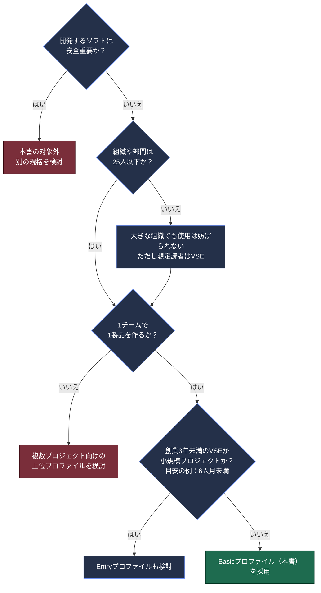

> 💡 **ポイント：Entryの判断基準**
> Entryかどうかは、**創業からの年数（3年未満）か、プロジェクトの規模（小規模）** で判断します。「6人月未満」は小規模の目安の例です。試作であることは条件ではありません。逆に、試作でもこの規模条件を満たさなければ、自動的にEntryにはなりません。
>
> 💡 **ポイント：大きな組織は使ってはいけない？**
> いいえ。規格は「VSE以外の組織が使うことを妨げない」と述べています。**想定読者がVSEである**という意味です。（S3）
>
> 💡 **ポイント：すでにISO/IEC/IEEE 12207を自社に合わせて調整できる組織は？**
> 序文は、12207や15288を**調整（テーラリング）する専門知識を持つVSEは、29110ではなく元の規格を使うことを推奨する**と述べています。29110は、調整の経験が乏しいVSEのための既製の部分集合です。（S3）

出典：S1、S3。

---

## 5. ステップ5：2つのプロセス（PMとSI）の全体像

本書の目次（S3）は、規格の中心が次の2つのプロセスであることを示しています。

| 章 | プロセス | 略称 | 一言でいうと |
|:--|:--|:--|:--|
| 6 | プロジェクト管理 | **PM**（Project Management） | 計画し、進捗を見て、問題があれば是正し、終える |
| 7 | ソフトウェア実装 | **SI**（Software Implementation） | 要件を分析し、設計・作成・結合テストをして、納品する |

### 5-1. 目的と期待される利益

本書の序文（S3）は、利用者が得られる利益を3点で述べています。

| 利益 | 内容 |
|:--|:--|
| 合意の明確化 | プロジェクトの要求事項と、顧客に引き渡す成果物の組が合意される |
| 管理された進め方 | プロジェクトの可視性があり、問題や計画からのずれに是正措置が取られる |
| 体系的な実装 | 顧客のニーズを満たし、作業成果物の品質を確保する実装プロセスが踏まれる |

### 5-2. PMとSIはどう連携するか

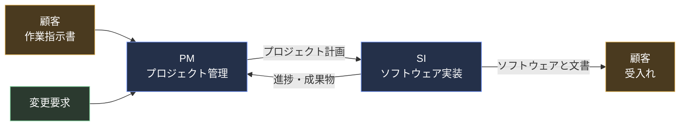

この関係は、O'Connor氏とLaporte氏の初期の解説（S8）でも、「PMがプロジェクト計画を作成してプロジェクトを方向づけ、実行中の変更要求が計画の改訂を引き起こし、SIが完了してクロージャで終わる」と説明されています。

### 5-3. 本書（5-1-2）を読み進めるための章立て

| 章 | 内容 |
|:--|:--|
| 1〜3 | 範囲、参照規格（なし）、用語（本書だけで読めるよう用語を追加） |
| 4 | 命名・図示・定義の約束事、略語 |
| 5 | 概要。**Basicプロファイルを使う前提条件（5.2）** とプロセス・活動の全体像（5.3） |
| 6 | PMプロセス（目的・成果・役割・活動とタスク） |
| 7 | SIプロセス（同上） |
| 8 | 役割の説明 |
| 9 | 作業成果物の説明 |
| 10 | ソフトウェアツール |
| 付録A〜E | 情報提供の付録。A〜Dは追加できるプロセス・タスク、Eはデプロイメントパッケージを説明する導入支援資料（第11章で解説） |

出典：S3（目次・序文）、S8。

---

## 6. ステップ6：PMプロセスを4つの活動で理解する

PMの目的は、**プロジェクトの目標を、期待される品質・時間・費用の範囲で達成すること**です。PMは4つの活動で構成されると、論文（S8）で整理されています。

| 活動 | 目的（要約） |
|:--|:--|
| プロジェクト計画（Project Planning） | 実行可能な計画を作り、関係者に伝える。範囲、成果物、タスク、スケジュール、必要資源を決める |
| 計画の実行（Project Plan Execution） | 合意した計画に沿って作業を進める |
| 評価と管理（Project Assessment and Control） | 状況を把握し、計画・予算・技術目標どおりか確認する。必要なら再計画する |
| クロージャ（Project Closure） | 最終成果物を顧客に引き渡し、文書を引き継ぎ、資源を解放し、関係者に終了を知らせる |

> 🔎 **要確認**
> 活動の番号・名称・タスクの細かい表現は、2025年版で書き直されています（第10章参照）。上記は S8 と、2011年版TRの構成に基づく**概要レベル**の説明です。2025年版の条文は規格本文でご確認ください。活動IDは、2025年版の概要ページ（S4）にある「PM.01 project planning」のようなゼロ詰め表記（PM.01〜PM.04、SI.01〜SI.06）に統一しています。2011年版TRでは PM.1、SI.1 のようにゼロ詰めなしで表記されていました。

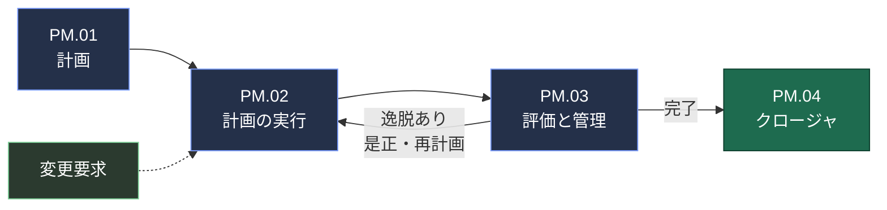

### 6-1. 各活動で「何をするのか」を、やさしい言葉で

| 活動 | 初心者向けの言い換え | 典型的な成果物（2011年版TR由来の例） |
|:--|:--|:--|
| 計画 | 「何を、誰が、いつまでに、どんな順で、どのくらいの工数で作るか」を紙にする。リスクも洗い出す。顧客と確認して合意する | プロジェクト計画 |
| 実行 | 計画どおりに作業する。会議で状況を共有し、記録を残す。変更の依頼が来たら受け付けて対応を決める | 進捗状況記録、会議記録、変更要求 |
| 評価と管理 | 計画と実績を比べる。ずれたら原因を見て、直す対策を決めて実行する | 進捗状況記録、是正登録簿 |
| クロージャ | 顧客に渡して受け入れてもらい、成果物をリポジトリに保管して終了する | 受入れ記録、プロジェクト・リポジトリ |

> 💡 **ベストプラクティス：計画は「重く」しない**
> VSEのための規格なので、計画書は**必要十分で短く**て構いません。Laporte氏らの事例（S5）でも、プロジェクト計画の作成は2名のスタートアップで合計約42時間（作成35時間＋レビュー3時間＋修正4時間）に収まっています。

出典：S5、S8。

---

## 7. ステップ7：SIプロセスを6つの活動で理解する

SIの目的は、**合意された要求に従って、ソフトウェアの作成と変更を体系的に行うこと**です。6つの活動の名称は、Laporte氏の論文の図（S5）に示されています。

| 活動 | 名称（英語） | 一言で |
|:--|:--|:--|
| SI.01 | Software Implementation Initiation | チームがプロジェクト計画を理解し、作業環境を整える |
| SI.02 | Software Requirements Analysis | 顧客の要求を分析し、要求仕様としてまとめて合意する |
| SI.03 | Software Architectural and Detailed Design | 構造と詳細を設計し、要求との対応を取る |
| SI.04 | Software Construction | コードを書き、単体テストをして、欠陥を直す |
| SI.05 | Software Integration and Tests | 部品を結合し、テストして、要求を満たすか確認する |
| SI.06 | Software product assembly | ソフトウェアと文書を製品としてまとめ、納品できる形に組み立てる |

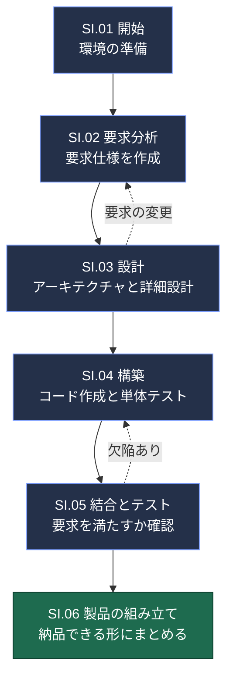

> 💡 **ポイント：ウォーターフォールの強制ではない**
> 図は上から下へ描いていますが、規格は開発手法を**限定していません**。序文は、ウォーターフォール、反復、増分、進化的、アジャイルのいずれのライフサイクルとも併用できると述べます。（S3）2011年版TRも、アジャイルやテスト駆動開発などで利用できる旨を述べています。（S15）

### 7-1. 各活動の読み解き方（初心者向け）

| 活動 | 具体的に何をする？ | QAエンジニアの視点で重要なこと |
|:--|:--|:--|
| SI.01 | プロジェクト計画をチームでレビューし、開発環境・ツールを用意する | テスト環境の準備も、この段階から視野に入れる |
| SI.02 | 顧客の要望を、検証可能な「要求仕様」として文書化する | **要求が検証できる形か**（曖昧語がないか）を早期にレビュー |
| SI.03 | 設計し、要求と設計・構成要素の**トレーサビリティ**を残す | 要求ごとのテスト漏れの確認に使える |
| SI.04 | 実装し、単体テストを行い、見つけた欠陥を直す | 欠陥の記録と分類。再現手順を残す |
| SI.05 | テストケースと手順を作り、結合して実行し、結果を記録する | 結合後のソフトウェアが要求を満たすことを確認 |
| SI.06 | 利用者向け文書、保守文書を整え、顧客に納品して受入れを得る | 受入れ基準と受入れテストの合意 |

Laporte氏らの事例（S5）では、SI.05の成果として次が列挙されています：チームによる計画のレビュー、テストケースと手順・結合環境の理解、結合済みソフトウェアと修正済み欠陥・結果の文書、要求と設計に対する結合ソフトウェアのトレーサビリティ、検証済みの運用・利用者文書、検証済みのソフトウェア・ベースライン。

### 7-2. 「検証」と「妥当性確認」の違い

| 用語 | 問い | 例 |
|:--|:--|:--|
| 検証（Verification） | 作り方は正しいか？（仕様どおりか） | 設計書が要求仕様に合っているかのレビュー |
| 妥当性確認（Validation） | 正しいものを作ったか？（顧客の要望を満たすか） | 顧客が受入れテストで確認 |

出典：S3、S5、S15。

---

## 8. ステップ8：役割と成果物を整理する

### 8-1. 役割（ロール）

Basicプロファイルでは、**1人が複数の役割を兼務**できます。2名のスタートアップ事例（S5）では、次のように割り当てられていました。

| 役割 | 略称（2011年版由来） | 担当の概要 | 事例での担当 |
|:--|:--|:--|:--|
| 顧客 | CUS | 要望を出し、受入れる | （外部または内部） |
| プロジェクトマネージャ | PM | 計画・管理・顧客との窓口 | B |
| 技術リーダー | TL | 技術的な判断を導く | A |
| 分析担当 | AN | 要求を分析する | A |
| 設計担当 | DES | 設計する | B |
| プログラマ | PR | 実装・単体テスト | A/B |
| 作業チーム | WT | チーム全体 | A/B |

> 🔎 **要確認**
> 略称は2011年版TRの慣例に基づく筆者の理解です。2025年版は、**付録Aでサポート管理者（support manager）** の役割を、**付録Bでもう1つの役割**（テストを支える役割）を追加しています。（S3、S4）追加された役割の正式名称は第8章と付録Bでご確認ください。

### 8-2. 主な作業成果物（概要）

2011年版TRで定義されていた代表的な成果物の例です。名称や必須・条件付きの扱いは2025年版で整理し直されているため、**第9章（作業成果物の説明）で必ず確認**してください。

| 区分 | 成果物の例 | 作成する活動 |
|:--|:--|:--|
| 管理 | 作業指示書（Statement of Work）、プロジェクト計画、進捗状況記録、会議記録、変更要求、是正登録簿、プロジェクト・リポジトリ | PM |
| 要求・設計 | 要求仕様、ソフトウェア設計、トレーサビリティ記録 | SI.02、SI.03 |
| 構築・テスト | ソフトウェア、テストケースと手順、テスト報告書、ソフトウェア構成 | SI.04、SI.05 |
| 納品 | 利用者文書、保守文書、受入れ記録 | SI.06、PM.04 |
| 条件付き | 運用ガイドなど（**顧客が求めた場合**に作成） | SI.06 |

2025年版では、旧版の「(optional)」表記が曖昧さの原因だったため、**条件付きタスク（conditional task）** という考え方に置き換えられています。（S3）

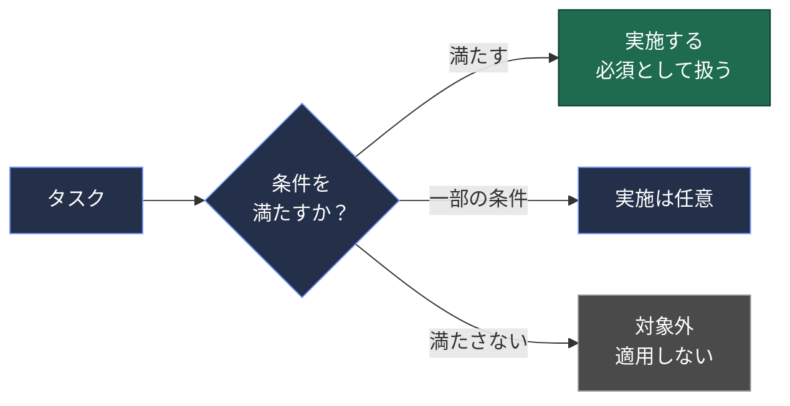

用語集の定義（S3）によれば、条件付きタスクは「ある条件では必須、別の条件では任意、さらに別の条件では範囲外や適用不可になりうるタスク」です。

出典：S3、S4、S5。

---

## 9. ステップ9：導入ステップ（自分のチームで始める）

「規格を丸ごと導入する」必要はありません。Laporte氏らは、VSEが段階的に始められるよう、**デプロイメントパッケージ（DP）** を開発してきました。DPは、プロファイルの一部の実務を導入しやすくするための成果物一式（手順、テンプレート、チェックリストなど）です。（S3、S5）

### 9-1. 導入の流れ

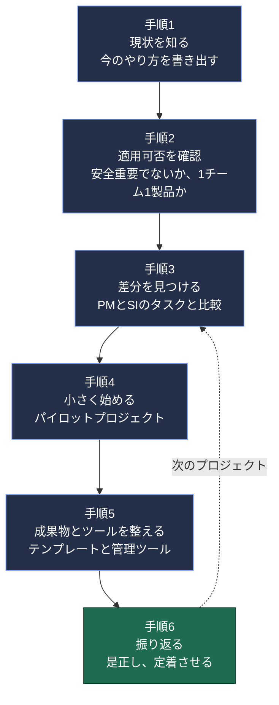

| 手順 | やること | ヒント |
|:--|:--|:--|
| 1 | 現状のプロセスを書き出す | 完璧でなくてよい。実際にやっていることを書く |
| 2 | 適用条件を確認する | 本書5.2「Basicプロファイルを使う前提条件」と第4章の判断フローを使う |
| 3 | 差分（ギャップ）を洗い出す | PM/SIのタスクと比較する。カナダの金融機関の事例では、実装タスクの網羅率が63〜73%程度だったと報告されている（S5） |
| 4 | パイロットで試す | 小さな案件で試し、ツールやテンプレートを調整する |
| 5 | 成果物とツールを整える | 第10章が示すPM/SI用ツールの種類を参考にする |
| 6 | 振り返り（教訓の整理） | 次のプロジェクトで改善する |

### 9-2. 事例から学ぶ（Laporte氏・O'Connor氏の論文より）

| 事例 | 規模 | 結果の要点 |
|:--|:--|:--|
| ① ITスタートアップ | 開発者2名、合計約990時間 | 手戻り（修正）は全体の**約12.6%**、準備（環境構築など）は**約9.0%**。112件のテストケースを実施 |
| ② カナダの金融機関の資金管理部門 | 6名 | ISO 29110にスクラムのタスクを加えた**アジャイル型プロセス**で、ある月の影響システム5件・重要度17が、約9か月後には1件・重要度1まで減少 |
| ③ 大手エンジニアリング企業の送配電部門 | 中小規模プロジェクト | 小規模はEntry、中規模はBasicのPMプロセスで文書化。3年間の見積りで導入維持費約16万ドルに対し純便益約78.6万ドル（企業の見積り） |

（S5。②③は元論文の数値で、組織の事情に依存します。）

> 💡 **ベストプラクティス**
> ①の事例では、検証として**ペアのデスクチェック**（机上レビュー）が使われました。コストが低く、小さなチームでもすぐに導入できるレビュー手法です。（S5）
>
> 💡 **ベストプラクティス：要求とコンポーネントの対応表**
> ①の事例では、要求とソフトウェア構成要素の**トレーサビリティ・マトリクス**を作成し、要求が変わったときの**影響範囲**を素早く特定できました。（S5）

出典：S3、S5。

---

## 10. 2025年版で何が変わったか（2011年版TRとの違い）

2025年版の「序文」には、**主な変更点**が明記されています。（S3）

| # | 変更点 | 初心者向けの解説 |
|:--|:--|:--|
| 1 | 多くのタスク記述が、理解しやすいように書き直された | 読みやすさの改善 |
| 2 | **条件付きタスク**が導入され、旧版の「(optional)」表記を置き換えた | 顧客が求める成果物（例：運用ガイド）などを、条件付きで扱う |
| 3 | 用語がClause 3に追加され、**本書だけで読み切れる**ようになった | 他のパートを引かなくても用語が分かる |
| 4 | 12207と15289の改訂に合わせて、一部の用語が見直された | 上位規格との整合 |
| 5 | 理解を助ける追加説明のテキストが加えられた | 補足の充実 |
| 6 | **付録A**：開発した製品を**サポート**するプロセスの追加 | 運用後の保守・サポート |
| 7 | **付録B**：**テスト**をよりよく支えるタスク（1つの役割と複数の成果物を含む） | QAに直結 |
| 8 | **付録C**：**アクセシビリティ**に関するタスク | 利用しやすさ配慮 |
| 9 | **付録D**：**セキュリティ**関連のタスク | セキュリティ要求の統合 |

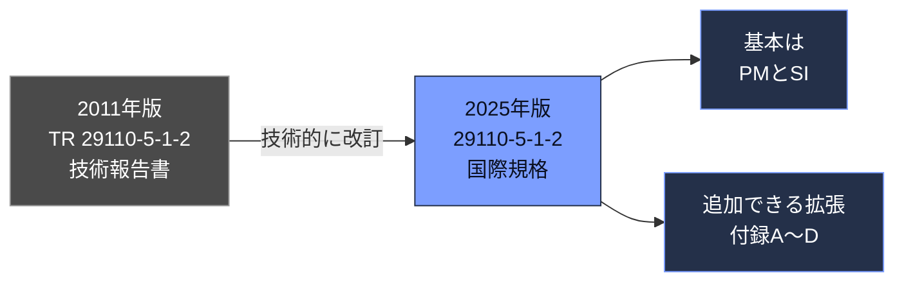

ISOの2011年版TRのページには、「2025-02-18付で撤回（Withdrawal）、2025年版に改訂された」と記載されています。（S2）

> 💡 **ポイント**
> 旧版（TR）の記述に基づく書籍や論文を読む際は、**付録A〜Dの内容は2025年版で新設**であることに注意してください。旧版のPM/SIの基本構成は踏襲されていると理解できますが、**タスク表現は書き換えられています**。

### 10-1. 改訂の経緯（ISOのステージ記録）

| 段階 | 日付 |
|:--|:--|
| 新規プロジェクト承認 | 2022年12月22日 |
| 委員会原案（CD）登録 | 2022年12月22日 |
| CDコメント期間の終了 | 2023年5月6日 |
| DIS（国際規格案）投票開始 | 2023年10月26日 |
| FDIS承認登録 | 2024年7月22日 |
| FDIS投票終了 | 2024年12月21日 |
| **国際規格として発行** | **2025年2月18日** |

出典：S1、S2、S3。

---

## 11. 付録A〜E：追加できる拡張と導入支援資料

本書の序文（S3）は、これらの付録を**情報提供（informative）** と位置づけています。ただし性質は2種類に分かれます。

- **付録A〜D**：Basicプロファイルの本体（PM + SI）に**追加できるプロセスやタスク**
- **付録E**：プロセスやタスクの追加ではなく、**デプロイメントパッケージを説明する導入支援資料**

| 付録 | 種別 | 内容 | 向いている状況 |
|:--|:--|:--|:--|
| A | 追加プロセス | 開発した製品の**サポート**プロセス（サポート管理者の役割を含む） | 納品後も保守・問い合わせ対応を担う |
| B | 追加タスク | **追加のテストタスク**（1つの役割、複数の成果物を含む） | テストを強化したい。QAの関与を明確にしたい |
| C | 追加タスク | **アクセシビリティ**のタスク | 幅広い利用者が使うWeb・アプリ |
| D | 追加タスク | **セキュリティ**のタスクと成果物の統合 | 個人情報や認証を扱う製品 |
| E | 導入支援資料 | **デプロイメントパッケージ**の説明（プロファイルへの追加要素ではない） | 段階的に導入したい |

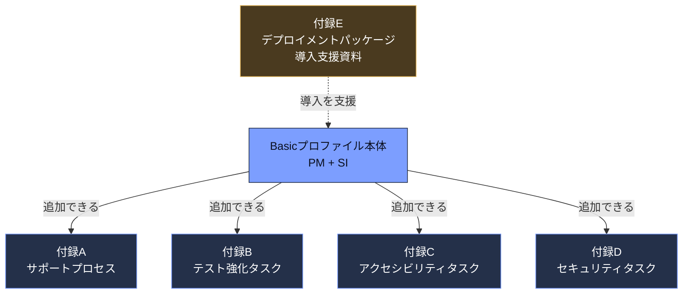

### 11-1. 付録Bとテスト関連規格の関係

付録Bは、用語（試験条件、テストデータ、テスト設計技法、テスト環境など）を、**ISO/IEC/IEEE 29119-1**（ソフトウェアテストの概念と定義）から引いています。（S3の用語定義）たとえば、テスト設計技法の例として、同値分割法、境界値分析、決定表テスト、分岐テストが挙げられています。

> 💡 **QAエンジニアへのヒント**
> 付録Bは、29119シリーズ（テストプロセス、技法、文書化）の考え方を、**VSEの軽量なプロセスに合う形**で取り込む入口と読めます。詳細なタスク名や成果物名は付録B本文で確認してください。

### 11-2. 付録Cのアクセシビリティの用語

用語集（S3）では、アクセシビリティを「幅広い特性・能力を持つ人々が、特定の状況で目標を達成するために製品やサービスを使える度合い」と定義し、**ペルソナ**（利用者像）、**支援技術**、**適応的方策**なども定義しています。付録Cのタスクはこれらの概念を前提にしています。

出典：S3、S4。

---

## 12. 実践例：2名スタートアップの場合

> ⚠️ **これは学習用の架空の例です**。規格本文のサンプルではなく、本ガイドの筆者が構成を説明するために作った例です。

### 12-1. 前提

| 項目 | 内容 |
|:--|:--|
| 製品 | 旅行計画を共有するWebアプリ |
| チーム | 開発者2名（AさんとBさん） |
| 期間 | 約3か月 |
| 顧客 | 社内の企画担当（内部の合意） |
| 安全重要か | いいえ |

### 12-2. 役割の割り当て

| 役割 | 担当 |
|:--|:--|
| プロジェクトマネージャ | Bさん |
| 技術リーダー・分析・プログラマ | Aさん |
| 設計・プログラマ | Bさん |

### 12-3. 週次の進め方（PMとSIの組み合わせ）

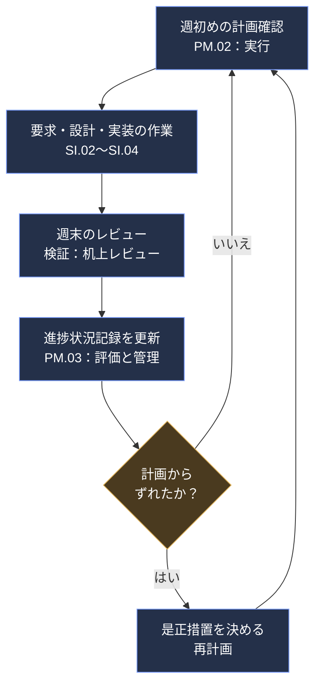

### 12-4. 成果物の例（最小構成）

| 成果物 | 内容の目安 |
|:--|:--|
| プロジェクト計画 | 範囲、タスク一覧、スケジュール、リスク、レビュー方法 |
| 要求仕様 | 機能一覧、受入れ基準 |
| 設計書 | 画面構成、データ構造、主要な処理 |
| テストケース・手順 | 要求ごとの確認項目 |
| テスト報告書 | 結果、未解決の欠陥 |
| 利用者文書 | 操作手順 |
| 受入れ記録 | 顧客の確認 |

---

## 13. よくある疑問（FAQ）

**Q1. 認証（ISO/IEC 29110認証）は必須ですか？**
A. いいえ。規格は任意です。VSEは、プロファイルを実装して**監査を受けることで認知を得られる**と序文が述べています。（S3）メキシコには29110-4-1の認証を受けた企業のリストがあるという論文の記述もあります。（S11）

**Q2. アジャイル開発でも使えますか？**
A. 使えます。序文は特定のライフサイクルを限定せず、アジャイルを含めて併用できると述べます。（S3）カナダの金融機関の事例では、スクラムのタスクを加えた**ISO 29110アジャイル型プロセス**が運用されました。（S5）

**Q3. 規格は有料ですか？**
A. ISOの英語ページでは、2026年10月時点で**価格がCHF 0と表示**されていました。（S1）ただし、国別ページでは価格表示が異なる場合もあり、2011年版TRは「ISOから無償で入手可能」と論文に記されています。購入前にISO公式ページで確認してください。

**Q4. 25人を超える組織は使えませんか？**
A. 使えます。VSE向けに設計されただけで、大きな組織の利用を妨げません。（S3）

**Q5. 12207や15288を使える組織は、29110を使うべきですか？**
A. 序文は、**調整の専門知識がある組織は元の規格を使うことを推奨**しています。（S3）

**Q6. 複数のチームで複数の製品を作っています。Basicで足りますか？**
A. 足りません。Basicは**1チーム1製品**が前提なので、複数製品の並行開発はBasicの適用条件に合いません。どのプロファイルが適合するかは、Intermediateなど他のプロファイルの適用条件を、各プロファイル文書で別途確認してください。（S1、S5）

**Q7. システム（ハードウェアを含む）はどうしますか？**
A. 序文は、システム開発のVSEには**システムエンジニアリング版のBasicプロファイルのガイド（発行済みの ISO/IEC TR 29110-5-6-2:2014）** を使うよう勧めています。（S3）

> 注：後継の番号なし「ISO/IEC 29110-5-6-2」（国際規格）は発行準備中です（ISOのステージ 60.00、2026年9月4日から）。（S16）

---

## 14. 用語集

| 用語 | 意味（本ガイドの言葉で） |
|:--|:--|
| VSE | 最大25人の企業・組織・部門・プロジェクト |
| プロファイル | 大きな規格から、目的に合わせて選んだプロセス・活動・タスク・成果の部分集合 |
| Basicプロファイル | 1つの作業チームが1つの製品を作るVSE向けのプロファイル |
| 汎用プロファイル群 | 安全重要でない製品を開発するVSE向けの、4つの成長段階のプロファイル群 |
| プロセス | 入力を出力に変える、相互に関連する活動の集まり |
| 活動 | 一連のタスクのまとまり |
| タスク | 成果の達成に貢献する、必須・推奨・許容された行動 |
| 条件付きタスク | 条件により、必須にも任意にも対象外にもなりうるタスク |
| ベースライン | 正式に承認され、ある時点で固定された構成要素の版 |
| 作業成果物 | プロセスから生じる成果物（計画、仕様、コード、報告書など） |
| デプロイメントパッケージ（DP） | VSEが実務を導入しやすくするための成果物一式 |
| ソフトウェアサポート | 実装済みシステムの利用と改善のために、継続して提供されるサービスと資材 |
| トレーサビリティ | 要求から設計・コード・テストまで、対応関係をたどれること |
| 欠陥 | 作業成果物が要求や仕様を満たさず、修理か交換が必要な不備 |

（用語の意味は S3 の定義に基づく要約。正確な定義文は規格本文のClause 3を参照。）

---

## 15. 理解度チェック

- [ ] VSEは何人以下の組織か説明できる
- [ ] ISO/IEC 29110-4-1（仕様）と5-1-2（ガイド）の違いを説明できる
- [ ] 4つのプロファイルを順に挙げ、Basicの対象を説明できる
- [ ] 本書の対象外になるケース（安全重要など）を2つ挙げられる
- [ ] PMの4活動とSIの6活動を挙げられる
- [ ] 条件付きタスクが何を置き換えたか説明できる
- [ ] 2025年版で追加された付録A〜Dの内容を言える
- [ ] 自分のチームで導入する最初の一歩を決められる

### 確認問題

**問1.** 5人のチームが、2つの別製品を並行して開発している。Basicプロファイルは適切か？
**答え：** 適切とは限りません。Basicは**1チーム1製品**が前提で、複数並行の開発は上位プロファイルが想定されます。（S1、S5）

**問2.** 顧客が運用ガイドを求めた場合、2025年版ではどう扱われるか？
**答え：** 「条件付きタスク」として、条件を満たすときに作成するタスクの形で表現されます。（S3）

**問3.** 規格の適合要件はどのパートに書かれているか？
**答え：** ISO/IEC 29110-4-1 です。（S3）

---

## 16. 参照ソース一覧

> 検索基準日：2026年10月16日までの情報。URLは筆者が実際に開いて内容を確認したものです。

### 16-1. 公式情報（ISO）

| ID | 資料 | URL |
|:--|:--|:--|
| S1 | ISO/IEC 29110-5-1-2:2025 公式ページ（要旨、ライフサイクル、ステージ記録） | https://www.iso.org/standard/82669.html |
| S2 | ISO/IEC TR 29110-5-1-2:2011（撤回・2025年版へ改訂）公式ページ | https://www.iso.org/standard/51153.html |
| S16 | ISO/IEC 29110-5-6-2（TR 29110-5-6-2:2014 の後継、発行準備中）公式ページ | https://www.iso.org/standard/86342.html |

### 16-2. 規格プレビュー（公開サンプル）

| ID | 資料 | URL |
|:--|:--|:--|
| S3 | ISO/IEC 29110-5-1-2:2025 プレビューPDF（序文、目次、用語、主な変更点）※iTeh Standards提供 | https://cdn.standards.iteh.ai/samples/82669/53c2b3e0d89b4126aea1556f6bd3c522/ISO-IEC-29110-5-1-2-2025.pdf |
| S4 | 同規格のカタログページ（処理内容、付録の概要） | https://standards.iteh.ai/catalog/standards/iso/13cdc5fd-1400-470d-a826-98b0499d8743/iso-iec-29110-5-1-2-2025 |
| S15 | ISO/IEC TR 29110-5-1-2:2011 サンプルPDF（旧版の範囲・利用者・開発手法の記述） | https://cdn.standards.iteh.ai/samples/51153/360ee03ad5a8419d9db50a2d0a8a8349/ISO-IEC-TR-29110-5-1-2-2011.pdf |

### 16-3. 主要エディター・研究者の論文と解説（国際的に著名）

| ID | 資料 | 著者・所属 | URL |
|:--|:--|:--|:--|
| S5 | A Multi-Case Study Analysis of Software Process Improvement in Very Small Companies using ISO/IEC 29110（ECSPI 2016、3事例） | Claude Y. Laporte（ÉTS、規格のリードエディター）、Rory V. O'Connor（DCU） | https://doras.dcu.ie/21401/1/Published.pdf |
| S6 | An Overview of Eight Implementations of ISO/IEC 29110 in Small Organizations | Claude Y. Laporte（ÉTS） | https://dcu-test.eprints-hosting.org/21798/1/Published.pdf |
| S7 | ISO/IEC 29110 の概要（Basicプロファイルの全体像） | Claude Y. Laporte（ÉTS） | https://doras.dcu.ie/20273/1/PID3323607.pdf |
| S8 | Software Project Management in Very Small Entities with ISO/IEC 29110（PMの4活動） | Rory V. O'Connor、Claude Y. Laporte | https://doras.dcu.ie/20277/1/OConnor.pdf |
| S9 | ISO/IEC 29110 コース紹介（4段階ロードマップ、DPの紹介） | ÉTS（Laporte氏のコース） | https://ena.etsmtl.ca/course/view.php?id=4430 |
| S10 | Laporte氏の経歴（2005年から29110シリーズのリードエディター） | Cudi（講演紹介ページ） | https://cudi.edu.mx/eventos/overview-software-quality-assurance-and-isoiec-29110-series-standards-and-guides-very-small |
| S11 | An evaluation of the benefits and difficulties of implementing ISO/IEC 29110 in academia and industry（2025年7月、23の便益と課題） | Universidad de Medellín 誌 | https://revistas.udem.edu.co/index.php/ingenierias/en/article/view/5149 |
| S12 | Analysis of 13 implementations of the Basic profile guide of ISO/IEC 29110 in VSEs using different life cycles（2020、J. Software: Evolution and Process） | Munoz, Pena, Mejia, Gasca-Hurtado, Gomez-Alvarez, Laporte | https://espace2.etsmtl.ca/id/eprint/21322 |
| S13 | ISO/IEC 29110-4-1（Basicプロファイル仕様）の範囲（BSI） | BSI Knowledge | https://knowledge.bsigroup.com/products/systems-and-software-engineering-lifecycle-profiles-for-very-small-entities-vses-software-engineering-profile-specifications-generic-profile-group |
| S14 | VSE関連規格の一覧（ANSI Webstore） | ANSI | https://webstore.ansi.org/industry/software/software-engineering/VSE-Very-Small-Entities |

### 16-4. 本ガイドの限界

| 項目 | 内容 |
|:--|:--|
| 条文の詳細 | 規格本文は著作権の制約があるため、PM/SIの各タスクの正確な文言・番号は反映していません |
| 活動名・成果物名 | S5、S8、2011年版TRの系譜に基づく概要。2025年版では書き換えがあります |
| 付録B〜Dの中身 | 序文と目次に基づく概要のみ。詳細は規格本文で確認してください |
| 推奨アクション | 実務で使う前に、ISO公式ページから規格本体を入手し、第5〜10章と付録を直接確認してください |

---

*本ガイドは、公開情報に基づく筆者による学習用の再構成です。ISO/IECの規格本文の代替ではありません。*
