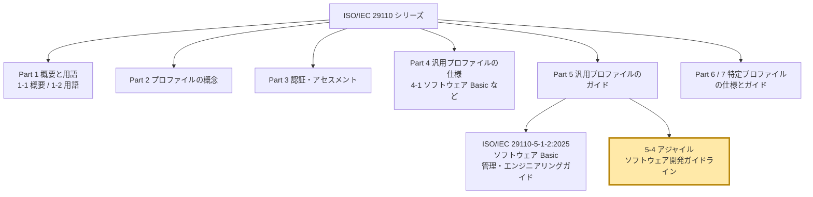
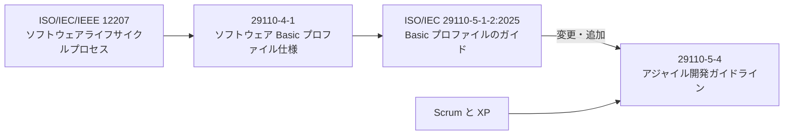
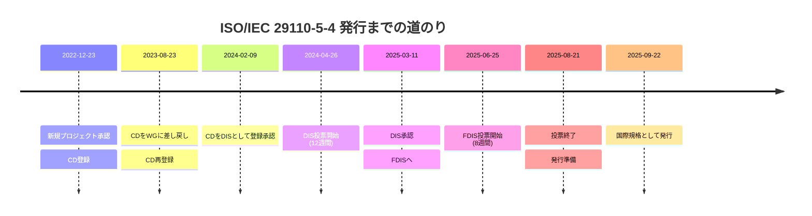
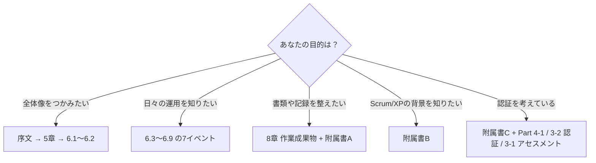
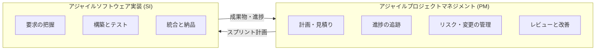
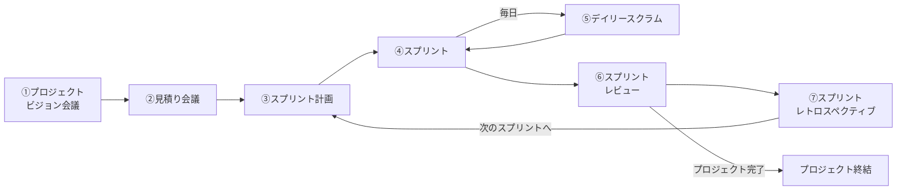
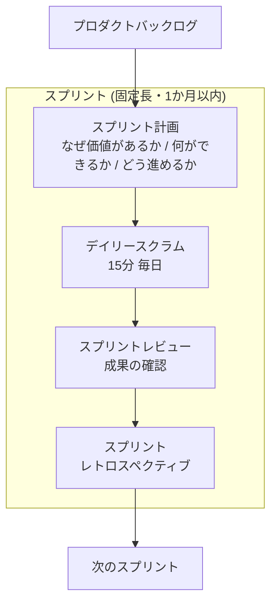
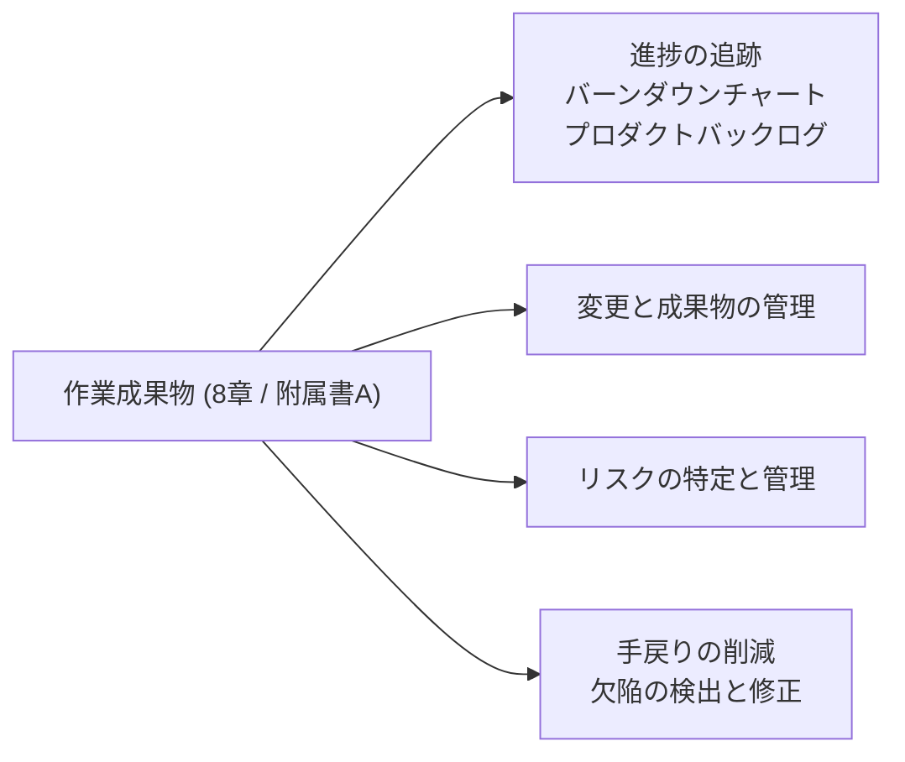
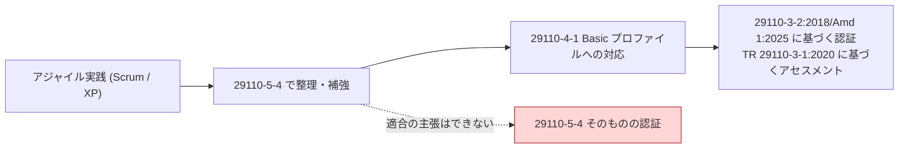
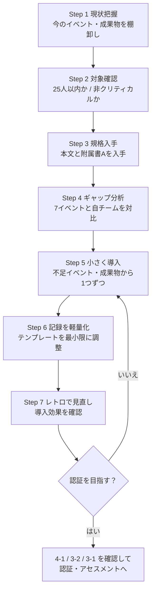

# ISO/IEC 29110-5-4:2025 初学者向けステップバイステップ解説

> **正式名称**: Systems and software engineering — Life cycle profiles for very small entities (VSEs) — Part 5-4: Agile software development guidelines
> **和訳（本書での呼称）**: システム及びソフトウェア工学 — 超小規模組織（VSE）向けライフサイクルプロファイル — 第5-4部: アジャイルソフトウェア開発ガイドライン
> **情報の基準日**: 2026年10月18日現在

---

## 0. 本書の読み方と情報の確かさ

本書は、規格の公開情報（ISO公式ページ、VDE出版社の公開プレビュー PDF の目次・序文・適用範囲）と、アジャイル分野の一次情報（アジャイル宣言、Scrum Guide、Kent Beck の XP）をもとに構成しています。

規格本文は有料かつ著作権で保護されているため、**本文の各タスクの詳細・役割の細かな責務・作業成果物の項目は転載せず**、公開されている範囲の構造と趣旨を自分の言葉で解説します。情報の出どころは次の3種類に分けて明示します。

| 記号 | 意味 | 例 |
|---|---|---|
| 【規格】 | ISO公式ページ・公開プレビューで確認できた内容 | 適用範囲、目次、イベント名、成果との対応 |
| 【一般】 | Scrum / XP / アジャイル宣言など、規格外の一次情報で確認できる内容 | Scrumのイベント、XPの価値 |
| 【提案】 | 筆者（本ガイド）による学習・導入のための整理 | 導入ステップ、QA視点の観点 |

> 実務で規格を根拠に判断するときは、必ず規格の購入版（ISO Store / 各国規格協会）で本文を確認してください。

---

## 1. 3分でわかる全体像

### 1.1 ひとことで言うと

**「少人数でアジャイル（Scrum と XP）開発をしているチームが、ISO/IEC 29110 の考え方を使って、いまのやり方を整理・補強するための手引き」** です。【規格】

### 1.2 押さえるべき5つの事実

| # | 事実 | 区分 |
|---|---|---|
| 1 | 対象は VSE（**最大25人**程度の組織・部門・プロジェクト）【規格】 | 規格 |
| 2 | 対象外は、**ビジネスクリティカル / 安全クリティカル**な製品を開発する VSE【規格】 | 規格 |
| 3 | 主に **Scrum と XP** に基づく【規格】 | 規格 |
| 4 | **要求事項（requirements）を含まない**。したがって「本文書への適合」を主張することはできない【規格】 | 規格 |
| 5 | 2025年9月22日に第1版として発行、全73ページ【規格】 | 規格 |

> **重要な誤解の防止**: 「ISO 29110-5-4 の認証を取る」という言い方は成立しません。本書は**ガイドライン**であり、認証の対象にはなりません。認証では、VSE が Part 4-1（ソフトウェア Basic プロファイル）の要求事項に適合するように実装したプロセスが、Part 3-2 の認証スキームに従って評価されます。詳細は第9章で説明します。

### 1.3 この規格が解決しようとしている課題

序文によると、VSE には次のような悩みがあります。【規格】

1. 多くの国際規格は大企業を想定しており、VSE が実装・適合するのは困難。
2. 規格を自社のビジネスに結びつけたり、導入工数を正当化したりするのが難しい。
3. アジャイルを始めるとき、柔軟で抽象度の高い ISO/IEC/IEEE の要求を自分で解釈・テーラリングするより、**具体的な手順があるほうが助かる**ことが多い。

---

## 2. ISO/IEC 29110 シリーズの中での位置づけ

### 2.1 シリーズ全体図

【規格】序文の整理に基づく。5-4 は Part 5（汎用プロファイル群向けのガイド）に属します。

### 2.2 各 Part の役割（一覧表）

| Part | 役割 | 主な読者 |
|---|---|---|
| 1-1 | プロセス・ライフサイクル・VSE の特徴・プロファイル分類の概要 | VSE、顧客、アセッサ、ツールベンダ |
| 1-2 | シリーズ共通の用語定義 | 同上 |
| 2 | プロファイルを定義・適用するための考え方 | プロファイル作成者 |
| 3 | 認証スキーム、アセスメント、適合性評価、自己評価 | 監査員、認証機関、VSE |
| 4 | 汎用プロファイル群の仕様（例: 4-1 ソフトウェア Basic） | VSE、規格作成者、ツールベンダ |
| 5 | 汎用プロファイル群の管理・エンジニアリング・サービス提供のガイド | VSE、顧客 |
| 6 / 7 | 特定プロファイルの仕様 / ガイド | 同上 |

### 2.3 5-4 と 5-1-2 の関係

5-4 は、**ソフトウェア Basic プロファイルのガイドである ISO/IEC 29110-5-1-2:2025（Systems and software engineering — Life cycle profiles for very small entities (VSEs) — Part 5-1-2: Software engineering guidelines for the generic Basic profile）をベースに、要素（タスク、作業成果物、役割など）を変更・追加して**、アジャイル開発向けに作り直したものです。【規格】

---

## 3. 発行までの経緯（ISO公式ページのステージ履歴）

| 項目 | 内容 |
|---|---|
| 版 | 第1版（Edition 1）、2025年9月 |
| ステージ | 60.60（International Standard published） |
| ページ数 | 73 |
| 担当委員会 | ISO/IEC JTC 1/SC 7（ソフトウェア及びシステムエンジニアリング） |
| ICS | 35.080（ソフトウェア） |
| 提供形式 | 英語、PDF + ePub（ISO公式ページ） |

> ドラフト段階（DIS / FDIS）の概要には「Scrum と XP に基づく」「ソフトウェア Basic プロファイルを既に使っている VSE がアジャイルを導入しやすくする」旨が明記されていました。発行版の適用範囲の文面は、より簡潔になっています。【規格】

---

## 4. 規格の構成（目次の読み解き）

公開プレビューの目次から、章構成を整理します。【規格】

| 章 | 内容 | ページ（目安） |
|---|---|---|
| 序文 | VSE の背景、シリーズ紹介、本書の狙いと得られる効果 | vi〜viii |
| 1 | 適用範囲 | 1 |
| 2 | 引用規格（29110-1-2 用語） | 1 |
| 3 | 用語・定義・略語 | 1〜6 |
| 4 | 表記・図の規約 | 6 |
| 5 | 概要（Basic プロファイルとアジャイルイベントの対応、関与する役割） | 7〜9 |
| 6 | **アジャイルソフトウェア開発プロセス**（本書の中心。7つのイベント） | 10〜31 |
| 7 | 役割の説明 | 32〜34 |
| 8 | **作業成果物の説明** | 35〜58 |
| 附属書A | 作業成果物テンプレートの例（参考） | 59〜64 |
| 附属書B | 代表的なアジャイル手法の概要（参考） | 65〜66 |
| 附属書C・D | ガイドライン開発の経緯（参考） | 67〜71 |
| 参考文献 | — | 72 |

### 4.1 どこから読むべきか

---

## 5. 本書が使う2つのプロセス（ステップ1: 骨格を理解する）

ソフトウェア Basic プロファイルは、2つのプロセスで構成されています。5-4 はそれぞれに「アジャイル」を付けています。【規格】

| プロセス | 略称（成果の接頭辞） | 何を担うか（一般的な理解） |
|---|---|---|
| **アジャイルプロジェクトマネジメント** | PM（PM.O1 など） | 計画、進捗追跡、リスク、変更、レビュー、終結などの管理活動 |
| **アジャイルソフトウェア実装** | SI（SI.O1 など） | 要求の分析、設計、構築、テスト、統合、納品などの技術活動 |

> 各成果（Outcome）の厳密な文言は規格本文 6.1.2 / 6.2.2 にあります。ここでは「PM は管理」「SI は作る」という切り分けだけ覚えれば十分です。

---

## 6. 7つのアジャイルイベント（ステップ2: 中心部を理解する）

### 6.1 7イベントの流れ

6章の本体は、7つの「イベント」で構成されています。【規格】

①②は**プロジェクト開始時**、③〜⑦は**スプリントごとの繰り返し**と読むのが基本です（⑤は④の中で毎日実施）。

### 6.2 各イベントの概要

各イベントは、規格の中で共通の型（**正当性 Justification → 概要 Overview → タスク Tasks**）で説明されています。【規格】

| # | イベント | 目的の一般的な理解【一般】 | 規格内の節 |
|---|---|---|---|
| 1 | プロジェクトビジョン会議 | 何を、なぜ作るのかを関係者でそろえる | 6.3 |
| 2 | 見積り会議 | バックログ項目の大きさ・工数を見積もる | 6.4 |
| 3 | スプリント計画 | 次のスプリントで何をやるか決める | 6.5 |
| 4 | スプリント | 設計・実装・テストを回し、動くものを作る | 6.6 |
| 5 | デイリースクラム | 毎日短時間で進捗・障害を共有する | 6.7 |
| 6 | スプリントレビュー | できた成果をステークホルダーに見せ、フィードバックを得る | 6.8 |
| 7 | スプリントレトロスペクティブ | やり方そのものを振り返り改善する | 6.9 |

### 6.3 イベントと成果（Outcome）の対応マトリクス【規格】

目次には、各イベントが **どの成果に貢献するか** が明記されています。ここが「アジャイルのイベントを、29110 の成果に結びつける」という本書の核心です。

| イベント | PM.O1 | PM.O2 | PM.O3 | PM.O4 | PM.O5 | PM.O7 | SI.O1 | SI.O3 | SI.O4 | SI.O5 | SI.O7 |
|---|:-:|:-:|:-:|:-:|:-:|:-:|:-:|:-:|:-:|:-:|:-:|
| ① ビジョン会議 | ● | | | | | | | | | | |
| ② 見積り会議 | ● | | | | ● | | | | | | |
| ③ スプリント計画 | ● | ● | | ● | | ● | ● | ● | | ● | |
| ④ スプリント | | ● | ● | | | | | ● | ● | ● | ● |
| ⑤ デイリースクラム | | ● | ● | ● | ● | ● | | | | | |
| ⑥ スプリントレビュー | | ● | ● | ● | | | | | | ● | ● |
| ⑦ レトロスペクティブ | | ● | ● | ● | | ● | | | | | |

#### 読み取れること（初学者向けのコツ）

1. **PM.O2 / PM.O3 / PM.O4 は多くのイベントに登場**する。つまり「進捗を追い、見直す」活動がアジャイルでは**毎スプリント・毎日**に分散している。
2. **SI 成果（作る側）は ③④⑥ に集中**する。計画、実装、レビューで作る活動が現れる。
3. **①②は PM だけ**。開始時の整理は管理側の活動である。
4. PM.O6 と SI.O2 / SI.O6 は表の目次には現れない（どのイベントにも明示されていない）。取りこぼしがないかは、規格本文で確認するとよい。

---

## 7. 7イベントを Scrum の知識で理解する（ステップ3: 土台を補う）

本書は Scrum と XP に基づくため、まず**Scrum 自体**を理解すると規格が読みやすくなります。ここからは【一般】の情報です。

### 7.1 アジャイル宣言の4つの価値（2001年）

17人の実践者（Kent Beck、Martin Fowler、Ken Schwaber、Jeff Sutherland ら）が署名した宣言です。

| 重視するもの（左） | 並べて比べる対象（右） |
|---|---|
| 個人と対話 | プロセスやツール |
| 動くソフトウェア | 包括的なドキュメント |
| 顧客との協調 | 契約交渉 |
| 変化への対応 | 計画に従うこと |

**右側にも価値はあるが、左側をより重視する**、というのが宣言の趣旨です。

> 29110 のような規格は「プロセスと文書」寄りに見えます。5-4 は、その**両立**を狙った位置づけです（序文が、変更管理・リスク管理・手戻り削減などの効果を挙げています）。

### 7.2 Scrum のイベント（Scrum Guide 2020）

Scrum Guide（Ken Schwaber / Jeff Sutherland、2020年11月版）によると、**スプリント**が他のイベントを包む容器です。スプリントは**1か月以内の固定長**で、次のスプリントは前のスプリント終了直後に始まります。

| Scrum の要素 | 内容 |
|---|---|
| 3つの責任 | プロダクトオーナー / スクラムマスター / 開発者 |
| 5つのイベント | スプリント / スプリント計画 / デイリースクラム / スプリントレビュー / レトロスペクティブ |
| 3つの作成物とコミットメント | プロダクトバックログ（プロダクトゴール）/ スプリントバックログ（スプリントゴール）/ インクリメント（完成の定義） |
| タイムボックス上限（1か月スプリントの場合）| 計画 8時間、レビュー 4時間、レトロスペクティブ 3時間、デイリー 15分 |

> Scrum Guide が示す時間は**1か月スプリントでの上限**で、短いスプリントではそれに応じて短くなります。

### 7.3 規格の7イベントと Scrum の対応【提案】

| 規格のイベント | Scrum の対応 | 補足 |
|---|---|---|
| ① プロジェクトビジョン会議 | プロダクトゴール設定、バックログの初期作成 | Scrum の5イベントの外側にある「開始時の活動」 |
| ② 見積り会議 | バックログのリファインメント（見積り） | Scrum Guide ではリファインメントは継続的な活動 |
| ③ スプリント計画 | スプリント計画 | 同名 |
| ④ スプリント | スプリント | 同名 |
| ⑤ デイリースクラム | デイリースクラム | 同名 |
| ⑥ スプリントレビュー | スプリントレビュー | 同名 |
| ⑦ スプリントレトロスペクティブ | スプリントレトロスペクティブ | 同名 |

Scrum の5イベントに、**開始時の2つ（①②）を明示的に加えた**点が、VSE 向けの工夫だと読み取れます。

### 7.4 XP（Extreme Programming）の要点

Kent Beck が1996年のChryslerのC3プロジェクトで形作り、1999年の著書 *Extreme Programming Explained* で整理した手法です。

| 観点 | 内容 |
|---|---|
| 5つの価値 | コミュニケーション、シンプルさ、フィードバック、勇気、尊重 |
| 代表的な実践 | ペアプログラミング、継続的インテグレーション、テストファースト（TDD）、小さなリリース、オンサイト顧客 |
| 構造 | 価値 → 原則 → 実践 の3層（実践は価値の表れ） |

Martin Fowler は、アジャイルを機能させるには堅実な技術プラクティスが必要であり、XP はその代表であると述べています。

> Scrum は「**進め方（マネジメント）**」、XP は「**作り方（技術）**」が強みです。5-4 が両方を土台にしているのは、この補完関係のためと考えられます。【提案】

---

## 8. 役割と作業成果物（ステップ4: 記録と責任を理解する）

### 8.1 役割（7章・5.4）

規格は、関与する役割を5.4で概観し、7章で詳しく説明します。【規格】役割ごとのタスクが用意されることが、序文の「各役割の明確化」という効果に対応します。

#### 参考：Scrum Guide 2020 の責任（規格の役割表ではありません）【一般】

次の表は **Scrum Guide 2020 の説明** であり、5-4 の役割名ではありません。「スクラムマスター」は Scrum Guide の用語です。5-4 の役割名・責務は規格本文の5.4と7章で確認してください。

| Scrum Guide の責任 | 責任の概要 |
|---|---|
| プロダクトオーナー | プロダクトの価値の最大化、バックログの管理 |
| スクラムマスター | Scrum の確立、チームの障害除去の支援 |
| 開発者 | 各スプリントで使えるインクリメントを作る |

### 8.2 作業成果物（8章・附属書A）

8章は規格で最大のボリューム（35〜58ページ、約24ページ）を占め、**各作業成果物の内容**を定義します。附属書Aには、そのテンプレート例があります。【規格】

序文は、作業成果物を使うことで得られる効果として次を挙げています。【規格】

---

## 9. 認証との関係（ステップ5: 誤解を避ける）

### 9.1 5-4 は認証対象ではない

序文は次のことを述べています。【規格】

- 本書は**要求事項を含まない**。組織は**本書への適合を主張できない**。
- 一方で、ソフトウェア Basic プロファイル（**ISO/IEC 29110-4-1**）の2つのプロセスについて**認証を始めたい VSE**が、アジャイルの実践を続けながら進められるように支援する（附属書C）。

### 9.2 実務上の整理

| やりたいこと | 参照する規格 |
|---|---|
| アジャイルのやり方を整理する | **29110-5-4**（本書） |
| 既存の Basic プロファイルの手順を知る | ISO/IEC 29110-5-1-2:2025 |
| Basic プロファイルの要求を確認する | 29110-4-1 |
| 認証スキームを知る | ISO/IEC 29110-3-2:2018/Amd 1:2025 |
| プロセスアセスメントの手続きを知る | ISO/IEC TR 29110-3-1:2020 |
| 用語を確認する | 29110-1-2（本書の引用規格） |

---

## 10. 用語の勘所（3章）

3章は、29110-1-2 の用語に加え、アジャイル固有の用語を定義します。ここでは公開プレビューで確認できた2つを紹介します。【規格】

| 用語 | 趣旨（要約） |
|---|---|
| 受け入れ基準（acceptance criteria） | ストーリーや機能などの作業が完了とみなされるために満たすべき品質属性について、チームが合意した取り決め |
| アジャイル（agile） | フィードバックに素早く対応できるようにする、製品・サービスの開発・提供・保守のアプローチ。要求仕様は作業を始める時点で具体化し、無駄を避けて優先順位づけを助ける。ISO/IEC 33202:2024 の定義を修正したもの |

QA 視点では、**受け入れ基準が「合意」として定義されている**ことが重要です（第12章）。

---

## 11. 導入ステップ（ステップバイステップ）【提案】

「いまアジャイルで動いている小さなチーム」が、5-4 を使って補強する手順の例です。

| Step | やること | 判断の目安 |
|---|---|---|
| 1 | チームのイベント、バックログ、見積り、レビューの実態を書き出す | 7イベントのうち、すでに実施しているものに印を付ける |
| 2 | 規模と製品の性質を確認する | 25人以下が対象。25人を超える、またはビジネスクリティカル / 安全クリティカルな製品なら対象外 |
| 3 | 規格本文を購入（ISO Store 等） | 公開情報だけで運用を決めない |
| 4 | 6章の7イベントと実態を比較 | ギャップは「未実施」「実施しているが記録がない」の2種に分ける |
| 5 | 優先度の高いギャップから埋める | 一度に全部やらない。1スプリント1改善 |
| 6 | 附属書Aの例を参考に、最小限のテンプレートにする | 文書化の目的は「追跡」「合意」「再現」 |
| 7 | レトロスペクティブで効果を評価 | 計画精度、手戻り率、障害の滞留時間など |
| 8 | 認証を目指すなら Part 4-1、認証スキームの 29110-3-2:2018（Amd 1:2025 を含む）、アセスメントの TR 29110-3-1:2020 を確認 | 5-4 自体には適合主張できない点に注意 |

---

## 12. QA エンジニア視点での活用ポイント【提案】

| 観点 | 活用のしかた |
|---|---|
| 受け入れ基準 | 3章の定義を踏まえ、ストーリーごとに「合意された品質条件」として文書化する |
| 完成の定義（DoD） | Scrum の完成の定義と併せ、テスト実施・レビュー済み・不具合ゼロ件など、チームの基準を明示する |
| スプリント計画（③） | テスト工数をバックログ項目に含める。「実装だけ」の見積りにしない |
| スプリント（④） | XP のテストファースト・継続的インテグレーションで、欠陥の早期検出を仕組みにする |
| レビュー（⑥） | 受け入れ基準に対する結果を示す場にする |
| レトロ（⑦） | 欠陥の原因分析と再発防止を議題にする（序文の「手戻りの削減」に対応） |
| リスク | 作業成果物としてリスクを管理し、スプリントごとに見直す |

---

## 13. よくある誤解 Q&A

| 質問 | 回答 |
|---|---|
| 5-4 を守れば ISO 認証が取れる？ | いいえ。本書は要求事項を持たず、適合を主張できません。認証では、Part 4-1 の要求事項に適合するように実装したプロセスが、29110-3-2:2018/Amd 1:2025（認証スキーム）に従って評価されます。 |
| Scrum 以外のアジャイル（Kanban など）でも使える？ | 本書は主に Scrum と XP に基づきます。他手法を使う場合は、各自でテーラリングが必要です（附属書Bは代表的な手法の概観）。 |
| 大企業でも使える？ | 対象は VSE（最大25人程度）です。大規模な組織には別の規格・フレームワークを検討してください。 |
| 医療機器・金融の基幹システムに使える？ | 適用範囲はビジネスクリティカル / 安全クリティカルでない製品の開発です。医療機器ソフトウェアの場合は、医療機器ソフトウェア向けの IEC 62304 などの専門規格を検討してください。金融の基幹システムの場合は、該当する業界規制・規格（各国の金融当局の規制やガイドラインなど）を確認してください。 |
| ドキュメントを増やす規格では？ | 【提案】筆者は、成果物を「必要な管理と追跡のための最小限」に絞って運用することを勧めます。序文が挙げる効果（変更管理・リスク管理・手戻り削減）と、アジャイル宣言の趣旨を両立させるための読み方です。 |
| Scrum Guide と矛盾しない？ | 5つのイベントは同名で対応します。①②は規格が追加した開始時の活動です。 |

---

## 14. 理解度チェック

1. 5-4 が対象とする組織の最大人数の目安は？
2. 5-4 で定義される7つのイベントを順に挙げよ。
3. 5-4 は主にどの2つのアジャイル手法に基づくか？
4. なぜ「5-4 の認証を取る」ことはできないのか？
5. 5-4 の元になった29110のガイドは？
6. 適用範囲から外れる製品の種類は？

解答

1. 25人（VSE）
2. ビジョン会議 → 見積り会議 → スプリント計画 → スプリント → デイリースクラム → スプリントレビュー → レトロスペクティブ
3. Scrum と XP
4. 要求事項を含まないガイドラインであり、適合を主張できないため
5. ISO/IEC 29110-5-1-2:2025（ソフトウェア Basic プロファイルの管理・エンジニアリングガイド）
6. ビジネスクリティカル / 安全クリティカルな製品

---

## 15. 根拠となるソース一覧（URL）

### 15.1 規格そのものに関する情報（一次・準一次）

| 内容 | URL |
|---|---|
| ISO公式ページ（概要・ステージ履歴・発行日） | https://www.iso.org/standard/82668.html |
| VDE出版社 公開プレビューPDF（目次・序文・適用範囲・用語の冒頭） | https://www.vde-verlag.de/iec-normen/preview-pdf/info_isoiec29110-5-4{ed1.0}en.pdf |
| BSI Knowledge（規格概要） | https://knowledge.bsigroup.com/products/systems-and-software-engineering-life-cycle-profiles-for-very-small-entities-vses-agile-software-development-guidelines |
| ISO FDIS 段階ページ（Scrum と XP に基づく旨の概要） | https://inacal.isolutions.iso.org/standard/82668.html?browse=ics |
| カナダ規格評議会 DIS 登録ページ | https://scc-ccn.ca/standardsdb/standards/8188608 |

### 15.2 ISO/IEC 29110 の研究者・開発者の情報

| 内容 | URL |
|---|---|
| Claude Y. Laporte（ISO/IEC 29110 プロジェクトエディタ）らの発表資料（INCOSE） | https://www.incose.org/wp-content/uploads/legacy/presentation/IS2015-pdf/7-4-1.pdf |
| Laporte, "Very Small Entities" 論文（DCU repository） | https://doras.dcu.ie/20273/1/PID3323607.pdf |
| Galván-Cruz, Muñoz, Mejía, Laporte ら "Building a guideline to reinforce agile software development with the basic profile of ISO/IEC 29110 in very small entities"（Springer, 2021）書誌 | https://espace2.etsmtl.ca/id/eprint/21949 |
| Laporte 著者別論文一覧（アジャイルと29110に関する複数の論文） | https://espace2.etsmtl.ca/view/master_director/Laporte=3AClaude_Y=2E=3A=3A.html |
| 研究: アジャイルVSEでの29110導入戦略（SBC） | https://sol.sbc.org.br/index.php/cibse/article/view/35320 |

### 15.3 アジャイル / Scrum / XP の一次情報・参考情報

| 内容 | URL |
|---|---|
| The Scrum Guide 2020（Ken Schwaber, Jeff Sutherland） | https://scrumguides.org/docs/scrumguide/v2020/2020-Scrum-Guide-US.pdf |
| Agile Manifesto 関連資料（Kent Beck、Martin Fowler ら署名者を含む） | https://cs.appstate.edu/rmp/cs4800/202110/Beck-2013-Manifesto%20for%20Agile%20Software%20Development.pdf |
| Kent Beck インタビュー（InfoQ）: アジャイルの価値と導入 | https://www.infoq.com/articles/kent-beck-interview-2006 |
| Kent Beck（人物・XP・TDD・アジャイル宣言の経緯） | https://en.wikipedia.org/wiki/Kent_Beck |
| Martin Fowler: アジャイルに関する解説 | https://martinfowler.com/agile.html |
| Ron Jeffries: What is Extreme Programming | https://ronjeffries.com/xprog/what-is-extreme-programming/ |
| FU Berlin 講義資料: XP の価値・原則・実践 | https://www.inf.fu-berlin.de/inst/ag-se/teaching/V-SWT2-2023/08_xp-part1.pdf |

---

## 16. 注意事項

- 本書は規格本文の代替ではありません。**規格本文（有料）を確認**のうえ、実務に適用してください。
- 第6章の「イベント×成果」マトリクスは、公開プレビューの目次に記載された対応関係をもとにしています。成果コードの定義と詳細は規格本文の 6.1.2 / 6.2.2 を参照してください。
- 【提案】と記した部分（導入ステップ、QA視点、Scrum との対応表）は筆者の整理であり、規格が定めた内容ではありません。
- 本書の URL は2026年10月18日時点で確認した情報源です。ISO 規格はシステマティックレビューで改訂・確認される可能性があります。最新の状態は ISO 公式ページで確認してください。
