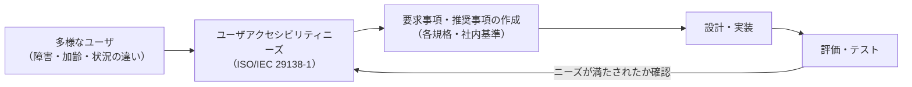
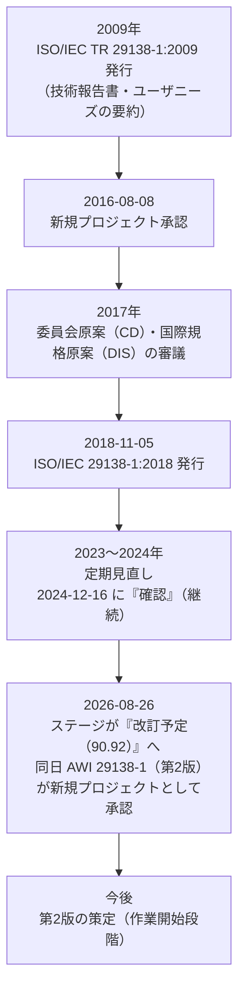
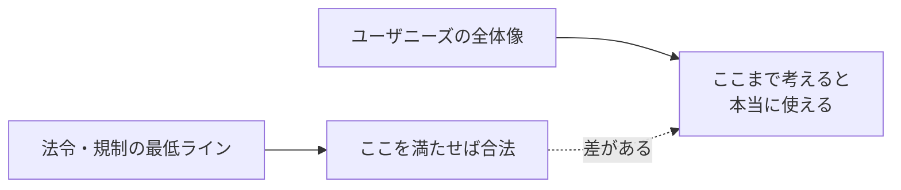
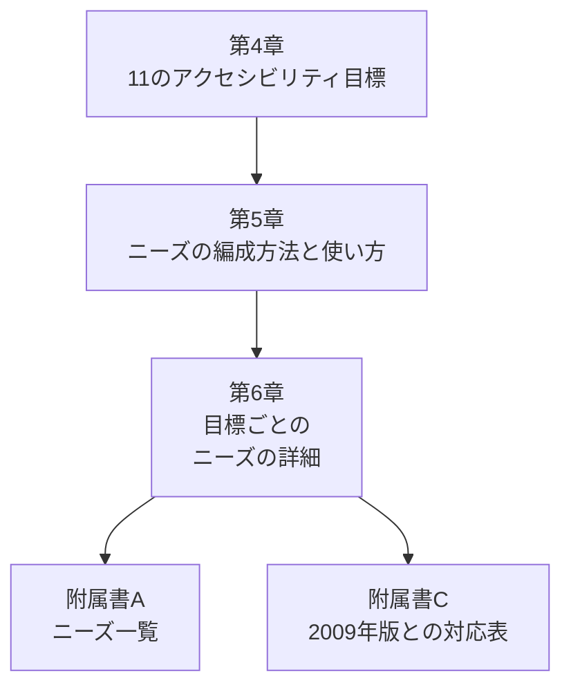
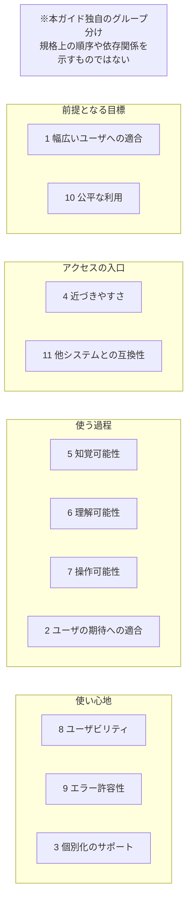
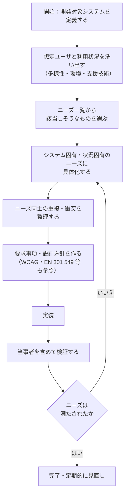
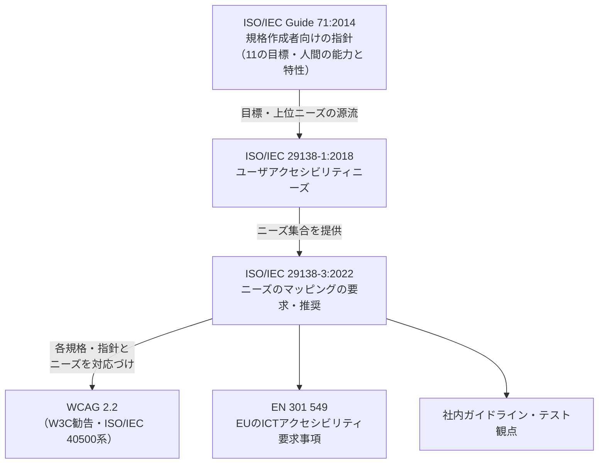
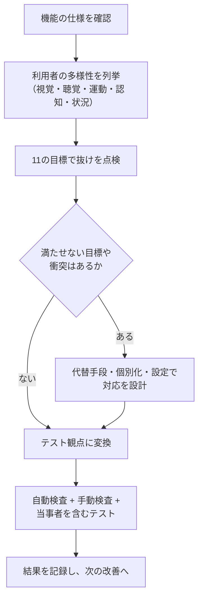

# ISO/IEC 29138-1:2018 初学者向け完全ガイド

**Information technology — User interface accessibility — Part 1: User accessibility needs**
（情報技術 — ユーザインタフェースのアクセシビリティ — 第1部：ユーザアクセシビリティニーズ）

> 作成日：2026年10月13日（この日までに確認できた公開情報に基づく）
> 対象読者：ソフトウェアエンジニア／QAエンジニア／UI・UXデザイナー／アクセシビリティ初学者

---

## 0. このガイドの読み方と、先に伝えておくべき注意

### 0.1 この規格を一言でいうと

**「ICTシステムを使う多様な人々が、そのシステムを“使える”ようにするために必要とすること（ユーザアクセシビリティニーズ）を、一覧として整理した規格」** です。

「こう作りなさい」という**要求事項（requirements）の規格ではありません**。「利用者はこういうことを必要としている」という**ニーズのカタログ**です。ここを最初に押さえると、以降の理解がとても楽になります。

### 0.2 情報源についての正直な注意（重要）

| 項目 | 内容 |
|---|---|
| 規格本文 | 有料です。ISOのサイトには、ISOコンテンツをAI等に入力して回答を生成させることを禁じる旨の記載があります。そのため、**本ガイドは規格本文を転載・要約したものではありません** |
| 本ガイドの根拠 | ①ISO公式ページ・各国規格団体ページで公開されている**概要（Abstract）と目次の断片**、②規格の土台になっている**ISO/IEC Guide 71:2014**（公開PDFが入手可能）、③W3C WAI、EN 301 549、Microsoft Inclusive Design 等の**公開された関連情報** |
| 確実な部分 | 規格の位置づけ、目的、適用範囲、ライフサイクル、章立ての骨格、関連規格との関係 |
| 推定を含む部分 | 第6章の個々のニーズの文言。本ガイドでは、規格の源流である Guide 71 の「共通ユーザアクセシビリティニーズ」を使って**説明のための例**として示しています（該当箇所に「※Guide 71 に基づく例」と明記） |
| 実務での注意 | 監査・調達・契約で個々のニーズ番号や文言を引用する場合は、**必ず規格本文を購入して原文を確認**してください |

---

## 1. 3分で全体像をつかむ

### 1.1 サマリー表

| 観点 | 内容 |
|---|---|
| 規格番号 | ISO/IEC 29138-1:2018（第1版） |
| 発行 | 2018年11月 |
| タイトル | User interface accessibility — Part 1: User accessibility needs |
| 担当委員会 | ISO/IEC JTC 1/SC 35（User interfaces） |
| 目的 | ICTシステムのアクセシビリティを実現するために、多様なユーザが持つニーズを特定・整理する |
| 種類 | 要求事項ではなく、ニーズの一覧（情報提供的な性格） |
| やらないこと | 要求事項・評価方法の提供、認証・規制・契約目的での利用 |
| 想定する使い方 | 法令・規制の**最低限を超えて**アクセシビリティを考えるための材料にする |
| 現状（2026年10月時点） | 有効（2024年に見直し・確認済み）。ただし2026年8月26日に改訂プロジェクトが承認された |

### 1.2 全体像の図

この規格が担当するのは、図の **B（ニーズの整理）** の部分です。C以降（要求事項の作成、設計、テスト）は別の規格や社内ルールが担当します。

---

## 2. ステップ1：基本情報とライフサイクルを知る

### 2.1 基本情報（ISO公式ページより）

| 項目 | 内容 |
|---|---|
| 参照番号 | ISO/IEC 29138-1:2018 |
| 版 | Edition 1 |
| 発行年月 | 2018年11月（2018-11-05 に国際規格として発行） |
| ページ数 | 90ページ |
| ICS | 11.180.99（障害者向け補助具関連のその他の規格）、35.240.80（保健医療分野のIT応用） |
| 前身 | ISO/IEC TR 29138-1:2009（Accessibility considerations for people with disabilities — Part 1: User needs summary）。現在は廃止済み |
| 後継（開発中） | ISO/IEC AWI 29138-1（Edition 2） |

### 2.2 ライフサイクルの流れ

ポイントは次の3つです。

1. **2009年版は技術報告書（TR）、2018年版は国際規格（IS）** に格上げされています。
2. 現行の2018年版は、2026年10月13日時点で**引き続き有効**です。
3. **第2版の策定は始まったばかり**（ISOページの記載は「Drafting has started」）です。今すぐ内容が変わるわけではありません。

---

## 3. ステップ2：なぜ「ユーザアクセシビリティニーズ」なのか

### 3.1 「ニーズ」と「要求事項」の違い

初学者が最も混乱しやすい点です。表で整理します。

| 比較軸 | ユーザニーズ（この規格） | 要求事項（WCAGなど） |
|---|---|---|
| 視点 | **人の側**から見る | **システムの側**から見る |
| 例 | 「操作を間違えたときに元に戻したい」 | 「入力エラーを特定し、テキストで説明すること」 |
| 性質 | 状況や人によって変わる | 判定できるように明文化されている |
| 検証 | 直接は「合否」にならない | 合格／不合格を判定できる |
| 役割 | 要求事項を**考え出す材料** | ニーズを**満たすための具体的な基準** |

規格自身も、ニーズは「個人がシステムに求めうること」であり、**人によって・状況によって異なるニーズの組み合わせを持つ**と述べています。また、この文書は要求事項や評価の方法を与えるものではなく、要求事項を作るときの材料になる、という立場です。

### 3.2 なぜ最低限の基準を超える必要があるのか

規格の概要には、このニーズが「アクセシビリティ担当者が、法令や規則の最低限の規定を**超えて**考えるよう促すためのもの」という趣旨が書かれています。

たとえば、基準を機械的にすべて満たしていても、**特定の利用者にとっては使いにくい**ことがあります。WCAGの策定に長く関わったGregg Vanderheiden氏（米Trace Center）も、W3Cの議論リストで「WCAG適合はすべての人があらゆる環境・タスクでアクセスできることを保証しない」という趣旨を述べています（出典は第11章）。

### 3.3 「障害のある人」だけの話ではない

アクセシビリティは、障害のある人だけでなく**一時的・状況的な制約を持つ人**にも関係します。Microsoft Inclusive Design（Kat Holmes氏らが推進）の「ペルソナスペクトラム」では、制約を3種類に分けて考えます。

| 領域 | 恒久的 | 一時的 | 状況的 |
|---|---|---|---|
| 視覚 | 全盲 | 目の検査後で瞳孔が開いている | 強い日差しで画面が見えない |
| 聴覚 | ろう | 耳の感染症 | 騒がしい場所 |
| 運動 | 片腕がない | 腕を骨折している | 子どもを抱いている |
| 認知 | 読字障害 | 脳しんとう | 睡眠不足・強いストレス |

（上記の整理は、Microsoft Inclusive Design Toolkit の考え方を紹介した解説記事に基づく例です）

なお、この考え方には批判もあります。「一時的な制約で恒久的な障害の経験を代用すると、当事者の実体験を見失う」という指摘（Experience Dynamics の記事）があります。したがって、**当事者を設計・テストに巻き込むこと**が大前提です。

---

## 4. ステップ3：まず覚える用語（Guide 71 の定義に基づく）

規格の基礎である ISO/IEC Guide 71:2014 で定義されている用語です。29138-1 でも同じ枠組みで使われます。

| 用語 | 意味（要約） |
|---|---|
| システム | 人が使う製品・サービス・建築環境、またはその組み合わせ |
| ユーザ | システムにアクセスする、またはシステムと相互作用する個人 |
| 多様なユーザ | 能力・特性・アクセシビリティニーズが異なる個人の集まり |
| ユーザアクセシビリティニーズ | システムがアクセシブルであるために必要な機能や属性についてのユーザのニーズ。**時間や状況で変わる** |
| 利用状況（context of use） | 利用者・タスク・機器・物理的／社会的環境を含む使われ方 |
| 支援製品／支援技術 | 障害のある人が使う機器・ソフトウェア等（スクリーンリーダー等） |
| アクセシブルデザイン | 多様なユーザと利用状況を想定し、利用可能な人を最大化する設計 |

---

## 5. ステップ4：規格の構成（章立て）を読み解く

公開されている目次の断片から確認できる構成は次のとおりです。

| 章・附属書 | 内容（確認できた範囲） |
|---|---|
| 第4章 | アクセシビリティの目標（Accessibility goals） |
| 第5章 | ユーザアクセシビリティニーズと関連情報 |
| 5.2 | ニーズの集合の編成方法（5.2.2 は編成のヒューリスティクス） |
| 5.4 | ニーズの使い方（5.4.2 ニーズに関わる一般的な活動、5.4.3 システム・状況に固有のニーズの特定） |
| 第6章 | 個々のユーザアクセシビリティニーズの詳細（6.2 は「ユーザの期待への適合」に関する詳細） |
| 附属書A（参考） | ユーザアクセシビリティニーズの一覧（56ページ付近） |
| 附属書C（参考） | 2009年版TRのニーズと本規格のニーズの対応づけ（79ページ付近） |

また、この規格は2009年版TRと、**Guide 71:2014 のアクセシビリティ目標・上位レベルのニーズ**から発展したものだと説明されています。

### 5.1 読み解きのヒント（推定を含む）

第6章の 6.2 が「ユーザの期待への適合」であることから、**第6章は Guide 71 の11の目標と同じ順序で組まれている**と推測できます（Guide 71 でも 6.2.2 が「ユーザの期待への適合」）。ただし、これは目次の断片からの推測であり、確定情報ではありません。

---

## 6. ステップ5：11のアクセシビリティ目標を理解する

この規格の「背骨」にあたる部分です。ニーズは、次の11の目標に沿って整理されます（Guide 71:2014 の第6章に基づく）。

### 6.1 11の目標の一覧

| No. | 目標（英語） | 目標（日本語） | 一言でいうと |
|---|---|---|---|
| 1 | Suitability for the widest range of users | 最も幅広いユーザへの適合 | 多様な人・多様な状況を締め出さない |
| 2 | Conformity with user expectations | ユーザの期待への適合 | 予測できる。驚かせない |
| 3 | Support for individualization | 個別化のサポート | 自分に合う使い方に調整できる |
| 4 | Approachability | 近づきやすさ | 物理的・心理的な壁を越えてアクセスできる |
| 5 | Perceivability | 知覚可能性 | 情報や機能を感じ取れる |
| 6 | Understandability | 理解可能性 | 情報や機能の意味を解釈できる |
| 7 | Controllability | 操作可能性 | 操作を始めて完了できる |
| 8 | Usability | ユーザビリティ | 効果的・効率的・満足して使える |
| 9 | Error tolerance | エラー許容性 | 間違えても大きな不利益なく続けられる |
| 10 | Equitable use | 公平な利用 | 同じ、または同等の方法で使える |
| 11 | Compatibility with other systems | 他システムとの互換性 | 自分の支援技術を使って操作できる |

### 6.2 目標のグループ分け（本ガイド独自の整理）

この図は、11の目標を理解しやすくするために本ガイドが独自にまとめたグループ分けです。グループの並びは配置上のものであり、規格が目標の順序や依存関係を定めているわけではありません。

### 6.3 WCAGの4原則（POUR）との対応

Guide 71 は、各目標の「背景」として、WCAG（ISO/IEC 40500）など既存の指針のどの原則から導いたかを示しています。

| 11の目標 | 対応するWCAGの考え方 |
|---|---|
| 5 知覚可能性 | Perceivable（知覚可能） |
| 6 理解可能性 | Understandable（理解可能） |
| 7 操作可能性 | Operable（操作可能） |
| 11 他システムとの互換性 | Robust（堅牢） |
| 9 エラー許容性 | 「間違いを避け、修正できるよう助ける」という考え方 |
| 1・2・3・4・8・10 | WCAGの4原則に直接1対1では対応しない。ISO 9241系やユニバーサルデザインの原則に由来 |

つまり、**WCAGの4原則は、11の目標の一部と重なる**関係です。ユーザニーズ規格のほうが「視点が広い」と理解してください。

### 6.4 各目標のニーズ例（※Guide 71 に基づく例）

以下は、Guide 71:2014 に掲載されている「共通のユーザアクセシビリティニーズ」を、日本語で要約したものです。29138-1 の第6章はこれをさらに詳細化・拡張した内容になっていますが、**個々の文言は規格本文で確認**してください。

#### ① 最も幅広いユーザへの適合

- アクセシブルな利用方式・方法により、システムの利用者として含まれたい
- 複数の障害が重なっている場合や、悪条件の環境でも使えるようにしたい

#### ② ユーザの期待への適合

- 操作の結果に驚かされたくない
- 自分の知識・経験を使ってうまく操作したい
- 新しい知識が必要なときは、案内や訓練を受けたい
- すぐに見つかるヘルプや追加の説明が欲しい

#### ③ 個別化のサポート

- 自分に最適な操作方法を選びたい（組み込みのアクセシビリティ機能のオン／オフを含む）
- 選べる操作方法についての情報が欲しい
- 個別化の設定をアクセシブルな手段で行い、**次回以降も保持**してほしい

#### ④ 近づきやすさ

- 自分と支援技術が収まる十分な空間が欲しい
- 操作部が手の届く範囲にあってほしい
- 操作の選択肢が明確に示されてほしい
- 適切なプライバシーとセキュリティが欲しい
- 直接だけでなく遠隔でも使えるようにしたい

#### ⑤ 知覚可能性

- 特定の感覚（視覚・聴覚・触覚など）で情報を知覚したい
- 提示の属性（大きさ、音量など）を調整したい
- 提示される個々の情報要素を見分けたい
- 周囲の環境が情報の知覚を邪魔しないようにしたい

#### ⑥ 理解可能性

- システムとその機能の全体像を把握したい
- 提示された情報を理解したい
- 認知能力を支える情報が欲しい
- タスクの手順は最小限で、分かりやすく説明してほしい
- 作業の手がかりが欲しい
- 自分の操作の結果がフィードバックされてほしい
- 操作のペースを自分で決めたい
- 必要なときにヘルプが使えてほしい

#### ⑦ 操作可能性

- 特定の操作方式（タッチ、ジェスチャー、音声など）で操作したい
- 身体のさまざまな部位や動作でタスクを行いたい
- タスクを1ステップずつ実行したい
- 自分のペースで操作したい

#### ⑧ ユーザビリティ

- タスクの途中で間違いを避けたい
- 身体的・認知的な負担を最小限にしたい
- 自分の能力に対して効率的に終えたい
- 利用可能な時間内・資源内で完了したい
- 結果に満足し、使う価値があると感じたい
- 悪い結果や受け入れがたいリスクがないという確信が欲しい

#### ⑨ エラー許容性

- 意図せず機能を起動することなく、システムを探索したい
- 体の制御に制限（筋力、震えなど）があっても操作したい
- 間違いが起きたことに気づきたい
- 間違いから回復したい／以前の状態にリセットしたい
- 悪い結果が分かりやすく、避けやすく、起こしにくい仕組みが欲しい

#### ⑩ 公平な利用

- 他のユーザとできるだけ同じ方法で使いたい
- 同じ方法が無理なら、**異なっていても同等**の方法で使いたい
- 代替の操作方法が欲しい

#### ⑪ 他システムとの互換性

- 自分の支援技術で、システムのすべての機能を操作したい
- システムが自分の支援技術の動作を妨げないでほしい

---

## 7. ステップ6：規格の使い方（第5章の考え方）

### 7.1 ニーズを「システム固有・状況固有」に絞り込む

第5.4節では、一般的なニーズの集合から、**自分のシステムと利用状況に当てはまるニーズを特定する**活動が説明されています。全ニーズを一律に適用するのではなく、取捨選択と具体化が必要です。

この図は、規格の考え方（5.4 の活動）を実務向けに整理した**説明用の流れ**です。規格本文の手順そのものではありません。

### 7.2 ニーズどうしが衝突したときの考え方

Guide 71 は、**ニーズが他のユーザのニーズと衝突することがある**と述べ、一部を無視するのではなく**多様な方法で対応する**ことを求めています。

| 衝突の例 | 考え方 |
|---|---|
| 高コントラストが必要な人と、まぶしさに敏感な人 | 配色テーマを選べるようにする（個別化） |
| 音声操作が必要な人と、静かな環境で使う人 | 音声と非音声の両方の操作方法を用意する |
| 手順を最小にしたい人と、1ステップずつ進めたい人 | 要約表示と段階表示を切り替えられるようにする |

### 7.3 ニーズと要求事項は1対1ではない

Guide 71 には、複数の要求事項が1つのニーズを満たすこともあれば、1つの要求事項が複数のニーズに寄与することもある、という説明があります。**対応表で追跡する**のが実務上の鉄則です。

---

## 8. ステップ7：関連規格・指針との関係

### 8.1 位置づけ図

### 8.2 各規格の役割の比較

| 規格・文書 | 役割 | 性質 |
|---|---|---|
| ISO/IEC Guide 71:2014 | 規格を作る人向けに、アクセシビリティの目標・人間の能力・戦略を示す | ガイド |
| **ISO/IEC 29138-1:2018** | ICT向けの**ユーザアクセシビリティニーズの一覧** | ニーズ集 |
| ISO/IEC 29138-3:2022 | あるニーズ集合と、特定の規格・指針の条項を**対応づける方法**を示す | 要求・推奨 |
| WCAG 2.2 | Webコンテンツの**検証可能な達成基準** | 技術基準 |
| EN 301 549 | EUでのICT製品・サービスの要求事項。第4章に機能性能の記述（ユーザ視点のニーズ）がある | 調達・法令関連 |

### 8.3 ISO/IEC 29138-3（マッピング）との関係

2022年に発行された Part 3 は、あるニーズ集合を、特定の規格・技術報告書・ガイドラインの条項に**対応づける際のガイド**です。附属書Aには、**29138-1:2018 に基づくマッピングのサンプルテンプレート**が含まれていることが目次の断片から確認できます。なお、マッピングは**規格や指針の評価・認証を目的とするものではない**と明記されています。

### 8.4 EN 301 549 との類似点

EN 301 549 の第4章は、ユーザ視点の機能性能の記述が中心で、各技術要求（第5〜13章）がどのユーザニーズに対応するかを附属書Bで示します。**「ユーザニーズ → 技術要求」という二層構造**は、29138-1 とWCAGなどの関係と同じ発想です。

---

## 9. ステップ8：開発・QAの現場でどう使うか

### 9.1 ニーズを「テスト観点」に変換する

規格はテストの手順を与えませんが、ニーズは**テスト観点（何を確かめたいか）の出発点**になります。以下は説明用の変換例です。

| 目標 | ニーズの例 | テスト観点の例 | 確認方法の例 |
|---|---|---|---|
| ⑤ 知覚可能性 | 画像・音声の情報を別の手段でも得たい | 代替テキスト、字幕、色以外の手がかりがあるか | スクリーンリーダーでの読み上げ確認、色覚シミュレーション |
| ⑦ 操作可能性 | 特定の入力方式だけで操作したい | キーボードだけで全機能を操作できるか | Tabキーによるフォーカス移動と操作の確認 |
| ⑥ 理解可能性 | 作業手順を最小限で分かりやすくしてほしい | ステップ数、ラベル、案内文は適切か | ユーザビリティテスト、第三者レビュー |
| ⑨ エラー許容性 | 間違いから回復したい | 入力エラー時に原因と直し方が示されるか。取り消し・確認があるか | 異常系テスト（誤入力、途中離脱、再入力） |
| ③ 個別化 | 設定を次回以降も保持してほしい | 文字サイズ・テーマ等の設定が保持されるか | 再起動・再ログイン後の確認 |
| ⑪ 互換性 | 自分の支援技術で操作したい | 名前・役割・状態が支援技術に伝わるか | 主要なスクリーンリーダー・音声操作での確認 |
| ⑩ 公平な利用 | 同等の方法で使いたい | 特定の人だけ別画面・別手順になっていないか | 操作経路の比較レビュー |

### 9.2 具体例：ログインフォームを題材にした対応表

次は、ログインフォームを例にした**説明用のマッピング例**です（規格が定めたものではありません）。

| 目標 | このシステムでの具体的なニーズ | 設計・実装の例 | テストケースの例 |
|---|---|---|---|
| ⑤ 知覚可能性 | 入力欄が何かを非視覚でも把握したい | 入力欄にラベルを関連付ける | スクリーンリーダーでラベルが読まれる |
| ⑦ 操作可能性 | マウスなしでログインしたい | 論理的なTab順、Enterで送信 | キーボードのみでログイン完了 |
| ⑥ 理解可能性 | 何を入力すべきか分かりたい | 例示・書式の説明を事前に提示 | 初見ユーザが迷わず入力できる |
| ⑨ エラー許容性 | 誤入力を気づき、直したい | エラーの位置と原因をテキストで表示、入力値を保持 | 誤入力後にエラー内容を特定できる |
| ⑧ ユーザビリティ | 時間制限で失敗したくない | セッション切れ前の警告・延長手段 | 制限時間内に完了できない人向けの延長が働く |
| ③ 個別化 | 文字サイズ変更で崩れないでほしい | レスポンシブ・相対単位 | 拡大表示でも全項目が操作可能 |
| ⑪ 互換性 | パスワード管理ツールや支援技術を使いたい | 標準的なフォーム要素・autocomplete属性 | 主要ツールで入力補助が機能する |

### 9.3 レビュー時のチェックの流れ

### 9.4 テストを「3層」で考える（実務の目安）

| 層 | 内容 | 向いていること | 限界 |
|---|---|---|---|
| 自動検査 | ツールによる静的・動的チェック | 明確なルール違反の洗い出し | ニーズの充足までは分からない |
| 専門家の手動検査 | キーボード操作、支援技術での確認 | 操作性、読み上げ順の確認 | 当事者の実体験の代わりにはならない |
| 当事者を含むユーザテスト | 実際の利用者による評価 | ニーズが本当に満たされたかの確認 | コストと準備が必要 |

---

## 10. ステップ9：よくある誤解と注意点

| 誤解 | 実際 |
|---|---|
| 「29138-1に適合すれば認証される」 | 規格自身が、認証・規制・契約目的での利用を想定していないと明記している |
| 「これはWCAGの上位互換だ」 | 目的が異なる。WCAGは検証可能な技術基準、29138-1はニーズの整理 |
| 「ニーズを全部満たす必要がある」 | 全ニーズを一律に適用するものではない。システムと利用状況に合わせて特定する |
| 「障害のある人だけの話」 | 一時的・状況的な制約を持つ人にも関係する。ただし当事者の経験を一時的な制約で代用しない |
| 「規格を読めば設計方法が分かる」 | 設計方法や評価方法は規格の範囲外 |
| 「WCAG適合ならユーザニーズは満たされる」 | 適合は最低ラインであり、あらゆる人・環境・タスクでの利用可能性を保証しない |

---

## 11. ステップ10：2026年10月時点の最新動向

| トピック | 状況 | 実務への影響 |
|---|---|---|
| ISO/IEC 29138-1:2018 | 発行済み・有効。2024年の見直しで確認。2026-08-26 に「改訂予定」ステージへ | 当面は2018年版が最新の発行版 |
| ISO/IEC AWI 29138-1（第2版） | 2026-08-26 に新規プロジェクト承認、起草開始 | 数年単位の作業になる可能性。発行前に動向を確認 |
| ISO/IEC 29138-3:2022 | 2022年5月発行。ニーズのマッピング指針 | ニーズと各基準の対応表を作るときの参考 |
| WCAG 2.2 | 2023年10月5日にW3C勧告となった。現行の実務基準 | 監査・調達では引き続き中心 |
| WCAG 3.0 | 2026年9月10日に作業草案が更新。まだ草案であり、WCAG 2.xを廃止するものではないとW3Cが説明 | 動向は追うが、現時点では適合目標にしない |
| EU 欧州アクセシビリティ法（EAA） | 2025年6月28日から適用開始 | EU市場に提供する製品・サービスのうち、EAAの対象となるものに適用される。対象範囲と例外（零細企業向けの適用除外、不均衡な負担の主張など）を確認する |
| EN 301 549 | ETSI が V4.1.1 を2026年9月に公開した（V3.2.1 は WCAG 2.1 を取り込んだ旧版）。規格の公開と、EU官報（OJEU）への整合規格としての引用は別の状態で、V4.1.1 の OJEU 引用は本ガイドでは確認していない | 調達・適合推定では OJEU に引用された版を確認する |

---

## 12. ステップ11：理解度チェック

次の問いに、自分の言葉で答えてみてください。

| No. | 問い | 答えのヒント |
|---|---|---|
| 1 | ISO/IEC 29138-1 は「要求事項」の規格か | ニーズの一覧であり、要求事項ではない |
| 2 | この規格で認証を受けられるか | 認証・規制・契約目的ではない |
| 3 | ニーズが衝突したらどうするか | 無視せず、多様な方法で対応する |
| 4 | 11の目標のうち、WCAGの「堅牢」に近いものは | 他システムとの互換性 |
| 5 | 2009年版との違いは | TR（技術報告書）から国際規格へ。Guide 71 の目標に基づく |
| 6 | 次の版はどうなっているか | AWIとして2026-08-26に承認、起草開始 |
| 7 | ニーズとテストの関係は | ニーズはテスト観点の出発点。直接の合否基準ではない |

---

## 13. 用語集

| 用語 | 説明 |
|---|---|
| ICT | 情報通信技術 |
| AWI | Approved Work Item。承認された新規作業項目 |
| TR | Technical Report。技術報告書 |
| JTC 1/SC 35 | ISO/IEC合同技術委員会1の分科委員会35（ユーザインタフェース） |
| 支援技術 | スクリーンリーダー、音声認識、スイッチ等、利用者の能力を補う技術 |
| POUR | WCAGの4原則（Perceivable／Operable／Understandable／Robust） |
| ペルソナスペクトラム | 制約を恒久的・一時的・状況的に分けて考える設計手法 |

---

## 14. 根拠となったソース源（URL）

### 14.1 規格・標準化団体の一次情報

| 区分 | 内容 | URL |
|---|---|---|
| ISO公式 | ISO/IEC 29138-1:2018 の公式ページ（概要、ライフサイクル、ステージ） | <a href="https://www.iso.org/standard/71953.html" target="_blank" rel="noopener noreferrer">https://www.iso.org/standard/71953.html</a> |
| ISO公式 | ISO/IEC AWI 29138-1（第2版・開発中） | <a href="https://www.iso.org/standard/95214.html" target="_blank" rel="noopener noreferrer">https://www.iso.org/standard/95214.html</a> |
| ISO公式 | ISO/IEC 29138-3:2022（ユーザニーズのマッピング） | <a href="https://www.iso.org/standard/80765.html" target="_blank" rel="noopener noreferrer">https://www.iso.org/standard/80765.html</a> |
| ISO/IEC | ISO/IEC Guide 71:2014（11の目標、用語、戦略）。アイルランド国立ユニバーサルデザインセンター（universaldesign.ie）が公開しているPDF | <a href="https://universaldesign.ie/uploads/publications/ISO-IEC-Guide-71-2014.pdf" target="_blank" rel="noopener noreferrer">https://universaldesign.ie/uploads/publications/ISO-IEC-Guide-71-2014.pdf</a> |
| IEC | IEC Webstore の 29138-1 のページ | <a href="https://webstore.iec.ch/en/publication/64193" target="_blank" rel="noopener noreferrer">https://webstore.iec.ch/en/publication/64193</a> |
| IEC | IEC Webstore の 29138-3 のページ | <a href="https://webstore.iec.ch/publication/76037" target="_blank" rel="noopener noreferrer">https://webstore.iec.ch/publication/76037</a> |
| 各国規格団体 | カナダ規格評議会のTR 29138-1:2009（前身）の情報 | <a href="https://ccn-scc.ca/standardsdb/standards/8147689" target="_blank" rel="noopener noreferrer">https://ccn-scc.ca/standardsdb/standards/8147689</a> |
| 目次の断片 | 規格の目次情報の公開サンプル（iTeh） | <a href="https://cdn.standards.iteh.ai/samples/71953/bf1f4ff0c66a4ea486546a1b995b09c6/ISO-IEC-29138-1-2018.pdf" target="_blank" rel="noopener noreferrer">https://cdn.standards.iteh.ai/samples/71953/bf1f4ff0c66a4ea486546a1b995b09c6/ISO-IEC-29138-1-2018.pdf</a> |

### 14.2 国際的な実務コミュニティ・業界の情報

| 区分 | 内容 | URL |
|---|---|---|
| W3C WAI | How People with Disabilities Use the Web（多様な能力と障壁） | <a href="https://www.w3.org/WAI/people-use-web/" target="_blank" rel="noopener noreferrer">https://www.w3.org/WAI/people-use-web/</a> |
| W3C WAI | WCAG 3 作業草案（2026年9月）のお知らせ | <a href="https://www.w3.org/WAI/news/2026-09-10/wcag3/" target="_blank" rel="noopener noreferrer">https://www.w3.org/WAI/news/2026-09-10/wcag3/</a> |
| W3C WAI | WCAG 3 の導入ページ（背景とタイムライン） | <a href="https://www.w3.org/WAI/standards-guidelines/wcag/wcag3-intro/" target="_blank" rel="noopener noreferrer">https://www.w3.org/WAI/standards-guidelines/wcag/wcag3-intro/</a> |
| W3C WAI 議論リスト | Gregg Vanderheiden氏（Trace Center）の、WCAG適合と利用可能性に関する発言 | <a href="https://lists.w3.org/Archives/Public/w3c-wai-ig/2011JulSep/0008.html" target="_blank" rel="noopener noreferrer">https://lists.w3.org/Archives/Public/w3c-wai-ig/2011JulSep/0008.html</a> |
| Google web.dev | Learn Accessibility：デザインとUX（恒久・一時・状況的な障害、ペルソナ） | <a href="https://web.dev/learn/accessibility/design-ux" target="_blank" rel="noopener noreferrer">https://web.dev/learn/accessibility/design-ux</a> |
| Microsoft | Inclusive Design Toolkit | <a href="https://www.microsoft.com/design/inclusive/" target="_blank" rel="noopener noreferrer">https://www.microsoft.com/design/inclusive/</a> |
| ETSI/CEN/CENELEC | EN 301 549 V4.1.1（2026年9月公開） | <a href="https://www.etsi.org/deliver/etsi_en/301500_301599/301549/04.01.01_60/en_301549v040101p.pdf" target="_blank" rel="noopener noreferrer">https://www.etsi.org/deliver/etsi_en/301500_301599/301549/04.01.01_60/en_301549v040101p.pdf</a> |
| カナダ政府 | EN 301 549 の附属書E（第4章＝機能性能の説明） | <a href="https://accessible.canada.ca/node/395" target="_blank" rel="noopener noreferrer">https://accessible.canada.ca/node/395</a> |

### 14.3 解説記事（補助資料）

| 内容 | URL |
|---|---|
| ペルソナスペクトラムの解説（CareerFoundry） | <a href="https://careerfoundry.com/en/blog/ux-design/persona-spectrums/" target="_blank" rel="noopener noreferrer">https://careerfoundry.com/en/blog/ux-design/persona-spectrums/</a> |
| 一時的な障害を使った設計への批判的検討（Experience Dynamics） | <a href="https://dev.experiencedynamics.com/?p=26225" target="_blank" rel="noopener noreferrer">https://dev.experiencedynamics.com/?p=26225</a> |
| WCAG 3.0 の2026年9月草案の解説（AccessibleWeb） | <a href="https://accessibleweb.com/wcag/wcag-3-working-draft-changes/" target="_blank" rel="noopener noreferrer">https://accessibleweb.com/wcag/wcag-3-working-draft-changes/</a> |
| EN 301 549 と EAA の関係（arc42 Quality Model） | <a href="https://quality.arc42.org/standards/en-301-549" target="_blank" rel="noopener noreferrer">https://quality.arc42.org/standards/en-301-549</a> |

---

## 付録：本ガイドで確認できなかったこと

| 項目 | 状況 |
|---|---|
| 第6章の個々のニーズの正式な文言・番号 | 規格本文が有料のため未確認。Guide 71 の共通ニーズで代替して説明した |
| 附属書Bの内容 | 目次の断片で存在が確認できなかった |
| 附属書A（ニーズ一覧）の件数・構成 | 未確認 |
| 日本のJIS規格での対応状況 | 今回の調査では確認していない |
| AWI 29138-1 の改訂内容 | 起草開始段階であり、公開情報なし |

> 実務で規格の文言を引用する場合は、ISO・IEC・各国規格団体のストアから規格本文を入手して確認してください。
