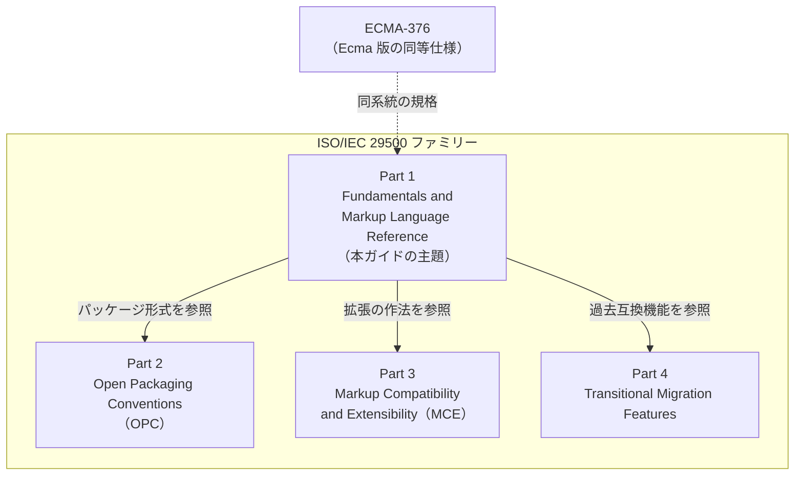
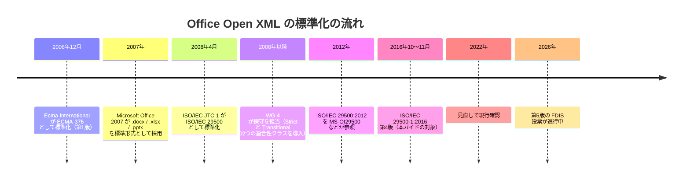
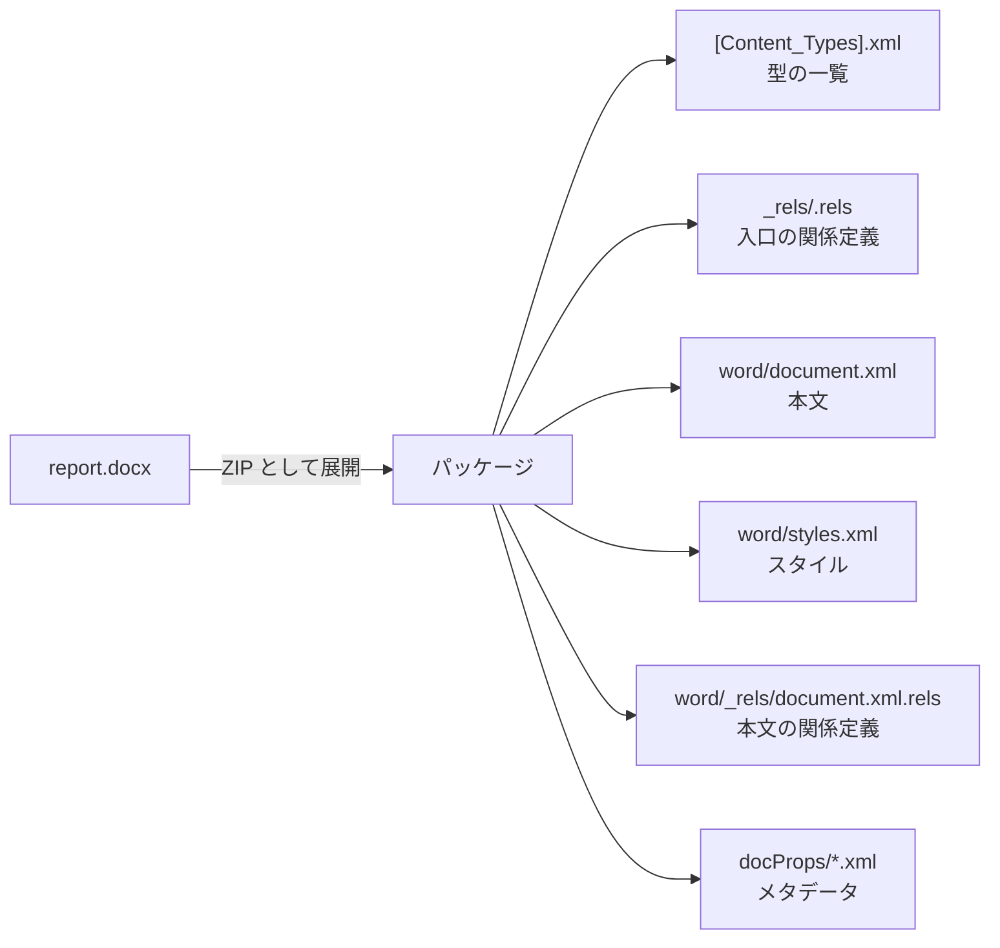
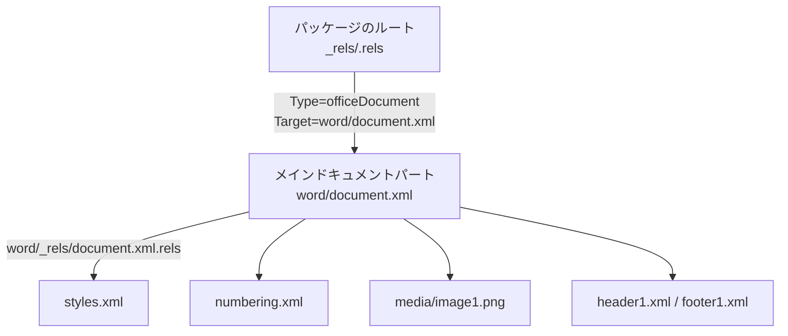
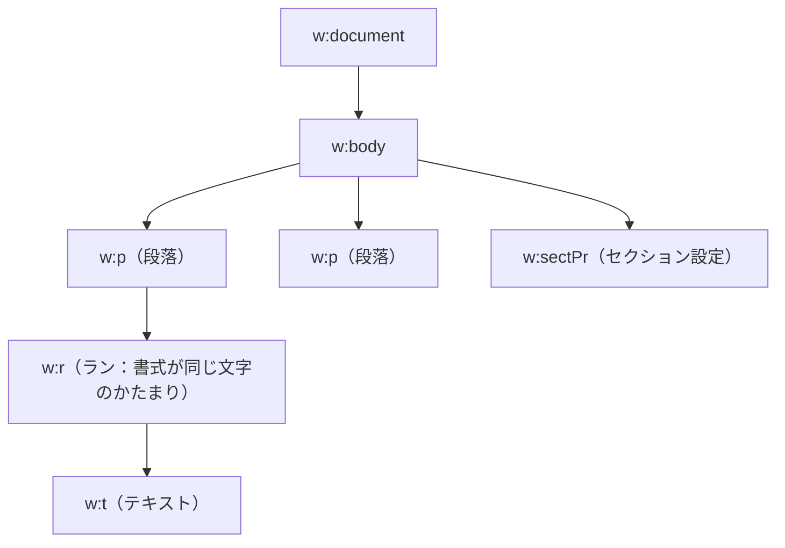
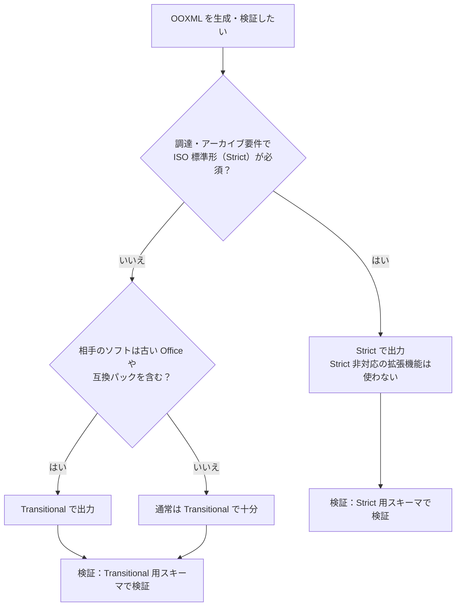
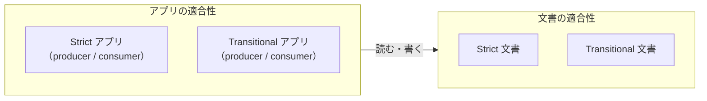
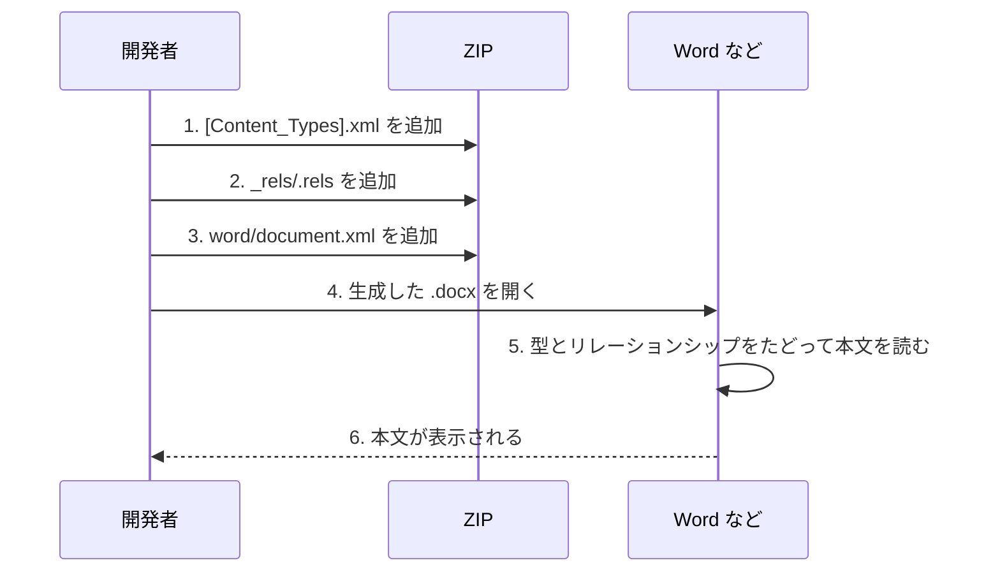
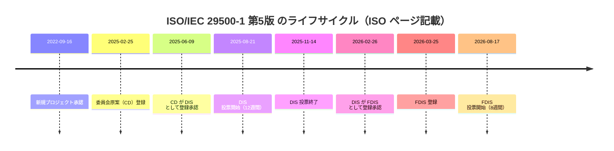
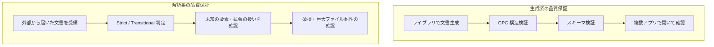

# ISO/IEC 29500-1:2016 初学者向け完全ガイド

**Office Open XML（OOXML）— Part 1: Fundamentals and Markup Language Reference**

> 対象読者：`.docx` / `.xlsx` / `.pptx` の「中身」を初めて学ぶソフトウェア・QAエンジニア
> 情報時点：2026年10月11日
> 公式ページ：<https://www.iso.org/standard/71691.html>

---

## 0. この文書の読み方と注意事項

| 項目 | 内容 |
|---|---|
| ゴール | OOXML が「何を決めた規格か」「どう読むか」「実務でどう効くか」を説明できるようになる |
| 進め方 | 全体像 → パッケージ構造 → 3つのマークアップ言語 → Strict/Transitional → 手を動かす → 最新動向 |
| 根拠の扱い | ISO 公式ページの抄録・メタデータ、Microsoft 公式ドキュメント、規格策定に関わった開発者のブログ／メーリングリスト等を参照（末尾に URL 一覧） |
| 重要な注意 | 規格本文（約5,000ページ）は ISO の著作物であり、**本文を転載・逐条解説したものではありません**。要素名や構造の説明は、公開情報と一般的な実装知識に基づく概説です。厳密な判断が必要な箇所は必ず原典で確認してください |

---

## 1. 一言でいうと

ISO/IEC 29500-1:2016 は、**ワープロ文書・表計算・プレゼンテーションを XML で表現するための「語彙（ボキャブラリ）」を定義した国際規格**です。

- 私たちが日常的に使う `.docx`（Word）、`.xlsx`（Excel）、`.pptx`（PowerPoint）の中身は、この規格が定める XML です。
- 規格の目的は2つあります（ISO 抄録より）。
  1. **過去資産の忠実な表現**：Microsoft Office 97〜2008 で作られた既存文書を忠実に表せること
  2. **拡張性と相互運用性**：複数ベンダー・複数プラットフォームで実装できること
- 生産者（producer）と消費者（consumer）、つまり「文書を書き出すソフト」と「読み込むソフト」への要件も定めています。

---

## 2. 規格のプロフィール

| 項目 | 内容 |
|---|---|
| 正式名称 | Information technology — Document description and processing languages — Office Open XML File Formats — Part 1: Fundamentals and Markup Language Reference |
| 版 | 第4版（Edition 4） |
| 発行 | 2016年11月（ISO ページ表記）。公開日は 2016-10-25〜26 と記載する情報源もあります |
| ページ数 | 5,024 ページ |
| 担当委員会 | ISO/IEC JTC 1/SC 34（作業部会は WG 4） |
| ICS 分類 | 35.060（IT で使う言語）、35.240.30（情報・文書・出版の IT 応用） |
| ステータス | Published（現行）。2022年に見直し・確認済み。ISO のステージコードは 90.92（改訂予定） |
| 入手 | ISO のページ上で価格表示が CHF 0（公開提供）。ただし規格本文の再利用は ISO の著作権条件に従います |

> 💡 **ポイント**：「現行版は2016年版だが、改訂版（第5版）がすでに最終承認段階にある」という点が2026年10月時点の最大のトピックです。詳しくは [第10章](#10-2026年10月時点の最新動向第5版fdis) を参照してください。

---

## 3. 規格ファミリー全体像（Part 1〜4）

ISO/IEC 29500 は4つのパートで構成されます。Part 1 はその中心ですが、**単体では完結しません**。



| パート | 何を決めているか | たとえ |
|---|---|---|
| Part 1 | XML 語彙（WordprocessingML / SpreadsheetML / PresentationML / DrawingML など）の仕様と適合性 | 「単語と文法の辞書」 |
| Part 2 | ZIP パッケージの構成ルール、パーツ、リレーションシップ、コンテンツタイプ | 「荷物の梱包ルール」 |
| Part 3 | 将来の拡張や旧バージョンとの前方互換のためのマークアップ規則 | 「方言を許す作法」 |
| Part 4 | Transitional（移行用）で許される旧来機能 | 「引っ越し期間の特例」 |

Part 2（OPC）は第4版が **ISO/IEC 29500-2:2021** として最新です。

---

## 4. 歴史：なぜ「Ecma」と「ISO」の両方があるのか



覚えておくポイントは次の3つです。

1. **Ecma 版（ECMA-376）が先、ISO 版（29500）が後**。内容は近いが、ISO 化の審議（BRM）で変更が入りました。
2. ISO 版では **Strict / Transitional** という2つの適合性クラスが導入されました（第7章で詳述）。
3. 保守は SC 34 の **WG 4** が担当しています。

---

## 5. OOXML ファイルの正体：ZIP + XML のパッケージ

### 5.1 いちばん大事な事実

`.docx` は、拡張子を `.zip` に変えて解凍できます。中身は **XML ファイルの集まり**です。



### 5.2 パッケージを構成する3つの概念（Part 2 OPC）

| 概念 | 意味 | 具体例 |
|---|---|---|
| パーツ（Part） | パッケージ内の個々のファイル | `word/document.xml`、`word/styles.xml`、画像ファイル |
| コンテンツタイプ | 各パーツが「何者か」を宣言するラベル | `...wordprocessingml.document.main+xml` |
| リレーションシップ（Relationship） | パーツ同士・パッケージとパーツの「つながり」を ID 付きで宣言 | `rId1` → `word/document.xml` |

Microsoft の公式ドキュメントは、**「パッケージにメインドキュメントパートへのリレーションシップがあれば、それはワープロ文書と見なされる」**という趣旨で説明しています。つまり文書の種類は拡張子ではなく、リレーションシップで決まります。

### 5.3 リレーションシップのたどり方



> 💡 **QA の視点**：「ファイルは存在するのにリレーションシップから到達できない」「コンテンツタイプの宣言漏れ」は、Word が「ファイルが破損しています」と表示する典型原因です。

---

## 6. 3つのマークアップ言語と共通の部品

Part 1 の主要部分は、文書の種類ごとの XML 語彙のリファレンスです。

| 略称 | 対象 | 主な拡張子 | ルート要素の例 | 基本の入れ子構造 |
|---|---|---|---|---|
| WordprocessingML | ワープロ文書 | `.docx` | `w:document` | 文書 → 本文 `w:body` → 段落 `w:p` → ラン `w:r` → テキスト `w:t` |
| SpreadsheetML | 表計算 | `.xlsx` | `x:workbook`（既定名前空間） | ブック → シート → 行 `row` → セル `c` |
| PresentationML | プレゼン | `.pptx` | `p:presentation` | プレゼン → スライド → 図形ツリー `p:spTree` → 図形 `p:sp` |
| DrawingML | 図・グラフ・図形の共通部品 | 上記3種に埋め込み | `a:...` | 図形、テキスト、色、効果、チャート |
| Shared / その他 | 数式（OMML）、カスタム XML、書誌など | 同上 | — | — |

規格の目次には、WordprocessingML のリファレンスに加え、パッケージ利用（OPC の使い方）、リレーションシップ、マークアップの互換性と拡張性、Unicode 双方向アルゴリズム、アクセシビリティ（Annex J）、そして **ISO/IEC 29500 と ECMA-376:2006 の差分（情報的附属書）** が含まれています。

### 6.1 WordprocessingML の最小構造



Microsoft のドキュメントでは、最も単純な有効な文書は「メインドキュメントストーリー」だけで成立し、本文は `document` と `body`、その下のブロックレベル要素（段落 `p` など）で構成される、と説明されています。

---

## 7. Strict と Transitional：最重要の使い分け

### 7.1 なぜ2種類あるのか

- ISO 化の審議（BRM）で、**適合性クラスが Strict と Transitional に分けられました**。
- Transitional は「過去の Office 文書との互換のために、旧来機能を許す」クラスです。Strict は旧来機能を禁止する、より純粋なクラスです。
- ISO 抄録も、本規格が **strict と transitional の両方の適合性の概念**を規定していると述べています。

| 観点 | Strict | Transitional |
|---|---|---|
| 位置づけ | 規格本来の「純粋形」 | 過去資産・移行向けの許容クラス |
| 旧来機能（Part 4 系） | 禁止 | 許可 |
| 名前空間（例：WordprocessingML） | `http://purl.oclc.org/ooxml/wordprocessingml/main` | `http://schemas.openxmlformats.org/wordprocessingml/2006/main` |
| Office での既定の保存形式 | 既定ではない（保存時に選択） | 既定 |
| 主な利用場面 | 公共調達、長期保存の要件など | 一般的な業務文書 |

> 💡 見分け方：`document.xml` などのルート要素の **名前空間 URI が `purl.oclc.org` か `schemas.openxmlformats.org` か** を見るのが最も確実です。

### 7.2 判断フロー



### 7.3 開発者コミュニティの見方（歴史的な議論）

| 人物・出典 | 立場 | 要点 |
|---|---|---|
| Doug Mahugh（Microsoft）の公式ブログ | 製品側 | 2010年の記事で、Office 2010 は Strict の読み取りに対応し、Office 2007 SP2 向けにも読み取りフィルターを提供する、と説明 |
| Alex Brown（SC 34 WG 4 関係者） | 標準化側 | Office 2007 の出力は Strict に準拠せず、Transitional でも検証エラーがあったと指摘（2008年）。後に Office 2010 は Transitional であると批判 |
| Rick Jelliffe（XML 分野の著名な開発者） | 標準化側 | Strict を「Transitional の望ましいプロファイル」として調達・開発の目標にするという考え方を WG 4 メーリングリストで提案 |
| LibreOffice（TDF）メーリングリスト | 実装者側 | Office 2013 が初めて Strict を**書き出し**できるが、既定は Transitional で、保存時に明示的な選択が必要という整理 |

> ⚠️ これらは主に2008〜2013年の議論で、**現行の Office の挙動は変わっている可能性があります**。実務では必ず最新の Office で実際に保存して確認してください。

---

## 8. 適合性（Conformance）の考え方

規格は、**文書（Document）** と **アプリケーション（Application）** の両方に適合性を定義します。



| 区分 | 問い | QA での確認観点 |
|---|---|---|
| 文書適合 | この `.docx` は規格に沿っているか | スキーマ検証、OPC 構造検証 |
| 消費者（consumer）適合 | 読み込むソフトは規格の文書を正しく扱えるか | 異なるソフトでの読み込み比較 |
| 生産者（producer）適合 | 書き出すソフトは適合文書を出力するか | 出力ファイルの検証 |

さらに Doug Mahugh のブログによれば、BRM では **ワープロ・表計算・プレゼン別の適合性クラス**も作られました。

> 📌 **実装の現実**：Microsoft は規格の Office 実装情報を **[MS-OI29500]** として公開しており、「規格とどこが違うか、どこを拡張しているか」を確認できます。2026年8月18日付の改訂 25.0 が最新として公開されています。実装者にとって、規格本文と並ぶ必読資料です。

---

## 9. 手を動かす：最小の `.docx` を自作する

### 9.1 目的

ライブラリを使わず、**3つのパーツだけで最小の Word 文書**を作り、パッケージ構造を体感します。

### 9.2 必要なパーツ

| パーツ | 役割 |
|---|---|
| `[Content_Types].xml` | 型の宣言 |
| `_rels/.rels` | 入口となるリレーションシップ |
| `word/document.xml` | 本文 |

### 9.3 作成の流れ



### 9.4 Python スクリプト（標準ライブラリのみ）

```python
import zipfile

CONTENT_TYPES = """<?xml version="1.0" encoding="UTF-8" standalone="yes"?>
<Types xmlns="http://schemas.openxmlformats.org/package/2006/content-types">
  <Default Extension="rels" ContentType="application/vnd.openxmlformats-package.relationships+xml"/>
  <Default Extension="xml" ContentType="application/xml"/>
  <Override PartName="/word/document.xml"
    ContentType="application/vnd.openxmlformats-officedocument.wordprocessingml.document.main+xml"/>
</Types>"""

ROOT_RELS = """<?xml version="1.0" encoding="UTF-8" standalone="yes"?>
<Relationships xmlns="http://schemas.openxmlformats.org/package/2006/relationships">
  <Relationship Id="rId1"
    Type="http://schemas.openxmlformats.org/officeDocument/2006/relationships/officeDocument"
    Target="word/document.xml"/>
</Relationships>"""

DOCUMENT = """<?xml version="1.0" encoding="UTF-8" standalone="yes"?>
<w:document xmlns:w="http://schemas.openxmlformats.org/wordprocessingml/2006/main">
  <w:body>
    <w:p>
      <w:r>
        <w:t>Hello, Office Open XML!</w:t>
      </w:r>
    </w:p>
  </w:body>
</w:document>"""

with zipfile.ZipFile("hello.docx", "w", zipfile.ZIP_DEFLATED) as z:
    z.writestr("[Content_Types].xml", CONTENT_TYPES)
    z.writestr("_rels/.rels", ROOT_RELS)
    z.writestr("word/document.xml", DOCUMENT)

print("hello.docx を作成しました")
```

### 9.5 実験アイデア（QA 向け）

| 実験 | 手順 | 学べること |
|---|---|---|
| ① 型を消す | `Override` の行を削除して開く | コンテンツタイプの必要性 |
| ② 関係を壊す | `Target` を存在しないパスにする | リレーションシップ解決の失敗 |
| ③ 名前空間を Strict に変える | `w:` の URI を `purl.oclc.org/ooxml/wordprocessingml/main` に変更 | Strict/Transitional の違い（他の部分も合わせる必要あり） |
| ④ 既存文書を解凍 | 普段使う `.docx` を ZIP として展開 | 実際の文書の複雑さ |

### 9.6 C#（Open XML SDK）で同じことをする

```csharp
using DocumentFormat.OpenXml;
using DocumentFormat.OpenXml.Packaging;
using DocumentFormat.OpenXml.Wordprocessing;

using var doc = WordprocessingDocument.Create(
    "hello-sdk.docx", WordprocessingDocumentType.Document);

var mainPart = doc.AddMainDocumentPart();
mainPart.Document = new Document(
    new Body(
        new Paragraph(
            new Run(
                new Text("Hello, Open XML SDK!")))));
```

- Open XML SDK は **Microsoft が .NET Foundation プロジェクトとして公開している MIT ライセンスのライブラリ**で、Word・Excel・PowerPoint 文書を扱えます。
- NuGet 上の最新版は、確認できた範囲で **3.5.1（2026年3月18日更新表示）** です。利用前に最新版を確認してください。
- SDK の `WordprocessingDocument` クラスが Word 文書のパッケージを表し、要素ごとに型付きクラスが用意されています。

---

## 10. 2026年10月時点の最新動向：第5版（FDIS）

ISO のページによると、Part 1 の改訂版は **ISO/IEC FDIS 29500-1（Edition 5）** として承認段階にあり、**現行の 29500-1:2016 を置き換える予定**とされています。



| 項目 | 内容 |
|---|---|
| 現在のステージ | 50.20（FDIS 投票実施中） |
| 投票期間 | 8週間。2026年8月17日開始のため、計算上は **10月中旬に終了**見込み（正式な終了日は ISO の最新情報を確認） |
| ページ数 | FDIS 第5版は 3,146 ページ（現行2016年版は 5,024 ページ） |
| 関連パート | Part 4（Transitional migration features）も第5版の FDIS（459ページ）が同時期に進行中 |
| 公開済み | Part 2（OPC）は 2021 年に第4版 |

> ⚠️ ページ数が大きく異なる理由は、公開情報からは断定できません（再構成や分冊の影響などが考えられますが、確認できていません）。FDIS が承認・発行された後に、改訂内容を原典で確認してください。**10月11日時点では、2016年版が現行の発行済み版**です。

### 実務への影響（考え方）

| 観点 | 当面の対応 |
|---|---|
| 既存実装 | 2016年版を基準にして問題なし。急な破壊的変更を前提にしない |
| 新規設計 | 第5版の発行後に差分を確認する前提で、規格依存部分を分離しておく |
| テスト | スキーマ検証ツールのバージョン固定と、第5版発行時の差分検証計画を用意 |

---

## 11. QA・開発での活用パターン



| 観点 | チェック項目 | 補足 |
|---|---|---|
| 構造 | `[Content_Types].xml` の宣言漏れ、リレーションシップ切れ | 最も多い破損原因 |
| スキーマ | 名前空間、要素の順序 | OOXML は要素の順序が決まっている箇所が多い |
| 互換 | Word / LibreOffice / Google など複数で開く | 規格適合と実装の差は避けられない |
| 拡張 | ベンダー拡張の無視・保存の挙動 | Part 3（MCE）の作法 |
| セキュリティ | ZIP 爆弾、外部参照、マクロ（`.docm` など） | 受信側は入力を信用しない |
| 長期保存 | Strict 要件の有無 | 調達要件を確認 |

---

## 12. よくある誤解 Q&A

| 質問 | 回答 |
|---|---|
| OOXML は Microsoft 専用の形式？ | 起源は Microsoft ですが、Ecma と ISO/IEC で標準化され、複数ベンダーの実装を想定しています |
| `.docx` と ISO 29500 は同じ？ | `.docx` は ISO 29500 の WordprocessingML を使うファイルです。ただし Office が既定で書くのは Transitional で、Strict ではありません |
| Strict の方が「新しい」？ | 新旧ではなく、旧来機能を禁止するか許すかの違いです |
| 規格に適合していれば、どのソフトでも同じに見える？ | 適合していても描画・レイアウトの差は出ます。実装情報（MS-OI29500）も確認が必要です |
| 規格は無料で読める？ | ISO のページでは価格表示が CHF 0 ですが、再利用は著作権条件に従います。販売サイトによって価格表示が異なる場合もあります |
| ODF（OpenDocument）とは？ | 別系統の文書規格（ISO/IEC 26300）で、同じ SC 34 が担当しています |

---

## 13. 学習ロードマップ


---

## 14. 用語集

| 用語 | 意味 |
|---|---|
| OOXML | Office Open XML の略称 |
| OPC | Open Packaging Conventions。ZIP ベースのパッケージ規約（Part 2） |
| Part（パーツ） | パッケージ内の個々のファイル |
| Relationship | パーツ間の関係を ID 付きで宣言する仕組み |
| Content Type | パーツの種類を示す MIME 形式のラベル |
| MCE | Markup Compatibility and Extensibility。拡張・互換のための規則（Part 3） |
| Strict | 旧来機能を禁止する適合性クラス |
| Transitional | 旧来機能を許す適合性クラス |
| Producer / Consumer | 文書の書き出し側 / 読み込み側のアプリケーション |
| BRM | Ballot Resolution Meeting。2008年の ISO 審議会議 |
| WG 4 | SC 34 の OOXML 保守作業部会 |
| FDIS | Final Draft International Standard。最終国際規格案 |
| WordprocessingML / SpreadsheetML / PresentationML / DrawingML | 各文書種別・描画共通の XML 語彙 |

---

## 15. 根拠となるソース一覧（URL）

### 15.1 規格・標準化機関（一次情報）

| 内容 | URL |
|---|---|
| ISO/IEC 29500-1:2016（公式ページ・ご指定） | <https://www.iso.org/standard/71691.html> |
| ISO 委員会サイト版（版、ページ数、見直し状況の表示） | <https://committee.iso.org/standard/71691.html> |
| ISO/IEC FDIS 29500-1（第5版・ライフサイクル） | <https://www.iso.org/standard/85626.html> |
| ISO/IEC FDIS 29500-4（第5版） | <https://www.iso.org/standard/85627.html> |
| カナダ規格評議会（SCC）の規格データベース | <https://scc-ccn.ca/standardsdb/standards/2028230> |
| 米国議会図書館 OOXML フォーマットファミリー解説 | <https://loc.gov/preservation/digital/formats/fdd/fdd000395.shtml> |
| Cover Pages（ISO 29500 最終規格化の記録、WG 4 の設立経緯） | <https://xml.coverpages.org/ni2008-11-21-a.html> |

### 15.2 Microsoft 公式ドキュメント・開発者

| 内容 | URL |
|---|---|
| [MS-OI29500] Office 実装情報（改訂 25.0） | <https://learn.microsoft.com/en-us/openspecs/office_standards/ms-oi29500/1fd4a662-8623-49c0-82f0-18fa91b413b8> |
| WordprocessingML 文書の構造（Open XML SDK） | <https://learn.microsoft.com/en-us/office/open-xml/word/structure-of-a-wordprocessingml-document> |
| パッケージの作成（Open XML SDK） | <https://learn.microsoft.com/en-us/office/open-xml/general/how-to-create-a-package> |
| Doug Mahugh：Office’s Support for ISO/IEC 29500 Strict | <https://learn.microsoft.com/sv-se/archive/blogs/dmahugh/offices-support-for-isoiec-29500-strict> |
| Doug Mahugh：Alex Brown’s research（Strict/Transitional の導入経緯） | <https://learn.microsoft.com/fi-fi/archive/blogs/dmahugh/alex-browns-research-abiword-enhancements> |
| Open XML SDK（GitHub、.NET Foundation / MIT） | <https://github.com/dotnet/open-xml-sdk> |
| Open XML SDK の NuGet 公開情報 | <https://feed.nuget.org/profiles/tomjebo> |

### 15.3 標準化関係者・コミュニティの議論

| 内容 | URL |
|---|---|
| Rick Jelliffe：WG 4 メーリングリスト（Strict の位置づけ） | <https://mailman.vse.cz/pipermail/sc34wg4/2009-May/000235.html> |
| IT Writing：Alex Brown による Office の Strict 対応への指摘（2010年） | <https://www.itwriting.com/blog/wp-json/wp/v2/posts/2424> |
| LibreOffice（TDF）メーリングリスト：Strict の書き出し対応の整理 | <https://listarchives.tdf.io/i/cszBiu2JzoD7pn6iFp1PTOSN> |
| 実装者の技術記事：Strict と Transitional の名前空間と機能差の実例 | <https://blog.loslab.com/en-gb/hotxls-component/hotxls-strict-ooxml-iso29500-output-delphi.html> |

### 15.4 百科事典・参考

| 内容 | URL |
|---|---|
| Wikipedia（英）Office Open XML | <https://en.wikipedia.org/wiki/ISO/IEC_29500> |
| Wikipedia（日）Office Open XML | <https://ja.wikipedia.org/wiki/Office_Open_XML> |
| Wikipedia（英）Open Packaging Conventions | <https://en.wikipedia.org/wiki/Open_Packaging_Conventions> |

### 15.5 情報の信頼度についての補足

- **確度が高い**：ISO・SCC・ISO 委員会ページの抄録、版、ページ数、ステージ日付。Microsoft 公式ドキュメントの内容。
- **歴史的資料（時期に注意）**：2008〜2013年のブログ・メーリングリストの議論。現行製品の挙動とは異なる可能性があります。
- **規格本文からの確認が必要**：個々の要素・属性の厳密な定義、Strict と Transitional の細かな差分、第5版の変更内容。本ガイドは本文を引用していないため、実装前に原典（または ISO 公開版）で確認してください。
- 第9章のコードは、一般的な OPC の構造（コンテンツタイプ、リレーションシップ、メインドキュメント）に基づく最小例です。お使いの Word などで動作確認してください。

---

*作成日：2026年10月11日*
