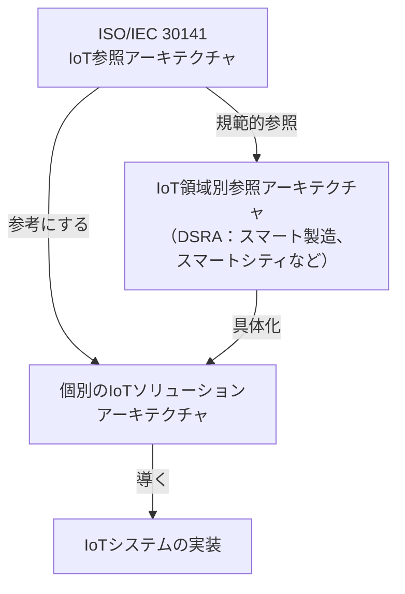
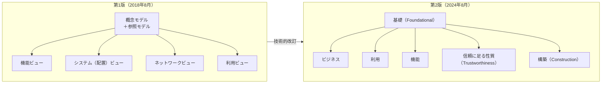
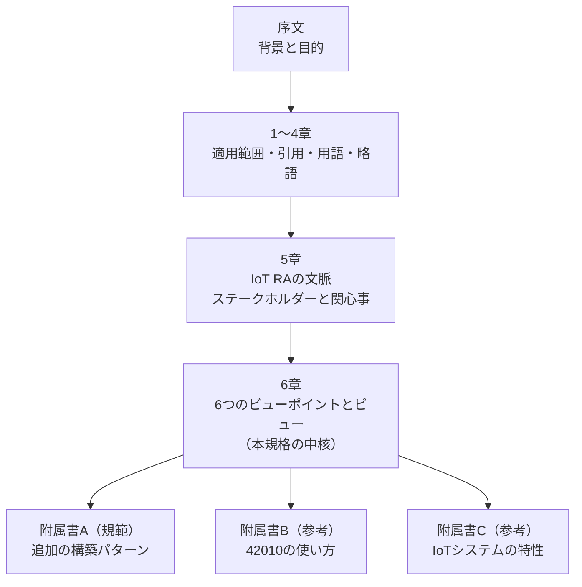
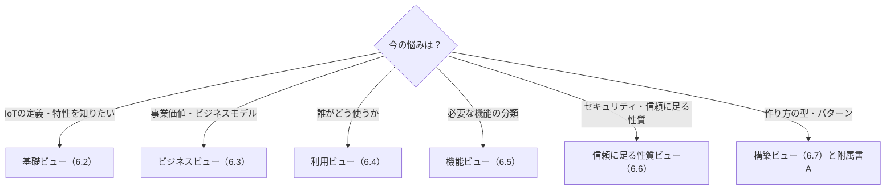
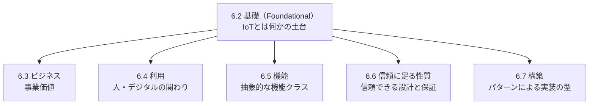
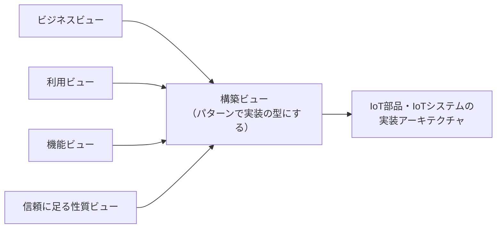
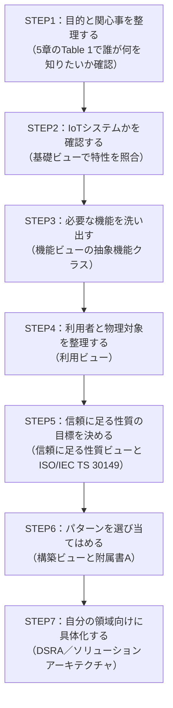
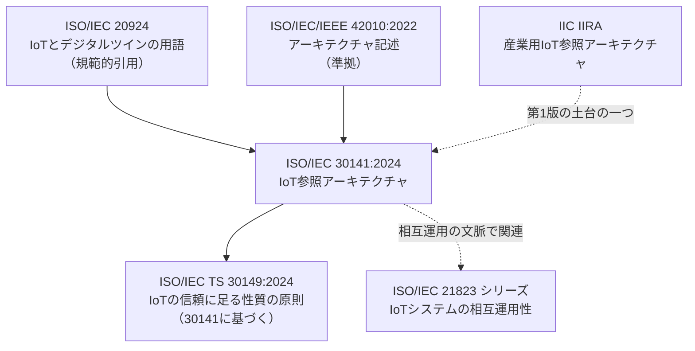
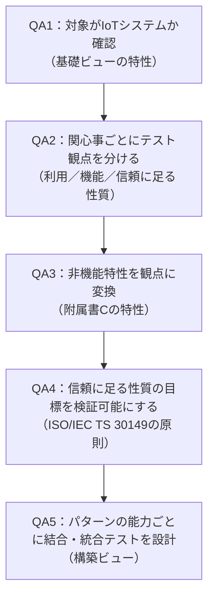

# ISO/IEC 30141:2024 初学者向けステップバイステップ解説ガイド

> **対象規格**: ISO/IEC 30141:2024 *Internet of Things (IoT) — Reference architecture*（IoT参照アーキテクチャ、通称 **IoT RA**）
> **調査時点**: 2026年10月22日
> **想定読者**: IoTシステムの設計・開発・QAに関わる初学者〜中級者
> **表記ルール**: 図解は Mermaid と Markdown の表で記述（ASCII図解は不使用）
> **重要な注意**: 本規格の本文は有料です。本ガイドは、ISO/IEC公式の概要ページ、公開されている目次・序文・プレビュー、関連文書を根拠に、**自分の言葉で**整理した解説です。規格本文の転載ではありません。正確な要求事項や図表の詳細は、必ず正規版で確認してください。

---

## 目次

1. [この規格を一言でいうと](#1-この規格を一言でいうと)
2. [Step 0: 前提知識（参照アーキテクチャとは何か）](#2-step-0-前提知識参照アーキテクチャとは何か)
3. [Step 1: 規格の基本情報と位置づけ](#3-step-1-規格の基本情報と位置づけ)
4. [Step 2: 第2版（2024）で何が変わったか](#4-step-2-第2版2024で何が変わったか)
5. [Step 3: 規格全体の構成を地図で把握する](#5-step-3-規格全体の構成を地図で把握する)
6. [Step 4: ステークホルダーと関心事（5章）](#6-step-4-ステークホルダーと関心事5章)
7. [Step 5: 6つのビューポイントとビュー（6章）](#7-step-5-6つのビューポイントとビュー6章)
8. [Step 6: 構築ビューとパターンを深掘りする](#8-step-6-構築ビューとパターンを深掘りする)
9. [Step 7: 附属書A・B・Cの読み方](#9-step-7-附属書abcの読み方)
10. [Step 8: 関連規格・関連フレームワークとの関係](#10-step-8-関連規格関連フレームワークとの関係)
11. [Step 9: 実務での使い方（設計者・開発者・QA別）](#11-step-9-実務での使い方設計者開発者qa別)
12. [よくある誤解と注意点](#12-よくある誤解と注意点)
13. [用語集](#13-用語集)
14. [理解度チェック](#14-理解度チェック)
15. [参考にした情報源（URL）](#15-参考にした情報源url)

---

## 1. この規格を一言でいうと

**ISO/IEC 30141:2024 は、「IoTシステムを設計するときに共通で使える設計図の"ひな形"」を定めた国際規格です。**

ISOの公式概要によると、この規格は「共通の語彙」「再利用できる設計」「業界のベストプラクティス」を使ったIoT参照アーキテクチャを提供します。進め方は**トップダウン**です。

1. IoTの最も重要な特徴を集める
2. それを「基礎となるビュー」として抽象化する
3. さらに5つのビュー（構築ビューを含む）を示す
4. 構築ビューでは、IoTシステムを作るためのアーキテクチャ／設計パターンを提供する

つまり「IoTって何？」から「実際にどう作る？」までを、**1本の筋道でつなぐ**のがこの規格の役割です。

### この規格が"やらないこと"

| やること | やらないこと |
|---|---|
| IoTの共通語彙・考え方・構造のひな形を示す | 特定製品・特定ベンダーの実装方法を決める |
| 設計者が参考にする抽象的な機能や構造を示す | 認証（適合性証明）を発行する（※後述） |
| 領域別の参照アーキテクチャ（DSRA）の土台になる | 個々のユースケースの詳細設計を網羅する |

---

## 2. Step 0: 前提知識（参照アーキテクチャとは何か）

### 2.1 参照アーキテクチャ（Reference Architecture, RA）とは

家づくりで例えると、次のような関係です。

| 家づくりの例え | ソフトウェア／IoTの世界 |
|---|---|
| 建築基準や標準的な間取りのひな形 | **参照アーキテクチャ（RA）** |
| 自分の家族向けにアレンジした設計図 | **ソリューションアーキテクチャ** |
| 実際に建てた家 | **実装されたIoTシステム** |

RAは「そのまま使う完成品」ではなく、**自分の案件に合わせて取り込む共通の土台**です。

### 2.2 IoTとは（規格の序文（Introduction）0.2より）

規格の序文（Introduction）の0.2「About Internet of Things (IoT)」では、IoTの根っこを次のように説明しています（要旨）。

- **センサー**が物理世界の情報を集める
- **アクチュエータ**が物理世界に働きかける
- これらのフィールドデバイスがネットワーク経由でデジタル世界につながる
- IoTは、デジタルツイン、AI、クラウド、ビッグデータ、データ分析などを支える基盤になる

> この図は、序文の説明を初学者向けに**解説者が一般化して描いた概念図**です。規格内の図そのものではありません。

### 2.3 ISO/IEC/IEEE 42010 の基本用語（読むうえで必須）

本規格は、アーキテクチャ記述の国際規格 **ISO/IEC/IEEE 42010:2022** に沿って構成されています。ただし適合は**限定的**で、アスペクト、パースペクティブ、決定事項、根拠に関する要求は適用除外とされています（序文（Introduction）0.1を参照）。次の4語だけ押さえてください。

| 用語 | 意味 | 身近な例え |
|---|---|---|
| **ステークホルダー** | システムに関心を持つ人・組織 | 家の施主、設計士、施工業者 |
| **関心事（Concern）** | ステークホルダーが気にしていること | 「耐震性は大丈夫？」「予算は？」 |
| **ビューポイント（視点）** | 関心事に答えるための"見方のルール" | 「配線図の描き方のルール」 |
| **ビュー（視点から見た図・記述）** | ビューポイントに従って作った実物の記述 | 「実際に描いた配線図」 |

---

## 3. Step 1: 規格の基本情報と位置づけ

### 3.1 基本情報（ISO公式ページより）

| 項目 | 内容 |
|---|---|
| 規格番号 | ISO/IEC 30141:2024 |
| 名称 | Internet of Things (IoT) — Reference architecture |
| 版 | 第2版（Edition 2） |
| 発行 | 2024年8月 |
| 担当委員会 | ISO/IEC JTC 1/SC 41（IoTとデジタルツイン） |
| 作成部会 | WG 3（IoT参照アーキテクチャ関連。iTeh Standardsの紹介による） |
| ICS分類 | 35.020 |
| ページ数 | 53ページ（ISO公式ページの表記） |
| 前版 | ISO/IEC 30141:2018（および Cor 1:2020）。**撤回済み** |
| ステータス（ISO公式、10月22日時点で確認） | 発行済み。ステージは **90.92（International Standard to be revised／改訂予定）** |

> **補足**: ステージ90.92は「定期見直しの結果、改訂が決まった」段階を示します。**現行の有効版は2024年版**ですが、将来の改訂（第3版）に備えて、ISOの規格ページを定期的に確認すると安心です。

### 3.2 規格の使われ方（序文（Introduction）0.4 の Figure 1 の趣旨）

序文（Introduction）の0.4によると、この規格の主目的は「IoTシステムの**アーキテクチャを設計する人（アーキテクト）**を支援すること」です。規格の規範的な部分を、より実装に近いアーキテクチャへ取り込めます。

**DSRA（Domain Specific Reference Architecture）** は、特定の分野向けの参照アーキテクチャです。規格によれば、DSRAは本規格をIoT部分の土台として使い、アプリケーション固有の関心事やユースケースはDSRA側に任せることができます。

---

## 4. Step 2: 第2版（2024）で何が変わったか

ISO公式ページには、第1版（2018）から次の**3つの大きな技術的変更**が明記されています。

| 変更点 | 初学者向けの意味 |
|---|---|
| ① ISO/IEC/IEEE 42010:2022 への準拠 | アーキテクチャ記述の国際ルールに沿った構造になり、他の参照アーキテクチャと整合しやすくなった |
| ② 使いやすさの向上 | 利用者（設計者）が自分の関心事から必要な箇所に辿り着きやすくなった |
| ③ 実装パターンのサポート | **構築ビュー**が加わり、IoT部品やシステムの作り方の型（パターン）が示された |

> **読み取りの注意**
>
> - 第1版の抄録は、情報源によって「4つのビュー（機能・システム・ネットワーク・利用）」「5つのビュー」と書き方が揺れています。ここでは大きな傾向として図示しています。
> - 第2版は、ISOの公式目次で **6つのビューポイントとそれに対応するビュー** が確認できます（次章で詳説）。
> - 第1版にあった「ネットワークビュー」「システム配置ビュー」は、第2版では独立した章立てとしては現れません。第2版では、構築ビュー側のパターン（附属書AのEnterprise networking pattern など）として扱われている形跡が目次から読み取れますが、**正確な対応関係は正規版で確認してください**。

---

## 5. Step 3: 規格全体の構成を地図で把握する

公開されている目次（iTeh Standardsのプレビュー）から、章構成を整理します。

| 章 | タイトル | 役割 |
|---|---|---|
| 序文（Introduction） | 0.1 一般／0.2 IoTについて／0.3 IoTの情報源／0.4 参照アーキテクチャの一般原則 | 背景と目的 |
| 1 | 適用範囲 | この規格が扱う範囲 |
| 2 | 引用規格 | **ISO/IEC 20924**（IoTとデジタルツインの用語）を引用 |
| 3 | 用語及び定義 | 用語はISO/IEC 20924に従う |
| 4 | 略語 | ASD、OMD、PED、RAID、SCD などの略語 |
| 5 | IoT RAの文脈 | 概要とステークホルダー・関心事 |
| 6 | IoT RAのビューポイントとビュー | **本規格の中核** |
| 附属書A（規範） | 追加のIoT構築パターン | RAMI 4.0、動的IoTシステムなど |
| 附属書B（参考） | ISO/IEC/IEEE 42010:2022の使い方の指針 | アーキテクチャ記述としての整理 |
| 附属書C（参考） | 特定の文脈でのIoTシステムの特性 | 共通特性、信頼に足る性質に関する特性 |

### 読む順番のおすすめ

| 目的 | おすすめの順番 |
|---|---|
| まず全体像をつかみたい | 序文 → 5章 → 6.1（概要） |
| 設計の考え方を知りたい | 6.2（基礎）→ 6.5（機能）→ 6.7（構築） |
| セキュリティ・信頼に足る性質を設計に入れたい | 6.6（信頼に足る性質）→ 関連規格 ISO/IEC TS 30149 |
| 実装の型を知りたい | 6.7（構築）→ 附属書A |

---

## 6. Step 4: ステークホルダーと関心事（5章）

5章の Table 1 は、「**誰が何を知りたいか**」と「**どのビューポイントが答えるか**」を対応づけています。ここが規格を"使う"ための入口です。以下は要旨を日本語で整理したものです。

| ビューポイント | 主なステークホルダー | 主な関心事（要旨） |
|---|---|---|
| 基礎（Foundational IoT） | アーキテクト、プロジェクト／プログラムマネージャー、標準化専門家、ドメイン専門家、事業責任者、システムオーナー | IoTとは何か。IoTシステムの本質的特性は何か。何が新しく何が違うか。あるシステムはIoTシステムといえるか。 |
| ビジネス | 事業責任者、システムオーナー、アーキテクト | IoTの能力をどう事業価値に変えるか。新しいビジネスモデルにどう使うか。IoTの特性は事業やオーナーにどう影響するか。 |
| 利用（Usage） | システムアーキテクト、プロジェクトマネージャー | 利用者（人・デジタル）はIoTシステムとどう関わるか。対象の物理的な実体とどう関わるか。 |
| 機能（Functional） | アーキテクト、プロジェクト／プログラムマネージャー、IoT標準化専門家、事業責任者、システムオーナー | IoTシステムに実装が必要な抽象的な機能の種類は何か。 |
| 信頼に足る性質（Trustworthiness） | システムアーキテクト、セキュリティ担当、プライバシー担当、プロジェクトマネージャー、事業責任者 | 信頼に足る性質の目標を満たすIoTシステムをどう設計するか。実装したシステムが設計目標を満たすことをどう保証するか。 |
| 構築（Construction） | システムアーキテクト、プロジェクトマネージャー、システム設計者 | 要件を満たすIoTシステム／IoT部品を作るとき、どんな設計の型が役立つか。 |

### 使い方の発想

「どの章から読めばいいか分からない」ときは、**自分の役割と悩み**から逆引きします。

---

## 7. Step 5: 6つのビューポイントとビュー（6章）

規格は「**6つのアーキテクチャビューと、それを規定する6つのビューポイント**」を示します。

### 7.1 基礎（Foundational IoT）ビュー（6.2）

**役割**: 「IoTとは何か」という土台を共通認識にします。

規格の目次・図表一覧から分かる内容は次のとおりです。

| 内容 | 解説 |
|---|---|
| IoTコンポーネント・IoTシステム・IoT環境の関係（Figure 2） | IoTの部品、それらを束ねたシステム、システムが置かれる環境の関係を整理 |
| IoT環境の例（Figure 3） | 具体的な環境のイメージ |

**初学者向けの理解のコツ**: 「このシステムはIoTか？」と迷ったとき、判断の基準を与えてくれるのがこのビューです。序文（Introduction）の0.1では、IoT RAが対象とするシステムを次の2点で説明しています。

- 物理世界の実体を**センシング・操作する技術**を使う
- ネットワークを介して**やり取りする構成要素**を持つ

### 7.2 ビジネスビュー（6.3）

**役割**: IoTの能力を**事業価値**に結びつける視点です（Table 3）。「IoTの特性が事業やシステムオーナーにどう影響するか」「新しいビジネスモデルにどう使うか」が関心事です。

### 7.3 利用ビュー（6.4）

**役割**: 利用者（人・デジタルの両方）がIoTシステムとどう関わり、物理的な実体とどう関わるかを示します。

- 目次には **Figure 4: 外部に向けた機能（External facing functions）** があります。
- **IoTシステムの"外側から見える機能"** を整理する図と読み取れます。

### 7.4 機能ビュー（6.5）

**役割**: IoTシステムに実装が必要な**抽象的な機能の種類**を示します。

- 目次には **Figure 5: 抽象機能クラスの内部モデル（Internal model of abstract function classes）** があります。
- 規格の概要では、データ・管理・通信・インターフェースなどの**機能的な能力**を表すと説明されています。

**初学者向けの理解のコツ**: 機能ビューは「具体的な製品名」ではなく、「**どんな種類の機能が必要か**」の分類表です。たとえば要件定義や設計レビューで、**機能の抜け漏れチェックリスト**として使えます。

### 7.5 信頼に足る性質ビュー（6.6）

**役割**: 信頼に足る性質（Trustworthiness）を満たすIoT製品・ソリューションを作る際の**信頼モデル**を考えるための視点です。

- Table 6 は、**ISO/IEC TS 30149** を考慮した信頼に足る性質ビューポイントを示しています。
- 目次には Figure 6（信頼に足る性質ビューで使う凡例）があります。
- 序文（Introduction）の0.1では、物理世界とデジタル世界の両方に関わる**信頼に足る性質に関わる機能**を扱うと述べられています。

> **信頼に足る性質（Trustworthiness）とは？**
> 本ガイドでは Trustworthiness を「信頼に足る性質」、Reliability を「信頼性」と訳し分けます。信頼性（Reliability）は信頼に足る性質を構成する特性の一つであり、同じ概念ではありません。
> 第1版の本文では、ISO/IEC 20924の定義を引いて「システムが期待どおりに動作するとステークホルダーが持つ信頼の度合い」という趣旨で説明されています。セキュリティ、プライバシー、安全、信頼性（Reliability）、レジリエンスなどを含む広い概念です。ISO委員会のニュース記事では、規格開発を率いた Dr François Coallier（JTC 1/SC 41の委員長）が、信頼に足る性質を「頼れる、安全、セキュア、プライバシーを尊重し、災害や攻撃などの混乱にも耐えられる」という意味で説明しています。

### 7.6 構築ビュー（6.7）

**役割**: 実装に近い視点で、**設計パターン**を提供します。第2版の目玉です。次章で詳しく扱います。

---

## 8. Step 6: 構築ビューとパターンを深掘りする

### 8.1 構築ビューの位置づけ

規格の説明によれば、構築ビューは「**実装アーキテクチャの観点**から、IoT参照アーキテクチャを記述する」ものです。ビューは**パターン**として示されます。

規格の概要に挙がっているパターンの例は次のとおりです。

| パターン | 規格内の位置 | 概要（目次・概要から読み取れる範囲） |
|---|---|---|
| IoTコンポーネントパターン | 6.7.3 | IoT部品が持つ能力（Capability）を整理するパターン。Figure 8、Table 9〜11 |
| IoTシステムパターン | 6.7（Table 12） | IoTシステムを構成する型 |
| RAMI 4.0 パターン | 附属書A.2 | ドイツ発の産業向け参照アーキテクチャ（Reference Architecture Model Industrie 4.0）との対応づけ |
| 動的IoTシステムパターン | 附属書A.3 | 動的サービス合成（DSC：Dynamic Service Composition）を扱う型。メッセージフローと家庭用の空気清浄サービスの例が図示されている |
| IoTエンタープライズシステムパターン | 附属書A.4 | 企業内のIoTシステム配置の型 |
| IoTエンタープライズネットワーキングパターン | 附属書A.5 | ネットワーク構成の型 |
| IoTエンタープライズ利用パターン | 附属書A.6 | 役割（IoTサービス提供者、サービス開発者など）と活動の型 |

### 8.2 構築ビューの考え方

規格のプレビューによれば、構築ビューは、**ビジネス、利用、機能、信頼に足る性質の各ビューポイントの結果を踏まえて**IoTアーキテクチャを構築する、という立て付けです。

### 8.3 IoTコンポーネントパターンを理解する

目次から、次の構成が読み取れます。

| 図表 | 内容 |
|---|---|
| Figure 8 | IoTコンポーネントの能力（Capabilities of an IoT component） |
| Table 9 | IoTコンポーネントパターン |
| Table 10 | IoTコンポーネントの能力に関する追加情報 |
| Table 11 | 能力の主要な変換（Key capability transformations） |
| Table 12 | IoTシステムパターン |

**初学者向けの捉え方**: 「センサー」「ゲートウェイ」「クラウドサービス」など、呼び名の違う部品を、**どんな能力を持つか**という共通の言葉で整理するための仕組みです。設計レビューで「この部品の役割は何か」を揃えるときに役立ちます。

### 8.4 ステップ別: パターンを使った設計の流れ（解説者による実践提案）

> 以下は規格本文の手順そのものではなく、**構築ビューの考え方を実務に置き換えた学習用の提案**です。

---

## 9. Step 7: 附属書A・B・Cの読み方

### 9.1 附属書A（規範）: 追加のIoT構築パターン

「規範」は、この規格の一部として**従うべき内容**という位置づけです。目次から次の5つが確認できます。

| 附属書 | パターン | 学習のポイント |
|---|---|---|
| A.2 | RAMI 4.0 パターン | 製造業（インダストリー4.0）の参照モデルとIoT RAをどう対応づけるか |
| A.3 | 動的IoTシステムパターン | 状況に応じてサービスを組み合わせる仕組み（DSC）と、そのメッセージフロー |
| A.4 | IoTエンタープライズシステムパターン | システム配置のモデル（Figure A.5） |
| A.5 | IoTエンタープライズネットワーキングパターン | ネットワークのモデル（Figure A.6） |
| A.6 | IoTエンタープライズ利用パターン | 運用時の役割と活動（IoTサービス提供者、サービス開発者、デバイス・アプリ開発の活動、セキュリティ分析での利用など） |

### 9.2 附属書B（参考）: ISO/IEC/IEEE 42010:2022 の使い方

この規格が**アーキテクチャ記述としてどう作られているか**を説明する附属書です（ステークホルダー・関心事、ビューポイント、モデル種別、凡例、対応関係、ビューとモデル、対応関係）。

序文（Introduction）の0.1には「アスペクト、パースペクティブ、決定事項、根拠を除き、42010:2022の要求に適合する」と書かれています。自分のプロジェクトでアーキテクチャ記述を作るときの**お手本**になります。

### 9.3 附属書C（参考）: IoTシステムの特性

目次から、次のような特性が整理されていることが分かります。

| 区分 | 特性（目次の項目名） |
|---|---|
| 共通特性 | レガシー対応、ネットワーク接続、一意な識別、明確に定義された構成要素、自動構成、コンテンツ認識、コンテキスト認識、発見可能性、管理可能性、ネットワーク管理と運用、リアルタイム性、自己記述、サービス購読 |
| 信頼に足る性質に関する特性 | データ特性（量・速度・真正性・変動性・多様性）、PII（個人を特定できる情報）の保護、柔軟性 |

**QAエンジニア向けの活用ヒント**: これらの特性は、**非機能要件のチェックリスト**の種になります。たとえば「発見可能性」「自己記述」「リアルタイム性」は、テスト観点の洗い出しに使えます。

---

## 10. Step 8: 関連規格・関連フレームワークとの関係

| 関連文書 | 関係 | 根拠 |
|---|---|---|
| **ISO/IEC 20924** | 用語の定義元。本規格は用語をこれに従う | 規格プレビューの2章・3章 |
| **ISO/IEC/IEEE 42010:2022** | 本規格が準拠するアーキテクチャ記述規格 | ISO公式ページ、規格プレビュー |
| **ISO/IEC TS 30149:2024** | 「ISO/IEC 30141に基づくIoTの信頼に足る性質の原則」。2024年5月発行 | ISO公式ページ。TS 30149の目次には「ISO/IEC 30141との関係」図もあり |
| **ISO/IEC 21823 シリーズ** | IoTシステムの相互運用性（枠組み、トランスポート、意味、構文、振る舞い・ポリシー）。SC 41の規格群 | ISOのSC 41規格一覧。※部によって開発段階が異なる。最新状況はISOカタログで確認 |
| **IIC IIRA** | 第1版（2018）は、IoT-AとIIRAなどのトップダウン／モデルベースの参照アーキテクチャの上に立つと学術論文が述べている。第2版はビジネス・利用・機能・構築といった視点の並びが似ている | Birmingham City University（ERAMIS論文）、IIC IIRA v1.10 |

> **IIRAとの違い**: IIRAは**産業分野（IIoT）**に焦点を当てています。一方、30141は**特定の産業に限定しない汎用的**なIoT参照アーキテクチャです（ドイツの技術者Stefan Malich氏のブログが、規格の草案段階でそう整理しています）。

---

## 11. Step 9: 実務での使い方（設計者・開発者・QA別）

### 11.1 役割別の活用ポイント

| 役割 | 使いどころ | 具体例 |
|---|---|---|
| アーキテクト | 設計の語彙と構造を揃える | 設計書の章立てを、ビューポイント単位（利用・機能・信頼に足る性質・構築）に合わせる |
| 開発者 | 部品の責務を揃える | IoTコンポーネントパターンで、デバイスやゲートウェイの能力を言語化する |
| セキュリティ担当 | 信頼に足る性質を設計に組み込む | 信頼に足る性質ビューとISO/IEC TS 30149で、設計目標と保証の方法を整理する |
| QAエンジニア | テスト観点の網羅性確認 | 附属書Cの特性、機能ビューの機能分類を、テスト観点の洗い出しに使う |
| プロジェクトマネージャー | ステークホルダーの関心事整理 | 5章のTable 1を、ステークホルダー分析の雛形にする |
| 標準化・調達担当 | 他の標準との整合確認 | DSRAを作る際に、30141を規範的に参照する |

### 11.2 QAエンジニア向け: 観点の洗い出しフロー（解説者による実践提案）

### 11.3 適合性（認証）についての注意

ISO/IEC 30141 は**参照アーキテクチャ**であり、「この規格に認証される」という性質の規格ではありません。箇条5「IoT RA context」の5.1（Overview）では、DSRAが**本規格の一部への適合を規定できる**とされています。使い方は「設計の参考・規範的参照」です。

> 注意: 本規格には、第1版の時点で「適合性評価の指針は別途作成され得る」という注記がありました。第2版の適合性の扱いは、正規版で確認してください。

---

## 12. よくある誤解と注意点

| 誤解 | 実際 |
|---|---|
| 「30141に従えばIoTシステムが完成する」 | 参照アーキテクチャなので、**自分の案件に合わせた具体化（DSRAやソリューション設計）が必要** |
| 「特定のプロトコルや製品が指定されている」 | 特定の製品・プロトコルを決める規格ではなく、**抽象的な機能・構造**を示す |
| 「第1版のドメイン図（PED・SCDなど）がそのまま第2版にある」 | 第2版の略語表にはPED、SCD、RAID、ASD、OMDが残っているが、第1版の章立て（概念モデル・参照モデル）とは構成が変わっている。**対応は正規版で確認** |
| 「通信ビューや情報ビューが第2版にある」 | 公式の目次で確認できる第2版のビューは、**基礎、ビジネス、利用、機能、信頼に足る性質、構築**の6つ。一部の解説サイトに別の記述があるが、公式目次と一致しないため本ガイドでは採用していない |
| 「ネットで全文が無料で読める」 | 本文は有料。公開されているのは概要、目次、プレビュー程度 |

---

## 13. 用語集

| 用語 | 意味 |
|---|---|
| IoT RA | IoT参照アーキテクチャ（本規格） |
| DSRA | 領域別参照アーキテクチャ（Domain Specific Reference Architecture） |
| ビューポイント | 関心事に答えるための見方のルール |
| ビュー | ビューポイントに従って作ったアーキテクチャの記述 |
| ステークホルダー | システムに関心を持つ人・組織 |
| 関心事 | ステークホルダーが気にしていること |
| 信頼に足る性質（Trustworthiness） | システムが期待どおりに動くという信頼の度合い。セキュリティ、プライバシー、安全などを含む |
| 信頼性（Reliability） | 求められる機能を、決められた条件と期間のあいだ果たし続けられる度合い。信頼に足る性質（Trustworthiness）を構成する特性の一つ |
| 構築パターン | IoT部品やシステムを作るための再利用可能な設計の型 |
| DSC | 動的サービス合成（Dynamic Service Composition） |
| RAMI 4.0 | Reference Architecture Model Industrie 4.0。製造業向けの参照モデル |
| PII | 個人を特定できる情報 |
| PED / SCD / RAID / ASD / OMD | 第1版の概念モデルで使われた領域の略語（物理実体／センシング・制御／資源アクセス・交換／アプリ・サービス／運用・管理）。第2版の略語表にも残る |
| ISO/IEC JTC 1/SC 41 | IoTとデジタルツインを担当するISO/IEC合同の小委員会 |

---

## 14. 理解度チェック

Q1. ISO/IEC 30141 は一言でいうと何ですか？

IoTシステムを設計する際の共通の語彙・構造・設計パターンを提供する、IoT参照アーキテクチャの国際規格です。

Q2. 第2版（2024）の主な技術的変更点を3つ挙げてください。

ISO/IEC/IEEE 42010:2022への準拠、使いやすさの向上、実装パターンのサポートです。

Q3. 第2版が定める6つのビューポイントは？

基礎（Foundational）、ビジネス、利用、機能、信頼に足る性質（Trustworthiness）、構築（Construction）です。

Q4. 「ビューポイント」と「ビュー」の違いは？

ビューポイントは関心事に答えるための見方のルール、ビューはそのルールに従って作った実際の記述です。

Q5. 構築ビューにはどんなパターンがありますか？

IoTコンポーネントパターン、IoTシステムパターンのほか、附属書AにRAMI 4.0、動的IoTシステム、エンタープライズのシステム／ネットワーキング／利用の各パターンがあります。

Q6. 信頼に足る性質（Trustworthiness）を深掘りするには、どの規格を併せて読みますか？

ISO/IEC TS 30149:2024（IoTの信頼に足る性質の原則）です。30141に基づく文書です。

Q7. 用語の定義は、どの規格に従いますか？

ISO/IEC 20924（IoTとデジタルツインの用語）です。

Q8. 30141は認証を受ける規格ですか？

いいえ。設計の参考・規範的参照として使う参照アーキテクチャです。適合の扱いはDSRA側で定める形になります。

---

## 15. 参考にした情報源（URL）

> 調査は2026年10月22日時点。規格本文は有料のため、**公式ページ、公開プレビュー、関連文書**を根拠にしています。「著名で国際的な開発者の投稿」は、30141:2024に直接言及した公開記事が非常に少ないため、**国際的な業界団体・標準化関係者・研究機関・実務者のブログ**を代替として参照しました。

### 15.1 一次情報（公式）

| 情報源 | URL | 使った内容 |
|---|---|---|
| ISO 公式（規格ページ） | <a href="https://www.iso.org/standard/88800.html" target="_blank" rel="noopener noreferrer">https://www.iso.org/standard/88800.html</a> | 抄録、第2版の3つの技術的変更、ステージ90.92、SC 41、ICS、53ページ |
| ISO 委員会サイト（同ページ） | <a href="https://committee.iso.org/standard/88800.html?browse=ics" target="_blank" rel="noopener noreferrer">https://committee.iso.org/standard/88800.html?browse=ics</a> | 同上の確認 |
| ISO/IEC TS 30149:2024 | <a href="https://www.iso.org/standard/53269.html" target="_blank" rel="noopener noreferrer">https://www.iso.org/standard/53269.html</a> | 30141に基づく信頼に足る性質の原則の位置づけ |
| ISO SC 41 規格一覧 | <a href="https://www.iso.org/ru/committee/6483279/x/catalogue/" target="_blank" rel="noopener noreferrer">https://www.iso.org/ru/committee/6483279/x/catalogue/</a> | 20924、21823シリーズ、30141:2018の撤回 |
| ISO ニュース（Reference framework for the IoT） | <a href="https://committee.iso.org/news/ref2340.html" target="_blank" rel="noopener noreferrer">https://committee.iso.org/news/ref2340.html</a> | Dr François Coallier（JTC 1/SC 41）の発言、信頼に足る性質の説明 |
| IEC Webstore（2024年版） | <a href="https://webstore.iec.ch/en/publication/66548" target="_blank" rel="noopener noreferrer">https://webstore.iec.ch/en/publication/66548</a> | IECとしての刊行情報 |
| IEC Webstore（2018年版・撤回） | <a href="https://webstore.iec.ch/en/publication/60606" target="_blank" rel="noopener noreferrer">https://webstore.iec.ch/en/publication/60606</a> | 第1版の撤回日（2024-08-23） |

### 15.2 規格プレビュー・目次（本ガイドの構成の根拠）

| 情報源 | URL | 使った内容 |
|---|---|---|
| iTeh Standards（2024年版プレビューPDF） | <a href="https://cdn.standards.iteh.ai/samples/88800/e545dddaf5474251a0fb9af0e2109b9e/ISO-IEC-30141-2024.pdf" target="_blank" rel="noopener noreferrer">https://cdn.standards.iteh.ai/samples/88800/e545dddaf5474251a0fb9af0e2109b9e/ISO-IEC-30141-2024.pdf</a> | 目次、序文、適用範囲、5章（Table 1）、6.1概要 |
| iTeh Standards（2024年版カタログ） | <a href="https://standards.iteh.ai/catalog/standards/iec/cf861230-b8ce-43d4-8fe3-86c27178c814/iso-iec-30141-2024" target="_blank" rel="noopener noreferrer">https://standards.iteh.ai/catalog/standards/iec/cf861230-b8ce-43d4-8fe3-86c27178c814/iso-iec-30141-2024</a> | 6つのビューポイントの整理、Annex A/Bの概要 |
| IECNORM プレビュー（2024年版） | <a href="https://previewnorm.com/iec/ISO%20IEC%2030141-2024%20PDF.pdf" target="_blank" rel="noopener noreferrer">https://previewnorm.com/iec/ISO%20IEC%2030141-2024%20PDF.pdf</a> | 6.4〜6.7、構築ビューの説明 |
| BSI Knowledge（BS ISO/IEC 30141:2024） | <a href="https://knowledge.bsigroup.com/products/internet-of-things-iot-reference-architecture-12" target="_blank" rel="noopener noreferrer">https://knowledge.bsigroup.com/products/internet-of-things-iot-reference-architecture-12</a> | 適用範囲（英国規格としての採用） |
| ANSI Webstore プレビュー | <a href="https://webstore.ansi.org/preview-pages/ISO/preview_ISO+IEC+30141-2024.pdf" target="_blank" rel="noopener noreferrer">https://webstore.ansi.org/preview-pages/ISO/preview_ISO+IEC+30141-2024.pdf</a> | 目次の裏取り |
| 第1版（2018）のプレビュー | <a href="https://iteh.es/catalog/standards/iso/06829b4e-71d3-4230-9aa9-598154487f62/iso-iec-30141-2018" target="_blank" rel="noopener noreferrer">https://iteh.es/catalog/standards/iso/06829b4e-71d3-4230-9aa9-598154487f62/iso-iec-30141-2018</a> | 第1版の章構成（概念モデル、ドメイン、機能／システム／ネットワーク／利用ビュー） |
| ISO/IEC TS 30149:2024 プレビュー | <a href="https://vde-verlag.de/iec-normen/preview-pdf/info_isoiects30149{ed1.0}en.pdf" target="_blank" rel="noopener noreferrer">https://vde-verlag.de/iec-normen/preview-pdf/info_isoiects30149{ed1.0}en.pdf</a> | 30141との関係図の存在 |

### 15.3 業界団体・標準化関係者・研究機関による解説

| 情報源 | URL | 使った内容 |
|---|---|---|
| Industrial Internet Consortium（IIC） IIRA v1.10 | <a href="https://www.iiconsortium.org/wp-content/uploads/sites/2/2022/11/IIRA-v1.10.pdf" target="_blank" rel="noopener noreferrer">https://www.iiconsortium.org/wp-content/uploads/sites/2/2022/11/IIRA-v1.10.pdf</a> | IIRAがISO/IEC/IEEE 42010の考え方（関心事・ステークホルダー・ビュー・ビューポイント）を採る点 |
| IIoT World（IIC IIRA解説） | <a href="https://www.iiot-world.com/industrial-iot/connected-industry/iic-industrial-iot-reference-architecture/" target="_blank" rel="noopener noreferrer">https://www.iiot-world.com/industrial-iot/connected-industry/iic-industrial-iot-reference-architecture/</a> | IIRAの概要 |
| Birmingham City University（ERAMIS論文） | <a href="https://www.open-access.bcu.ac.uk/7508/1/ConciseVersion-published.pdf" target="_blank" rel="noopener noreferrer">https://www.open-access.bcu.ac.uk/7508/1/ConciseVersion-published.pdf</a> | 30141がIoT-AとIIRAを土台にしているという整理 |
| The Open Group（IoT参照アーキテクチャ） | <a href="http://www.opengroup.org/iot/wp-refarchs/p6.htm" target="_blank" rel="noopener noreferrer">http://www.opengroup.org/iot/wp-refarchs/p6.htm</a> | 草案段階の位置づけ（IIRA、oneM2Mとの並び） |
| Stefan Malich 氏のブログ | <a href="https://stefanmalich.com/2017/09/10/reference-models-and-architectures-related-to-smart-connected-devices-and-internet-of-things/" target="_blank" rel="noopener noreferrer">https://stefanmalich.com/2017/09/10/reference-models-and-architectures-related-to-smart-connected-devices-and-internet-of-things/</a> | IIRA・IoT-A・oneM2M・30141（当時CD）の比較。**2017年の草案段階の記事であり、第2版の内容は反映していない** |

### 15.4 本ガイドで採用しなかった情報

| 情報源 | 理由 |
|---|---|
| iso-library.com（<a href="https://iso-library.com/standard/30141/" target="_blank" rel="noopener noreferrer">https://iso-library.com/standard/30141/</a>） | 「通信ビュー」「情報ビュー」など、ISO公式の目次と一致しない記述があるため、**ビュー構成の根拠には使っていない** |

### 15.5 情報の限界と確認のすすめ

- 本ガイドの記述は、**公開目次・抄録・プレビュー**で確認できる範囲に基づきます。図の細部（例: Figure 2〜8の具体的な内容、Table 9〜12の中身）は有料部分にあり、**本文を直接確認していません**。
- 第1版の知識（ドメインモデルなど）が第2版でどう再編されたかは、**正規版で必ず確認してください**。
- 実務で規格を根拠にする場合は、ISO、IEC、各国規格協会（JSAなど）から正規版を入手してください。
- ISOのステージは**90.92（改訂予定）**です。最新状況は <a href="https://www.iso.org/standard/88800.html" target="_blank" rel="noopener noreferrer">https://www.iso.org/standard/88800.html</a> で確認してください。

---

*本ガイドは学習用の解説であり、ISO/IEC 30141:2024 の本文の代替ではありません。*
