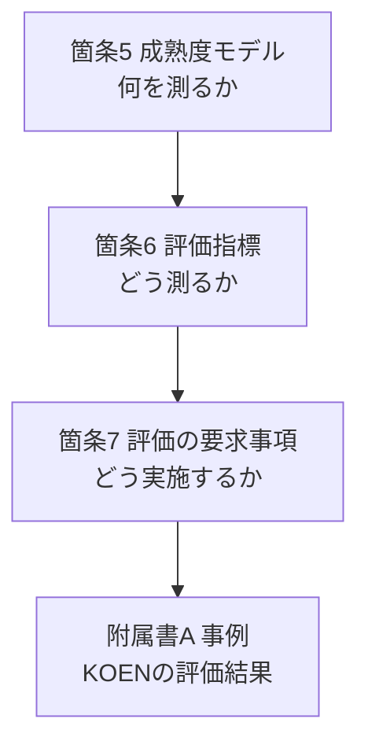
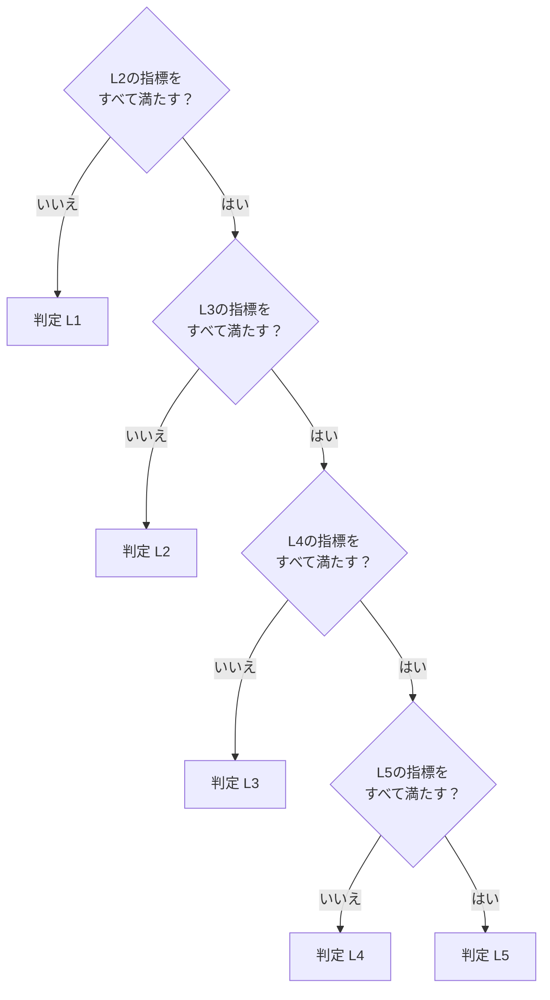
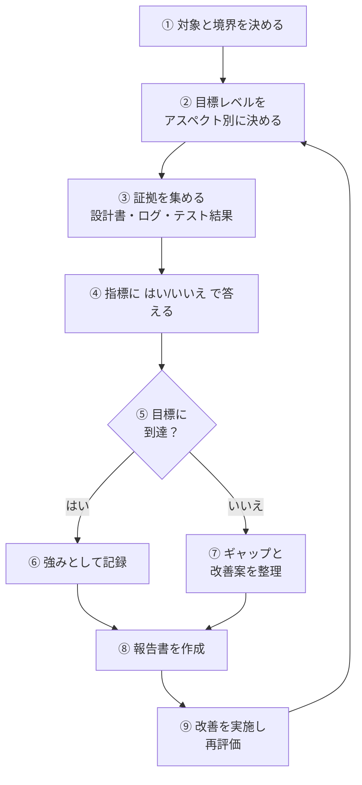
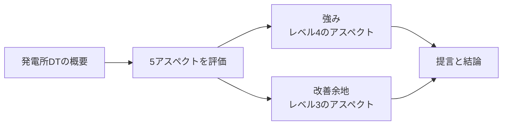
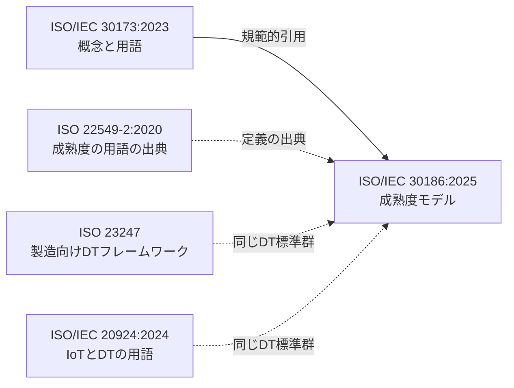

# ISO/IEC 30186:2025 初学者向けステップバイステップ解説

**デジタルツイン — 成熟度モデルと成熟度評価のガイダンス**
（Digital twin — Maturity model and guidance for a maturity assessment）

> 情報時点：2026年10月22日まで　／　対象：初学者〜中級のソフトウェアエンジニア・QAエンジニア
> 一次情報：<https://www.iso.org/standard/53306.html>

---

## 0. この文書の読み方と前提

| 項目 | 内容 |
|---|---|
| 目的 | ISO/IEC 30186:2025 の「全体像」「5つのアスペクト×5つのレベル」「評価の進め方」を、規格本文を持っていない人でも理解できるようにする |
| 取り扱い | 規格本文の転載はしていません。すべて要約・言い換えです（ISOの著作権に配慮） |
| 根拠の層 | ①ISO公式ページ ②試読版（目次・序文・箇条1〜5.2）③BSI（英国規格協会）の公開ウェビナー資料 ④第三者の解説記事・論文 |
| 重要な制約 | 規格の有料全文（箇条5.3以降の表、箇条6の指標全文、箇条7、附属書A詳細）は未確認です。レベルごとの特徴は BSI 資料に基づく要約で、**正確な判定基準は必ず原文で確認してください** |

> ⚠️ 第三者記事の中には、規格の定義と食い違う説明（例：アスペクト数を6と書く、収束を「組織・データ統合」と説明する）が見つかりました。本ガイドでは**規格の試読版の定義と BSI 資料を優先**しています（詳細は第10章）。

---

## 目次

1. [30秒でわかる ISO/IEC 30186](#1-30秒でわかる-isoiec-30186)
2. [ステップ1：なぜ必要か（背景）](#2-ステップ1なぜ必要か背景)
3. [ステップ2：規格の基本情報](#3-ステップ2規格の基本情報)
4. [ステップ3：前提知識（デジタルツインとは）](#4-ステップ3前提知識デジタルツインとは)
5. [ステップ4：規格の構成](#5-ステップ4規格の構成)
6. [ステップ5：成熟度モデル（5アスペクト×5レベル）](#6-ステップ5成熟度モデル5アスペクト5レベル)
7. [ステップ6：評価指標の仕組み](#7-ステップ6評価指標の仕組み)
8. [ステップ7：評価の進め方（実践手順）](#8-ステップ7評価の進め方実践手順)
9. [ステップ8：附属書A 事例（KOEN）](#9-ステップ8附属書a-事例koen)
10. [情報源の信頼性と食い違い](#10-情報源の信頼性と食い違い)
11. [QAエンジニア視点での活用](#11-qaエンジニア視点での活用)
12. [よくある誤解と FAQ](#12-よくある誤解と-faq)
13. [用語集](#13-用語集)
14. [参照URL（根拠ソース）](#14-参照url根拠ソース)

---

## 1. 30秒でわかる ISO/IEC 30186

**ひとことで言うと**：「そのデジタルツインは、どのくらい成熟しているか？」を、**共通のものさし**で測るための国際規格です。

| 問い | 答え |
|---|---|
| 何を決めている？ | 汎用の成熟度モデル、評価指標の定義、評価のガイダンス |
| 何を測る？ | 5つの側面（アスペクト）：収束・能力・統合ビュー・時間・信頼性 |
| 何段階？ | 各アスペクトに5段階のレベル |
| 合計点は出る？ | 出さない。**アスペクトごとに別々に評価**する（BSI資料） |
| 何を決めていない？ | 特定のアーキテクチャ、データモデル、ツール、製品固有の技術要件（BSI資料） |


---

## 2. ステップ1：なぜ必要か（背景）

### 2.1 規格が解決しようとする課題

序文の趣旨を要約すると、次のとおりです。

1. デジタルツインは、単純なものから複雑なものへ、単独システムから連携ネットワークへ、人手の介入が必要な状態から自律へと進化する。
2. 分野の異なるデジタルツイン同士が協調する場面が増えているが、**収束・能力・統合ビューのレベル差が協調の妨げ**になる。
3. そこで「いまどのレベルか」「次にどこへ進むか」を共通理解するための評価ツールが必要になった。

### 2.2 何を扱わないか

序文によると、この規格は**組織の技術的な成熟度の評価と向上**を支援するものです。次の2点は対象外と読めます。

- 利用者（人）の能力を高めるためのガイダンス
- デジタルツインが生み出す成果（アウトカム）そのものの評価

> 💡 **学習のヒント**：「成熟度が高い＝成果が出る」とは限りません。この規格は**技術能力のものさし**であり、ビジネス成果の保証ではありません。

---

## 3. ステップ2：規格の基本情報

| 項目 | 内容 | 出典 |
|---|---|---|
| 規格番号 | ISO/IEC 30186:2025 | ISO公式 |
| 名称 | Digital twin — Maturity model and guidance for a maturity assessment | ISO公式 |
| 版 | Edition 1（第1版） | ISO公式 |
| 発行 | 2025年7月（ステージ 60.60、2025-07-14に発行） | ISO公式 |
| ステータス | 発行済み（Published） | ISO公式 |
| 担当委員会 | ISO/IEC JTC 1/SC 41（IoTおよびデジタルツイン） | ISO公式 |
| ICS | 35.240.95（ISO）。BSIは 35.020 と 35.240 も付与 | ISO公式／BSI |
| ページ数 | 32ページ（ISO公式）。VDEは31ページ表記 | ISO公式／VDE |
| 言語 | 英語のみ | ISO公式 |
| 価格 | CHF 159（PDF／紙、ISOストア） | ISO公式 |

### 3.1 策定の流れ


> 参考：ISOの記録では、2025-07-10にCDがDIS登録として承認（ステージ 30.99）され、同日に「発行準備」（ステージ 60.00）へ移っています。投票の資料番号は試読版のForewordに記載があります。

---

## 4. ステップ3：前提知識（デジタルツインとは）

### 4.1 たとえ話で理解する

デジタルツインは「現実の対象（ターゲットエンティティ）の**デジタルの双子**」です。この規格では、現実側を**物理状態**、デジタル側を**デジタル状態**と呼んで対比します。

| 例 | 現実（ターゲットエンティティ） | デジタルツイン |
|---|---|---|
| 発電所 | ボイラー・タービン | 運転状態を再現し予測するモデル |
| 工場 | 生産ライン | ラインの稼働と品質を再現・最適化するモデル |
| 建物 | 空調・エネルギー設備 | 消費と環境を再現するモデル |

### 4.2 土台になる規格

| 規格 | 位置づけ |
|---|---|
| **ISO/IEC 30173:2023** | 唯一の**規範的引用**。用語はこの規格に従う。デジタルツインの概念と用語を定義 |
| ISO 22549-2:2020 | 「成熟度レベル」「成熟度モデル」の定義の出典（修正して採用） |

### 4.3 重要な一文（規格の注記の要約）

> ISO/IEC 30173 のデジタルツインの定義は、収束アスペクトの**レベル3**に焦点を当てている。ISO/IEC 30186 は、そこに留まらない特徴まで含めて成熟度を評価できるよう拡張している。

つまり、**ISO/IEC 30173 の定義は収束レベル3（双方向の同期）に焦点を当てている一方、ISO/IEC 30186 はレベル1から成熟度を評価できる枠組み**になっており、レベル1やレベル2の段階を排除するものではありません。


---

## 5. ステップ4：規格の構成

試読版の目次から、全体の流れをつかみます。

| 箇条 | タイトル | 内容の概要 |
|---|---|---|
| 序文 | Introduction | 背景と目的 |
| 1 | Scope | 適用範囲 |
| 2 | Normative references | ISO/IEC 30173 を引用 |
| 3 | Terms and definitions | 成熟度レベル・モデル・評価、5アスペクトの定義 |
| 4 | Abbreviated terms | AI、AR、VR、2D、3D |
| **5** | **Maturity model** | **5アスペクトと各5レベル（表1〜5）** |
| **6** | **Maturity assessment indicators** | **評価指標（表6〜11）** |
| **7** | **Requirements for a maturity assessment** | **評価の要求事項** |
| 附属書A（参考） | 電力デジタルツインの評価例 | 韓国のKOEN社の事例 |



### 5.1 5つのアスペクトの定義（要約）

| アスペクト | 規格上の意味（要約） |
|---|---|
| 収束（Convergence） | 現実（物理状態）とデジタルツイン（デジタル状態）の**相関の度合い** |
| 能力（Capability） | 対象の振る舞いを**正確に反映し予測する**能力 |
| 統合ビュー（Integrated view） | ライフサイクルの各段階の利用者の作業と、チーム横断の協働を**どう支えるか** |
| 時間（Time） | デジタルツインの**時間情報の管理** |
| 信頼性（Trustworthiness） | ライフサイクル全体での**セキュリティ・信頼性・適合性** |

> 💡 **ベストプラクティス**：注記では、この5つは「最小限のモデル」であり、整合する形で**アスペクトを追加して拡張できる**とされています。また、アスペクト間の相互依存は**ケースバイケース**で評価するとされています。

---

## 6. ステップ5：成熟度モデル（5アスペクト×5レベル）

### 6.1 全体図

BSI資料が示すレベル名を整理した全体図です。各アスペクトは**累積的な5段階**です。

```mermaid
flowchart LR
  subgraph CV["Convergence"]
    direction TB
    CV1["L1 Static"] --> CV2["L2 Paired"] --> CV3["L3 Synchronized"] --> CV4["L4 Coordinated"] --> CV5["L5 Unified"]
  end
  subgraph CP["Capability"]
    direction TB
    CP1["L1 Mirroring"] --> CP2["L2 Monitoring"] --> CP3["L3 Predictive"] --> CP4["L4 Federated"] --> CP5["L5 Autonomous"]
  end
  subgraph IV["Integrated view"]
    direction TB
    IV1["L1 Task-specific"] --> IV2["L2 Connected"] --> IV3["L3 Preventive"] --> IV4["L4 Augmented"] --> IV5["L5 Supervising"]
  end
  subgraph TM["Time"]
    direction TB
    TM1["L1 Un-linked"] --> TM2["L2 Linked"] --> TM3["L3 Parametrized"] --> TM4["L4 Aligned"] --> TM5["L5 Integrated"]
  end
  subgraph TR["Trustworthiness"]
    direction TB
    TR1["L1 Integral"] --> TR2["L2 Secured"] --> TR3["L3 Reliable"] --> TR4["L4 Validated"] --> TR5["L5 Trusted"]
  end
```



### 6.2 レベル早見表

| レベル | 収束 | 能力 | 統合ビュー | 時間 | 信頼性 |
|---|---|---|---|---|---|
| **L1** | Static | Mirroring | Task-specific | Un-linked | Integral |
| **L2** | Paired | Monitoring | Connected | Linked | Secured |
| **L3** | Synchronized | Predictive | Preventive | Parametrized | Reliable |
| **L4** | Coordinated | Federated | Augmented | Aligned | Validated |
| **L5** | Unified | Autonomous | Supervising | Integrated | Trusted |

### 6.3 アスペクト別の特徴（BSI資料に基づく要約）

> ⚠️ 以下は BSI の公開資料の要約です。規格本文の表1〜5の文言とは異なる可能性があります。

#### ① 収束（Convergence）

**問い**：現実とデジタルは、どれだけ密接につながっているか？

| レベル | 特徴 |
|---|---|
| L1 Static | 現実とのデータ接続がない。実質的に静的なモデル |
| L2 Paired | 片方向の接続 |
| L3 Synchronized | 双方向の接続 |
| L4 Coordinated | 複数のデジタルツインが協調する |
| L5 Unified | システム・オブ・システムズ。自律的な統合体 |

#### ② 能力（Capability）

**問い**：デジタルツインは何ができるか？

| レベル | 特徴 |
|---|---|
| L1 Mirroring | 静的で記述的なモデル |
| L2 Monitoring | 状態監視と診断 |
| L3 Predictive | 予測シミュレーション |
| L4 Federated | 複数ツインによる連合的な予測運用 |
| L5 Autonomous | 自動での最適化と制御 |

#### ③ 統合ビュー（Integrated view）

**問い**：誰の、どの作業を、どこまで支えるか？（利用者と協働の軸）

| レベル | 特徴 |
|---|---|
| L1 Task-specific | 単一タスクに特化 |
| L2 Connected | タスクが連結。単一分野の範囲 |
| L3 Preventive | 分野横断。予防的な分析 |
| L4 Augmented | ライフサイクルや企業全体にわたる意思決定支援 |
| L5 Supervising | 監督的。分野（ドメイン）をまたぐ調整 |

> 補足：BSI資料のレベル3の呼称は、ある箇所で「Preventative」、別の箇所で「Preventive」と揺れています。本ガイドでは後者に統一しました。

#### ④ 時間（Time）

**問い**：時間の情報をどう扱っているか？

| レベル | 特徴 |
|---|---|
| L1 Un-linked | 標準的な時間基準がない |
| L2 Linked | タイムスタンプ付きデータで順序づけ |
| L3 Parametrized | 時間に基づくシミュレーションと振り返り |
| L4 Aligned | 複数のデジタルツイン間で時間を共有 |
| L5 Integrated | 時間駆動の自律運用 |

#### ⑤ 信頼性（Trustworthiness）

**問い**：データと運用はどれだけ信頼できるか？

| レベル | 特徴 |
|---|---|
| L1 Integral | 基本的なデータの完全性 |
| L2 Secured | 安全なデータ伝送 |
| L3 Reliable | 信頼でき、監査可能な運用 |
| L4 Validated | データの自動検証、リアルタイムの誤り訂正 |
| L5 Trusted | 自己修復、予測的なセキュリティとコンプライアンス |

### 6.4 全体の流れ：「つながる」から「任せる」へ


### 6.5 レベルの「累積」の考え方

BSI資料は「5つの累積的なレベル」と説明しています。素直に読むと、**上のレベルは下のレベルの要件を前提にする**ということです。次の判定フローは、その読み方に基づく理解用の図です。

> ⚠️ 規格が定める正式な判定ルール（上位指標だけ満たす場合の扱い等）は、原文の箇条6・7で確認してください。



### 6.5.1 「高いほど良い」ではない

BSI資料は、**目標レベルは用途に応じて設定する**としています。さらに、成熟度の低い段階のプロジェクトを排除しない姿勢も示されています。

| 場面 | 目標の考え方 |
|---|---|
| 設備の状態を見たいだけ | 能力L2（監視）で十分な場合がある |
| 将来の故障を予測したい | 能力L3以上、収束L3以上、時間L3以上が必要になりやすい |
| 複数拠点・複数ツインを連携 | 収束L4、時間L4、能力L4が論点になる |

> 上の表は理解のための一般的な目安であり、規格が指定する対応関係ではありません。

---

## 7. ステップ6：評価指標の仕組み

### 7.1 指標の構造（表6）

規格の目次では「表6：成熟度評価の指標の構造」が示されています。BSI資料の例から、構造は次の3列と読み取れます。

| 列 | 意味 | 例 |
|---|---|---|
| Aspect | どのアスペクトか | Capability |
| Questions | 評価のための質問（はい／いいえ） | 「状態監視と診断のために、データ接続を通じて対象を監視しているか？」 |
| Maturity level | その質問が属するレベル | 2 |

### 7.2 指標IDの読み方

BSI資料の例にある ID は、次の規則に見えます（原文で確認を推奨）。

| ID | 読み方（推定） |
|---|---|
| CA.2-1 | **CA**pability（能力）の、**レベル2**の、**1番目**の指標 |
| CA.2-2 | 能力アスペクト、レベル2の2番目 |
| CA.3-1 | 能力アスペクト、レベル3の1番目（データやシミュレーションによる予測） |
| CA.3-2 | 能力アスペクト、レベル3の2番目（what-if分析と先読み予測） |

### 7.3 評価の基本ルール（BSI資料）

| ルール | 意味 |
|---|---|
| 各レベルに はい／いいえ の質問群 | 客観的な基準で判断する |
| アスペクトごとに別々に採点 | **単一の合計点にまとめない** |
| 目標レベルは用途で決める | 全アスペクトを最大にする必要はない |

### 7.4 例：評価結果のプロフィール表現（架空の例）

> これは**説明用の架空例**で、規格の附属書Aの数値ではありません。

| アスペクト | 現在レベル | 目標レベル | ギャップ | 一言コメント |
|---|---|---|---|---|
| 収束 | 3 | 3 | 0 | 双方向同期は達成済み |
| 能力 | 2 | 3 | 1 | 予測モデルが未整備 |
| 統合ビュー | 2 | 3 | 1 | 部門をまたぐ共有が未整備 |
| 時間 | 2 | 3 | 1 | 時刻基準の統一が必要 |
| 信頼性 | 3 | 4 | 1 | 自動データ検証の導入余地 |

### 7.5 「合計点を出さない」理由を考える

| 考え方 | 説明 |
|---|---|
| 平均すると情報が消える | 収束L5・信頼性L1のツインが「平均L3」となり実態を隠す |
| アスペクトは独立の軸 | 注記でも、レベルは基本的に独立に評価するとされている |
| 弱点が見えなくなる | 最も低い軸が全体のボトルネックになりうる |

> 補足：英国デジタルツインセンター（UKDTC）の準備度評価は、30186に基づきつつ、**全体の準備度を5軸の最小値とする**独自ルールを採用しています。これはUKDTCの運用であり、30186自体の規定ではありません。

---

## 8. ステップ7：評価の進め方（実践手順）

### 8.1 規格が求める姿勢（第三者記事による要約）

Asset Dynamics 社の解説は、箇条7の趣旨を次の4点にまとめています。**二次情報のため、原文の確認を推奨**します。

| 要求 | 内容 |
|---|---|
| 範囲の明確化 | 資産・システム境界・文脈を最初に定義する |
| 関係者の参加 | IT、OT、経営層、エンド利用者を巻き込む |
| 証拠に基づく分析 | 検証可能なデータに基づき、願望で採点しない |
| 実行可能な報告 | 診断だけでなく、実践的な提言を出す |

また、社内評価、第三者監査、併用のいずれも選べるとされています。

### 8.2 実践ステップ（本ガイド独自の整理）

以下は規格の条文ではなく、上記の趣旨とBSI資料を踏まえた**実務向けの進め方の例**です。



| ステップ | やること | 成果物の例 |
|---|---|---|
| ① | 対象のデジタルツインと現実側の境界を決める | スコープ定義書 |
| ② | 用途に合わせ、5アスペクトの目標レベルを決める | 目標レベル表 |
| ③ | 各指標を裏づける証拠を集める | 証拠一覧（アーキテクチャ図、通信仕様、運用ログ、検証記録） |
| ④ | 指標ごとに はい／いいえ を判定し、根拠を書く | 評価シート |
| ⑤ | 目標との差を確認する | ギャップ表 |
| ⑥⑦ | 強みと改善点に分ける | 強み／改善点リスト |
| ⑧ | 提言を含む報告書にまとめる | 評価報告書 |
| ⑨ | 改善後に再評価する | 再評価レポート |

### 8.3 評価シートの雛形（Markdown）

```markdown
| 指標ID | 質問 | 判定 | 証拠 | 備考 |
|---|---|---|---|---|
| CA.2-1 | 監視のためのデータ接続はあるか | はい | 接続設計書 §3.2、稼働ログ | |
| CA.3-1 | データやシミュレーションで予測しているか | いいえ | 該当なし | 予測モデルは検討中 |
```

### 8.4 つまずきポイント

| つまずき | 対処 |
|---|---|
| 「はい」の根拠が口頭のみ | 資料・ログ・テスト結果の形で残す |
| 全アスペクトで高い目標を置く | 用途から逆算して決める |
| 一度評価して終わる | 改善後に再評価し、経年で比較する |
| 点数だけを共有する | 強み・ギャップ・提言まで報告する |

---

## 9. ステップ8：附属書A 事例（KOEN）

附属書Aは**参考（informative）**で、韓国の発電会社（Korea South-East Power Co., KOEN）の**発電所向けデジタルツイン**の評価例です。

| 項目 | 内容（目次ベース） |
|---|---|
| A.1 | KOENのデジタルツインの概要と機能（表A.1） |
| A.2.1 | 評価結果の概要。5アスペクトごとの結果表（表A.2〜A.6） |
| A.2.2 | **強み（レベル4のアスペクト）** |
| A.2.3 | **改善余地（レベル3のアスペクト）** |
| A.2.4 | 提言 |
| A.2.5 | 結論 |



Asset Dynamics 社の解説によれば、KOENはスコープ設定、指標の適用、インタビュー・利用ログ確認・結合テスト・サイバーセキュリティ監査などによる証拠確認を行い、優先度付きの改善ロードマップを作成したとされています（二次情報）。どのアスペクトがレベル4で、どれがレベル3かは、有料全文で確認してください。

---

## 10. 情報源の信頼性と食い違い

### 10.1 情報源の層

| 層 | 例 | 信頼度の考え方 |
|---|---|---|
| ISO公式 | ISOの規格ページ | 基本情報（版、日付、ステージ、価格）の根拠 |
| 規格の試読版 | VDE／iTeh の試読PDF | 定義、構成、注記の根拠（箇条5.2冒頭まで） |
| 標準化団体の資料 | BSI の公開ウェビナー資料（2026年4月23日） | レベル名と各レベルの特徴の根拠。**スライド要約であり規格本文ではない** |
| 研究・学術 | Taylor & Francis の論文、MDPI の論文 | 規格が5アスペクト×5レベルであることの傍証 |
| 実務者の解説 | Asset Dynamics、LinkedInの投稿 | 実務上の見方の参考。**規格との食い違いに注意** |

### 10.2 食い違いの例

| 項目 | 規格・BSI資料 | 第三者記事 | 本ガイドの扱い |
|---|---|---|---|
| アスペクト数 | 5つ | 「6つの相互関連するアスペクト」と記載（Asset Dynamics） | 5つを採用 |
| 収束の意味 | 現実とデジタルの相関の度合い | 組織・データ領域の統合として説明 | 規格の定義を採用 |
| 評価要求の詳細 | 規格の箇条7（未確認） | 4点に要約 | 参考情報として明示 |

> 💡 **学習のヒント**：標準の解説記事は誤りを含むことがあります。重要な判断では、**規格の有料全文、または公式の試読版**に当たってください。

### 10.3 調査上の限界

- 規格の発行から日が浅く、**個人開発者によるコードやアーキテクチャ寄りの技術記事はほとんど見つかりませんでした**。主な情報源は標準化団体、研究機関、コンサルティング企業です。
- 箇条5.3〜7の本文は未確認です。

---

## 11. QAエンジニア視点での活用

成熟度評価は、**テストと同じく「証拠に基づく判定」**の活動です。QAの考え方がそのまま使えます。

### 11.1 評価とテストの対応

| QAの概念 | 30186評価での対応 |
|---|---|
| 受け入れ基準 | 各レベルの指標（はい／いいえ） |
| テスト対象のスコープ | 評価対象のデジタルツインと境界 |
| テスト証跡 | 指標ごとの証拠（ログ、設計書、結果） |
| 合否判定 | 指標への はい／いいえ とレベル判定 |
| 回帰テスト | 改善後の再評価 |
| 欠陥報告 | ギャップと提言 |

### 11.2 アスペクト別の確認観点（例）

> 本ガイド独自の整理で、規格の指標そのものではありません。

| アスペクト | 検証したい観点の例 |
|---|---|
| 収束 | 現実→デジタル、デジタル→現実の両方向でデータが流れ、遅延と欠損が許容範囲内か |
| 能力 | 予測値と実測値の乖離を測定し、what-if分析の結果が妥当か |
| 統合ビュー | 複数の部門・段階の利用者が必要な情報に到達できるか |
| 時間 | タイムスタンプの時刻基準が統一され、リプレイや再現ができるか |
| 信頼性 | 通信の保護、データ検証、障害時の挙動、監査ログが機能するか |

### 11.3 関連規格との位置づけ



BSIの整理では、デジタルツイン関連の標準は、ISO/TC 184（製造）、ISO/IEC JTC 1/SC 41（分野横断）、CEN/TC 442（建築環境）の3系統にまたがっています。30186は**分野横断（SC 41）**のモデルです。

---

## 12. よくある誤解と FAQ

| 誤解 | 実際 |
|---|---|
| 認証規格である | ISO/IECは適合の証明を行わない（Forewordに明記）。評価の枠組みを提供する規格で、**認証制度ではない** |
| レベル5を目指すべき | 目標は用途で決める（BSI資料） |
| 総合スコアが出る | アスペクトごとに別々に評価し、単一スコアに畳まない |
| 特定のアーキテクチャを要求する | 要求しない。アーキテクチャ、データモデル、ツールは範囲外（BSI資料） |
| 成熟度が高ければ成果が出る | 成果の評価は対象外（序文） |
| 利用者のスキルも測れる | 利用者の能力向上は対象外（序文） |

**Q1. 初学者はどこから読めばよいですか？**
A. まず ISO/IEC 30173 の用語を押さえ、次に30186の箇条5（5アスペクト）と箇条6（指標）を読むと理解しやすいです。

**Q2. 小規模なプロジェクトでも使えますか？**
A. BSI資料は、開発初期のプロジェクトを排除せず、静的モデルから段階的に進化できるとしています。

**Q3. アスペクトを追加できますか？**
A. 規格の注記は、5アスペクトを最小限のモデルとし、整合する形での拡張を認めています。

**Q4. 規格はどこで入手できますか？**
A. ISOストア（CHF 159）、BSI、DIN Media、VDEなどの各国窓口で購入できます。価格と最新の版は購入前に確認してください。

---

## 13. 用語集

| 用語 | 意味（要約） |
|---|---|
| ターゲットエンティティ（target entity） | デジタルツインが対象とする現実の存在 |
| 物理状態／デジタル状態 | 現実側の状態／デジタル側の状態 |
| 成熟度レベル（maturity level） | 測定された効果の度合いを、能力が高まる順に区切った段階 |
| 成熟度モデル（maturity model） | 成熟度レベルの特徴を示す情報の集合 |
| 成熟度評価（maturity assessment） | 成熟度モデルに照らしてレベルを評価する方法 |
| 収束アスペクト | 現実とデジタルの相関の度合いに関する成熟度 |
| 能力アスペクト | 対象の振る舞いを正確に反映・予測する能力に関する成熟度 |
| 統合ビューアスペクト | 利用者のタスクとチーム横断の協働の支援に関する成熟度 |
| 時間アスペクト | 時間情報の管理に関する成熟度 |
| 信頼性アスペクト | セキュリティ・信頼性・適合性に関する成熟度 |
| what-if分析 | 条件を変えた場合の結果をシミュレーションで調べる分析 |
| OT | 運用技術（Operational Technology）。工場や設備を制御する技術 |

---

## 14. 参照URL（根拠ソース）

### 14.1 公式・規格関連

| # | 内容 | URL |
|---|---|---|
| 1 | ISO公式ページ（基本情報、アブストラクト、ライフサイクル） | <https://www.iso.org/standard/53306.html> |
| 2 | VDE Verlag 試読PDF（目次、序文、箇条1〜5.2冒頭） | <https://www.vde-verlag.de/iec-normen/preview-pdf/info_isoiec30186{ed1.0}en.pdf> |
| 3 | iTeh Standards 試読PDF（同上の試読版） | <https://cdn.standards.iteh.ai/samples/iec/iso-iec-30186-2025/c2ea01a2040f435080744e3083cc2edc/iso-iec-30186-2025.pdf> |
| 4 | iTeh Standards 規格ページ（5アスペクトの概要） | <https://standards.iteh.ai/catalog/standards/iec/0b43663d-3cc2-4e71-a643-60eb0c768c01/iso-iec-30186-2025> |
| 5 | BSI Knowledge（BS ISO/IEC 30186:2025 の書誌情報） | <https://knowledge.bsigroup.com/products/digital-twin-maturity-model-and-guidance-for-a-maturity-assessment> |
| 6 | DIN Media（書誌情報、価格） | <https://www.dinmedia.de/en/standard/iso-iec-30186/394197442> |

### 14.2 標準化団体・研究機関の解説

| # | 内容 | URL |
|---|---|---|
| 7 | BSI ウェビナー資料「Digital Twins and ISO/IEC 30186」（2026-04-23。レベル名・特徴・評価方法の主な根拠） | <https://www.bsigroup.com/siteassets/pdf/en/insights-and-media/media/webinars/bsi-md-digital-twins-iso-webinar-230426-en-gb.pdf> |
| 8 | UK Digital Twin Centre（Digital Catapult）の準備度評価（BSI資料内で30186準拠と説明） | 上記 #7 に記載 |
| 9 | 学術論文：Identifying and characterising uncertainty in digital twin engineering（5アスペクト×5レベルへの言及） | <https://www.tandfonline.com/doi/full/10.1080/27525783.2026.2668886> |
| 10 | 学術論文：Formal Integration of ISO/IEC Digital Twin Standards（管理レイヤでの30186の位置づけ） | <https://www.mdpi.com/2227-7390/14/9/1425> |

### 14.3 実務者の解説（二次情報）

| # | 内容 | URL |
|---|---|---|
| 11 | Asset Dynamics「Digital Twin Maturity Assessments Using ISO/IEC 30186」（アスペクト数や収束の説明に規格との食い違いあり） | <https://www.assetdynamics.co.nz/news-articles/digital-twin-maturity-assessments> |
| 12 | Robert Suansri氏（LinkedIn）の紹介投稿（検索結果のスニペットのみ確認） | <https://www.linkedin.com/in/robert-suansri/> |
| 13 | 標準化リポジトリ（ICT Rolling Plan） | <https://standict.eu/standards-repository/digital-twin-maturity-model-and-guidance-maturity-assessment> |

---

> 本ガイドは、公開情報（試読版・標準化団体の資料・第三者の解説）をもとに作成した学習用の要約であり、規格そのものの代替ではありません。導入・監査・契約などの重要な判断では、必ず最新版の規格原文をご確認ください。
