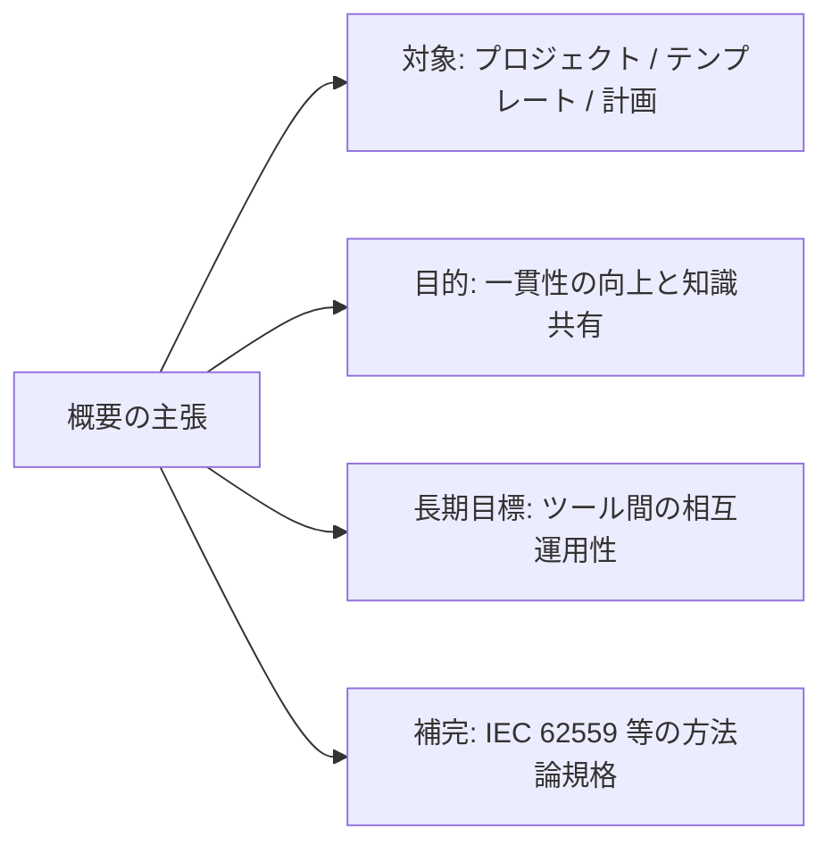
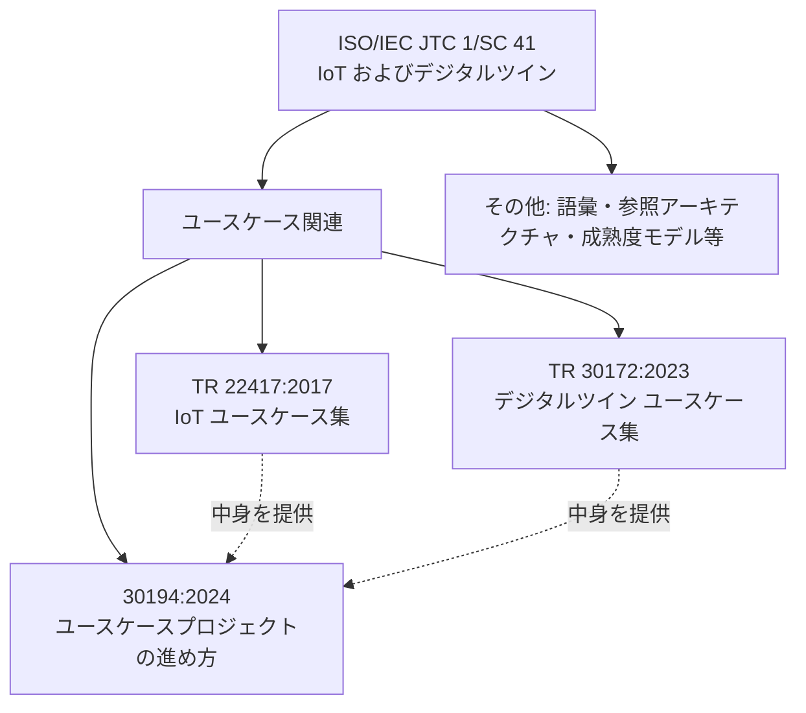
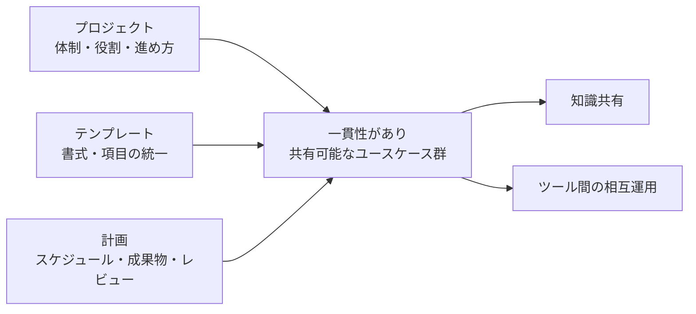
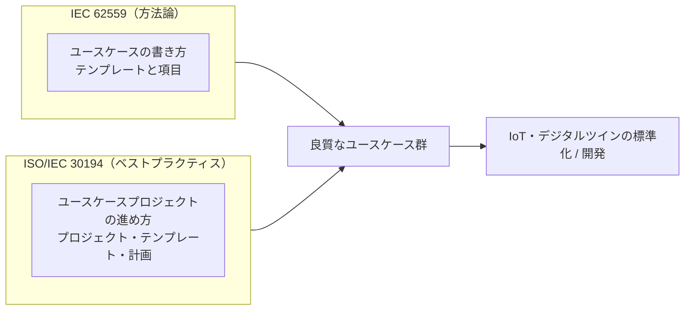
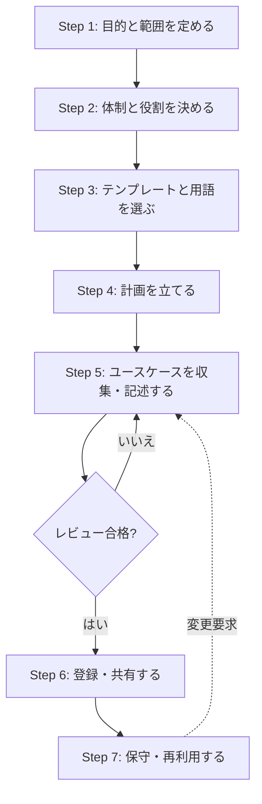
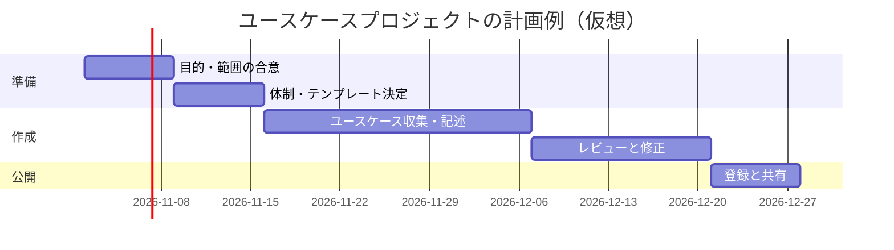
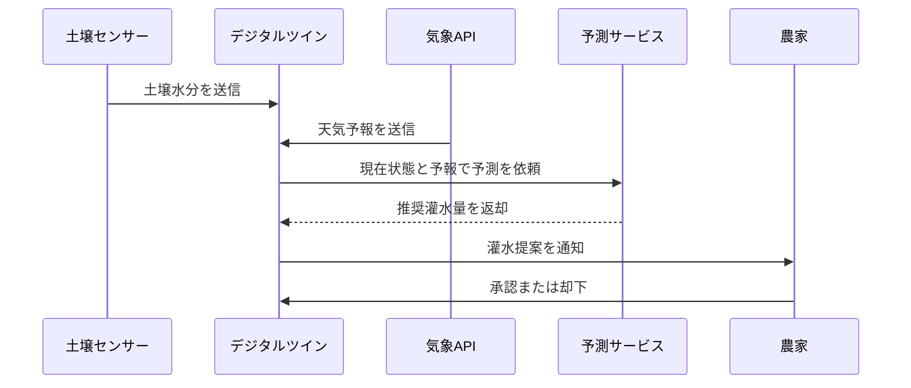
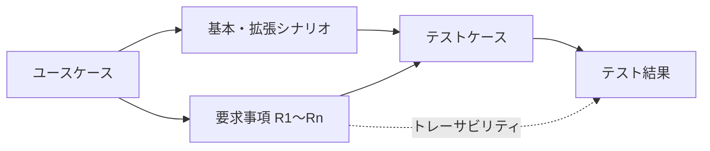

# ISO/IEC 30194:2024 初学者向けステップバイステップ解説

**IoT およびデジタルツイン ― ユースケースプロジェクトのベストプラクティス**
*Internet of things (IoT) and digital twin — Best practices for use case projects*

> 調査基準日: 2026年10月22日 / 対象読者: ソフトウェアエンジニア・QAエンジニア・規格初学者

---

## 0. 先に読んでください（本ガイドの信頼性の区分）

ISO/IEC 30194:2024 は **有料規格** で、全文は公開されていません。無償で確認できるのは概要（Abstract）、書誌情報、および ISO 公式ページの試読（Read sample）に限られます。そのため、本ガイドでは情報を次の3種類に分けて明示します。

| 記号 | 区分 | 意味 |
|---|---|---|
| ✅ | 公開情報で確認済み | ISO・IEC などの公式/販売ページの記載、またはその直接の根拠がある事実 |
| 💡 | 一般的な解説 | 関連規格（IEC 62559 等）や広く知られたユースケース技法に基づく、理解のための説明 |
| 🔶 | 筆者の解釈・実務提案 | 規格本文ではなく、実務への落とし込みとしての提案 |

> ⚠️ **本ガイドは規格本文の要約ではありません。** 条項番号・必須要求・テンプレートの正式な項目名などは、規格本文（ISO または各国規格協会で購入可能）で必ず確認してください。本ガイドの 💡 と 🔶 の記述を、規格要求として引用しないでください。

---

## 1. 一言でいうと

✅ この規格は、**「ユースケースを作るプロジェクト」をどう進めればよいか** のベストプラクティスを述べた文書です。

ポイントは「システムの作り方」ではなく **「ユースケースを集めて整える活動の進め方」** を対象にしていることです。

```markdown
対象 = ユースケースそのものを書く技術 ではなく
       ユースケースを作る「プロジェクト」の運営
```

---

## 2. 基本情報（✅ 公開情報で確認済み）

| 項目 | 内容 |
|---|---|
| 規格番号 | ISO/IEC 30194:2024 |
| 題名 | Internet of things (IoT) and digital twin — Best practices for use case projects |
| 版 | Edition 1 |
| 発行 | 2024年12月 |
| ステータス | Published（国際規格として発行、ステージ 60.60） |
| 担当委員会 | ISO/IEC JTC 1/SC 41（IoT およびデジタルツイン） |
| ICS | 35.240.95（インターネット応用） |
| ページ数 | 29ページ（ISO 公式ページの記載） |
| 言語 | 英語 |
| 価格 | CHF 159（ISO 公式ページの記載） |

### ⚠️ 公開情報の表記ゆれに関する注意

調査中、同じ番号でも販売元により表記が異なっていました。

| 情報源 | 表記 | ページ数 |
|---|---|---|
| ISO 公式ページ | 「ISO/IEC 30194:2024」（International Standard） | 29 |
| IEC Webstore / AFNOR / VDE | 「ISO/IEC **TR** 30194:2024」（Technical Report） | 34 |

概要文は同一ですが、**種別（IS か TR か）とページ数が異なる** 記載があります。原因は本調査では特定できていません。購入・引用の際は、入手元の表記と版を確認し、引用時は入手した文書の表紙の表記に合わせてください。

---

## 3. 概要（Abstract）を読み解く

✅ 公式の概要は、次の趣旨です（要旨を日本語で言い換えています）。

1. **プロジェクト・テンプレート・計画** の観点でユースケースプロジェクトのベストプラクティスを述べる
2. 目的は、異なるユースケースプロジェクト間で **内容の一貫性を高める** ことと、**プロジェクト間の知識共有を可能にする** こと
3. 長期的な目標は、ユースケースの収集・保守を支援する **ツール間の相互運用性** を促進すること
4. 想定読者は **ユースケースプロジェクトの開発者**（標準化の文脈を含む）
5. **IEC 62559 などの既存の方法論規格を補完** する用途で使える



---

## 4. 前提知識: ユースケースとは何か（💡）

### 4.1 定義のイメージ

ユースケースは「**誰が（アクター）、何のために（目的）、システムとどのようにやり取りするか**」を物語として記述したものです。

ユースケース技法の代表的な解説書として、アジャイルソフトウェア開発宣言の共同署名者でもある **Alistair Cockburn** の *Writing Effective Use Cases*（Addison-Wesley, 2001）があります。出版社の紹介では、アクター、ステークホルダー、設計スコープ、ゴールレベル、シナリオといった要素を扱うとされています。また書評記事（Alan Zeichick）では、Cockburn が **ユースケースを図ではなくテキスト中心の構成物** と捉え、UML の図はテキスト記述から発展させるべきだと主張していると紹介されています。

### 4.2 ユースケースの基本要素

| 要素 | 意味 | 例（スマート農業のデジタルツイン） |
|---|---|---|
| アクター | システムと関わる人・システム | 農家、土壌センサー、気象API |
| 目的（ゴール） | アクターが達成したいこと | 灌水量を最適化したい |
| 前提条件 | 開始時に成立している状態 | センサーが稼働中 |
| 基本シナリオ | 成功する標準的な流れ | 計測→ツイン更新→予測→灌水提案 |
| 拡張・例外 | 失敗や分岐 | センサー欠測時の補完 |
| 要求事項 | そこから導かれる要件 | 欠測時も5分以内に提案を出す |

### 4.3 なぜ IoT・デジタルツインでユースケースが重要か

IoT やデジタルツインのシステムは、**センサー、通信、クラウド、アプリ、人** と関係者が多岐にわたります。関係者ごとに用語や期待がずれやすいため、共通の記述形式で「誰が何をしたいか」を揃えることが、標準化や開発の出発点になります。

---

## 5. この規格の位置づけ（SC 41 の標準群の中で）

✅ ISO/IEC 30194 は JTC 1/SC 41 の規格です。SC 41 は IoT とデジタルツインを担当する委員会で、2020年11月の第8回総会でスコープにデジタルツインが加えられました（JTC 1 公式ページの記載）。

SC 41 には、ユースケース関連の規格が複数あります。

| 規格 | 内容 | 確認状況 |
|---|---|---|
| ISO/IEC TR 22417:2017 | IoT ユースケース（実世界の応用に基づくシナリオとユースケースを特定） | ✅ IEC Webstore の概要で確認 |
| ISO/IEC TR 30172:2023 | IoT ― デジタルツイン ― ユースケース | ✅ 規格登録データベースで確認 |
| **ISO/IEC 30194:2024** | **ユースケースプロジェクトのベストプラクティス** | ✅ ISO 公式 |



🔶 **整理のコツ**: 22417 と 30172 は「ユースケースの **中身（事例集）**」、30194 は「ユースケースを **どう集めて整えるか（やり方）**」と覚えると混乱しません。図の点線は筆者の整理であり、規格が定めた関係ではありません。

---

## 6. 3つの柱: プロジェクト・テンプレート・計画

✅ 概要は「projects, templates and plans」の3観点を挙げています。以下は、3観点を実務でイメージするための 💡 一般的な説明です（規格本文の章立てそのものではありません）。



| 柱 | 考えるべきこと（💡） | 失敗するとどうなるか |
|---|---|---|
| プロジェクト | 誰が何の責任でユースケースを集め、承認するか | 担当不明で記述が放置される |
| テンプレート | 全員が同じ項目・粒度・用語で書く | 書き手ごとに形式が違い、比較・統合できない |
| 計画 | 範囲、手順、レビュー、保守の段取り | 作りっぱなしで陳腐化する |

---

## 7. IEC 62559 との関係（✅ 補完関係 / 💡 内容の説明）

✅ 概要には、30194 は **IEC 62559 のような既存の方法論規格を補完** できると書かれています。

### 7.1 IEC 62559 シリーズとは

| 部 | 内容 | 確認状況 |
|---|---|---|
| IEC TR 62559-1:2019 | 背景・動機・ユースケースの扱い方（IEC 62559-2 の記載による） | ✅ 間接確認 |
| IEC 62559-2:2015 | ユースケースのテンプレート、アクター一覧、要求一覧の定義 | ✅ IEC Webstore で確認 |
| IEC 62559-3:2017 | ユースケーステンプレートの成果物を XML 形式でシリアライズ | ✅ 規格タイトルを販売ページで確認 |
| IEC SRD 62559-4:2020 | ユースケース開発・リポジトリ管理のベストプラクティス（標準化プロセスおよび企業プロジェクト等での適用） | ✅ IEC Webstore で確認 |

IEC 62559-2:2015 は、ユースケーステンプレートを標準化団体での規格開発や、システム開発プロジェクトでの利用を想定して定義した規格です。スマートグリッドが最初の利用分野でしたが、スマートホームや電動モビリティなど他分野にも適用できる汎用テンプレートとされています。

さらに、DIN Media の紹介では、IEC 内で **ユースケース管理リポジトリ（UCMR）** を共通の協働基盤として使い、ユースケースの調和を図る構想が述べられています。

> 📚 参考: IEC 62559-2 と SGAM（Smart Grid Architecture Model）を扱った書籍として、OFFIS の Gottschalk, Uslar, Delfs による *The Use Case and Smart Grid Architecture Model Approach*（Springer, 2017）があります。Uslar は SGAM の主要著者の一人と紹介されています。

### 7.2 30194 と 62559 の役割分担（🔶 筆者の整理）



| 観点 | IEC 62559（🔶） | ISO/IEC 30194（🔶） |
|---|---|---|
| 主な焦点 | 1つ1つのユースケースの記述方法 | ユースケースを作る活動の進め方 |
| 例え | 「履歴書の書式」 | 「採用活動の進め方」 |
| 関係 | 補完関係（✅ 概要の記載） | |

---

## 8. ステップバイステップ: ユースケースプロジェクトの進め方（🔶 実務提案）

> ⚠️ 以下は、概要の3観点と一般的な要求工学の考え方に基づく **筆者の実務提案** です。規格本文の手順ではありません。



### Step 1: 目的と範囲を定める

- 何のためにユースケースを作るのか（標準化、製品開発、PoC など）
- 対象領域（例: 農業IoT、工場のデジタルツイン）
- 作らないもの（スコープ外）

### Step 2: 体制と役割を決める

| 役割（例） | 責任 |
|---|---|
| プロジェクトリード | 全体の進行と合意形成 |
| ドメイン専門家 | 業務の目的・用語の正確性 |
| システム専門家 | インタフェース・データの具体化 |
| レビュアー（QA含む） | 品質と一貫性の確認 |

### Step 3: テンプレートと用語を選ぶ

- 既存の方法論（例: IEC 62559-2 のテンプレート）を採用するか検討
- 用語集を先に作り、同じ言葉は同じ意味で使う
- ✅ 概要が掲げる目的（一貫性・知識共有）に直結する、最重要ステップ

### Step 4: 計画を立てる



### Step 5: ユースケースを収集・記述する

1. ステークホルダーにインタビューやワークショップを実施
2. テンプレートに沿って1件ずつ記述
3. 目的・アクター・シナリオ・要求を明確にする

### Step 6: レビューして登録・共有する

- チェックリスト（第11章）で品質を確認
- 共有基盤（リポジトリやツール）に登録
- ✅ 概要は、収集・保守を支えるツール間の相互運用性を長期目標としている

### Step 7: 保守・再利用する

- 規格改訂や要求変更に合わせて更新
- 他プロジェクトで再利用できる形で保管

---

## 9. 具体例: 仮想のユースケース記述（🔶 説明用のフィクション）

題材: 「温室のデジタルツインによる灌水最適化」。これは **説明用の架空例** で、規格の例ではありません。

### 9.1 ユースケース概要

| 項目 | 内容 |
|---|---|
| 名称 | 灌水量の最適化提案 |
| 目的 | 水と肥料の使用量を抑えつつ収量を維持する |
| アクター | 農家、土壌センサー、気象API、デジタルツイン、予測サービス |
| 前提条件 | センサーが稼働し、ツインが現在の温室状態を反映している |
| 成功条件 | 農家が灌水提案を確認し、実行または却下できる |

### 9.2 基本シナリオ



### 9.3 拡張（例外）シナリオ

| ID | 条件 | 期待される動作 |
|---|---|---|
| E1 | センサー欠測 | 直近値と近隣センサーで補完し、補完済みである旨を通知 |
| E2 | 気象API応答なし | 過去平均で暫定提案し、再取得を試行 |
| E3 | 農家が24時間応答しない | 提案を失効させ、再通知 |

### 9.4 要求事項（ユースケースから導出）

| ID | 要求 | 種別 |
|---|---|---|
| R1 | 欠測時も5分以内に提案を出すこと | 性能・信頼性 |
| R2 | 補完データを利用した提案には明示ラベルを付与すること | 透明性 |
| R3 | 提案の履歴を1年間保存すること | 追跡性 |

---

## 10. QAエンジニア向け: ユースケースからテストへ（🔶 筆者の提案）

ユースケースは **テスト設計の優れた入力** になります。基本シナリオと拡張シナリオがそのままテストケースの骨格になります。



| ユースケース要素 | テスト設計での使い方 | 例 |
|---|---|---|
| 基本シナリオ | 正常系の E2E テスト | 計測→提案→承認 |
| 拡張シナリオ | 異常系・境界値テスト | センサー欠測、API無応答 |
| 要求事項 | 非機能テストの合格基準 | 5分以内の応答 |
| アクター | テストデータ・ペルソナの設計 | 農家役の操作 |

トレーサビリティの例:

| ユースケース | 要求ID | テストケースID | 結果 |
|---|---|---|---|
| 灌水最適化 基本 | R1 | TC-001 | 合格 |
| 灌水最適化 E1 | R1, R2 | TC-002 | 合格 |
| 灌水最適化 E2 | R1 | TC-003 | 未実施 |

---

## 11. 品質チェックリスト（🔶 レビュー用）

ユースケース群をレビューする際の観点です。規格の必須項目ではありません。

- [ ] 目的が1文で明確に書かれている
- [ ] アクターが人・システムの区別を含め網羅されている
- [ ] 前提条件と成功条件が記述されている
- [ ] 基本シナリオが番号付きステップで追える
- [ ] 例外・異常系が少なくとも主要なものは書かれている
- [ ] 要求事項に一意のIDが付いている
- [ ] 用語集と矛盾する用語がない
- [ ] 全ユースケースが同じテンプレート・同じ粒度で書かれている
- [ ] 版数・更新日・責任者が管理されている

---

## 12. よくある疑問（FAQ）

**Q1. この規格に準拠すれば認証や適合性評価を受けられますか？**
A. ✅ 公開情報では、ベストプラクティスを述べた文書とされています。認証制度については公開情報から確認できていません。

**Q2. ユースケースの書き方そのものが載っていますか？**
A. 概要は「プロジェクト、テンプレート、計画」の観点を挙げています。個々のユースケースの詳細な記述技法は、IEC 62559 のような方法論規格を補完する関係と読めます（概要の記載に基づく解釈）。

**Q3. デジタルツインに限定された規格ですか？**
A. 題名は「IoT and digital twin」で、担当委員会も SC 41 ですが、概要の記述自体は一般的な「use case projects」を対象としています。

**Q4. 無料で全文を読めますか？**
A. 本調査では全文の無料公開は確認できませんでした。ISO 公式ページに「Read sample」（試読）の案内があります。

**Q5. ユースケースは UML のユースケース図とは違うのですか？**
A. 💡 Cockburn の立場では、ユースケースはテキスト中心で、図（棒人間と楕円）は補助という考え方です。IEC 62559 のテンプレートも、記述項目を体系化したものです。

---

## 13. 用語集

| 用語 | 意味 |
|---|---|
| ユースケース | アクターがシステムを使って目的を達成する流れの記述 |
| アクター | ユースケースに関与する人・システム |
| ユースケースプロジェクト | ユースケースを収集・記述・管理する活動単位（本規格の対象） |
| テンプレート | ユースケースを統一形式で書くための書式 |
| デジタルツイン | 実世界の対象を模したデジタル上の対応物 |
| SC 41 | ISO/IEC JTC 1 の IoT・デジタルツイン担当小委員会 |
| IEC 62559 | ユースケース方法論の規格シリーズ |
| UCMR | IEC のユースケース管理リポジトリ構想 |
| SGAM | スマートグリッドのアーキテクチャモデル |

---

## 14. 根拠ソース一覧（URL）

### 14.1 規格本体・書誌情報（✅ 一次情報に近い）

| 内容 | URL |
|---|---|
| ISO 公式ページ（概要・ステージ・ページ数・価格） | <https://www.iso.org/standard/53314.html> |
| ISO 委員会サイト（同内容の別URL） | <https://committee.iso.org/standard/53314.html?browse=ics> |
| IEC Webstore（TR 表記・34ページ・安定期限 2027） | <https://webstore.iec.ch/publication/68099> |
| AFNOR（TR 表記・34ページ） | <https://www.boutique.afnor.org/en-gb/standard/iso-iec-tr-301942024/internet-of-things-iot-and-digital-twin-best-practices-for-use-case-project/xs302504/430980> |
| VDE Verlag（TR 表記・34ページ） | <https://vde-verlag.de/iec-standards/254601/iso-iec-tr-30194-2024.html> |
| Standards Council of Canada（IS 表記・2024-12-06） | <https://scc-ccn.ca/standardsdb/standards/8190336> |
| Singapore Standards eShop（29ページ・SC 41） | <https://www.singaporestandardseshop.sg/Product/SSPdtDetail/d6850b3e-2761-da00-8a26-3a16b0ce846a> |

### 14.2 関連規格・委員会（✅）

| 内容 | URL |
|---|---|
| IEC 62559-2:2015（テンプレート規格の概要） | <https://webstore.iec.ch/publication/22349> |
| IEC 62559-2 プレビュー PDF（VDE） | <https://www.vde-verlag.de/iec-normen/preview-pdf/info_iec62559-2{ed1.0}b.pdf> |
| DIN EN 62559-2（UCMR の記載） | <https://www.dinmedia.de/en/standard/din-en-62559-2/249847571> |
| ISO/IEC TR 22417:2017 IoT ユースケース | <https://webstore.iec.ch/publication/60605> |
| ISO/IEC TR 30172:2023 デジタルツイン ユースケース | <https://lsmu.lt/cris/entities/standard/c111c56d-8be8-4844-b8ca-2ba0aa577a51> |
| JTC 1/SC 41 公式ページ（スコープ・沿革） | <https://jtc1info.org/jtc1-subcommittees/sc-41/> |
| SC 41 のデジタルツイン活動資料（ETSI ワークショップ、2023年） | <https://docbox.etsi.org/Workshop/2023/07_ETSIIoTCONFERENCE/S09_DIGITAL_TWINS/SC41_ACTIVITIES_DIGITAL_TWINS_TRIALOG_KUNG.pdf> |
| SC 41 の動向（AIOTI Days 2024） | <https://aioti.eu/wp-content/uploads/AIOTI-Days-2024-S8-Antonio-Kung.pdf> |

### 14.3 著名な実務家・研究者の文献（💡 背景理解用）

| 内容 | URL |
|---|---|
| Alistair Cockburn, *Writing Effective Use Cases*（Pearson 書籍ページ） | <https://www.pearson.com/en-nz/subject-catalog/p/writing-effective-use-cases/P200000009217/9780321605801> |
| 同書の書評記事（Alan Zeichick, ProjectManagement.com） | <https://www.projectmanagement.com/books/19843/writing-effective-use-cases> |
| 同書の書評（TDAN） | <https://tdan.com/?p=5598> |
| Gottschalk, Uslar, Delfs, *The Use Case and SGAM Approach*（Springer） | <https://link.springer.com/9783319492285> |
| IEC 62559 ユースケースと SGAM の品質特性に関する論文 | <https://link.springer.com/article/10.1186/s42162-023-00280-5> |

---

## 15. 検証できなかった事項（正直な限界）

| 事項 | 状況 |
|---|---|
| 規格本文の章構成・条項番号 | 有料のため未確認 |
| 規格が定める具体的なテンプレート項目 | 未確認 |
| IS（29ページ）と TR（34ページ）の表記差の原因 | 未確認 |
| 30194 を直接解説した著名な国際的開発者の投稿 | 今回の検索では見つからず。関連する背景として Cockburn の文献などを参照 |
| 日本語版（JIS 等）の有無 | 今回の調査では確認できず |

**次のアクション（🔶）**: 実務で使う場合は、ISO 公式ページの試読版で目次を確認し、必要に応じて規格本文を購入したうえで、本ガイドの 💡・🔶 部分を本文と照合してください。
