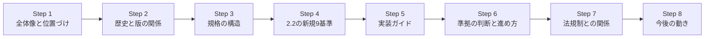
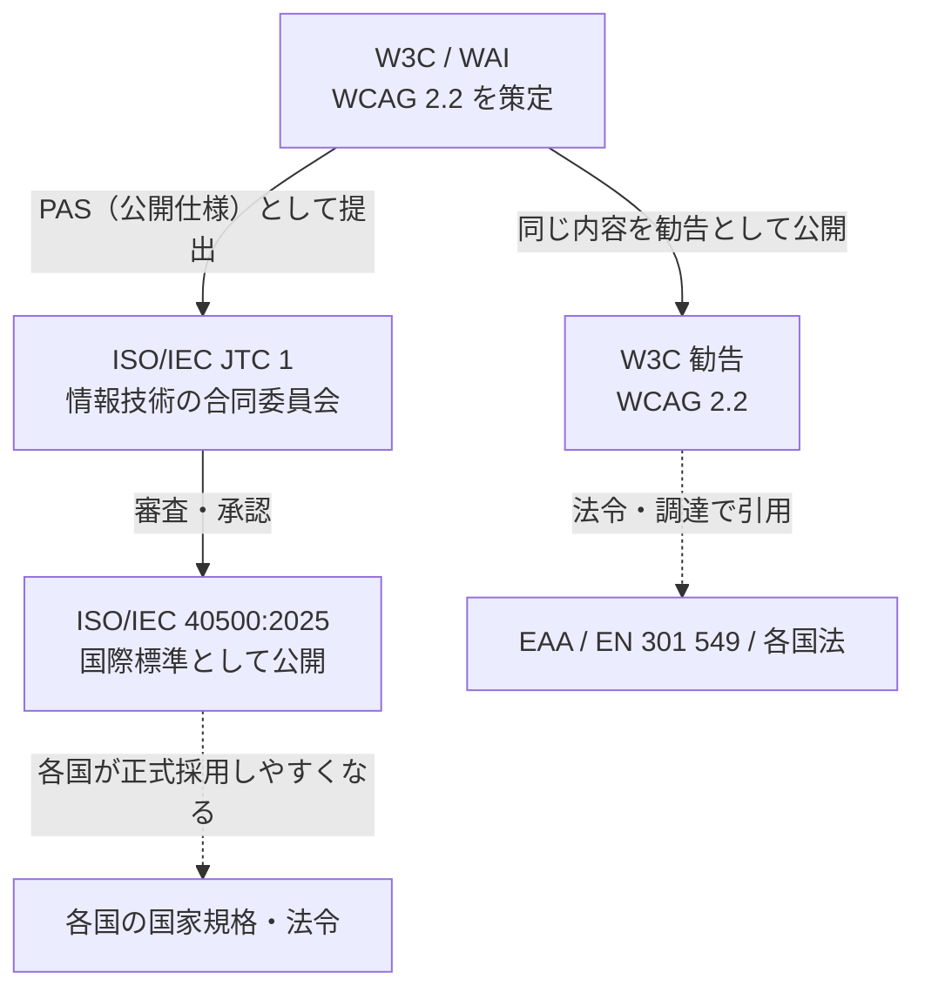
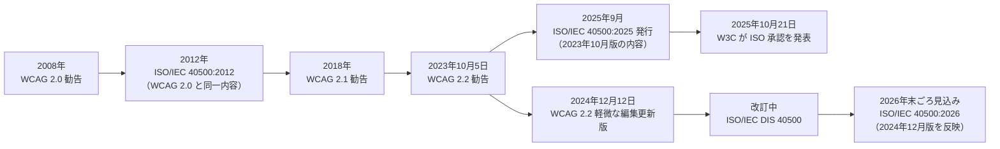
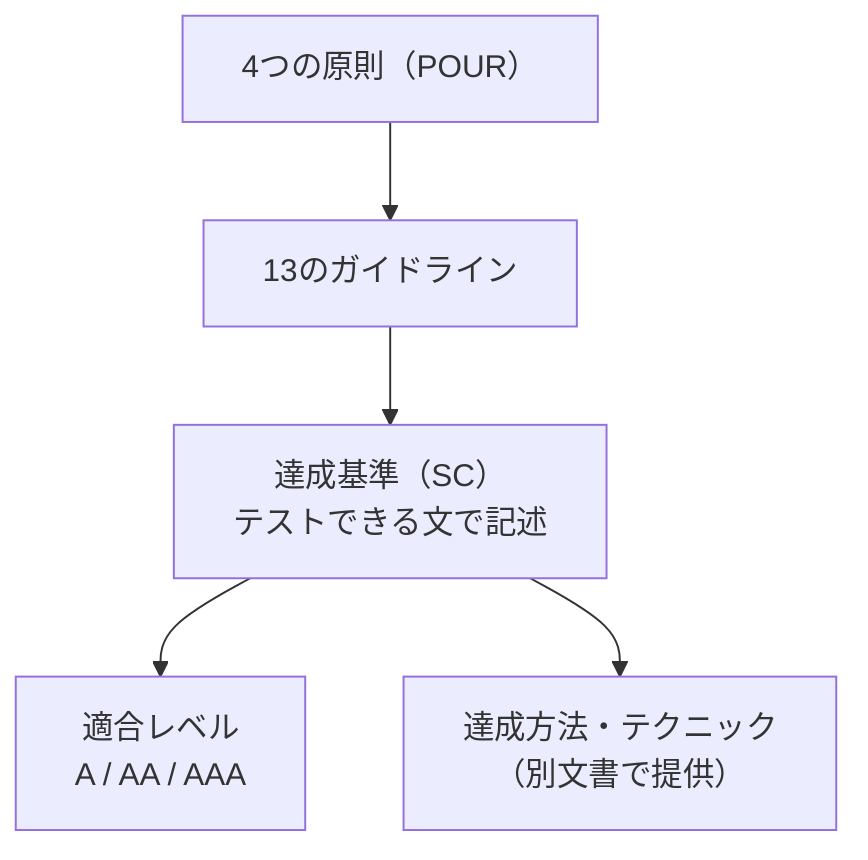
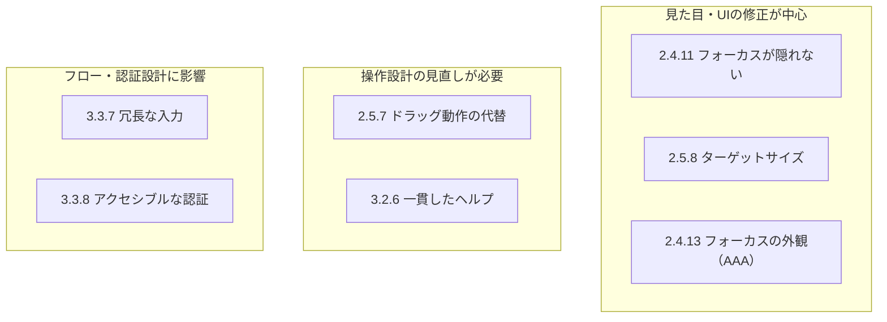
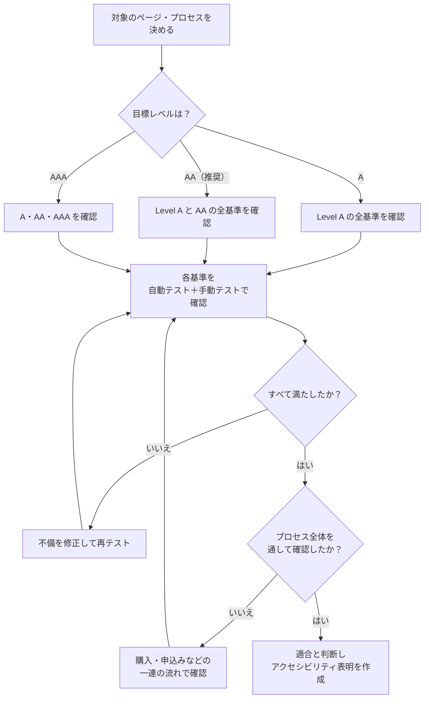
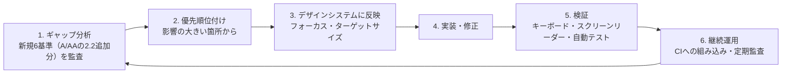
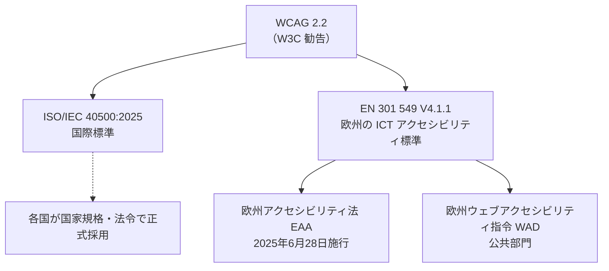
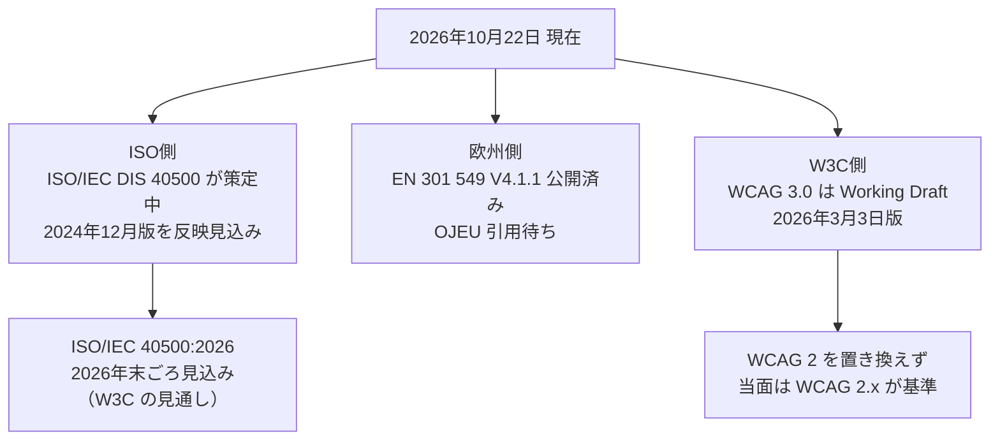

# ISO/IEC 40500:2025 初学者向けステップバイステップ解説ガイド

> **正式名称**: ISO/IEC 40500:2025 *Information technology — W3C Web Content Accessibility Guidelines (WCAG) 2.2*
> **日本語での通称**: ウェブコンテンツ・アクセシビリティ・ガイドライン（WCAG）2.2 の ISO/IEC 国際標準版
> **情報時点**: 2026年10月22日（本ガイドの調査時点）
> **対象読者**: 開発者・QAエンジニア・デザイナー・PM（アクセシビリティ初学者）

---

## 0. このガイドの読み方

### 0.1 ゴール

このガイドを読み終えると、次の5つに自分の言葉で答えられるようになります。

| # | 問い | 対応する章 |
|---|------|-----------|
| 1 | ISO/IEC 40500:2025 とは何か。WCAG 2.2 とどう違うのか | Step 1〜2 |
| 2 | 規格の中身（原則・ガイドライン・達成基準・適合レベル）はどう構成されているか | Step 3 |
| 3 | WCAG 2.2 で何が新しくなったのか | Step 4〜5 |
| 4 | 自分のプロジェクトは「準拠している」とどう判断するのか | Step 6 |
| 5 | EU の法規制や今後の動き（WCAG 3 など）とどう関係するのか | Step 7〜8 |

### 0.2 学習の全体像



### 0.3 用語のミニ辞書

| 用語 | 意味 |
|------|------|
| **WCAG** | Web Content Accessibility Guidelines。W3C が策定するウェブコンテンツのアクセシビリティ指針 |
| **W3C** | World Wide Web Consortium。Web 標準を策定する国際的な団体 |
| **WAI** | Web Accessibility Initiative。W3C の中でアクセシビリティを担当する活動 |
| **ISO/IEC JTC 1** | ISO と IEC の合同技術委員会（情報技術分野を担当） |
| **達成基準（Success Criterion, SC）** | 「テストできる文」で書かれた個々の要件。例: 2.5.8 ターゲットサイズ（最小） |
| **CSS ピクセル** | 画面の物理解像度に依存しない CSS 上の長さの単位 |
| **EAA** | European Accessibility Act（欧州アクセシビリティ法） |
| **EN 301 549** | 欧州の ICT 製品・サービスのアクセシビリティ要件の標準 |

---

## Step 1. ISO/IEC 40500:2025 とは何か

### 1.1 ひとことで言うと

**「W3C が作った WCAG 2.2 を、ISO/IEC の国際標準として正式に位置づけたもの」**です。内容は WCAG 2.2 そのものであり、ISO が別の要件を新しく作ったわけではありません。

### 1.2 なぜ ISO 化するのか

WCAG は W3C の勧告（Recommendation）として世界中で広く使われています。しかし、国や公共機関によっては「ISO/IEC の国際標準でなければ法令や調達基準に引用できない」という事情があります。ISO/IEC 化により、**より多くの国が WCAG 2.2 を正式に採用しやすくなる**ことが、W3C と ISO/IEC JTC 1 の双方から説明されています。

### 1.3 関係者の整理



### 1.4 基本情報（ISO 公式ページの記載）

| 項目 | 内容 |
|------|------|
| 規格番号 | ISO/IEC 40500:2025 |
| 版 | Edition 2（第2版） |
| 発行 | 2025年9月（ISO のステージ履歴では 2025-09-24 に International Standard published） |
| ページ数 | 72 ページ |
| 担当委員会 | ISO/IEC JTC 1（Information technology） |
| ICS 分類 | 35.080（Software） |
| 入手 | ISO サイトから **無償**（価格欄は CHF 0） |
| 前の版 | ISO/IEC 40500:2012（WCAG 2.0 に対応。現在は Withdrawn） |
| 現在のステージ | 90.92（To be revised：改訂予定。2026-02-05 に遷移） |
| 次の版 | ISO/IEC DIS 40500（Draft International Standard）が策定中 |

> **ポイント**: 「2025」は ISO としての発行年です。中身の WCAG 2.2 の版とは別の話なので、Step 2 で整理します。

---

## Step 2. 歴史と版の関係を押さえる

### 2.1 時系列



### 2.2 いちばん大事な注意点（初学者がつまずく所）

| 質問 | 答え |
|------|------|
| ISO/IEC 40500:2025 の中身は WCAG 2.2 のどの版か | **2023年10月版**の WCAG 2.2 と同一（W3C の説明） |
| 最新の W3C 勧告 WCAG 2.2 は何版か | **2024年12月12日版**（軽微な編集上の更新を含む） |
| 両者は違うのか | 編集上の更新に由来する差が生じています。W3C は 2024年12月版が **2026年末ごろ ISO/IEC 40500:2026 として利用可能になる**と見込んでいます |
| 新しい達成基準が増えたり減ったりしたか | 2024年12月版は「軽微な編集更新」とされており、達成基準の追加・削除はありません |

**実務での考え方**: 実装・テストは、W3C の最新 WCAG 2.2（`https://www.w3.org/TR/WCAG22/`）を一次資料にして問題ありません。ISO/IEC 40500:2025 は「国際標準として引用するための正式な参照先」と考えてください。

### 2.3 WCAG 2.2 と過去版の互換性

- WCAG 2.2 に適合するコンテンツは、WCAG 2.0 と 2.1 にも適合します（2.2 は 2.1 に新しい達成基準を**追加**した構造）。
- WCAG 2.2 の公開で、2.0 や 2.1 が廃止されたわけではありません。ただし W3C は、将来にわたる有効性を最大化するため **最新の WCAG 2.2 の利用を推奨**しています。

---

## Step 3. 規格の構造を理解する

WCAG は「4つの原則 → 13のガイドライン → 達成基準 → 適合レベル」の階層で整理されています。

### 3.1 階層構造



> WCAG 本体はテクノロジー非依存で書かれています。「HTML ならこう書く」といった具体的な実装方法は、**Understanding WCAG 2** と **Techniques for WCAG 2** という別文書が担います。ISO/IEC 40500 に含まれるのは WCAG 本体です。

### 3.2 4つの原則（POUR）

| 原則 | 英語 | 意味 | 具体例 |
|------|------|------|--------|
| 1. 知覚可能 | **P**erceivable | 情報と UI を、ユーザーが知覚できる形で提示する | 画像の代替テキスト、十分な色のコントラスト |
| 2. 操作可能 | **O**perable | UI とナビゲーションを、さまざまな方法で操作できる | キーボードだけで操作、時間制限の配慮 |
| 3. 理解可能 | **U**nderstandable | 情報と UI の操作が理解できる | 入力エラーの分かりやすい説明、一貫したナビゲーション |
| 4. 堅牢 | **R**obust | 支援技術を含むさまざまなユーザーエージェントで解釈できる | 正しい名前・役割・値（name, role, value）の提供 |

### 3.3 3つの適合レベル

| レベル | 位置づけ | 実務での目安 |
|--------|---------|-------------|
| **A** | 最低限。満たさないと利用できなくなる人が出やすい | すべてのサイトが最低限満たす |
| **AA** | 標準的な目標。多くの法令・調達要件が参照 | **多くの組織の事実上の目標** |
| **AAA** | 最高水準。コンテンツ全体で満たすのは現実的でない場合もある | 可能な範囲で部分的に採用 |

### 3.4 達成基準の数（WCAG 2.2）

| レベル | WCAG 2.1 | 2.2 での増減 | WCAG 2.2 |
|--------|---------|-------------|----------|
| A | 30 | 新規 +2、4.1.1 削除 −1 | 31 |
| AA | 20 | 新規 +4 | 24 |
| AAA | 28 | 新規 +3 | 31 |
| **合計** | 78 | 新規 +9、削除 −1 | **86** |

> 達成基準の総数は W3C 公式の一覧で必ず再確認してください（本表は新規9・削除1の増減から算出した目安です）。

### 3.5 適合の5つの要件（ここを知らないと「準拠」を主張できない）

WCAG の適合（Conformance）には、レベルを選ぶだけでなく次の要件があります。

| # | 要件 | 平たく言うと |
|---|------|-------------|
| 1 | 適合レベル | A・AA・AAA のどれかを満たす（下位レベルをすべて含む） |
| 2 | ページ全体 | 「ページの一部だけ」ではなく、ページ全体が適合している |
| 3 | プロセス全体 | 購入や申込みなど、一連のプロセス全体が適合している |
| 4 | アクセシビリティ サポーテッドな技術の使用 | 支援技術などで実際に使える方法で技術を使う |
| 5 | 非干渉 | 使っている技術が、他の達成基準の達成を妨げない |

> 実務では「トップページだけ直した」では準拠と言えません。購入フローなら**カート → 入力 → 確認 → 完了**まで通して適合する必要があります。

---

## Step 4. WCAG 2.2 の新規9基準を一覧で押さえる

### 4.1 新規達成基準の一覧

| SC | 名称 | レベル | 主に助けられる人 | 一言でいうと |
|----|------|--------|-----------------|-------------|
| 2.4.11 | フォーカスが隠れない（最小） | **AA** | キーボード利用者・低視力 | キーボードフォーカスされた要素が、固定ヘッダー等に**完全には隠れない** |
| 2.4.12 | フォーカスが隠れない（拡張） | AAA | 同上 | フォーカスされた要素が**まったく隠れない** |
| 2.4.13 | フォーカスの外観 | AAA | 低視力・認知障害 | フォーカス表示が**十分な大きさとコントラスト**を持つ |
| 2.5.7 | ドラッグ動作 | **AA** | 運動障害・ポインタ操作が難しい人 | ドラッグ操作には**クリックなど単純な代替手段**を用意する |
| 2.5.8 | ターゲットのサイズ（最小） | **AA** | 運動障害・タッチ操作 | 操作対象は原則 **24×24 CSS px 以上**（例外あり） |
| 3.2.6 | 一貫したヘルプ | **A** | 認知障害・学習障害 | ヘルプ手段を**毎回同じ相対位置**に置く |
| 3.3.7 | 冗長な入力 | **A** | 認知障害・記憶に困難がある人 | 同じ情報を**二度入力させない** |
| 3.3.8 | アクセシブルな認証（最小） | **AA** | 認知障害・学習障害 | 認証で**認知機能テスト**（記憶・転記・パズル）を強いない |
| 3.3.9 | アクセシブルな認証（拡張） | AAA | 同上 | 3.3.8 より例外が少ない厳格版 |

**レベル別の件数**: A が 2件（3.2.6、3.3.7）、AA が 4件（2.4.11、2.5.7、2.5.8、3.3.8）、AAA が 3件（2.4.12、2.4.13、3.3.9）。

### 4.2 削除された達成基準

| SC | 名称 | 扱い |
|----|------|------|
| 4.1.1 | 構文解析（Parsing） | WCAG 2.2 で**削除**。かつて想定された問題は、現在はブラウザ・支援技術の進化で起きにくいか、他の達成基準でカバーされるため |

> ただし、HTML が正しく書けていなくてよい、という意味ではありません。壊れたマークアップが原因で**名前・役割・値が正しく伝わらない**場合は、引き続き 4.1.2 などの違反になります。

### 4.3 新規基準の影響度マップ



---

## Step 5. 新規基準の実装ガイド（コード付き）

> 以下のコードは学習用の最小例です。達成基準の例外条件や判定の詳細は、必ず W3C の **Understanding WCAG 2.2** で確認してください。

### 5.1 2.4.11 フォーカスが隠れない（最小）

**よくある失敗**: 画面上部に固定ヘッダーがあり、Tab キーで移動した要素がヘッダーの裏に隠れる。

```css
/* 固定ヘッダーの高さぶん、スクロール時の余白を確保する */
html {
  scroll-padding-top: 5rem;     /* 固定ヘッダーの高さに合わせる */
  scroll-padding-bottom: 4rem;  /* 固定フッターがある場合 */
}

/* フォーカス表示は常に見えるようにする */
:focus-visible {
  outline: 3px solid #1a5fb4;
  outline-offset: 2px;
}
```

**確認方法（キーボードスイープ）**: マウスを使わず Tab / Shift+Tab で全体を巡回し、フォーカスされた要素が固定要素やモーダルで完全に隠れないか確認します。Cookie バナーやチャットウィジェットも対象です。

### 5.2 2.5.8 ターゲットのサイズ（最小）

**基本ルール**: ポインタで操作する対象は 24×24 CSS ピクセル以上。ただし次の例外があります。

| 例外 | 内容 |
|------|------|
| 間隔 | 24px 未満でも、周囲に十分な間隔があり他の対象と干渉しない |
| 同等の手段 | 同じ機能を果たす別の対象が基準を満たしている |
| インライン | 文章中のリンクなど、行の高さ等で大きさが制約される |
| ユーザーエージェント制御 | ブラウザ標準のコントロールで、作者が大きさを変更していない |
| 本質的 | 表現上その大きさが不可欠な場合 |

```css
/* アイコンボタンの最小サイズを確保 */
.icon-button {
  min-inline-size: 24px;
  min-block-size: 24px;
  padding: 8px;               /* 実際のタップ領域は広めに取るのが推奨 */
}
```

**実務のヒント**: 24px は「最小限」です。指でタップする UI では、より大きい 44×44 CSS px（旧 AAA の 2.5.5 の目安）を目標にすると、操作しやすさが大きく向上します。実際に 16×16 のアイコンボタンや密集したインラインリンクが、この基準で問題になりやすい箇所です。

### 5.3 2.5.7 ドラッグ動作

ドラッグ＆ドロップで並べ替えるリストには、単純なポインタ操作で同じことができる手段を併設します。

```html
<li>
  項目A
  <button type="button" aria-label="項目Aを上へ移動">上へ</button>
  <button type="button" aria-label="項目Aを下へ移動">下へ</button>
</li>
```

### 5.4 3.2.6 一貫したヘルプ

ヘルプ（連絡先、チャット、FAQ へのリンクなど）を複数ページに置く場合、**ページ間で同じ相対的な位置・順序**に配置します。

| NG | OK |
|----|----|
| ページごとにヘルプリンクがヘッダーだったりフッターだったり変わる | すべてのページでフッターの同じ位置にヘルプリンクを置く |

### 5.5 3.3.7 冗長な入力

同じプロセス内で**すでに入力した情報**は、自動入力するか選択肢として提示します（セキュリティ上の再入力が必要な場合などは例外）。

```html
<!-- 配送先と請求先が同じ場合のチェックボックス -->
<label>
  <input type="checkbox" id="same-address">
  請求先は配送先と同じ
</label>

<!-- 標準的な属性値で、ブラウザの自動入力を助ける -->
<input type="text" id="postal" name="postal-code" autocomplete="postal-code">
```

### 5.6 3.3.8 アクセシブルな認証（最小）

認証の手順で、記憶・転記・パズル解決のような**認知機能テスト**を、代替なしで求めないようにします。

```html
<!-- パスワードマネージャーと貼り付けを妨げない -->
<input type="password" id="pw" name="password" autocomplete="current-password">
```

| やってよい・推奨 | 避けるべき |
|-----------------|-----------|
| パスワードマネージャー対応 | 貼り付け（ペースト）の禁止 |
| メールリンク、パスキー、SSO などの代替手段 | 画像の文字を読み取って入力させる CAPTCHA のみ |
| コピー＆ペーストの許可 | 「前に登録した答え」を記憶で答えさせるのみ |

### 5.7 2.4.13 フォーカスの外観（AAA・参考）

フォーカス表示は、サイズ（外周の太さの目安は 2 CSS px 以上）と、フォーカス前後での **3:1 以上のコントラスト変化**が求められます。AA の 2.4.7（フォーカスの可視化）よりも具体的な数値要件を持つため、AAA に分類されています。AA 目標の組織でも、デザインシステムのフォーカススタイルに先取りで取り入れる価値があります。

---

## Step 6. 準拠の判断と進め方

### 6.1 達成基準が満たされているかを判断するフロー



### 6.2 現実的な進め方（既存サービスを WCAG 2.1 AA から 2.2 AA へ）



> 新規の **A/AA** は 6 基準です（A: 3.2.6、3.3.7／AA: 2.4.11、2.5.7、2.5.8、3.3.8）。まずここから着手するのが一般的です。

### 6.3 テストの種類と役割

| テスト | 得意なこと | 苦手なこと |
|--------|-----------|-----------|
| 自動テスト（axe, Lighthouse, Pa11y など） | 欠落した代替テキスト、コントラスト不足など、機械的に判定できる問題 | 文脈や意味の判断、フォーカス順序の妥当性、認証手順の設計 |
| 手動のキーボードテスト | フォーカス可視性、隠れ、操作可能性 | 大量ページの網羅 |
| スクリーンリーダー確認 | 名前・役割・値、読み上げ順序 | 設定・環境の差による再現性 |
| ユーザーテスト | 実際の利用者の困りごと | 準備コスト |

> 新規基準の多くは**手動確認が必要**と、実務の指針でも繰り返し指摘されています。自動テストの緑だけで「準拠」と判断しないでください。

### 6.4 QAエンジニア向けチェック表（新規基準）

| SC | 確認手順（最短） | 合否の目安 |
|----|----------------|-----------|
| 2.4.11 | Tab で全要素を巡回 | 固定要素にフォーカス対象が完全に隠れない |
| 2.5.7 | ドラッグ可能な UI を探す | クリック・ボタン等の代替手段がある |
| 2.5.8 | 開発者ツールで要素サイズを計測 | 24×24 以上、または例外・間隔条件を満たす |
| 3.2.6 | 複数ページのヘルプ位置を比較 | 毎回同じ相対位置・順序 |
| 3.3.7 | 複数ステップのフォームを通す | 既入力の再入力を強いない（例外除く） |
| 3.3.8 | ログイン手順を確認 | ペースト可・代替手段あり・認知機能テストのみにならない |

---

## Step 7. 法規制・標準との関係（EU を例に）

### 7.1 全体の関係



### 7.2 EN 301 549 の最新状況（2026年10月時点）

| 項目 | 状況 |
|------|------|
| 最新版 | **EN 301 549 V4.1.1**（ETSI・CEN・CENELEC が 2026年9月2日に公開） |
| WCAG の参照 | 旧版 V3.2.1 は WCAG **2.1** A/AA。V4.1.1 は WCAG **2.2** A/AA に更新 |
| 追加の変更 | EAA との対応づけを明示する附属書の追加、リアルタイム通信要件の見直し など |
| 法的な位置づけ | EU 官報（OJEU）に引用されると、適合推定を与える整合規格になる |
| 官報引用の見込み | **情報源により差があります**（Deque は 2026年11月30日ごろ、アイルランド NDA は 2026年12月16日の見込みと記載） |
| 注意 | **WCAG 2.2 AA を満たすことと、EN 301 549 V4.1.1 に適合することは同じではありません**（EN 301 549 には WCAG 以外の要件もあります） |

### 7.3 日本の読者へ

日本では JIS X 8341-3:2016 が WCAG 2.0（および ISO/IEC 40500:2012）に対応した規格として広く参照されてきました。WCAG 2.2 / ISO/IEC 40500:2025 を受けた国内の規格・ガイドラインの更新状況は、本ガイドの調査範囲外です。**最新の JIS やデジタル庁・各自治体のガイドラインを個別に確認してください。**

---

## Step 8. 今後の動き

### 8.1 3つの動き



### 8.2 WCAG 3.0 はいつ使えるのか

| 項目 | 内容 |
|------|------|
| 現状 | 2026年3月3日に更新された **Working Draft**（未完成の草案） |
| WCAG 2 との関係 | WCAG 3 は WCAG 2.2 の後継だが、**WCAG 2 を廃止するものではない** |
| 時期 | 確定した日程はなく、コミュニティからも日程への懐疑的な声がある。草案段階で変更される可能性が高い |
| 実務判断 | **今は WCAG 2.2 に取り組むのが正解**。2.2 での取り組み（フォーカス、操作性、認知負荷の軽減など）は将来も無駄になりにくい |

> WCAG 3 の完成時期について、ベンダー系の解説記事は「Candidate Recommendation が 2027年第4四半期ごろ、Recommendation は 2028年以降」と紹介しています。一方、W3C 内部の議論では、スケジュールの実現可能性に懸念を示す発言（アクセシビリティテストで知られる Wilco Fiers 氏）もあります。**日程は不確実な見通し**として扱ってください。

---

## 補足. よくある誤解 Q&A

| # | 誤解 | 正しい理解 |
|---|------|-----------|
| 1 | ISO/IEC 40500:2025 は WCAG 2.2 とは別の新要件だ | **同じ内容**。ISO が別要件を作ったわけではない |
| 2 | ISO/IEC 40500:2025 は最新の WCAG 2.2（2024年12月版）である | 2025版は **2023年10月版**。2024年12月版は ISO/IEC 40500:2026 として見込み |
| 3 | WCAG 2.2 に対応したら WCAG 2.1 に対応できなくなる | 2.2 に適合すれば **2.0 / 2.1 にも適合** |
| 4 | 自動テストが全部パスなら準拠している | 自動テストで検出できる範囲は一部。**手動確認が必須** |
| 5 | トップページだけ対応すればよい | **ページ全体・プロセス全体**が対象 |
| 6 | 4.1.1 が削除されたので HTML の品質は無関係 | 壊れたマークアップが原因で支援技術に伝わらなければ 4.1.2 等で不適合 |
| 7 | WCAG 2.2 AA を満たせば EN 301 549 V4.1.1 に完全適合 | **同義ではない**。EN 301 549 には WCAG 以外の要件がある |
| 8 | WCAG 3 が出るので WCAG 2.2 対応は不要 | WCAG 3 は草案段階で、WCAG 2 を廃止しない |

---

## 情報の確度と注意点（必読）

| 区分 | 内容 | 確度 |
|------|------|------|
| ISO 公式ページの情報 | 版、発行月、ページ数、ステージ、DIS の存在、価格（無償） | 高（一次情報） |
| W3C の発表 | 2025年10月21日に ISO 承認を発表。2025版は 2023年10月版であること、2024年12月版が 2026年末ごろ利用可能になる見込み | 高（一次情報） |
| 発行日の表記差 | ISO のステージ履歴は 2025-09-24 発行、W3C の発表は 2025-10-21 | 中（「ISO の発行」と「W3C の周知」の日付の違いと解釈できるが、公式の説明は確認できていない） |
| EN 301 549 V4.1.1 | 2026年9月2日公開は複数の情報源で一致 | 高 |
| OJEU 引用日 | Deque（11月30日ごろ）と NDA（12月16日）で食い違い | **低（情報源により異なる）**。最新の EU 官報情報を確認すること |
| WCAG 3 の時期 | ベンダー記事とコミュニティ議論で見通しが異なる | **低（不確実）** |
| 日本の規格の更新状況 | 本調査では未確認 | 未確認 |

**ISO 規格の本文はライセンスにより転載できません。**本ガイドは公開情報（ISO のメタ情報、W3C の公開文書、実務家の解説）の要約と、筆者による説明で構成しています。達成基準の正確な文言は、W3C の WCAG 2.2 原文（無償）で確認してください。

---

## 学習チェックリスト

- [ ] ISO/IEC 40500:2025 と WCAG 2.2 の関係を説明できる
- [ ] 2025版が **2023年10月版**であり、2024年12月版とは別だと説明できる
- [ ] POUR の4原則と、A/AA/AAA の3レベルを説明できる
- [ ] 新規9基準の名称とレベルを言える
- [ ] 4.1.1 が削除された理由と、HTML 品質が無関係ではない理由を説明できる
- [ ] 2.4.11（フォーカスが隠れない）を、キーボードだけで検証できる
- [ ] 2.5.8 の 24×24 CSS px と主な例外を説明できる
- [ ] 3.3.8 で、ペースト禁止がなぜ問題かを説明できる
- [ ] 「ページ全体」「プロセス全体」で準拠を判断すると説明できる
- [ ] EN 301 549 V4.1.1 が WCAG 2.2 A/AA を参照することを説明できる

---

## 参照ソース一覧（2026年10月22日時点で確認）

### 一次情報（ISO / W3C）

| # | 内容 | URL |
|---|------|-----|
| 1 | ISO/IEC 40500:2025 公式ページ（ステージ・版・DIS の記載） | <https://www.iso.org/standard/91029.html> |
| 2 | W3C WAI ニュース: WCAG 2.2 が ISO 標準として承認（2025-10-21） | <https://www.w3.org/WAI/news/2025-10-21/wcag22-iso> |
| 3 | W3C プレスリリース（ML 配信テキスト） | <https://lists.w3.org/Archives/Public/w3c-news/2025OctDec/0002.html> |
| 4 | W3C プレスリリース（日本語版・PAS として審査された旨） | <https://www.w3.org/ja/press-releases/2025/wcag22-iso-pas/> |
| 5 | W3C WAI ディレクター Shawn Lawton Henry 氏の告知 | <https://lists.w3.org/Archives/Public/public-wai-announce/2025OctDec/0001.html> |
| 6 | WCAG 2 Overview（ISO/IEC 40500, EAA, EN 301 549 の節） | <https://www.w3.org/WAI/standards-guidelines/wcag/> |
| 7 | WCAG 2.2 本文（W3C 勧告） | <https://www.w3.org/TR/WCAG22/> |
| 8 | What's New in WCAG 2.2（W3C WAI） | <https://www.w3.org/WAI/standards-guidelines/wcag/new-in-22/> |
| 9 | WCAG 2.1/2.2 軽微な編集更新（2024-12-12） | <https://www.w3.org/WAI/news/2024-12-12/wcag2updates/> |
| 10 | WCAG 2.2 公開履歴 | <https://w3.org/standards/history/WCAG22> |
| 11 | WCAG 3 草案（2026-03-03 版） | <https://w3.org/TR/WCAG3/> |
| 12 | WCAG 3 草案更新のお知らせ（2026-03-03） | <https://www.w3.org/WAI/news/2026-03-03/wcag3> |

### 実務家・専門組織の解説

| # | 内容 | URL |
|---|------|-----|
| 13 | Hidde de Vries: What's new in WCAG 2.2? | <https://hidde.blog/new-in-wcag22/> |
| 14 | Adrian Roselli: CSUN ATC 2024「WCAGmire」スライド（フォーカス・ターゲットサイズ） | <https://blog.adrianroselli.com/wp-content/uploads/2024/03/CSUNATC-2024_WCAGmire_Adrian-Roselli.pdf> |
| 15 | Deque: EN 301 549 v4.1.1 is final! | <https://www.deque.com/blog/en-301-549-v4-1-1-is-final-what-changed-what-it-means-and-what-you-should-do/> |
| 16 | Deque University: WCAG 2.2 リソース | <https://dequeuniversity.com/resources/wcag-2.2> |
| 17 | Intopia: WCAG 2.2 の新規基準の概要 | <https://intopia.digital/?p=3241> |
| 18 | アイルランド NDA: EN 301 549 V4.1.1 公開のお知らせ | <https://nda.ie/news/en301549-published> |
| 19 | Davis Wright Tremaine: EAA 向け新技術標準の解説 | <https://www.dwt.com/insights/2026/09/european-accessibility-act-ict-standards-update> |
| 20 | HTML5 Accessibility: Last week in WAI #3（WCAG 3 の日程に関する議論） | <https://html5accessibility.com/stuff/2026/01/16/last-week-in-wai-3/> |

### 補助的な情報源（ベンダー記事。参考扱い）

| # | 内容 | URL |
|---|------|-----|
| 21 | Accessible Web: ISO 標準と WCAG 2.2 適合の影響 | <https://accessibleweb.com/disability-law/iso-standards-wcag-2-2-conformance/> |
| 22 | WebAbility: WCAG 3.0 解説（2026） | <https://www.webability.io/blog/wcag-3-0-explained> |

---

*本ガイドは、2026年10月22日時点で公開されている情報に基づきます。EN 301 549 の官報引用や ISO/IEC 40500:2026、WCAG 3 は今後も動くため、最新情報は上記の一次情報で確認してください。*
