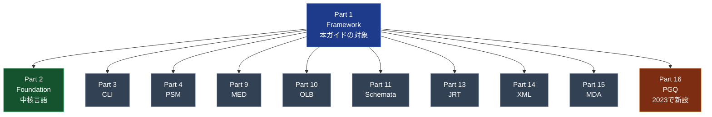
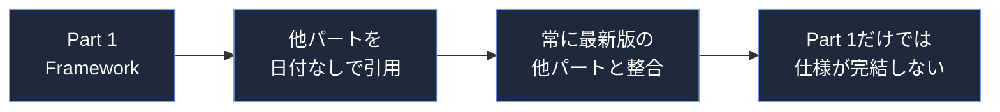
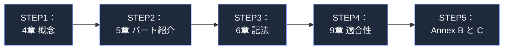
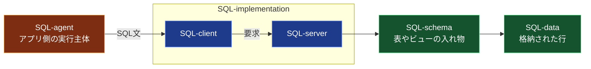
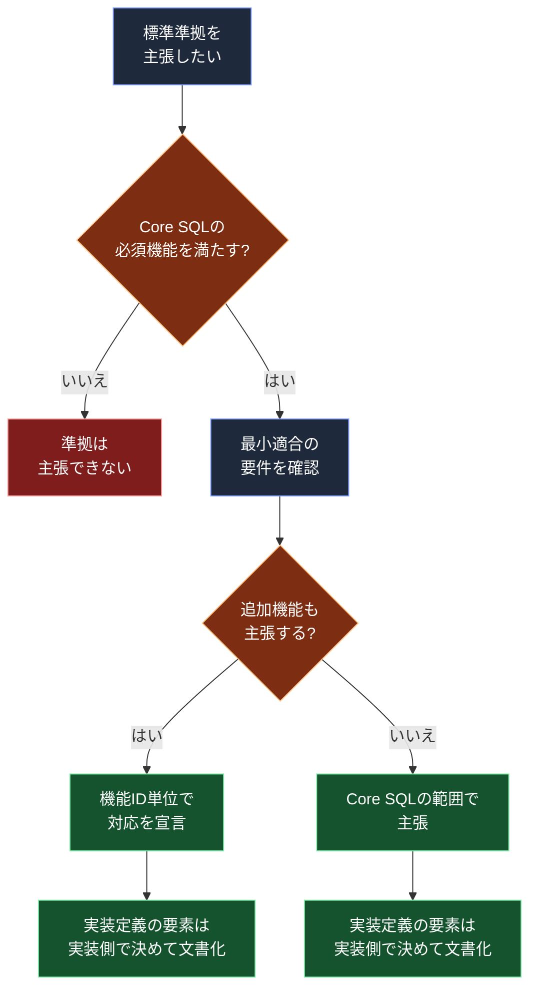
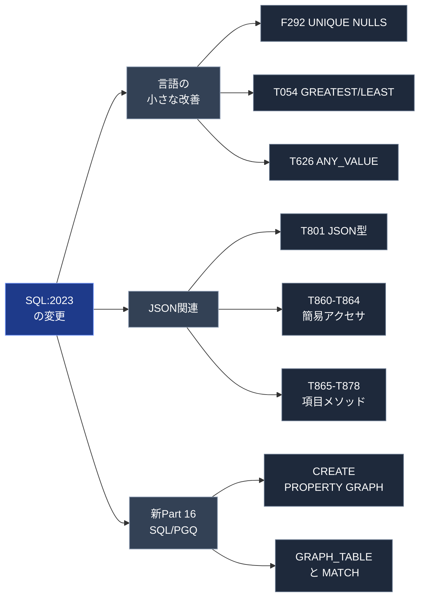
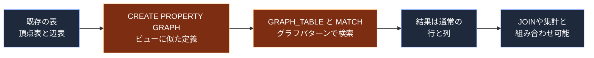
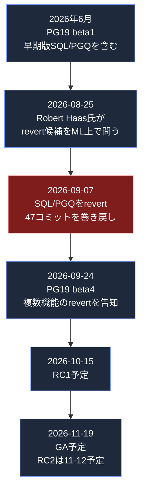
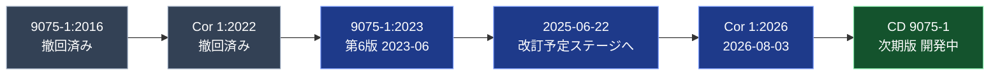
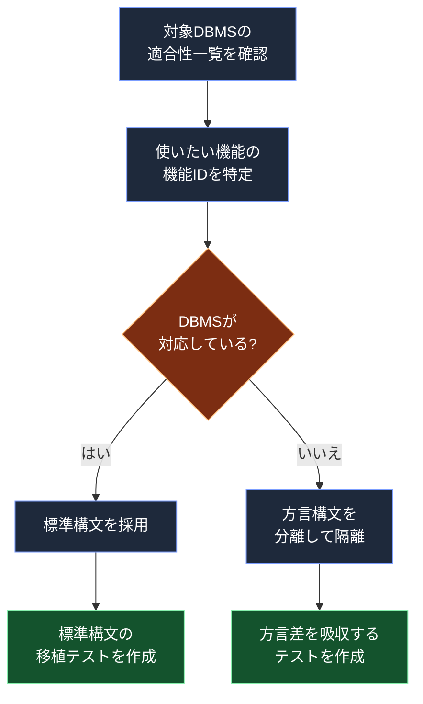

# ISO/IEC 9075-1:2023（SQLフレームワーク）初学者向けステップバイステップ解説

> **対象規格**: ISO/IEC 9075-1:2023 — Information technology — Database languages SQL — Part 1: Framework (SQL/Framework)
> **情報基準日**: 2026年10月13日（以降の動きは未反映）
> **想定読者**: SQLは書けるが、「SQL標準そのもの」は読んだことがないソフトウェア／QAエンジニア
> **根拠URL**: 12章にまとめて掲載（本文中の `[S1]` などは出典番号）

---

## 目次

1. [このガイドの前提と限界](#1-このガイドの前提と限界)
2. [3分でつかむ要点](#2-3分でつかむ要点)
3. [STEP 1：SQL標準は「1冊」ではなくシリーズ](#step-1sql標準は1冊ではなくシリーズ)
4. [STEP 2：Part 1（Framework）の役割](#step-2part-1frameworkの役割)
5. [STEP 3：文書の構成（公開情報で確認できた範囲）](#step-3文書の構成公開情報で確認できた範囲)
6. [STEP 4：中核概念 ― SQL-environment とその部品](#step-4中核概念--sql-environment-とその部品)
7. [STEP 5：適合性（Conformance）と「実装定義／実装依存」](#step-5適合性conformanceと実装定義実装依存)
8. [STEP 6：SQL:2023 で何が変わったか](#step-6sql2023-で何が変わったか)
9. [STEP 7：2026年10月時点の実装状況](#step-72026年10月時点の実装状況)
10. [STEP 8：版の状況と今後（Cor 1:2026・次期改訂）](#step-8版の状況と今後cor-12026次期改訂)
11. [QA／開発者向け：標準をどう使うか](#11-qa開発者向け標準をどう使うか)
12. [参考URL（出典一覧）](#12-参考url出典一覧)
13. [用語集・FAQ・学習チェックリスト](#13-用語集faq学習チェックリスト)

---

## 1. このガイドの前提と限界

最初に、この文書で「何を根拠に」「どこまで書けるか」を明確にします。

| 項目 | 内容 |
|---|---|
| 根拠にした情報 | ISOカタログページのメタデータ（版・発行日・ステージ・規定引用）、公開されている目次プレビュー、PostgreSQLコア開発者 Peter Eisentraut 氏の解説、Markus Winand 氏（modern-sql.com）の解説、Oracle・PostgreSQL 各プロジェクトの公式発表 |
| 規格本文の扱い | 規格本文は有料（ISO著作権）のため、**本文の転載・逐語引用はしていません**。章立ては公開プレビューの目次から確認できた範囲のみ記載し、確認できなかった部分は「未確認」と明記します |
| 情報基準日 | 2026-10-13 |
| 読み方の注意 | 本ガイドは理解のための解説です。**適合性主張・監査・契約などの正式な判断には、必ず規格の原文（購入版）を確認してください** |

> ⚠️ 規格の1ページの技術正誤表（Cor 1:2026）の中身は、本ガイド作成時点では公開情報から確認できていません（STEP 8参照）。

---

## 2. 3分でつかむ要点

| 疑問 | 答え |
|---|---|
| これは何？ | SQL標準（ISO/IEC 9075）シリーズの**第1部**。SQLの文法や処理結果を各パートで規定するための**概念的な枠組み**と、シリーズ共通の**用語・記法**を定める文書 |
| SQLの文法は書いてある？ | 書いてありません。文法（SELECTやCREATE TABLEなど）は主に Part 2（Foundation）以降にあります |
| 何版？いつ？ | 第6版、2023年6月発行、74ページ |
| 前の版は？ | ISO/IEC 9075-1:2016（撤回済み） |
| SQL:2023の目玉は？ | JSON関連の強化、**新Part 16（SQL/PGQ：プロパティグラフ問合せ）**、細かな言語改善 |
| 今どうなってる？ | 2025-06-22に「改訂対象」ステージに入り、次期版の委員会ドラフト（CD 9075-1）が進行中。2026-08に1ページの技術正誤表が発行 |
| 実装は？ | OracleはDatabase 23aiでSQL/PGQを実装。PostgreSQL 19ではSQL/PGQが**ベータ中にrevert**された（STEP 7） |

---

## STEP 1：SQL標準は「1冊」ではなくシリーズ

### 1-1. まず全体像を見る

SQL標準の正式名は ISO/IEC 9075 で、複数の**パート**に分かれています。Part 1（本書）は、他のパートを読むための「入口」にあたります \[S1\]\[S5\]。



### 1-2. 各パートの役割（初学者向けの一言説明）

ISOカタログの規定引用に載っているパートは次の11個です \[S1\]。Eisentraut氏も「新Part 16を含めて現在11のアクティブなパートがある」と述べています \[S5\]。

| Part | 略称 | 正式名 | 一言でいうと |
|---|---|---|---|
| 1 | SQL/Framework | Framework | **本書。全体の枠組み・用語・記法・適合性の考え方** |
| 2 | SQL/Foundation | Foundation | 一般にSQLとして知られる**中核言語**（データ型、DDL、DML、問合せ等）。Eisentraut氏も「多くの人がコア言語として知るのはPart 2」と述べる \[S5\] |
| 3 | SQL/CLI | Call-Level Interface | アプリからSQLを呼び出すためのAPI（ODBCに近い立ち位置） |
| 4 | SQL/PSM | Persistent Stored Modules | ストアドプロシージャ／関数など手続き的な拡張 |
| 9 | SQL/MED | Management of External Data | 外部データの管理 |
| 10 | SQL/OLB | Object Language Bindings | オブジェクト指向言語との結合（Java等） |
| 11 | SQL/Schemata | Information and Definition Schemas | メタデータ（情報スキーマ／定義スキーマ） |
| 13 | SQL/JRT | SQL Routines and Types Using the Java Programming Language | Javaでのルーチン／型 |
| 14 | SQL/XML | XML-Related Specifications | XML関連 |
| 15 | SQL/MDA | Multidimensional Arrays | 多次元配列 |
| 16 | **SQL/PGQ** | Property Graph Queries | **プロパティグラフ問合せ（2023で追加）** |

> 💡 **ポイント**: パート番号が飛んでいる（5〜8、12など）のは、過去に存在した／別の扱いになったパートがあるためです。「欠番＝抜け落ち」ではありません。

### 1-3. 規模感

SQL標準全体は、Winand氏によればSQL:2023で**4,300ページ超**と巨大で、どの実装も全機能は実装できません \[S8\]。一方、Part 1は**74ページ**です \[S1\]。つまりPart 1は「全体の地図」であり、細部は他パートに委ねられています。

---

## STEP 2：Part 1（Framework）の役割

### 2-1. 規格が自ら述べる範囲（Scope）

ISOカタログページ \[S1\] の要旨を、日本語で言い換えると次の2点です。

1. 他のパートがSQLの**文法**と、SQL-implementationが文を処理した**結果**を規定するときに使う、**概念的な枠組み**を説明する
2. シリーズ全体で使う**用語**と**記法**を定義する

### 2-2. 「規定すること」と「しないこと」

| 項目 | Part 1が担う | 他パートが担う |
|---|---|---|
| 概念の定義（SQL-environment、SQL-implementation 等） | ✅ | |
| 用語・記法・表記規約 | ✅ | |
| 各パートの紹介・位置づけ | ✅ | |
| 適合性の枠組み（最小適合など） | ✅ | |
| 具体的な文法（SELECT / CREATE TABLE など） | | Part 2 ほか |
| 手続き言語（ストアド等） | | Part 4 |
| メタデータの具体的な表（INFORMATION_SCHEMA） | | Part 11 |
| プロパティグラフの文法 | | Part 16 |

### 2-3. 規定引用（Normative references）が示す関係

Part 1は、他パートを**日付なしで**規定引用しています \[S1\]。ISOの規則上、日付なし引用は「最新版を参照する」扱いです（参照元ページの記述）。これは「パート同士が一体で運用される」ことの表れで、Part 1だけ読んでもSQLの全体は決まりません。



---

## STEP 3：文書の構成（公開情報で確認できた範囲）

公開されている目次プレビュー \[S2\]\[S3\] から確認できた章立てを整理します。**途中が欠けている箇所は、プレビューに出ていなかっただけ**で、存在しないという意味ではありません。

| 章 | 確認できた内容 | 初学者向けの読みどころ |
|---|---|---|
| 3 | 用語・定義（ISO/IEC 10646:2020 由来の定義を含む） | 文字コード系の定義を他規格から借りている |
| **4 Concepts** | 4.1 What is SQL?／4.4 SQL-environments and their components（SQL-agent、SQL-implementation、SQL-client、SQL-server、SQL-client modules、user mapping、routine mapping、SQL-schemas、SQL-data）／4.6 SQL data types／4.8 SQL-schema objects（User-defined types、Table constraints 等） | **最も重要。まずここを読む** |
| **5 パート紹介** | 5.2 Framework／5.3 Foundation／5.5 PSM／5.6 MED／5.7 OLB／5.8 Schemata／5.11 MDA／5.12 PGQ ほか | 各パートの役割を短く紹介する章。**5.12にPGQが追加**されている |
| 6 記法・規約 | 6.3.11 Implementation-defined and implementation-dependent／6.4.5 Implementation-defined items／6.4.6 Implementation-dependent items | 「実装定義」「実装依存」の区別の説明 |
| 7 | 7.3 Implementation-defined elements／7.4 Implementation-dependent elements | 実装定義／実装依存の要素 |
| 8 | **未確認**（プレビューに掲載なし） | 原文で確認してください |
| **9 Conformance** | 9.2 Minimum conformance | **適合性。STEP 5で解説** |
| Annex B（参考） | Implementation-defined elements | 実装定義の要素一覧 |
| Annex C（参考） | Implementation-dependent elements | 実装依存の要素一覧 |

### 3-1. 初学者向けの読む順番



---

## STEP 4：中核概念 ― SQL-environment とその部品

Part 1の第4章は、SQLを「言語」だけでなく「**どこで・誰が・何に対して実行するか**」まで含めて定義します \[S2\]\[S3\]。用語がハイフン付きで独特ですが、日常用語に置き換えると理解しやすくなります。

### 4-1. 用語の対応表（目次で確認できた語）

| 規格の用語 | 日常的な言い換え（理解用） | ひとこと |
|---|---|---|
| SQL-environment | SQLが動く「環境」全体 | 以下の部品を包む最上位の概念 |
| SQL-agent | SQLの実行を引き起こす主体（アプリ側） | 「誰がSQLを発行するか」 |
| SQL-implementation | DBMS製品（クライアント側＋サーバー側） | 「SQLを処理する実体」 |
| SQL-client | SQL-implementation の呼び出し側の部分 | アプリとつながる窓口 |
| SQL-server | SQL-implementation のデータ管理側の部分 | データを実際に扱う |
| SQL-client module | アプリ側のSQL文のまとまり | 埋め込みSQL等に対応する概念 |
| user mapping / routine mapping | 外部データ連携のためのユーザー／ルーチン対応づけ | Part 9（MED）と関連 |
| SQL-schema | スキーマ（表・ビュー等を束ねる入れ物） | カタログの中に置かれる |
| SQL-data | 実際に格納される表のデータ | 「中身」 |

### 4-2. 図で見る：SQLが実行される流れ（概念図）



> 💡 この図は**理解のための単純化**です。規格が定義する関係（カタログ、認可識別子など）は、原文で確認してください。

### 4-3. データ型とスキーマオブジェクト

目次には 4.6「SQL data types」と 4.8「SQL-schema objects」があり、後者の下に**ユーザー定義型（User-defined types）**や**表制約（Table constraints）**の節が確認できます \[S2\]\[S3\]。SQL:2023の `UNIQUE NULLS [NOT] DISTINCT`（後述）は、まさにこの「表制約」の解釈に関わる変更点です。

---

## STEP 5：適合性（Conformance）と「実装定義／実装依存」

### 5-1. なぜ適合性が必要か

Winand氏が指摘するとおり、SQL標準は巨大で、どの実装も全機能を実装できません \[S8\]。そこで標準は「どこまで実装すれば標準準拠といえるか」の物差しを用意します。

### 5-2. 適合性の歴史（Winand氏の整理）

| 時期 | 仕組み | 要点 |
|---|---|---|
| SQL-92 | 3段階のレベル（entry / intermediate / full） | 準拠主張はレベルを明記。多くのDBはentry準拠 \[S8\] |
| SQL:1999以降 | 全機能を列挙し、**必須(mandatory)／任意(optional)** に分類 | 必須の集合が **Core SQL**。それ以外は**機能単位**で主張 \[S8\] |

Part 1の第9章に「Minimum conformance（最小適合）」の節があることは目次から確認できます \[S2\]\[S3\]。具体的な主張要件の文言は原文で確認してください。

### 5-3. 機能ID（Feature ID）とは

SQL標準の機能には `F292`、`T801` のような**機能ID**が付いています。実装は「Core SQL＋対応する機能ID」という形で能力を表明できます。SQL:2023では、**実装定義の挙動にも識別子が付与**されたと Winand氏は記しています \[S9\]。

### 5-4. 実装定義（implementation-defined）と実装依存（implementation-dependent）

Part 1の第6章・第7章・Annex B/Cが扱う重要な区別です \[S2\]。

| 区別 | 意味（一般的な説明） | 実装側の責任 | 例 |
|---|---|---|---|
| **実装定義** | 標準は挙動を決めず、各実装が**決めて文書化**する | 決めて文書化する | `UNIQUE` 制約でNULLを区別するかの**既定値**（SQL:2023で明示指定を追加、既定は実装定義）\[S5\] |
| **実装依存** | 標準は決めず、各実装が違ってよい。**文書化の義務は必須ではない** | 特になし | 実行計画の選び方など |

> 💡 **QAの観点**: テストで「環境によって結果が違う」ことを見つけたら、まず**実装定義／実装依存の領域か**を疑うと、バグか仕様かの切り分けが速くなります。

### 5-5. 適合性主張の判断フロー（概念図）



> ⚠️ 上図は理解用の整理です。**正式な準拠主張の要件は Part 1 の Clause 9 と、各パートの適合性規定（原文）に従います。**

---

## STEP 6：SQL:2023 で何が変わったか

Part 1自体は枠組みの文書ですが、**シリーズ全体（SQL:2023）の改訂内容**を知ることは、Part 1が紹介する各パートを理解する近道です。以下は Peter Eisentraut 氏（PostgreSQLコア開発者）の整理 \[S5\] に基づきます。

> 📝 SQL:2023の新機能は、すべて**任意（オプション）機能**として追加されています \[S5\]。既存実装が必ず変更を迫られるわけではありません。

### 6-1. 変更の3系統



### 6-2. 「小さな改善」の機能一覧

| 機能ID | 機能名 | 内容（初学者向け） |
|---|---|---|
| F292 | UNIQUE null treatment | UNIQUE制約で**NULLを重複とみなすか**を明示指定できる（`NULLS DISTINCT` / `NULLS NOT DISTINCT`）。既定は実装定義 |
| F868 | ORDER BY in grouped table | GROUP BYした結果を、SELECT句に出ていない列で並べ替えてよい |
| T054 | GREATEST / LEAST | 複数引数の最大／最小。集計関数のMAX/MINと別名なのは、構文上区別できないため |
| T055 | 文字列パディング | `LPAD` / `RPAD` |
| T056 | 複数文字TRIM | `LTRIM` / `RTRIM` / `BTRIM` |
| T081 | 文字列型の最大長を省略可 | `VARCHAR` の長さ指定を省略できる（既定上限は実装定義） |
| T133 | 強化されたサイクルマーク値 | 再帰クエリの `CYCLE` 句でboolean型や既定値を使える |
| T626 | ANY_VALUE | グループから任意の非NULL値を返す集計関数 |
| T661 | 非10進整数リテラル | `0xFF`（16進）・`0o755`（8進）・`0b1010`（2進） |
| T662 | 数値リテラルのアンダースコア | `1_000_000` のように区切れる |

### 6-3. JSON関連の機能一覧

| 機能ID | 機能名 | 内容 |
|---|---|---|
| T801 | JSON data type | **JSON型**の導入。SQL:2016は文字列に格納したJSONへの操作が中心だった |
| T802 | Enhanced JSON data type | 重複キーのチェック（`WITH UNIQUE KEYS`） |
| T803 | String-based JSON | SQL:2016の文字列ベースJSON機能の位置づけ |
| T840 | Hex integer literals in SQL/JSON path | SQL/JSONパスで16進リテラルを許可 |
| T860-T864 | SQL/JSON simplified accessor | `t.j.foo.bar[2]` のようにドットと添字でJSONへアクセス（`JSON_QUERY`/`JSON_VALUE`の糖衣構文） |
| T865-T878 | SQL/JSON item methods | `bigint()`、`date()`、`timestamp()` など**型変換系**のメソッド群 |
| T879-T882 | JSON comparison | JSON型の比較・ソート・グルーピング |

### 6-4. 具体例で理解する（概念理解用のサンプル）

```sql
-- F292: NULLの扱いを明示する
CREATE TABLE users (
    email VARCHAR,              -- T081: 長さ指定を省略
    UNIQUE NULLS NOT DISTINCT (email)
);
INSERT INTO users VALUES (NULL);
INSERT INTO users VALUES (NULL);   -- NULLS NOT DISTINCT なので重複エラー

-- T054 / T055 / T661 / T662
SELECT GREATEST(10, 20, 15)        AS max_value,
       LPAD('42', 6, '0')          AS padded,
       0xFF + 0b1010 + 1_000_000   AS literal_sum;

-- T626: GROUP BY に含まれない列から任意の1値を取る
SELECT dept_id, ANY_VALUE(dept_name) AS dept_name, COUNT(*)
FROM employees
GROUP BY dept_id;

-- T860: JSONの簡易アクセサ（JSON_VALUE等の糖衣構文）
SELECT t.j.foo.bar[2] FROM tbl t;
```

> ⚠️ 各DBMSで対応状況・方言が異なります。実行前に**使用するDBMSの対応表**を確認してください（STEP 7）。

### 6-5. 目玉：Part 16 SQL/PGQ（プロパティグラフ問合せ）

**一言で**: 既存の表を**グラフ（頂点と辺）として問い合わせる**ための構文です。Eisentraut氏は、単純なケースでは複雑な結合クエリをより直感的に書ける可能性がある、と説明しています \[S5\]。



```sql
-- 概念例（構文の細部はDBMSごとに確認してください）
CREATE PROPERTY GRAPH bank_graph
    VERTEX TABLES (person, account)
    EDGE TABLES (ownerof);          -- 外部キーがあれば関係を推論できる \[S5\]

SELECT *
FROM GRAPH_TABLE (bank_graph
    MATCH (p IS person WHERE p.name = 'Alice') -[IS ownerof]-> (a IS account)
    COLUMNS (p.name AS owner_name, a.account_no AS account_no)
);
```

Oracleの説明でも、SQLのプロパティグラフは**既存の表に対するビューのようなオブジェクト**とされ、SQLの開発者・ツール資産をそのまま使える点が利点とされています \[S11\]。

### 6-6. Part 1との関係（なぜここで扱うか）

Part 1の第5章（パート紹介）には**5.12 SQL/PGQ**の節があり、新パートの追加がPart 1側にも反映されていることが目次から確認できます \[S2\]\[S3\]。「新しい機能群はまずPart 1の“地図”に載り、詳細は個別パートで定義される」という構図です。

---

## STEP 7：2026年10月時点の実装状況

### 7-1. 実装状況の見取り図

| DBMS／実装 | 主な状況（2026-10-13時点） | 出典 |
|---|---|---|
| **Oracle Database 23ai** | SQL/PGQを実装。Oracleは標準化を主導し、**初の商用SQL/PGQ実装**と説明 | \[S11\] \[S12\] |
| **PostgreSQL 19** | SQL/PGQは**ベータ期間中にrevert**。PG19には搭載されない見込み（PG20向けに修正との報道） | \[S13\] \[S14\] \[S15\] \[S16\] |
| **PostgreSQL 15〜17** | F292（PG15）、ANY_VALUE・非10進リテラル・アンダースコア（PG16）、SQL/JSONコンストラクタ（PG16）、`JSON_TABLE`等（PG17） | \[S6\] \[S7\] |

### 7-2. PostgreSQL の SQL:2023 機能対応（Eisentraut氏の2023年時点の表）

Eisentraut氏は2023年4月の時点で、各機能のPostgreSQL対応を次のように整理しました \[S6\]。**その後の状況は変わっている可能性があるため、最新はPostgreSQL公式のSQL適合性ドキュメントで確認してください。**

| 機能 | 当時の状況 |
|---|---|
| UNIQUE null treatment (F292) | PostgreSQL 15 |
| ORDER BY in grouped table (F868) | 以前から対応（ancient） |
| GREATEST / LEAST (T054) | 以前から対応 |
| 文字列パディング (T055) | 以前から対応 |
| 複数文字TRIM (T056) | 以前から対応 |
| 最大長省略の文字列型 (T081) | 以前から対応 |
| 強化サイクルマーク値 (T133) | PostgreSQL 14 |
| ANY_VALUE (T626) | PostgreSQL 16 |
| 非10進整数リテラル (T661) | PostgreSQL 16 |
| 数値リテラルのアンダースコア (T662) | PostgreSQL 16 |
| JSON data type (T801) | PostgreSQL 9.2/9.4（`json` / `jsonb` との対応づけ） |
| 強化JSON型 (T802) | 将来 |
| 文字列ベースJSON (T803) | 計画なし |
| SQL/JSON パスの16進 (T840) | PostgreSQL 16 |
| SQL/JSON 簡易アクセサ (T860-T864) | 将来 |
| SQL/JSON 項目メソッド (T865-T878) | 将来 |
| JSON比較 (T879-T882) | PostgreSQL 9.4 |
| Property Graph Queries | 将来 |

> 📝 「以前から対応（ancient）」は、Eisentraut氏の定義で「PostgreSQL 10より前から」を指します。また氏は、SQL:2016／2023のJSON機能の多くは `json` 型より `jsonb` 型に対応づけやすいと注記しています \[S6\]。

さらにSimon Willison氏は、PostgreSQL 17（2024-09-26リリース）の SQL/JSON 機能が SQL:2023 に基づくと紹介し、`json_table()` を注目機能に挙げています \[S7\]。

### 7-3. PostgreSQL 19 の SQL/PGQ に何が起きたか（時系列）



押さえておきたいポイント:

| 論点 | 内容 | 出典 |
|---|---|---|
| revertの規模 | 2026-09-07、SQL/PGQ関連の**47コミット**をREL_19_STABLEとmasterの両方から巻き戻し | \[S13\] |
| 実施者 | 当該revertは、SQL/PGQの実装者でもある Peter Eisentraut 氏が実施 | \[S13\] |
| 理由 | 設計上の複数の問題が、今サイクル内で解決するには遅すぎた。例：制約の不変条件が**CREATE時にのみ**確認され、後からキー／列を削除すると壊れ得る | \[S13\] \[S14\] |
| 今後 | RMTはPostgreSQL 20で修正する方針を推奨（報道） | \[S16\] |
| 日程 | RC1は10/15予定、**GAは当初10/29予定から11/19へ延期**（RC2を11/12に挟む） | \[S17\] \[S18\] |
| 注意 | 一部のサードパーティ記事・ドキュメントはrevert前の「PG19搭載」記述が残っているため**日付を要確認** | \[S16\] |

> 💡 **実務への示唆**: SQL/PGQを使うなら、現時点で**商用ではOracle 23ai**が選択肢。PostgreSQLでの標準構文によるグラフ問合せは、最短でもPG20待ちです（報道ベース）。

---

## STEP 8：版の状況と今後（Cor 1:2026・次期改訂）

### 8-1. 規格のライフサイクル（ISOカタログより）

| 項目 | 値 | 出典 |
|---|---|---|
| 版 | 第6版（Edition 6） | \[S1\] |
| 発行 | 2023-06（60.60：2023-06-01） | \[S1\] |
| ページ数 | 74 | \[S1\] |
| 担当委員会 | ISO/IEC JTC 1/SC 32（Data management and interchange） | \[S1\] |
| ICS | 35.060（情報技術で使われる言語） | \[S1\] |
| 現在のステージ | **90.92：改訂予定**（2025-06-22〜） | \[S1\] |
| 前の版 | ISO/IEC 9075-1:2016 および Cor 1:2022（いずれも撤回） | \[S1\] |
| 技術正誤表 | **ISO/IEC 9075-1:2023/Cor 1:2026**（2026-08-03発行、1ページ、無料） | \[S19\] |
| 置き換え予定 | **ISO/IEC CD 9075-1**（開発中） | \[S1\] \[S20\] |

> ⚠️ Cor 1:2026 の**修正内容そのもの**は、ISOカタログのメタデータからは確認できませんでした。必要な場合は正誤表の本文（ISOのOBPプレビュー等）を直接確認してください。

### 8-2. 版の流れ（図）



### 8-3. 次の標準で何が来そうか（参考）

Winand氏は、`GROUP BY ALL` について「次の標準に入る可能性が高い。ただし現行標準はGROUP BY句に式を許さないため、列名以外を足す場合は非適合になる」と述べています \[S10\]。Eisentraut氏も2023年時点で「明確なロードマップはないが、PGQの拡充、JSON、コア言語の磨き込みが続きそう」と見通しを書いています \[S5\]。ただし、**CD 9075-1の中身は非公開部分が多く、本ガイドでは確認できていません**。

---

## 11. QA／開発者向け：標準をどう使うか

> ここは公開情報を踏まえた**筆者（本ガイド）の整理**で、規格の記述そのものではありません。

### 11-1. 実務での活用ステップ



### 11-2. テスト観点の例

| 観点 | 具体例 |
|---|---|
| NULLと一意制約 | `UNIQUE` 列にNULLを2件入れて、DBMSの**既定挙動**を確認（実装定義）。移行時の差分検知に有効 |
| 型の暗黙変換 | JSON項目メソッド（`date()` 等）の変換エラー時の挙動 |
| 集計の非決定性 | `ANY_VALUE` は**どの値が返るか不定**。テストでは期待値を固定しない |
| 方言差 | `GREATEST`/`LEAST` のNULL扱いなど、実装差が出やすい箇所を明示的にテスト（※DBMSごとに仕様を確認） |
| 未対応機能のフォールバック | 標準構文が使えない環境での代替実装が正しく動くか |

---

## 12. 参考URL（出典一覧）

**凡例**: ◎=規格団体・公式、○=著名な国際的開発者／ベンダー公式、△=二次情報（日付要確認）

| 番号 | 内容 | URL | 区分 |
|---|---|---|---|
| S1 | ISO/IEC 9075-1:2023 カタログ（版・ステージ・規定引用・スコープ） | https://www.iso.org/standard/76583.html | ◎ |
| S2 | 目次プレビュー（ANSI Webstore） | https://webstore.ansi.org/preview-pages/ISO/preview_ISO+IEC+9075-1-2023.pdf | ◎ |
| S3 | 目次情報（iteh カタログ） | https://iteh.es/catalog/standards/iso/390f9dc6-45e5-425b-b6d8-942d06647c78/iso-iec-9075-1-2023 | △ |
| S4 | ISO/IEC 9075-16（SQL/PGQ）カタログ | https://www.iso.org/standard/79473.html | ◎ |
| S5 | Peter Eisentraut「SQL:2023 is finished: Here is what's new」（2023-04-04） | https://peter.eisentraut.org/blog/2023/04/04/sql-2023-is-finished-here-is-whats-new | ○ |
| S6 | Peter Eisentraut「PostgreSQL and SQL:2023」（2023-04-18） | http://peter.eisentraut.org/blog/2023/04/18/postgresql-and-sql-2023 | ○ |
| S7 | Simon Willison「PostgreSQL 17: SQL/JSON is here!」リンクブログ（2024-10-13） | https://feeds.simonwillison.net/2024/Oct/13/postgresql-sqljson/ | ○ |
| S8 | Markus Winand（modern-sql.com）「SQL Conformance Levels」 | https://modern-sql.com/standard/levels | ○ |
| S9 | Markus Winand「SQL:2023」 | https://modern-sql.com/standard/2023 | ○ |
| S10 | Markus Winand「Group by All」 | https://modern-sql.com/caniuse/group-by-all | ○ |
| S11 | Oracle「Property Graphs in Oracle Database 23ai: the SQL/PGQ standard」 | https://blogs.oracle.com/database/property-graphs-in-oracle-database-23ai-the-sql-pgq-standard | ○ |
| S12 | Oracle Database 23ai SQL Language Reference（変更点） | https://docs.oracle.com/en/database/oracle/oracle-database/23/sqlrf/Changes-in-This-Release-for-Oracle-Database-SQL-Language-Reference.html | ◎ |
| S13 | pgEdge（Shaun Thomas）「Looking Forward to Postgres 19: Epilogue」 | https://www.pgedge.com/blog/looking-forward-to-postgres-19-epilogue | ○ |
| S14 | Command Prompt「Two features just left PostgreSQL v19」 | https://www.commandprompt.com/blog/two-features-just-left-postgresql-19/ | ○ |
| S15 | PostgreSQL 19 Beta 4 リリース告知 | https://www.postgresql.org/about/news/postgresql-19-beta-4-3386/ | ◎ |
| S16 | FAUN「PostgreSQL 19 GA target moves to October, SQL/PGQ graph queries pulled」 | https://faun.dev/news/postgresql-19-ga-slips-to-october-sqlpgq-graph-queries-reverted/ | △ |
| S17 | pgsql-hackers「PostgreSQL 19 RC1 and GA release dates」（2026-09-28） | https://www.postgresql.org/message-id/915517c4-d0ee-49f9-bbeb-c683ef2b9d3f%40postgresql.org | ◎ |
| S18 | pgsql-hackers「Updated PostgreSQL RC / GA dates」（2026-10-10） | https://www.postgresql.org/message-id/f161fbb7-e193-42eb-bec7-4cfc1af74a50%40postgresql.org | ◎ |
| S19 | ISO/IEC 9075-1:2023/Cor 1:2026 カタログ | https://www.iso.org/standard/93690.html | ◎ |
| S20 | ISO/IEC CD 9075-1（次期版・開発中） | https://www.iso.org/standard/92320.html | ◎ |
| S21 | Wikipedia「SQL:2023」（概要把握用） | https://en.wikipedia.org/wiki/SQL:2023 | △ |

> ⚠️ **出典の取り扱い**: S3・S16・S21 は二次情報です。重要な判断には◎・○の一次情報を優先してください。PostgreSQL 19 関連は**日付が頻繁に動く**ため、必ず公式の最新告知を確認してください（本ガイドの時点は 2026-10-13）。

---

## 13. 用語集・FAQ・学習チェックリスト

### 13-1. 用語集

| 用語 | 意味 |
|---|---|
| SQL-implementation | SQLを処理するDBMS製品側の実体（クライアント＋サーバー） |
| SQL-agent | SQLの実行を引き起こす主体（アプリ側） |
| Core SQL | 標準が必須とする機能の集合（SQL:1999以降の考え方）\[S8\] |
| 機能ID（Feature ID） | `F292` のように個々の機能に付く識別子 |
| 実装定義 | 標準が決めず、各実装が決めて**文書化**する要素 |
| 実装依存 | 標準が決めず、実装ごとに違ってよい要素 |
| プロパティグラフ | 頂点とそれをつなぐ辺、それぞれに属性（プロパティ）を持つデータモデル |
| SQL/PGQ | 表をプロパティグラフとして問い合わせる、SQL:2023のPart 16 |
| Cor（Technical Corrigendum） | 現行版を訂正する無料の正誤表。現行版の本文には統合されない |

### 13-2. FAQ

| 質問 | 回答 |
|---|---|
| Part 1を読めばSQLの文法がわかる？ | わかりません。文法は主にPart 2以降です。Part 1は枠組み・用語・適合性の文書です |
| SQL:2023に対応しないとダメ？ | SQL:2023の新機能はすべて**任意**です \[S5\]。対応は各実装の判断です |
| 「SQL標準準拠」と書いてあれば安心？ | 準拠の**範囲**（Core SQLか、どの機能IDか）が重要です。実装定義の要素も実装ごとに違います |
| SQL:2023とISO 9075-1:2023は同じ？ | SQL:2023はシリーズ全体の版名で、9075-1:2023はそのPart 1です |
| 今、PostgreSQLでSQL/PGQは使える？ | PostgreSQL 19には載らない見込みです（revert済み）。最新の公式告知を確認してください \[S15\] |
| 規格の本文はどこで読める？ | ISOストア等で購入します。無料プレビューは目次中心です \[S1\]\[S2\] |

### 13-3. 学習チェックリスト

- [ ] SQL標準が「複数パートのシリーズ」であることを説明できる
- [ ] Part 1が文法ではなく**枠組み・用語・適合性**を扱うと説明できる
- [ ] SQL-environment／SQL-agent／SQL-implementationの違いを説明できる
- [ ] 実装定義と実装依存の違いを例つきで説明できる
- [ ] Core SQLと機能IDの関係を説明できる
- [ ] SQL:2023の3系統（小改善・JSON・SQL/PGQ）を挙げられる
- [ ] `UNIQUE NULLS NOT DISTINCT` の意味を説明できる
- [ ] 利用中のDBMSの適合性ドキュメントの場所を把握している
- [ ] PostgreSQL 19でSQL/PGQが搭載されない経緯を説明できる

---

*本ガイドは公開情報（2026-10-13時点）に基づく解説であり、規格本文の転載ではありません。正式な判断には規格の原文をご確認ください。*
