# ISO/IEC/IEEE 24765:2017 初学者向け解説ガイド

**システム及びソフトウェア工学 ― 用語（Systems and software engineering — Vocabulary）**

> 情報の基準日：2026年10月16日現在
> 一次情報：ISO公式ページ（https://www.iso.org/standard/71952.html）
> 注意：本ガイドは学習用の解説です。規格本文の定義文は著作物のため転載せず、**意訳・要約**で説明します。正確な定義は必ず規格原本または SEVOCAB で確認してください。

---

## 目次

1. [Step 0：30秒でわかる全体像](#step-0)
2. [Step 1：なぜ「用語集」が規格になっているのか](#step-1)
3. [Step 2：基本情報を押さえる](#step-2)
4. [Step 3：誰が作り、誰が維持しているのか](#step-3)
5. [Step 4：規格の構成（章立て）](#step-4)
6. [Step 5：用語エントリの読み方](#step-5)
7. [Step 6：どんな用語が入り、どんな用語が入らないのか](#step-6)
8. [Step 7：SEVOCABを使って調べる](#step-7)
9. [Step 8：版の履歴と最新状況（2026年10月時点）](#step-8)
10. [Step 9：実務での使い方（QA・AI開発の現場）](#step-9)
11. [Step 10：著名な開発者の知見から学ぶ「用語」の重要性](#step-10)
12. [Step 11：よくある誤解](#step-11)
13. [Step 12：理解度チェック](#step-12)
14. [まとめ](#summary)
15. [根拠ソース一覧（URL）](#sources)

---

## Step 0：30秒でわかる全体像

| 項目 | 内容 |
|---|---|
| 一言で言うと | システム・ソフトウェア工学の**共通用語辞書**を国際規格にしたもの |
| 種類 | 要求事項（〜しなければならない）を定める規格ではなく、**用語と定義**を集めた規格 |
| 適用範囲 | システム及びソフトウェア工学の仕事全般 |
| 最大の特徴 | 既存規格に由来する定義には**出典となる規格**が示され、元の規格をたどれる（出典が表示されない定義もある） |
| 最新の状況 | 2017年版が現行。2026年9月20日に「確認（継続）」された |

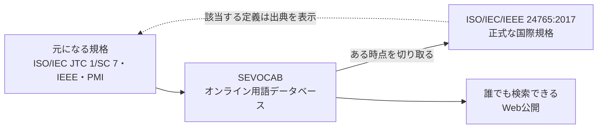

**ポイント**：24765は、原則として「新しい定義を発明する規格」ではありません。既存の規格にすでにある定義を集め、整理して、一冊にまとめた**ハブ（中継地点）**です。ただし例外として、既存の定義が不完全・不明確・不整合な場合には、**新規の定義、改訂した定義、複数の定義を組み合わせた複合定義**も作成されます。これらは必ずしも元の規格に由来しないため、出典が表示されないことがあります。

---

## Step 1：なぜ「用語集」が規格になっているのか

### 1-1. 用語がずれると何が起きるか

同じ「テスト」「欠陥」「要求」という言葉でも、人によって意味が違うことがあります。

| 場面 | 用語のずれによる問題 |
|---|---|
| 要求定義 | 顧客と開発者で「完了」の意味が違い、手戻りが発生する |
| テスト | 「バグ」「欠陥」「障害」を混ぜて使い、報告書の解釈が割れる |
| 契約・調達 | 仕様書の用語が曖昧で、検収時に揉める |
| 国際開発 | 国や会社ごとの「方言」で議論が噛み合わない |

### 1-2. 規格が果たす役割

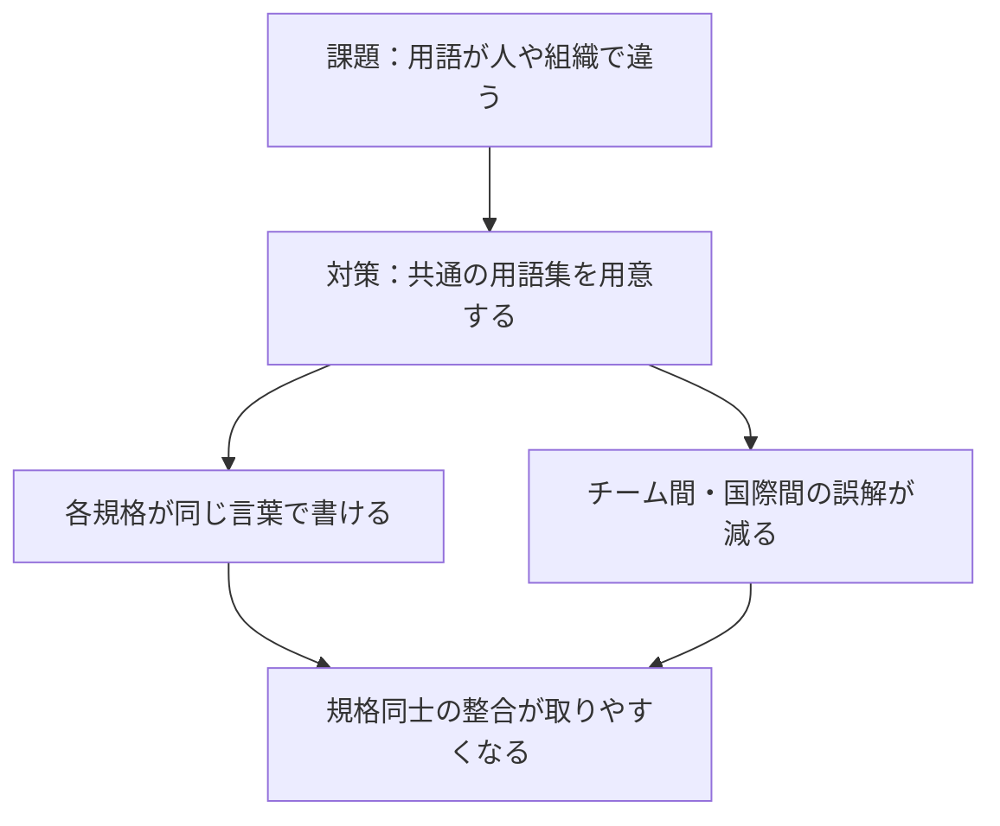

規格の趣旨は、情報技術分野の参照先として使われること、そしてISO・IEEE Computer Society・PMI が作成した他の規格の利用を促すことにあります（出典：ISO公式ページ）。

---

## Step 2：基本情報を押さえる

| 項目 | 内容 |
|---|---|
| 規格番号 | ISO/IEC/IEEE 24765:2017 |
| 英語タイトル | Systems and software engineering — Vocabulary |
| 版 | 第2版（Edition 2） |
| 発行 | 2017年9月 |
| ページ数（ISO表記） | 522ページ（販売元により530〜554ページ等の表記差あり） |
| 担当委員会 | ISO/IEC JTC 1/SC 7（ソフトウェア及びシステムエンジニアリング） |
| ICS分類 | 35.080（ソフトウェア）／01.040.35（情報技術の用語） |
| 現在のステータス | 発行済み。2026年9月20日に確認（ステージ 90.93） |
| 前の版 | 24765:2010（第1版、撤回済み） |

> 💡 **ページ数の表記が違う理由**：ISO、IEEE、各国の規格販売元でレイアウトや前付けの扱いが違うためです。内容の違いではありません。学習上は「500ページ超の大部の辞書」と理解すれば十分です。

---

## Step 3：誰が作り、誰が維持しているのか

### 3-1. 関係する組織

| 組織 | 役割 |
|---|---|
| ISO/IEC JTC 1/SC 7 | 規格の作成を担う国際委員会。用語の検証は WG 22（用語検証）が担当 |
| IEEE Computer Society | ISO/IEC JTC 1/SC 7 の Vocabulary Validation Team と協力して SEVOCAB データベースを維持。IEEE 側の規格も担当 |
| PMI | プロジェクトマネジメント用語集（Glossary）の定義を提供。規格内に利用許諾付きで収録 |

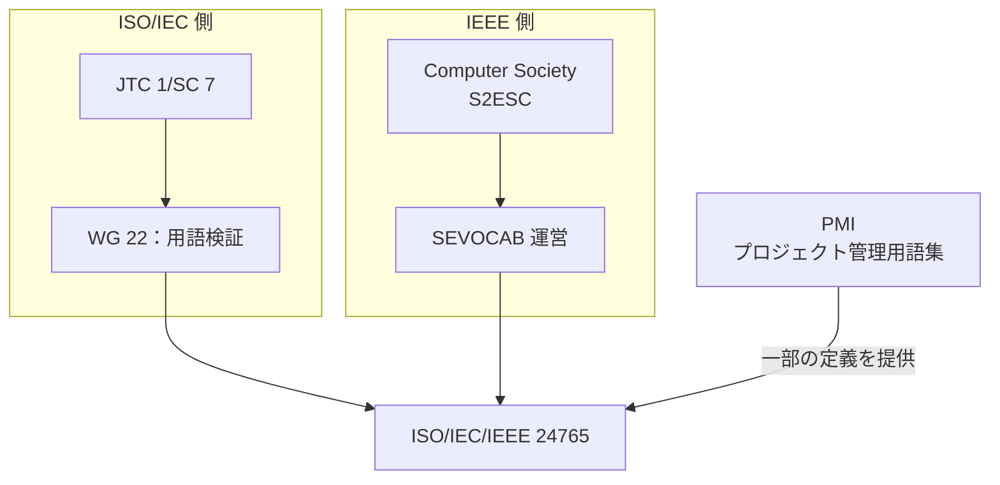

### 3-2. 土台になった規格

SEVOCABの説明によれば、この用語集の**主たる元資料（基盤文書）**は、IEEE Std 610.12-1990（ソフトウェア工学用語の標準用語集）です。つまり、現在の24765は30年以上の歴史を持つ用語整備の流れの上にあります。

---

## Step 4：規格の構成（章立て）

販売元の目次情報から確認できる構成は次のとおりです。

| 区分 | 内容 |
|---|---|
| Preface / Foreword / Introduction | 前付け。作成の経緯と目的 |
| 1 Scope | 適用範囲 |
| 1.1 General | 一般事項 |
| 1.2 Relationship of the print and internet-accessible versions | 印刷版（規格）とインターネット版（SEVOCAB）の関係 |
| 1.3 Vocabulary structure | 用語集の構造（並び順、出典の書き方など） |
| 1.4 PMI Glossary provisions | PMI用語集の扱い |
| 2 Normative references | 引用規格 |
| 3 Terms, definitions, and abbreviated terms | **本体：用語・定義・略語（アルファベット順）** |
| Annex A | 参考文献の一覧（出典リスト） |
| Bibliography | 参考文献 |

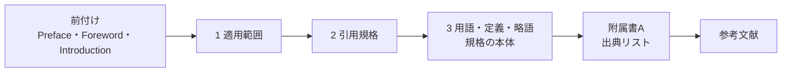

**学習のコツ**：ページの大半は第3章です。最初から通読するのではなく、**第1章（読み方のルール）だけ読み、あとは辞書として引く**のが正しい使い方です。

---

## Step 5：用語エントリの読み方

### 5-1. エントリの基本形

規格のサンプルページから、エントリには次の要素が現れることが確認できます。見出し語と定義が基本で、出典・注記・参照は**該当する場合にだけ**記載されます。

| 要素 | 意味 | 読み方のポイント |
|---|---|---|
| 見出し語 | 調べる用語 | アルファベット順に並ぶ |
| 番号付き定義 | 1つの用語に複数の定義がある場合は番号で並ぶ | 文脈に合う番号を選ぶ |
| 出典（角括弧）※該当する場合 | その定義が元々載っている規格名 | 表示されない定義もある。表示があれば元の規格で詳細を確認する |
| 注記（Note to entry）※該当する場合 | 定義への補足説明 | 例外や使い方のヒントが書かれる |
| 参照（cf.）※該当する場合 | 関連する用語への誘導 | 近い概念を横断的に学べる |

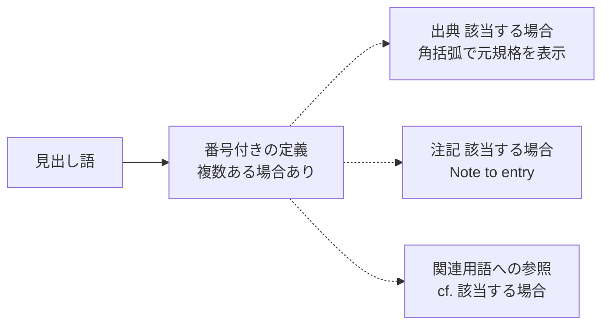

### 5-2. 最重要の考え方：1つの用語に複数の定義がある

この辞書は「1語1定義」ではありません。**規格ごとに微妙に違う定義を、出典付きで併記**しています。

| よくある疑問 | 答え |
|---|---|
| どの定義が正しい？ | 全部「その出典規格の中では」正しい。**自分の文脈で採用している規格**の定義を選ぶ |
| 定義が矛盾して見える | 適用範囲が違うだけのことが多い。出典を見て文脈を確認する |
| 注意点 | 規格本文は「一般的な用途に合う定義」を選んでいる。特定領域では、より具体的な定義が必要になる場合がある |

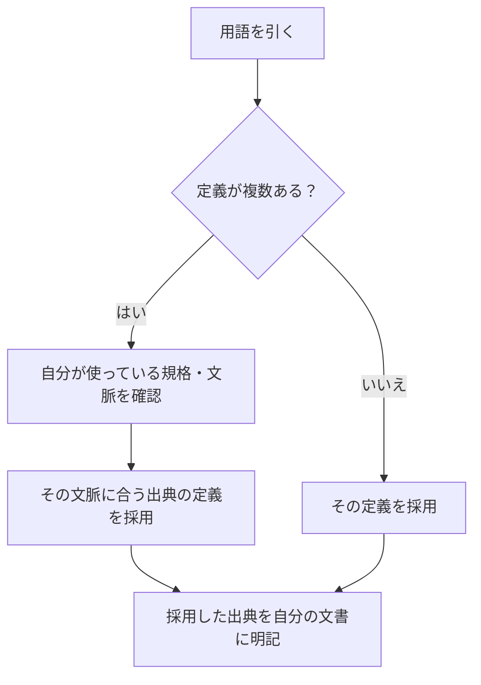

---

## Step 6：どんな用語が入り、どんな用語が入らないのか

第1章（Scope）には、収録しない用語の基準が示されています（要約）。

| 除外される用語 | 具体的な考え方 |
|---|---|
| 特定の団体だけで通用する用語 | 一部の組織に限られた言い回し |
| 企業の独自用語・商標 | 会社固有の名称や登録商標 |
| 構成語から意味が推測できる複合語 | 単語を足せば意味がわかる用語 |
| 一般的な英語の意味から推測できるIT用語 | 辞書的な意味で十分なもの |

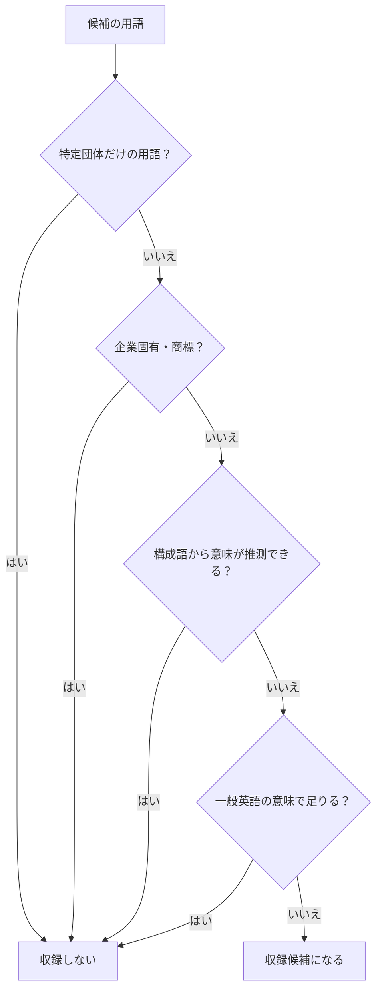

> 💡 **学習上の意味**：この辞書に載っている言葉は「業界横断で共通理解を固める価値がある用語」だと言えます。逆に、載っていない言葉は**自社や自チームで別途定義する**必要があります。

---

## Step 7：SEVOCABを使って調べる

### 7-1. SEVOCABとは

SEVOCABは、規格24765の元になっているオンラインのデータベースです。ISO/IEC JTC 1/SC 7 の Vocabulary Validation Team と IEEE Computer Society が協力して維持し、一般公開されています。規格は、このデータベースの「スナップショット（ある時点の写し）」として定期的に発行されます。

| 項目 | 内容 |
|---|---|
| 検索の入口 | https://pascal.computer.org/ および https://www.computer.org/sevocab |
| 検索の対象 | 用語、または特定の出典規格に含まれる全定義 |
| 検索結果 | その用語の定義に加え、**その用語を使っている他の定義**も表示される |
| 最小文字数 | 3文字以上（2文字の略語は検索できない） |
| 並び順 | アルファベット順 |

### 7-2. 調べ方のステップ

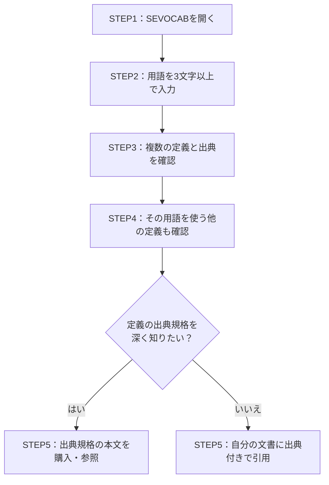

### 7-3. 印刷版（規格）とWeb版（SEVOCAB）の違い

| 観点 | 規格（PDF・冊子） | SEVOCAB（Web） |
|---|---|---|
| 位置づけ | 正式に発行された国際規格 | 継続的に更新される元データベース |
| 更新 | 版ごと（次の改訂まで固定） | 管理された手順で随時更新 |
| 引用に向くか | 契約・正式文書で引用しやすい | 日常の確認・最新の見え方の把握に向く |
| 入手 | 有料（販売元により価格差あり） | 検索機能は公開 |

> ⚠️ **注意**：「規格に書かれている内容」と「SEVOCABに今表示される内容」は、時間が経つと差が出ることがあります。**契約書や監査対応では、版（24765:2017）を明記**して引用してください。

---

## Step 8：版の履歴と最新状況（2026年10月時点）

### 8-1. 時系列

| 日付 | 出来事 | 出典 |
|---|---|---|
| 2010年12月 | 初版 ISO/IEC/IEEE 24765:2010 発行（410ページ）。のち撤回 | ISO公式（50518） |
| 2017年9月 | 第2版 24765:2017 発行 | ISO公式（71952） |
| 2024年6月28日 | オーストラリア・ニュージーランドが 2017版を同一採用（AS/NZS 24765:2024） | Standards Australia |
| 2024年12月11日 | IEEE側で改訂企画（P24765）のPAR承認 | IEEE SA |
| 2025年9月19日 | ISO側で第3版の新規プロジェクト承認 | ISO公式（92875） |
| 2026年1月8日 | CD（委員会原案）がDIS登録に承認 | ISO公式（92875） |
| 2026年9月20日 | 改訂プロジェクトが**中止**（ステージ 30.98） | ISO公式（92875） |
| 2026年9月20日 | 2017版が**確認**され、引き続き現行（ステージ 90.93） | ISO公式（71952） |

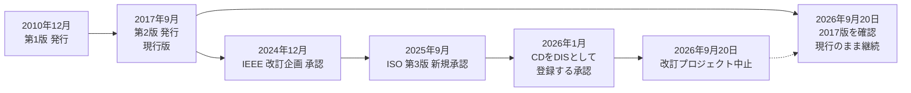

### 8-2. 初学者が押さえるべき結論

| 結論 | 説明 |
|---|---|
| 現行版は2017年版 | 第3版（改訂）は中止され、2017年版が確認された |
| 2010年版は使わない | 撤回済み。古い解説記事が2010年版を参照していることがある |
| 情報源は更新日を確認 | 同じ規格でも、販売サイトによってステージ表記が古い・食い違うことがある |

> ⚠️ **情報の食い違いについて**：調査時点で、第三者サイトには「DIS段階」「FDIS登録承認」といった古い表記が残っていました。また、SEBoK（システムズエンジニアリング知識体系）の個別ページは2010年版を引用しています。**ステージの判断は必ずISO公式ページを基準**にしてください。ISO公式ページの旧版スナップショットでは「2022年に確認」とも表示されており、それが2026年9月の確認で更新された形です。

---

## Step 9：実務での使い方（QA・AI開発の現場）

### 9-1. 使う場面

| 場面 | 24765の活かし方 |
|---|---|
| 用語集（Glossary）作成 | 自社用語を作る前に、24765に該当語があるか確認し、出典付きで流用する |
| テスト計画書・報告書 | 「欠陥」「故障」など、報告書で使う語の意味をチーム内で揃える |
| 要求仕様・契約書 | 重要語を24765の定義に紐づけ、解釈の揺れを防ぐ |
| 国際規格の読み解き | 12207・15288・29119 など、他の規格を読むときの用語確認に使う |
| AIプロジェクト | 新しい用語（エージェント等）と、既存のソフトウェア工学用語を区別して議論する |

### 9-2. 用語整備のワークフロー

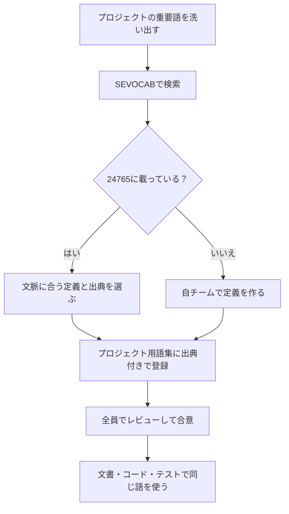

### 9-3. よく使われる用語のイメージ（解説用の意訳）

以下は**学習用の意訳**であり、規格本文の定義ではありません。実際には1つの用語に複数の定義が併記されます。

| 用語 | 学習用のイメージ | 注意点 |
|---|---|---|
| error（エラー） | 人間の誤りや、計算結果と本来の値との差など | 複数の意味で使われるため、定義の併記が特に重要 |
| fault / defect（欠陥） | ソフトウェアの中にある誤り（コード・設計などの不備） | 文書により「欠陥」の使い方が揺れやすい |
| failure（故障・失敗） | 動かしたときに、期待した動作をしない現象 | 欠陥が実行されて表に出た結果、と整理されることが多い |
| verification（検証） | 作ったものが、決めた仕様・要求どおりかを確認すること | validationと混同されやすい |
| validation（妥当性確認） | 作ったものが、実際の利用目的や利用者の要望を満たすかを確認すること | 「正しいものを作ったか」の観点 |

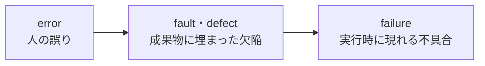

> ⚠️ **重要**：この関係図は「よくある整理の仕方」の一例です。**自分の組織やプロジェクトが採用する規格の定義**に合わせて、SEVOCABで必ず確認してください。

---

## Step 10：著名な開発者の知見から学ぶ「用語」の重要性

24765は規格ですが、「共通の言葉を持つことの価値」は、世界的に著名な開発者たちも繰り返し語っています。

### 10-1. Martin Fowler：Semantic Diffusion（意味の拡散）

| 項目 | 内容 |
|---|---|
| 人物 | Martin Fowler（Thoughtworks のチーフサイエンティスト。『リファクタリング』著者） |
| 概念 | ある人や集団が良い定義とともに作った言葉が、広まるうちに定義が薄れ、元の意味が失われていく現象（2006年に提唱） |
| 24765との関係 | 用語の意味が拡散しないよう、**出典付きの定義を固定して参照できる場所**として24765・SEVOCABが機能する |

### 10-2. Simon Willison：AI時代の実例

Simon Willison は2025年3月、「vibe coding」という言葉が本来の意味（LLMが書いたコードをレビューせずに受け入れる使い方）から離れ、「LLMでコードを書くこと全般」を指すように使われ始めていると指摘しました。そして Fowler の Semantic Diffusion の概念を引いて説明しています。

**AI開発者への示唆**：新しい用語ほど急速に意味がずれます。社内文書や契約でAI関連の用語を使うときは、**定義を明記する**か、24765のような既存の定義済み用語に結びつけることが重要です。

### 10-3. Eric Evans：ユビキタス言語（Ubiquitous Language）

| 項目 | 内容 |
|---|---|
| 人物 | Eric Evans（『ドメイン駆動設計』著者） |
| 概念 | 開発者と利用者（ドメイン専門家）が、**ドメインモデルに基づく厳密な共通言語**を作り、会話・文書・コードで一貫して使う実践 |
| ポイント | ソフトウェアは曖昧さに弱いため、言語は厳密である必要がある。また言語はチームの理解とともに進化する |
| 24765との関係 | 24765は**業界横断**の共通語。ユビキタス言語は**プロジェクト（境界づけられたコンテキスト）内**の共通語。両者は階層が違い、組み合わせて使える |

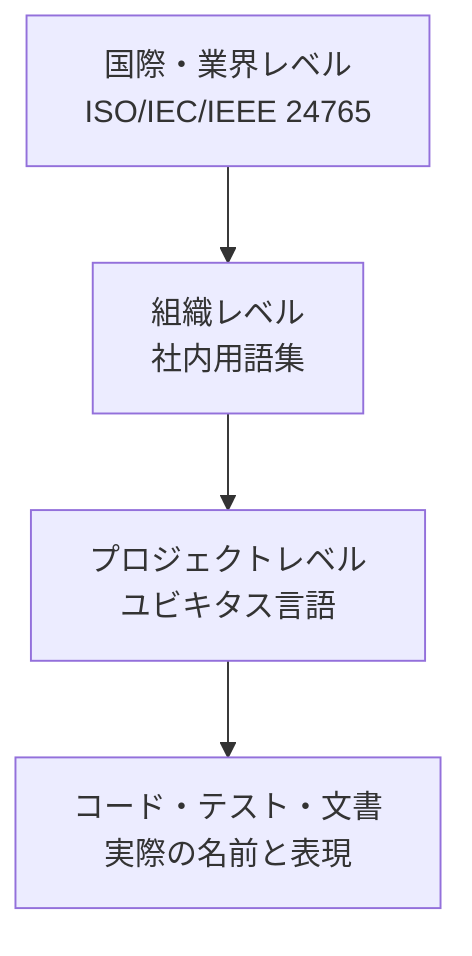

---

## Step 11：よくある誤解

| 誤解 | 正しい理解 |
|---|---|
| 24765に従わないと違反になる | 24765は用語集であり、**適合を求める要求事項はない**。参照して使うもの |
| 1つの用語には1つの定義しかない | 複数の定義が出典付きで併記される。文脈に合うものを選ぶ |
| SEVOCABが最新で、規格は古いから使えない | 規格は**版を固定した引用先**として価値がある。契約・監査では版の明記が有効 |
| 2010年版も使える | 2010年版は撤回済み。2017年版を使う |
| 載っていない用語は間違い | 収録基準により、特定団体・企業固有・推測可能な語は載らない。別途定義すればよい |
| 24765を丸暗記すべき | 辞書として**引く**もの。暗記ではなく、調べ方と出典の読み方を身につける |

---

## Step 12：理解度チェック

| 問い | 答え |
|---|---|
| Q1. 24765の種類は何か | 要求事項ではなく、用語と定義を集めた規格 |
| Q2. 元になっているデータベースの名前は | SEVOCAB（ISO/IEC JTC 1/SC 7 の Vocabulary Validation Team と IEEE Computer Society が協力して維持） |
| Q3. 24765は何の「スナップショット」か | SEVOCABデータベースのある時点の写し |
| Q4. 現行版はいつの版か | 2017年版（第2版）。2026年9月20日に確認された |
| Q5. 1つの用語に複数の定義がある場合どうするか | 自分の文脈に合う出典の定義を選び、出典を明記する |
| Q6. SEVOCABの検索に必要な最小文字数は | 3文字以上 |
| Q7. 第3版の改訂プロジェクトはどうなったか | 2026年9月20日に中止された |
| Q8. 公式のステージ確認はどこで行うか | ISO公式ページ（https://www.iso.org/standard/71952.html） |

---

## まとめ

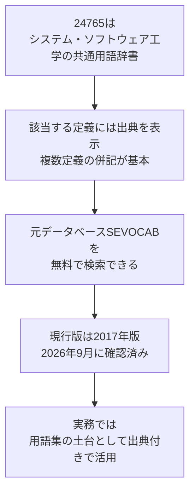

| 覚えておくこと | 内容 |
|---|---|
| 性質 | 要求ではなく「用語の参照先」 |
| 読み方 | 通読せず、辞書として引く。出典と複数定義に注意 |
| 調べ方 | SEVOCAB（3文字以上で検索） |
| 最新状況 | 2017年版が現行。第3版の改訂は中止 |
| 実務への応用 | 用語集・テスト文書・契約書の用語を、出典付きで揃える |

---

## 根拠ソース一覧（URL）

調査日：2026年10月（情報の基準日は10月16日現在）。「種別」は一次情報（規格団体の公式情報）か二次情報かを示します。

### A. 規格団体の公式情報（一次情報）

| No. | 内容 | URL |
|---|---|---|
| 1 | ISO公式：ISO/IEC/IEEE 24765:2017（ステージ 90.93、2026-09-20確認、522ページ、第2版） | https://www.iso.org/standard/71952.html |
| 2 | ISO公式：ISO/IEC/IEEE CD 24765（第3版）。2025-09-19新規承認、2026-01-08 DIS登録承認、2026-09-20中止 | https://www.iso.org/standard/92875.html |
| 3 | ISO公式：ISO/IEC/IEEE 24765:2010（第1版、撤回済み） | https://www.iso.org/standard/50518.html |
| 4 | IEEE SA：P24765（改訂企画、PAR承認 2024-12-11、WG議長 Annette Reilly） | https://standards.ieee.org/ieee/24765/11892/ |
| 5 | IEC Webstore：24765:2017（発行日、委員会情報） | https://webstore.iec.ch/publication/61433 |

### B. SEVOCAB（用語データベース）

| No. | 内容 | URL |
|---|---|---|
| 6 | SEVOCAB 検索画面（IEEE Computer Society & ISO/IEC JTC 1/SC 7） | https://pascal.computer.org/ |
| 7 | SEVOCAB ご利用案内（スナップショット関係、3文字検索、IEEE Std 610.12-1990が基盤文書） | https://pascal.computer.org/sev_display/help.jsp |
| 8 | IEEE Computer Society：SEVOCAB 紹介ページ | https://www.computer.org/sevocab |

### C. 規格本文の抜粋・目次を確認できた販売元・公開資料（二次情報）

| No. | 内容 | URL |
|---|---|---|
| 9 | BSI：適用範囲（1 Scope）、除外基準、印刷版とWeb版の関係 | https://knowledge.bsigroup.com/products/systems-and-software-engineering-vocabulary-1 |
| 10 | en-standard：BS ISO/IEC/IEEE 24765:2017（1.3 用語集の構造、出典、PMI用語集第5版、附属書A） | https://www.en-standard.eu/bs-iso-iec-ieee-24765-2017-systems-and-software-engineering-vocabulary/ |
| 11 | Standards Australia：AS/NZS ISO/IEC/IEEE 24765:2024（2017版の同一採用、目次） | https://store.standards.org.au/product/as-nzs-iso-iec-ieee-24765-2024 |
| 12 | NASA Software Engineering Handbook 掲載のサンプルPDF（エントリ形式：Note to entry、cf. 参照） | https://swehb.nasa.gov/download/attachments/16450104/c071952_ISO_IEC_IEEE_24765_2017.pdf?api=v2 |
| 13 | iTeh Standards：24765:2017 サンプルPDF（序文、構造） | https://cdn.standards.iteh.ai/samples/71952/6289cd982a154c1d8fa0b10b52e0f8a8/ISO-IEC-IEEE-24765-2017.pdf |
| 14 | NASA Standards：IEEE 24765 の位置づけ | https://standards.nasa.gov/node/1719 |
| 15 | SEBoK：システムズエンジニアリング関連規格の全体像（用語の位置づけ。※一部ページは2010年版を引用） | https://sebokwiki.org/wiki/Systems_Engineering_Related_Standards_Landscape |

### D. 著名な開発者の知見（Step 10）

| No. | 内容 | URL |
|---|---|---|
| 16 | Martin Fowler：Semantic Diffusion（意味の拡散） | https://martinfowler.com/bliki/SemanticDiffusion.html |
| 17 | Martin Fowler：Ubiquitous Language（Eric Evansの概念の解説） | https://martinfowler.com/bliki/UbiquitousLanguage.html |
| 18 | Simon Willison：Semantic Diffusion と「vibe coding」の定義のずれ（2025年3月） | https://simonwillison.net/tags/martin-fowler |
| 19 | Eric Evans：Domain-Driven Design パターン要約（ドメイン言語・モデル駆動設計） | https://www.domainlanguage.com/wp-content/uploads/2016/05/PatternSummariesUnderCreativeCommons.doc |
| 20 | Thoughtworks：Martin Fowler の経歴（bliki の位置づけ） | https://www.thoughtworks.com/insights/podcasts/technology-podcasts/martin-fowler-my-thoughtworks-journey |

### E. 情報の食い違いが確認された二次情報（参考・要注意）

| No. | 内容 | URL |
|---|---|---|
| 21 | セルビア規格協会：DIS段階（40.99）表記が残存（ISO公式の最新状況とは異なる） | https://iss.rs/en/project/show/iso:proj:92875 |
| 22 | DIN：改訂プロジェクト登録（2025-09-19） | https://www.din.de/en/wdc-proj:din21:395840411 |

---

> 本ガイドは学習用の解説であり、規格の代替ではありません。契約・監査・認証などで用いる場合は、規格原本（ISO/IEC/IEEE 24765:2017）を購入・参照し、版を明記してください。
> ステージ情報は変わり得ます。最新状況は ISO公式ページ（https://www.iso.org/standard/71952.html）で確認してください。
