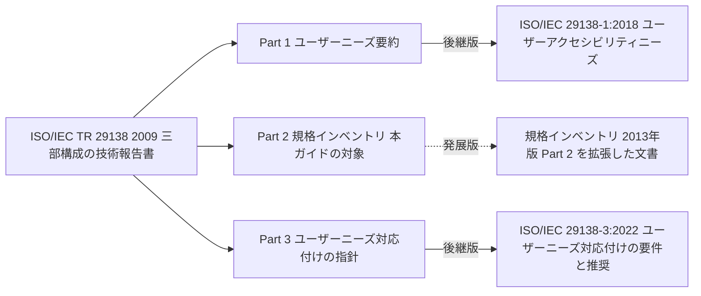
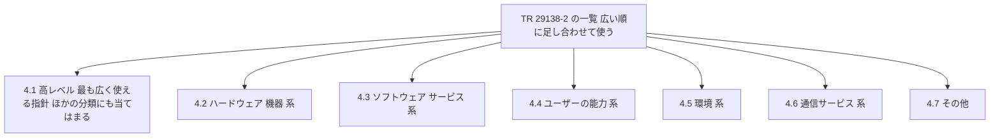
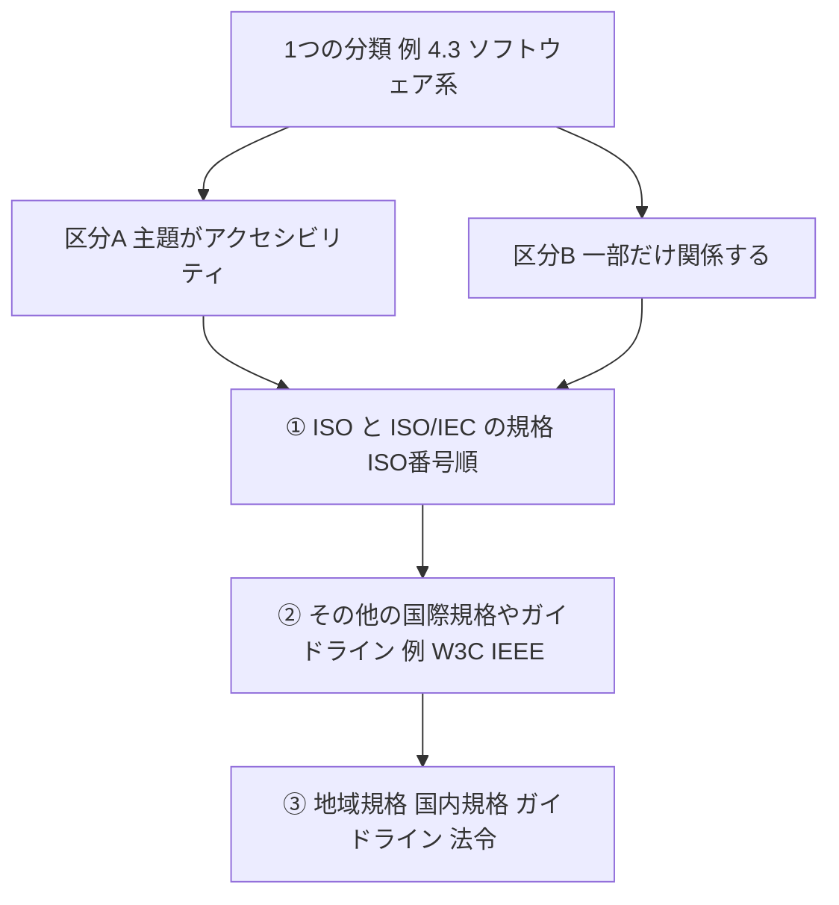
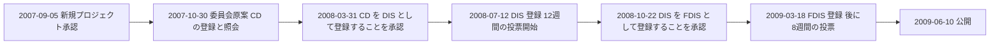
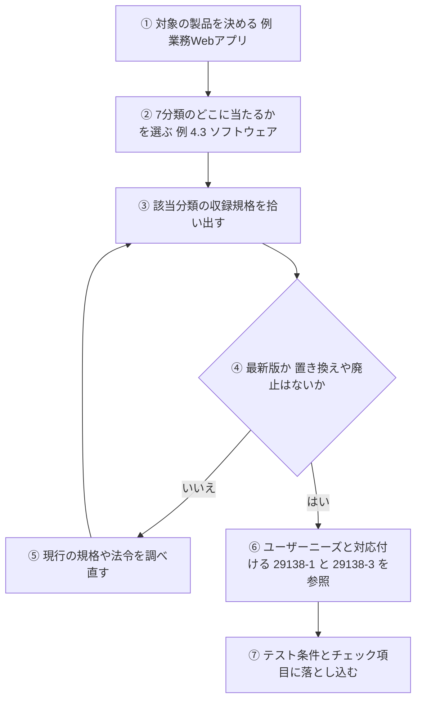

# ISO/IEC TR 29138-2:2009 初学者向けステップバイステップ解説ガイド

> **対象規格**：ISO/IEC TR 29138-2:2009 「Information technology — Accessibility considerations for people with disabilities — Part 2: Standards inventory」
> **情報の時点**：2026年10月13日
> **想定読者**：アクセシビリティ規格を初めて学ぶソフトウェアエンジニア・QAエンジニア
> **公式ページ**：https://www.iso.org/standard/51341.html
> **読む前の注意**：この規格の全文は有償で、今回読めたのは公式ページ、無料サンプルの範囲（前付け、第1〜3章、第4章の前半）、各機関の公開情報です。読めていない部分は「確認できていない」と明記します。

---

## 目次

1. [Step 0：3分で分かる結論](#step-0)
2. [Step 1：この規格を一言でいうと](#step-1)
3. [Step 2：なぜこの規格が作られたのか](#step-2)
4. [Step 3：規格ファミリー全体での位置づけ](#step-3)
5. [Step 4：最初に押さえる3つの用語](#step-4)
6. [Step 5：中心となる「7つの分類」](#step-5)
7. [Step 6：収録されている規格の実例](#step-6)
8. [Step 7：作成の経緯（2007〜2009年）](#step-7)
9. [Step 8：2009年の一覧と現在の姿](#step-8)
10. [Step 9：実務での使い方（QA・開発向け）](#step-9)
11. [Step 10：よくある誤解](#step-10)
12. [Step 11：理解度チェック](#step-11)
13. [Step 12：根拠となるソースURL](#step-12)

---

<a id="step-0"></a>

## Step 0：3分で分かる結論

💡 この章では、規格の全体像を先に3点で示します。細かい説明を読む前に結論を知っておくと、後の章の位置づけが分かりやすくなります。

**この規格は、図書館の「蔵書目録」のようなものです。** 本の中身（技術的な要求事項）は書かれておらず、「どの棚（分類）に、どんな本（規格）があるか」が書かれています。

| # | 結論 | 根拠となる確認事項 |
|---|------|------------------|
| ① | 要求事項を定める規格ではなく、障害のある人のニーズに応える指針となる文書を一覧にした技術報告書（TR）である | ISO公式ページの要旨、序文のタイプ3の説明 |
| ② | 一覧は「7つの分類」で整理され、各分類はさらに2つの区分に分かれる | 目次と第3章 |
| ③ | 2009年時点の一覧なので、掲載された規格の状況は今では変わっている。使う前に最新状況の確認が要る | 発行年と、現在の各規格の状況（Step 8） |

📖 このセクションで登場した用語
- 技術報告書（TR）：ISO/IEC が出す文書の種類の1つ。国際規格（IS）と違い、情報の整理や現状のまとめを目的にすることがある
- インベントリ：一覧表・棚卸しのこと。ここでは「規格の一覧」を指す

---

<a id="step-1"></a>

## Step 1：この規格を一言でいうと

💡 この章では、規格の基本情報を表で確認します。後で「どの機関が、いつ、どんな種類の文書として出したか」を確かめるときの基準になります。

**一言要約**：ICT（情報通信技術）のアクセシビリティ（＝障害や加齢で能力が制限されていても使えること）に関して、参考にできる文書を集めて分類した一覧表です。

| 項目 | 内容 |
|------|------|
| 正式名称 | Information technology — Accessibility considerations for people with disabilities — Part 2: Standards inventory |
| 日本語題名（本ガイドの意訳） | 情報技術 — 障害のある人々のためのアクセシビリティ配慮 — 第2部：規格インベントリ（公式和訳ではありません） |
| 種別 | Technical Report（技術報告書）のタイプ3 |
| 版・発行 | 第1版、2009年6月（ISOページのステージ履歴では 2009-06-10 に公開） |
| ページ数 | 43ページ |
| 管理委員会 | ISO/IEC JTC 1/SC 35（User interfaces） |
| ICS（国際規格分類） | 11.180.99、35.240.80（iTeh の登録情報では 35.020 も表示） |
| ISOページ上の状態 | Published（公開済み、ステージ 60.60） |
| 主な読者 | 規格の作成者。ほかにIT製品・サービスの開発者、政策担当者、調達担当者、アクセシビリティの推進者にも役立つとされる |

### 「タイプ3」とは何か

序文では、TRの種類が3つ説明されています。タイプ3は「JTC 1 が、通常の国際規格として出す種類とは別の性質のデータ（例：現状の技術水準）を集めた場合」に使います。タイプ1・2のように3年以内の見直しで国際規格へ変えるかを検討する義務はなく、データが古くなって役に立たないと判断されるまで見直しが必須ではありません。

つまり、この文書は「守るべき基準」ではなく「調べるための資料集」です。

📖 このセクションで登場した用語
- ICT：情報通信技術。PC、スマートフォン、Webサービス、通信機器などを含む
- アクセシビリティ：年齢・障害・環境の違いがあっても、製品やサービスを使えること
- ICS：ISOが規格を分野ごとに分類するための番号体系

---

<a id="step-2"></a>

## Step 2：なぜこの規格が作られたのか

💡 この章では、序文に書かれた背景を説明します。「なぜ一覧が必要か」が分かると、7つの分類の意味が理解しやすくなります。

### 例え話：地図のない巨大な商店街

アクセシビリティの規格は、ISO、IEC、ITU、各国・各地域の標準化機関、さらに業界団体（コンソーシアム）や利用者団体からも出ています。巨大な商店街に店が散らばっていて、案内図がない状態です。初めて来た人は、どの店に何があるか分かりません。この規格は、その案内図の役割をします。

### 序文の要点（言い換え）

- ICTのアクセシビリティ標準化は大きな取り組みで、世界・地域・各国の関係者が関わる
- 製品・サービスは増え続けているのに、今のICT機器やサービスは必ずしも使いやすくない
- 特に影響を受けるのは、障害のある人と、加齢で能力が下がった人。ただし、PCの操作で困るのはこの人たちだけではない
- アクセシビリティを改善すると、特別なニーズのある人だけでなく、全ての利用者に利益がある
- 個人によって必要なものが違い、複数の障害がある人は特に固有のニーズを持つ。1つの規格で全てをカバーするのは難しい

最後の点が重要です。**1つの規格では足りない**から、複数の規格を組み合わせる前提になり、その組み合わせの出発点として一覧が必要になりました。

📖 このセクションで登場した用語
- コンソーシアム：企業などが集まって技術仕様を作る団体。W3C や IEEE のように、ISOとは別の仕組みで標準を作る組織
- 複数の障害（重複障害）：1人が複数の障害を併せ持つこと

---

<a id="step-3"></a>

## Step 3：規格ファミリー全体での位置づけ

💡 この章では、TR 29138 が3部構成であることと、関連規格との関係を説明します。Part 2 だけを読んでも全体像が見えないため、先に家系図を確認します。

### 3部構成

序文によると、ISO/IEC TR 29138 は次の3部で構成されています。

| Part | 題名（原題） | 2009年版の内容 |
|------|------------|--------------|
| Part 1 | User needs summary | 障害のある人のユーザーニーズの要約 |
| **Part 2** | **Standards inventory** | **本ガイドの対象。規格の一覧** |
| Part 3 | Guidance on user needs mapping | ユーザーニーズを規格の条項に対応付ける指針 |

### 家系図

この図は、2009年の3部構成と、その後の関連文書の関係を表しています。左から右へ読み進めてください。実線は後継関係、点線は発展的な文書です。



各ノードの意味：
- 「ISO/IEC TR 29138 2009」：3部をまとめた総称。2009年6月に3部とも公開された
- 「Part 1」：ISOの管理ページでは、2009年版は Withdrawn（廃止）になっている
- 「Part 3」：同じく2009年版は廃止。2022年版が国際規格（IS）として出ている
- 「Part 2」：ISOページでは今も Published。2013年に発展版の一覧が出たという情報がある（出典はWikipedia。二次情報）
- 実線の矢印：新版が旧版の位置づけを引き継いでいる関係。題名と範囲の対応から読み取れる範囲の記述です

### 現在の状況（2026年10月13日時点で確認できた範囲）

| 文書 | 状況 | 確認元 |
|------|------|--------|
| TR 29138-1:2009 | Withdrawn（廃止） | ISO公式ページ |
| ISO/IEC 29138-1:2018 | Published。2024年に見直されて現行のまま確認された | ISO公式ページ |
| TR 29138-2:2009 | Published（本ガイドの対象） | ISO公式ページ |
| TR 29138-3:2009 | Withdrawn（廃止） | ISO公式ページ（committee.iso.org） |
| ISO/IEC 29138-3:2022 | Published | ISO公式ページ（committee.iso.org） |
| Part 2 を引き継ぐ国際規格（IS） | 今回の検索では確認できなかった | — |

最後の行は「無い」と断定する意味ではありません。今回の検索範囲では見つからなかった、という意味です。

### 関連：ISO/IEC Guide 71

要旨には、**ISO/IEC Guide 71**（規格作成者向けに、高齢者・障害のある人への配慮の方法を示すガイド）との関係が出てきます。このガイドは2014年に改訂され、現在の題名は「Guide for addressing accessibility in standards」です。2014年版はISO、IEC、ITU の共同声明とともに公表され、ITU-T SG16 も採択したと報じられています。

📖 このセクションで登場した用語
- Withdrawn：廃止。新しい版に置き換えられたり、不要になったりして取り下げられた状態
- IS（International Standard）：国際規格。TR とは別の種類
- ISO/IEC Guide 71：規格を作る人が、アクセシビリティを規格に盛り込むための手引き

---

<a id="step-4"></a>

## Step 4：最初に押さえる3つの用語

💡 この章では、第2章（Terms and definitions）の3つの定義を説明します。この3語は、後で「どこまでが対象か」を判断する基準になります。

### 3つの定義（言い換え）

| 用語 | この規格での意味 | 初学者向け補足 |
|------|---------------|-------------|
| standard（規格） | 具体的な指針を含む、識別できる文書。ISO・ISO/IEC の規格、技術報告書、公開仕様（PAS）に加え、同様の役割を持つ他組織の文書も含む | 普通の「規格」より広い。W3Cの勧告や国内法令に近い文書も入る |
| user（利用者） | 製品、サービス、環境と関わる人 | Guide 71 の定義を借りた言葉 |
| user accessibility need（ユーザーアクセシビリティニーズ） | 環境、けが、障害、加齢による衰えなどで能力が下がった利用者にとって、使いやすさを高めるために製品や利用環境が満たすべき要件 | 注意：全てのニーズを満たせるとは限らない（原文の注記） |

### ここが重要：「standard」の範囲が広い

通常「規格」と聞くと、ISOやJISを思い浮かべます。しかしこの規格は、**一覧に載せる対象を広く取っています**。そのため、一覧には各国の法律（例：米国のSection 508）や、各国のガイドラインも並びます（Step 6で例を示します）。

📖 このセクションで登場した用語
- PAS（公開仕様）：ISOが規格に準じる文書として公開するもの
- ニーズ：ここでは「あると助かる」ではなく、使えるかどうかを左右する要件を指す

---

<a id="step-5"></a>

## Step 5：中心となる「7つの分類」

💡 この章では、この規格の中心である第3章と第4章の構造を説明します。ここを理解すれば、規格全体の骨格が分かります。

### 5.1 分類の考え方：「広さ」で並べる

第3章によると、一覧は「どれだけ広く適用できるか」で分類されています。分類は重ならない箱ではなく、**足し合わせて詳しい指針にしていく層**として設計されています。

**例え話：商店街の案内図**
最初に「商店街全体の案内（高レベル）」を見て、次に「食品街（ハードウェア）」「衣料街（ソフトウェア）」と絞り込む使い方に近いです。

この図は、7つの分類の関係を表しています。上から下へ読み進めてください。



各ノードの意味：
- 「4.1 高レベル」：全体に通じる総合的な指針や設計の指針。複数分類の内容をまとめたものも含むため、ほかの全分類に属するとも見なせる（原文の注記）
- 「4.2〜4.7」：対象を絞った分類。次の表で詳しく説明する

### 5.2 7分類の一覧表

| 条項 | 分類 | 何に適用されるか（第3章の説明を言い換え） | 本編のページ |
|------|------|-----------------------------------|-----------|
| 4.1 | 高レベル（High-level） | 最も一般的な指針。総合的な指針、設計の指針を含む | p.3〜 |
| 4.2 | ハードウェア・機器系 | 全種類のコンピューターハードウェアと、家電、通信機器、特殊環境用機器などの関連機器 | p.7〜 |
| 4.3 | ソフトウェア・サービス系 | ハードウェアや組み込み制御の機器を動かすソフトウェア | p.15〜 |
| 4.4 | ユーザーの能力系 | コンピューターや環境の種類に関係なく、人の特性に着目した指針 | p.21〜 |
| 4.5 | 環境系 | 公共のアクセスシステム、コントロールセンター、遠隔・モバイル利用など、特定環境向けの機器や設計要素 | p.25〜 |
| 4.6 | 通信サービス系 | 通信プロトコル、電話や TV に関する規制など、通信の機能 | p.29〜 |
| 4.7 | その他 | 梱包などの問題 | p.37〜 |

補足：ハードウェア系（4.2）には通信機器が含まれますが、通信「サービス」は 4.6 に入ります。この棲み分けは原文の注記で示されています。

### 5.3 各分類の中は「2つの区分」に分かれる

どの分類も、次の2つの区分に分かれています。

| 区分 | 意味 | 例え話 |
|------|------|-------|
| 主題がアクセシビリティ（focused on accessibility） | 文書の主題が、障害のある人や高齢者への配慮そのもの | 「バリアフリー専門書」の棚 |
| 一部だけ関係する（partly related to accessibility） | 一般的な設計やエルゴノミクスの文書で、アクセシビリティにも関わる部分がある | 「一般の設計書だが、一章がバリアフリー」の棚 |

序文の考え方として、「優れた一般設計は、優れたアクセシブルデザインの前提」とされています。そのため、アクセシビリティが主題でない文書も一覧に入っています。

### 5.4 並び順のルール

この図は、各区分の中の並び方を表しています。上から下へ読み進めてください。



各ノードの意味：
- 「区分A」「区分B」：どちらの区分でも同じ並び順を使う
- ①：ISO と ISO/IEC の規格が最初で、ISO番号の順
- ②：国際的だが ISO とは別の組織の文書（原文の例は W3C と IEEE）
- ③：地域（例：欧州）や各国の規格、ガイドライン、法令

### 5.5 表の読み方

第4章の一覧表は、列が「規格番号」「題名」「組織」「状況」「入手先URL」の5つです。「状況」は**2009年当時**の状況（例：IS published 2008、under development、FDIS published 2007）です。

📖 このセクションで登場した用語
- エルゴノミクス（人間工学）：人が使いやすいように機器や環境を設計する学問分野
- FDIS：最終国際規格案。国際規格になる直前の段階
- 組み込み制御：機器の中に埋め込まれたコンピューターによる制御
- 勧告：W3Cが出す仕様書の正式な形式（W3C Recommendation）

---

<a id="step-6"></a>

## Step 6：収録されている規格の実例

💡 この章では、無料サンプルで確認できた 4.1〜4.3 の「主題がアクセシビリティ」区分から代表例を示します。一覧の「中身の雰囲気」をつかむための章です。

**確認範囲の限界**：4.3.1 の途中までしか確認できていません。4.4 以降と 4.1〜4.3 の「一部だけ関係する」区分は、個別の規格名を挙げず、分類の説明にとどめます。以下の状況欄は**2009年当時の記載**です。

### 6.1 高レベル（4.1.1）

| 規格 | 内容（要約） | 2009年当時の状況 |
|------|-----------|--------------|
| ISO Guide 71 | 規格作成者向けの、高齢者・障害のある人への配慮の指針 | 2001年版が公開済み（現在は2014年版、Step 3参照） |
| ISO 9241-20 | ICT機器・サービスのアクセシビリティ指針（人間工学） | IS、2008年 |
| ISO/TR 22411 | Guide 71 を製品・サービスの規格に適用するための人間工学データと指針 | TR、2008年。当時は再開発中と記載 |
| ISO/IEC 24756 | 利用者・システム・環境のニーズと能力を共通の形式で記述する枠組み（CAP） | 開発中、FDIS 2007年 |
| BS 7000-6 | インクルーシブデザインの管理（英国） | 2005年 |
| CWA 14661 | ICT製品・サービスの標準化担当者向け指針（欧州CEN） | 2003年 |
| JIS X 8341-1 | 高齢者・障害のある人向けの情報通信機器・ソフトウェア・サービスの共通指針（日本） | 2004年 |
| JIS Z 8071 | 規格作成者向けの高齢者・障害のある人への配慮の指針（日本） | 2003年 |
| Section 508 | 米国リハビリテーション法の連邦法 | 1998年。当時は改定中と記載 |

### 6.2 ハードウェア・機器系（4.2.1）

| 規格 | 内容（要約） | 2009年当時の状況 |
|------|-----------|--------------|
| ISO/IEC 10779 | オフィス機器のアクセシビリティ指針 | IS、2008年 |
| ISO/IEC 29136 | PCのアクセシビリティ機能 | 新規作業項目、2007年 |
| ISO/IEC 13066 | 支援技術との相互運用性 | 新規作業項目、2008年 |
| JIS S 0011〜0014 | 消費者製品の触覚点表示、使いやすさ、報知音（日本） | 2000〜2003年 |
| JIS X 8341-2 / -4 / -5 | 情報処理機器、通信機器、事務機器の指針（日本） | 2004〜2006年 |
| ANSI C63.19 | 無線通信機器と補聴器の適合性の測定方法（米国） | 2007年 |

### 6.3 ソフトウェア・サービス系（4.3.1）

| 規格 | 内容（要約） | 2009年当時の状況 |
|------|-----------|--------------|
| ISO 9241-171 | ソフトウェアのアクセシビリティの指針 | IS、2008年 |
| ISO/TS 16071 | 人とコンピューターのインタフェースのアクセシビリティ指針 | TS、2003年。9241-171 に置き換えられると記載 |
| ISO 9241-129 | 個人に合わせた設定（個別化）の指針 | 開発中、CD 2008年 |
| ISO/IEC TR 19765 / 19766 | アクセスしやすいアイコン・記号の調査とデザイン指針 | TR、2007年 |
| ISO/IEC 24786-1 | アクセシビリティ設定のためのアクセシブルなUI | 開発中、FCD 2007年 |
| ATAG 1.0 | オーサリングツール（Webページ作成ツール）のアクセシビリティ指針 | W3C WAI、2000年 |

### 6.4 この実例から分かること

- ISO規格、W3Cの文書、各国のJIS・法令が**同じ表に並ぶ**。一覧の目的が「出どころを問わず探せるようにすること」だと分かる
- 日本の読者には JIS X 8341 シリーズ、JIS S 0011〜0014、JIS Z 8071 が入っていることが参考になる
- 2009年時点の「開発中」の規格は、現在どうなっているかを各自が確認する必要がある

📖 このセクションで登場した用語
- 支援技術（AT）：スクリーンリーダー（画面読み上げ）や点字ディスプレイなど、障害のある人の利用を助ける技術
- CAP（Common Access Profile）：人の能力、システム、環境を共通の形式で記述する枠組み
- TS：技術仕様書。TRと同じく、国際規格とは別の種類
- オーサリングツール：Webページや文書を作る道具（CMSやWebエディタなど）

---

<a id="step-7"></a>

## Step 7：作成の経緯（2007〜2009年）

💡 この章では、ISOページに記録されたステージ履歴をもとに、規格が完成するまでの流れを説明します。国際規格や技術報告書が、投票を経て作られる仕組みの例として読めます。

この図は、新規プロジェクトの承認から公開までの流れを表しています。左から右へ読み進めてください。



各ノードの意味：
- 「CD」「DIS」「FDIS」：文書の完成度が上がるごとの名前。投票や意見募集を経て次へ進む
- 「2008-10-22」：DISの投票の結果が各国に配布され、次の段階へ進むことが承認された日
- 「2009-06-10」：公開（ステージ 60.60）に到達した日

### 作業部会の移り変わり

| 時期 | 出来事 | 出典 |
|------|-------|------|
| 2007年4月 | JTC 1 の特別作業部会（SWG-A、アクセシビリティ担当）が、3部を1つのタイプ3 TRとして進めることに合意 | JTC 1 履歴ページ |
| 2010年1月 | 第11回SWG-A会合で、Part 1 と Part 2 の更新計画が始まる | JTC 1 履歴ページ |
| のち | SWG-A は解散し、作業はSC 35（User interfaces）へ移った | 欧州委員会 Rolling Plan |

📖 このセクションで登場した用語
- CD / DIS / FDIS：ISO/IEC で文書が国際規格になるまでの段階（委員会原案、国際規格案、最終国際規格案）
- SWG-A：JTC 1 の特別作業部会。アクセシビリティを担当した
- JTC 1：ISOとIECが共同で設置した、情報技術分野の合同技術委員会

---

<a id="step-8"></a>

## Step 8：2009年の一覧と現在の姿

💡 この章では、「2009年の一覧が今も使えるか」を、確認できた範囲の最新情報で検証します。Step 5.5 の「状況は2009年時点」という注意を、具体例で理解する章です。

**例え話：10年以上前の電話帳**
住所や番号が変わった店がたくさんあります。一覧が「どこを探せばいいかの手がかり」としては有効でも、番号をそのままかけると別の店につながることがあります。

### 8.1 確認できた変化

| 項目 | 2009年の一覧での姿 | 現在（確認できた範囲） | 出典 |
|------|------------------|-------------------|------|
| Guide 71 | 2001年版 | 2014年版「Guide for addressing accessibility in standards」に更新。2001年版は廃止 | AFNOR、ISOページ、ANSI |
| WCAG（Web Content Accessibility Guidelines） | 一覧の確認範囲では未確認（W3Cの文書はATAG 1.0を確認） | WCAG 2.0 は2012年に ISO/IEC 40500:2012 になった。WCAG 2.2 は2023年10月5日に W3C 勧告になり、2025年に ISO/IEC 40500:2025 として承認された | W3C WAI、Wikipedia |
| WCAG 3.0 | 存在しない | 作業中のドラフトで、2026年9月10日にWorking Draftが更新された | W3C WAI |
| EN 301 549（欧州のICTアクセシビリティ規格） | 存在しない（2014年に初版が出た） | V3.2.1（2021年3月）がWCAG 2.1 AAを取り込む。V4.1.1 は2026年9月にETSIが公開し、第9〜11節の要件がWCAG 2.2 勧告に合わせて更新された。欧州連合官報（OJEU）への引用は別の手続きで、引用されたかは未確認 | ETSI（下記注） |
| 欧州アクセシビリティ法（EAA） | 存在しない | 2025年6月28日から適用開始 | 複数の二次情報 |

注：EN 301 549 V4.1.1 は、ETSI の配布ページで 2026年9月版（V4.1.1 (2026-09)）として公開されています。ETSI による公開と、整合規格としての欧州連合官報（OJEU）への引用は別々の状態です。OJEU への引用は、2026年10月13日時点では一次情報で確認できていません。法的な参照先として使う前に、欧州委員会の公式情報で確認してください。

### 8.2 この表から言えること

| 観点 | 説明 |
|------|------|
| 一覧は「出発点」として使える | 分類の考え方（7分類、2区分）は今も有効 |
| 個別の規格の状況は更新が要る | 版、廃止、後継、法令の改正は2009年以降に起きている |
| 最新の一覧は別にある可能性 | 2013年に発展版の一覧が出たという情報がある（二次情報） |

📖 このセクションで登場した用語
- EAA（European Accessibility Act）：欧州連合（EU）のアクセシビリティ法。製品やサービスのアクセシビリティを求める指令
- EN 301 549：欧州の、ICT製品・サービスのアクセシビリティ要求を定める欧州規格
- 勧告（W3C Recommendation）：W3Cが定める正式な仕様の段階

---

<a id="step-9"></a>

## Step 9：実務での使い方（QA・開発向け）

💡 この章では、この規格を現場で使うときの手順を示します。**ここで示す手順は本ガイドの提案**であり、規格本文が要求しているものではありません。

### 9.1 使い方の流れ

この図は、規格の一覧から実際のテスト条件へたどり着く流れを表しています。上から下へ読み進めてください。



各ノードの意味：
- ①②：対象を決めてから分類に当てる。先に分類を見ると、必要のない規格まで拾ってしまう
- ③：一覧は2009年時点なので、あくまで「手がかり」
- ④（ひし形）：最新の状況を確認する判断。一覧の状況欄は信用せず、必ず調べ直す
- ⑥：ユーザーニーズの記述は 29138-1:2018 を、規格との対応付けの方法は 29138-3:2022 を使う。29138-3:2022 は、対応付けを認証や評価に使うことは意図していないと述べている

### 9.2 分類ごとの、テスト対象の例（本ガイドの提案）

| 分類 | テスト対象の例 | 確認の観点の例 |
|------|-------------|-------------|
| 4.2 ハードウェア | 端末、入力デバイス、周辺機器 | キーボードだけで操作できるか、音や触覚の通知があるか |
| 4.3 ソフトウェア | Webアプリ、モバイルアプリ | スクリーンリーダーで操作できるか、色だけに頼っていないか |
| 4.4 ユーザーの能力 | 利用者像の設定 | ペルソナ（想定利用者像）の能力の幅を考えたか |
| 4.5 環境 | 屋外キオスク、現場端末 | 明るさ、騒音、立ち位置の違いを考えたか |
| 4.6 通信サービス | 通話、チャット、動画配信 | 字幕、テキスト代替の手段があるか |

### 9.3 自社版インベントリの雛形

この雛形は、一覧が古くなる問題を避けるために、**自社で状況を管理する**ための例です。各行に、なぜその項目が必要かを書いています。

```yaml
# 自社プロダクト用「アクセシビリティ規格インベントリ」の雛形
# 理由：TR 29138-2 は 2009 年時点の一覧なので、
#       自社が参照する版と最新状況を、自分たちで管理する必要があるため
product: 社内向け勤怠Webアプリ        # 対象の製品（例）
reviewed_on: 2026-10-13               # 見直した日。古くなったことを検知するため
standards:
  - id: "ISO/IEC 40500:2025"          # WCAG 2.2 に対応する国際規格
    category: software                # 4.3 ソフトウェア・サービス系
    focus: accessibility              # 区分A：主題がアクセシビリティ
    status_checked: true              # 版と状況を確認済みか
  - id: "EN 301 549 V3.2.1"           # 欧州向けに出す場合の参照先
    category: software
    focus: accessibility
    status_checked: false             # V4.1.1 は公開済み。OJEU への引用状況の確認が要る
```

📖 このセクションで登場した用語
- ペルソナ：想定する利用者像。年齢、能力、利用環境などを具体的に描いたもの
- スクリーンリーダー：画面の内容を音声や点字で伝えるソフトウェア
- 区分A：Step 5 で説明した「主題がアクセシビリティ」の区分

---

<a id="step-10"></a>

## Step 10：よくある誤解

💡 この章では、初学者が間違えやすい点を表にまとめます。

| 誤解 | 正しい理解 | 理由 |
|------|----------|------|
| 「この規格に適合すれば認証が取れる」 | 認証の基準ではない | 規格の一覧を示す技術報告書（タイプ3）で、要求事項を定める文書ではないため |
| 「ISO規格だけが載っている」 | W3C、IEEE、各国のJIS、法令も載る | 「standard」を広く定義しているため（Step 4） |
| 「一覧に載っている規格は現行のものだ」 | 状況欄は2009年時点 | 発行後に版の更新、廃止、後継が起きている（Step 8） |
| 「Part 2 を読めばユーザーニーズが全て分かる」 | ユーザーニーズの本体は Part 1 側の内容 | 目次を見ると、本編は規格一覧が中心。要旨の文面が Part 1 と共通のように見えるのは、本ガイドの推測 |
| 「Part 2 が今の最新の一覧だ」 | 発展版の一覧があるという情報がある | 2013年版の存在は二次情報（Wikipedia）で、ISO公式では確認できていない |

📖 このセクションで登場した用語
- 適合：規格の要求事項を満たしていること
- 二次情報：元の資料を読んだ第三者がまとめた情報。確認元として弱いため、一次情報で裏取りが要る

---

<a id="step-11"></a>

## Step 11：理解度チェック

💡 この章では、ここまでの内容を5問で確認します。答えは各問の下にあります。

**Q1.** ISO/IEC TR 29138-2:2009 は、要求事項を定める規格ですか。
- A. いいえ。規格を一覧にした技術報告書（タイプ3）で、調べるための資料集です。

**Q2.** 一覧は、何を基準に7つに分けられていますか。
- A. 適用の「広さ」です。高レベル、ハードウェア、ソフトウェア、ユーザーの能力、環境、通信サービス、その他に分かれ、足し合わせて使う設計です。

**Q3.** 各分類の中の2つの区分は何ですか。
- A. 「主題がアクセシビリティ」と「一部だけ関係する」です。

**Q4.** 一覧の「状況」欄を、そのまま信用してよいですか。
- A. いいえ。2009年時点の記載なので、版の更新や廃止を必ず確認します。

**Q5.** Part 1 と Part 3 の現在の姿は何ですか。
- A. Part 1 は ISO/IEC 29138-1:2018、Part 3 は ISO/IEC 29138-3:2022 として国際規格（IS）が出ています。

📖 このセクションで登場した用語
- 資料集：調べるためのまとめ。守るべき基準とは別の役割

---

<a id="step-12"></a>

## Step 12：根拠となるソースURL

💡 この章では、本ガイドの根拠になった情報源を一覧にします。信頼度を付けたので、使う前に一次情報で確認する場合の参考にしてください。

### 12.1 一次情報（規格団体・標準化機関）

| 根拠にした内容 | URL |
|--------------|-----|
| 規格の基本情報、要旨、ステージ履歴 | https://www.iso.org/standard/51341.html |
| TR 29138-1:2009 が廃止されている状況 | https://www.iso.org/standard/45161.html |
| ISO/IEC 29138-1:2018 の要旨と状況（2024年に確認） | https://www.iso.org/standard/71953.html |
| TR 29138-3:2009 が廃止されている状況 | https://committee.iso.org/es/sites/isoorg/contents/data/standard/05/13/51342.html |
| ISO/IEC 29138-3:2022 の要旨 | https://committee.iso.org/es/sites/isoorg/contents/data/standard/08/07/80765.html |
| Guide 71（2014年版）の範囲 | https://www.iso.org/ru/standard/33987.html |
| JTC 1 SWG-A の履歴（2007〜2010年） | https://jtc1info.org/sd-2-history/special-wgs/swg-1/ |
| SWG-A の作業がSC 35へ移ったこと | https://interoperable-europe.ec.europa.eu/collection/rolling-plan-ict-standardisation/accessibility-ict-products-and-services-0 |
| WCAG 2.2 が ISO/IEC 40500:2025 になったこと | https://www.w3.org/WAI/news/2025-10-21/wcag22-iso |
| EN 301 549 V4.1.1（2026-09）の公開と、第9〜11節のWCAG 2.2への整合 | https://www.etsi.org/deliver/etsi_en/301500_301599/301549/04.01.01_60/ |
| WCAG 3.0 ドラフトの最新状況（2026年9月10日のWorking Draft） | https://www.w3.org/TR/wcag-3.0/ |

### 12.2 規格本文（無料サンプル）に基づく情報

| 根拠にした内容 | URL |
|--------------|-----|
| 目次、前付け、第1〜3章、第4章の前半（第3〜6章の説明の根拠） | https://standards.iteh.ai/catalog/standards/iso/3df196dd-5125-49d9-8710-00432511ed34/iso-iec-tr-29138-2-2009 |
| 同サンプルのPDF（iTeh のページに掲載されているリンク） | https://cdn.standards.iteh.ai/samples/51341/3b7b56fbb36d49f2a9eea455a69b0c69/ISO-IEC-TR-29138-2-2009.pdf |

### 12.3 実務者向け・二次情報

| 根拠にした内容 | URL | 信頼度 |
|--------------|-----|-------|
| Guide 71:2014 の公表と ITU-T SG16 の採択 | https://ansi.org/standards-news/all-news/2014/12/iec-iso-and-itu-publish-international-accessibility-guide-for-standards-development-09 | 中（業界団体の報道） |
| Guide 71:2014 と旧版の関係 | https://www.boutique.afnor.org/en-gb/standard/iso-iec-guide-712014/guide-for-addressing-accessibility-in-standards/xs023160/123396 | 中（規格販売サイト） |
| ISO/TR 22411（Guide 71 の適用データ） | https://knowledge.bsigroup.com/products/ergonomics-data-and-guidelines-for-the-application-of-iso-iec-guide-71-to-products-and-services-to-address-the-needs-of-older-persons-and-persons-with-disabilities | 中（規格販売サイト） |
| 2013年版インベントリ、WCAG の経緯 | https://en.wikipedia.org/wiki/ISO/IEC_JTC_1/SWG-A 、 https://en.wikipedia.org/wiki/WCAG | 低〜中（百科事典。一次情報での裏取りを推奨） |
| EN 301 549 と EAA の状況 | https://accessible.org/what-is-en-301-549/ 、 https://www.acquia.com/blog/european-accessibility-act-and-en-301-549-your-complete-compliance-guide 、 https://www.taylorwessing.com/en/interface/2025/accessibility/the-european-accessibility-act-and-its-implementation | 中（アクセシビリティ専門事業者、法律事務所の解説） |

### 12.4 開発者向けの学習リソース（国際的に知られたもの）

TR 29138-2 そのものを解説した、著名な開発者の投稿は、今回の検索では見つかりませんでした。代わりに、関連する実装面の学習に使える代表的な資料を挙げます。

| 資料 | URL | 使いどころ |
|------|-----|----------|
| W3C WAI（Web Accessibility Initiative） | https://www.w3.org/WAI/ | WCAG、WAI-ARIA、評価方法の公式情報 |
| MDN Web Docs：アクセシビリティ（英語） | https://developer.mozilla.org/en-US/docs/Web/Accessibility | HTML、ARIA、WCAG の実装の入門 |
| MDN Web Docs：アクセシビリティ（日本語） | https://developer.mozilla.org/ja/docs/Web/Accessibility/Index | 日本語での学習 |

### 12.5 この調査の限界

- 規格の全文は有償で、読めたのは無料サンプルの範囲です。4.3.1 の途中以降（4.3.2、4.4〜4.7、附属書A）の個別の規格名は確認していません
- 要旨の「ユーザーニーズや問題を特定する」という記述が、本編のどこに対応するかは確認できていません（Step 10 の推測を参照）
- 2013年版インベントリの存在は二次情報のみです。ISO/IEC の公式な一覧で確認できていません
- EN 301 549 V4.1.1 は ETSI が公開済みです。OJEU への引用状況は、2026年10月13日時点で一次情報では確認できていません

---

*このガイドは、公開情報をもとに作成した学習用の解説です。規格の条文の引用や複製は含まず、内容は言い換えです。実務での判断には、規格本文と最新の公式情報を必ず確認してください。*
