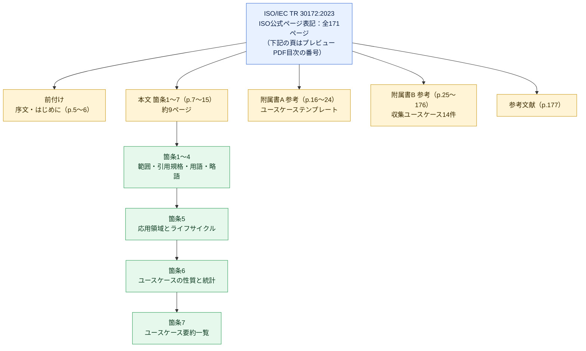
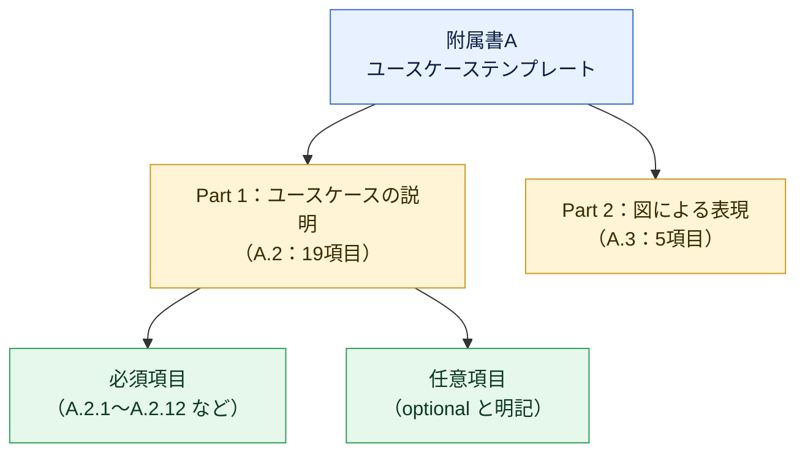
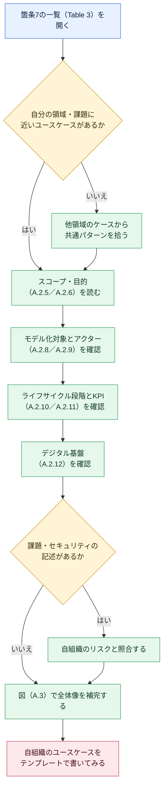
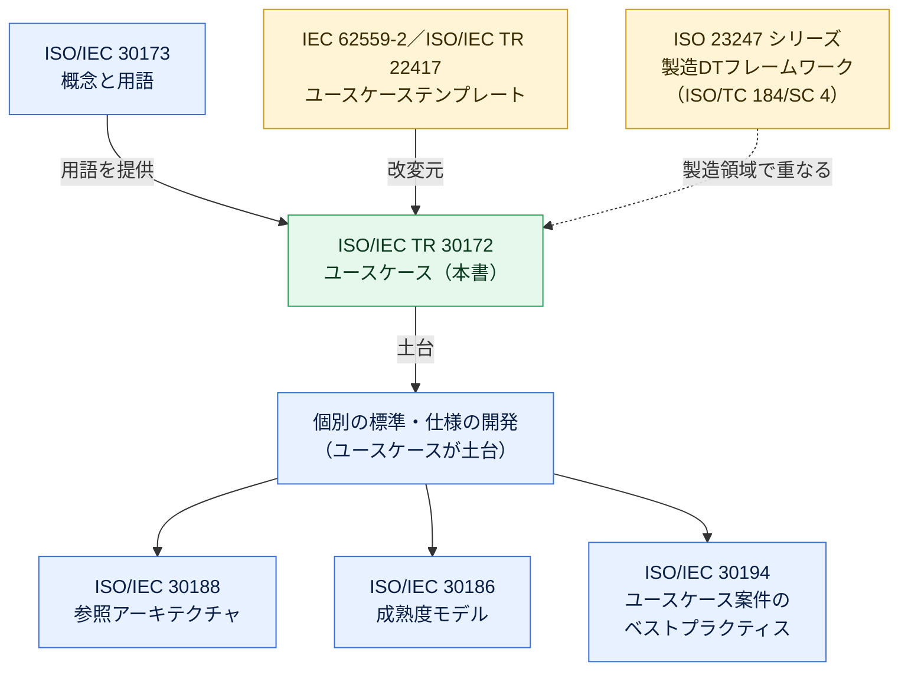

# ISO/IEC TR 30172:2023 初学者向けステップバイステップ解説ガイド

> **対象規格**：ISO/IEC TR 30172:2023 *Internet of things (IoT) — Digital twin — Use cases*（IoT — デジタルツイン — ユースケース）
> **対象読者**：デジタルツイン（DTw）やIoTの標準を初めて読むソフトウェアエンジニア、QAエンジニア、企画・設計担当者
> **情報の基準日**：2026年10月23日（ISO公式ページの掲載状況を同日確認）

---

## 目次

1. [このガイドの読み方と限界（最初に必ず読む）](#0-このガイドの読み方と限界最初に必ず読む)
2. [Step 1：30秒でつかむ全体像](#step-1-30秒でつかむ全体像)
3. [Step 2：そもそも「TR」とは何か](#step-2-そもそもtrとは何か)
4. [Step 3：デジタルツインの定義を理解する](#step-3-デジタルツインの定義を理解する)
5. [Step 4：文書の構造を地図で把握する](#step-4-文書の構造を地図で把握する)
6. [Step 5：本文（箇条1〜7）の流れ](#step-5-本文箇条17の流れ)
7. [Step 6：附属書A「ユースケーステンプレート」を読み解く](#step-6-附属書aユースケーステンプレートを読み解く)
8. [Step 7：附属書B「収集された14のユースケース」](#step-7-附属書b収集された14のユースケース)
9. [Step 8：ユースケースの読み方（実践フロー）](#step-8-ユースケースの読み方実践フロー)
10. [Step 9：関連規格との位置関係](#step-9-関連規格との位置関係)
11. [Step 10：実務への活用（筆者の補足提案）](#step-10-実務への活用筆者の補足提案)
12. [よくある誤解Q&A](#よくある誤解qa)
13. [理解度チェックリスト](#理解度チェックリスト)
14. [参照ソースURL一覧](#参照ソースurl一覧)

---

## 0. このガイドの読み方と限界（最初に必ず読む）

ISO/IEC TR 30172:2023 は**有料の規格文書**（全171ページ）です。本ガイドは次の**公開情報だけ**を根拠にしています。

| 区分 | 参照できた内容 | 参照できなかった内容 |
|---|---|---|
| ISO公式ページ | 題名、抄録（Abstract）、版、ページ数、委員会、ステージ履歴、価格 | 本文全体 |
| 公開プレビューPDF | 目次（全章・附属書・図表一覧）、序文（Introduction）、箇条1〜3.3（適用範囲、用語の一部） | 箇条3.4以降、箇条4〜7の本文、附属書A・Bの本文 |
| 各国標準機関・関連機関ページ | 範囲・位置づけの説明、関連規格の動向 | — |

したがって、本ガイドでは次のルールで書き分けます。

- 【規格由来】：公開プレビュー・公式ページで確認できた事実
- 【補足】：筆者による解説・実務への応用提案（規格の記述ではありません）
- 附属書Bの**各ユースケースの中身（技術詳細・数値）は有料部分のため書いていません**。タイトルと構成のみを扱います。

> 💡 **学習のヒント**：規格本文を読む場合は、ISOストアでPDFを購入するか、所属組織が加入する規格閲覧サービスを利用してください。本ガイドは「読む前の地図」として使うと効果的です。

---

## Step 1: 30秒でつかむ全体像

### 一言でいうと

> **「世界各地・各分野の“デジタルツイン活用事例”を、共通の書式で集めた事例集」**です。

【規格由来】抄録によると、本書はスマートマニュファクチャリングやスマートシティなど、さまざまな領域のデジタルツイン応用の代表的ユースケースを集めたもので、営利企業・政府機関・非営利団体などあらゆる種類の組織に適用できます。

### 基本情報

| 項目 | 内容 |
|---|---|
| 規格番号 | ISO/IEC TR 30172:2023 |
| 題名 | Internet of things (IoT) — Digital twin — Use cases |
| 種別 | Technical Report（技術報告書） |
| 版 | 第1版 |
| 発行 | 2023年10月（ISOページ上のステージ60.60：2023-11-01） |
| ページ数 | 171ページ |
| 担当委員会 | ISO/IEC JTC 1/SC 41（Internet of things and digital twin） |
| ICS | 35.020（IEC側の表記は 35.020；35.240） |
| ステータス | Published（2026-10-23時点の公式ページ表示。改訂・廃止の表示なし） |
| 言語 | 英語 |
| 価格（ISOストア） | CHF 227 |

### 何が書いてあって、何が書いていないか

| 書いてある（【規格由来】） | 書いていない（一般論） |
|---|---|
| 領域ごとの代表的なDTwユースケース | DTwの実装手順・製品選定 |
| ユースケースを記述するための統一テンプレート | 適合性を判定する要求事項（shall） |
| ユースケースの統計（領域別・ライフサイクル別） | 特定ベンダー製品の推奨 |

---

## Step 2: そもそも「TR」とは何か

ISO/IECの出版物には種類があります。**TR（Technical Report）は、要求事項を定める規格（IS）とは性格が異なり、情報提供を目的とする文書**です。

| 種別 | 略称 | 性格 | 本書との関係 |
|---|---|---|---|
| International Standard | IS | 要求事項や手順を定める | ― |
| Technical Specification | TS | 開発途上の技術に関する仕様 | ― |
| **Technical Report** | **TR** | **情報・事例・調査結果などを提供** | **本書はこれ** |

【規格由来】本書は「箇条2：引用規格」が**ありません**（No normative references）。また附属書AとBはいずれも **informative（参考）** と目次に明記されています。

【補足】つまり、本書を読んで「満たすべき要求事項を探す」使い方は不向きです。**「他社・他国はどう使っているのか」「自分の案件はどう書けばよいか」を知るための資料**として読みます。

---

## Step 3: デジタルツインの定義を理解する

### 3-1. 本書が採用する定義

【規格由来】箇条3.1で、デジタルツイン（DTw）は次の趣旨で定義されています（出典は ISO/IEC 30173 とされています）。

> 対象となるエンティティのデジタル表現であって、**適切な同期の頻度**で物理側とデジタル側の状態を**収束**させられるデータ接続を備えたもの。

注記では、次の趣旨が補足されています。

- DTwは、接続・統合・分析・シミュレーション・可視化・最適化・協調などの能力の一部または全部を持つ
- DTwは、対象エンティティの**ライフサイクル全体にわたる統合的な見方**を提供できる

### 3-2. 初学者がつまずく3つの用語

| 用語 | 意味（趣旨） | 例 |
|---|---|---|
| **エンティティ（entity）** | 物理的か非物理的かを問わず、固有の存在を持つもの | 人、物、出来事、考え、プロセス |
| **物理エンティティ（physical entity）** | 物理世界にあり、センシングやアクチュエーションの対象になり得るもの | ポンプ、ビル、変電設備 |
| **ターゲットエンティティ（target entity）** | DTwが写し取る対象（定義は箇条3.1に登場） | 工場ライン、都市インフラ |

【補足】「デジタルツイン＝3Dモデル」と思われがちですが、定義の核心は**データ接続による同期**です。静的な3Dモデルだけでは、定義の要件を満たしません。

### 3-3. デジタルツインの概念図

> 【補足】この図は定義（物理とデジタルの状態を収束させるデータ接続）を理解するための筆者作成の概念図であり、規格の図ではありません。なお、箇条3.4以降の用語は公開プレビューで確認できていません。

---

## Step 4: 文書の構造を地図で把握する

【規格由来】公開プレビューPDF（参照ソース #2）の目次から読み取れるページ配分は次のとおりです。**このStep以降のページ番号はすべてプレビューPDFの目次に記載された頁番号**であり、ISO公式ページの総ページ数（171ページ）とは数え方が一致しません（目次上の最終頁は p.177）。目次の頁番号で見ると、**約150ページ（p.25〜176）が附属書Bの事例**です。

### 構成の要点

> 表の「ページ」欄はプレビューPDF目次の頁番号です（ISO公式ページの総ページ数171とは別の数え方）。

| 部分 | ページ | 役割 | 読む優先度 |
|---|---|---|---|
| 序文（Introduction） | p.6 | 本書の作り方（テンプレート由来、収集方法）を説明 | ★★★ |
| 箇条1〜4 | p.7〜9 | 範囲・用語・略語 | ★★★ |
| 箇条5〜6 | p.9〜13 | 領域・ライフサイクル・統計 | ★★☆ |
| 箇条7 | p.14〜15 | ユースケースの一覧（Table 3） | ★★★ |
| 附属書A | p.16〜24 | 記述テンプレート | ★★★ |
| 附属書B | p.25〜176 | 各ユースケース本体 | ★★☆（自分の領域だけ精読） |

---

## Step 5: 本文（箇条1〜7）の流れ

> ⚠️ 箇条4以降の本文は公開プレビューに含まれていないため、**見出し（目次）から確認できる範囲**で説明します。

### 5-1. 序文（Introduction）が教えてくれること

【規格由来】序文には、本書の作り方が書かれています。

| 項目 | 内容（趣旨） |
|---|---|
| テンプレートの出自 | IEC 62559-2 のユースケーステンプレートと ISO/IEC TR 22417 のテンプレートを改変して作成 |
| 他のWGの参照 | ISO/IEC JTC 1/AG 8、JTC 1/AG 11、JTC 1/SC 41/AG 25 で使われたテンプレートも考慮 |
| テンプレートの構成 | 「ユースケースの説明」と「ユースケースを示す図」の2部構成 |
| 収集の手順 | ①デジタルツインの応用領域を特定 → ②テンプレートを提供 → ③寄稿者に提出を依頼 |
| 品質向上策 | DTwの概念と参照モデルを含む寄稿者向けガイダンスを提供 |
| 期待される効果 | ユースケースを調べることで、市場からの新しい技術要求を見つけられる |

### 5-2. 箇条ごとのガイド

| 箇条 | 見出し | 確認できる内容 | 初学者へのアドバイス |
|---|---|---|---|
| 1 | Scope | 多様な領域のDTwユースケースの収集。あらゆる組織に適用可能 | 「集める」ことが目的だと理解する |
| 2 | Normative references | なし | TRらしい特徴として押さえる |
| 3 | Terms and definitions | DTw、エンティティ、物理エンティティなど | 定義の出典（ISO/IEC 30173、ISO/IEC 20924）に注目 |
| 4 | Abbreviated terms | 略語一覧 | DTw等の略語を先に覚える |
| 5 | Applications | 5.1 応用領域／5.2 ライフサイクル段階のカバー範囲 | 「どの領域・どの段階か」の2軸で整理されている |
| 6 | Use cases | 6.1 概要／6.2 性質／6.3 基本統計（領域別・ライフサイクル別） | Figure 1・Table 2 は全体傾向をつかむ入口 |
| 7 | Use case summaries | ユースケースの要約一覧（Table 3） | 自分に近い事例を探すための索引 |

### 5-3. 統計に関する目次上の手がかり

【規格由来】目次から、次の図表が存在することが分かります。

| 図表 | タイトル（趣旨） |
|---|---|
| Figure 1 | 附属書Bで集めたユースケースの応用領域別の分布 |
| Figure 2 | JTC 1/AG 11 の報告書にある、ユースケースで採用された主要技術の統計 |
| Table 1 | JTC 1/AG 11 報告書のユースケース一覧 |
| Table 2 | ライフサイクル段階別のユースケース一覧 |
| Table 3 | ユースケース一覧 |

> 💡 **学習のヒント**：JTC 1/AG 11 は、本書より前にユースケースを整理した諮問グループです。本書はその成果も取り込んでいる点を覚えておくと、位置づけが理解しやすくなります。

---

## Step 6: 附属書A「ユースケーステンプレート」を読み解く

本書の最大の実用価値は、**ユースケースを書くための共通テンプレート**にあります。

### 6-1. テンプレートの全体像

【規格由来】目次から読み取れる構成は次の2部です。

### 6-2. Part 1：ユースケースの説明（A.2）の19項目

【規格由来】目次の見出しに基づく一覧です。「任意」は目次上 *(optional)* と表記されている項目です。

| 番号 | 項目名（原題） | 日本語での意味 | 任意 |
|---|---|---|---|
| A.2.1 | Name of use case | ユースケース名 | |
| A.2.2 | Digital twin application area or context of use | 応用領域・利用文脈 | |
| A.2.3 | Version management | バージョン管理 | |
| A.2.4 | Basic information to use case | 基本情報 | |
| A.2.5 | Scope of use case | スコープ（箇条書き） | |
| A.2.6 | Objectives of use case | 目的（箇条書き） | |
| A.2.7 | Narrative of use case | ユースケースの物語（叙述） | |
| A.2.8 | Entities to be modelled as digital entities | デジタルエンティティとしてモデル化する対象 | |
| A.2.9 | Actors: people, organizations or systems | アクター（人・組織・システム） | |
| A.2.10 | Life cycle of digital twin system in use case | DTwシステムのライフサイクル | |
| A.2.11 | Key performance indicators (KPIs) | KPI（Table A.1に定性指標の説明） | |
| A.2.12 | Digital infrastructures | デジタル基盤 | |
| A.2.13 | Referenced standards and standardization committees | 参照する規格・標準化委員会 | ✔ |
| A.2.14 | Referenced papers or patent | 参照する論文・特許 | ✔ |
| A.2.15 | Relation with other known use cases | 他ユースケースとの関係（共通要件など） | ✔ |
| A.2.16 | General remarks | 一般的な備考 | ✔ |
| A.2.17 | Challenges and issues | 課題・問題点 | ✔ |
| A.2.18 | Data security, privacy and trustworthiness | データセキュリティ・プライバシー・信頼に足る性質 | ✔ |
| A.2.19 | User requirements and interactions with other actors | ユーザー要求と他アクターとの相互作用 | ✔ |

### 6-3. Part 2：図による表現（A.3）の5項目

| 番号 | 項目名 | 内容 | 任意 |
|---|---|---|---|
| A.3.1 | Drawing of use case | ユースケースの全体図 | |
| A.3.2 | Data flow diagram | データフロー図 | ✔ |
| A.3.3 | Sequence diagram(s) | シーケンス図 | ✔ |
| A.3.4 | Deployment diagram(s) | 配置図 | ✔ |
| A.3.5 | Others | その他 | ✔ |

> 【補足】必須か任意かは目次の *(optional)* 表記から判断しています。実際の必須・任意の厳密な扱いは、本文の凡例で確認してください。

### 6-4. 初学者向けの読み解きポイント

| 注目項目 | なぜ重要か |
|---|---|
| **A.2.8 モデル化する対象** | 「何をデジタル側に写し取るか」がDTw設計の出発点になる |
| **A.2.9 アクター** | 誰（何）がDTwを使い、データを提供するかが分かる |
| **A.2.10 ライフサイクル** | 設計・施工・運用など、どの段階のDTwかを区別できる |
| **A.2.11 KPI** | 効果を測る指標。QAや受入基準づくりに直結する |
| **A.2.17／A.2.18 課題・セキュリティ** | 失敗事例や非機能要件の宝庫（任意項目だが重要） |

---

## Step 7: 附属書B「収集された14のユースケース」

【規格由来】目次に載っている14件の題名を、領域ごとに整理します（開始ページは目次の記載）。

| 番号 | 領域 | ユースケース題名（日本語訳） | 開始頁 |
|---|---|---|---|
| B.1 | スマートビル | DTに基づくスマートビル運用 | 25 |
| B.2 | 産業スマートパーク | DTに基づく産業スマートパークの設計・建設 | 39 |
| B.3 | スマートシティ | DTに基づくスマートシティ管理システム | 49 |
| B.4 | スマートエネルギー | 大規模な石油・ガス処理施設のDTの構築と応用 | 61 |
| B.5 | スマートビル | 水の監視 | 74 |
| B.6 | スマート電力網 | DTに基づく電力網の運用 | 82 |
| B.7 | スマート建設ライフサイクル | 施工フェーズのデジタルツインモデル | 91 |
| B.8 | スマートビル（住宅） | 明示的デマンドレスポンス：電力需要予測のための消費者行動DT | 106 |
| B.9 | スマートシティ | Greater Hobart Digital Twin | 120 |
| B.10 | スマートシティ | NSW Spatial Digital Twin | 130 |
| B.11 | 交通 | Sydney Trains Engineering and Maintenance Digital Twin | 138 |
| B.12 | 交通 | TfNSW Infrastructure Delivery Digital Twin | 148 |
| B.13 | スマートエネルギー | 電力網の計画から運用保守までをカバーする電力網DT | 157 |
| B.14 | スマートエネルギー | 電気フィールドレベルのサブシステムDT（仕様化・試運転・運用保守の基盤） | 165 |

### 領域別の件数（題名からの筆者集計）

| 領域 | 件数 | 該当番号 |
|---|---|---|
| スマートエネルギー／電力網 | 4 | B.4, B.6, B.13, B.14 |
| スマートビル | 3 | B.1, B.5, B.8 |
| スマートシティ | 3 | B.3, B.9, B.10 |
| 交通 | 2 | B.11, B.12 |
| 産業スマートパーク | 1 | B.2 |
| 建設ライフサイクル | 1 | B.7 |
| **合計** | **14** | |

> 【補足】この件数は題名からの筆者の分類であり、規格本文 Figure 1 の分類とは異なる可能性があります。

### 目次から分かる補足情報

【規格由来】B.7（施工フェーズ）には、目次の図一覧から次のトピックを扱うことが分かります（図の見出しのみ確認）。

| 図 | 見出し（趣旨） |
|---|---|
| Figure B.1 | 安全予防のための幾何解析 |
| Figure B.2 | 重機同士の近接イベントの識別 |
| Figure B.3 | 安全教育のシナリオ |
| Figure B.4 | ボクセル空間の点群マッチング後に分割された施工部材 |
| Figure B.5 | 欠陥予測のサンプル |
| Figure B.6 | 現場での欠陥可視化・確認・是正作業の追加 |
| Figure B.7／B.8 | 施工開始前／施工中のユースケース図 |

また、Sirris の解説ページによれば、本書のユースケースの領域は交通・自律移動、エネルギー、スマートシティ・ビル、スマートホーム、スマート製造、ビジネス管理、ヘルスなど幅広いとされています（出典：Sirris の解説ページ）。

> 💡 **学習のヒント**：B.9〜B.12 はオーストラリアの公共・インフラ領域に関する題名（Hobart、NSW、Sydney Trains、TfNSW）です。各国・各機関が実際のプロジェクトを寄稿している点が、本書の「事例集」らしさです。

---

## Step 8: ユースケースの読み方（実践フロー）

附属書Bはプレビュー目次の頁番号で約150ページあるため、**全部を順番に読む必要はありません**。次のフローで読みます。

### 推奨する通読順序

---

## Step 9: 関連規格との位置関係

### 9-1. 関連する主な規格

| 規格 | 内容 | 本書との関係 |
|---|---|---|
| **ISO/IEC 30173:2023** | Digital twin — Concepts and terminology（概念と用語） | 本書の用語定義の出典。SC 41が2023年に発行した姉妹規格 |
| **ISO 23247 シリーズ** | 製造向けデジタルツインフレームワーク（ISO/TC 184/SC 4） | 製造領域で内容が重なる。Part 1〜4は2021年、Part 5（デジタルスレッド）は2026年6月に発行、Part 6（構成）も2026年版が掲載 |
| ISO/IEC 30188:2026 | Digital twin — Reference architecture（参照アーキテクチャ） | 2023年時点の解説ページでは策定中と記載。現在は発行済み（第1版、Published、ステージ 60.60、2026年7月発行。参照ソース #19） |
| ISO/IEC 30186:2025 | Digital twin — Maturity model and guidance for a maturity assessment | 2023年時点の解説ページでは策定中と記載。現在は発行済み（第1版、Published、ステージ 60.60、2025年7月発行。参照ソース #20） |
| ISO/IEC 30194:2024 | Best practices for use case projects | 2023年時点の解説ページでは策定中と記載。現在は発行済み（第1版、Published、ステージ 60.60、2024年12月発行。参照ソース #21） |
| ISO/TR 24464:2025 | Visualization elements of digital twin — Visualization fidelity | 2025年発行のDTw関連文書として論文で言及 |
| IEC 62559-2 | ユースケース方法論のテンプレート | 本書のテンプレートの改変元 |
| ISO/IEC TR 22417 | IoTユースケース | 本書のテンプレートの改変元 |

### 9-2. 位置関係の図

> ルクセンブルクの標準化機関がポータルサイト portail-qualite.public.lu で公開しているデジタルツインの技術資料（2023年、参照ソース #11）は、本書（30172）を「特定のDTwユースケースに基づく標準・仕様の開発の土台」と説明しています。
>
> 💡 **学習のヒント**：DTw関連の標準は複数の委員会にまたがります。学術論文でも、ISO/IEC 30173、ISO 23247、IEC 63278-1（資産管理シェル）などの間で概念の捉え方に違いがあると指摘されています。複数規格を併用する際は、**用語の定義がどの規格由来か**を必ず確認してください。

---

## Step 10: 実務への活用（筆者の補足提案）

> ⚠️ このStepは【補足】です。規格の記述ではなく、ソフトウェア／QAの視点からの活用案です。

### 10-1. 活用の全体フロー

### 10-2. テンプレート項目から導けるテスト観点の例

| テンプレート項目 | 導けるテスト観点（例） |
|---|---|
| A.2.8 モデル化対象 | モデルと実物の対応（識別子・属性）の正しさ |
| A.2.9 アクター | 権限ごとの操作可否、他システム連携の入出力 |
| A.2.10 ライフサイクル | 段階ごと（設計・運用など）のデータ引き継ぎ |
| A.2.11 KPI | KPI算出ロジックの検証、閾値付近の境界値 |
| A.2.12 デジタル基盤 | 遅延・欠損・再送、基盤障害時の挙動 |
| A.2.18 セキュリティ | 認可、データ保護、改ざん検知 |

【補足】定義にある「適切な同期の頻度」は、実装では**同期遅延・更新頻度・整合性**の非機能要件になります。要件定義とテスト設計の両方で数値化すると、あいまいさが減ります。

### 10-3. 国際的な開発者コミュニティの動きとの接続

本書は「何を実現したいか（ユースケース）」を記述する資料であり、実装技術は扱いません。実装側の動きを知る代表例として、次があります。

| 取り組み | 概要 | 本書との接点 |
|---|---|---|
| **Digital Twin Consortium：Capabilities Periodic Table（CPT）** | ユースケースの能力要件を整理する、アーキテクチャ・技術に依存しない要件定義フレームワーク。v1.1で「責任（Responsibility）」や「検索（Search）」の能力が追加された | ユースケースを集約して必要能力を決めるという発想が共通。CPTの共同議長 Pieter van Schalkwyk（XMPro）は、CPTを相互運用性・拡張性・設計再利用に焦点を当てる枠組みと説明 |
| **Eclipse Ditto**（Eclipse IoT） | 物理デバイスをクラウド上のデジタル表現として管理するOSSフレームワーク。状態管理・検索・アクセス制御を提供 | 「状態の同期」を実装する一例（A.2.12 デジタル基盤の検討材料） |
| **DTDL**（Microsoft） | IoTデジタルツインのモデルとインターフェースを記述する言語。JSON-LDとRDFなどW3C標準に基づく | 「何をモデル化するか」（A.2.8）を機械可読に書く際の参考 |
| **NIST（Guodong Shao 氏ら）の論文** | 製造DTwのユースケース、利点、課題、標準化動向の整理 | 製造領域の事例と標準の位置づけの理解に有用 |

---

## よくある誤解Q&A

| 質問 | 回答 |
|---|---|
| Q1. この規格に準拠すれば「適合」と認められますか？ | **いいえ。** 本書はTR（情報提供文書）で、附属書も参考扱いです。ISO/IECは適合性の証明（attestation of conformity）自体を提供しません。 |
| Q2. 実装のやり方が載っていますか？ | **載っていません。** 載っているのはユースケースの記述（目的・アクター・KPI・基盤など）です。 |
| Q3. デジタルツインとシミュレーションは同じですか？ | **同じではありません。** 定義の核心は「データ接続による物理とデジタルの状態の収束」です。ISO/IEC 30173はシミュレーション等との比較も扱っています（Sirrisの解説による）。 |
| Q4. 14件の事例はすべて日本の事例ですか？ | 題名から確認できる範囲では、B.9〜B.12はオーストラリアの機関名・地名を含みます。各国の寄稿を集めた構成です。 |
| Q5. 古くなっていませんか？ | 2023年発行の第1版で、2026-10-23時点のISOページでは改訂・廃止の表示はありません。ただし関連規格（ISO 23247 Part 5・6など）は2026年も更新が続いているため、**併せて最新版を確認**してください。 |
| Q6. 序文は「附属書Aに全寄稿がある」と読めますが？ | 序文の記述と目次の附属書構成（Aはテンプレート、Bが収集ユースケース）に表現のずれがあります。【補足】実際の寄稿内容は附属書Bで確認する前提で読むのが安全です。 |

---

## 理解度チェックリスト

- [ ] 本書がTR（情報提供文書）であり、要求事項を定める規格ではないと説明できる
- [ ] デジタルツインの定義の核心（データ接続による状態の収束・同期頻度）を説明できる
- [ ] 本書の構成（本文約9ページ＋テンプレート＋事例約150ページ）を説明できる
- [ ] 附属書Aのテンプレートが「説明」と「図」の2部構成であることを説明できる
- [ ] 必須項目と任意項目（A.2.13〜A.2.19）の違いを説明できる
- [ ] 附属書Bの14件が、どの領域に分かれるか説明できる
- [ ] ISO/IEC 30173・ISO 23247との関係を説明できる
- [ ] 自分の案件を附属書Aのテンプレートで書き出せる
- [ ] KPI・課題・セキュリティの項目から、テスト観点を導ける

---

## 参照ソースURL一覧

### 一次情報（規格・標準化機関）

| # | ソース | URL | 確認した内容 |
|---|---|---|---|
| 1 | ISO 公式ページ | <a href="https://www.iso.org/standard/81578.html" target="_blank" rel="noopener noreferrer">https://www.iso.org/standard/81578.html</a> | 題名、抄録、版、ページ数、委員会、ステージ、価格 |
| 2 | VDE Verlag 公開プレビューPDF | <a href="https://assets.vde-verlag.de/iec-normen/preview-pdf/info_isoiectr30172%7Bed1.0%7Den.pdf" target="_blank" rel="noopener noreferrer">https://assets.vde-verlag.de/iec-normen/preview-pdf/info_isoiectr30172%7Bed1.0%7Den.pdf</a> | 目次、序文、箇条1〜3.3、図表一覧 |
| 3 | iTeh Standards（サンプル） | <a href="https://iteh.es/catalog/standards/iec/169258c6-aff5-437e-8a46-aa74c2bf85cc/iso-iec-tr-30172-2023" target="_blank" rel="noopener noreferrer">https://iteh.es/catalog/standards/iec/169258c6-aff5-437e-8a46-aa74c2bf85cc/iso-iec-tr-30172-2023</a> | 目次の一部、ICSコード等 |
| 4 | カナダ SCC 規格DB | <a href="https://scc-ccn.ca/standardsdb/standards/8187911" target="_blank" rel="noopener noreferrer">https://scc-ccn.ca/standardsdb/standards/8187911</a> | 範囲、発行日 |
| 5 | StandICT.eu | <a href="https://www.standict.eu/standards-repository/isoiec-tr-30172-ed1digital-twin-use-cases" target="_blank" rel="noopener noreferrer">https://www.standict.eu/standards-repository/isoiec-tr-30172-ed1digital-twin-use-cases</a> | 規格リポジトリ上の位置づけ |
| 6 | ISO/IEC 30173:2023（ISO） | <a href="https://www.iso.org/standard/81442.html" target="_blank" rel="noopener noreferrer">https://www.iso.org/standard/81442.html</a> | 概念と用語の範囲 |
| 7 | ISO/IEC 30173:2023（IEC Webstore） | <a href="https://webstore.iec.ch/publication/68081" target="_blank" rel="noopener noreferrer">https://webstore.iec.ch/publication/68081</a> | 発行日、ページ数 |
| 8 | ISO 23247-5:2026 | <a href="https://www.iso.org/standard/87425.html" target="_blank" rel="noopener noreferrer">https://www.iso.org/standard/87425.html</a> | デジタルスレッド規格の範囲・発行 |
| 9 | ISO 23247-6:2026（ANSI） | <a href="https://webstore.ansi.org/standards/iso/iso232472026-2614645" target="_blank" rel="noopener noreferrer">https://webstore.ansi.org/standards/iso/iso232472026-2614645</a> | 構成（composition）規格の範囲 |
| 19 | ISO/IEC 30188:2026（ISO） | <a href="https://www.iso.org/standard/53308.html" target="_blank" rel="noopener noreferrer">https://www.iso.org/standard/53308.html</a> | 参照アーキテクチャ規格の版・ステータス・発行年月 |
| 20 | ISO/IEC 30186:2025（ISO） | <a href="https://www.iso.org/standard/53306.html" target="_blank" rel="noopener noreferrer">https://www.iso.org/standard/53306.html</a> | 成熟度モデル規格の版・ステータス・発行年月 |
| 21 | ISO/IEC 30194:2024（ISO） | <a href="https://www.iso.org/standard/53314.html" target="_blank" rel="noopener noreferrer">https://www.iso.org/standard/53314.html</a> | ユースケース案件ベストプラクティス規格の版・ステータス・発行年月 |

### 解説・業界団体・研究機関

| # | ソース | URL | 確認した内容 |
|---|---|---|---|
| 10 | Sirris（ベルギー）解説ページ | <a href="https://sirris.be/en/inspiration/look-latest-standardisation-projects-field-digital-twins" target="_blank" rel="noopener noreferrer">https://sirris.be/en/inspiration/look-latest-standardisation-projects-field-digital-twins</a> | SC 41の規格群と30172の領域 |
| 11 | ルクセンブルク標準化資料（PDF） | <a href="https://portail-qualite.public.lu/dam-assets/publications/normalisation/2023/fiche-technique-digital-twin.pdf" target="_blank" rel="noopener noreferrer">https://portail-qualite.public.lu/dam-assets/publications/normalisation/2023/fiche-technique-digital-twin.pdf</a> | DTw関連規格の俯瞰 |
| 12 | 学術論文（KPI Science News, 2025） | <a href="https://scinews.kpi.ua/article/view/337306" target="_blank" rel="noopener noreferrer">https://scinews.kpi.ua/article/view/337306</a> | ISO/IEC 30173・23247・IEC 63278-1等の比較分析 |
| 13 | NIST（Shao）製造DTw標準の論文 | <a href="https://www.nist.gov/node/1862836" target="_blank" rel="noopener noreferrer">https://www.nist.gov/node/1862836</a> | 製造DTwのユースケースと標準化動向 |
| 14 | NIST（Shao & Helu）製造DTwフレームワーク | <a href="https://www.nist.gov/node/1615601" target="_blank" rel="noopener noreferrer">https://www.nist.gov/node/1615601</a> | ISO 23247の背景 |
| 15 | Digital Twin Consortium CPT | <a href="https://www.digitaltwinconsortium.org/initiatives/capabilities-periodic-table/" target="_blank" rel="noopener noreferrer">https://www.digitaltwinconsortium.org/initiatives/capabilities-periodic-table/</a> | 能力要件フレームワーク |
| 16 | Automation.com：CPT v1.1 | <a href="https://www.automation.com/article/digital-twin-capabilities-periodic-table-v1-1" target="_blank" rel="noopener noreferrer">https://www.automation.com/article/digital-twin-capabilities-periodic-table-v1-1</a> | v1.1の新機能 |
| 17 | Eclipse Ditto | <a href="https://projects.eclipse.org/projects/iot.ditto" target="_blank" rel="noopener noreferrer">https://projects.eclipse.org/projects/iot.ditto</a> | DTw状態管理OSSの概要 |
| 18 | DTDL（Microsoft、GitHub上の複製リポジトリ） | <a href="https://github.com/gnakti/opendigitaltwins-dtdl" target="_blank" rel="noopener noreferrer">https://github.com/gnakti/opendigitaltwins-dtdl</a> | DTDLの概要（公式リポジトリの確認も推奨） |

---

## 注意事項

- 本ガイドは公開情報に基づく**学習用の解説**であり、規格本文の代替ではありません。
- 規格本文の内容（特に附属書Bの技術詳細・数値）を引用・実務に利用する場合は、正規版を購入・閲覧して確認してください。
- 関連規格のステータスは随時変わります。**ISOサイトで最新状況を確認**してください。
- 規格の著作権はISO/IECに帰属します。本ガイドは目次・公開情報に基づく要約と筆者の解説で構成しています。
