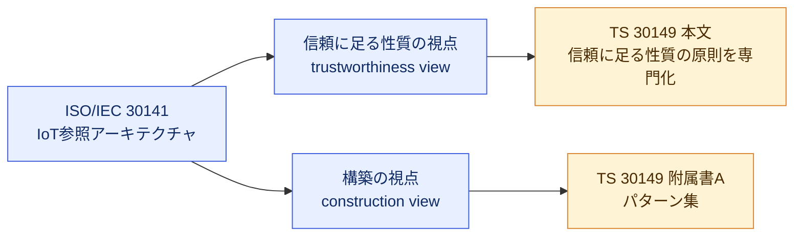
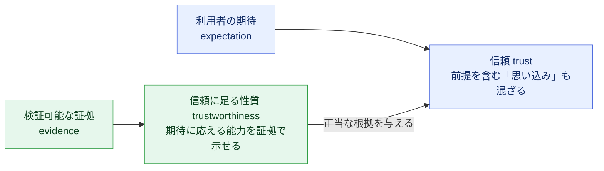
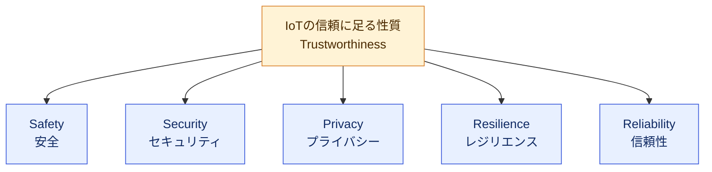
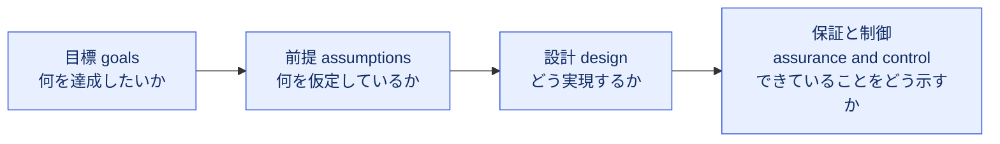
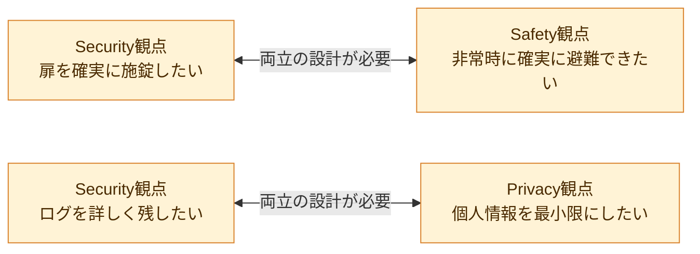
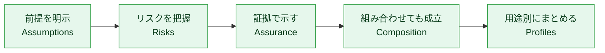
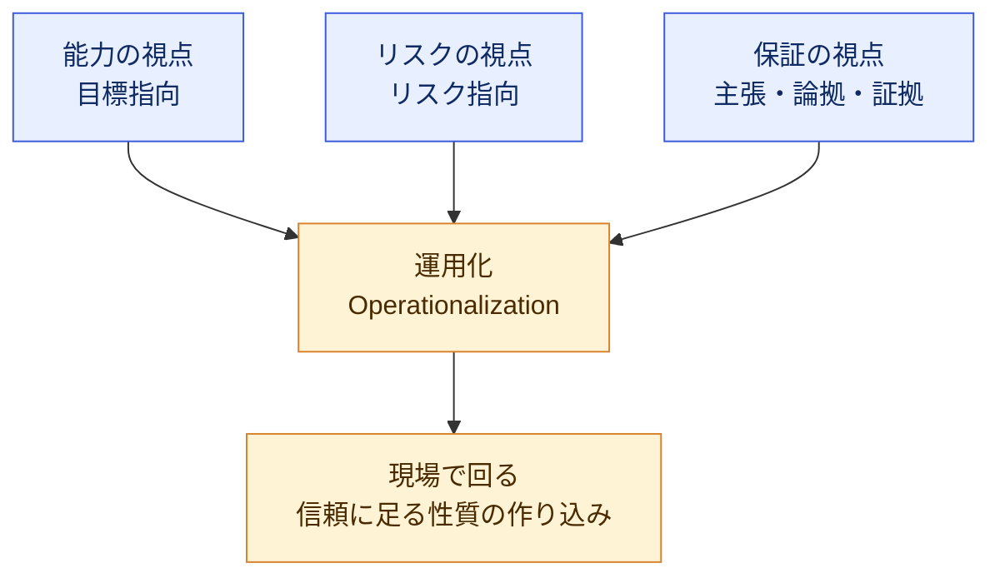
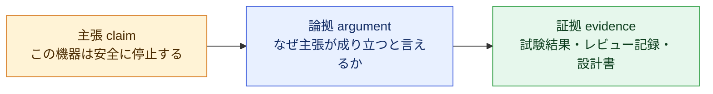
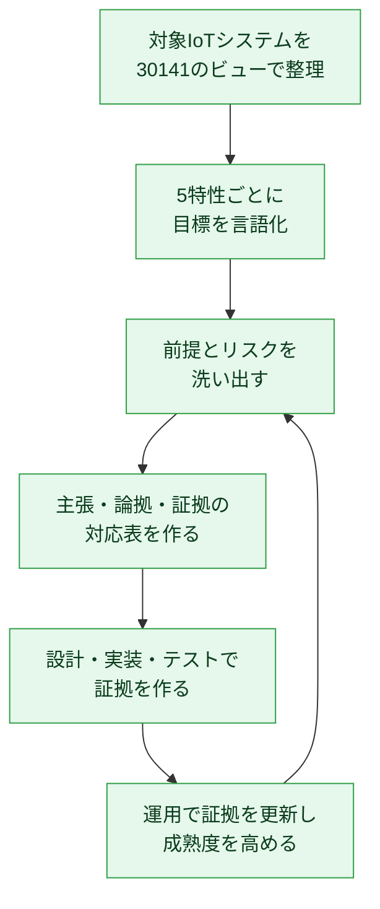
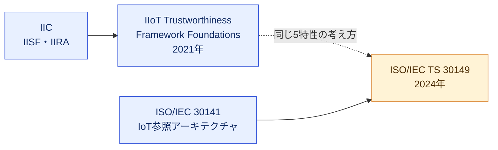

# ISO/IEC TS 30149:2024 初学者向け解説ガイド

**IoT — Trustworthiness principles（IoTの信頼に足る性質の原則）を、ステップバイステップで理解する**

> 調査基準日: 2026年10月23日
> 対象読者: IoT・組込み・クラウド・QAに関わる初学者〜中級者
> 表記ルール: 図解はMermaidまたはMarkdown表のみを使用（ASCII図解なし）

---

## 目次

1. [この規格をひとことで言うと](#1-この規格をひとことで言うと)
2. [基本情報（まず押さえる事実）](#2-基本情報まず押さえる事実)
3. [Step 0: 前提知識 ― ISO/IEC 30141 との関係](#3-step-0-前提知識--isoiec-30141-との関係)
4. [Step 1: 中心概念 ― trust と trustworthiness](#4-step-1-中心概念--trust-と-trustworthiness)
5. [規格の全体構成マップ](#5-規格の全体構成マップ)
6. [Step 2: 5つの特性（Safety / Security / Privacy / Resilience / Reliability）](#6-step-2-5つの特性)
7. [Step 3: 信頼に足る性質を「管理する」（箇条7）](#7-step-3-信頼に足る性質を管理する箇条7)
8. [Step 4: 信頼に足る性質を「構築する」（箇条8）](#8-step-4-信頼に足る性質を構築する箇条8)
9. [Step 5: 附属書A ― ベストプラクティス（パターン集）](#9-step-5-附属書a--ベストプラクティスパターン集)
10. [Step 6: 実務での使い方（QA・開発の視点）](#10-step-6-実務での使い方qa開発の視点)
11. [関連する規格・フレームワークとの違い](#11-関連する規格フレームワークとの違い)
12. [よくある誤解](#12-よくある誤解)
13. [理解度チェック](#13-理解度チェック)
14. [参照ソース（根拠URL）](#14-参照ソース根拠url)
15. [この資料の限界（重要）](#15-この資料の限界重要)

---

## 1. この規格をひとことで言うと

**「そのIoT製品は本当に信頼してよいのか？ を、ベンダーの自己申告を含む主張が根拠（証拠）で裏づけられているかで示すための考え方を整理した文書」** です。自己申告そのものを否定するのではなく、証拠に支えられていない主張に頼らないことが要点です。

| 疑問 | この規格が与える答えの方向性 |
|---|---|
| 「安全です」と言われたが本当か？ | 主張（claim）・論拠（argument）・証拠（evidence）で裏づける |
| 何をもって「信頼できる」と言うのか？ | 5つの特性（安全・セキュリティ・プライバシー・レジリエンス・信頼性）で分解する |
| 誰が・いつ・どこで考えるのか？ | IoT参照アーキテクチャ（ISO/IEC 30141）の「信頼に足る性質の視点」で考える |
| 具体的な進め方は？ | 附属書Aのパターン（特性評価・成熟度・影響評価・エンジニアリング・保証）を使う |

初学者が最初に覚えるべきキーワードは次の3つだけです。

1. **Trustworthiness（信頼に足る性質）**: 期待に応えられることを、検証可能な形で示せる能力
2. **5つの特性**: Safety / Security / Privacy / Resilience / Reliability
3. **Assurance（保証）**: 「主張が達成されている（される）」と言える、正当な確信の根拠

---

## 2. 基本情報（まず押さえる事実）

| 項目 | 内容 |
|---|---|
| 規格番号 | ISO/IEC TS 30149:2024 |
| 正式名称 | Internet of Things (IoT) — Trustworthiness principles |
| 文書の種類 | **TS（Technical Specification：技術仕様書）**。TSは規範的規定（要求事項等）を含み得る文書区分だが、本書は信頼に足る性質の原則・要素と構築パターンを整理し、適合性評価の要求事項を定めるものではない |
| 版 | 第1版（Edition 1） |
| 発行年月 | 2024年5月 |
| 担当委員会 | ISO/IEC JTC 1/SC 41（Internet of Things and Digital Twin） |
| ICS | ISOカタログ: 35.020 ／ IECストア: 35.020, 35.030（掲載元により付与される分類が異なる） |
| 適用範囲（Scope） | ISO/IEC 30141 の参照アーキテクチャに基づく、IoTの信頼に足る性質の要素を示す |
| 規範的引用文献 | **なし**（他規格の引用が必須ではない） |
| 状態 | 発行済み（Published） |
| ページ数 | ISOのページでは29、IECストアでは34ページ表記（販売元・数え方の違い） |
| IECストアのstability date | 2027 |
| 入手 | 有料（ISOストアでCHF 159の表示。プレビューあり） |

### TS（技術仕様書）とIS（国際規格）の違い

| 観点 | TS | IS |
|---|---|---|
| 位置づけ | 技術的に発展途上、または即時IS化の合意に至る前の分野で発行される仕様（規範的規定を含み得る） | 広い合意に基づき発行される国際規格（規範的規定を含み得る） |
| 認証（適合性評価）との関係 | 文書が適合性評価の対象となる要求事項を含むかどうかで決まる（TSだから一律に不向きというわけではない） | 要求事項を含む規格は認証・監査の基準として使われることがある |
| 本書（TS 30149）の内容 | IoT参照アーキテクチャにおける信頼に足る性質の原則・要素と参考パターン（附属書A）を示し、適合性評価用の要求事項は定めない | — |

> 補足: ISO/IECの文書は、適合性の証明（認証）そのものを行いません。第三者認証機関が別途サービスとして提供します（規格のForewordにも明記）。

### 公開情報で確認できた最近の動き

- カナダ規格協会（CSA）が **CSA ISO/IEC TS 30149:26** として採用（公開日 2026-01-31）していることを、カナダ規格データベースで確認しました。
- ISO/IECの親規格 30141 側も 2024年版が発行されています。

---

## 3. Step 0: 前提知識 ― ISO/IEC 30141 との関係

TS 30149 は単独で読むものではなく、**ISO/IEC 30141（IoT参照アーキテクチャ）の一部を深掘りした文書**です。規格の序文（Introduction）では、次の2点が明記されています。

1. TS 30149 は、IoT参照アーキテクチャの「**信頼に足る性質の視点（trustworthiness view）**」を専門化する
2. 附属書Aで、参照アーキテクチャの「**構築の視点（construction view）**」で使えるパターンを列挙する

### 初学者向けの例え

| 例え | 対応するもの |
|---|---|
| 建築の「基本設計図一式」 | ISO/IEC 30141（IoT全体の設計図） |
| その中の「耐震・防火・防犯の設計ルール集」 | TS 30149（信頼に足る性質に特化した部分） |

> 学習順序のおすすめ: まず 30141 の全体像（ドメインやビュー）をざっくり掴み、その後で 30149 を読むと「どこの話をしているのか」が迷子になりません。

---

## 4. Step 1: 中心概念 ― trust と trustworthiness

### 4.1 日本語にすると似ているが、別物

| 用語 | 意味 | 性質 |
|---|---|---|
| **Trust（信頼）** | 利用者や関係者が「きっと大丈夫」と**思う**状態 | 前提（assumption）に基づく。正しい前提も、根拠のない前提も混ざる |
| **Trustworthiness（信頼に足る性質）** | 期待に応えられることを**検証可能に示せる**能力 | 事実と証拠に基づく |

Kaspersky（この規格の策定に参加したと公表している企業）の解説では、次の例が使われています。

- 「金属製である」: 観察できる性質に基づく前提
- 「秘密のバックアップパスワードを含まない」: 裏づけがなければ根拠のない前提になりうる

### 4.2 規格が整理する3つの関係（箇条5）

| 箇条 | 論点 | 初学者向けの理解 |
|---|---|---|
| 5.1 | Relation to trust（信頼との関係） | 信頼は「相手を信じる側」の話、信頼に足る性質は「相手が示す側」の話 |
| 5.2 | Relation to context（文脈との関係） | 同じIoT機器でも、家庭用と工場用では「十分に信頼できる」の水準が違う |
| 5.3 | Relation to characteristics, behaviour, assurance and confidence | 特性・振る舞い・保証・確信がどうつながるか |

### 4.3 重要用語（箇条3の定義を要約）

| 用語 | 定義の要旨 |
|---|---|
| **assurance（保証）** | 主張（claim）が達成された、または達成されるという、正当な確信を持てる根拠。出典は ISO/IEC/IEEE 15026-1:2019 |
| **composability（合成可能性）** | 部品を**改造や追加の接続作業なしに**論理的・物理的に組み立てられる能力。「統合（integration）」は大きな労力を示唆し、「合成（composition）」は小さい〜ほぼ無い労力を示唆する。出典は ISO 22166-1:2021（一部修正） |

> 例（規格の例示の趣旨）: ハードウェアのセキュリティ部品と、データ保存部品を組み合わせて「安全なデータ保存部品」を作る。

---

## 5. 規格の全体構成マップ

プレビューで公開されている目次から、構成を整理します。

| 箇条 | タイトル | 内容の概要 | 本ガイドの対応Step |
|---|---|---|---|
| 1 | Scope | 適用範囲 | 2章 |
| 2 | Normative references | 規範的引用文献（なし） | 2章 |
| 3 | Terms and definitions | 用語定義 | 4章 |
| 4 | Abbreviated terms | 略語 | — |
| 5 | Concept of trustworthiness | 信頼に足る性質の概念 | Step 1 |
| 6 | Characteristics | 5つの特性 | Step 2 |
| 7 | Managing trustworthiness | 信頼に足る性質の管理 | Step 3 |
| 8 | Building trustworthiness | 信頼に足る性質の構築 | Step 4 |
| 附属書A（参考） | Best practices for IoT trustworthiness | ベストプラクティスとパターン | Step 5 |
| 参考文献 | Bibliography | — | — |

図表（規格内の図番号とタイトル）も、読む順番の地図になります。

| 図表 | タイトル | 読む目的 |
|---|---|---|
| Figure 1 | Relationship between ISO/IEC TS 30149 and ISO/IEC 30141 | 30141との関係 |
| Figure 2 | Trustworthiness and trust | trustとの違い |
| Figure 3 | Concepts of characteristics, behaviour, assurance and confidence | 概念のつながり |
| Figure 4 | Relationship between security and privacy | セキュリティとプライバシーの関係 |
| Figure 5 | Trustworthiness characteristics examples | 特性の例 |
| Figure 6 | Goal oriented trustworthiness | 目標指向の見方 |
| Figure 7 | Risk oriented trustworthiness | リスク指向の見方 |
| Figure 8 | Assurance based on claims, arguments, and evidence | 主張・論拠・証拠 |
| Figure 9 | Conceptual model for trustworthiness | 信頼に足る性質の概念モデル |
| Figure 10 | Determining risk factors within an RA | 参照アーキテクチャ内のリスク要因の特定 |
| Table 1 | Example of goals and properties | 目標と性質の例 |
| Table 2 | Principles for trustworthiness operationalization | 運用化の原則 |
| Table A.1〜A.6 | 附属書Aの各パターン表 | 実践手順の雛形 |

---

## 6. Step 2: 5つの特性

規格は、信頼に足る性質を次の**5つの特性**に分解します（Kaspersky解説でも同じ5つが列挙されています）。

### 6.1 5特性の早見表

定義の言い回しは、同じ5特性を扱うIIC（Industry IoT Consortium）の信頼に足る性質の解説ブログの整理を参考にした**学習用の要約**です。規格本文の逐語訳ではありません。

| 特性 | 一言で | 守る対象 | 具体例 |
|---|---|---|---|
| **Safety（安全）** | 人・環境に害を与えない | 人命・財産・環境 | 異常時に機器を安全側に停止させる |
| **Security（セキュリティ）** | 許可されないアクセス・改変・破壊から守る | システムと情報 | 認証、暗号化、ファームウェア署名 |
| **Privacy（プライバシー）** | 個人が自分の情報の扱いを制御できる | 個人の権利 | 収集目的の限定、保存期間の管理 |
| **Resilience（レジリエンス）** | 混乱を引き起こす事象に抵抗・適応し、回復する | サービス継続 | 停電・人的ミス・攻撃を受けても縮退運転で継続し、復旧する |
| **Reliability（信頼性）** | 定められた条件・期間で必要な機能を果たし続ける | 通常運用の継続性 | 故障率、平均故障間隔 |

### 6.2 ReliabilityとResilienceの違い（初学者がつまずく点）

| 観点 | Reliability | Resilience |
|---|---|---|
| 定義の軸 | **定められた条件**のもとで、**定められた期間**、機能を果たすこと | 混乱を引き起こす事象（disruptive events）に**抵抗し、適応し、回復する**こと |
| 目的 | 必要な機能を所定の期間果たし続ける | 混乱の影響を抑え、サービスを保ち、回復させる |
| 例 | 規定温度範囲での所定期間の稼働 | 地震・停電・攻撃の最中の縮退運転と、その後の復旧 |

> 注: 「想定内か想定外か」だけで区別するのは不正確です。Resilience が扱う事象には、あらかじめ想定して備えておくものも含まれます。

### 6.3 規格の箇条6の「型」を読み取る

目次を見ると、**Safety / Security / Privacy には同じ型の節構成**があり、Resilience / Reliability は節が分かれていません。

| 特性 | 節構成（目次より） |
|---|---|
| 6.1 Safety | 全般 → Safety goals → Safety design → Safety assurance and control |
| 6.2 Security | 全般 → Security goals → **Security assumptions** → Security design → Security assurance and control |
| 6.3 Privacy | 概要 → Privacy goals → **Privacy assumptions** → Privacy design → Privacy assurance and control |
| 6.4 Resilience | 節分けなし |
| 6.5 Reliability | 節分けなし |

この「型」は、次の流れとして覚えると整理しやすくなります（学習用の整理）。

> 注: Safetyには assumptions の節が目次に無いなど、特性ごとの差があります。上図は「共通する骨格」の学習用モデルです。

### 6.4 特性同士は衝突する（トレードオフ）

IICの解説では、5特性は互いに関連し、**調整（reconcile）が必要**だと述べられています。典型例は「施錠」と「避難」です。

規格にも **Figure 4: Relationship between security and privacy** があり、この2つの関係を整理していることが目次から分かります（図の中身は有料部分のため、本ガイドでは再現していません）。

---

## 7. Step 3: 信頼に足る性質を「管理する」（箇条7）

箇条7は、信頼に足る性質を**継続的に管理するための要素**を扱います。

| 節 | 要素 | 初学者向けの意味（節タイトルからの一般的な解釈） |
|---|---|---|
| 7.1 | General | 全般 |
| 7.2 | Assumptions | 「こう動くはず」という前提を明示し、管理する |
| 7.3 | Assurance | 主張を裏づける証拠を揃える |
| 7.4 | Risks | 信頼に足る性質を損なう要因をリスクとして扱う |
| 7.5 | Composition | 部品・システムを組み合わせたときの信頼に足る性質を考える |
| 7.6 | Trustworthiness profiles | 信頼に足る性質の要求を用途別にまとめた「型」 |

> 注意: 上図は**学習しやすいように並べた整理**であり、規格が「この順に実施せよ」と定めた手順ではありません。

### 7.1 Composition（合成）が重要な理由

IoTは「センサ + ゲートウェイ + クラウド + アプリ」のように**多数の部品の組合せ**で動きます。

| 状況 | 起きがちな問題 |
|---|---|
| 部品単体は信頼できる | 組み合わせると前提が食い違い、全体として信頼できない |
| 部品が増える | 前提とリスクの管理対象が増え、見落としが生じる |

そのため、定義（3.2 composability）で「部品を改造なしに組める」ことを明確にしているのです。

---

## 8. Step 4: 信頼に足る性質を「構築する」（箇条8）

箇条8は、信頼に足る性質を**作り込む**ための見方を3つの視点で示します。

| 節 | 視点 | 対応する図 | 問い |
|---|---|---|---|
| 8.2 | Capability viewpoint（能力の視点） | Figure 6: Goal oriented trustworthiness | 何を達成できる能力があるか（目標指向） |
| 8.3 | Risk viewpoint（リスクの視点） | Figure 7: Risk oriented trustworthiness | 何が起きうるか、どう抑えるか（リスク指向） |
| 8.4 | Assurance viewpoint（保証の視点） | Figure 8: Assurance based on claims, arguments, and evidence | どう証明するか（主張・論拠・証拠） |
| 8.5 | Operationalization（運用化） | Table 2: Principles for trustworthiness operationalization | 現場でどう回すか |

### 8.1 保証の核心: 主張・論拠・証拠

Figure 8のタイトルが示すとおり、保証は **claims（主張）・arguments（論拠）・evidence（証拠）** で組み立てます。これはセーフティケース／アシュアランスケースと呼ばれる考え方に通じます。

| 悪い例（根拠のない主張） | 良い例（証拠に裏づけられた主張） |
|---|---|
| 「当社製品は安全です」とだけ述べる | 「異常電流時に100ms以内に遮断する」（主張）→ 保護回路の設計根拠（論拠）→ 試験成績書・FMEA記録（証拠） |

> 良い例の主張は、供給者自身による自己申告（自己宣言）でもかまいません。問題は誰が述べるかではなく、主張が論拠と証拠で裏づけられ、検証できるかどうかです。
>
> 上の数値や例は理解のための**架空の例**で、規格が定める値ではありません。

### 8.2 参照アーキテクチャ内のリスク要因

Figure 10 **Determining risk factors within an RA** は、IoT参照アーキテクチャ（RA）のどこにリスク要因があるかを特定する考え方に関する図です。30141の構成要素（ドメイン等）とリスクを結びつける発想だと理解してください（図の詳細は有料部分）。

---

## 9. Step 5: 附属書A ― ベストプラクティス（パターン集）

附属書A（参考）は、**実際に手を動かすための雛形（パターン）**です。目次から以下が確認できます。

| 節 | パターン名 | 対応表 | 目的（名称からの一般的な解釈） |
|---|---|---|---|
| A.1 | Relation with ISO/IEC 30141 | — | 30141とのつながり |
| A.2 | Concerns | Table A.1: Concerns for an implementation architecture | 実装アーキテクチャで気にすべき関心事 |
| A.3.2 | Trustworthiness characterization method pattern | Table A.2 | 対象システムの信頼に足る性質を**特徴づける**方法 |
| A.3.3 | Trustworthiness maturity model pattern | Table A.3 | 信頼に足る性質の**成熟度**を段階的に評価する |
| A.3.4 | Trustworthiness impact assessment pattern | Table A.4 | 信頼に足る性質が損なわれたときの**影響**を評価する |
| A.3.5 | Trustworthiness engineering pattern | Table A.5 | 信頼に足る性質を**設計・実装に組み込む** |
| A.3.6 | Trustworthiness assurance pattern | Table A.6 | 信頼に足る性質を**証拠で保証する** |

> 注意: 上図は附属書Aの節の並びを**使い方の流れとして描いた学習用図**です。各パターンの具体的な手順・表の内容は有料部分のため、本ガイドでは再現していません。

Kaspersky解説では、附属書のパターンについて「信頼に足る性質の違反の脅威評価手法から、MILS（Multiple Independent Levels of Security）のような信頼できるシステム向けアーキテクチャ解までのベストプラクティスのテンプレート」と紹介されています。

---

## 10. Step 6: 実務での使い方（QA・開発の視点）

以下は、規格の考え方を**QAエンジニア・開発者が現場に落とす**ための、本ガイド独自の提案（学習用）です。規格が要求する手順ではありません。

### 10.1 プロジェクトへの適用フロー

### 10.2 特性別のテスト観点の例（独自整理）

| 特性 | 主なテスト・検証の観点 | 証拠の例 |
|---|---|---|
| Safety | 故障注入、異常時の安全側動作、ハザード分析との整合 | 故障注入試験記録、FMEA/FTA |
| Security | 脆弱性診断、認証・認可、ファームウェア更新の改ざん耐性 | ペネトレーションテスト報告、脅威モデル |
| Privacy | データ収集範囲の確認、保存期間・削除の動作確認 | データフロー図、プライバシー影響評価 |
| Resilience | 通信断・電源断・過負荷での縮退運転と復旧 | カオステスト結果、復旧時間の実測 |
| Reliability | 長時間稼働、環境条件ストレス | 耐久試験データ、故障率の推定 |

### 10.3 自己点検チェックリスト

- [ ] 対象システムの**利用文脈**（家庭・産業・医療など）を明記した
- [ ] 5特性それぞれについて、達成したい**目標**を書いた
- [ ] 「たぶん大丈夫」という**前提**を一覧化し、検証方法を決めた
- [ ] 主要な主張ごとに、**証拠への参照**を紐づけた
- [ ] 部品を組み合わせた**全体**でも主張が成立するか確認した
- [ ] 特性間の**トレードオフ**（例: ログ収集とプライバシー）を判断・記録した
- [ ] 製品出荷後も、証拠を**更新する運用**を決めた

---

## 11. 関連する規格・フレームワークとの違い

| 文書 | 発行元 | 位置づけ | TS 30149との関係 |
|---|---|---|---|
| ISO/IEC 30141 | ISO/IEC JTC 1/SC 41 | IoT参照アーキテクチャ | **親**。30149はその信頼に足る性質の視点を専門化 |
| IIoT Trustworthiness Framework Foundations | Industry IoT Consortium（IIC） | 産業IoT向けの信頼に足る性質のフレームワーク（2021年7月公表） | 同じ5特性を扱う。IIRAのPDFとは別の文書で、IICのIIRAプログラムに関連づけられている |
| IISF（Industrial Internet of Things Security Framework） | IIC | 産業IoTのセキュリティフレームワーク | 関連文書。Trustworthiness Framework Foundations はIISFを基にしている |
| ISO/IEC/IEEE 15026-1 | ISO/IEC/IEEE | 保証（assurance）の用語・概念 | 30149の用語定義の出典 |
| ISO 22166-1 | ISO | ロボティクス分野のモジュール性の用語 | composabilityの定義の出典 |

> SC 41の事業計画（2020年版）でも、信頼に足る性質（Trustworthiness）はIoTシステムに重要なシステム工学上の属性として位置づけられ、信頼性・可用性・レジリエンス・セキュリティ・プライバシー・安全などが挙げられています。IoTの信頼に足る性質は、TS 30149の発行以前からSC 41の重点領域でした。

---

## 12. よくある誤解

| 誤解 | 実際 |
|---|---|
| この規格に準拠すれば認証が取れる | 本書は信頼に足る性質の原則・要素と参考パターンを示す文書であり、適合性評価用の要求事項を定めていない（またISO/IEC自身は認証を行わない） |
| セキュリティのことだけを書いた規格 | セキュリティは5特性のうちの1つ。Safety・Privacy・Resilience・Reliabilityも同格 |
| 具体的な技術要件（暗号方式など）が書いてある | 原則・考え方・パターンが中心で、特定の暗号方式などを強制する文書ではない（本文は有料のため詳細は原文で確認） |
| ReliabilityとResilienceは同じ | 定められた条件・期間で機能を果たす力と、混乱を引き起こす事象に抵抗・適応し回復する力で別物 |
| 信頼（trust）と信頼に足る性質（trustworthiness）は同義 | 前者は思い込みを含み、後者は検証可能な根拠を伴う |
| 1度評価すれば終わり | 運用・更新の中で証拠と成熟度を継続的に管理する発想 |

---

## 13. 理解度チェック

Q1. trustworthinessを一言で説明してください

期待に応えられることを、検証可能な形で示せる能力（Kasperskyの解説に基づく整理）。

Q2. TS 30149が扱う5つの特性を挙げてください

Safety、Security、Privacy、Resilience、Reliability。

Q3. 保証（assurance）を組み立てる3要素は何ですか

主張（claims）、論拠（arguments）、証拠（evidence）。

Q4. TS 30149とISO/IEC 30141の関係は

30141（IoT参照アーキテクチャ）の「信頼に足る性質の視点」を専門化し、附属書Aで「構築の視点」で使えるパターンを列挙する関係。

Q5. ReliabilityとResilienceの違いは

Reliability（信頼性）は定められた条件のもとで、定められた期間、機能を果たす力。Resilienceは混乱を引き起こす事象に抵抗し、適応し、回復する力。

---

## 14. 参照ソース（根拠URL）

### 14.1 一次情報（規格・公的情報）

| 内容 | URL |
|---|---|
| ISO公式ページ（基本情報・要旨） | <a href="https://www.iso.org/standard/53269.html" target="_blank" rel="noopener noreferrer">https://www.iso.org/standard/53269.html</a> |
| IECストア（発行日・stability date・ページ数） | <a href="https://webstore.iec.ch/en/publication/67281" target="_blank" rel="noopener noreferrer">https://webstore.iec.ch/en/publication/67281</a> |
| 規格プレビューPDF（目次・序文・Scope・用語定義） | <a href="https://vde-verlag.de/iec-normen/preview-pdf/info_isoiects30149{ed1.0}en.pdf" target="_blank" rel="noopener noreferrer">https://vde-verlag.de/iec-normen/preview-pdf/info_isoiects30149{ed1.0}en.pdf</a> |
| カナダ規格データベース（CSA採用 2026-01-31） | <a href="https://ccn-scc.ca/standardsdb/standards/4034053" target="_blank" rel="noopener noreferrer">https://ccn-scc.ca/standardsdb/standards/4034053</a> |
| SC 41 事業計画2020（信頼に足る性質の位置づけ） | <a href="https://jtc1info.org/wp-content/uploads/2022/04/SC_41_Business_Plan_2020.pdf" target="_blank" rel="noopener noreferrer">https://jtc1info.org/wp-content/uploads/2022/04/SC_41_Business_Plan_2020.pdf</a> |

### 14.2 国際的な開発者・企業による解説

| 内容 | 発信者 | URL |
|---|---|---|
| Why standardization matters: from convenience to saving lives（2024年10月、TS 30149の策定に参加した旨と5特性の解説） | Kaspersky | <a href="https://www.kaspersky.com/blog/iot-trustworthiness-iec-30149/52392/" target="_blank" rel="noopener noreferrer">https://www.kaspersky.com/blog/iot-trustworthiness-iec-30149/52392/</a> |
| 5特性の定義と相互関係の解説ブログ | Industry IoT Consortium（IIC）Trustworthiness Task Group | <a href="https://iiconsortium.org/?p=1660" target="_blank" rel="noopener noreferrer">https://iiconsortium.org/?p=1660</a> |
| IIoT Trustworthiness Framework Foundations公表（2021年7月）のニュース | IIC / Control Engineering | <a href="https://www.controleng.com/?p=115950" target="_blank" rel="noopener noreferrer">https://www.controleng.com/?p=115950</a> |
| IIC 2021年第2四半期報告（信頼に足る性質のメソッドの例） | IIC | <a href="https://www.iiconsortium.org/pdf/2021-Q2-Quarterly-Report.pdf" target="_blank" rel="noopener noreferrer">https://www.iiconsortium.org/pdf/2021-Q2-Quarterly-Report.pdf</a> |
| IIC 2017年第4四半期報告（特性が互いに関連し調整が必要） | IIC | <a href="https://www.iiconsortium.org/pdf/2017-12_4Q17_report_Trustworthiness_Final.pdf" target="_blank" rel="noopener noreferrer">https://www.iiconsortium.org/pdf/2017-12_4Q17_report_Trustworthiness_Final.pdf</a> |
| IoT Trustworthiness States（Bassam Zarkout氏、IGnPower） | IIoT World | <a href="https://www.iiot-world.com/industrial-iot/connected-industry/iot-trustworthiness-states/" target="_blank" rel="noopener noreferrer">https://www.iiot-world.com/industrial-iot/connected-industry/iot-trustworthiness-states/</a> |
| Journal of Innovation 2018年9月号（IIC信頼に足る性質の特集の著者一覧） | IIC | <a href="https://www.iiconsortium.org/?p=2982" target="_blank" rel="noopener noreferrer">https://www.iiconsortium.org/?p=2982</a> |

---

## 15. この資料の限界（重要）

| 項目 | 内容 |
|---|---|
| 規格本文は有料 | 本ガイドは、公開されているプレビュー（目次・序文・Scope・用語定義の一部）と、公開された解説記事に基づきます。**第5〜8章および附属書Aの詳細本文は、原文で確認していません** |
| 「一般的な解釈」と書いた箇所 | 節タイトルからの学習用の意味づけで、規格本文の記述そのものではありません |
| 独自提案の箇所 | 10章のフロー・観点表・チェックリストは本ガイド独自の整理で、規格の要求事項ではありません |
| 例の数値 | 「100ms以内に遮断」などは理解のための架空例です |
| 時点 | 2026年10月23日時点の公開情報です。改版・採用状況は変わる可能性があるため、ISOとIECの公式ページで最新状態を確認してください |
| 精読する場合 | ISOまたはIECストアから原文を購入し、5〜8章と附属書Aを読むと、本ガイドの「学習用の整理」を原文で裏づけられます |

---

*本ガイドは学習目的の解説であり、規格の代替ではありません。規格の引用部分は要旨の言い換えです。*
