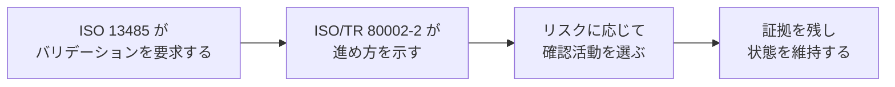
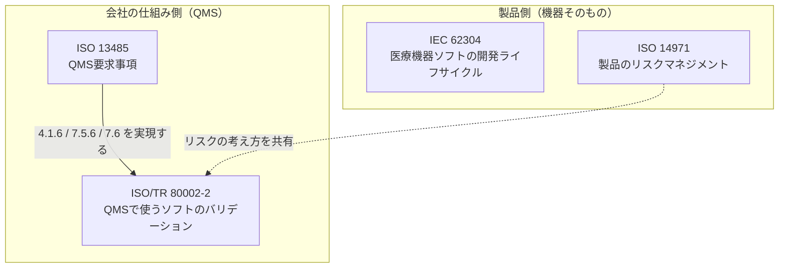
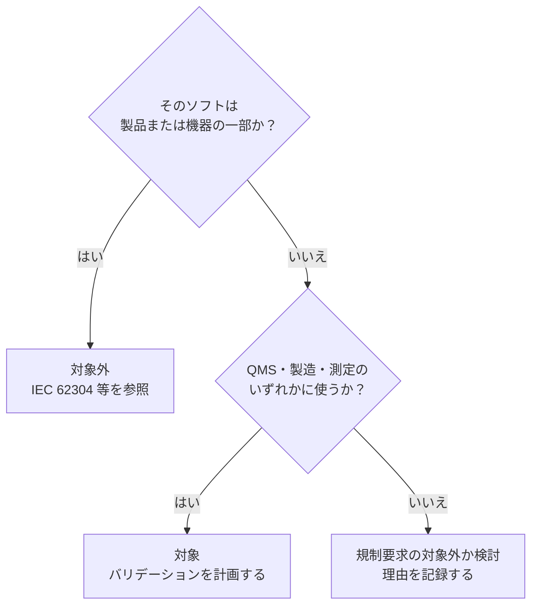
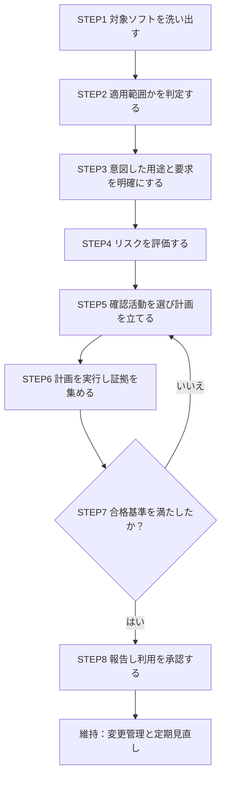
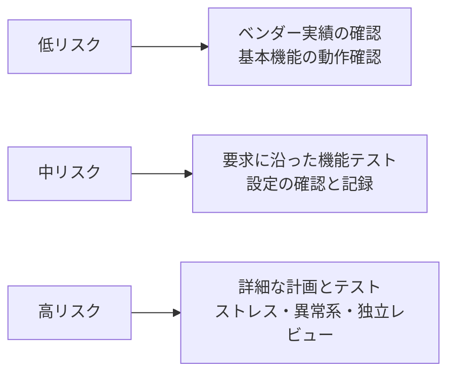
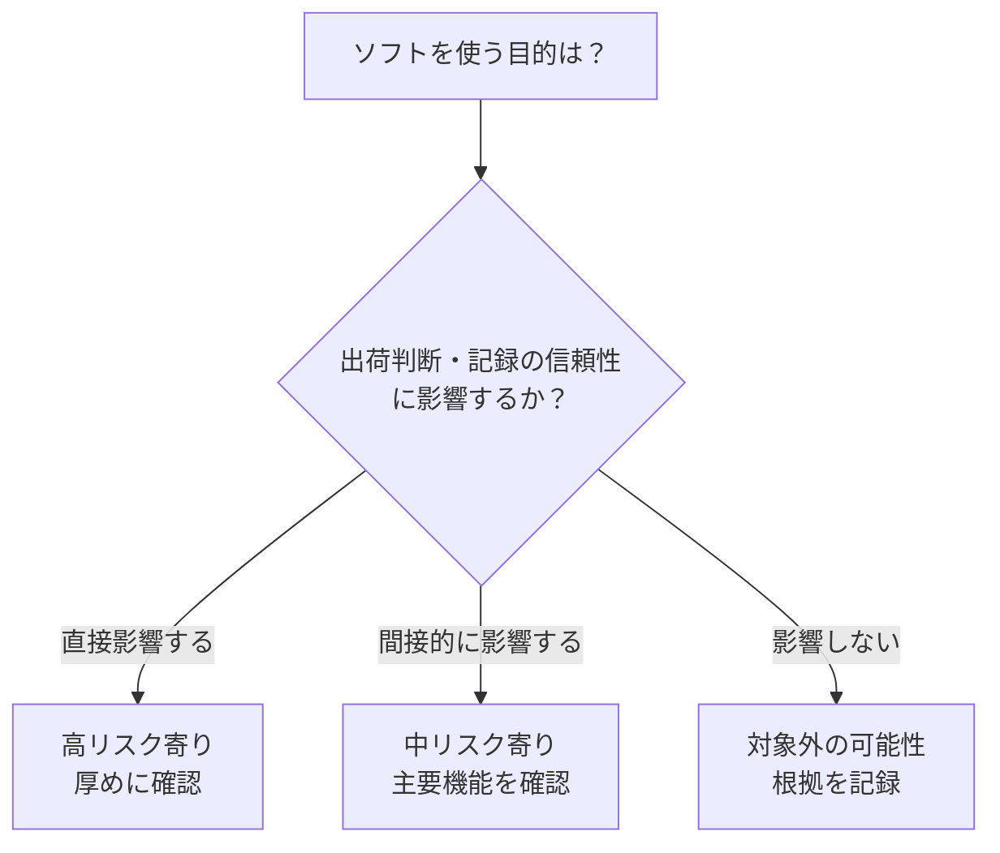
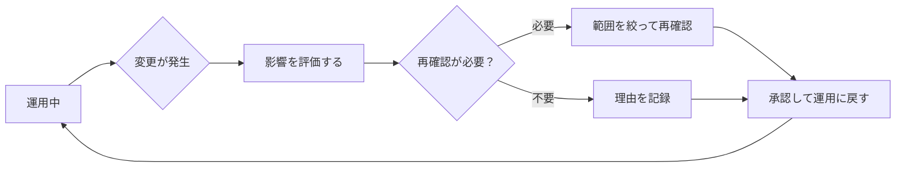

# ISO/TR 80002-2:2017 初学者向け解説ガイド

> **医療機器ソフトウェア ― 第2部：医療機器の品質システムで使うソフトウェアのバリデーション**
> Medical device software — Part 2: Validation of software for medical device quality systems

| 項目 | 内容 |
|---|---|
| 文書の種類 | 技術報告書（Technical Report, TR）。**認証・適合性審査の要求事項ではなく、実践ガイド** |
| 版・発行 | 第1版、2017年6月（ISO上のステータスは Published、ステージ 60.60） |
| 担当委員会 | ISO/TC 210（医療機器の品質マネジメントと関連する一般的側面） |
| ページ数 | 84ページ |
| 関連規格の中心 | ISO 13485:2016 の 4.1.6 / 7.5.6 / 7.6 |
| 米国での対応版 | AAMI/ISO TIR80002-2:2017 |
| 情報の時点 | 2026年10月13日 |
| 公式ページ | https://www.iso.org/standard/60044.html |

> **本ガイドの根拠と限界（先にお読みください）**
> ISO/TR 80002-2:2017 の本文は有償で、ISO の利用条件上も本文の転載はできません。そのため本ガイドは、(1) ISO 公式ページの要旨・目次、(2) 各国規格機関が公開している目次・プレビュー、(3) 国際的に著名な実務者（Christian Johner 氏ら）の解説、(4) FDA の公開ガイダンスと法律事務所・業界団体の解説、を根拠に、**筆者が自分の言葉で構成した解説**です。
> 条項番号を確認できたのは **4 / 4.2 / 5 / 5.2 / 5.2.3 / 5.3.1 / 附属書A** のみです。それ以外の細かな条項番号や表の中身は、実際の規格本文で必ず確認してください。
> 「例」と明記した表や事例は**学習用の筆者の例示**で、規格本文の記述ではありません。

---

## 目次

1. [30秒でわかる要点](#1-30秒でわかる要点)
2. [なぜこのTRが必要なのか](#2-なぜこのtrが必要なのか)
3. [規格地図の中での位置づけ](#3-規格地図の中での位置づけ)
4. [適用範囲：何が対象で、何が対象外か](#4-適用範囲何が対象で何が対象外か)
5. [押さえるべき5つのキーワード](#5-押さえるべき5つのキーワード)
6. [ステップバイステップ：バリデーションの進め方](#6-ステップバイステップバリデーションの進め方)
7. [トゥールボックス（附属書A）の読み方](#7-トゥールボックス附属書aの読み方)
8. [事例で理解する](#8-事例で理解する)
9. [購入ソフト・クラウド（SaaS）の扱い](#9-購入ソフトクラウドsaasの扱い)
10. [バリデート済み状態を維持する](#10-バリデート済み状態を維持する)
11. [記録・文書化の考え方](#11-記録文書化の考え方)
12. [FDA CSA・QMSRとの関係（2026年時点）](#12-fda-csaqmsrとの関係2026年時点)
13. [批判的な視点：このTRの強みと弱み](#13-批判的な視点このtrの強みと弱み)
14. [よくある失敗](#14-よくある失敗)
15. [実務チェックリスト](#15-実務チェックリスト)
16. [理解度チェック](#16-理解度チェック)
17. [参照ソース（URL）](#17-参照ソースurl)

---

## 1. 30秒でわかる要点

- **何の規格か**：医療機器メーカーが「自社の品質マネジメントシステム（QMS）の中で使うソフトウェア」を、どうバリデーションするかの実践ガイドです。
- **対象は誰か**：製品に組み込まれるソフトではなく、**会社の業務や製造・検査・試験を支えるソフト**です（例：不具合管理システム、文書管理システム、検査用スクリプト、製造装置の制御ソフト）。
- **核となる考え方**：すべてを一律に重くテストするのではなく、**リスクに応じて**、**道具箱（toolbox）から適切な確認活動を選ぶ**という「クリティカルシンキング（批判的思考）」です。
- **法的な位置づけ**：TR自体は要求事項ではありません。要求しているのは **ISO 13485:2016**（4.1.6、7.5.6、7.6）です。TRは「それをどう実現するか」の参考書です。

---

## 2. なぜこのTRが必要なのか

### 2.1 背景

ISO 13485:2016 は、QMS で使うソフトウェアについて、**初回使用の前にバリデーションを行うこと**、**変更の際にも適切に行うこと**を求めています。ところが規格本文は「何をどこまで」までは書いていません。

その結果、現場では次の両極端が起きがちでした。

| 現場で起きがちな状況 | 問題 |
|---|---|
| すべての機能を全件テストして膨大な文書を作る | 時間・人手がかかり、変更のたびに作業が止まる |
| 「市販品だから大丈夫」と何もしない | 監査で指摘され、実際の不具合にも気づけない |

### 2.2 TRが提供する解決策

TRは、この間をつなぐ考え方を示します。ISO 公式の要旨は、このTRが**設計・試験・部品受入・製造・表示・包装・流通・苦情対応など、QMSのあらゆる側面を自動化するソフトウェア**に適用できる、と述べています。

これは FDA の考え方（後述のCSA）とも方向性が一致しており、米国・欧州の両方で「リスクベースで必要十分に」という流れが定着しています。

---

## 3. 規格地図の中での位置づけ

初学者が最も混乱するのが、IEC 62304 など似た名前の規格との違いです。**「ソフトウェアが誰の道具か」**で整理すると明快です。

| 規格 | 守備範囲 | 対象ソフトの例 |
|---|---|---|
| IEC 62304 | **機器に入る／機器そのものである**ソフトの開発プロセス | 診断支援アプリ、機器の制御ファームウェア |
| ISO 13485 | 医療機器QMSの要求事項 | （規格自体はソフトを限定しない） |
| **ISO/TR 80002-2** | **QMSの道具として使う**ソフトのバリデーション | 不具合管理、文書管理、試験自動化、製造装置ソフト |

> **覚え方**：「製品に入るソフト」は IEC 62304、「会社の仕事を回すソフト」は ISO/TR 80002-2。

---

## 4. 適用範囲：何が対象で、何が対象外か

### 4.1 対象（ISO公式要旨より）

| 区分 | 具体例（筆者の例示） |
|---|---|
| QMSの中で使うソフト | 文書管理、CAPA・苦情管理、教育訓練記録、監査管理 |
| 製造・サービス提供で使うソフト | 製造実行システム（MES）、自動検査装置、ラベル印刷、滅菌工程の制御 |
| 監視・測定に使うソフト | 測定データ解析、校正管理、計測器に付属する解析ソフト |

### 4.2 対象外

| 区分 | 理由 |
|---|---|
| 機器の構成部品・部品・付属品として使うソフト | 製品側の規格（IEC 62304 等）の領域 |
| それ自体が医療機器であるソフト（SaMD） | 同上 |

### 4.3 判定の考え方

TRの目次には「5.2 ソフトウェアが適用範囲かを判定する」があり、その下に **5.2.3「医療機器の規制要求の範囲外にあるプロセスとソフトウェア」** という項目があります。つまり、**「対象外と判断した場合も、その判断を整理して残す」**ことが想定されています。

---

## 5. 押さえるべき5つのキーワード

### 5.1 ソフトウェアバリデーション（広い意味で使う）

TR第4章は、「バリデーション」という言葉が**狭く（テストだけ）も広くも**解釈されてきたと整理したうえで、このTRでは**ソフトが意図した用途で信頼できると示すための活動の全体**を指す、という立場をとります。

| 狭い理解（誤解されやすい） | TRの広い理解 |
|---|---|
| 「テストをすること」 | 計画、要求の整理、リスク評価、確認活動、報告、維持を含む全体 |

### 5.2 意図した用途（Intended Use）

そのソフトを**誰が・何のために・どの工程で**使うのか。これがすべての出発点です。同じソフトでも、使い方が違えば必要な確認の深さが変わります。

### 5.3 リスク（プロセスリスク）

ここでのリスクは、**そのソフトが誤動作したとき、製品の品質・安全・規制順守にどれだけ悪影響が出るか**です。ISO 14971 の考え方に近く、実務者の間では「QMSソフト版の14971」と表現されることもあります（一部の実務者フォーラムでの言い回しで、規格上の公式表現ではありません）。

### 5.4 クリティカルシンキング（批判的思考）

第5章の題名にもなっている中心概念です。**手順書をなぞるのではなく、状況を考えて必要な確認を選ぶ**姿勢を指します。

| 思考停止 | クリティカルシンキング |
|---|---|
| 「全部テストする」 | 「どの機能が失敗すると困るか」を先に考える |
| 「ベンダーが保証している」 | 「ベンダーの証拠をどこまで使えるか」を評価する |
| 「去年と同じでよい」 | 「今回の変更の影響は何か」を問う |

### 5.5 トゥールボックス（Toolbox）

第4章の **4.2「信頼性を高める活動：トゥールボックスの道具」** と、**附属書A（参考）** に登場します。バリデーションに使える確認活動の**一覧表（道具箱）**で、**リスクに応じてここから選ぶ**というのがTRの基本姿勢です。

---

## 6. ステップバイステップ：バリデーションの進め方

> **注意**：以下の8ステップは、TRの考え方（第4・5章と附属書A）を初学者向けに**筆者が整理した流れ**です。実際の章立てと完全に一致するとは限りません。

### STEP 1：対象ソフトを洗い出す

会社で使っているソフトの**一覧（インベントリ）**を作ります。表計算ファイル、社内スクリプト、SaaS、装置付属ソフトも含めます。

| ソフト名 | 使う部門 | 何をしているか |
|---|---|---|
| （例）CAPA管理ツール | 品質保証 | 是正・予防措置の記録と期限管理 |
| （例）検査用Pythonスクリプト | 検査 | 測定値の合否判定を自動化 |

### STEP 2：適用範囲かを判定する

第4章の分類（QMS／製造・サービス提供／監視・測定）に当てはまるかを見ます。**対象外と判断した根拠も記録**します（5.2.3 の趣旨）。

### STEP 3：意図した用途と要求を明確にする

- 誰が使うか、どの入力を受け、何を出力するか
- 規制上・品質上、**どの機能が重要か**
- 他システムとのつながり

> **ポイント**：要求は「ソフトの全機能」ではなく、**自社の使い方に必要な範囲**で書きます。

### STEP 4：リスクを評価する

**「この機能が間違えたら何が起きるか」**を考えます。

| 観点 | 考えること |
|---|---|
| 影響の大きさ | 製品の品質・患者の安全・規制順守に波及するか |
| 発見のしやすさ | 誤りが出ても、後工程の検査や人のチェックで気づけるか |
| 代替手段 | 出力を別の手段で確認できるか |

### STEP 5：確認活動を選び、計画を立てる

トゥールボックスから**リスクに見合った活動**を選び、**バリデーション計画**にまとめます（目次の **5.3.1 バリデーション計画** に対応）。

計画に入れる内容（例）：目的、範囲、役割、選んだ活動、合格基準、成果物。

### STEP 6：計画を実行し、証拠を集める

テスト実施だけでなく、ベンダー評価、レビュー、設定の確認なども**証拠**です。結果は**客観的に確認できる形**で残します。

### STEP 7：合格基準と照らして判断する

未達なら原因を調べ、**計画や対策を見直して再実施**します（図のSTEP5へ戻る）。

### STEP 8：報告し、利用を承認する

結果をまとめた**バリデーション報告**を作り、**責任者が利用開始を承認**します。ISO 13485 は**初回使用の前**にバリデーションを求めているため、順序が大切です。

---

## 7. トゥールボックス（附属書A）の読み方

### 7.1 トゥールボックスとは

附属書A（参考）は、バリデーションに使える**活動の一覧表**です。実務者の解説（Johner Institut）によれば、**ストレステスト**や**アウトプット・フォーシング・テスト**といった具体的な方法が挙がっており、活動を具体化する点が評価されています。

### 7.2 活動のイメージ（筆者の例示）

| 分類 | 活動の例 | 狙い |
|---|---|---|
| 計画・要求 | 要求の整理、リスク評価 | 何をどこまで確認するかを決める |
| 供給元の評価 | ベンダー監査、実績・品質情報の確認 | 提供元の信頼性を使えるか判断 |
| 設計・実装の確認 | レビュー、検査 | 作り方の妥当性を確かめる |
| 動的な確認 | 機能テスト、ストレステスト、出力強制テスト | 実際に動かして挙動を確かめる |
| 運用の確認 | 受入テスト、利用者トレーニング、運用手順 | 現場で正しく使える状態にする |

> 上表は**分類の考え方を示す筆者の例示**です。実際の活動名と分類は附属書A本文で確認してください。

### 7.3 リスクと活動の選び方（筆者の例）

| リスク水準（例） | 確認の深さ（例） | 記録の量（例） |
|---|---|---|
| 低 | 軽い確認で十分な場合が多い | 簡潔な記録 |
| 中 | 主要機能を要求に沿って確認 | 計画・結果・報告 |
| 高 | 異常系・境界・負荷まで確認 | 詳細な計画と根拠 |

> **重要**：Johner 氏は「どの場面でどの活動が必要か」がTRから読み取りにくい点を指摘しています。したがって上の対応は、**あくまで自社の判断の出発点**として使い、**なぜそう決めたかの理由**を必ず残してください。

---

## 8. 事例で理解する

> 以下は**学習用の架空の事例**です。

### 事例A：不具合（CAPA）管理SaaS

| 項目 | 内容 |
|---|---|
| 用途 | 是正・予防措置の記録、期限管理、承認ワークフロー |
| 重要な機能 | 承認の記録、期限通知、改ざん防止（監査証跡） |
| リスクの考え方 | 記録の消失や承認漏れは規制順守に影響するため中程度以上 |
| 確認活動の例 | ベンダー評価、承認フローの機能テスト、権限設定の確認、データ移行の確認 |
| 省略してよい例 | レポートの見た目調整など、品質に影響しない機能は深追いしない |

### 事例B：検査の合否判定を自動化するスクリプト

| 項目 | 内容 |
|---|---|
| 用途 | 測定値を読み込み、規格値と比べて合否を出す |
| リスクの考え方 | 誤判定が出荷判断に直結するため**高リスク** |
| 確認活動の例 | 境界値テスト、既知データでの出力強制テスト、コードレビュー、版管理、変更時の再確認 |

### 事例C：社内で使う議事録の整形マクロ

| 項目 | 内容 |
|---|---|
| 用途 | 会議メモの体裁を整える |
| リスクの考え方 | 品質・安全に影響しないため、**QMS上の規制要求の対象外**と判断できる可能性が高い |
| やること | 対象外と判断した**根拠を一覧に記録**する |

---

## 9. 購入ソフト・クラウド（SaaS）の扱い

TRの目次に「ベンダー提供ソフトの品質・安定性」に関する記述があることからも、**購入品の扱い**はTRの主要テーマです。

### 9.1 基本の考え方

**ベンダーが作ったから免除、ではありません。** 責任は**使う側（医療機器メーカー）**にあります。ただし、**ベンダーの証拠を活用して自社の作業を減らす**ことはできます。

| ベンダーに任せられること | 自社でやるべきこと |
|---|---|
| 開発・基本テスト・品質管理の実施 | **自社の用途に合っているか**の確認 |
| 一般的な機能の品質 | 自社の設定・構成・運用の確認 |
| 不具合修正・更新の提供 | 更新時の影響確認 |

### 9.2 活用できるベンダー情報の例

- 品質マネジメントシステムの認証、監査報告
- テスト結果や検証資料の開示
- 利用実績、不具合の公開情報
- 契約上の品質・変更通知の取り決め

> Johner 氏への読者質問にも「購入ソフトをどこまで扱うか」が挙がっており、実務で関心の高い論点です。

---

## 10. バリデート済み状態を維持する

一度バリデートして終わりではありません。ISO 13485 は**変更時にも**適切に行うことを求めています。

| 変更の種類（例） | 見るべき点 |
|---|---|
| バージョンアップ | 自社が使う機能への影響 |
| 設定変更 | 重要設定の変更による挙動の変化 |
| 運用環境の変更 | OS・DB・ネットワークとの相性 |
| 利用目的の拡大 | 新しい用途に対するリスク評価 |

> **ポイント**：再確認は**変更の影響範囲に絞る**のが合理的です。毎回フル再テストにする必要はありません。

---

## 11. 記録・文書化の考え方

**「何を作るか」より「何を示したいか」**で考えます。示したいのは、**そのソフトが意図した用途で使えると判断した根拠**です。

| 文書（例） | 内容 |
|---|---|
| ソフト一覧（インベントリ） | 対象・対象外の判断と理由 |
| バリデーション計画 | 範囲、リスク、選んだ活動、合格基準 |
| 証拠 | テスト結果、レビュー記録、ベンダー資料 |
| バリデーション報告 | 結果の要約、逸脱、承認 |
| 変更記録 | 変更内容、影響評価、再確認の有無 |

> 文書の形式や分量に決まりはありません。**リスクに見合う量**にとどめるのが、TRの精神に沿った姿勢です。

---

## 12. FDA CSA・QMSRとの関係（2026年時点）

### 12.1 何が起きたか

| 出来事 | 内容 |
|---|---|
| 2022年9月 | FDAが **CSA（Computer Software Assurance）** のドラフトガイダンスを公表 |
| 2025年9月24日 | FDAが最終ガイダンス「Computer Software Assurance for Production and Quality System Software」を発行 |
| 2026年2月3日 | 更新版を発行（名称が「…Production and Quality Management System Software」に） |
| 2026年2月 | FDAの品質システム規則が **QMSR** に移行し、ISO 13485:2016 を参照で取り込む |

最終版CSAは、2002年のFDA「General Principles of Software Validation」の**第6章を置き換え**ます。

### 12.2 TRとCSAの比較

| 観点 | ISO/TR 80002-2 | FDA CSA |
|---|---|---|
| 位置づけ | 国際的な技術報告（参考） | FDAのガイダンス（推奨事項） |
| 中心概念 | クリティカルシンキング、トゥールボックス | リスクに基づく保証、最小負担 |
| リスクの見方 | プロセスリスクに応じて活動を選ぶ | 意図した用途とプロセスリスクで保証活動を決める |
| 文書化 | リスクに見合う量 | システムログ等のデジタル記録の活用も推奨 |
| 強み | 欧州・国際規制（ISO 13485）に直結 | 米国当局の期待が明確 |

### 12.3 どう使い分けるか

- **両者は対立しません。** どちらも「リスクに応じて必要十分に」という同じ方向です。
- 欧州・日本・米国のいずれにも出荷する場合、**TRで枠組みを作り、CSAの考え方で重さを調整する**運用が現実的です。
- 実務者の解説（VDE）も、**QMSRによって米国でもISO 13485の4.1.6、7.5.6、7.6が決め手になる**と整理しています。

> 米国向けの具体的な対応は、FDAの最新ガイダンス本文と自社の規制担当者の見解を必ず確認してください。

---

## 13. 批判的な視点：このTRの強みと弱み

### 13.1 強み

| 点 | 内容 |
|---|---|
| 実用的な考え方 | リスクに応じて活動を選ぶ姿勢が明確 |
| 具体化された道具箱 | 附属書Aがストレステスト等の方法を具体化 |
| 国際的な通用性 | ISO 13485 と直接結びつく |

### 13.2 弱み（Johner Institut の指摘より）

| 点 | 内容 |
|---|---|
| 本文の具体性 | 本文（主要章）は具体的な指針が薄い、との評価 |
| 活動の選び方 | どの場面でどの活動が必要かが読み取りにくい |
| 他規格との接続 | ISO 25010 など標準的な品質概念との連携が弱い、との指摘 |

### 13.3 結論

> **TRは「参考書」であり、「正解集」ではありません。** 監査で問われるのは、TRへの準拠ではなく **ISO 13485 の要求を満たしているか**です。したがってTRは**自社のSOPと計画を作るヒント**として使い、**根拠のある判断**を示すことが最も重要です。

---

## 14. よくある失敗

| 失敗 | 対策 |
|---|---|
| 「TR準拠」を目標にしてしまう | 目標は ISO 13485 4.1.6 / 7.5.6 / 7.6 の充足 |
| すべての機能を全件テストする | リスクで優先順位をつける |
| ベンダー任せにして何もしない | 自社用途での確認を最低限行う |
| ソフトの洗い出しが不完全 | 表計算・スクリプト・SaaS も含めて一覧化 |
| 導入後に変更管理が抜ける | 変更時の影響評価をSOPに組み込む |
| 判断の理由が残っていない | 「なぜこの深さにしたか」を必ず記録 |
| 利用開始が検証前になる | **初回使用の前**に承認する順序を守る |

---

## 15. 実務チェックリスト

- [ ] QMS・製造・測定に使うソフトの一覧を作った
- [ ] 各ソフトについて、対象／対象外の判断と理由を記録した
- [ ] 意図した用途と重要機能を書き出した
- [ ] 機能ごとにリスクを評価した
- [ ] リスクに見合う確認活動を選び、計画にまとめた
- [ ] 計画に合格基準を入れた
- [ ] ベンダー証拠を使う場合、その信頼性を評価した
- [ ] 計画を実行し、客観的な証拠を残した
- [ ] 報告を作り、責任者が利用開始を承認した（初回使用の前）
- [ ] 変更管理と定期見直しの手順を定めた

---

## 16. 理解度チェック

**Q1.** ISO/TR 80002-2 は、規制上の「要求事項」ですか。
> **答え**：いいえ。技術報告書（参考ガイド）です。要求しているのは ISO 13485 の 4.1.6 / 7.5.6 / 7.6 です。

**Q2.** 医療機器に組み込まれる診断ソフトは、このTRの対象ですか。
> **答え**：いいえ。機器の構成部品や、それ自体が医療機器であるソフトは対象外で、IEC 62304 等の領域です。

**Q3.** 「バリデーション」とは、テストのことだけですか。
> **答え**：いいえ。このTRでは、計画・リスク評価・確認活動・報告・維持を含む**広い意味**で使います。

**Q4.** 購入した市販ソフトは、ベンダーが品質保証しているので何もしなくてよいですか。
> **答え**：いいえ。責任は使う側にあります。ベンダーの証拠を活用しつつ、**自社用途での確認**が必要です。

**Q5.** バージョンアップのたびにフル再テストが必要ですか。
> **答え**：いいえ。**変更の影響範囲に絞って**再確認し、判断の理由を記録すれば足ります。

---

## 17. 参照ソース（URL）

> 以下は2026年10月13日時点で確認したものです。本文は有償のため、**公式ページ・規格機関の公開要旨・国際的な実務者の解説・FDA関連**を組み合わせています。

### 17.1 規格の一次情報（公式・要旨・目次）

| 資料 | URL |
|---|---|
| ISO 公式ページ（ISO/TR 80002-2:2017） | https://www.iso.org/standard/60044.html |
| ISO/TR 80002-2:2017 目次・冒頭プレビュー（iTeh） | https://iteh.es/catalog/standards/iso/cb31740e-55ba-4cd2-95e3-0b8018096b31/iso-tr-80002-2-2017 |
| VDE 提供の公開プレビューPDF | https://vde-verlag.de/iec-normen/preview-pdf/info_isotr80002-2{ed1.0}en.pdf |
| AAMI/ISO TIR80002-2:2017 プレビュー（ANSI Webstore） | https://webstore.ansi.org/preview-pages/AAMI/preview_AAMI+ISO+TIR80002-2-2017.pdf |
| カナダ規格評議会（SCC）の登録情報 | https://scc-ccn.ca/standardsdb/standards/2028733 |

### 17.2 国際的な実務者・専門機関の解説

| 資料 | URL |
|---|---|
| Johner Institut「ISO 80002-2 Software-Validierung」（Christian Johner 氏） | https://www.johner-institut.de/blog/iec-62304-medizinische-software/iso-80002-2-software-validierung/ |
| Johner Institut「AAMI TIR 36 Software-Validierung」 | https://www.johner-institut.de/blog/regulatory-affairs/aami-tir-36-software-validierung/ |
| VDE「Validierung von QMS-Software」 | https://www.vde.com/topics-de/health/beratung/validierung-von-qms-software |
| MDDI「The Goldilocks Principle: Approaches to Software Validation」（AAMI系TIRの考え方） | https://www.mddionline.com/software/the-goldilocks-principle-approaches-software-validation |

### 17.3 FDA CSA・QMSR関連

| 資料 | URL |
|---|---|
| Federal Register（最終ガイダンス公示 2025-18468） | https://www.federalregister.gov/documents/2025/09/24/2025-18468/computer-software-assurance-for-production-and-quality-system-software-guidance-for-industry-and |
| NSF「FDA Final Guidance Computer Software Assurance (CSA)」（2026年2月3日更新版の言及） | https://www.nsf.org/life-science-regulatory-news/fda-final-guidance-computer-software-assurance-csa |
| Hogan Lovells「FDA finalizes computer software assurance guidance」 | https://hlc.com/en/publications/fda-finalizes-computer-software-assurance-guidance-for-production-and-quality-system-software |
| ISPE「Computer Software Assurance and the Critical Thinking Approach」 | https://ispe.org/pharmaceutical-engineering/march-april-2024/computer-software-assurance-and-critical-thinking |
| King & Spalding「FDAのCSAドラフトガイダンス解説」 | https://www.kslaw.com/news-and-insights/fdas-draft-computer-software-assurance-guidance-changes-the-game-for-quality-system-and-production-software-validation |
| RQA「FDA Issues Final Guidance on CSA」 | https://www.therqa.com/news/fda-issues-final-guidance-computer-software-assura/ |

### 17.4 補足（実務者フォーラム）

| 資料 | URL | 備考 |
|---|---|---|
| Elsmar Cove Forum「Do I need to follow ISO 80002?」 | https://elsmar.com/elsmarqualityforum/threads/scope-for-iso-13485-certification-of-a-translation-service-provider.81109/ | 実務者の個人的見解。公式見解ではない |

---

*本ガイドは学習用の解説であり、規格本文の代替ではありません。実際の運用・監査対応では、必ず規格本文、ISO 13485:2016、各地域の最新規制と社内の規制担当者の判断を確認してください。*
