# ISO/TS 24971-2:2026 初学者向けステップバイステップ解説

**医療機器 ― ISO 14971 適用ガイダンス ― 第2部：人工知能における機械学習**
（Medical devices — Guidance on the application of ISO 14971 — Part 2: Machine learning in artificial intelligence）

> 情報基準日：2026年10月11日
> 対象読者：医療AI・SaMD（Software as a Medical Device）に関わるソフトウェア／QA／規制対応の初学者

---

## 目次

0. [この文書の読み方と重要な注意](#0-この文書の読み方と重要な注意)
1. [3分でわかる全体像](#1-3分でわかる全体像)
2. [前提知識：用語をそろえる](#2-前提知識用語をそろえる)
3. [規格の位置づけ](#3-規格の位置づけ)
4. [適用範囲：何が対象で、何が対象外か](#4-適用範囲何が対象で何が対象外か)
5. [成立の経緯とタイムライン](#5-成立の経緯とタイムライン)
6. [規格の構成（章と附属書）](#6-規格の構成章と附属書)
7. [ステップバイステップ：ISO 14971 を ML に適用する](#7-ステップバイステップiso-14971-を-ml-に適用する)
8. [ML特有リスクの深掘り](#8-ml特有リスクの深掘り)
9. [架空の具体例で理解する](#9-架空の具体例で理解する)
10. [関連規格・規制との関係](#10-関連規格規制との関係)
11. [実務チェックリスト（QA視点）](#11-実務チェックリストqa視点)
12. [よくある誤解 FAQ](#12-よくある誤解-faq)
13. [学習ロードマップ](#13-学習ロードマップ)
14. [根拠となるソース一覧（URL）](#14-根拠となるソース一覧url)

---

## 0. この文書の読み方と重要な注意

| 項目 | 内容 |
|---|---|
| 本文の根拠 | ISO公式ページの公開情報（概要・ライフサイクル）、各国標準化機関のカタログ情報、およびJohner Institute等の専門機関による公開解説 |
| 規格本文の参照 | **規格本文（有料・全32ページ）は参照していません**。条項番号・要求の細部は、必ず正規版で確認してください |
| 引用方針 | 規格本文の転載は行わず、公開情報を自分の言葉で要約・再構成しています |
| 「例」の扱い | 第9章の具体例は**学習用に筆者が作った架空の例**であり、規格内の例ではありません |
| 推測の明示 | 規格本文を未確認のため、筆者の推測や整理は「**（筆者整理）**」と明記しています |

> 注意：ISOの公式ページには、ISOコンテンツをAI/機械学習等の学習・応答生成に用いることを禁じる旨の記載があります。本ガイドは規格本文を使用せず、公開されている概要情報と第三者の解説のみに基づきます。

---

## 1. 3分でわかる全体像

### 1.1 一言でいうと

**「ISO 14971（医療機器のリスクマネジメント）を、機械学習（ML）を搭載した医療機器に適用するときの“読み替えガイド”」** です。

新しいリスクマネジメントのプロセスを作る規格ではありません。ISO 14971 のプロセスはそのまま使い、**MLで特に重要になる論点（データ、バイアス、ドリフト、過信、更新など）をどこでどう考えるか**を示す技術仕様書（Technical Specification）です。

### 1.2 基本情報

| 項目 | 内容 |
|---|---|
| 正式名称 | ISO/TS 24971-2:2026 |
| 種別 | Technical Specification（技術仕様書） |
| 版 | Edition 1 |
| 発行 | 2026年6月（ISOページ上の公開日：2026-06-17） |
| ページ数 | 32ページ |
| 担当委員会 | ISO/TC 210（品質マネジメントおよび医療機器に関する一般事項） |
| ICS | 11.040.01 / 35.240.01 / 35.240.80 |
| 使い方 | **ISO 14971 および ISO/TR 24971 と併用**する |
| 対象外 | **LLM（大規模言語モデル）や生成AIを用いるMLMDには適用されない** |
| 価格（ISO） | CHF 159（PDF + ePub） |

### 1.3 覚えるべき3つの要点

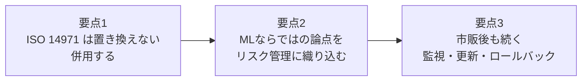

---

## 2. 前提知識：用語をそろえる

初学者が最初につまずくのは用語です。まず次の表で整理しましょう。

| 用語 | 意味（やさしい説明） |
|---|---|
| **ISO 14971** | 医療機器のリスクマネジメントを定めた国際規格。ハザードの特定→評価→対策→残留リスク評価→市販後まで一連のプロセスを規定 |
| **ISO/TR 24971** | ISO 14971 の適用ガイダンス（Technical Report）。現行版は ISO/TR 24971:2020 で、「第1部」ではない。これを置き換える予定の ISO/AWI TS 24971-1「第1部：一般」が開発中（2026年7月に作業項目登録、ステージ 20.00）。本規格（ISO/TS 24971-2）は「第2部（ML編）」に当たる |
| **Technical Specification（TS）** | ISOの成果物の一種。国際規格（IS）ほど合意が固まっていない、または技術が発展途上の分野で使われる。**直接の法的拘束力はない** |
| **ML（機械学習）** | データからパターンを学習し、予測・分類などを行う技術 |
| **MLMD** | ML-enabled Medical Device。機械学習を搭載した医療機器（IVDソフトも含む） |
| **ハザード** | 危害の潜在的な原因 |
| **危険状態** | 人・財産・環境がハザードにさらされる状況 |
| **危害（Harm）** | 人の傷害や健康被害、または財産・環境への損害 |
| **バイアス** | データやモデルに生じる偏り。特定の集団で性能が低下する原因になる |
| **ドリフト／データセットシフト** | 運用中の入力データの性質が、学習時と変わってしまい性能が劣化する現象 |
| **OOD入力** | Out-of-Distribution。学習時に想定していない種類の入力 |
| **オートメーションバイアス** | 人が自動化システムの出力を過度に信頼してしまう傾向 |
| **PMS** | Post-Market Surveillance（市販後監視） |
| **PCCP** | Predetermined Change Control Plan。米FDAの「事前に定めた変更管理計画」。AIの更新を計画的に行う枠組み |
| **GMLP** | Good Machine Learning Practice。医療機器ML開発の良好実践の10原則（IMDRFが2025年1月に最終版を公表） |

---

## 3. 規格の位置づけ

### 3.1 規格群の中での関係

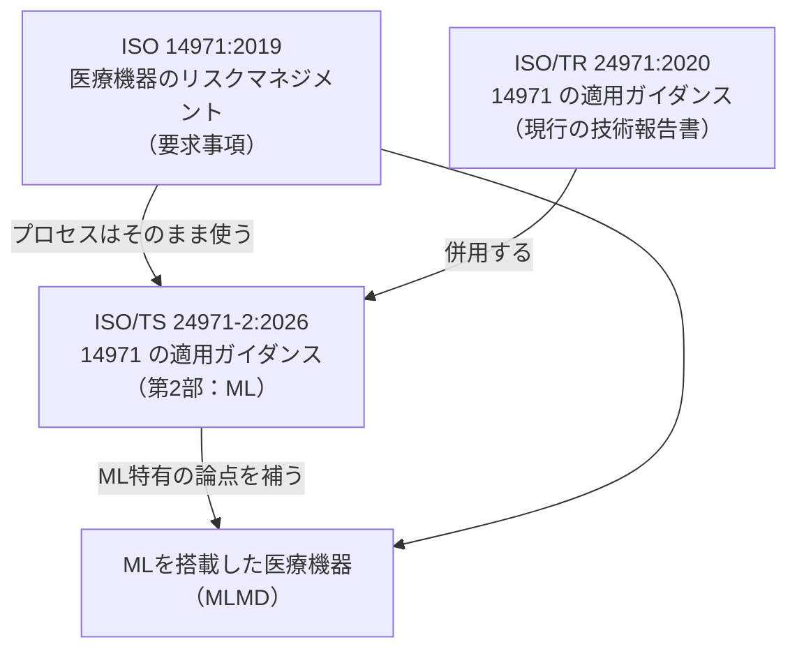

### 3.2 ISO/TS 24971-2 の「前身」との関係

本規格が登場する前から、業界ではAAMIと英国BSIが共同で、同趣旨のガイダンスを発行していました。

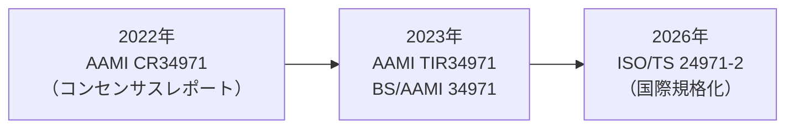

- AAMI CR34971 は、米FDAが「医療機器の要求事項を満たすために適切」と認めたガイダンスとして、AI関連では初の位置づけだったと報じられています。
- その後 TIR34971:2023 に置き換えられ、BSIとの共同で BS/AAMI 34971:2023 が発行されました。
- 前身の趣旨（14971のプロセスを変更せず、ML特有のリスクを補う）は、ISO/TS 24971-2 にも引き継がれていると読み取れます（**筆者整理**。章立て・内容の差分は正規版で確認してください）。

### 3.3 法的な位置づけ

| 観点 | 内容 |
|---|---|
| 拘束力 | TSであり、**それ自体は直接の法的拘束力を持たない** |
| 実務上の重み | 「現時点の技術水準（state of the art）」を反映するものとして、審査機関（Notified Body）や規制当局が解釈の参照に用いる可能性が高い、とJohner Instituteは見ています |
| EU（MDR/IVDR） | 自動的に義務化されるわけではないが、実務上は重要な参照枠になる見込み |

---

## 4. 適用範囲：何が対象で、何が対象外か

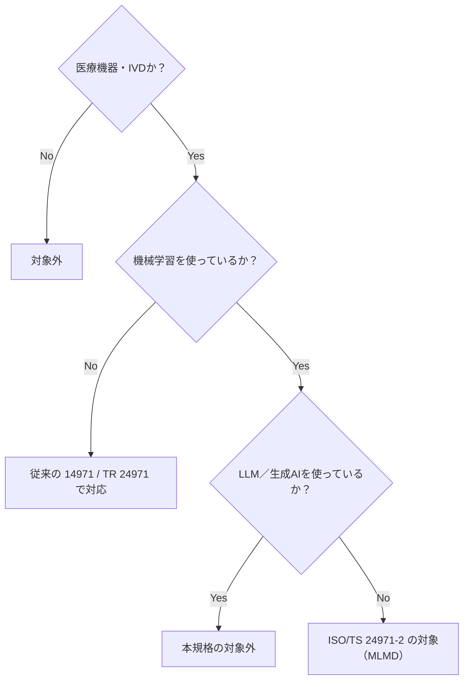

| 区分 | 具体例 |
|---|---|
| **対象** | 機械学習を搭載した医療機器ソフトウェア、機械学習を用いたIVDソフトウェア、機械学習機能が組み込まれた従来型の医療機器 |
| **対象外** | LLM・生成AIを使うMLMD（規格の概要に明記） |
| **ライフサイクル** | ハザード分析から、リスクコントロール、市販後の監視・更新・ロールバックまで全体 |

> ポイント：「AI = 全部対象」ではありません。**生成AI／LLM系は明示的に対象外**です。この点は誤解されやすいので注意してください。

また、影響を受けるのはデータサイエンティストだけではありません。

| 部門 | 関わり |
|---|---|
| 薬事（RA） | 製品の意図する用途・限界の整理 |
| 品質（QM）／リスクマネジメント | 計画・プロセスの整備 |
| 臨床／性能評価 | 臨床的妥当性、サブグループ評価 |
| ユーザビリティ（ヒューマンファクター） | 誤解・過信のリスク評価 |
| 市販後監視 | ドリフト監視、更新判断 |

---

## 5. 成立の経緯とタイムライン

ISO公式ページに掲載されているライフサイクル情報を整理します。

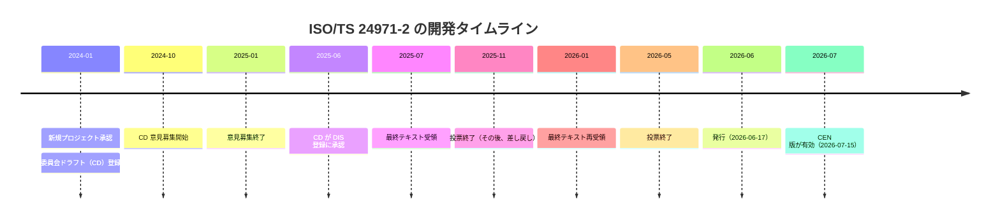

| 補足 | 内容 |
|---|---|
| 差し戻しの存在 | 2025年12月にTC/SCへ差し戻された記録があり、2026年1月に再提出されています |
| 欧州での採用 | CEN ISO/TS 24971-2:2026 として、2026年7月15日付で有効になっています（EVS掲載情報） |
| ドラフト段階との違い | ドラフト段階の概要には「健康格差（health inequity）」などの語もありましたが、**発行版の概要は異なる表現**です。引用する際は発行版を基準にしてください |

---

## 6. 規格の構成（章と附属書）

Johner Instituteの解説によれば、本規格は ISO 14971 の構成に沿って作られています。そのため「AI専用の並行したリスクマネジメント体系」を新たに作る必要はありません。

### 6.1 主な章立て

| 本規格の主な章 | 対応する ISO 14971:2019 の箇条（**筆者整理**） |
|---|---|
| 適用範囲 | 箇条1 |
| 引用規格 | 箇条2 |
| 用語と定義 | 箇条3 |
| リスクマネジメントシステムの一般要求事項 | 箇条4 |
| リスク分析 | 箇条5 |
| リスク評価 | 箇条6 |
| リスクコントロール | 箇条7 |
| 全体的な残留リスクの評価 | 箇条8 |
| リスクマネジメントレビュー | 箇条9 |
| 製造及び製造後の活動 | 箇条10 |

> 箇条番号の対応は ISO 14971:2019 の構成に基づく筆者の整理です。本規格の実際の条項番号は正規版で確認してください。

### 6.2 附属書（実務で特に役立つ部分）

| 附属書 | 内容（Johner Instituteの解説に基づく） | 使いどころ |
|---|---|---|
| **Annex A** | バイアスの説明 | データ・モデルの偏りを理解する |
| **Annex B** | ハザードとハザード状況の例 | ハザード分析の発想の材料 |
| **Annex C** | 安全に関わる特性やハザードの特定を助ける質問（網羅的ではない参考情報。チェックリストとしては使用しない） | 予備的ハザード分析（PHA）の発想の材料 |
| **Annex D** | MLMDの自律度（degree of autonomy）に関する考慮事項 | 人の関与度合いの設計 |

---

## 7. ステップバイステップ：ISO 14971 を ML に適用する

ここが本ガイドの中心です。ISO 14971 のプロセスを9ステップに分け、各ステップで**「ML特有に何が加わるか」**を整理します。

### 7.0 全体フロー

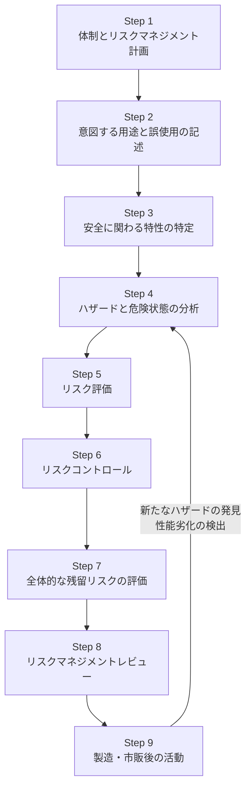

### Step 1：体制とリスクマネジメント計画

**ISO 14971 の基本**：リスクマネジメントの方針、責任と権限、計画を定める。

**MLで加わること**：

| 観点 | 内容 |
|---|---|
| 必要な専門性 | ソフトウェアだけでは足りない。データ品質・代表性、バイアス、ドリフト／データセットシフト／OOD入力、AI特有のユーザビリティリスク、サイバーセキュリティ、臨床ワークフローへの統合など |
| 計画に書くべきこと | 性能をどう監視するか、ドリフト監視は必要か、更新・再学習・ロールバックをいつ行うか、バージョン管理とトレーサビリティをどう確保するか |

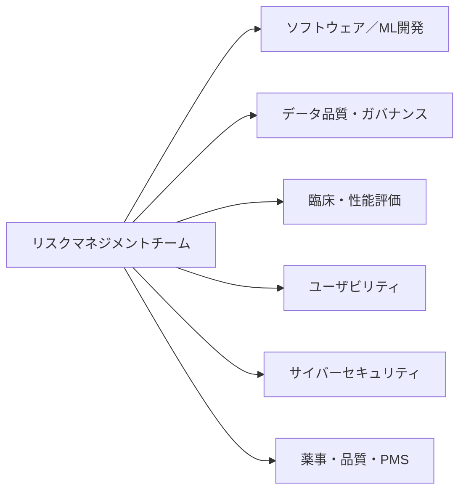

### Step 2：意図する用途と合理的に予見可能な誤使用

**ISO 14971 の基本**：意図する用途、予見可能な誤使用を特定する。

**MLで加わること**：次のような**ML特有の使われ方のリスク**を、具体的に書き込む。

| ML特有の観点 | 具体的な懸念 |
|---|---|
| スコアや分類結果の誤解釈 | 確率スコアを「確定診断」と受け取る |
| AI出力への過度な依存 | 医師がAIの結果を確認せず採用する |
| 検証済み範囲外での使用 | 学習・検証に含まれない年齢層や装置での使用 |
| 性能限界の不明確さ | どんな条件で精度が落ちるかが利用者に伝わらない |
| 不確実性・信頼度の誤解 | 信頼度の意味を取り違える |
| 透明性の不足による誤解 | なぜその出力なのかが分からず誤った判断をする |

### Step 3：安全に関わる特性の特定

**ISO 14971 の基本**：安全性に関連する特性を特定する。

**MLで加わること**：**精度（accuracy）だけでは不十分**です。

| 安全に関わる特性の例 | 説明 |
|---|---|
| 入力データ要件 | どんな画像・信号・形式なら正しく動くか |
| 対象集団の制約 | どの患者集団で検証されたか |
| キャリブレーションと閾値 | スコアの意味、陽性とする閾値の設定 |
| 既知のエラーシナリオ | 誤りやすいパターン |
| 依存関係 | クラウド、接続性、上流システムへの依存 |

> Annex C の質問は、この特定作業の発想を助ける網羅的ではない参考情報です。チェックリストとしては使用せず、自社製品に合わせて特性を検討してください。

### Step 4：ハザードと危険状態の分析

**ISO 14971 の基本**：ハザード→事象の連鎖→危険状態→危害の関係を分析する。

**MLで加わること**：

- **「モデルの誤り」だけに限定しない。** ソフトウェア／ITエラー、ユーザビリティ、サイバーセキュリティ、データ管理、実行環境、診断情報の提示方法なども従来どおり重要です。
- 次のようなML特有の事象の連鎖を考える。

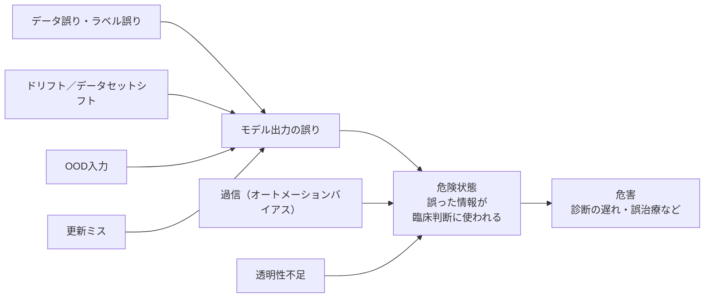

- **バイアス**（Annex A）を、データ収集・前処理・ラベリング・学習・評価の各段階で検討する。

### Step 5：リスク評価

**ISO 14971 の基本**：ここでは2つの活動を区別します。

| 活動 | 内容 | ISO 14971 での位置づけ |
|---|---|---|
| リスク推定 | 危害の発生確率と重大度から、リスクの大きさを見積もる | リスク分析の一部 |
| リスク評価 | 推定したリスクをリスク受容基準と照合し、受容できるかを決める | 推定とは別の活動 |

**MLで加わること**：MLでは**発生確率の推定が難しい**ことが多い。その場合のリスク推定の考え方は次のとおりです（Johner Instituteの解説に基づく）。推定の結果は、その後のリスク評価でリスク受容基準と照合します。

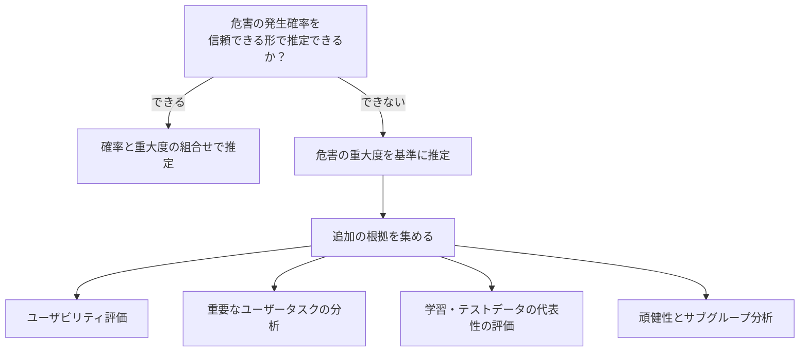

### Step 6：リスクコントロール

**ISO 14971 の基本**：設計での本質的な安全、保護手段、安全に関する情報の順で対策を講じる。

**MLで加わること**：典型的なML特有の対策は次のとおりです。

| 対策の領域 | 具体例 |
|---|---|
| **データ** | データ品質の確保、学習データとテストデータの分離 |
| **開発** | 現実的な入力制約の設定 |
| **使用時** | 人による監督・介入の仕組み、妥当性チェックとアラート |
| **情報提供** | 透明性のある警告、使用上の制限、説明可能性（explainability）の要素 |

> リスクコントロールは**データ・開発・使用の各段階から始まる**、というのが要点です。

### Step 7：全体的な残留リスクの評価

**ISO 14971 の基本**：個々の残留リスクだけでなく、全体としての許容性を評価する。

**MLで加わること**：バイアス、透明性、説明可能性、自律度（Annex D）は**二次的な話題ではなく**、MLMDの安全プロファイルと残留リスクに大きく影響し得る、とJohner Instituteは整理しています。

### Step 8：リスクマネジメントレビュー

**ISO 14971 の基本**：リスクマネジメント計画の実施と、全体的な残留リスクの許容性をレビューする。

**MLで加わること**：レビューの観点として、ML特有のギャップ分析（第11章）が有効です。

### Step 9：製造・市販後の活動

**ISO 14971 の基本**：製造・市販後の情報を収集・評価し、リスクマネジメントに反映する。

**MLで加わること**：本規格は**市場投入後のリスクマネジメントを明示的に重視**しています。

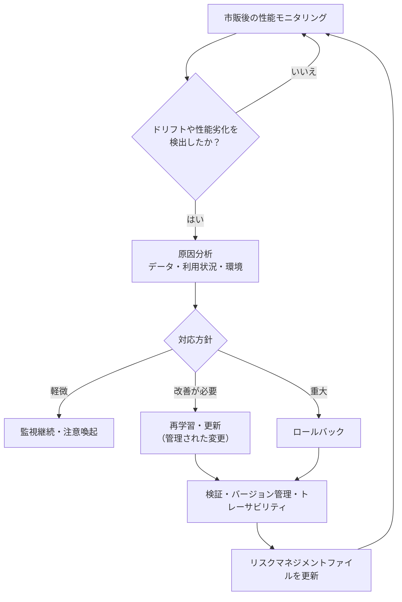

---

## 8. ML特有リスクの深掘り

### 8.1 バイアス（偏り）

| 発生段階 | 例 |
|---|---|
| データ収集 | 特定の施設・機器・人種・年齢層に偏ったデータ |
| ラベリング | ラベル付与者の判断の偏り |
| モデル開発 | 多数派に最適化され、少数派で性能が低い |
| 評価 | テストデータが対象集団を代表していない |

**対策の方向性**：学習・テストデータの代表性の評価、サブグループ別の性能分析。

### 8.2 ドリフトとデータセットシフト

| 種類 | 説明 | 例 |
|---|---|---|
| 入力データの変化 | 撮影装置の更新や撮影条件の変化 | 新機種のCTで画質特性が変わる |
| 対象集団の変化 | 患者背景の変化 | 導入先の病院で患者層が異なる |
| 運用の変化 | 使い方の変化 | 想定外の目的で使われる |

> Johner Instituteは、ドリフト指標や監視設計、複雑なモデルの説明可能性などについて、**規格は「何を考えるべきか」を示すが「どう実装するか」の方法論までは詳細に示していない**部分がある、と評価しています。この領域は手法自体が発展途上のためです。

### 8.3 オートメーションバイアスと過信

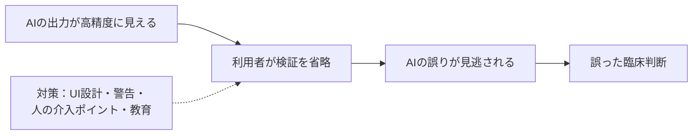

### 8.4 自律度（Annex D）

AIがどこまで自動で判断・実行し、人がどこで関与するか。自律度が高いほど、人による監督・介入の設計が残留リスクに大きく影響します。

| 自律度のイメージ（**筆者整理**） | 例 |
|---|---|
| 低 | AIが候補を提示し、人がすべて判断 |
| 中 | AIが優先順位付けをし、人が確認 |
| 高 | AIが自動で判断・動作し、人は事後確認 |

---

## 9. 架空の具体例で理解する

> ここで扱う製品・数値はすべて**学習用の架空設定**です。規格内の例ではありません。

### 9.1 設定

「胸部X線画像から肺結節の疑いを検出し、読影の優先順位を付けるAIソフトウェア」を開発している、と仮定します。

### 9.2 ステップごとの検討例

| ステップ | 検討例 |
|---|---|
| Step 2（用途・誤使用） | 「優先順位付けの補助」であり「診断確定」ではないことを明記。スコアを確定診断と誤解するリスクを特定 |
| Step 3（安全特性） | 対応する撮影装置、画像形式、対象年齢層、閾値、既知の誤検出パターンを整理 |
| Step 4（ハザード分析） | 学習データに小児が含まれない→小児画像でOOD→見逃し→治療遅延、という連鎖を分析 |
| Step 5（推定・評価） | 確率推定が難しいため、重大度を軸に推定し、サブグループ分析で補強したうえで、リスク受容基準と照合して受容性を判断 |
| Step 6（対策） | 対象年齢外の画像は処理しない入力制約、警告表示、読影者の確認フロー |
| Step 9（市販後） | 導入施設別の陽性率の変化を監視し、閾値を超えたらドリフト調査 |

### 9.3 この例のハザード連鎖

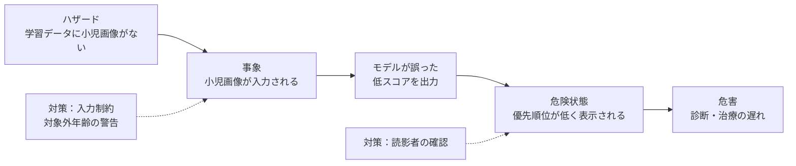

---

## 10. 関連規格・規制との関係

| 規格・規制 | 関係 |
|---|---|
| **ISO 14971:2019** | 本規格が適用対象とするリスクマネジメント規格。要求事項は変更されない |
| **ISO/TR 24971:2020** | 14971 の一般的な適用ガイダンス（現行の技術報告書）。本規格と併用。開発中の ISO/AWI TS 24971-1「第1部：一般」に置き換えられる予定 |
| **BS/AAMI 34971:2023／AAMI TIR34971** | 前身にあたるガイド（第3.2節） |
| **IEC 62304** | 医療機器ソフトウェアのライフサイクル規格（Johner Instituteは第2版の話題も扱っている） |
| **IEC 62366-1** | ユーザビリティエンジニアリング。AI特有の誤解・過信リスクと関連 |
| **IMDRF GMLP 10原則** | 2025年1月に最終版が公表。意図する用途の理解、優れたソフトウェア・設計・セキュリティ実践、集団を代表するデータセット、学習データとテストデータの独立などを含む |
| **FDA PCCP最終ガイダンス（2025年8月改訂版。初版は2024年12月）** | AI対応デバイスのソフトウェア機能について、事前に計画した変更を認可に含める枠組み。**ML更新のリスク管理**と整合させる場面が多い |
| **EU AI Act** | Johner Instituteは、AI ActとISO/TS 24971-2等を合わせて対応を支援する旨を記載。詳細な適用関係は別途確認が必要 |

### 10.1 関係の全体像

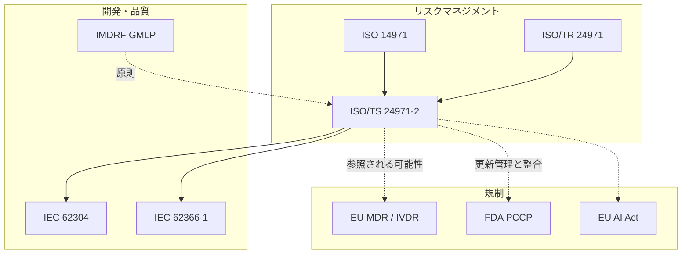

---

## 11. 実務チェックリスト（QA視点）

Johner Instituteが推奨する、製造業者が今すぐ取るべきステップを、QA向けに再構成しました。

### 11.1 取るべき5つのアクション

| # | アクション | 内容 |
|---|---|---|
| 1 | **コンピテンシーの拡張** | データ代表性、データの臨床的意味、ユーザビリティ、サイバーセキュリティ、データガバナンス、モデル開発（学習・テスト・検証）の知見をチームに |
| 2 | **用途と誤使用の見直し** | 限界が十分明確か、出力の誤解釈が現実的に扱われているか |
| 3 | **リスク分析の拡張** | データ誤り、ドリフト、誤使用、接続問題、更新ミス、透明性不足による事象の連鎖 |
| 4 | **ギャップ分析** | 既存のリスクマネジメントシステムをML視点で点検 |
| 5 | **PMSの能動的な設計** | 性能・ドリフト・実使用パターンを監視し、新たなハザードを早期に発見 |

### 11.2 ギャップ分析の対象領域

| リスク対象 | 確認の観点 |
|---|---|
| 入力データとデータガバナンス | 収集、前処理、管理、ラベリング、各種バイアス |
| モデル開発 | 学習、検証、テスト |
| AI特有の使用エラー | UIの複雑さ、出力の誤解釈、過信、正しい出力への不信、限界の認識不足 |
| 配備の依存関係 | クラウド遅延、接続要件が結果提供のタイミングや可用性に与える影響 |
| 配備後の活動 | 性能ドリフト、管理された更新、再学習、ロールバック |

### 11.3 自己点検チェックリスト（**筆者整理**）

- [ ] リスクマネジメント計画に、ML特有の監視・更新・ロールバック方針を記載したか
- [ ] 意図する用途に、対象集団・入力条件・限界を明記したか
- [ ] 精度以外の安全に関わる特性（入力要件、閾値、既知エラー、依存関係）を洗い出したか
- [ ] ハザード分析がモデル誤りだけに偏っていないか（IT、UI、セキュリティ、データ管理を含む）
- [ ] 発生確率が不確実な場合の評価方針（重大度ベース＋追加根拠）を定めたか
- [ ] 学習データとテストデータを分離し、独立性を確認したか
- [ ] サブグループ別の性能分析を実施したか
- [ ] 人の監督・介入の仕組みと、過信に対する対策があるか
- [ ] 市販後のドリフト監視指標と、更新時の再評価手順を定義したか
- [ ] モデル・データ・コードのバージョン管理とトレーサビリティを確保したか

---

## 12. よくある誤解 FAQ

| 誤解 | 実際 |
|---|---|
| 「ISO 14971 とは別の、AI専用のリスク管理プロセスが必要になる」 | **不要**。14971 のプロセスを前提に、ML特有の論点を織り込む |
| 「TSなので無視してよい」 | 直接の拘束力はないが、技術水準の参照として審査・規制対応で意識される可能性が高い |
| 「精度が高ければ安全」 | 精度は一部にすぎない。入力要件、集団、閾値、過信、更新管理なども必要 |
| 「承認を取れば終わり」 | 市販後の監視・更新・ロールバックまで計画に含める |
| 「生成AI／LLMにも使える」 | **対象外**と規格の概要に明記されている |
| 「モデルの誤りだけ見ればよい」 | IT、ユーザビリティ、サイバー、データ管理等の従来リスクも引き続き重要 |

---

## 13. 学習ロードマップ

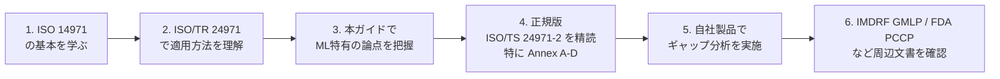

| 段階 | 目安 |
|---|---|
| 入門 | 第1〜4章、第7章を読み、全体の流れを把握 |
| 実務 | 第11章のチェックリストで自社のギャップを洗い出す |
| 深掘り | 正規版で附属書（A〜D）を確認し、チェックリストを自社用に具体化 |

---

## 14. 根拠となるソース一覧（URL）

### 14.1 一次情報・公式情報

| 区分 | ソース | URL | 参照内容 |
|---|---|---|---|
| ISO公式 | ISO/TS 24971-2:2026 | <a href="https://www.iso.org/standard/24971-2" target="_blank" rel="noopener noreferrer">https://www.iso.org/standard/24971-2</a> | 名称、概要（対象範囲、LLM/生成AI対象外）、発行日、ページ数、TC、ライフサイクル、価格 |
| 欧州規格 | CEN ISO/TS 24971-2:2026（EVS） | <a href="https://www.evs.ee/en/cen-iso-ts-24971-2-2026" target="_blank" rel="noopener noreferrer">https://www.evs.ee/en/cen-iso-ts-24971-2-2026</a> | CEN版の有効開始日（2026-07-15） |
| スペイン規格協会 | UNE掲載ページ | <a href="https://www.en.une.org/encuentra-tu-norma/busca-tu-norma/iso?c=087600" target="_blank" rel="noopener noreferrer">https://www.en.une.org/encuentra-tu-norma/busca-tu-norma/iso?c=087600</a> | 発行日（2026-06-17）の確認 |
| カナダ規格評議会 | SCC標準データベース（発行版） | <a href="https://scc-ccn.ca/standardsdb/standards/2058833" target="_blank" rel="noopener noreferrer">https://scc-ccn.ca/standardsdb/standards/2058833</a> | 発行版の概要・公開日 |
| カナダ規格評議会 | SCC標準データベース（ドラフト版） | <a href="https://scc-ccn.ca/standardsdb/standards/8191847" target="_blank" rel="noopener noreferrer">https://scc-ccn.ca/standardsdb/standards/8191847</a> | ドラフト段階の概要（バイアス、継続学習などの記述） |

### 14.2 専門機関・業界団体の解説（著名な国際的専門機関）

| 区分 | ソース | URL | 参照内容 |
|---|---|---|---|
| Johner Institute（Dr. Catharina Bertram、2026-09-16公開） | ISO/TS 24971-2:2026 – Risk Management for ML-Based Medical Devices | <a href="https://blog.johner-institute.com/regulatory-affairs/iso-ts-24971-22026-risk-management-for-ml-based-medical-devices/" target="_blank" rel="noopener noreferrer">https://blog.johner-institute.com/regulatory-affairs/iso-ts-24971-22026-risk-management-for-ml-based-medical-devices/</a> | 要点、構成、附属書、製造業者への推奨ステップ、評価 |
| BSI | BS/AAMI 34971:2023 解説 | <a href="https://knowledge.bsigroup.com/articles/how-to-tackle-hazards-in-ai-medical-devices-using-bs-aami-34971" target="_blank" rel="noopener noreferrer">https://knowledge.bsigroup.com/articles/how-to-tackle-hazards-in-ai-medical-devices-using-bs-aami-34971</a> | 前身ガイドの趣旨 |
| BSI | BS/AAMI 34971 製品ページ | <a href="https://knowledge.bsigroup.com/products/application-of-iso-14971-to-machine-learning-in-artificial-intelligence-guide/standard" target="_blank" rel="noopener noreferrer">https://knowledge.bsigroup.com/products/application-of-iso-14971-to-machine-learning-in-artificial-intelligence-guide/standard</a> | 前身ガイドの対象範囲 |
| AAMI／MedTech Intelligence | AAMI TIR34971 と BS/AAMI 34971 の発行 | <a href="https://medtechintelligence.com/?p=31349" target="_blank" rel="noopener noreferrer">https://medtechintelligence.com/?p=31349</a> | CR→TIR→BSの経緯、FDAによる認識 |
| GlobalSpec（AAMI CR34971） | AAMI CR34971 概要 | <a href="https://standards.globalspec.com/std/14504976/cr34971" target="_blank" rel="noopener noreferrer">https://standards.globalspec.com/std/14504976/cr34971</a> | 前身コンセンサスレポートの趣旨（データ管理、特徴抽出、学習、評価、サイバーセキュリティ） |

### 14.3 関連する規制・ガイダンス

| 区分 | ソース | URL | 参照内容 |
|---|---|---|---|
| 米FDA | Good Machine Learning Practice for Medical Device Development: Guiding Principles | <a href="https://www.fda.gov/medical-devices/artificial-intelligence-enabled-medical-devices/good-machine-learning-practice-medical-device-development-guiding-principles" target="_blank" rel="noopener noreferrer">https://www.fda.gov/medical-devices/artificial-intelligence-enabled-medical-devices/good-machine-learning-practice-medical-device-development-guiding-principles</a> | IMDRFが2025年1月にGMLP 10原則の最終版を公表 |
| RAPS | IMDRF finalizes good machine learning practice, software risk documents | <a href="https://www.raps.org/resource/imdrf-finalizes-good-machine-learning-practice-so.html" target="_blank" rel="noopener noreferrer">https://www.raps.org/resource/imdrf-finalizes-good-machine-learning-practice-so.html</a> | GMLP最終版の内容（意図する用途、代表性のあるデータ、学習・テストデータの独立など） |
| 米FDA | Marketing Submission Recommendations for a Predetermined Change Control Plan for AI-Enabled Device Software Functions（Final、2025年8月） | <a href="https://www.fda.gov/regulatory-information/search-fda-guidance-documents/marketing-submission-recommendations-predetermined-change-control-plan-artificial-intelligence" target="_blank" rel="noopener noreferrer">https://www.fda.gov/regulatory-information/search-fda-guidance-documents/marketing-submission-recommendations-predetermined-change-control-plan-artificial-intelligence</a> | PCCP最終ガイダンスの現行版 |
| Ropes & Gray | FDA finalizes guidance on PCCPs for AI-enabled device | <a href="https://ropesgray.com/en/insights/alerts/2024/12/fda-finalizes-guidance-on-predetermined-change-control-plans-for-ai-enabled-device" target="_blank" rel="noopener noreferrer">https://ropesgray.com/en/insights/alerts/2024/12/fda-finalizes-guidance-on-predetermined-change-control-plans-for-ai-enabled-device</a> | PCCP最終ガイダンスの公表日・スコープ |
| McDermott Will & Schulte | FDA Issues Final Guidance on PCCPs for AI-Enabled Devices | <a href="https://www.mcdermottlaw.com/insights/fda-issues-final-guidance-on-predetermined-change-control-plans-for-ai-enabled-devices/" target="_blank" rel="noopener noreferrer">https://www.mcdermottlaw.com/insights/fda-issues-final-guidance-on-predetermined-change-control-plans-for-ai-enabled-devices/</a> | PCCPの位置づけ |

### 14.4 ソースに関する補足

- ISO/TS 24971-2:2026 は2026年6月に発行されたばかりであり、**個人開発者のブログ等で規格本文を踏まえた詳細解説は、基準日時点では限定的**でした。このため本ガイドでは、国際的に知られる専門機関（Johner Institute、BSI、AAMI、FDA、IMDRF）の公開情報を中心に参照しています。
- Johner Institute の記事は2026年9月16日公開（同月23日更新）で、本規格を扱った**基準日時点で最も詳しい公開解説**の一つです。
- **規格本文（有料）は未参照**です。実務で適用する際は、必ず正規版で条項・附属書の内容を確認してください。

---

## 付録：用語の英日対応

| English | 日本語 |
|---|---|
| ML-enabled medical device (MLMD) | 機械学習を搭載した医療機器 |
| Risk management plan | リスクマネジメント計画 |
| Hazard / Hazardous situation / Harm | ハザード／危険状態／危害 |
| Residual risk | 残留リスク |
| Bias | バイアス |
| Drift / Dataset shift | ドリフト／データセットシフト |
| Out-of-distribution (OOD) | 分布外入力 |
| Automation bias | オートメーションバイアス |
| Explainability | 説明可能性 |
| Degree of autonomy | 自律度 |
| Post-market surveillance (PMS) | 市販後監視 |
| Rollback | ロールバック（以前のバージョンへの戻し） |
| Predetermined change control plan (PCCP) | 事前に定めた変更管理計画 |
| Preliminary hazard analysis (PHA) | 予備的ハザード分析 |
