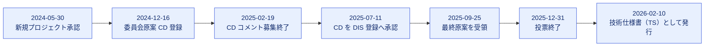
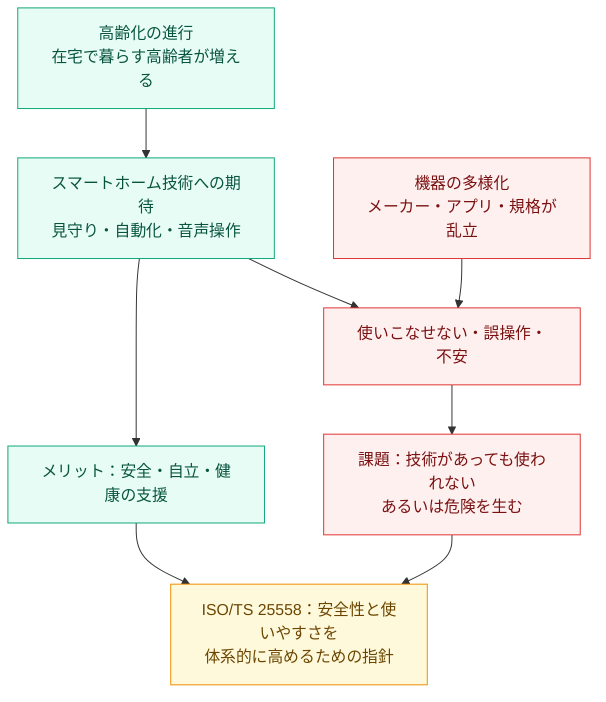
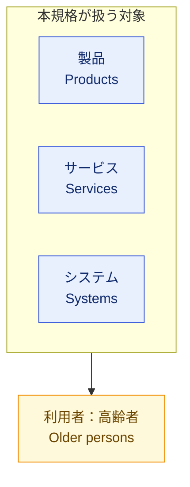
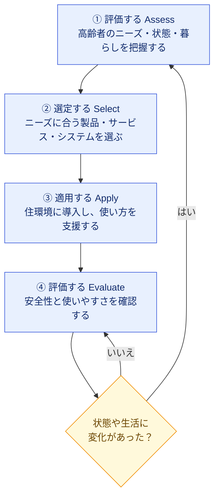
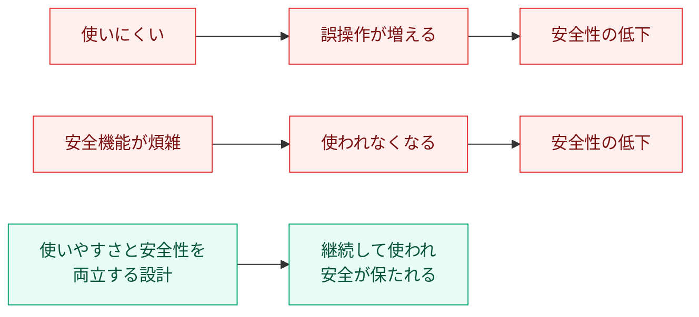
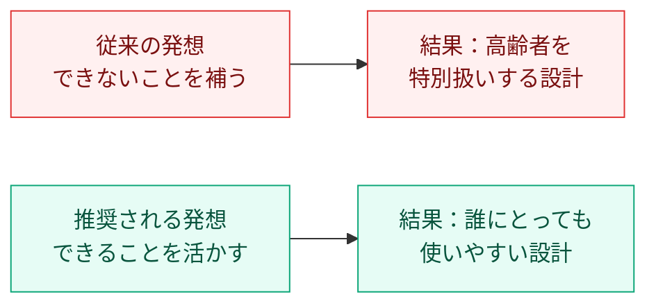
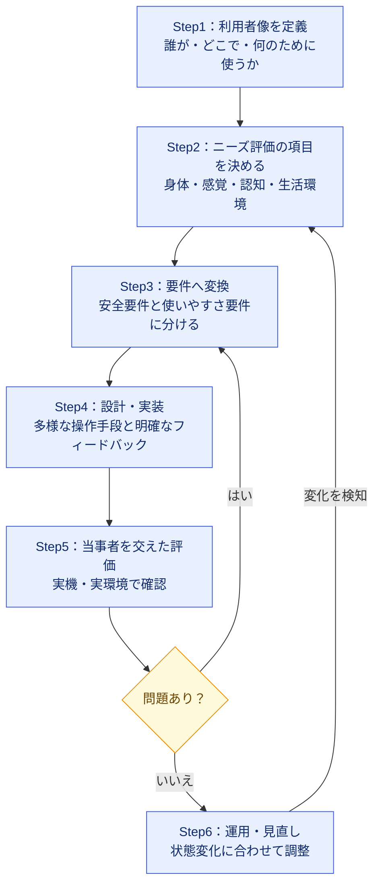
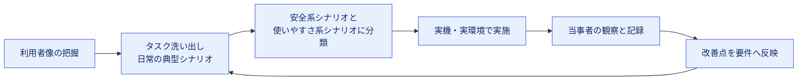
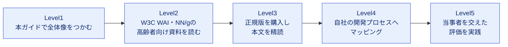

# ISO/TS 25558:2026 初学者向けステップバイステップ解説ガイド

> **対象規格**：ISO/TS 25558:2026 — Ageing societies — Guidance for enhancing safety and usability of smart home products, services, and systems for older persons in smart home environment
> **邦題（仮訳）**：高齢社会 ― スマートホーム環境における高齢者向けのスマートホーム製品・サービス・システムの安全性と使いやすさを高めるためのガイダンス
> **調査基準日**：2026年10月23日
> **想定読者**：スマートホーム／IoT／アプリの開発者、UI/UXデザイナー、QAエンジニア、サービス企画者

---

## 0. このガイドを読む前に（情報の限界と読み方）

先に、このガイドで「何が分かり、何が分からないか」を正直に示します。

| 区分 | 内容 |
|---|---|
| ✅ 公式に確認できた情報 | ISO公式ページ、各国規格機関（SFS・ISS・ISME 等）の公開ページにある**要旨（Abstract/Scope）・書誌情報・制定履歴** |
| ⚠️ 確認できなかった情報 | **規格本文（条項番号、具体的な要求・推奨事項、附属書）**。本文は有償（CHF 135、21ページ）で、ISOの利用規約は該当するライセンス条件の下で許諾のないAI/MLによるISOコンテンツの処理を認めていない（第12章 URL 17）ため、本ガイドは本文を参照していません |
| 🧭 本ガイドの補足 | 公開要旨から読み取れる**考え方の整理**と、W3C・Nielsen Norman Group・Matter 等の**国際的に信頼できる公開情報**をもとにした実務への橋渡し |

**重要な約束事**

- 本ガイドは規格本文の要約ではありません。**条項番号や「規格はこう要求している」という断定は書きません**。
- 本文の細部が必要な場合は、必ずISOストアで正規版を購入するか、各国の規格機関から入手してください（第12章に入手先を記載）。
- 各章の見出し横の記号で情報の確度を示します。

| 記号 | 意味 |
|---|---|
| 🟢 | 公式ページで確認できた事実 |
| 🔵 | 公開要旨に基づく読み取り（解釈を含む） |
| 🟡 | 一般的な知見・実務上の整理（規格本文とは無関係） |

---

## 目次

1. [ひとことで言うと](#1-ひとことで言うと)
2. [基本情報カード](#2-基本情報カード)
3. [なぜこの規格が生まれたのか](#3-なぜこの規格が生まれたのか)
4. [TS（技術仕様書）とは何か](#4-ts技術仕様書とは何か)
5. [スコープと対象読者](#5-スコープと対象読者)
6. [核心：4ステップのプロセス](#6-核心4ステップのプロセス)
7. [「安全性」と「使いやすさ」を分けて考える](#7-安全性と使いやすさを分けて考える)
8. [加齢に伴う変化をどう捉えるか](#8-加齢に伴う変化をどう捉えるか)
9. [開発現場への落とし込み（ステップバイステップ）](#9-開発現場への落とし込みステップバイステップ)
10. [QAエンジニア向け：テスト観点の設計](#10-qaエンジニア向けテスト観点の設計)
11. [関連規格・関連ガイドライン](#11-関連規格関連ガイドライン)
12. [根拠ソースURL一覧](#12-根拠ソースurl一覧)
13. [FAQ・よくある誤解](#13-faqよくある誤解)
14. [学習ロードマップ](#14-学習ロードマップ)

---

## 1. ひとことで言うと

🟢🔵

> **「高齢者が自宅のスマートホームで、安全に、迷わず、自分らしく暮らし続けられるようにするための"進め方の指針"」**

ポイントは次の3つです。

| # | ポイント | 意味 |
|---|---|---|
| ① | **ガイダンス（指針）** | 「これを満たさなければ不適合」という要求事項ではなく、考え方と進め方を示す文書 |
| ② | **プロセス志向** | 公式要旨が「ニーズを評価し、製品・サービス・システムを**選び、適用し、評価する**プロセスを示す」と述べている |
| ③ | **変化への対応** | 高齢者の**健康状態やライフスタイルが変わっていく**ことを前提にしている |

---

## 2. 基本情報カード

🟢（ISO公式ページより）

| 項目 | 内容 |
|---|---|
| 規格番号 | ISO/TS 25558:2026 |
| 種別 | Technical Specification（技術仕様書） |
| 版 | 第1版（Edition 1） |
| 発行日 | 2026年2月（ステージ 60.60 到達日：2026-02-10） |
| ステータス | Published（発行済み） |
| ページ数 | 21 |
| 言語 | 英語のみ（フランス語・スペイン語版なし） |
| 担当委員会 | ISO/TC 314（Ageing societies：高齢社会） |
| ICS（分類） | 11.180.01（障害者・高齢者向け補助具・一般）／35.240.95（インターネットアプリケーション） |
| 価格 | CHF 135（PDF + ePub、ISO公式ストア） |
| 関連するSDGs | 3（すべての人に健康と福祉を）、5（ジェンダー平等）、10（人や国の不平等をなくそう） |

### 制定までの経緯（公式ライフサイクルより）

> 🟡 **読み取りのヒント**：新規提案の承認から発行までは約1年9か月です。比較的新しく、**実装事例や解説記事がまだ少ない規格**であることを意味します。

---

## 3. なぜこの規格が生まれたのか

🟢🟡

### 3-1. 担当委員会 ISO/TC 314 の使命

ISO公式の記事によると、ISO/TC 314（Ageing societies）は、高齢化する社会が直面する課題に対して、共通言語となる規格を作ることを目的とした委員会です。

TC 314が公表している規格の例（書誌情報として確認できたもの）は次のとおりです。

| 規格 | テーマ |
|---|---|
| ISO 25550:2022 | 年齢包摂的な職場（age-inclusive workforce） |
| ISO 25552:2022 | 認知症にやさしい地域（dementia-inclusive communities） |
| ISO 25556:2025 | 高齢者を含めたデジタル経済（BSIの一覧より） |
| **ISO/TS 25558:2026** | **高齢者向けスマートホームの安全性・使いやすさ（本ガイドの対象）** |

### 3-2. 「スマートホーム × 高齢者」が課題になる理由

> 🟡 スマートホームの標準化では、メーカー間の相互運用性を高める共通規格 **Matter**（Connectivity Standards Alliance）が普及し始めています。ただし相互運用性が上がっても、**高齢者にとって使いやすいか**は別の問題として残ります。ISO/TS 25558 はこの「人間側」の視点を補う位置づけと理解すると整理しやすくなります。

---

## 4. TS（技術仕様書）とは何か

🟡（ISOの一般的な文書区分に関する知識）

ISO/TS 25558 の「TS」は **Technical Specification** の略です。初学者が最初に混乱しやすいので整理します。

| 区分 | 位置づけ | 本規格での意味 |
|---|---|---|
| **IS**（International Standard） | 合意の成熟度が最も高い。要求事項を含むことが多い | — |
| **TS**（Technical Specification） | 技術が発展途上、または将来IS化の可能性がある分野で発行される | **本規格はこちら** |
| **TR**（Technical Report） | 情報提供が中心 | — |

### 実務上の注意点

| 誤解 | 実際 |
|---|---|
| 「ISO規格だから認証を受けられる」 | ISO公式ページ上、本規格は**ガイダンス**として紹介されており、認証制度が前提かどうかは公開情報からは確認できません。**認証の有無は本文・各認証機関の情報で確認が必要**です |
| 「守らないと法令違反になる」 | 規格それ自体は法令ではありません。ただし契約・調達要件として参照される可能性はあります |
| 「ISとTSは同じ強さ」 | 区分が異なります。TSは**ガイダンスとして使う**姿勢が基本です |

---

## 5. スコープと対象読者

🟢（公式Scopeより）

### 5-1. スコープ（適用範囲）

公式の要旨は、次の2点を柱にしています。

1. **目的**：高齢者が望む健康的な暮らしを送れるよう、スマートホームの**製品・サービス・システム**の安全性と使いやすさを高めること
2. **方法**：高齢者のニーズを**評価**し、適切な製品等を**選定・適用・評価**する**プロセス**を示すこと

### 5-2. 対象となる「3つの層」

| 層 | 具体例（🟡 筆者の例示） |
|---|---|
| 製品 | スマートスピーカー、照明、サーモスタット、ドアロック、センサー |
| サービス | 見守りサービス、遠隔相談、オンライン生活支援 |
| システム | 複数の機器・アプリ・クラウドを組み合わせたホーム全体の仕組み |

### 5-3. 対象読者

公式要旨では、**スマートホームの設計者・開発者・提供者**に適用されると明記されています。

| 立場 | 本規格との関わり（🔵 読み取り） |
|---|---|
| 設計者（UI/UX、建築、サービス設計） | 設計判断の拠り所 |
| 開発者（ファーム、アプリ、クラウド） | 要件定義・仕様検討の観点 |
| 提供者（事業者、販売・導入支援） | 導入前のニーズ評価、導入後の見直し |
| QAエンジニア（🟡 筆者の補足） | 受入基準・テスト観点を考える材料 |

---

## 6. 核心：4ステップのプロセス

🟢🔵（公式要旨の「assess → select, apply, and evaluate」を図解）

公式要旨は、ニーズの**評価**から、製品等の**選定・適用・評価**までを一連のプロセスとして示しています。これを初学者向けに4ステップへ整理します。

> 🔵 **注意**：ステップ名と分け方は、要旨の動詞（assess / select / apply / evaluate）を**本ガイドが図解用に整理したもの**です。規格本文の章立てと一致するとは限りません。

### 各ステップの意味

| ステップ | 何をするか | 初学者向けの例え |
|---|---|---|
| ① 評価する | 本人の身体・感覚・認知の状態、生活習慣、家の環境、周囲の支援者などを把握する | 洋服を買う前に**採寸する** |
| ② 選定する | ①の結果に合う機器・サービスを選ぶ | **サイズに合う服**を選ぶ |
| ③ 適用する | 設置・設定し、本人が使えるよう支援する | **試着して微調整**する |
| ④ 評価する | 実際に安全か、迷わず使えるかを確認する | **着心地を確かめる** |
| 繰り返し | 状態が変われば①に戻る | **体型が変われば仕立て直す** |

### このプロセスで最も大切な考え方

公式要旨は「健康状態やライフスタイルが**変化する**」ことに言及しています。

> 🔵 つまり「**一度導入したら終わり**」ではなく、**継続的に見直す前提**の設計思想です。これはソフトウェア開発における継続的改善（フィードバックループ）とよく似ています。

---

## 7. 「安全性」と「使いやすさ」を分けて考える

🟡（本規格のキーワードを、一般的なHCI・安全設計の考え方で整理）

規格名にある **safety（安全性）** と **usability（使いやすさ）** は、混ぜずに分けると理解しやすくなります。

| 観点 | 問い | 悪い例 | 良い例（🟡 筆者の例示） |
|---|---|---|---|
| **安全性** | 利用者を危害から守れるか | 誤操作でコンロが点火し続ける | 異常時に自動停止し、家族へ通知する |
| **使いやすさ** | 目的を効果的・効率的・満足に達成できるか | 設定画面が複雑で諦める | 1画面1操作で、結果が音と表示で分かる |

### 両者の関係

> 🟡 **ポイント**：安全機能は**使われて初めて機能します**。使いやすさは「おまけ」ではなく、安全性を成立させる条件でもあります。

---

## 8. 加齢に伴う変化をどう捉えるか

🟡（一般的な知見。規格本文の記述ではありません）

高齢者のニーズを「評価」するとき、変化は一人ひとり異なります。年齢だけで一括りにしない点が重要です。

### 8-1. 変化の3つの側面

高齢者向けのUX・人間工学やアクセシビリティの実務では、「身体・感覚・認知」の3つの側面で変化を整理するのが一般的です（🟡 実務上の整理枠組み）。

| 側面 | 起こりうる変化（一般論） | 設計上の観点 |
|---|---|---|
| **身体** | 握力・指先の細かな動き・歩行・立ち座りのしにくさ | 大きなボタン、軽い操作、タッチ以外の操作手段 |
| **感覚** | 視力・聴力・触覚の低下 | 文字サイズ、コントラスト、音量、複数感覚での通知 |
| **認知** | 新しい手順の習得、短期記憶、注意の維持のしにくさ | 手順の簡素化、一貫性、誤操作の取り消し |

### 8-2. 「できないこと」ではなく「できること」から設計する

> 🟡 UXデザインの実務記事でも、高齢者向けの設計を「特殊対応」ではなく**すべてのユーザーの摩擦を見つける方法**として扱う考え方が紹介されています（第12章 参照）。

---

## 9. 開発現場への落とし込み（ステップバイステップ）

🟡（筆者による実務への橋渡し。規格本文の要求ではありません）

規格本文を入手できない段階でも、**公式要旨のプロセスに沿って**開発フローへ当てはめられます。

### 9-1. 全体像

### 9-2. 各ステップの具体策

| ステップ | やること | 成果物の例 |
|---|---|---|
| **Step1 利用者像** | 高齢者本人だけでなく、家族・介護者・訪問スタッフも関係者として整理する | ペルソナ、ステークホルダー図 |
| **Step2 ニーズ評価** | 面談・観察・生活動線の確認で、困りごとと「できること」を把握する | ニーズ評価シート |
| **Step3 要件化** | 安全要件（異常時の挙動）と使いやすさ要件（所要時間・誤操作率）に分ける | 要件一覧、受入基準 |
| **Step4 設計・実装** | 音声・物理ボタン・アプリなど**複数の操作手段**を用意する。エラーは平易に伝える | UI仕様、状態遷移図 |
| **Step5 評価** | 実際の高齢者による**ユーザビリティテスト**を行う | テスト報告書 |
| **Step6 運用** | 利用状況を見て設定や機器を見直す | 見直し記録 |

### 9-3. 著名な国際情報源から学べる設計の勘所

規格本文とは別に、国際的に信頼できる公開情報（解説・研究資料を含み、本規格の一次情報ではありません）から、再利用しやすい知見をまとめます。

#### ① W3C WAI（Web Accessibility Initiative）

| 内容 | 要点 |
|---|---|
| 研究の結論 | EU出資の WAI-AGE プロジェクトは、高齢のウェブ利用者のニーズと障害者向けアクセシビリティとの**重なり**を調査した |
| 示唆 | 障害のある人に配慮してアクセシブルに作られたWebサイト・アプリ・ツールは、**高齢の利用者にもよりアクセシブル**になる |
| 実務への影響 | スマートホームの**Web管理画面**には、WCAG（Web Content Accessibility Guidelines）の適用が有効。**ネイティブのモバイルアプリ**はWebコンテンツではないため、WCAG2ICT（WCAGを非Web ICTへ適用するためのW3Cの指針、第12章 URL 18）または適用される製品規格（例：EN 301 549）を参照する |

#### ② Nielsen Norman Group（Jakob Nielsen ら）

| 内容 | 要点 |
|---|---|
| 調査 | 65歳以上を対象にしたユーザビリティ研究を長年実施 |
| 知見の例 | 入力の許容範囲が狭いフォーム（例：電話番号の書式）で高齢者がつまずきやすい |
| 実務への影響 | 入力は**複数の書式を受け付ける**、エラーメッセージは**平易で修正方法が分かる**ものにする |

> ⚠️ 上記は Web サイトを対象とした研究が中心で、**スマートホームの物理機器やIoTにそのまま当てはまるとは限りません**。「設計の勘所」として参考にしてください。

#### ③ スペイン・マドリード工科大学 Ageing Lab（学術系）

| 内容 | 要点 |
|---|---|
| 高齢者向けUIの指針例 | 大きな文字と十分なコントラスト、長文の回避、1画面に複数の操作を詰め込まない |
| ヒューリスティクス | Nielsen の10原則は高齢者にも適用でき、特に**一貫性と標準**が最優先と報告 |

#### ④ Matter（Connectivity Standards Alliance）

| 内容 | 要点 |
|---|---|
| 概要 | Amazon・Google・Apple・Samsung などが参加する、スマートホームの**相互運用性**のためのオープン標準 |
| アクセシビリティ面の期待 | 英国の視覚障害者支援団体は、Matter により**メーカーを問わず組み合わせて使える**ようになり、アクセシブルな機器を選びやすくなると解説 |
| 注意点 | 同団体は、導入時の使い勝手はまだ見極めが必要という慎重な立場も示している |
| 実務への影響 | 機器の**接続・設定の簡素化**は、高齢者の導入ハードルを下げる要素になりうる |

> 🟡 **まとめ**：ISO/TS 25558 は**人を中心にした進め方**、W3C・NN/g は**画面設計の具体知見**、Matter は**機器間の接続基盤**と、それぞれ役割が異なり、**組み合わせて使う**と効果的です。

---

## 10. QAエンジニア向け：テスト観点の設計

🟡（筆者の整理。規格本文の要求ではなく、テスト設計の叩き台）

「安全性」と「使いやすさ」は、**テストの切り口が異なります**。

### 10-1. テスト観点の一覧表

| 観点 | 確認すること | テスト手法の例 |
|---|---|---|
| **安全：異常時の挙動** | 通信断・停電・センサー誤作動のとき危険が生じないか | 異常系テスト、フェイルセーフ確認 |
| **安全：誤操作耐性** | 誤タップ・誤発話で重大な動作が起きないか | 確認ダイアログ、取り消し操作の検証 |
| **安全：通知の確実性** | 異常が本人・家族に確実に届くか | 通知経路の疎通、複数手段の確認 |
| **使いやすさ：効果** | 目的のタスクを達成できるか | タスク成功率の測定 |
| **使いやすさ：効率** | 所要時間・手数が妥当か | 操作時間、クリック数の計測 |
| **使いやすさ：満足** | 不安なく使い続けられるか | 事後アンケート、観察 |
| **知覚性** | 文字サイズ・コントラスト・音量が適切か | Web管理画面はWCAG準拠チェック、ネイティブのモバイルアプリはWCAG2ICTまたは適用される製品規格（例：EN 301 549）に基づくチェック、機器本体の表示・音量は実機での評価 |
| **一貫性** | 機器間・画面間で操作が統一されているか | UIレビュー、ヒューリスティック評価 |
| **導入・設定** | 初期設定を本人または支援者が完了できるか | 初期設定シナリオテスト |
| **経時変化への対応** | 設定変更や機器追加が容易か | 変更シナリオテスト |

### 10-2. テスト設計のフロー

### 10-3. 実施上の注意

| 注意点 | 理由 |
|---|---|
| **開発者や若い社内メンバーだけで評価しない** | 感覚・認知の状態が異なる実際の利用者でないと見えない問題がある |
| **テスト参加者の負担に配慮する** | 疲労や緊張で成績が左右される。休憩や丁寧な説明が必要（NN/g も高齢者向けテストの配慮を解説） |
| **失敗を利用者のせいにしない** | 操作できなかった事実は、設計の問題として記録する |
| **個人情報・健康情報の取り扱いに注意** | 観察・録画データには機微な情報が含まれうる。同意取得と最小限の収集を徹底する |

---

## 11. 関連規格・関連ガイドライン

### 11-1. ISO/TC 314 の関連規格（🟢 書誌情報で確認）

| 規格 | 内容 | 本規格との関係（🟡） |
|---|---|---|
| ISO 25550:2022 | 年齢包摂的な職場 | 同じ「高齢社会」シリーズ。対象は職場 |
| ISO 25552:2022 | 認知症にやさしい地域の枠組み | 認知面の配慮を考える際の参考 |
| ISO 25556:2025 | 高齢者を含むデジタル経済 | デジタルサービス全般の視点 |
| ISO 25553-1:2026 | スマート多世代近隣地区の枠組み（第1部：要求事項及び推奨事項、2026年6月発行） | 住まいから地域へ広げた視点 |

### 11-2. 実務で併用しやすいガイドライン（🟡）

| 領域 | 参照先 | 活用場面 |
|---|---|---|
| Webアクセシビリティ | W3C WCAG | Web管理画面、Webダッシュボード |
| ネイティブアプリのアクセシビリティ | W3C WCAG2ICT、適用される製品規格（例：EN 301 549） | モバイル管理アプリ |
| ユーザビリティ | Nielsen の10ヒューリスティクス | UIレビュー |
| 機器間連携 | Matter | 機器選定、接続設計 |

---

## 12. 根拠ソースURL一覧

調査基準日：2026年10月23日

### 12-1. 規格本体（一次情報・書誌情報）

| # | 情報源 | URL | 確認できた内容 |
|---|---|---|---|
| 1 | ISO公式（本規格） | <a href="https://www.iso.org/standard/85086.html" target="_blank" rel="noopener noreferrer">https://www.iso.org/standard/85086.html</a> | 要旨、版、ページ数、価格、ICS、委員会、制定ライフサイクル、SDGs |
| 2 | ISO公式（フランス語ページ） | <a href="https://www.iso.org/fr/standard/85086.html" target="_blank" rel="noopener noreferrer">https://www.iso.org/fr/standard/85086.html</a> | 英語のみ提供であること |
| 3 | フィンランド規格協会（SFS） | <a href="https://store.sfs.fi/en/isots-25558-2026-2" target="_blank" rel="noopener noreferrer">https://store.sfs.fi/en/isots-25558-2026-2</a> | 要旨・ICS・委員会の一致確認 |
| 4 | セルビア規格協会（ISS） | <a href="https://iss.rs/en/project/show/iso:proj:85086" target="_blank" rel="noopener noreferrer">https://iss.rs/en/project/show/iso:proj:85086</a> | 発行日 2026-02-10、Scope |
| 5 | モンテネグロ規格協会（ISME） | <a href="https://isme.me/en/project/show/iso:proj:85086" target="_blank" rel="noopener noreferrer">https://isme.me/en/project/show/iso:proj:85086</a> | 発行日、Scope、ICS名称 |
| 17 | ISO Online Browsing Platform 利用規約 | <a href="https://www.iso.org/home/store/iso-obp-terms.html" target="_blank" rel="noopener noreferrer">https://www.iso.org/home/store/iso-obp-terms.html</a> | ISOコンテンツの利用条件（許諾のないAI/ML処理の制限の根拠） |

### 12-2. 委員会・関連規格

| # | 情報源 | URL | 確認できた内容 |
|---|---|---|---|
| 6 | ISO記事「A society for all ages」 | <a href="https://www.iso.org/news/society-for-all-ages.html" target="_blank" rel="noopener noreferrer">https://www.iso.org/news/society-for-all-ages.html</a> | TC 314の目的、ISO 25552 等の位置づけ |
| 7 | ISO 25550:2022 | <a href="https://www.iso.org/fr/standard/76420.html" target="_blank" rel="noopener noreferrer">https://www.iso.org/fr/standard/76420.html</a> | 年齢包摂的な職場の規格情報 |
| 8 | BSI 標準開発ポータル（TC 314対応委員会） | <a href="https://standardsdevelopment.bsigroup.com/committees/50276427" target="_blank" rel="noopener noreferrer">https://standardsdevelopment.bsigroup.com/committees/50276427</a> | ISO 25552・25556・25553-1 等の状況 |

### 12-3. 国際的に著名な技術・設計コミュニティの情報

| # | 情報源 | URL | 活用した内容 |
|---|---|---|---|
| 9 | W3C WAI「Older Users and Web Accessibility」 | <a href="https://www.w3.org/WAI/older-users/" target="_blank" rel="noopener noreferrer">https://www.w3.org/WAI/older-users/</a> | 高齢者ニーズとアクセシビリティの重なり |
| 10 | Nielsen Norman Group「User Testing with Older Adults」 | <a href="https://www.nngroup.com/videos/user-testing-older-adults/" target="_blank" rel="noopener noreferrer">https://www.nngroup.com/videos/user-testing-older-adults/</a> | 高齢者向けテストの配慮 |
| 11 | Pernice & Nielsen「Web Usability for Senior Citizens」書誌（Univ. of Groningen） | <a href="https://ebooks.ub.rug.nl/87" target="_blank" rel="noopener noreferrer">https://ebooks.ub.rug.nl/87</a> | 65歳以上の調査の概要 |
| 12 | UPM Ageing Lab「UX and usability for older users」 | <a href="https://ageinglab.ctb.upm.es/en/ux-and-usability-for-older-users-en" target="_blank" rel="noopener noreferrer">https://ageinglab.ctb.upm.es/en/ux-and-usability-for-older-users-en</a> | 高齢者向けUI指針、一貫性の重要性 |
| 13 | ZURB Radar「Design for Seniors, Ship a Better Product for Everyone」 | <a href="https://radar.zurb.com/article/design-for-seniors-ship-a-better-product-for-everyone" target="_blank" rel="noopener noreferrer">https://radar.zurb.com/article/design-for-seniors-ship-a-better-product-for-everyone</a> | 高齢者設計を全体改善へ活かす考え方、フォームの許容度 |
| 14 | Guide Dogs（英国）「How Matter will revolutionise smart home device accessibility」 | <a href="https://www.guidedogs.org.uk/blog/matter-smart-home-accessibility" target="_blank" rel="noopener noreferrer">https://www.guidedogs.org.uk/blog/matter-smart-home-accessibility</a> | Matter とアクセシビリティ |
| 15 | AbilityNet「Matter: Enriching disabled people's experience of technology」 | <a href="https://abilitynet.org.uk/news-blogs/matter-enriching-disabled-peoples-experience-technology" target="_blank" rel="noopener noreferrer">https://abilitynet.org.uk/news-blogs/matter-enriching-disabled-peoples-experience-technology</a> | Matter の期待と限界 |
| 16 | arXiv「Matter: IoT Interoperability for Smart Homes」 | <a href="https://arxiv.org/abs/2405.01618v2" target="_blank" rel="noopener noreferrer">https://arxiv.org/abs/2405.01618v2</a> | Matter の技術的な位置づけ |
| 18 | W3C「Guidance on Applying WCAG 2.2 to Non-Web Information and Communications Technologies (WCAG2ICT)」 | <a href="https://www.w3.org/TR/wcag2ict-22/" target="_blank" rel="noopener noreferrer">https://www.w3.org/TR/wcag2ict-22/</a> | ネイティブアプリなど非Web ICTへのWCAGの適用 |

### 12-4. 規格本文の入手方法

| 方法 | 内容 |
|---|---|
| ISO公式ストア | 上記 URL 1 から購入（PDF + ePub、CHF 135） |
| 各国の規格機関 | SFS、ISS 等の販売ページ（URL 3〜5）。日本国内では日本規格協会（JSA）等の取り扱いを各自確認 |

> ⚠️ **誠実な注記**：「高齢者向けスマートホーム」に特化した**著名な開発者個人の投稿**は、調査時点で本規格を直接解説したものを見つけられませんでした。そのため、関連分野で国際的に信頼される W3C、Nielsen Norman Group、Matter 関連の情報を橋渡しとして用いています。

---

## 13. FAQ・よくある誤解

| 質問 | 回答 |
|---|---|
| Q1. この規格を満たせば高齢者に安全だと言えますか？ | いいえ。本規格は**ガイダンス**であり、安全の保証ではありません。実環境での評価が前提です |
| Q2. 高齢者専用の特別な機器を作る必要がありますか？ | 公式要旨は「ニーズの評価に基づく製品等の**選定・適用**」を述べており、専用機器の開発が必須とは読み取れません（🔵） |
| Q3. 技術的な要件（通信方式やAI仕様）が書かれていますか？ | 公開要旨からは確認できません。公式要旨はニーズの評価および製品・サービス・システムの選定・適用・評価のプロセスに焦点を当てており、具体的な規定の詳細は**正規版の本文で確認**してください |
| Q4. 日本語版はありますか？ | ISOの公式ページでは**英語のみ**です。日本語版の有無は国内規格機関に確認してください |
| Q5. 最初に何を読めばよいですか？ | 本ガイドの第6章（4ステップ）と第9章を読み、その後に正規版の本文へ進むのがおすすめです |
| Q6. AIで規格本文を要約してもよいですか？ | ISOの利用規約は、該当するライセンス条件の下で**許諾のない**AI/MLによるISOコンテンツの処理を認めていません（第12章 URL 17）。入手したライセンスの条件を確認し、許諾がない場合は本文を人が読み、自分の言葉で整理してください |

---

## 14. 学習ロードマップ

| レベル | 目標 | 期間の目安（🟡） |
|---|---|---|
| Level1 | 規格の目的・構造を説明できる | 1日 |
| Level2 | 高齢者向けUIの具体的な設計知見を説明できる | 1週間 |
| Level3 | 本文の要求・推奨事項を把握する | 2週間 |
| Level4 | 自社の要件定義・テスト計画に対応づける | 1か月 |
| Level5 | 実際の利用者評価を計画・実施する | 継続 |

---

## まとめ

| 要点 | 内容 |
|---|---|
| 何の規格か | 高齢者向けスマートホームの**安全性と使いやすさ**を高めるためのガイダンス（TS） |
| 核心 | ニーズを**評価**し、製品等を**選定・適用・評価**するプロセス |
| 前提 | 健康状態や生活は**変化する**ため、継続的な見直しが必要 |
| 対象 | 設計者・開発者・提供者 |
| 注意 | 本ガイドは**公開要旨に基づく**もの。本文の細部は正規版で確認すること |

---

*本ガイドは2026年10月23日時点の公開情報に基づく学習用資料です。規格本文の複製・要約ではなく、条項番号や要求事項の断定は含みません。実際の適用にあたっては、必ず正規版の規格をご確認ください。*
